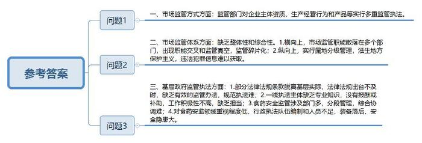
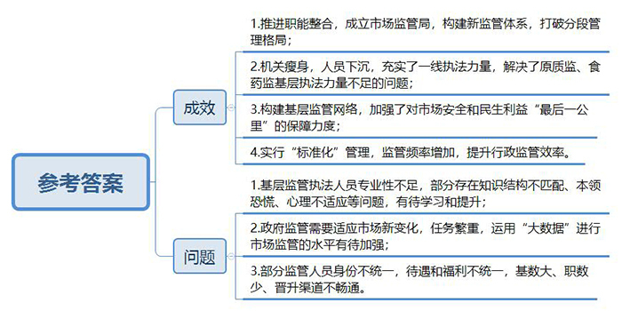
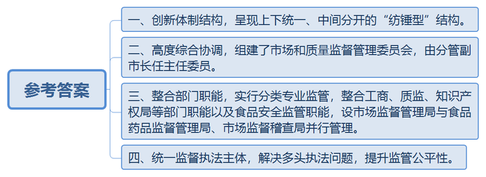
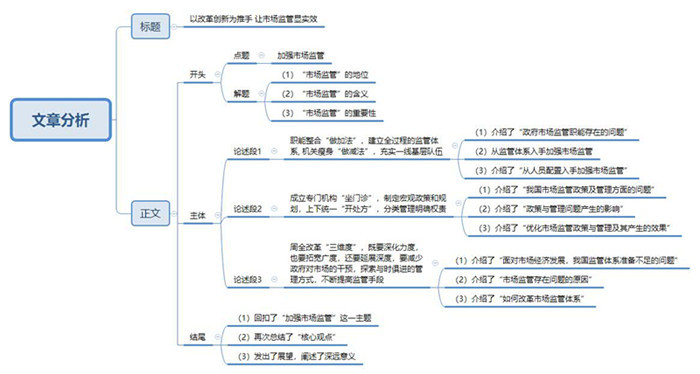

# 2016年上海市公考《申论》题（A卷）

<!-- gwy:overview:start -->
> **上海 · 2016 · 申论 · A类** ｜ 4 题 · 图片 4 处 · 答案随题折叠

导航：[题目](#题目) · [材料 1](#材料-1)
<!-- gwy:overview:end -->

> 候选采集稿。参考答案及解析来自粉笔页面，不代表官方答案或真实高分答卷；来源使用许可与原卷对应关系仍需人工核实。

## 给定材料

### 材料 1

市场监管是现代政府的基本职能之一。从概念上说，市场监管主要是指政府依据法律规定和行政法规的要求，对市场及其市场经营主体的行为进行整体性、全过程、多方位的监督和管理。其目的在于规范各种市场行为，维护市场秩序，创造良好的市场环境。市场监管根据监管对象的不同，分为经济性监管和社会性监管两大类：前者针对能源、金融等经济部门，后者包括安全、健康和环境等内容。在西方国家近30年改革中，政府一方面放松对微观经济运行的管制和干预，另一方面加强与民生相关的社会性监管。在我国行政体制架构中，能源局、证监会、银监会、保监会等部门承担经济性监管职能；工商、质监、食药监、知识产权、安监等部门主要负责社会性监管。

政府监管市场的模式在理论上可分为：分段监管，主要包括研制、生产、流通、消费等环节；分事项监管，主要包括许可审批、监督执法、行政处罚等工作；分品种监管，根据风险程度将产品区分为普通商品、重要工业产品、进口商品、食品药品、特种设备等，采取不同监管措施。各种模式各有利弊，其中分段监管容易产生段与段之间的缝隙，分事项监管对工作专业性要求较高，而分品种监管的难点是品种边界的划分。

### 材料 2

成熟的市场经济国家政府对于市场主体的监管，其重心从对主体和资质的监管转向对企业活动和行为（包括行为的结果，如产品和服务等）的监管，尤其是注重对终端产品质量安全进行监管，而涉及主体资格资质和行为的标准、认证等事务交给市场和社会组织。我国则不同，监管部门对企业主体资质、生产经营行为和产品本身三个方面都进行监管。如在2014年新版《医疗器械监督管理条例》颁布之前，医疗器械生产企业需要从工商部门获取营业执照，这是对主体资质的确认。同时，食药监管部门对委托生产行为进行实质性备案，属于对生产行为的限制。此外，企业生产的医疗器械需要通过质监部门的强制性安全认证，即对产品本身的监管。类似情况在市场监管领域广泛存在，多重监管执法会带来企业成本提升和行政资源浪费，还有可能导致监管执法不公平。

理想的市场监管体系应具有整体性、综合性。由于种种原因，我国政府市场监管职能长期散落在多个部门，部门之间难免出现职能交叉和监管真空，形成“九龙治水”的监管碎片化问题，在当前环境下，由于食药监等部门实行属地分级管理，地方保护主义又将监管体制缺陷放大，导致产生信息本地化问题。在不少地方，市场主体违法犯罪信息呈现“村里知道说不知道，乡里不知道装知道，县里想知道还真知不道”的层层衰减分布。横向与纵向的监管体制缺陷，使得我们面临日益严峻的食品药品安全、产品质量低劣和消费者权益受侵害等问题。

### 材料 3

近年来，地沟油、瘦肉精、天价宰客、电梯伤人等类似的事件一直未曾断绝过。据统计，2014年中国全国小康进程中“最受关注的十大焦点问题”，包括食品安全、腐败、物价、房价、医疗改革、贫富差距、环境保护、就业、社会保障、社会道德风气等，其中，食品安全关注度位居首位。

2014年3月28日，国家食品药品监管总局和公安部联合召开新闻发布会，公布了2013年查处的食品药品违法犯罪案件中案情复杂、涉案金额较高、社会影响恶劣、具有警示作用的“食品药品十大典型案例”。其中包括：河南民权“5·24”特大病死肉案，湖北武汉闵某某等生猪注射沙丁胺醇案，陕西西安李某等涉嫌生产、销售假牛肉案，山东枣庄盖某等涉嫌生产、销售不符合安全标准的食品案，辽宁本溪徐某等涉嫌生产、销售伪劣保健食品、药品案，江苏沛县蒋某等涉嫌生产、销售伪劣保健食品案，广西柳州“5·17”生产、销售假药案，广东深圳“7·29”系列生产、销售假药案，湖南隆回孙某等涉嫌生产、销售假药案，浙江丽水周某等涉嫌生产、销售假冒伪劣创可贴案。

国家食品药品监督管理总局稽查局领导介绍，2013年，食品药品监管部门与公安机关开展了食品药品系列专项整治行动，强力打击各类危害食品药品安全的突出违法犯罪。据统计，全年我国各地侦破食品药品安全犯罪案件4.3万余起，抓获犯罪嫌疑人6万余名。他还指出，在当前中国经济社会发展所处的特定阶段，食品药品安全违法犯罪出现了一些新情况、新动向，如长链条跨区域案件明显增多，利用互联网进行食品药品违法犯罪呈上升势头等，犯罪手法升级，活动愈加隐蔽。

### 材料 4

近年来，电梯事故频发，而今年尤为惊心动魄，2015年7月26日上午10时左右，湖北荆州市安良百货公司手扶电梯发生事故，一名女子因电梯与楼面连接的迎宾踏板松动，被卷入电梯内。女子在遇险的一刹那，双手奋力向前，将幼小的儿子托举送出，旁人救下孩子，而她自己则在短短8秒内被电梯吞没。荆州“电梯吃人”事件迅速传遍全国，引发社会强烈关注，然而就在4天之后，杭州某小区电梯突然下坠，女住户被夹身亡；9月7日，济南历城某中学食堂一名工作人员在搬运货物时，被突然运行的电梯夹住头部身亡；9月13日，新民市某商厦电梯发生塌陷事故，一女子侥幸逃生；10月9日，重庆轨道交通红旗河沟枢纽站内，一名4岁男孩不幸被卷入了扶梯右侧扶手带进口处不幸身亡……频频见诸媒体的电梯惊魂事件，一次次敲响了安全警钟。

根据有关资料，我国仅2014年上报的因电梯事故死亡的人数就达36人。据国家质检总局2015年3月份印发的文件显示，截至2014年底，全国电梯总量达到360万台，并保持以每年20%左右的速度增长。目前，我国电梯保有量、年产量、年增长量均为世界第一。由于目前部分电梯管理责任主体不明确、选型配置与使用条件不适应、维护保养不到位以及老旧电梯逐步增多等原因，电梯事故时有发生。截至2015年6月底，全国31个省份及新疆生产建设兵团电梯使用和维护保养单位自查电梯230余万台，发现存在隐患的电梯11余万台。照此计算，隐患电梯占比达到4.7%。

国家质检总局甚至用“全国电梯安全监管大会战”的字眼来定位2015年的工作要点，而各地也是在认真按照质检总局的要求制定“大会战”的实施方案。比如湖南湘潭市实施方案的工作目标是：通过全面排查和集中整治，掌握全市在用电梯安全状况，预防和减少电梯事故，降低电梯故障率，让群众安全乘梯、放心乘梯。着力推动“无物业管理、无维保单位、无维修资金”电梯（以下简称“三无”电梯）以及老旧电梯（使用年限已经达到15年及以上的电梯）更新改造等“老大难”问题的综合治理，推动建立电梯安全责任保险机制，努力构建“企业全面负责、政府统一领导、部门联合监管、检验技术把关、社会广泛参与”的电梯安全管理多元共治格局。该市还成立了电梯安全监管大会战领导小组，要求：全面开展电梯安全风险大排查，专项整治“三无”电梯，协调做好老旧电梯更新改造修理工作，加强电梯定期检验有效性，以及推动电梯安全责任保险和电梯应急救援体系建设工作等。大会战实施方案还制定了详细的工作步骤和时间节点，诸如宣传发动阶段、排查整治阶段、集中攻坚阶段、总结验收阶段，可见政府部门的决心之大、力度之强。

### 材料 5

上述这些事件给公众带来持续的危机感，暴露了食品产业链和特种设备安监等方面的问题，政府公信力亦面临考验。

近年来，中央一直在加强对食品安全工作的力度，先后制定了食品安全法及实施条例，设立了国务院食品安全委员会，开展了一系列专项治理和整顿。然而深层次的问题并未得到根本解决，每年各类食品安全事件仍层出不穷。以下几个案例折射出我国有些地方的基层政府在食品药品安全监管方面还存在一些问题。如某县食品药品监督管理局为进一步强化食品药品监管工作，从县人大代表、政协委员中聘请了13名社会监督员，8个镇各聘请了一名食品药品安全协管员，169个村都聘请了村级食品药品安全信息员，建立了“横向到边、纵向到底”的县、乡、村三级食品药品监管网络。但是，协管员、信息员缺乏食品药品安全监管基本知识；没有报酬或补助，工作积极性不高；监管对象多为本乡本村人，怕得罪人、遭报复。以上这些问题导致协管员、信息员不能真正发挥作用。另外，实际执法与现行法律法规存在脱节，如《医疗器械监督管理条例》规定的处罚起点在5000元，脱离农村和基层实际，难以规范执法。法律还规定对不符合要求的餐饮服务单位要予以取缔，但现实中许多小餐饮业主都是下岗、失业和农村务工人员。如果坚决取缔，又可能影响社会和谐稳定。再如，某县现有的食品安全监管执法人员基本都是原从事药品医疗器械监管的人员，从未接触过食品相关业务知识，虽然不断加大相关法律法规知识和业务知识的培训力度，但仍无法完全达到食品安全执法工作的要求。

食品安全的监管从农田到餐桌，涉及农业、水利、盐业、工信、质监、工商、食品药品监督等多个部门。以某县为例，目前是“铁路警察，各管一段”，段与段之间还存在着间隙。县政府虽然在县食品药品监督管理局挂牌设立了食品药品安全委员会，但未能落实相应的编制及人员，加之县食品药品监督管理局与质监、工商、农业等部门属同级政府工作部门，协调难度大，监督手段有限，限制了食品安全综合协调工作的纵深开展。同时，管理食品加工小作坊和食品摊贩的地方法规迟迟难以出台，缺乏具体有效的监管办法和标准，形成了一定的监管盲区，留下了食品安全隐患。

近年来，各级领导高度重视矿山、交通、消防、护林防火、建筑施工等安全问题，要机构就成立机构，要人给人，要钱给钱，几乎没有任何领导拒绝甚至迟缓，在一些乡镇甚至成了中心工作。而与我们每个人的身体健康和生命安全息息相关的食品药品安全，却未享受这样的礼遇。如某县食品药品监管对象有5000家左右，从业人员数万人，而食品药品监督管理人员编制仅35名。人均管理对象150家左右，人均工作量数倍甚至数十倍于其他行政执法队伍，监督管理任务非常艰巨，人少事多矛盾突出，再加上执法装备落后，行政执法取证设备缺乏等问题，潜在安全风险巨大。

### 材料 6

党的十八届三中全会通过的《中共中央关于全面深化改革若干重大问题的决定》明确提出：必须积极稳妥从广度和深度上推进市场化改革，大幅度减少政府对资源的直接配置。政府的职责和作用主要保持宏观经济稳定，加强和优化公共服务，保障公平竞争，加强市场监管，维护市场秩序，推动可持续发展，促进共同富裕，弥补市场失灵。要“改革市场监管体系，实行统一的市场监管”。目前，全国一些地方政府按照中央的精神，积极探索市场综合监管体制改革。

2014年1月1日，上海浦东新区正式挂牌成立新区市场监督管理局，作为上海食品药品监管体制改革的先行探索，这个由原浦东新区的工商、质监、食药监部门“三合一”整合的部门将会构建起一个覆盖生产、流通、消费全过程的监管体系，以打破原有分段管理、“九龙治水”的格局。同时依托原来体制、队伍比较完备的基层工商所组建市场监督管理所，职能整合“做加法”和机关瘦身“做减法”同步开展，将机关人员、职能下沉到基层，基层一线得以充实，力量得以加强，监管执法资源向基层倾斜，实现了“—个街镇、一个监管所”的监管覆盖目标。在浦东新区体制改革试点的基础上，上海进一步推进区县市场监督管理体制改革。目前16个区县工商分局、质量技术监督局、食品药品监管分局全部由垂直管理调整为区县政府分级管理，与区县物价局有关价格监督检查机构整合，组建区县市场监督管理局为区县政府工作部门。区县市场监督管理局加挂区县食品安全委员会、区县质量发展局牌子。

此次体制改革较好解决了原质监、食药监一线基层执法力量不足的问题，加大了对市场安全和民生利益“最后一公里”的保障力度。如2014年3月，依托改革后的36个基层监管所优势，在点位多、任务重的情况下，浦东新区仅用两个多小时就完成了对央视“3·15”晚会曝光“问题食品”的紧急检查任务。借助覆盖全区的基层监管网络，2014年对药品零售和医疗器械经营企业的现场检查数，和改革前相比分别增长了4.6倍和1.7倍，对特种设备使用单位监察户次同比增长47%，其中特种设备监察员现场检查数同比增长6.5倍。

在浦东G镇，某高压氧舱有限公司生产的“高压氧舱”既属于医疗器械，又属于特种设备。这种“跨界”产品原先要由食药监、质监两批不同的专业人员分头监管。现在只要浦东新区市场监管局的工作小分队出马，一次就能完成特种设备、医疗器械监管项目的监督抽查。

徐某、王某负责执法浦东新区的J广场，商标广告、电梯设备、食品安全等全是她们执法检查的范围。某川菜店内，两人穿过餐厅，直奔后厨。王某在前，从水果间到凉菜间，从库房到冷库，每一处直抓要害，对于食品添加剂和废弃油更是她检查的重中之重。徐某在后，各类证照单据一一对照。“食品安全是人们关注的焦点，J广场70家商家中有38家是餐饮店，来不得半点马虎。”

“现在检查是从前到后，从里到外，所有的细节都没放过。”半年时间，酒店负责人张经理已经习惯了这样的“彻查”。“以前工商、质检、食药监各来各的，现在来检查的人少了，力度反而更大了。”

某农贸市场集聚了大大小小的经营户，这里原本是“典型”的分散管理，新成立的市场监管所引入“标准化”新模式，全面提升了这里的食品安全监督力度。一线执法人员人手一本《农副产品市场监管检查操作流程》，这是征询了农贸市场、批发市场、街镇和市场监管所等各方意见后，编制完成的日常检查“掌中宝”。而从检查频率来看，市场上门检查从原来的每月一次改为每周一次，涵盖原分属三个局职能的农产品索证索票、生产许可证检查、食品安全检测等。

但市场综合监管体制改革后，在一些专业性较强的监管领域，如特种设备监管、食品安全检验检测、医疗器材监管等，监管主体和监管对象之间的知识、信息、专业不对称等问题依然制约着相应监管水平的提升。尤其是基层监管执法人员仍不同程度存在知识结构不匹配、本领恐慌、心理不适应等问题，而基层执法人员要真正的熟练掌握专业技能，尚需要一个较长的学习、锻炼过程。

面对风起云涌的新业态，政府监管任务日益繁重。如当下便利的网络订餐让不少人成了它的忠实拥趸。然而，互联网背后的餐饮商家也隐藏着卫生状况不过关等食品安全隐患。在浦东一家公司上班的白领小方最近遇到一件怪事，她一直用网络订餐来解决午饭问题，但有一次她点开一家饮品店的商家详细信息，竟然发现该商家上传的营业执照是一家汽车运输公司的。“老母鸡变鸭”暴露出的正是网络订餐的食品安全隐患。而新的《食品安全法》已于2015年10月1日正式实施，如何运用“大数据”监管模式，促使网络订餐市场、食品销售和餐饮服务等规范、有序、健康发展，对市场监管部门提出了更为严格的要求。

此外，目前一些基层市场监管人员身份不统一，待遇和福利不统一，“同工不同酬”现象较普遍。尤其是基层市场监管队员基数大、职数少、晋升渠道不畅。如上海某区市场监管局55岁还是科员的员工有十个，越到基层年龄越大，职级越低。而且体制改革后，基层监管任务增加、压力增大，要学习大量新的业务，承担更多的职责。

### 材料 7

深圳于2009年借大部制改革之机，率先在全国进行市场监管体制改革。大胆突破分段监管桎梏，改变监管领域的“碎片化”，将原工商、质监、知识产权三局整合，组建了市场监督管理局，不再保留市质监局、市工商局。把食品生产、食品流通、餐饮消费三个环节的食品安全监督管理职责一并划入市场监督管理局。2011年，深圳市进一步整合涉及食品安全监管的相关职能，将原由农业部门承担的食用农产品质量安全监管和原由卫生部门承担的食品安全管理综合协调等职能先后划入市市场监督管理局，并专门成立了市食品安全监督管理局（设在市场监督管理局内）。2014年5月，深圳市继续探索市场监管领域大部制改革的“升级版本”，组建市场和质量监督管理委员会，主要承担制定政策、规划、标准等职能，并监督执行部门，由分管副市长任主任委员。委员会下设三个机构：一是深圳市市场监督管理局（挂市质量管理局、市知识产权局牌子），二是深圳市食品药品监督管理局，三是深圳市市场监督稽查局。上述机构分别承担市场监管领域的行政管理和监督执法职能，市场监督管理局和食品药品监督管理局局长分别担任市场监管委员会副主任委员。在区一级分别设置市场监督管理分局和食品药品监督管理分局作为市局直属机构，在街道设市场监督管理所作为两个区分局的派出机构。深圳模式呈现上下统一、中间分开的“纺锤型”结构。

深圳模式经过重大调整，目前看有三大优点。一是采取分类监管模式。充分考虑并区分对待普通产品质量与食品药品安全，将食品安全监管职能调整为由食品药品监管局承担，实现专业化监管。二是统一监督执法队伍。由于行政强制、处罚等行为与市场主体利益直接相关，解决多头执法问题有利于减轻市场主体负担，提升监管公平性。三是宏观政策设计与微观监管有机结合。

深圳模式在确保监管政策一致性上面临挑战。各类市场监管部门的“前世今生”截然不同，工商部门从管理城乡农贸市场起家，监管对象是交易行为和市场秩序，管理方式较为粗放；质监部门更多关注产品内在质量如重量、成色和品质，因此技术支撑能力较强；餐饮监管主体的前身是卫生监督机构，其注重产品和公共场所的清洁无菌以及对人体健康无害。这种差异会带来行政许可、行政执法和行政处罚的标准不同和风格冲突。全国工商系统实有工作人员42万人，2012年全国食药监系统到岗93572人，全国质检系统约20万人。随着企业登记制度改革不断推进，工商部门所拥有的实际职能不断减少，这支庞大的公务员队伍的未来出路已经上升为政治问题。同时，工商部门作为老牌市场监管部门嵌入市场网络较深，在政府体系中拥有更大话语权，有能力主导市场监管体制改革。用基层监管工作人员的话来说是工商“吞并”质监和食药监。其直接影响是工商部门惯用的排查、索证索票等管理方式被广泛用于基层市场监管。

将不同部门糅合在一起，需要统一的行政流程再造，否则会产生内部行政文化冲突。例如，标准化、知识产权促进和保护、消费者权益保护工作原分属质监、知识产权和工商部门，机构改革后标准化与知识产权促进的关系密切，知识产权保护又与消费者权益保护密切相关，这就需要按业务内在联系的逻辑而非部门间联系的逻辑来确定工作流程。又如，由于上位法律法规没有相应调整，机构改革后监管人员在监督执法时要带好几套法律文书，相对人也不得不面对不同执法标准和行政风格。

## 题目

### 第 1 题

**结合给定资料，概括一些地方政府市场监管过程中的问题。（20分）**

关联材料：材料 1、材料 2、材料 3、材料 4、材料 5、材料 6、材料 7

作答要求：概括准确，条理清楚，语言精练，字数不超过300字。

第 1 题 · 答案与解析

**参考答案（粉笔题库参考内容）**

一、市场监管方式方面：监管部门对企业主体资质、生产经营行为和产品等实行多重监管执法。

二、市场监管体系方面：缺乏整体性和综合性。1.横向上，市场监管职能散落在多个部门，出现职能交叉和监管真空，监管碎片化；2.纵向上，实行属地分级管理，滋生地方保护主义，违法犯罪信息难以获取。

三、基层政府监管执法方面：1.部分法律法规条款脱离基层实际，法律法规出台不及时，缺乏有效的监管办法，规范执法难；2.一线执法主体缺乏专业知识，没有报酬或补助，工作积极性不高，缺乏担当；3.食药安全监管涉及部门多，分段管理，综合协调难；4.对食药安监领域重视程度低，行政执法队伍编制和人员不足，装备落后，安全隐患大。

**解析**

**参考答案说明：**参考答案从市场监管方式、市场监管体系、基层政府监管执法这三个不同的维度进行了分条撰写。各条要点之间是并列关系，没有交叉。并且撰写每条要点时，都提炼出了概括性强的总括词并前置，满足了题目中规定的“概括准确”这一要求。

**考点**：问题类

**来源**：2016年上海市公考《申论》题（A卷）

### 第 2 题

**结合给定资料，概括浦东新区等区县市场监管改革的成效与问题。（20分）**

关联材料：材料 1、材料 2、材料 3、材料 4、材料 5、材料 6、材料 7

作答要求：概括准确，条理清楚，语言精练，字数不超过300字。

第 2 题 · 答案与解析

**参考答案（粉笔题库参考内容）**

一、成效：1.推进职能整合，成立市场监管局，构建新监管体系，打破分段管理格局；2.机关瘦身，人员下沉，充实了一线执法力量，解决了原质监、食药监基层执法力量不足的问题；3.构建基层监管网络，加强了对市场安全和民生利益“最后一公里”的保障力度；4.实行“标准化”管理，监管频率增加，提升行政监管效率。

二、问题：1.基层监管执法人员专业性不足，部分存在知识结构不匹配、本领恐慌、心理不适应等问题，有待学习和提升；2.政府监管需要适应市场新变化，任务繁重，运用“大数据”进行市场监管的水平有待加强；3.部分监管人员身份不统一，待遇和福利不统一，基数大、职数少、晋升渠道不畅通。

**解析**

**参考答案说明**：本参考答案按“成效”和“问题”这两个要素进行了分段撰写，其中“成效”又从“职能整合”“机关瘦身”“基层监管网络”“实行‘标准化’管理，监管效率提高”四个方面进行了分条撰写；“问题”又从“监管人员的专业性”“市场新变化”“基层监管人员的待遇”三个方面进行了分条撰写。各条要点之间在内容上是并列关系，没有交叉。

**考点**：多要素组合类

**来源**：2016年上海市公考《申论》题（A卷）

### 第 3 题

**结合给定资料，概括深圳模式的主要特点。（20分）**

关联材料：材料 1、材料 2、材料 3、材料 4、材料 5、材料 6、材料 7

作答要求：概括准确，条理清楚，语言精练，字数不超过200字。

第 3 题 · 答案与解析

**参考答案（粉笔题库参考内容）**

一、创新体制结构，呈现上下统一、中间分开的“纺锤型”结构；二、高度综合协调，组建了市场和质量监督管理委员会，由分管副市长任主任委员；三、整合部门职能，实行分类专业监管，整合工商、质监、知识产权局等部门职能以及食品安全监管职能，设市场监督管理局与食品药品监督管理局、市场监督稽查局并行管理；四、统一监督执法主体，解决多头执法问题，提升监管公平性。

**解析**

**参考答案说明：**答案从“创新体制结构”“高度综合协调”“整合部门职能”“统一监督执法主体”这四个方面进行了分条撰写。各条要点之间在内容上是并列关系，没有交叉。

**考点**：特点类

**来源**：2016年上海市公考《申论》题（A卷）

### 第 4 题

**阅读给定资料，以“加强市场监管”为主题写一篇文章。（40分）**

关联材料：材料 1、材料 2、材料 3、材料 4、材料 5、材料 6、材料 7

作答要求：

（1）自选角度，自拟题目；

（2）观点明确，联系实际，分析具体，条理清楚，语言流畅；

（3）总字数800~1000字。

第 4 题 · 答案与解析

**参考答案（粉笔题库参考内容）**

**加快市场监管体系的改革与创新**

**市场监管是现代政府的基本职能之一，是指政府依据法律规定和行政法规的要求，对市场及其市场经营主体的行为进行监督和管理。成熟的市场经济国家注重对终端产品质量安全进行监管，我国则不同，监管部门对企业主体资质、生产经营行为和产品本身三个方面都进行监管，多重监管执法会带来企业成本提升和行政资源浪费，还有可能导致监管执法不公平等问题。**

为保障市场经济的健康发展，加强市场监管已势在必行。而加强市场监管的关键，又在于加快市场监管体系的改革与创新。

**职能整合“做加法”，建立全过程的监管体系，机关瘦身“做减法”，充实一线基层队伍。**我国政府市场监管职能长期散落在多个部门，部门之间难免出现职能交叉和监管真空，形成“九龙治水”的监管碎片化问题。所以加强市场监管，首先得在监管体系上下功夫。要整合职能部门，事前做好规范，事中做好监督，事后做好惩戒；要建立全过程的监管体系，避免出现监管真空，规范市场活动中的“灰色地带”。其次，人员配置也是关键。我们应该依托原来体制、队伍，将机关人员、职能下沉到基层，监管执法资源向基层倾斜，充实一线基层队伍。

**成立专门机构“坐门诊”，制定宏观政策和规划，上下统一开“复方药”，分类管理明确权责。**目前我国在政策制定和规划方面相对滞后。实行属地分级管理，地方保护主义又将监管体制缺陷放大，导致产生信息本地化问题。而群众比较关心的食品安全问题、电梯吃人等问题的发生给公众带来持续的危机感，政府公信力亦面临考验。各地政府监管之策动辄进行大规模的专项整治活动、大会战、大检查，可往往收效甚微。市场监管体系改革切忌雷声大雨点小，只有通过专门部门的调查研究，把准市场的脉搏才能开出切中病灶的药方。好的政策和规划还要依赖各级职能机构的落实，明确责任人和负责人，才能产生自上而下的联动效应，避免上有政策下有对策的现象发生。

**进一步深化改革，拓展改革深度广度，减少政府对市场的干预，探索与时俱进的管理方式，不断提高监管手段。**市场经济飞速发展，市场监管体系总显得“准备不足”。这可能既有监管不到位的原因，也可能是由于调控的“失度”，进而造成市场调节的“失灵”。为此李克强总理曾多次强调要不断创新和完善改革的方向。这就说明面对复杂多变的市场环境，即使进行了改革，问题还是会不断涌现，因此改革只有进行时，没有完成时，我们只有不断探索市场监管的新方式，提高监管的技术手段，才能保障市场经济的稳定发展，保障我国国力的稳步提升。

改革从来都不是一朝一夕的事情，**只有我们建立起全过程的监管体系，加强基层队伍建设，制定宏观政策，并且统一实行，不断与时俱进创新管理方式**，才能实现市场经济的稳步发展，才能还百姓一个安居乐业的状态，才能实现中国经济社会的稳步前进！

**以改革创新为推手** **让市场监管显实效**

市场监管是现代政府的基本职能之一，是指政府依据法律规定和行政法规的要求，对市场及其市场经营主体的行为进行监督和管理。市场监管能够规范各种市场行为，维护市场秩序，创造良好的市场环境。可见，推动社会主义特色市场经济的快速发展，以市场监管为护盾是必然的选择。

在市场经济发达的国家，市场监管主要落实在终端产品质量安全上。然而，我国有所不同，监管部门的职责范围涉及企业主体资质、生产经营行为以及产品质量三个方面，多重监管执法会带来企业成本提升和行政资源浪费，还有可能导致监管执法不公平等问题。为保障市场经济的健康发展，加快市场监管体系的改革与创新势在必行。

**首先，职能整合“做加法”，建立全过程的监管体系，机关瘦身“做减法”，充实一线基层队伍。**我国政府市场监管职能长期散落在多个部门，部门之间难免出现职能交叉和监管真空，形成“九龙治水”的监管碎片化问题。所以加强市场监管，首先得在监管体系上下功夫。要整合职能部门，事前做好规范，事中做好监督，事后做好惩戒；要建立全过程的监管体系，避免出现监管真空，规范市场活动中的“灰色地带”。其次，人员配置也是关键。我们应该依托原来体制、队伍，将机关人员、职能下沉到基层，监管执法资源向基层倾斜，充实一线基层队伍。

**其次，成立专门机构“坐门诊”，制定宏观政策和规划，上下统一“开处方”，分类管理明确权责。**常言道：无规矩，无以成方圆。目前我国在政策制定和规划方面相对滞后。实行属地分级管理，地方保护主义又将监管体制缺陷放大，导致产生信息本地化问题。而群众比较关心的食品安全问题、电梯吃人等问题的发生给公众带来持续的危机感，政府公信力亦面临考验。各地政府监管之策动辄进行大规模的专项整治活动、大会战、大检查，可往往收效甚微。市场监管体系改革切忌雷声大雨点小，只有通过专门部门的调查研究，把准市场的脉搏才能开出切中病灶的药方。好的政策和规划还要依赖各级职能机构的落实，明确责任人和负责人，才能产生自上而下的联动效应，避免上有政策下有对策的现象发生。

**最后，周全改革“三维度”，既要深化力度，也要拓宽广度，还要延展深度，要减少政府对市场的干预，探索与时俱进的管理方式，不断提高监管手段。**市场经济飞速发展，市场监管体系总显得“准备不足”。这既可能是监管不到位的原因，也可能是由于调控的“失度”，进而造成市场调节的“失灵”。为此李克强总理曾多次强调要不断创新和完善改革的方向。这就说明面对复杂多变的市场环境，即使进行了改革，问题还是会不断涌现，因此改革只有进行时，没有完成时，我们只有不断探索市场监管的新方式，提高监管的技术手段，才能保障市场经济的稳定发展，保障我国国力的稳步提升。

“千里之行，始于足下”。加强市场监管并非一朝一夕之事，只有做好科学合理的职能分工，打造严实无缝的监管系统，全面深化体制机制改革，才能让市场监管发挥实效、显现成效，也唯有如此才能实现市场经济的稳步发展，让中国经济社会稳中有进！

**解析**

**文章分析**

**以改革创新为推手** **让市场监管显实效**

【**标题的优点：**首先，范文的标题“以大改革创新为推手 让市场监管显实效”突出了“市场监管”这一主题词。其次，形式上，对仗工整，简洁明快。】

市场监管（1）是现代政府的基本职能之一，是指政府依据法律规定和行政法规的要求，对市场及其市场经营主体的行为进行监督和管理。市场监管能够（2）规范各种市场行为，维护市场秩序，创造良好的市场环境。可见，（3）推动社会主义特色市场经济的快速发展，以市场监管为护盾是必然的选择。

【**开头的优点：**★内容方面。范文的开头是紧扣题目给定的“加强市场监管”这一主题展开的。首先，开头第一句话点出主题，做到了主题明确。其次，对“加强市场监管”这一主题进行了分析阐述，指出了（1）“市场监管”的地位；（2）“市场监管”的含义；（3）“市场监管”的重要性。注意以上几个方面的阐述在逻辑上有先后顺序：先写“市场监管”的地位、含义，再写“市场监管”的重要性。★文字表达方面：段尾句使用了总结词“可见”突显了段落整体的逻辑性，并且“以**……为护盾**”这一比喻修辞方法的使用，使文字表达更加形象、有力。】

在市场经济发达的国家，市场监管主要落实在终端产品质量安全上。然而，我国有所不同，监管部门的职责范围涉及企业主体资质、生产经营行为以及产品质量三个方面，多重监管执法会带来企业成本提升和行政资源浪费，还有可能导致监管执法不公平等问题。为保障市场经济的健康发展，加快市场监管体系的改革与创新势在必行。

【**过渡段的优点：**范文过渡段分析了“市场监管”的问题、危害等方面的内容，此外，还要注意过渡段末尾的“为保障市场经济的健康发展，加快市场监管体系的改革与创新势在必行”是用来引起下文的过渡句。】

**首先，职能整合“做加法”，建立全过程的监管体系，机关瘦身“做减法”，充实一线基层队伍。**我国政府市场监管（1）职能长期散落在多个部门，部门之间难免出现职能交叉和监管真空，形成“九龙治水”的监管碎片化问题。所以加强市场监管，首先（2）得在监管体系上下功夫。要整合职能部门，事前做好规范，事中做好监督，事后做好惩戒；要建立全过程的监管体系，避免出现监管真空，规范市场活动中的“灰色地带”。其次，（3）人员配置也是关键。我们应该依托原来体制、队伍，将机关人员、职能下沉到基层，监管执法资源向基层倾斜，充实一线基层队伍。

【**论述段1的优点：**★观点句：范文的观点句是紧扣“加强市场监管”这一文章主题提出的。形式上，它在段首处直接写出，位置突出，容易发现。内容上，关键词突出，内容要点明确，可以明显看出它是从“机关职能整合”入手，指出了“加强市场监管的对策”。★论述内容：（1）介绍了“政府市场监管职能存在的问题”；（2）介绍了“从监管体系入手加强市场监管”；（3）介绍了“从人员配置入手加强市场监管”。注意：以上几个方面的内容都是紧扣“职能整合‘做加法’，建立全过程的监管体系，机关瘦身‘做减法’，充实一线基层队伍”这个观点句进行分析论述的，论述的针对性强，内容层次丰富。并且这几个方面的论述是有内在逻辑顺序的，先讲问题，然后讲对策。最后，在论述方法和论据的选取上做到了讲道理、打比方相结合，做到了丰富多样。】

**其次，成立专门机构“坐门诊”，制定宏观政策和规划，上下统一“开处方”，分类管理明确权责。**常言道：无规矩，无以成方圆。目前（1）我国在政策制定和规划方面相对滞后。实行属地分级管理，地方保护主义又将监管体制缺陷放大，导致产生信息本地化问题。而群众比较关心的食品安全问题、电梯吃人等问题的发生给公众带来持续的危机感，（2）政府公信力亦面临考验。各地政府监管之策动辄进行大规模的专项整治活动、大会战、大检查，可往往收效甚微。市场监管体系改革切忌雷声大雨点小，（3）只有通过专门部门的调查研究，把准市场的脉搏才能开出切中病灶的药方。好的政策和规划还要依赖各级职能机构的落实，明确责任人和负责人，才能产生自上而下的联动效应，避免上有政策下有对策的现象发生。

【**论述段2的优点：**★观点句：范文的观点句是紧扣“加强市场监管”这一文章主题提出的。形式上，它在段首处直接写出，位置突出，容易发现。内容上，关键词突出，内容要点明确，可以明显看出它是从“政策制定，分类管理”入手，指出了“加强市场监管的对策”。★论述内容：（1）介绍了“我国市场监管政策及管理方面的问题”；（2）介绍了“政策与管理问题产生的影响”；（3）介绍了“优化市场监管政策与管理及其产生的效果”。注意：以上几个方面的内容都是紧扣“成立专门机构‘坐门诊’，制定宏观政策和规划，上下统一‘开处方’，分类管理明确权责”这个观点句进行分析论述的，论述的针对性强，内容层次丰富。并且这几个方面的论述是有内在逻辑顺序的，先讲问题，然后讲影响，再讲对策。最后，在论述方法和论据的选取上做到了讲道理、举例子、打比方相结合，做到了丰富多样。】

**最后，周全改革“三维度”，既要深化力度，也要拓宽广度，还要延展深度，要减少政府对市场的干预，探索与时俱进的管理方式，不断提高监管手段。**（1）市场经济飞速发展，市场监管体系总显得“准备不足”。这既可能是（2）监管不到位的原因，也可能是由于调控的“失度”，进而造成市场调节的“失灵”。为此李克强总理曾多次强调要不断创新和完善改革的方向。这就说明面对复杂多变的市场环境，即使进行了改革，问题还是会不断涌现，因此（3）改革只有进行时，没有完成时，我们只有不断探索市场监管的新方式，提高监管的技术手段，才能保障市场经济的稳定发展，保障我国国力的稳步提升。

【**论述段3的优点：**★观点句：范文的观点句是紧扣“加强市场监管”这一文章主题提出的。形式上，它在段首处直接写出，位置突出，容易发现。内容上，关键词突出，内容要点明确，可以明显看出它是从“改革‘三维度’”入手，指出了“加强市场监管的对策”。★论述内容：（1）介绍了“面对市场经济发展，我国监管体系准备不足的问题”；（2）介绍了“市场监管存在问题的原因”；（3）介绍了“如何改革市场监管体系”。注意：以上几个方面的内容都是紧扣“周全改革‘三维度’，既要深化力度，也要拓宽广度，还要延展深度，要减少政府对市场的干预，探索与时俱进的管理方式，不断提高监管手段”这个观点句进行分析论述的，论述的针对性强，内容层次丰富。并且这几个方面的论述是有内在逻辑顺序的，先讲问题，然后讲原因，再讲对策。最后，在论述方法和论据的选取上做到了讲道理、举例子、打比方相结合，做到了丰富多样。】

“千里之行，始于足下”。（1）加强市场监管并非一朝一夕之事，只有（2）做好科学合理的职能分工，打造严实无缝的监管系统，全面深化体制机制改革，才能让市场监管发挥实效、显现成效，也唯有如此（3）才能实现市场经济的稳步发展，让中国经济社会稳中有进！

【**结尾的优点：**范文的结尾（1）回扣了“加强市场监管”这一主题。（2）再次总结了“核心观点”；（3）发出了展望，阐述了深远意义。】

**考点**：文章写作题

**来源**：2016年上海市公考《申论》题（A卷）

