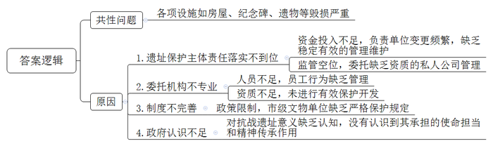
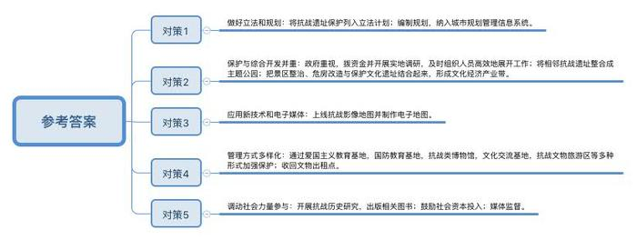
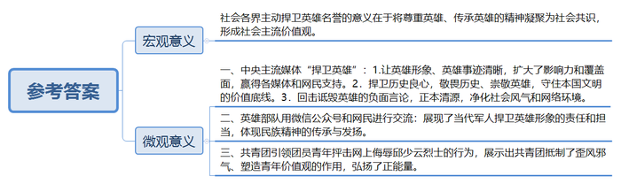
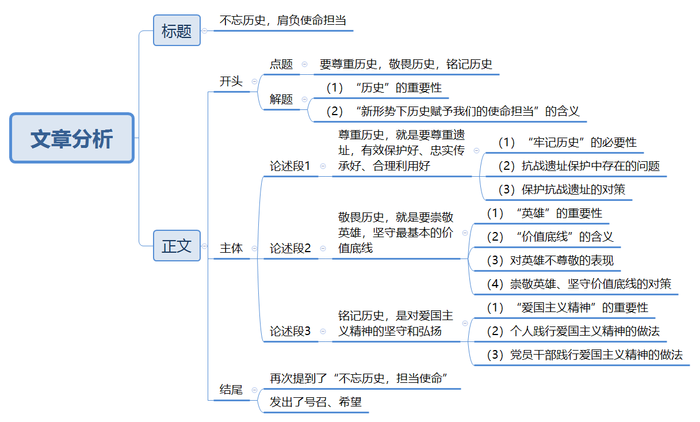

# 2016年上海市公考《申论》题（B卷）

<!-- gwy:overview:start -->
> **上海 · 2016 · 申论 · B类** ｜ 4 题 · 图片 4 处 · 答案随题折叠

导航：[题目](#题目) · [材料 1](#材料-1)
<!-- gwy:overview:end -->

> 候选采集稿。参考答案及解析来自粉笔页面，不代表官方答案或真实高分答卷；来源使用许可与原卷对应关系仍需人工核实。

## 给定材料

### 材料 1

铭记历史，离不开唤起记忆的遗址。烽火连天的抗战岁月，留下了许多抗战遗址，也留下了侵华日军罄竹难书的罪证。令人遗憾的是，随着时间的流逝，不少抗战遗址如今正逐渐淹没在平常生活之中。喜峰口、山海关、潘家口等战役都是在长城上进行的，但目前现场却没有任何标识。长城上每天游人如织，谁又知道这里曾经发生过什么？不少烈士陵园由于年久失修而变得荒废败落，杂草丛生，谁会记得这里埋葬的都是为国捐躯的先烈？像湖南衡阳五马归槽遗址已成为一处坟山，车公山抗日战壕遗址现为村民菜地。

2014年9月，有人网络曝光了L省F市“万人坑”遗址纪念馆破坏严重，出现纪念碑损坏、馆内照明损毁、遗骨散失等问题。“万人坑”纪念馆位于F市太平区孙家湾街道，占地面积56万平方米，主要包括：死难矿工遗骨馆、抗暴青工遗骨馆、死难矿工单人典型馆及相关遗存纪念广场、纪念碑等附属设施，建成后接待了全国各地参观者达380余万人。1998年，L省国防教育领导小组确立“万人坑”纪念馆为省国防教育基地；2006年，F市“万人坑”经国务院核准，公布为第六批全国重点文物保护单位；2009年，中宣部公布为全国爱国主义教育示范基地；2014年，国务院将其列入第一批国家级抗战纪念设施、遗址名录。

“万人坑”纪念馆始建于1968年，由当时的F市矿务局发掘并管理。矿务局经济条件不好，纪念馆长期仅维持着留人看守的水平。2007年，矿业集团（矿务局改制后成立）因经营困难、自身发展举步维艰，纪念馆因而被移交市文广局管理。纪念馆成立四十多年来，仅作了一些小修小补。由于年久失修，缺乏管理，纪念馆各项设施、遗物毁损严重。

2014年9月30日，《人民日报》刊发了《各地抗战遗址屡遭破坏》的评论文章，对L省F市等地抗战遗址遭受破坏的现象进行了评论，强调“不忘昨日，才能更好肩负今日的使命担当，遗址不是普通的景观，有效保护好、忠实传承好、合理利用好，可以让历史历历在目，让精神代代相传。”文章刊发后，F市市委、市政府实地调研发现遗址保护确实存在诸多问题，组织工作人员连续加班，展开了遗址东、西两馆修复工作。L省省委、省政府和国家文物局也迅速落实对纪念馆的维修改善工作。纪念馆闭馆10个月，完成了抢修保护。

### 材料 2

抗战期间，苏联志愿航空队、中国空军、美国志愿援华航空队（也称“飞虎队”）先后进驻Z市机场，频频驾机与日军战机展开血战，为抗击侵略者做出了巨大贡献。战后，留下了跑道、指挥塔、防空碉堡、营房群等历史遗址，其中，Z市旧机场及防空工事群遗址旧营房A区，位于Z市的市航五路。2015年8月，抗战胜利70周年前夕，新闻媒体实地探访“飞虎队”遗址，发现遗址被委托给私人公司管理，遗址内部分区域几乎被荒草淹没，一些建筑受损破败不堪。旧营房A区大门紧闭，墙上用红漆歪歪扭扭写着“飞虎队保护营区”。围墙内有几栋红砖建筑，一条石子路两旁长满荒草，若不是一旁有“全国重点文物保护单位”石碑，很难想象这是“飞虎队”遗址。进入遗址内部，只见几栋破败的瓦房，边上长满灌木，间杂着还种了玉米、红薯等，营房内墙壁斑驳，门窗和天花板大多脱落；Z市另一处旧机场及防空工事群遗址B区则归市动物园管理——几栋红砖建筑外墙上，“××老家菜馆”和“××酒店客房部”的招牌格外刺眼，据说是承包给了私人。

2008年旧营房A区的遗址升级成为国家文物保护单位，被委托给Z市画家村文化发展有限公司（以下简称“画家村公司”）管理，工商登记显示，此公司2008年2月成立，经营范围是“文化艺术交流、会务会展服务等”，成立后不久，与文物部门签订了委托开发协议。目前该公司只有6个人，2人看守遗址。该公司介绍，已投入近700万元用于保护。对遗址杂草丛生、建筑破败的状况，公司主要负责人承认工作不到位，农作物为看守人员所种。因政策限制，公司的开发规划一直未获得通过，故一直未进行实质性开发。

市文广局负责人称，在2013年之前，“飞虎队”遗址只是市级文物保护单位，当时并没有如此严格的保护规定。文化部门考虑过对“飞虎队”抗战遗址进行保护和开发，拟建设抗战文化园。目前，国家文物局已经立项，编制相关保护规划，并向上级申报划定保护区范围，但由于与画家村公司有协议，实质保护工作难以开展。2015年8月3日，Z市发布通报称，市政府决定一个月内将旧机场及防空工事群遗址出租的文物点收回，并预拨资金1000万元用于文物抢修及环境整治。

### 材料 3

新中国成立以来，重大的抗战遗址，有的被列为国家级、省级、市级文物保护单位，有的建成了爱国主义教育基地、国防教育基地，得到及时到位的保护。2014年经党中央、国务院批准，中国人民抗日战争纪念馆等80处纪念场馆被公布为第一批国家级抗战纪念设施、遗址名录，将抗战遗址保护提到了前所未有的高度。

斜阳洒在苏州河北岸，西藏路桥厚实的桥墩立于河水之中，安详宁静。78年前这座貌不惊人的大桥曾是租界的分界线，那场震惊世界的激战就在大桥北岸的四行仓库发生。四行仓库于1933年开业，因旧上海金城、中南、大陆、盐业四间银行共同出资建设而得名。1984年9月3日，上海市文物保管委员会正式将其命名为“八百壮士四行仓库抗日纪念地”。近期，这处著名抗战遗址经改造后正式开放，一尊“八百战士”抗战纪念雕塑矗立在纪念馆广场，讲述那壮怀激烈的历史。

“四行仓库保卫战”是“八·一三”淞沪会战中的著名战役。1937年10月26日，谢晋元奉命率“八百壮士”（实际人数为400余人）在四行仓库坚守孤楼，掩护部队后撤，孤军浴血奋战了四昼夜，击退日军数十次进攻，毙敌200余人，在中国抗战史上写下壮烈光辉的一页。四行仓库孤军抗敌的事迹广为传颂，上海音像资料馆馆藏历史影像存有当年“八百壮士”与日军在四行仓库英勇作战的场景。

“四行仓库保卫战”是一场向全世界直播的战争。数百中外新闻工作者在离四行仓库几十米外的苏州河对岸和南京路的高楼上目睹了“八百壮士”抵御日军的全过程，为他们深陷重围、前仆后继、奋勇杀敌的精神所感染。《大美晚报》评论，“吾人目睹闸北华军之英勇抗战精神，于吾人脑海中永留深刻印象，华军作战之奋勇空前未有，足永垂青史。”英国《新闻纪事报》评论，“华军在沪抵抗日军之成绩实为任何国家史记中最勇武的诸页之一。”更可贵的是，华裔摄影师王小亭冒着被流弹击中的危险，用电影摄影机拍摄下当时“八百壮士”反击日军进攻的全过程，这成为中国抗战史上的一段经典影像。

为纪念中国人民抗日战争暨世界反法西斯战争胜利70周年，2015年5月27日，上海抗战影像地图正式上线。此次除了有传统地图外，人文与传播学院、都市文化研究中心还联合腾讯网共同制作了电子地图。每个电子标注的图标，都可以放大。假如你行走在淮海路上，突然想看看周边有哪些抗战遗迹，只要打开电子地图，就能边走边寻访。上海抗战影像地图以地理信息数据库为支撑，以直观的时空分布图为表现形式，再现了1931年“九·一八”事变到1945年间两次淞沪战役及与八年抗战相关的历史要素，最终将呈现上海抗战历史的五张不同历史要素图。最先上线的是《抗日救亡分布图》，《淞沪抗战分布图》等其余4张地图将陆续上线，图中所标注的每个抗战历史要素的名称、时间属性和空间坐标均经过历史学方法严格考证。

### 材料 4

位于重庆市渝中区的李子坝抗战遗址公园，绿树成荫、环境宜人，不少市民在此休闲观光。背靠鹅岭、面朝嘉陵江的狭窄漫坡上，分布着高公馆、李根固旧居、刘湘公馆、国民参议院旧址、交通银行学校旧址等5组抗战历史文物建筑，集中展示了抗战时期政治、经济、文化、军事、外交、金融等各方面的历史风貌。李子坝抗战遗址公园占地12万平方米，前后连接曾家岩、红岩村，处于重庆抗战文化遗址长廊，是重庆首个抗战遗址公园，也是国内首个以主题公园形式展示历史文化保护成果的公园。

据公园建设方负责人介绍，公园修建前，辖区内房屋旧址不少被用作居民生活用房和工厂厂房，原有房屋60%以上属于C级、D级危房，74%的家庭处于最低居住保障水平以下，85%的家庭属低收入家庭。按照“保护为主，抢救第一，合理利用，加强管理”的工作方针，重庆将李子坝抗战遗址公园的建设与拆危建绿环境整治结合起来，总投入4.6亿元进行拆迁建设，使项目内650余户、2000多居民告别了危旧房，住进了新家园。在旧址修复的基础上，公园栽种了香樟、黄桷树等树种，绿化率超60%。公园将沿江堤岸整治、危旧房改造与保护文化遗址结合起来，打造成文化体验、旅游观光、文博展览的文化经济产业带。李子坝抗战遗址公园的建成是综合利用与保护开发抗战遗址的范例。

抗日战争时期，重庆是中国抗战大后方的政治、军事、经济、文化中心。据全国第三次文物普查，重庆现存抗战遗址395个，涵盖重要史迹、外事、军事建筑、名人故居等11个类别。此外还有92001件（套）可移动抗战文物。“重庆抗战遗址数量多，具有多样性和唯一性，有重要的历史价值，广泛分布在重庆22个区县，保护开发存在一定难度。”重庆市文物局领导说。

目前重庆有129处抗战遗址对外开放，其中全国重点文物保护单位22处，专题展览32个。已建成重庆抗战遗址博物馆等15家抗战类博物馆，宋庆龄旧居等10个抗战遗址文化交流基地，以及上清寺—红岩村片区等4个抗战文物旅游区，年均接待人数约650万人次。在充分调动社会力量参与抗战遗址保护利用方面，重庆还开展“抗战大后方历史研究”，出版《中国抗战大后方历史文化丛书》，武夷滨江公司、康翔实业公司、成都铁路局等共投入2300余万元，参与保护抗战遗址18个。此外，在摸清资源情况、明确保护对象的基础上，2014年，重庆市文物部门联合规划部门编制《重庆市主城区抗战遗址定点定位规划》，将主城区314个抗战遗址的位置、保护范围、保护要求纳入城市规划管理信息系统，使抗战遗址保护工作更加科学规范。2015年，市政府又将《重庆市抗日战争遗址保护利用管理办法》列入立法计划，进一步加强抗战遗址管理。

### 材料 5

近年来，国家对英雄的保障政策法规不断完善，烈属抚恤标准不断提高，尊重英雄，传承英雄的精神已凝聚为社会共识，形成社会主流价值观。但也有极少数思想异化的人，打着“还原历史”“寻找真相”等幌子，采取抹黑和丑化英雄的方式，混淆是非曲直，冲击主流价值观。

近期，网上出现一些别有用心的人恶意制造、散布谣言，抹黑邱少云、黄继光、董存瑞、雷锋等先烈的英雄事迹，一时间质疑甚至恶搞英雄人物的声音甚嚣尘上，歪曲国史、党史、军史，在社会上特别对年轻一代产生极大负面影响。更有甚者，冒着“追求真相”之名，公开质疑上甘岭特级战斗英雄黄继光的英雄事迹，认为用“粗浅的物理分析”可以推测堵枪眼的事不可能发生，可能是记者的杜撰。还有人用恶搞的方式编顺口溜诋毁黄继光，这些低俗段子成为浅薄的人网上调侃的内容。类似的事例还有，为战场埋伏而被活活烧死的邱少云事迹被质疑违反生理学常识，狼牙山五壮士被污蔑行窃乡里，助人为乐的雷锋被抹黑成动机不纯，无私奉献的焦裕禄也被肆意丑化……

敬畏历史、崇敬英雄，是每个国家对待本国文明最基本的价值底线。网络时代，如何更好地捍卫英雄？人民日报客户端围绕“捍卫英雄”宣传主题，通过原创、转载、推送等途径，累计发稿33篇，其中，人民日报新媒体版《抹黑英雄成网络公害》被多家媒体转载，取得良好传播效果；原创栏目《小调查·恶搞引争议，你怎么看？》好评如潮。“对话价值观”栏目以“捍卫英雄”为主题，邀请英雄连队官兵、社会各界相关专家、网络意见领袖畅所欲言，在充分碰撞中进行引导。

今年7月8日至14日，央广“中国之声”策划系列报道《捍卫英雄》，通过微信平台连续推出《黄继光血肉之躯为什么能挡住子弹？》《邱少云为何在烈火中一动不动？》《董存瑞是如何炸碉堡的？》等7篇力作，用事实说话，正本清源。报道同时也刻画了英雄作为普通人的朴素情感，在反驳质疑的同时，拉近英雄与大众的距离。“一些人对英雄造谣中伤，妄图通过‘细节考证’来推倒英雄。我们只有一种态度：坚决回击！”央广呈现了英雄战友、亲人提供的史料图片、音频和视频，并在报道尾声请他们直接出来发言；在提供确凿的证人、证言、证据的同时，还邀请广播听众，微信、微博的网友参与到为英雄正名行动中来。

新华社“为英雄正名”系列报道充分运用全媒体手段，以文字、图片和视频等方式综合展示英雄人物的光辉形象和英勇事迹，借助新华网、新华网客户端等平台，与优酷网等拥有庞大用户规模的视频网站合作，播出《为英雄正名：亲历者讲述刘胡兰的真挚恋情》《为英雄正名：邱少云牺牲之谜》等视频节目，扩大了影响力和覆盖面。中央主要媒体和网站“为英雄正名”报道推出后，媒体和广大网民纷纷发声表示支持。一些媒体刊文认为，为英雄正名是捍卫历史的良心，让人们重新认知英雄，了解英雄事迹，并参与到捍卫英雄形象的反击战中。

关注军事类微信公众号的网友或许会发现，一个名叫“我们的天空”的微信公众号最近不断推出捍卫英雄稿件，这个公众号正是黄继光烈士生前所在部队创办的。7月10日以来，“我们的天空”已推送了8篇相关文章。连队现任连长说：“63年前，英雄前辈为我们守住了上甘岭，守住了国门；63年后的今天，为英雄守住精神上甘岭是我们义不容辞的责任！”很多个夜晚，“黄继光连”连队宿舍已熄灯，“网络名人进军营”活动成员的住地却仍旧热闹，十余家军地媒体记者与新媒体账号负责人，或敲打键盘，或戳动手机“爬格子”。大家说，“低头”忙碌，为的是让更多的网民和读者抬起头来，仰望我们的英雄。

据2015年8月10日中国青年网消息，7月初的全国群团工作会议上，习近平总书记对共青团引领团员青年抨击网上侮辱邱少云烈士的现象提出表扬，称赞团员青年的行动压住了歪风邪气，弘扬了正能量，做得好。

### 材料 6

2015年8月6日是日本广岛原子弹爆炸70周年纪念日，广岛举行“原子弹爆炸遇难者悼念暨和平祈愿仪式”。据日本媒体报道，有一百多个国家的代表参加仪式，创历史之最。日本首相安倍晋三在仪式上发表演讲提到，要在联合国大会上提交新“废除核武器决议案”，称日本作为世界上唯一的核爆受害国将会敦促各国放弃使用核武器。然而，高调纪念“原爆被害历史”的日本政府面临着有识之士的质疑；作为二战发起国，为何没有铭记加害者责任？“广岛是日本人受难的缩影。”日本某历史学家认为，这造就了日本人的受害意识，然而那些悲惨的记忆只是原子弹所象征的战争历史的一部分，远不是全部，更不是原因。“他们很少想过，正是由于日本的战败，亚洲人民的苦难也结束了。亚洲国家从日本加害的角度理解战争，而这是日本人认识薄弱的地方。”前联邦德国总理施密特1995年访问广岛时曾对日本人谈起德国经验，“不可以简单地用一些偶然事件的因果关系来解释历史，历史包含着义务和责任。”

2013年8月6日，广岛原子弹爆炸纪念日，本该深刻反省历史的日本，却迎来二战后最大航母“出云”号下水，该舰排水量超过两万吨，配备了先进电子设备，具有强大攻击能力，它的长度只比法国“戴高乐”号航母短13米，其直通甲板能起降最新的F-35B战斗机。因国际法限制，日本将“出云”号划归“直升机护卫舰”，但2.7万吨的排水量却让专家和媒体直接将它与航母划上等号。国内外多家媒体还注意到，上一艘“出云”号是日本侵华舰队的旗舰。“出云”号与中国的渊源颇深。因《马关条约》获得两亿两白银巨额赔款，日本1897年向英国订造老“出云”号巡洋舰，技术指标属当时顶尖。该舰在日俄战争中先后率队歼灭沙俄海参崴舰队和波罗的海舰队。1932年“一·二八”事变爆发，“出云”号又充当舰队旗舰，被调遣泊在上海黄浦江上。“一·二八”事变和淞沪会战中，“出云”号引导舰队对上海军事民用目标射击，是日本海军横行中国的象征。除了“出云”号之外，目前日本海上自卫队还拥有1.9万吨的“日向级”直升机驱逐舰和两艘1.4万吨的“大隅级”两栖登陆舰，这些大型舰船都拥有直通甲板，随时可改装成航母。

最近日本计划将象征军国主义的军旗“旭日旗”认定为与国旗同等地位。从中日甲午海战，到日俄对马海战，这十六道血色光芒的太阳旗悬挂在日本军舰首尾，是日本军国主义扩张的证物。亚洲人民不会忘记这面军旗。在2013年韩国举行的东亚杯上，当有日本球迷展示这面军旗时，立即遭遇韩国球迷回击，他们打出横幅：忘记历史的民族没有未来。

### 材料 7

2014年2月27日，全国人大常委会通过了设立中国人民抗日战争胜利纪念日和南京大屠杀死难者国家公祭日的决定，这既是为了大力加强爱国主义教育，更是为了增强中华民族共同的历史记忆，凝聚民族精神。习近平总书记指出：“以爱国主义为核心的伟大民族精神是中国人民抗日战争胜利的决定因素。古往今来，任何一个有作为的民族，都以自己的独特精神著称于世。爱国主义是中华民族民族精神的核心。近代以来，中国人民为争取民族独立和解放进行的一系列抗争，就是中华民族觉醒的历史进程，就是中华民族精神升华的历史进程。这种民族觉醒和民族精神升华，在抗日战争时期达到了全新的高度。”纵观世界历史，依靠武力对外侵略扩张最终都要失败，这是历史规律。历史记忆不能被抹去，悲惨的历史更不能重演。

2015年9月3日上午，中国人民抗日战争暨世界反法西斯战争胜利70周年纪念大会在北京天安门广场举行。媒体梳理，纪念大会中的阅兵仪式有多个“首次”：首次在抗战胜利纪念日阅兵，首次邀请外国军队代表参加分列式，首次由将军担任领队，首次由300余名抗战老兵、英烈子女、抗战支前模范组成的2个乘车方队，行进在受阅方队最前面，接受祖国和人民的致敬等等。受阅的抗战老同志，由目前健在的国共两党抗战老兵代表，我党我军和国民党抗日英烈后代代表，以及抗战支前模范代表组成。他们中，抗战老兵平均年龄90岁，最年长的102岁；抗战支前模范平均年龄88岁；英烈子女平均年龄87岁。七十多年前，抗战英雄们为民族而战、为祖国而战、为尊严而战。这些从苦难辉煌、枪林弹雨中走来的英雄前辈通过广场时格外让人动容，习总书记率先起身向老同志们挥手致敬。全国各地数以亿计的现场观众和网友都衷心地表达对老兵们的崇敬，“今天来之不易的幸福生活跟和平年代靠的都是这些老兵们啊”，“他们是为人民坚守的坚毅军人！致敬！”，“或许，到下一个十周年，我们就很难看到抗战老兵了。”

阅兵直播在社会各界引起了强烈反响。在河北涉县八路军129师司令部旧址院内，几位白发苍苍、身着军装的老人吸引了人们的目光，他们是亲身经历过抗战烽火的八路军老战士。看着直播画面上整齐威武的受阅部队、现代化的高科技武器，老人们潸然泪下。今年94岁的八路军老战士董某在抗日战争中击毙敌伪军40多名，被称为神枪手。老人忆起当年小米加步枪，又看到长安街上开过的巡航导弹、第三代战机时，激动地说：“我是一名老兵，我当兵时每名战士只配有俩手榴弹一支步枪，现在我们有这样的军队，有党的领导，我一百个放心。”

35岁的机关干部吴某说，他的太爷爷是一名八路军战士，1942年被日军杀害，他作为烈士家属到天安门前观礼，“我非常激动，我为我太爷爷自豪。我是共产党员，也是烈士家属，在学习和工作中更要以身作则，不能给太爷爷丢脸。”张某是京郊一名村官，她组织村干部村民共同收看了活动现场直播。她说，我们应该珍惜今天和谐美满的日子，这是无数先辈用热血和生命换来的。战争带来了伤痛，我们不能忘记历史，作为当代青年基层工作者，我要立足基层、服务农民，为祖国的社会主义新农村建设添砖加瓦。

看完电视直播后，旅居瑞士的华人朱某说，只有身处异国他乡的时候，才能更深切地体会到国家强大是多么的重要；斯坦福大学医学院放射学系博士后卞某，做完实验后特地赶回家收看了直播，他表示阅兵式中印象最深刻的是“升国旗的时刻”；在泰国教中文的黄某表示，从纪念活动开始就守在屏幕前看直播了，“有几个镜头让我想起革命先烈，热泪就流了下来。”

美国《纽约时报》《洛杉矶时报》和英国《卫报》的网站进行了图文直播。英国广播公司评价说：“此次直播向国内和国外展示了中国的军事实力，令人惊叹。”众多外媒在看过阅兵直播后，纷纷用“盛大”“震撼”“精彩”等词来形容阅兵，认为阅兵向世界展现了中国自信，以及守护和平的决心。

俄罗斯驻意大利大使谢尔盖·拉佐夫评论道，中俄两军共同参加纪念中国人民抗日战争暨世界反法西斯战争胜利70周年阅兵，具有重大象征意义，体现了中俄全面战略协作伙伴关系，宣示了两国共同捍卫欧亚大陆乃至全球和平与稳定的决心。

## 题目

### 第 1 题

**结合给定资料，总结两个抗战遗址保护不力的案例中存在的共性问题，并简要分析原因。（20分）**

关联材料：材料 1、材料 2、材料 3、材料 4、材料 5、材料 6、材料 7

作答要求：概括准确，条理清楚，语言精练，字数不超过200字。

第 1 题 · 答案与解析

**参考答案（粉笔题库参考内容）**

共性问题：各项设施如房屋、纪念碑、遗物等毁损严重。

原因：1.遗址保护主体责任落实不到位。资金投入不足，负责单位变更频繁，缺乏稳定有效的管理维护；监管空位，委托缺乏资质的私人公司管理。2.委托机构不专业。人员不足，员工行为缺乏管理；资质不足，未进行有效保护开发。3.制度不完善。政策限制，市级文物单位缺乏严格保护规定。4.政府认识不足。对抗战遗址意义缺乏认知，没有认识到其承担的使命担当和精神传承作用。

**解析**

**参考答案说明：**本参考答案分成了“共性问题”和“原因”两个要素。先指出了两个抗战遗址保护不力的案例中存在的共性问题，然后“原因”要素分别从“遗址保护主体责任落实不到位”“委托机构不专业”“制度不完善”“政府认识不足”这四个方面进行分条撰写，各条要点之间在内容上相互并列，没有交叉。

**考点**：多要素组合类

**来源**：2016年上海市公考《申论》题（B卷）

### 第 2 题

**结合给定资料，总结抗战遗址保护的经验。（20分）**

关联材料：材料 1、材料 2、材料 3、材料 4、材料 5、材料 6、材料 7

作答要求：概括准确，条理清楚，语言精练，字数不超过300字。

第 2 题 · 答案与解析

**参考答案（粉笔题库参考内容）**

一、做好立法和规划：将抗战遗址保护列入立法计划；编制规划，纳入城市规划管理信息系统。二、保护与综合开发并重：政府重视，拨资金并开展实地调研，及时组织人员高效地展开工作；将相邻抗战遗址整合成主题公园；把景区整治、危房改造与保护文化遗址结合起来，形成文化经济产业带。三、应用新技术和电子媒体：上线抗战影像地图并制作电子地图。四、管理方式多样化：通过爱国主义教育基地，国防教育基地，抗战类博物馆，文化交流基地，抗战文物旅游区等多种形式加强保护；收回文物出租点。五、调动社会力量参与：开展抗战历史研究，出版相关图书；鼓励社会资本投入；媒体监督。

**解析**

**参考答案说明：**本参考答案分别从“做好立法和规划”“保护与综合开发并重”“应用新技术和电子媒体”“管理方式多样化”“调动社会力量参与”等不同的方面进行分条撰写。各条要点之间在内容上是并列关系，并且撰写每条要点时，都提炼出了概括性较强的总括词并将其前置，满足了题目中的“总结”这一要求。

**考点**：经验启示类

**来源**：2016年上海市公考《申论》题（B卷）

### 第 3 题

**结合给定资料，对社会各界主动捍卫英雄名誉的意义作简要分析。（20分）**

关联材料：材料 1、材料 2、材料 3、材料 4、材料 5、材料 6、材料 7

作答要求：概括准确，条理清楚，语言精练，字数不超过300字。

第 3 题 · 答案与解析

**参考答案（粉笔题库参考内容）**

社会各界主动捍卫英雄名誉的意义在于将尊重英雄、传承英雄的精神凝聚为社会共识，形成社会主流价值观。

具体如下：

一、中央主流媒体“捍卫英雄”：1.让英雄形象、英雄事迹清晰，扩大了影响力和覆盖面，赢得各媒体和网民支持。2．捍卫历史良心，敬畏历史、崇敬英雄，守住本国文明的价值底线。3．回击诋毁英雄的负面言论，正本清源，净化社会风气和网络环境。

二、英雄部队用微信公众号和网民进行交流：展现了当代军人捍卫英雄形象的责任和担当，体现民族精神的传承与发扬。

三、共青团引领团员青年抨击网上侮辱邱少云烈士的行为，展示出共青团抵制了歪风邪气、塑造青年价值观的作用，弘扬了正能量。

**解析**

**参考答案说明：**本参考答案从宏观意义层面与微观意义层面进行了撰写。其中微观层面的意义，又按“中央主流媒体”“英雄部队”“共青团”三个不同的主体进行了分条撰写，各条要点之间在内容上没有交叉。

**考点**：影响类

**来源**：2016年上海市公考《申论》题（B卷）

### 第 4 题

**阅读给定资料，以“新形势下如何肩负起历史赋予我们的使命担当”为主题写一篇文章。（40分）**

关联材料：材料 1、材料 2、材料 3、材料 4、材料 5、材料 6、材料 7

作答要求：

（1）自选角度，自拟题目；

（2）观点明确，联系实际，分析具体，条理清楚，语言流畅；

（3）总字数800~1000字。

第 4 题 · 答案与解析

**参考答案（粉笔题库参考内容）**

**不忘历史，肩负使命担当**

古人云：“以铜为鉴，可以正衣冠；以人为鉴，可以明得失；以史为鉴，可以知兴替。”中华五千年文明史，百年革命抗争史，告诉我们一个真理：**中华民族一脉相承的使命担当，要尊重历史，敬畏历史，铭记历史。**

**尊重历史，就是要尊重遗址，有效保护好、忠实传承好、合理利用好。**忘记历史，就意味着背叛，只有牢记历史，才能更好肩负今日的使命担当。作为历史见证的抗战遗址，很多因为保护不力，维护不善，破坏非常严重，失去了教育后代和弘扬民族精神的作用，也有的地方将保护工作政绩化，形式化，表面化，严重背离了保护抗战遗址的初衷。各级政府要加大资金投入力度，加快抗战遗址的规划与开发，运用爱国主义教育基地，国防教育基地等方式，发挥抗战在增强历史记忆、凝聚民族精神、肩负今日使命担当的重要作用。

**敬畏历史，就是要崇敬英雄，坚守最基本的价值底线。**英雄是历史前进的引领者，是历史使命与担当的践行者，敬畏历史、崇敬英雄，是本国文明最基本的价值底线。面对网络上抹黑、丑化英雄，或者恶意攻击英雄的行为，我们要坚决予以揭露和反击。我们要利用各种媒体和栏目，宣传英雄事迹，弘扬英雄精神，使尊重英雄、传承英雄的精神凝聚为社会共识，形成社会主流价值观，在端正社会风气的行动中体现自己的责任与担当。

**铭记历史，是对爱国主义精神的坚守和弘扬。**正是有了爱国主义精神，才激发了民族英雄前赴后继的责任与担当，谱写了感天动地、气壮山河的凯歌。所以，我们要用爱国主义精神去给理想信念补钙，将自己融入中国特色社会主义现代化建设的洪流中。爱国主义精神不仅仅是一种信仰，更是一种实践，我们要坚持做到干一行，爱一行，精一行，尽职尽责，爱岗奉献，为中国特色社会主义建设事业添砖加瓦。党员领导干部更当争当改革创新的排头兵，像英雄一样肩负起时代的使命担当，敢为敢当，善做善成，始终保持一股艰苦奋斗的劲头和锐意进取的激情。

我们一定要紧握历史的接力棒，要保护利用好历史遗址，要尊重历史英雄，要进一步弘扬爱国主义精神。我们要在自己的历史中找到出路，要在历史中找到民族的根。不忘历史，才能立足现在，尊重历史，才能迎接未来，铭记历史，才能更好地肩负中华民族的使命与担当！

**解析**

**文章分析**

**不忘历史，肩负使命担当**

【**标题的优点：**首先，范文的标题“不忘历史，肩负使命担当”突出了“不忘历史，担当使命”这一主题。其次，形式上，文字简洁明快。】

古人云：（1）“以铜为鉴，可以正衣冠；以人为鉴，可以明得失；以史为鉴，可以知兴替。”中华五千年文明史，百年革命抗争史，告诉我们一个真理：（2）**中华民族一脉相承的使命担当，要尊重历史，敬畏历史，铭记历史。**

【**开头的优点：**★内容方面：范文的开头是紧扣题目给定的“新形势下如何肩负起历史赋予我们的使命担当”这一主题展开的。首先，开头点出主题，做到了主题明确。其次，对“不忘历史，担当使命”这一主题进行了分析阐述，指出了（1）“历史”的重要性。（2）“新形势下历史赋予我们的使命担当”的含义。注意以上两个方面的阐述在逻辑上有先后顺序：先写“重要性”，再写“含义”。★文字表达方面：引用了名言警句，使文字表达更加丰满、有力。】

**尊重历史，就是要尊重遗址，有效保护好、忠实传承好、合理利用好。**（1）忘记历史，就意味着背叛，只有牢记历史，才能更好肩负今日的使命担当。作为历史见证的（2）抗战遗址，很多因为保护不力，维护不善，破坏非常严重，失去了教育后代和弘扬民族精神的作用，也有的地方将保护工作政绩化，形式化，表面化，严重背离了保护抗战遗址的初衷。（3）各级政府要加大资金投入力度，加快抗战遗址的规划与开发，运用爱国主义教育基地，国防教育基地等方式，发挥抗战在增强历史记忆、凝聚民族精神、肩负今日使命担当的重要作用。

【**论述段1的优点：**★观点句：范文的观点句是紧扣“不忘历史，担当使命”这一文章主题提出的。形式上，它在段首处直接写出，位置突出，容易发现。内容上，关键词突出，内容要点明确，可以明显看出它是从“保护、传承、合理利用遗址”等角度入手，指出了“尊重历史要尊重遗址”。★论述内容：（1）介绍了“牢记历史”的必要性；（2）介绍了抗战遗址保护中存在的问题；（3）介绍了保护抗战遗址的对策。注意：以上三个方面的内容都是紧扣“尊重历史，就是要尊重遗址，有效保护好、忠实传承好、合理利用好”这个观点句进行分析论述的，论述的针对性强，内容层次丰富。最后，在论述方法的选取上主要采取了讲道理的方式，做到了条理清楚，层层递进。】

**敬畏历史，就是要崇敬英雄，坚守最基本的价值底线。**（1）英雄是历史前进的引领者，是历史使命与担当的践行者，（2）敬畏历史、崇敬英雄，是本国文明最基本的价值底线。（3）面对网络上抹黑、丑化英雄，或者恶意攻击英雄的行为，我们（4）要坚决予以揭露和反击。我们要利用各种媒体和栏目，宣传英雄事迹，弘扬英雄精神，使尊重英雄、传承英雄的精神凝聚为社会共识，形成社会主流价值观，在端正社会风气的行动中体现自己的责任与担当。

【**论述段2的优点：**★观点句：范文的观点句是紧扣“不忘历史，担当使命”这一文章主题提出的。形式上，它在段首处直接写出，位置突出，容易发现。内容上，关键词突出，内容要点明确，可以明显看出它是从“坚守价值底线”这一角度入手，指出了“敬畏历史要崇敬英雄”。★论述内容：（1）介绍了“英雄”的重要性；（2）介绍了“价值底线”的含义；（3）介绍了对英雄不尊敬的表现；（4）介绍了崇敬英雄、坚守价值底线的对策。注意：以上四个方面的内容都是紧扣“敬畏历史，就是要崇敬英雄，坚守最基本的价值底线”这个观点句进行分析论述的，论述的针对性强，内容层次丰富。最后，在论述方法的选取上主要采取了讲道理的方式，做到了条理清晰，论述有力。】

**铭记历史，是对爱国主义精神的坚守和弘扬。**正是有了（1）爱国主义精神，才激发了民族英雄前赴后继的责任与担当，谱写了感天动地、气壮山河的凯歌。所以，我们（2）要用爱国主义精神去给理想信念补钙，将自己融入中国特色社会主义现代化建设的洪流中。爱国主义精神不仅仅是一种信仰，更是一种实践，我们要坚持做到干一行，爱一行，精一行，尽职尽责，爱岗奉献，为中国特色社会主义建设事业添砖加瓦。（3）党员领导干部更当争当改革创新的排头兵，像英雄一样肩负起时代的使命担当，敢为敢当，善做善成，始终保持一股艰苦奋斗的劲头和锐意进取的激情。

【**论述段3的优点：**★观点句：范文的观点句是紧扣“不忘历史，担当使命”这一文章主题提出的。形式上，它在段首处直接写出，位置突出，容易发现。内容上，关键词突出，内容要点明确，可以明显看出它是从“坚守、弘扬爱国主义精神”等角度入手，指出了“铭记历史要坚守和弘扬爱国主义精神”。★论述内容：（1）介绍了“爱国主义精神”的重要性；（2）介绍了个人践行爱国主义精神的做法；（3）介绍了党员干部践行爱国主义精神的做法。注意：以上三个方面的内容都是紧扣“铭记历史，是对爱国主义精神的坚守和弘扬”这个观点句进行分析论述的，论述的针对性强，内容层次丰富。最后，在论述方法的选取上主要采取了讲道理的方式，做到了层层递进，论述深入。】

【**论述段之间的关系**：★内容的内在逻辑：范文的论述段之间是依照“并列”的逻辑展开的。论述段1先写了“尊重历史，就是要尊重遗址，有效保护好、忠实传承好、合理利用好”，论述段2再写了“敬畏历史，就是要崇敬英雄，坚守最基本的价值底线”，论述段3接着写了“铭记历史，是对爱国主义精神的坚守和弘扬”。★段与段的外在衔接：论述段2段首处的过渡句“敬畏历史，就是要……”，起到了承接论述段1、引出了论述段2的作用。论述段3段首处的过渡句“铭记历史，是……”，起到了承接论述段2、引出了论述段3的作用。】

我们一定要紧握历史的接力棒，要保护利用好历史遗址，要尊重历史英雄，要进一步弘扬爱国主义精神。我们要在自己的历史中找到出路，要在历史中找到民族的根。不忘历史，才能立足现在，尊重历史，才能迎接未来，铭记历史，才能更好地肩负中华民族的使命与担当！

【**结尾的优点**：范文的结尾回扣了“不忘历史，担当使命”这一主题。再次提到了“不忘历史，担当使命”；发出了号召、希望。】

**考点**：文章写作题

**来源**：2016年上海市公考《申论》题（B卷）

