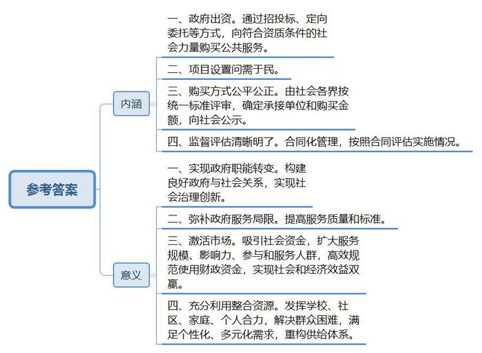
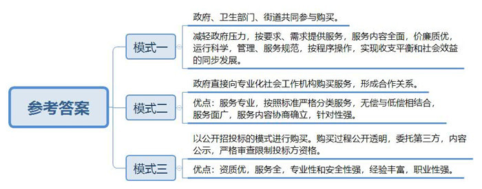
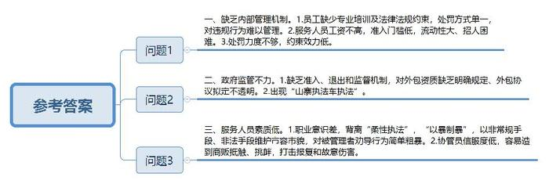
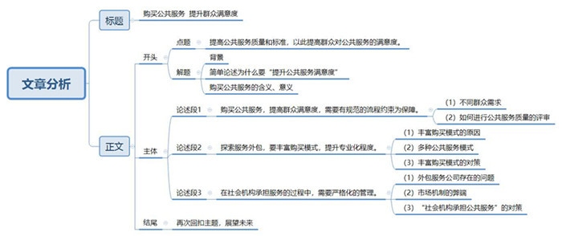

# 2017年上海市公考《申论》题（A卷）

<!-- gwy:overview:start -->
> **上海 · 2017 · 申论 · A类** ｜ 4 题 · 图片 4 处 · 答案随题折叠

导航：[题目](#题目) · [材料 1](#材料-1)
<!-- gwy:overview:end -->

> 候选采集稿。参考答案及解析来自粉笔页面，不代表官方答案或真实高分答卷；来源使用许可与原卷对应关系仍需人工核实。

## 给定材料

### 材料 1

政府购买公共服务是实现我国政府职能转变，构建良好政府与社会关系、实现社会治理创新的重要措施。党的十八大报告提出“继续加大政府购买公共服务力度，进一步提高公共服务质量和标准，强化政府购买公共服务质量的职责，加强公共服务标准化建设”“着力提高公共卫生、医疗、教育、文化、社会保障等服务质量”，进而全面促进经济社会和人的发展。

2013年9月国务院办公厅颁布《关于政府向社会力量购买服务的指导意见》，要求充分认识政府向社会力量购买服务的重要性，正确把握政府向社会力量购买服务的总体方向，规范有序开展政府向社会力量购买服务工作，扎实推进政府向社会力量购买服务工作。2015年财政部、民政部与工商总局印发《政府购买服务管理办法（暂行）》通知，明确规定承接主体保证服务质量和效果，并且接受主要相关部门、服务对象及社会的监督。

### 材料 2

近年来，群众健身热情空前高涨，公共体育服务需求迅速增长。然而，既是体育事业管理者，又是体育服务“供应商”的体育行政部门力量有限，2013年底M市在全国率先出台《关于购买公共体育服务的实施办法》。2014年4月，政府购买公共体育服务首批18个项目对外公开发布，46家企业和体育组织参与竞标；7月，有16家单位与政府签约，政府为项目“买单”共99万元。至此，M市主动转变政府职能、探索实施政府购买公共体育服务的系列做法基本形成。

买什么？群众说了算。项目都以群众需求为出发点，项目设置“问需于民”，首批18个购买项目中既有最具基础的“三大球”，也有群众喜闻乐见的健身秧歌、舞龙舞狮、太极拳剑等，覆盖了不同群体的需求。怎么买？“联合”说了算。由高校教授、社会组织代表、资深媒体人员等组成评审组，按统一标准对各申报单位进行评审，确定最终的承接单位和购买金额，并向社会公示，确保公开公平公正。如何评？社会说了算。所有承接单位均签订协议，实施合同化管理，项目实施情况有没有达到要求，逐一对照合同清晰明了。

政府购买也激活了沉闷已久的体育市场。过去，由于缺乏资金，协会主办的比赛活动规模小、影响弱，参与和服务人群有限；现在，政府资金可作为比赛启动经费，再加上协会的市场化运作，举办M市有史以来规模最大的舞龙比赛才成为现实。2014年政府购买的18项赛事活动，现场观摩和参与的群众近10万人，共吸引社会资金超过100万元，达到了高效规范化使用财政资金、满足群众公共体育服务需求目的，实现了社会效益和经济效益双赢。2014年10月，国务院出台的《关于加快发展体育产业促进体育消费的若干意见》明确指出，要加快政府职能转变，通过政府购买服务等多种方式，积极支持群众健身消费。国家体育总局的相关负责人认为，M市探索政府购买公共体育服务的做法走在了全国前列，为全国范围内体育行政部门转变职能、加快体育事业发展提供了范本。

### 材料 3

北京市朝阳区某小学三年级的学生们，已经跟皮影戏传人周师傅学习了2年。每周三的下午3点半放学后，不用出校门，在学校的专业教室里，周师傅准时前来，给喜欢皮影戏的孩子们上课。而上这门课，家长不用出一分钱。从2014年1月开始，北京市推出全市中小学课外活动计划，采取政府购买服务方式，每年投入5亿元用于中小学课外体育、文艺、科普社团活动。两年多来，这项为家长解忧的教育公共服务，成了北京市推进素质教育资源整合和发挥学校、社区以及家庭教育合力的突破口，生发出一系列能让家长和学生真正享受到的优质教育成果。

长期以来，由于孩子放学时间和家长下班时间存在时间差，很多家长只好给孩子报社会机构举办的各种托管班或培训班。虽然这些托管班存在师资差、偶尔也有安全隐患等问题，但还是成为不少家长“无奈的选择”。北京市教委推出中小学课外活动计划后，在星期一至星期五下午放学后的3点半至5点这期间，各中小学都会安排课外活动，而费用由财政部门按照城区学生生均400元、远郊区县学生生均500元给予补贴。在中小学生课外活动计划中，通过“政府购买社会服务”的形式，学校只能为学生提供体育、文艺、科普等内容，不得上文化课，时间每周不少于3天，每天不低于1个小时。对家长来说，不用花钱，孩子有人管，还能满足孩子全面发展和个性化需求。

“政府买单解决课后3点半难题并非简单的变社会托管为学校托管。”北京市教委工作人员说，“更重要的是，在满足学生教育消费的多元化需求中，重构教育的供给体系。”

为了给课后3点半教育注入更多的教育资源，北京市教委与北京市科协联合开展“科学家进校园”活动，并邀请一些有参与意愿同时又有相对固定时间的艺术家和文体明星，到中小学设立工作室。西城区教委推出了“城宫计划”，在每个街道选一些基础条件较好的中小学作为基地，建设学校少年宫，整合师资、场地等教育资源，开展以普及为特点的科技、艺术和体育等活动。

### 材料 4

上海市是全国最早进行政府购买公共服务的城市之一，1995年浦东新区社会发展局即委托某社会团体管理浦东新区L市民会馆。2009年开始，上海市民政局与区县民政局从两级福利彩票公益金中共同出资，以上海市社区服务中心作为招投标平台，面向已注册登记，此处满足一定条件的社会团体、民办非企业单位和公益性非营利事业单位三类组织，按比例配套使用福利彩票公益金购买社区安老、济困、扶优、助残服务以及其他社区公益服务。2009—2012年这四年间，社会团体依次中标23个、9个、9个、18个，民办非企业单位依次中标52个、27个、37个、37个，公益性非营利事业单位依次中标10个、4个、1个、3个。

除了上海市民政局外，市绿化市容局通过定向、招标邀标的方式向直属的23个改制企业和国有企业购买环卫作业、绿化养护、林业养护等服务，全市一年约有5.8亿元的绿化养护投入，其中公开招标邀标占20%。市水务局、海洋局通过招投标、定向方式向上海市排水公司、国家海洋局东海分局直属事业单位购买水务服务、排水服务、地方养护、海洋环境、污水处理等事务。

市农委通过定向委托形式向上海市农业技术服务中心等购买农产品质量安全检测服务，市卫生局向社会公开招聘购买120救护员。市禁毒委员会办公室、市司法局社区矫正工作办公室、团市委社区青少年事务办公室通过定向委任形式分别向上海市Q社会服务总社、上海市X社区服务总站、上海市G社区青少年事务中心购买为药物滥用人员、矫正人员、“失学、失业、失管”社区青少年提供的专业社工服务。

2010年静安区外经委、劳动局、卫生局通过定向委托、有限招投标、公开招标方式向区商业联合会、区商业企业管理协会、区企业联合会、民办培训中心、民办专业服务机构购买外资企业年检与业务培训、劳动技能培训、医疗服务的鉴定与评估、推进工资集体协商与企业承担社会责任等服务。浦东新区教育局通过定向委托形式向民办幼儿园、民办农民工子女就读中小学、某教育管理咨询中心、公立中学、由资深教育工作者建立的教育评估中心等机构，购买学前教育的学位与民办学校农民工子女的学位以及购买管理和购买评估活动服务。浦东新区教育局向专业的教育机构购买学校管理与教育评估。主要是基于教育管理与教育评估是需要专业技能与实践经验的领域，但符合资质条件的专业教育机构数量极少，难以形成充分的竞争性市场。

从市政府相关部门来看，大多数政府职能部门运用本部门年度预算资金用于政府购买。从区县政府来看，浦东新区已经将政府购买教育公共服务全部纳入公共预算，并且作为一个单独的条目列入部门的公共预算。上海市民政局运用福利彩票公益金购买社区公共服务，福利彩票公益金占市民政局政府购买经费较大的比重。市社区服务中心购买公共服务的资金主要来源于福利彩票公益金，体现“扶老、助残、救孤、济困”的宗旨，每年购买公共服务的金额达4000万，除市福利彩票金按每年中标项目标的50%对中标组织予以资助外，区民政部门也按照中标项目标的50%对中标组织予以资助。经过几年的实践探索，市政府有关部门与各区县政府每年用于购买公共服务的经费已经由初期的几十万、几百万上升到千万、上亿的水平。综合来看，基础设施的资金投入量大，市城建和交通委员会2011年购买额超过7亿元。一些经济比较充裕的区县投入资金较多，2014年浦东新区政府购买服务预算金额达33.8亿元。

上海市社区服务中心受市民政局的委托负责全市政府购买公共服务招投标具体事务。公益招投标的流程分为立项与招标、投标与评审、项目实施、过程监督和绩效评估五个环节。先由市与区县民政局提出项目招标需求，然后社区服务中心为满足资质要求的单位提交申请。社区服务中心是社区公益服务项目招投标的工作平台，作为受托机构负责招标工作方案和具体组织实施、投标方案的评估审议、协助有关方面对资助项目过程监督评估与效益评价等。随着政府购买公共服务推进多年，评估的作用越来越大，市民政局和市社区服务中心专门制定《上海社区公益服务招投标项目评估指标体系（暂行）》，共分项目完成情况、服务满意度、财务绩效、组织能力建设和综合效益评价五个一级指标，用于评估所有上海社区公益服务招投标的中标项目，既是评定接受上海市福利彩票公益金资助的主要依据，又为中标项目提高项目品质提供技术指导。

### 材料 5

养老服务是政府为社会提供的具有代表性的公共服务内容。随着社会经济、医疗卫生水平的提升，人们生活质量不断提高，人口老龄化问题凸显。以归属感和满足精神需求为基础的居家养老模式逐渐成为老年人的主要选择。国家民政部要求各级政府结合当地的实际情况，探索与当地发展特点相适应的居家养老服务模式。

为了完善养老服务体系以应对政府提供服务的局限性。上海市早在2000年就率先提出“政府购买养老服务”的理念，并在静安区等6个区中的12个街道进行试点实践。此后江苏省南京市鼓楼区不断加大政府的资金投入，向高龄独居老人及有特殊困难的老人提供家庭护理及日常生活照料。随后北京、宁波、广州、深圳等地也相继发展养老服务购买。当前，各地政府向社会组织购买服务尤其是居家养老服务的专业化程度要求越来越高，购买模式也越来越多样化。

A街道在人口老龄化程度不断加快，传统的养老模式远远不能满足老年人需求的情况下，成立了街道老年护理中心，护理中心的成立得到区政府，各有关部门及专业养老机构、志愿者等的大力支持，在解决房租、办公费、护工补贴费等问题的同时，区政府为中心投入10万元资金，区卫生部门则承担了免费培训护理人员的任务。A街道从“单靠政府的力量难以彻底解决老年人的居家照顾问题”的认识出发，充分利用、整合社区资源，做到国家、集体、个人共同参与和共同服务。根据老人日常照顾的要求，护理中心设立了生活照料、精神宽慰、家政服务三大类共22项服务项目，具体服务内容包括为老人配餐、喂饭、洗澡、陪伴、护理、康复和心理辅导等。在运行过程中，护理中心的工作由服务性逐步向服务与市场化并行转换，居家养老服务由最初的无偿为老人提供服务逐步向低偿型收费方式转变。在加强管理、规范服务和操作程序方面，护理中心对一批下岗职工进行培训及上岗教育，按客户需求提供价廉质优服务，做到了护理费收入与支出的基本持平和社会效益的同步发展。

B街道是居家养老服务的试点区域之一，近年来政府向社工服务社购买居家养老服务。社工服务社成立2000年，是一家主要针对老年社会福利服务事业的专业化社会工作机构，与政府形成长期的合作关系，曾经多次协助并参与管理政府成立的多家街道社区老年服务中心、并为其培训专业人才。社工服务社为B街道辖区内60多岁以上老人提供社区居家养老服务。其中，登记在册救济“三无”孤寡老人、低保对象中独居或仅与子女（残疾）生活的老人、优抚对象中的独居老人和三级以上伤残军人，每月可免费享受价值200元的服务时间。而对低收入家庭中70岁以上的仅与子女（残疾）生活或独居的老人、民政和社保代管退休人员中月退休金不足800元的独居以及生活难以自理的老人、年龄在79岁以上并且月收入低于1200元的独居或仅与子女（残疾）生活的老人，每月免费提供价值100元的养老服务时间。对其他不符合上述条件的老人，根据自己的意愿需求，实行低偿服务。服务内容主要是定时上门探访、卫生清洁、送餐、家务、照料、洗衣、理发、保健咨询、疏导心理问题等，具体的内容由社工服务社的评估小组根据评估情况与老人及其家庭成员协商确立。在购买服务后，政府直接付款给社工服务社。

C市人民政府于2013年9月发布《城区政府购买居家养老服务试行办法》，该办法明确居家养老服务对象具有以下资格：首先具有C市城区的户籍，并且居住在C城区，其次年龄超60岁且不能自己照顾自己的低收入老人或年龄超过80的独居残疾失能的低收入老人。随后，C政府根据试行办法的要求进行了政府购买服务。居家养老服务内容包括日常生活照顾、文化娱乐、医疗护理、保健卫生、心理安抚、紧急援助以及日常关怀等。C市购买服务的整个过程公开，由市民政局委托第三方机构对相应养老服务项目进行公开招投标，招标公示显示、采购内容是为符合条件的老人提供每人每月价值100元的养老服务时间，购买的服务期限为一年，投标方必须具有相应的资格，可投标的机构包括在民政部门登记过的专门养老服务机构，在医疗卫生部门登记过的医疗机构和在工商管理部门登记批准过的服务机构。这些机构需在C市范围具有国家的经营场所，具有丰富的居家养老服务经验，并具有劳动部门批准的养老养护员和家庭服务相关职技培训资质以及标准规范的场地。

2014年D市辖区为老人发放居家养老服务券，分为三类，即A类：低保户家庭老人、困难家庭老人及特等或一等革命伤残军人家庭老人，100元/月；B类：80岁以上的高龄老人，50元/月；C类：60岁以上、有能力且有养老服务需求的老人一次性50元的补助。有三种面额：1元、5元、10元。老人可以用代金券来购买家政服务、医疗服务、上门服务、代购服务等一系列无偿、低偿、有偿服务。

### 材料 6

为解决人手不足问题，“城管外包”机制曾一度被认为是城市公共管理和公共服务的创新之举。然而，来自改革开放前沿城市Z市的消息却显示，这座城市的城管工作在饱受种种负面新闻和批评意见之后，正在考虑对该制度进行改革，甚至考虑让这一制度逐步退出历史舞台。

Z市于2007年起以政府购买社会服务的方式在全市配备使用城市协管员，当时是为了解决人手不足这个综合执法最突出问题。事实上，直到目前为止，Z市城管执法人员缺口的情况仍然没有改善。据Z市城管局提供的数据显示，目前全市配备的城市管理执法队正式在编人员共1531人，与全市1500多万的实际人口相比，人手依然严重不足。

为此，从社会上吸引力量参与城管就成为城市不得不继续采用的方式。据了解，目前Z市全市共有35家公司参与城管服务外包。这些公司主要有两种，一种是物业服务公司，一种是保安公司。35家公司雇佣了3204名协管员。这些公司雇佣的协管员多的有近500名，少的不到10名。

Z市城管局表示，今年上半年，该局已经针对城市管理服务外包方式进行了一系列的深入调研，负责调研的冯增军表示，目前Z市城管已经形成了政府主导、企业协同、公众参与的格局。外包服务减少了基层执法人员的工作压力，降低了执法成本，将城市管理变为主动管理，市容市貌发生了明显的变化，但也弊端丛生，是时候对它进行规范管理了。

首先，外包服务公司内部管理机制明显匮乏。调研显示，不少协管员到公司后，接受简单培训就匆匆上岗，有的甚至缺乏基本的上岗培训，加之他们缺少像公务员纪律法规方面的约束，最后导致部分协管员“保护违法行为”，而很多公司又仅仅对违规的协管员做辞退处理或扣罚奖金，不能有效监督这些违规行为。

其次，有关部门对外包服务公司的监管机制也不完善。Z市此次调研发现，目前服务外包领域缺乏准入、退出和监督机制，管理部门对此类外包企业的资质要求没有明确规定、外包协议拟定过程不透明。据介绍，目前在Z市和外包服务公司签约的有社区、街道区政府等单位，但签订的合同比较混乱，没有规范的合同文本，缺乏一些强制性的惩罚措施。外包服务合同职责也不明确，双方易推诿责任。一些街道的服务公司签订合同时规定有权更换物业公司，但更换物业公司的情况却极少发生，因为合同文本缺乏监管细则和量化考核指标，和公司终止合同无依据。

曾曝出“开山寨执法车执法”等负面新闻的H物业公司是Z市规模较大的城管服务外包公司，共有协管员500多名，承接了10个街道的外包服务。该公司行政总经理坦言，协管员的月工资为2500元（包食宿）；在招聘条件方面，只要求身高和年龄，品行良好无任何传染性疾病；招聘时只看应聘者身份证的真假，其他无太高要求。该公司人员的流动性非常大，很多协管员做的时间不长，人越来越难招，一定程度上造成管理困难。公司对违规行为一般采取罚款20-50元等办法来管理，约束效力不明显。

协助执法曾被称为“柔性执法”。按照H物业公司与街道之间签订的合同，协管员主要以宣传、说服等柔性方式劝导乱摆卖者离开，对不听劝告者，协管员及时向街道执法队汇报，由街道执法队查处。虽然少部分小贩可能会听一听协管员的劝导，但是大部分长期摆卖的小贩，一般不会听，甚至会挑衅。Z市城管局的调研发现，协管员和被管理对象均易变成暴力行为的受害者，外包服务往往演变成“以暴制暴”，以非常规手段、非法手段来维护市容市貌，协管员在协助执法中，对被管理者的劝导行为过于简单粗暴，而协管员也容易成为打击报复的对象，甚至遭遇故意伤害。

2012年2月13日，Z市某物流配送有限公司的平价流动车正在某天桥旁边摆卖水果及副食品。突然5名男子从一辆无牌面包车上冲下来，持铁管打砸正在售卖的商品及工具，导致该公司损失7000余元。经查，犯罪嫌疑人为Z市T公司发展部的员工，T公司向Z市城管局承包了部分城管业务。此次打砸事件，是犯罪嫌疑人受到主要犯罪嫌疑人许某的指使。许某系某菜市场的承租人，后转手将档铺租给多名小业主经营，她认为平价流动售卖车对小业主的生意造成影响，导致部分业主拒绝交租，遂指使T公司数人对流动售卖车进行打砸。案件发生后，T公司总经理表示，最初的服务合作由城管局主动提出，其后公司与城管局签订合同承包了Z市多个片区的城管业务，主要负责清除牛皮纸、清理乱摆卖和乞丐等，但是他们也有难处：城管局给协管员的工资标准太低，每人每月只有1700元，根本没有公司愿接这种活。

### 材料 7

2016年6月，我国10个城市的公共服务公众满意度调查结果公布。从得分看，公众对于所在城市的公共服务质量整体满意度都在及格分以上，总体情况良好。排名第一的厦门以8.52分遥遥领先，北京、成都、上海的得分都在7.80以上，其次是郑州、西宁、昆明、哈尔滨、广州、武汉。值得注意的是，通常意义上的一线城市“北上广”，具有较高的城市发展水平和综合经济实力但是满意程度却有较大差异，这在一定意义上显示经济发展的优势并不代表满意度更高。当然，公共服务满意度与“公众期望与实际之间的差距”也有着密切关系。一般来说，一个城市越发达（开放程度越高、生活越富裕、受教育程度越高），对于公共服务的期望也会越高，这也会导致其满意度水平较低，因此经济更发达城市在提高公共服务方面面临的要求可能会更高（这需要有更加优质高效的公共服务），不断完善配套体制和机制，从而提升公众的满意度。

## 题目

### 第 1 题

**结合给定资料，谈谈政府购买公共服务的内涵及其意义。（20分）**

关联材料：材料 1、材料 2、材料 3、材料 4、材料 5、材料 6、材料 7

作答要求：

要求：概括准确、条理清晰、语言精练，字数不超过300字。

第 1 题 · 答案与解析

**参考答案（粉笔题库参考内容）**

内涵：一、政府出资。通过招投标、定向委托等方式，向符合资质条件的社会力量购买公共服务。二、项目设置问需于民。三、购买方式公平公正。由社会各界按统一标准评审，确定承接单位和购买金额，向社会公示。四、监督评估清晰明了。合同化管理，按照合同评估实施情况。

意义：一、实现政府职能转变。构建良好政府与社会关系，实现社会治理创新。二、弥补政府服务局限。提高服务质量和标准。三、激活市场。吸引社会资金，扩大服务规模、影响力、参与和服务人群，高效规范使用财政资金，实现社会和经济效益双贏。四、充分利用整合资源。发挥学校、社区、家庭、个人合力，解决群众困难，满足个性化、多元化需求，重构供给体系。

**解析**

**参考答案说明**：（1）宏观上，本参考答案先列出了“内涵”要点，再列出了“意义”要点；（2）微观上，答案从“政府出资”“项目问需于民”“购买方式公平公正”“监督评估清晰明了”等四个方面对内涵进行了分条撰写；从“实现政府职能转变”“弥补政府服务局限”“激活市场”“充分利用整合资源”等四个方面对意义进行了分条撰写。每条要点之间内容上没有交叉，且对要点提炼出了总括词并前置。

**考点**：多要素组合类

**来源**：2017年上海市公考《申论》题（A卷）

### 第 2 题

**结合资料5，概括各地“居家养老服务”不同的模式及优点。（20分）**

关联材料：材料 5

作答要求：

要求：概括准确、条理清晰、语言精练，字数不超过300字

第 2 题 · 答案与解析

**参考答案（粉笔题库参考内容）**

模式一：政府、卫生部门、街道共同参与购买。

优点：减轻政府压力，按要求、需求提供服务，服务内容全面，价廉质优，运行科学，管理、服务规范，按程序操作，实现收支平衡和社会效益的同步发展。

模式二：政府直接向专业化社会工作机构购买服务，形成合作关系。
优点：服务专业，按照标准严格分类服务，无偿与低偿相结合，服务面广，服务内容协商确立，针对性强。

模式三：以公开招投标的模式进行购买。购买过程公开透明，委托第三方，内容公示，严格审查限制投标方资格。
优点：资质优，服务全，专业性和安全性强，经验丰富，职业性强。

**解析**

**参考答案说明：**参考答案从“多方共同参与购买”“向专业化社会工作机构购买”和“以公开招投标的模式进行购买”这三方面介绍了居家养老的不同“模式”及“优点”，做到了分条撰写。各条答案要点之间在内容上是并列关系，没有交叉。

**考点**：特点类

**来源**：2017年上海市公考《申论》题（A卷）

### 第 3 题

**根据给定资料，分析Z市城管服务外包实践存在哪些问题。（20分）**

关联材料：材料 1、材料 2、材料 3、材料 4、材料 5、材料 6、材料 7

作答要求：

要求：观点明确、层次清楚、语言简练，字数不超过300字

第 3 题 · 答案与解析

**参考答案（粉笔题库参考内容）**

一、缺乏内部管理机制。1.员工缺少专业培训及法律法规约束，处罚方式单一，对违规行为难以管理。2.服务人员工资不高，准入门槛低，流动性大、招人困难。3.处罚力度不够，约束效力低。

二、政府监管不力。1.缺乏准入、退出和监督机制，对外包资质缺乏明确规定、外包协议拟定不透明。2.出现“山寨执法车执法”。

三、服务人员素质低。1.职业意识差，背离“柔性执法”，“以暴制暴”，以非常规手段、非法手段维护市容市貌，对被管理者劝导行为简单粗暴。2.协管员信服度低，容易遭到商贩抵触、挑衅，打击报复和故意伤害。

**解析**

**参考答案说明**：本参考答案从“缺乏内部管理机制”“政府监管不力”“服务人员素质低”等不同的问题进行了分条撰写。各条要点之间在内容上互相并列，没有交叉。并且撰写每条要点时，都提炼出了概括性强的总结词并前置，满足了题目中规定的“观点明确”这一要求。

**考点**：问题类

**来源**：2017年上海市公考《申论》题（A卷）

### 第 4 题

**围绕“提升公共服务满意度”这一主题写一篇文章。（40分）**

关联材料：材料 1、材料 2、材料 3、材料 4、材料 5、材料 6、材料 7

作答要求：

要求：

（1）自选角度，自拟题目；

（2）观点明确，联系实际，分析具体，条理清楚，语言流畅；

（3）总字数800～1000字。

第 4 题 · 答案与解析

**参考答案（粉笔题库参考内容）**

**购买公共服务** **提升群众满意度**

“为政之道在于安民，安民之要在于察其疾苦”。以人为本是我国目前倡导的服务型政府的宗旨所在。准确及时地发现百姓需求，第一时间主动提供满足其需求的公共服务，才能赢得百姓的好评。因此，政府要充分认识向社会力量购买公共服务的重要性，规范有序开展购买公共服务工作，提高公共服务质量和标准，全面促进经济社会和人的发展，以此提高群众对公共服务的满意度。

购买公共服务，即政府出资向符合资质条件的社会力量购买公共服务，政府角色由生产者向服务者、监督者转变。这一形式就更有利于发挥社会多元主体合力，共同参与社会服务，满足群众全方面、多元化、个性化的公共需求，从而让百姓共享优质成果；另一方面也能够合理整合社会资源，实现社会效益和经济效益双赢。由此可见，如何科学落实公共服务的购买工作，是我们必须思考的问题。

**购买公共服务，提高群众满意度，需要有规范的流程约束为保障**。群众满意是购买公共服务的出发点和落脚点，因此项目设置必然要“问需于民”，覆盖不同群体的需求。其次，组建以高校教授、社会组织代表、资深媒体人为代表的专业评审组，公开透明，按统一标准评审各申报单位。当然，公共服务质量的好坏，最终的评价还是由群众说了算，通过签订协议，实施合同化管理，对照合同，明晰判定实施情况是否达标。如此一来，从购买什么到如何购买再到谁来评价，正是在一整套规范流程的约束下，公共服务外包才有可能真正做到让群众满意。

**探索服务外包，不应千篇一律，而要丰富购买模式，提升专业化程度**。当前，群众需求呈现全面化，个性化、多元化的倾向。以养老服务为例，随着经济、医疗水平攀升，人口老龄化问题凸显，群众呼唤更有归属感的养老服务，以满足精神需求。在这种情况下，各地不断实践，探索出多种购买养老公共服务的新模式。无论是以街道老年人护理中心为基础，联合国家、集体、个人等多元主体共同参与服务，还是与专业化社会工作机构形成长期的合作关系，亦或是定向委托、公开招投标、发放服务券等方式，都在满足群众对公共服务日益增长的需求。除此以外，通过公共预算拨款、福利彩票公益金等多种资金的融合，拓宽资金来源，为购买高质量的公共服务，提供强大的资金支持。

**当然，我们不能“一购了之”，由社会机构承担公共服务的过程中，更需要严格化的管理。**一方面有些外包服务公司内部缺乏明确的管理机制，完善严格的纪律法规、岗前培训，对违规行为进行严厉惩处，增强约束力就显得尤为重要；另一方面公共服务外包是在公共服务领域引入市场机制，而市场以利益为导向，缺乏自律性。因此，政府就需要加强调控和监管，提高准入门槛。同时，加强监管以便明确职责，杜绝腐败滋生。政府购买服务项目严格执行预算制，采用公平公正的购买方式，并向社会公示公布。

公共服务满意度是百姓幸福感的集中体现，也是政府工作是否取得成效的试金石。只有提供更加优质高效的公共服务，不断完善配套的体制和机制，才能真正持久的提高群众满意度。

**解析**

**文章分析**

**购买公共服务** **提升群众满意度**

【**标题的优点：**首先，范文的标题突出了“提升公共服务满意度”这一主题。其次，它在形式上采用了对称式结构，文字简洁明快。】

“为政之道在于安民，安民之要在于察其疾苦”。（1）以人为本是我国目前倡导的服务型政府的宗旨所在。（2）准确及时地发现百姓需求，第一时间主动提供满足其需求的公共服务，才能赢得百姓的好评。因此，（3）政府要充分认识向社会力量购买公共服务的重要性，规范有序开展购买公共服务工作，提高公共服务质量和标准，全面促进经济社会和人的发展，以此提高群众对公共服务的满意度。

【**开头的优点：**★内容方面。范文的开头是紧扣题目给定的“提升公共服务满意度”这一主题展开的。首先，**文章开头即点出主题，做到了主题明确。其次，对“**提升公共服务满意度”这一主题**进行了分析阐述，指出了（1）“提升公共服务满意度”的背景。（2）为什么“提升公共服务满意度”。（3）如何“提升公共服务满意度”。**注意以上几个方面的阐述在逻辑上有先后顺序：先写“背景”“原因”，再写“对策”。★文字表达方面：使用了引用的修辞手法，使文字表达更加形象、有力。】

**购买公共服务**，即政府出资向符合资质条件的社会力量购买公共服务，政府角色由生产者向服务者、监督者转变。这一形式就更有利于发挥社会多元主体合力，共同参与社会服务，满足群众全方面、多元化、个性化的公共需求，从而让百姓共享优质成果；另一方面也能够合理整合社会资源，实现社会效益和经济效益双赢。由此可见，如何科学落实公共服务的购买工作，是我们必须思考的问题。

【**过渡段的优点：**范文过渡段分析了“购买公共服务的含义和意义”，此外，还要注意过渡段末尾的“如何科学落实公共服务的购买工作，是我们必须思考的问题”起到引起下文的作用。】

**购买公共服务，提高群众满意度，需要有规范的流程约束为保障**。（1）群众满意是购买公共服务的出发点和落脚点，因此项目设置必然要“问需于民”，覆盖不同群体的需求。其次，（2）组建以高校教授、社会组织代表、资深媒体人为代表的专业评审组，公开透明，按统一标准评审各申报单位。当然，公共服务质量的好坏，最终的评价还是由群众说了算，（3）通过签订协议，实施合同化管理，对照合同，明晰判定实施情况是否达标。如此一来，从购买什么到如何购买再到谁来评价，正是在一整套规范流程的约束下，公共服务外包才有可能真正做到让群众满意。

【**论述段1的优点：**★观点句：范文的观点句是紧扣“提升公共服务满意度”这一文章主题提出的。形式上，它在段首处直接写出，位置突出，容易发现。内容上，关键词突出，内容要点明确，可以明显看出它是从“对策”入手，指出了“购买公共服务需要有规范的流程约束”。★论述内容：（1）群众满意是公共服务的出发点和落脚点；（2）介绍了“如何进行公共服务质量的评审”。注意：以上两个方面的内容都是紧扣“购买公共服务，提高群众满意度，需要有规范的流程约束为保障”这个观点句进行分析论述的，论述的针对性强，内容层次丰富。并且这几个方面的论述是有内在逻辑顺序的，先讲“原因”，然后讲“对策”。★论述方法：采用了讲道理、举例子相结合，做到了丰富多样。】

**探索服务外包，不应千篇一律，而要丰富购买模式，提升专业化程度**。当前，（1）群众需求呈现全面化，个性化、多元化的倾向。以养老服务为例，随着经济、医疗水平攀升，人口老龄化问题凸显，群众呼唤更有归属感的养老服务，以满足精神需求。在这种情况下，各地不断实践，探索出多种购买养老公共服务的新模式。（2）无论是以街道老年人护理中心为基础，联合国家、集体、个人等多元主体共同参与服务，还是与专业化社会工作机构形成长期的合作关系，亦或是定向委托、公开招投标、发放服务券等方式，都在满足群众对公共服务日益增长的需求。除此以外，（3）通过公共预算拨款、福利彩票公益金等多种资金的融合，拓宽资金来源，为购买高质量的公共服务，提供强大的资金支持。

【**论述段2的优点：**★观点句：范文的观点句是紧扣“提升公共服务满意度”这一文章主题提出的。形式上，它在段首处直接写出，位置突出，容易发现。内容上，关键词突出，内容要点明确，可以明显看出它是从“对策”入手，指出了“购买公共服务要丰富购买模式，提升专业化程度”。★论述内容：（1）介绍了“丰富购买模式的原因——公共服务需求的多样化”；（2）介绍了“多种购买公共服务模式”；（3）介绍了“丰富购买模式的对策”；注意：以上几个方面的内容都是紧扣“探索服务外包，不应千篇一律，而要丰富购买模式，提升专业化程度”这个观点句进行分析论述的，论述的针对性强，内容层次丰富。并且这几个方面的论述是有内在逻辑顺序的，先讲“原因”，然后讲“对策”。★论述方法：采用了讲道理、举例子相结合，做到了丰富多样。】

**当然，我们不能“一购了之”，由社会机构承担公共服务的过程中，更需要严格化的管理。**（1）一方面有些外包服务公司内部缺乏明确的管理机制，完善严格的纪律法规、岗前培训，对违规行为进行严厉惩处，增强约束力就显得尤为重要；（2）另一方面公共服务外包是在公共服务领域引入市场机制，而市场以利益为导向，缺乏自律性。因此，（3）政府就需要加强调控和监管，提高准入门槛。同时，加强监管以便明确职责，杜绝腐败滋生。政府购买服务项目严格执行预算制，采用公平公正的购买方式，并向社会公示公布。

【**论述段3的优点：**★观点句：范文的观点句是紧扣“提升公共服务满意度”这一文章主题提出的。形式上，它在段首处直接写出，位置突出，容易发现。内容上，关键词突出，内容要点明确，可以明显看出它是从“对策”入手，指出了“社会机构承担公共服务更需要严格化的管理”。★论述内容：（1）介绍了“外包服务公司存在的问题”；（2）介绍了“市场机制的弊端”；（3）介绍了“如何严格管理社会机构”。注意：以上几个方面的内容都是紧扣“社会机构承担公共服务的过程中，更需要严格化的管理”这个观点句进行分析论述的，论述的针对性强，内容层次丰富。并且这几个方面的论述是有内在逻辑顺序的，先讲“问题”，再讲“对策”。★论述方法：采用了讲道理、举例子相结合，做到了丰富多样。】

【**论述段之间的关系**：★内容的内在逻辑：范文的论述段之间是依照“并列”的逻辑展开的。论述段1先写了“购买公共服务的规范流程”，论述段2再写了“丰富购买公共服务的模式”，论述段3接着写了“承担公共服务的社会机构需要严格管理”。★段与段的外在衔接：论述段2的段首处的过渡句“探索服务外包，不应千篇一律”，起到了承接论述段1、引出了论述段2的作用。论述段3的段首处的过渡句“当然，我们不能‘一购了之’，”，起到了承接论述段2、引出了论述段3的作用。】

（1）**公共服务满意度**是百姓幸福感的集中体现，也是政府工作是否取得成效的试金石。只有提供更加优质高效的公共服务，不断完善配套的体制和机制，（2）才能真正持久的提高**群众满意度**。

【**结尾的优点**：范文的结尾回扣了“提升公共服务满意度”这一主题。（1）再次提到了“公共服务满意度”；（2）发出了展望。】

**考点**：文章写作题

**来源**：2017年上海市公考《申论》题（A卷）

