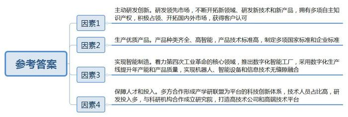
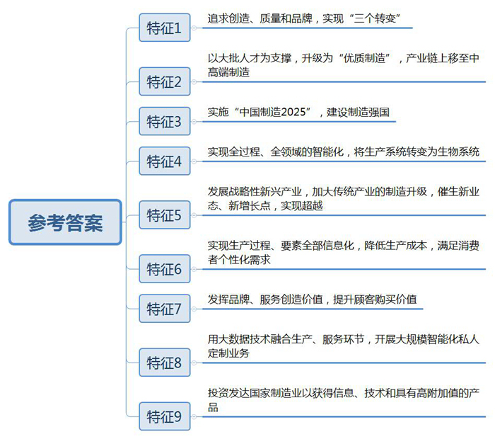
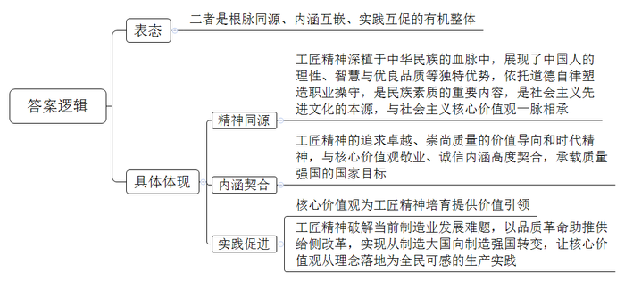
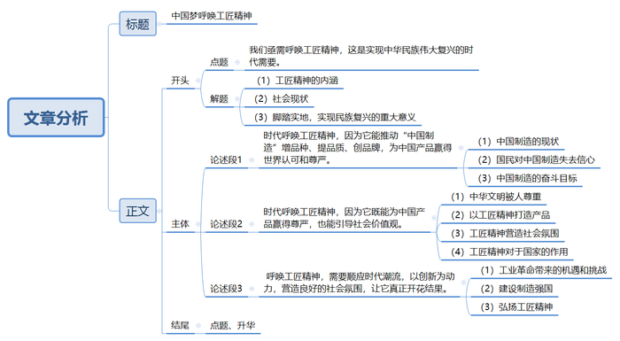

# 2017年上海市公考《申论》题（B卷）

<!-- gwy:overview:start -->
> **上海 · 2017 · 申论 · B类** ｜ 4 题 · 图片 4 处 · 答案随题折叠

导航：[题目](#题目) · [材料 1](#材料-1)
<!-- gwy:overview:end -->

> 候选采集稿。参考答案及解析来自粉笔页面，不代表官方答案或真实高分答卷；来源使用许可与原卷对应关系仍需人工核实。

## 给定材料

### 材料 1

沈阳市X机器人自动化股份有限公司（以下简称“X公司”）有全球最齐全的机器人种类。在X公司智能制造车间，一台台无人驾驶的移动机器人在地面上自由穿梭，自动避开障碍，搬运物品。自从移动机器人系统在国内某汽车公司首次投入使用后，X公司强势切入这一领域，不断开发新产品，如今已占领国内市场九成以上份额。它们从沈阳出发，“昂首”走向全球。通用汽车将X公司移动机器人纳入全球采购平台，瑞典沃尔沃公司放弃机器人行业老大ABB，选择了X公司移动机器人解决方案。

“2000年成立时X公司仅有40人。没有资金、没有厂房、没有社会资源。”该公司总裁介绍，“创新是主动选择，也是逼出来的。”从做课题做项目，到做实业做市场，X公司人当初也曾“拔剑四顾心茫然”。机器人产品技术门槛高，研发周期长，研发难度比其他行业更大。“研发必须走在市场前面。”智能移动机器人事业部王总监感受颇深。2010年X公司获悉国外出现了不用电池的移动机器人产品，就立刻投入研发。两年后，非接触供电机器人通过内部测试，随即得到广泛应用。除混合式充电技术外，X公司还研发出电磁导航、激光导航等多种导航方式，不仅实现了批量出口，还拿下95%的国内市场份额，首次在高端制造领域对进口品牌形成“挤出效应”。

第四次工业革命的核心是智能制造，智能制造的核心是机器人。以汽车为例，人工生产一辆汽车，需要117名熟练工人耗费3天时间，合格率仅为60%；用机器人，仅需要三个普通工人1个小时，合格率100%。目前，X公司有工业机器人、洁净机器人、移动机器人、特种机器人和服务机器人等5大类、70余种机器人产品，拥有600多项国家专利，取得10项软件产品著作权，制定了5项国家标准和几十项企业标准。2014年9月，X公司推出数字化智能工厂，数字化生产线年产能达到5000台。在这里集成了X公司生产的堆垛机器人、装配机器人、检测机器人等各类系列产品，可实现柔性物料传输、零部件自动清洗、自动化装配等一系列功能。用机器人生产机器人，标志着X公司真正将机器人、智能设备和信息技术三者无缝隙融合。

人才和投入是创新的基础。X公司早在2002年就形成以机器人国家工程研究中心、公司各研发事业部与国内外优势企业和研究机构结成的产学研联盟为平台的三层科技创新体系。技术人员占企业总人数接近80%，每年研发投入占公司总体销售额12%以上，在辽宁规模以上工业企业中遥遥领先。面向工业机器人，X公司与中科院沈阳自动化所成立机器人高端研究院，聚焦服务类机器人，与上海交大、上海科技大学等单位建立机器人技术研究院，不仅要成为高技术公司，还要成为高端平台公司。

## 题目

### 第 1 题

结合给定资料，分析X公司在机器人制造业获得成功的主要因素。（20分）

关联材料：材料 1

作答要求：

要求：概况准确，条理清楚，语言精练，字数不超过300字。

第 1 题 · 答案与解析

**参考答案（粉笔题库参考内容）**

成功的主要因素有：

一、主动研发创新。研发领先市场，不断开拓新领域、研发新技术和新产品，拥有多项自主知识产权，积极占领、开拓国内外市场，获得客户认可。

二、生产优质产品。产品种类齐全、高智能，产品技术标准高，制定多项国家标准和企业标准。

三、实现智能制造。着力第四次工业革命的核心领域，推出数字化智能工厂，采用数字化生产线提升年产能和产品质量，实现机器人、智能设备和信息技术无缝隙融合。

四、保障人才和投入。多方合作形成产学研联盟为平台的科技创新体系，技术人员占比高，研发投入多，与科研机构合作成立研究院，打造高技术公司和高端技术平台。

**解析**

**参考答案说明：**本参考答案从“主动研发创新”“生产优质产品”“实现智能制造”“保障人才和投入”四个方面进行了分条撰写。各条要点之间在内容上是并列关系，没有交叉。

**考点**：原因类

**来源**：2017年上海市公考《申论》题（B卷）

### 第 2 题

结合给定资料，谈谈未来中国制造应具备的主要特征。(20分)

关联材料：材料 1

作答要求：

要求：概括准确，条理清楚，语言精练，字数不超过300字。

第 2 题 · 答案与解析

**参考答案（粉笔题库参考内容）**

一、追求创造、质量和品牌，实现“三个转变”。

二、以大批人才为支撑，升级为“优质制造”，产业链上移至中高端制造。

三、实施“中国制造2025”，建设制造强国。

四、实现全过程、全领域的智能化，将生产系统转变为生物系统。

五、发展战略性新兴产业，加大传统产业的制造升级，催生新业态、新增长点，实现超越。

六、实现生产过程、要素全部信息化，降低生产成本，满足消费者个性化需求。

七、发挥品牌、服务创造价值，提升顾客购买价值。

八、用大数据技术融合生产、服务环节，开展大规模智能化私人定制业务。

九、投资发达国家制造业以获得信息、技术和具有高附加值的产品。

**解析**

**参考答案说明：**答案从“三个转变”“优质制造”“中国制造2025”“智能化”“产业升级”“信息化”“品牌、服务价值”“大数据技术”“投资发达国家制造业”等不同的方面进行了分条撰写。各条要点之间在内容上是并列关系，没有交叉。

**考点**：特点类

**来源**：2017年上海市公考《申论》题（B卷）

### 第 3 题

结合给定资料，分析“工匠精神”与培育、践行社会主义核心价值观之间的关系。(20分)

关联材料：材料 1

作答要求：

要求：观点明确，条理清楚，联系实际，字数不超过300字。

第 3 题 · 答案与解析

**参考答案（粉笔题库参考内容）**

二者是根脉同源、内涵互嵌、实践互促的有机整体，具体体现为：

1.精神同源。工匠精神深植于中华民族的血脉中，展现了中国人的理性、智慧与优良品质等独特优势，依托道德自律塑造职业操守，是民族素质的重要内容，是社会主义先进文化的本源，与社会主义核心价值观一脉相承。

2.内涵契合。工匠精神的追求卓越、崇尚质量的价值导向和时代精神，与核心价值观敬业、诚信内涵高度契合，承载质量强国的国家目标。

3.实践促进。核心价值观为工匠精神培育提供价值引领；工匠精神破解当前制造业发展难题，以品质革命助推供给侧改革，实现从制造大国向制造强国转变，让核心价值观从理念落地为全民可感的生产实践。

**解析**

**参考答案说明：**本参考答案先按照“观点明确”的要求对工匠精神与社会主义核心价值观的关系进行总体表态，接着从“精神同源”“内涵契合”“实践促进”三个方面对关系展开具体说明。各条答案要点之间在内容上相互并列，没有交叉。

**考点**：其他类

**来源**：2017年上海市公考《申论》题（B卷）

### 第 4 题

围绕“脚踏实地，实现民族复兴”这一主题，写一篇文章。(40分)

关联材料：材料 1

作答要求：

要求：

（1）自选角度，自拟题目；

（2）观点明确，联系实际，分析具体，条理清楚，语言流畅；

（3）总字数800～1000字。

第 4 题 · 答案与解析

**参考答案（粉笔题库参考内容）**

**中国梦呼唤工匠精神**

《尚书》有云：“惟精惟一，允执厥中”，要义是用功精深，用心专一，执着坚定，秉承中正之道。作为先秦的治世之道，它所传达的精神内核却跨越时空，与当下的工匠精神不谋而合。目前，社会上假货盛行，国人“崇洋媚外”，快节奏的生活使整个社会变得浮躁，**我们亟需呼唤工匠精神，这是实现中华民族伟大复兴的时代需要。**

**工匠精神**，既是调动起来的满腔热情，又是沉下心来的细致钻研；既是对过去的继承，又是对未来的创新。时代呼唤工匠精神，正是呼唤至精至诚、专一执着、正直无私、脚踏实地等美好品质，鼓励精益求精，积极创新，涵养属于我们这个时代的精神气质，勾勒属于我们这个国家的文化底色，实现属于我们这个**民族的伟大梦想**。

**时代呼唤工匠精神，因为它能推动****“****中国制造****”****增品种、提品质、创品牌，为中国产品赢得世界认可和尊严**。如今，“中国制造”虽已走向世界，但它属于低端粗制消费品的地位却没有根本改变。国人扎堆跑国外买马桶、买奶粉……无不反映我们对民族品牌缺乏信心。以此为戒，我们必当追求卓越的中国制造，当中国制造能融入工匠精神时，中国制造业必然转型升级，中国也必将由制造大国走向制造强国。

**时代呼唤工匠精神，因为它既能为中国产品赢得尊严，也能引导社会价值观**。中华文明在历史上之所以被人尊重，正因为有清朝的家具和景德镇瓷器等“不疯魔不成器”的产物。这些独具匠心的精美，源自追求极致和一丝不苟的“工匠精神”。工匠精神是一种“道德的力量”，它能引导全社会涵养内心充满定力、凡事精益求精的时代气质。同时，工匠精神也是国家生生不息的源泉，我们必须将其内化为国民品性，推动中华文明之伟大复兴。

**呼唤工匠精神，需要顺应时代潮流，以创新为动力，营造良好的社会氛围，让它真正开花结果**。第四次工业革命的到来为我们带来了机遇和挑战，我们要充分把握住“工业4.0”所带来的全新智能化发展，实施“中国制造2025”，建设制造强国，加大传统产业的制造升级，催生新业态、新增长点。同时，通过媒体宣传，发挥榜样示范作用，在全社会营造弘扬“工匠精神”的氛围，于潜移默化中让“工匠之风”盛行，实现“工匠精神”的回归。

让工匠精神浸润中华大地，我们应少一些敷衍，多一点专注；少一些拜金主义，多一点事业情怀；少一些投机思维，多一些实干精神。相信在所有人的共同努力下，**工匠精神**终会回归，成为我们这个时代的独特气质，我们的器物必会更精美，生活亦会更从容，**民族复兴**必将实现！

**解析**

**文章分析**

**中国梦呼唤工匠精神**

【**标题的优点：**首先，范文的标题“中国梦呼唤工匠精神”突出了“脚踏实地，实现民族复兴”这一主题。其次，形式上，文字简洁明快。】
《尚书》有云：“惟精惟一，允执厥中”，（1）要义是用功精深，用心专一，执着坚定，秉承中正之道。作为先秦的治世之道，它所传达的精神内核却跨越时空，与当下的工匠精神不谋而合。（2）目前，社会上假货盛行，国人“崇洋媚外”，快节奏的生活使整个社会变得浮躁，**我们亟需呼唤工匠精神，这是实现中华民族伟大复兴的时代需要。**

【**开头的优点：**★内容方面：范文的开头是紧扣题目给定的“脚踏实地，实现民族复兴”这一主题展开的。首先，**文章开头即点出主题，做到了主题明确****。**其次，**对****“**脚踏实地，实现民族复兴”这一主题**进行了分析阐述，指出了（****1****）****“****工匠精神****”****的内涵。（****2****）社会现状。**注意以上两个方面的阐述在逻辑上有先后顺序：先写“内涵”，再写“现状”。★文字表达方面：使用了引用的修辞手法，使文字表达更加形象、有力。

**工匠精神**，既是调动起来的满腔热情，又是沉下心来的细致钻研；既是对过去的继承，又是对未来的创新。时代呼唤工匠精神，正是呼唤至精至诚、专一执着、正直无私、脚踏实地等美好品质，鼓励精益求精，积极创新，涵养属于我们这个时代的精神气质，勾勒属于我们这个国家的文化底色，实现属于我们这个**民族的伟大梦想**。

【**过渡段的优点：**范文过渡段分析了“工匠精神的内涵和意义”，此外，还要注意过渡段末尾的“实现属于我们这个民族的伟大梦想”起到引起下文的作用。】

**时代呼唤工匠精神，因为它能推动****“****中国制造****”****增品种、提品质、创品牌，为中国产品赢得世界认可和尊严**。如今，（1）“中国制造”虽已走向世界，但它属于低端粗制消费品的地位却没有根本改变。（2）国人扎堆跑国外买马桶、买奶粉……无不反映我们对民族品牌缺乏信心。以此为戒，（3）我们必当追求卓越的中国制造，当中国制造能融入工匠精神时，中国制造业必然转型升级，中国也必将由制造大国走向制造强国。

【**论述段****1****的优点：**★观点句：范文的观点句是紧扣“脚踏实地，实现民族复兴”这一文章主题提出的。形式上，它在段首处直接写出，位置突出，容易发现。内容上，关键词突出，内容要点明确，可以明显看出它是从“意义”入手，指出了“工匠精神能够为中国产品赢得世界认可和尊严”。★论述内容：（1）介绍了中国制造的现状；（2）介绍了国民对中国制造失去信心；（3）中国制造的奋斗目标。注意：以上几个方面的内容都是紧扣“时代呼唤工匠精神，因为它能推动‘中国制造’增品种、提品质、创品牌，为中国产品赢得世界认可和尊严”这个观点句进行分析论述的，论述的针对性强，内容层次丰富。并且这几个方面的论述是有内在逻辑顺序的，先讲“中国制造的现状”，然后讲“国人对中国制造的信心”，最后讲“要追求卓越的中国制造”。最后，在论述方法和论据的选取上做到了讲道理、举例子相结合，做到了丰富多样。】

**时代呼唤工匠精神，因为它既能为中国产品赢得尊严，也能引导社会价值观**。（1）中华文明在历史上之所以被人尊重，正因为有清朝的家具和景德镇瓷器等“不疯魔不成器”的产物。（2）这些独具匠心的精美，源自追求极致和一丝不苟的“工匠精神”。（3）工匠精神是一种“道德的力量”，它能引导全社会涵养内心充满定力、凡事精益求精的时代气质。同时，（4）工匠精神也是国家生生不息的源泉，我们必须将其内化为国民品性，推动中华文明之伟大复兴。

【**论述段****2****的优点：**★观点句：范文的观点句是紧扣“脚踏实地，实现民族复兴”这一文章主题提出的。形式上，它在段首处直接写出，位置突出，容易发现。内容上，关键词突出，内容要点明确，可以明显看出它是从“意义”入手，指出了“工匠精神能引导社会价值观”。★论述内容：（1）介绍了中华文明被人尊重的原因；（2）介绍了“以工匠精神打造产品”；（3）介绍了“工匠精神营造社会氛围”；（4）介绍了“工匠精神对于国家”的作用。注意：以上几个方面的内容都是紧扣“时代呼唤工匠精神，因为它既能为中国产品赢得尊严，也能引导社会价值观”这个观点句进行分析论述的，论述的针对性强，内容层次丰富。并且这几个方面的论述是有内在逻辑顺序的，先讲“工匠精神之于产品”，然后讲“工匠精神之于社会氛围”，最后讲“工匠精神之于国家”。最后，在论述方法和论据的选取上做到了讲道理、举例子相结合，做到了丰富多样。】

**呼唤工匠精神，需要顺应时代潮流，以创新为动力，营造良好的社会氛围，让它真正开花结果**。（1）第四次工业革命的到来为我们带来了机遇和挑战，我们要充分把握住“工业4.0”所带来的全新智能化发展，（2）实施“中国制造2025”，建设制造强国，加大传统产业的制造升级，催生新业态、新增长点。同时，（3）通过媒体宣传，发挥榜样示范作用，在全社会营造弘扬“工匠精神”的氛围，于潜移默化中让“工匠之风”盛行，实现“工匠精神”的回归。
【**论述段****3****的优点：**★观点句：范文的观点句是紧扣“脚踏实地，实现民族复兴”这一文章主题提出的。形式上，它在段首处直接写出，位置突出，容易发现。内容上，关键词突出，内容要点明确，可以明显看出它是从“对策”入手，指出了“脚踏实地，实现民族复兴需要顺应时代潮流，营造良好社会氛围”。★论述内容：（1）介绍了“工业革命带来的机遇和挑战”；（2）介绍了“建设制造强国”；（3）介绍了“弘扬工匠精神”的对策。注意：以上几个方面的内容都是紧扣“呼唤工匠精神，需顺应时代潮流，以创新为动力，营造良好的社会氛围，让它真正开花结果”这个观点句进行分析论述的，论述的针对性强，内容层次丰富。并且这几个方面的论述是有内在逻辑顺序的，先讲机遇和挑战，再讲对策。最后，在论述方法和论据的选取上做到了讲道理、举例子相结合，做到了丰富多样。】

【**论述段之间的关系**：★内容的内在逻辑：范文的论述段之间是依照“并列”的逻辑展开的。论述段1先写了“时代呼唤工匠精神，因为它能推动‘中国制造’增品种、提品质、创品牌，为中国产品赢得世界认可和尊严”，论述段2再写了“时代呼唤工匠精神，因为它既能为中国产品赢得尊严，也能引导社会价值观”，论述段3接着写了“呼唤工匠精神，需要顺应时代潮流，以创新为动力，营造良好的社会氛围，让它真正开花结果”。★段与段的外在衔接：论述段2的段首处的过渡句“既能为中国产品赢得尊严，也能引导社会价值观”，起到了承接论述段1、引出了论述段2的作用。论述段3的段首处的过渡句“营造良好的社会氛围”，起到了承接论述段2、引出了论述段3的作用。】

让工匠精神浸润中华大地，我们应少一些敷衍，多一点专注；少一些拜金主义，多一点事业情怀；少一些投机思维，多一些实干精神。相信在所有人的共同努力下，工匠精神终会回归，成为我们这个时代的独特气质，我们的器物必会更精美，生活亦会更从容，民族复兴必将实现！

【**结尾的优点**：范文的结尾回扣了“脚踏实地，实现民族复兴”这一主题。（1）再次提到了“实现民族复兴”；（2）发出了展望。】

**考点**：文章写作题

**来源**：2017年上海市公考《申论》题（B卷）

