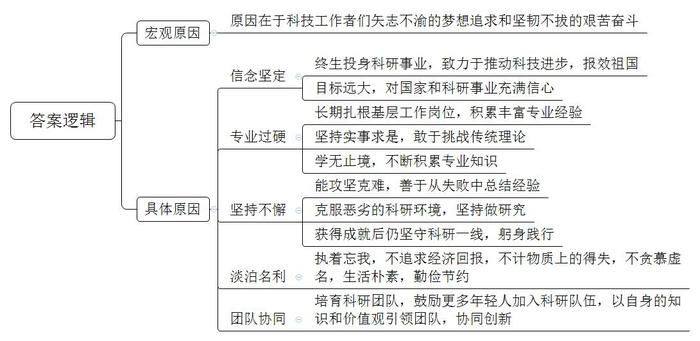
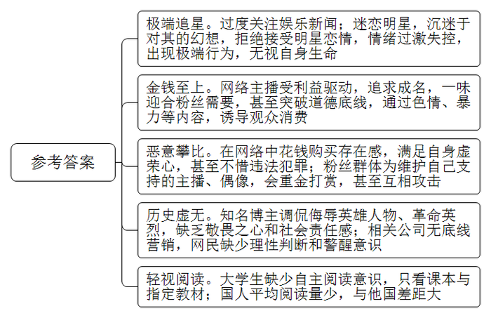
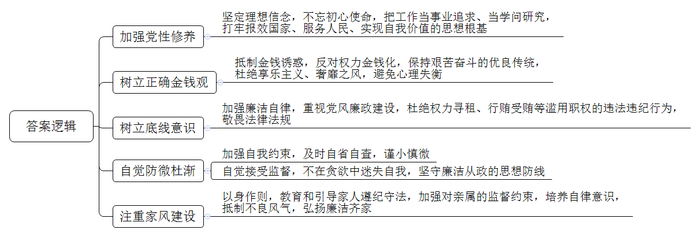
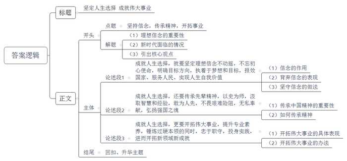

# 2018年上海市公考《申论》题（A卷）

> 候选采集稿。参考答案及解析来自粉笔页面，不代表官方答案或真实高分答卷；来源使用许可与原卷对应关系仍需人工核实。

## 给定材料

### 材料 material-0fddb7756182b137

中华人民共和国成立以来，我国科学技术事业获得了长足的发展，在某些领域取得了令世界瞩目的成就，对于一个起点低、底子薄的国家来说，殊为不易。这些彪炳史册的成就，凝聚着几代科技工作者们矢志不渝的梦想追求和坚韧不拔的艰苦奋斗。

袁隆平出生于20世纪30年代初，幼时中国社会食不果腹、饿殍遍野的惨象令他终生难忘，也影响着他一生的抉择。

1953年8月，从农学院毕业后，袁隆平被分配到一个偏远山村教书，他坐着烧木炭的汽车一路颠簸，到了距离黔阳县安江镇4公里外的安江农校，一待就是16年。正是在这里，他发现第一株“天然杂交水稻”，起初，他尝试以这株水稻的种子播种，结果全部失败，但他没有放弃，反而受到启发，决心开始培育人工杂交水稻。1961年到1965年，整整5年时间，他每天弯腰驼背地在稻田里查看一株株水稻，发现了仅有的6株雄性不育稻株，彻底推翻了传统的经典理论——“无性杂交”学说，得出水稻亦有杂交优势的理论。

那时科研环境恶劣，试验田被毁，秧苗被拔，他捡回了5根半埋着的秧苗，咬牙坚持继续做研究。1970年，试验田所在的县城发生7.2级地震，要求全部人员撤离，但袁隆平不肯走。他说：“有种子在，我不走。”于是在不断的余震中，他搭了个棚子住在那里，守着试验田。就在这样的环境中，他研究出了被取名“野败”的野生稻，这成了所有杂交稻的母本。

其实，日本、美国从1926年起，就开始研发杂交水稻，他们有先进的设备、强大的科研力量，得到最大的支持，却均未取得突破性进展。袁隆平没被国外同行的失败吓倒，而坚信“外国人没有搞成功的，中国人不一定就不能成功”。

1976年，全国推行杂交水稻，1988年，全国一半的稻田都在种杂交水稻。目前，中国杂交水稻在世界30多个国家和地区推广，并冠以“东方魔稻”“巨人稻”“瀑布稻”等美称，甚至将之与四大发明媲美。杂交水稻提高了水稻产量，为全国解决温饱，也为全球减少饥饿人口发挥了重要作用。袁隆平的科研成就具有难以估量的重要价值。

如今，他已八十多岁，依然穿梭在田间地头。2017年，他的团队培育的超级杂交水稻品种“湘两优900”平均亩产1149.02千克，创下水稻单产最高纪录。同年，他的团队悉心研发的“海水稻”试种成功，最高亩产620.95千克，标志着中国成为全世界第一个拥有大规模“海水稻”种植技术的国家。

有人说，袁隆平随便注册一个专利，那就值上千亿，单他这个名字也值1000亿，而他本人却开着10万元的车子，穿着35元的衬衫。他身上没有任何名号：他不是国家科学院的院士，曾经别人让他做过科技公司董事长，他很快辞职了，又挽起裤腿回到了田间。联合国颁给他的奖金，他没有要，而是用这笔钱创办了一个科研基金，鼓励年轻人加入科研的队伍中。甚至在88岁生日时，怕家人为他操办，他早早地就回到了田地中。收到的礼物，也只是一个小小的、用大米制作的蛋糕。

他曾说过：名利对我来说没什么用处，还是下田好，不去下田就无所事事了。有人说，现在中国人，世界上的人，早就吃饱了，他还研究这个干什么；有人说他名声太高，他种的杂交稻虽然产量高，但口味不够好啊；有人说，他是作秀，是吃饱了撑的……

袁隆平没有解释，他只是谈起他的梦想。“我曾梦见杂交水稻的茎秆像高粱一样高，穗子像扫帚一样长，籽粒像花生米一样大，我和助手们一块在稻田里散步，在稻穗下面乘凉……我把这个梦称为‘禾下乘凉梦’。这是我的梦想，是我追求的目标。”

## 题目

### 第 1 题

**结合给定资料，概括袁隆平、南仁东等科学家克服艰难困苦，完成重大科学成果的共同原因。（20分）**

关联材料：material-0fddb7756182b137

作答要求：

要求：概括准确，条理清楚，语言精练，字数不超过300字。

### 第 2 题

**结合给定资料，分析目前社会上一些年轻人存在的不良思想倾向。（20分）**

关联材料：material-0fddb7756182b137

作答要求：

要求：观点明确，条理清楚，语言精练，字数不超过300字。

### 第 3 题

**资料中提到“靡不有初，鲜克有终”，结合给定资料，请对公职人员如何做到不忘初心，有始有终，提出对策。（20分）**

关联材料：material-0fddb7756182b137

作答要求：

要求：观点明确，条理清楚，语言流畅，对策可行，字数不超过300字。

### 第 4 题

**结合给定资料，以“坚持信念，传承精神，开拓事业”为主题，写一篇文章。（40分）**

关联材料：material-0fddb7756182b137

作答要求：

要求：

（1）自选角度，自拟题目；

（2）观点明确，联系实际，分析具体，条理清楚，语言流畅；

（3）总字数800-1000字。

## 答案与解析

第 1 题

**参考答案（粉笔题库参考内容）**

原因在于科技工作者们矢志不渝的梦想追求和坚韧不拔的艰苦奋斗，具体分析如下：

1.信念坚定。终生投身科研事业，致力于推动科技进步，报效祖国；目标远大，对国家和科研事业充满信心。

2.专业过硬。长期扎根基层工作岗位，积累丰富专业经验；坚持实事求是，敢于挑战传统理论；学无止境，不断积累专业知识。

3.坚持不懈。能攻坚克难，善于从失败中总结经验；克服恶劣的科研环境，坚持做研究；获得成就后仍坚守科研一线，躬身践行。

4.淡泊名利。执着忘我，不追求经济回报，不计物质上的得失，不贪慕虚名，生活朴素，勤俭节约。

5.团队协同。培育科研团队，鼓励更多年轻人加入科研队伍，以自身的知识和价值观引领团队，协同创新。

**解析**

**参考答案说明：**本参考答案在逻辑上呈“总分”结构，按照宏观原因“原因在于科技工作者们矢志不渝的梦想追求和坚韧不拔的艰苦奋斗”，具体原因“信念坚定”“专业过硬”“坚持不懈”“淡泊名利”和“团队协同”，五个方面分条撰写，各条答案要点之间在内容上没有交叉。

**考点**：考点原因类

**来源**：来源2018年上海市公考《申论》题（A卷）

粉笔申论页面对本题只提供「解析视频」入口，该入口是会员推广位，页面无视频地址与文字解析。

第 2 题

**参考答案（粉笔题库参考内容）**

一、极端追星。过度关注娱乐新闻；迷恋明星，沉迷于对其的幻想，拒绝接受明星恋情，情绪过激失控，出现极端行为，无视自身生命。

二、金钱至上。网络主播受利益驱动，追求成名，一味迎合粉丝需要，甚至突破道德底线，通过色情、暴力等内容，诱导观众消费。

三、恶意攀比。在网络中花钱购买存在感，满足自身虚荣心，甚至不惜违法犯罪；粉丝群体为维护自己支持的主播、偶像，会重金打赏，甚至互相攻击。

四、历史虚无。知名博主调侃侮辱英雄人物、革命英烈，缺乏敬畏之心和社会责任感；相关公司无底线营销，网民缺少理性判断和警醒意识。

五、轻视阅读。大学生缺少自主阅读意识，只看课本与指定教材；国人平均阅读量少，与他国差距大。

**解析**

**参考答案说明****：**答案从“极端追星”“金钱至上”“恶意攀比”“历史虚无”“轻视阅读”进行了分条撰写。各条要点之间在内容上并列且没有交叉。

**考点**：考点问题类

**来源**：来源2018年上海市公考《申论》题（A卷）

粉笔申论页面对本题只提供「解析视频」入口，该入口是会员推广位，页面无视频地址与文字解析。

第 3 题

**参考答案（粉笔题库参考内容）**

一、加强党性修养。坚定理想信念，不忘初心使命，把工作当事业追求、当学问研究，打牢报效国家、服务人民、实现自我价值的思想根基。

二、树立正确金钱观。抵制金钱诱惑，反对权力金钱化，保持艰苦奋斗的优良传统，杜绝享乐主义、奢靡之风，避免心理失衡。

三、树立底线意识。加强廉洁自律，重视党风廉政建设，杜绝权力寻租、行贿受贿等滥用职权的违法违纪行为，敬畏法律法规。

四、自觉防微杜渐。加强自我约束，及时自省自查，谨小慎微；自觉接受监督，不在贪欲中迷失自我，坚守廉洁从政的思想防线。

五、注重家风建设。以身作则，教育和引导家人遵纪守法，加强对亲属的监督约束，培养自律意识，抵制不良风气，弘扬廉洁齐家。

**解析**

**参考答案说明：**本参考答案从“加强党性修养”“树立正确金钱观”“树立底线意识”“自觉防微杜渐”“注重家风建设”这五个方面进行了分条撰写。各条要点之间在内容上相互并列，没有交叉。

**考点**：考点提出对策类

**来源**：来源2018年上海市公考《申论》题（A卷）

粉笔申论页面对本题只提供「解析视频」入口，该入口是会员推广位，页面无视频地址与文字解析。

第 4 题

**参考答案（粉笔题库参考内容）**

**坚定人生选择** **成就伟大事业**

理想信念之火一经点燃，就永远不会熄灭，伟大的事业亦会经久不衰。过去，在党和国家的带领下，全国人民历经千辛万苦，战胜各种困难和挑战。如今，走进新时代、踏上新征程，年轻人便有了新的人生使命、新的人生选择，然而，无论何时，最重要的依然是坚定信念，传承中国精神，最为关键的是为开创实现中国梦的伟大事业而奋发努力。

**成就人生选择，就要坚定理想信念不动摇，不忘初心使命，明确目标方向，执着于梦想和目标，报效国家、服务人民、实现人生自我价值。**信念如同黑暗中的明灯、航船上的罗盘，于迷茫、困顿时指引前行的方向，只有理想信念坚定的人，才能矢志不渝的为实现既定目标而奋斗。十八大后首位落马的省部级官员李春城，利用职务便利为他人谋取利益，收受巨额贿赂，与当初追求的理想信念背道而驰。江苏省徐州市政协原副主席张引不注重学习，信仰逐渐淡薄，丧失了理想和方向。靡不有初，鲜克有终，只有筑牢信仰之基，补足精神之钙，守住权力边界，才能真正为党和人民的事业做出贡献。

**成就人生选择，还要传承先辈精神，以史为师，汲取智慧和经验，敢为人先，不畏艰难险阻，无私奉献，弘扬强国之魂。**中国精神是中国文化软实力的象征，是中华民族优秀传统文化的结晶，是凝心聚力的兴国之器、强国之魂，必须传承弘扬。在我国高速发展的今天，年轻人必须接过前人的接力棒，以红船精神、铁人精神、新时期创业精神等为指引，用“功成不必在我，功成必定有我”的决心，勇担时代使命，一年接着一年干，一代接着一代干，艰苦奋斗、淡泊名利，夯实民族复兴基础，筑牢大国崛起根基，为中国经济社会发展汇聚强大正能量。

**成就人生选择，更要开拓伟大事业，提升专业素养，锤炼过硬本领的同时，忠于职守，投身实践，进而开拓新领域新成就。**一直以来，无数仁人志士为祖国的伟大事业前仆后继、矢志不渝，从袁隆平的“禾下乘凉梦”到南仁东的“天眼望苍穹”，再到今天太空三人组的“万里归家路”……他们用扎实的专业技能，不断开拓进取，以越是艰险越向前的气魄，坚守工作岗位，在实践中积累经验，在创新中谋求发展，不断创造“中国奇迹”。一代人有一代人的使命，一代人有一代人的事业，对于我们每个人来说，只要立足本职岗位，敢闯、敢试、敢干，敢于迎难而上，奋力开拓事业新局，就一定能将愿景蓝图变成美好的现实。

路漫漫其修远兮，吾将上下而求索。无论是科技事业，还是为官之道，年轻人们都应当以信念为指引，以精神为支撑，努力且坚定的追寻人生价值、实现人生选择。最终，我们才能不枉此生，干出一番轰轰烈烈的伟大事业！

**解析**

**文章分析**

**坚定人生选择** **成就伟大事业**

【**标题的优点：**首先，范文的标题“坚定人生选择，成就伟大事业”突出了“坚持信念，传承精神，开拓事业”这一主题。其次，形式上，文字简洁明快。】

（1）理想信念之火一经点燃，就永远不会熄灭，伟大的事业亦会经久不衰。（2）过去，在党和国家的带领下，全国人民历经千辛万苦，战胜各种困难和挑战。如今，走进新时代、踏上新征程，年轻人便有了新的人生使命、新的人生选择，然而，无论何时，（3）最重要的依然是坚定信念，传承中国精神，最为关键的是为开创实现中国梦的伟大事业而奋发努力。

【**开头的优****点：**★内容方面：范文的开头是紧扣“坚持信念，传承精神，开拓事业”这一主题展开的。首先，开头先引出“坚持信念，传承精神，开拓事业”这一主题；其次，阐述了理想信念的重要性和新时代面临的情况，最后给出本文的核心观点。★文字表达方面：使用了“然而”等连接词，使语言表达有逻辑性。】

**成就人生选择，就要坚定理想信念不动摇，不忘初心使命，明确目标方向，执着于梦想和目标，报效国家、服务人民、实现人生自我价值。**（1）信念如同黑暗中的明灯、航船上的罗盘，于迷茫、困顿时指引前行的方向，只有理想信念坚定的人，才能矢志不渝的为实现既定目标而奋斗。（2）十八大后首位落马的省部级官员李春城，利用职务便利为他人谋取利益，收受巨额贿赂，与当初追求的理想信念背道而驰。江苏省徐州市政协原副主席张引不注重学习，信仰逐渐淡薄，丧失了理想和方向。靡不有初，鲜克有终，（3）只有筑牢信仰之基，补足精神之钙，守住权力边界，才能真正为党和人民的事业做出贡献。

【**论述段****1的优点：**★观点句：范文的观点句是紧扣“坚持信念，传承精神，开拓事业”这一文章主题提出的。形式上，它在段首处直接写出，位置突出，容易发现。内容上，关键词突出，内容要点明确，可以明显看出它侧重于“坚持信念”。★论述内容：（1）信念的作用；（2）背弃信念的表现；（3）坚守信念的做法。注意：以上三个方面层次清晰，论述的针对性强。在论述方法上采用了举例子、讲道理相结合的方式。】

**成就人生选择，还要传承先辈精神，以史为师，汲取智慧和经验，敢为人先，不畏艰难险阻，无私奉献，弘扬强国之魂。**（1）中国精神是中国文化软实力的象征，是中华民族优秀传统文化的结晶，是凝心聚力的兴国之器、强国之魂，必须传承弘扬。（2）在我国高速发展的今天，年轻人必须接过前人的接力棒，以红船精神、铁人精神、新时期创业精神等为指引，用“功成不必在我，功成必定有我”的决心，勇担时代使命，一年接着一年干，一代接着一代干，艰苦奋斗、淡泊名利，夯实民族复兴基础，筑牢大国崛起根基，为中国经济社会发展汇聚强大正能量。

【**论述段****2****的优点：**★观点句：范文的观点句是紧扣“坚持信念，传承精神，开拓事业”这一文章主题提出的。形式上，它在段首处直接写出，位置突出，容易发现。内容上，关键词突出，内容要点明确，可以明显看出它侧重于“传承先辈精神”。★论述内容：（1）传承中国精神的重要性，（2）如何传承精神。以上两个方面的内容都是紧扣“成就人生选择，还要传承先辈精神，以史为师，汲取智慧和经验，敢为人先，不畏艰难险阻，无私奉献，弘扬强国之魂”这个观点句进行分析论述的，论述的针对性强，内容层次丰富，在论述方法上以讲道理为主。】

**成就人生选择，更要开拓伟大事业，提升专业素养，锤炼过硬本领的同时，忠于职守，投身实践，进而开拓新领域新成就。**（1）一直以来，无数仁人志士为祖国的伟大事业前仆后继、矢志不渝，从袁隆平的“禾下乘凉梦”到南仁东的“天眼望苍穹”，再到今天太空三人组的“万里归家路”……他们用扎实的专业技能，不断开拓进取，以越是艰险越向前的气魄，坚守工作岗位，在实践中积累经验，在创新中谋求发展，不断创造“中国奇迹”。（2）一代人有一代人的使命，一代人有一代人的事业，对于我们每个人来说，只要立足本职岗位，敢闯、敢试、敢干，敢于迎难而上，奋力开拓事业新局，就一定能将愿景蓝图变成美好的现实。

【**论述段****3****的优点：**★观点句：范文的观点句是紧扣“坚持信念，传承精神，开拓事业”这一文章主题提出的。形式上，它在段首处直接写出，位置突出，容易发现。内容上，关键词突出，内容要点明确，可以明显看出它侧重于“开拓伟大事业”。★论述内容：（1）开拓伟大事业的具体表现；（2）开拓伟大事业的办法。注意：以上两个方面的内容都是紧扣“成就人生选择，更要开拓伟大事业，提升专业素养，锤炼过硬本领的同时，忠于职守，投身实践，进而开拓新领域新成就”这个观点句进行分析论述的，论述的针对性强，内容层次丰富。在论述方法上采用了举例子、讲道理相结合的方式。】

【**论述段之间的关系：**★内容的内在逻辑：论述段1从“坚定理想信念不动摇”层面论证主题，论述段2从“传承先辈精神”层面论证主题，论述段3从“开拓伟大事业”层面论证主题。三个论述段相互并列，逻辑清晰。】

路漫漫其修远兮，吾将上下而求索。无论是科技事业，还是为官之道，年轻人们都应当以信念为指引，以精神为支撑，努力且坚定的追寻人生价值、实现人生选择。最终，我们才能不枉此生，干出一番轰轰烈烈的伟大事业！

【**结尾的优点：**范文的结尾回扣了“坚持信念，传承精神，开拓事业”这个主题词，语言精悍富有文采，不拖沓。】

**考点**：考点文章写作题

**来源**：来源2018年上海市公考《申论》题（A卷）

粉笔申论页面对本题只提供「解析视频」入口，该入口是会员推广位，页面无视频地址与文字解析。

