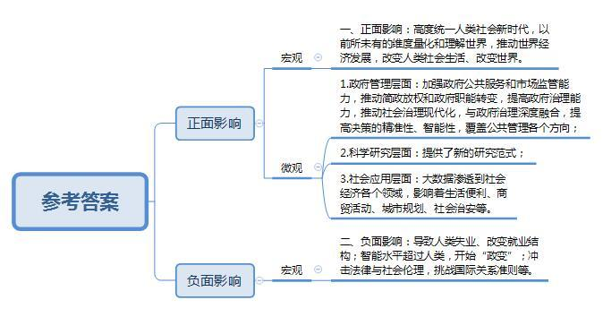
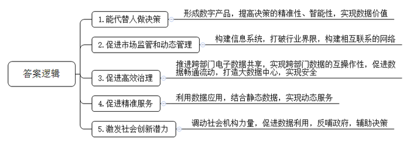
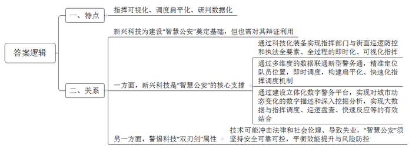
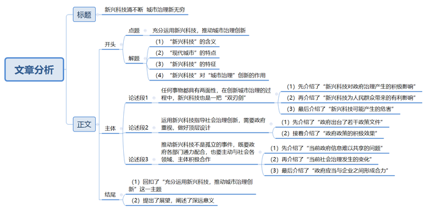

# 2018年上海市公考《申论》题（B、选调卷）

> 候选采集稿。参考答案及解析来自粉笔页面，不代表官方答案或真实高分答卷；来源使用许可与原卷对应关系仍需人工核实。

## 给定材料

### 材料 material-cf1efa119d73377a

2014年3月，国务院《政府工作报告》首次提出要大力发展“大数据”，时隔一年的《政府工作报告》中又提出了“互联网+”行动计划，要将移动互联网、云计算、大数据、物联网等技术与现代制造业相结合。同年7月，国务院办公厅颁布了《关于运用大数据加强对市场主体服务和监管的若干意见》，提出了要充分利用大数据加强政府公共服务和市场监管能力，推动简政放权和政府职能转变，提高政府治理能力。9月，国务院出台了《促进大数据发展行动纲要》，这是我国促进大数据发展的第一份权威性、系统性文件，是我国大数据发展的顶层设计。2016年2月，国务院印发了《关于全面推进政务公开工作的意见》，指出推进政府数据开放是推进政务阳光透明的内容之一。3月，“十三五”规划出台，第一次明确提出要实施国家大数据战略，把大数据作为基础性战略资源，全面实施促进大数据发展行动。接着，国务院办公厅转发了《推进“互联网+政务服务”开展信息惠民试点实施方案》，也明确提出了要打通政务数据部门孤岛的措施，鼓励政企合作。9月，国务院印发《政务信息资源共享管理暂行办法》，它是我国第一份关于政务信息资源共享的规范性文件，旨在加快解决政务信息和公共数据互联共享的老大难问题。如此密集地出台关于大数据的政策文件，体现了我国政府对现代新兴科技的重视程度，为各地应用发展大数据提供了极好的条件和极大的政策空间。

大数据是信息时代的产物，随着信息通讯技术的进步，社会经济活动对信息网络的依赖度增强，大量的智能终端设备、传感器、RFID等接入到了网络，产生的数据量与日俱增。2008年，世界著名科学杂志Nature专门推出了“大数据”专刊，大数据被定义为“代表人类认知过程的进步，数据集的规模是无法在可容忍的时间内用目前的技术、方法和理论去获取、管理、处理的数据”。2011年，国际数据公司（IDC）发布的《数字全球研究》指出，全球信息总量每过2年，就会增长一倍，2011年，全球创建和被复制的数据总量为1.8万亿GB，到2020年这一数据将增长到35万亿GB。为了进一步厘清大数据的概念，2012年IBM公司将大数据的特征总结为Volume（体量大），Velocity（速度快），Variety（形态多），即“3V”，随后该公司在这一基础上又增加了Veracity（真实性）的特征，即“4V”。2013年有研究者提出了Veracity（真实性）、Visualization（可视化），Value（价值性），即所谓的“新3V”。

无论是“3V”还是“4V”，大数据的具体特征都将随着数据的不断更新扩大被研究者进一步认知，而学界的讨论则从“什么是大数据”转移到了“如何应用大数据”方面。近来，关于大数据所蕴含的科学研究价值和社会应用价值吸引了越来越多的研究者和实践者的关注和重视。在科学研究领域，大数据提供了新的研究范式：一方面以数据为导向的研究范式将挑战传统科学研究基于归纳、演绎为主导的认识论(思维转变)；另一方面，该研究范式也为传统科学研究方法提供了计量革命的新契机（计量转向）。在社会应用层面，大数据几乎渗透到社会经济各个领域，影响着生活便利、商贸活动、城市规划乃至社会治安，如我国很多互联网企业均把用户的数据流量视为精准掌握客户行为和需求的基础；麻省理工学院（MIT）利用手机定位数据为意大利城市米兰完善城市空间规划；美国洛杉矶警察局（LA.P.D）和Predpoi公司合作，利用大数据预测犯罪的发生；Google Fiu Trends利用搜索关键词预测禽流感的散布；美国统计学家Nate Silver甚至通过大数据成功预测了2008年和2012年的总统选举结果。总而言之，大数据使得人们以前所未有的维度量化和理解世界，蕴含了巨大的价值。

## 题目

### 第 1 题

**结合给定资料，概述大数据与人工智能等新兴科技对人类社会与生活的影响。（20分）**

关联材料：material-cf1efa119d73377a

作答要求：

要求：概括准确，条理清楚，语言精练，字数不超过300字。

### 第 2 题

**结合给定资料，分析国外政府大数据主要应用在智慧政府、社会治理等五大领域的原因。（20分）**

关联材料：material-cf1efa119d73377a

作答要求：

要求：观点明确，层次清楚，语言精练，字数不超过200字。

### 第 3 题

**结合给定资料，用三个关键词归纳上海公安街面防控新型警务模式的主要特点；论述“智慧公安”与利用新兴科技之间的关系。（20分）**

关联材料：material-cf1efa119d73377a

作答要求：

要求：概括准确，观点明确，层次清楚，语言精练，字数不超过300字。

### 第 4 题

**以“充分运用新兴科技，推动城市治理创新”为主题，写一篇文章。（40分）**

关联材料：material-cf1efa119d73377a

作答要求：

要求：

（1）自选角度，自拟题目；

（2）观点明确，联系实际，分析具体，条理清楚，语言流畅；

（3）总字数800-1000字。

## 答案与解析

第 1 题

**参考答案（粉笔题库参考内容）**

一、正面影响：高度统一人类社会新时代，以前所未有的维度量化和理解世界，推动世界经济发展，改变人类社会生活、改变世界。1.政府管理层面：加强政府公共服务和市场监管能力，推动简政放权和政府职能转变，提高政府治理能力，推动社会治理现代化，与政府治理深度融合，提高决策的精准性、智能性，覆盖公共管理各个方向；2.科学研究层面：提供了新的研究范式；3.社会应用层面：大数据渗透到社会经济各个领域，影响着生活便利、商贸活动、城市规划、社会治安等。

二、负面影响：导致人类失业、改变就业结构；智能水平超过人类，开始“政变”；冲击法律与社会伦理，挑战国际关系准则等。

**解析**

**参考答案说明：**本参考答案分别从“正面影响”即“意义”及“反面影响”即“危害”两个方面进行作答，分别从宏观层面给出“正面影响”和“反面影响”，同时又从微观层面将“正面影响”分为“政府管理”“科学研究”“社会应用”三个层面。本题答案中的各条要点之间是并列关系，没有交叉。

**考点**：考点影响类

**来源**：来源2018年上海市公考《申论》题（B、选调卷）

第 2 题

**参考答案（粉笔题库参考内容）**

1.能代替人做决策。形成数字产品，提高决策的精准性、智能性，实现数据价值。

2.促进市场监管和动态管理。构建信息系统，打破行业界限，构建相互联系的网络。

3.促进高效治理。推进跨部门电子数据共享，实现跨部门数据的互操作性，促进数据畅通流动，打造大数据中心，实现安全。

4.促进精准服务。利用数据应用，结合静态数据，实现动态服务。

5.激发社会创新潜力。调动社会机构力量，促进数据利用，反哺政府，辅助决策。

**解析**

**参考答案说明：**本参考答案从“政府决策”“市场监管”“社会治理”“公共服务”“社会创新”五个方面展开，各条答案要点之间在内容上相互并列，没有交叉。

**考点**：考点原因类

**来源**：来源2018年上海市公考《申论》题（B、选调卷）

第 3 题

**参考答案（粉笔题库参考内容）**

一、特点：指挥可视化、调度扁平化、研判数据化。

二、关系：新兴科技为建设“智慧公安”奠定基础，但也需对其辩证利用。一方面，新兴科技是“智慧公安”的核心支撑。通过科技化装备实现指挥部门与街面巡逻防控和执法全要素、全过程的即时化、可视化指挥；通过多维度的数据联通新型警务通，精准定位队员位置，即时调度，构建扁平化、快速化指挥调度机制；通过建设立体化数字警务平台，实现对城市动态变化的数字描述和深入挖掘分析，实现大数据与指挥调度、巡逻盘查、快速反应等的有效结合。另一方面，警惕科技“双刃剑”属性。技术可能冲击法律和社会伦理、导致失业，“智慧公安”须坚持安全可靠可控，平衡效能提升与风险防控。

**解析**

**参考答案说明****：**本参考答案先介绍了上海公安街面防控新型警务模式的主要特点，围绕“指挥可视化”“调度扁平化”“研判数据化”三个方面展开。接着总结性点明了“智慧公安”与利用新兴科技之间的关系，然后具体从“新兴科技是‘智慧公安’的核心支撑”“警惕科技‘双刃剑’属性”两方面展开。

**考点**：考点多要素组合类

**来源**：来源2018年上海市公考《申论》题（B、选调卷）

第 4 题

**参考答案（粉笔题库参考内容）**

**新兴科技涌不断 城市治理新无穷**

这是一个崭新的时代，网络、大数据、人工智能等新兴科技力量喷涌而出，为“城市”这一巨系统的创新治理带来了诸多红利。现代城市的复杂性，决定了城市治理同样是一项庞杂的工程，而新兴科技的速度快、形态多、体积大等显著特征，如同一把解锁城市治理难题的“金钥匙”，不仅具有极强的针对性，更让城市治理的工作理念、指导思想、方法手段等不断推陈出新。因此，现代化城市创新治理，让新兴科技成为中流砥柱确有必要。

然而，**任何事物都具有两面性，在创新城市治理的过程中，新兴科技也是一把“双刃剑”。**在新兴科技的助力下，政府决策较之以往更加高效精准，市场监管、公共服务、社会治理等能力与水平显著提升。例如里昂基于实时交通报告不仅能侦测和预测拥堵，还可以及时调整信号灯让车流以最高效率运行，以及应对突发事件，有效地提高了政府治理能力。不仅如此，新兴科技也让人民群众的生活更加便捷，商贸活动更加自由，社会呈现出一派安居乐业的和谐景象。尽管如此，我们仍然要警惕新兴科技会导致人类失业、冲击法律与社会伦理、挑战国际关系准则等正在或潜在发生的问题，这就需要政府、社会、人民群众等多方力量，共同谱写新时代下，创新城市治理的科技篇章。

**运用新兴科技指导社会治理创新，需要政府重视，做好顶层设计。**2014年以来，我国政府密集出台了很多关于大数据的政策文件，为各地应用发展大数据提供了优越的条件、拓宽了发展的政策空间，有效地解决了围绕城市管理、环境保护等社会治理的难点问题，推动了社会治理的现代化进程。

**推动新兴科技不是孤立的事件，既要政府各部门通力配合，也要主动与社会各领域、主体积极合作。**目前来看，虽然很多政府已经将大数据作为提升政府治理能力和治理现代化的重要手段，但是信息难以共享，各个职能部门仍然是一个个孤岛，最终只能获得局部碎片数据、片面单一数据。随着社会结构的变化，参与社会治理的主体，已经从政府单一主体过渡到一个由政府、企业等构成的行动者系统。因此，一定要鼓励政府部门之间，政府和企业之间有效破解体制性障碍、摆脱机制性束缚。当然，这需要企业应积极参与各项信息化建设，夯实步入智能化时代的基础。

诺贝尔曾说：科学研究日益扩充的领域将唤起我们的希望。如今，科技的触角伸向城市治理，智慧城市再也不是南柯一梦，只存在于电影、戏剧，而是你我正在亲历其中，亲眼目睹，亲自感触的一场时代巨变！

**解析**

**文章分析**

**新兴科技涌不断 城市治理新无穷**

【**标题的优点：**一方面，范文的标题“新兴科技涌不断 城市治理新无穷”突出了“充分运用新兴科技，推动城市治理创新”这一主题。另一方面，它在形式上采用对称式结构，前半句点出手段，后半句点出了目的，使标题更加完整、饱满。】

这是一个崭新的时代，（1）网络、大数据、人工智能等新兴科技力量喷涌而出，为“城市”这一巨系统的创新治理带来了诸多红利。（2）现代城市的复杂性，决定了城市治理同样是一项庞杂的工程，而（3）新兴科技的速度快、形态多、体积大等显著特征，如同一把解锁城市治理难题的“金钥匙”，不仅具有（4）极强的针对性，更让城市治理的工作理念、指导思想、方法手段等不断推陈出新。因此，现代化城市创新治理，让新兴科技成为中流砥柱确有必要。

【**开头的优点：**★内容方面：范文的开头是紧扣题目给定的“充分运用新兴科技，推动城市治理创新”这一主题展开的。首先，开头第一句话点出主题，做到了主题明确。其次，对“充分运用新兴科技，推动城市治理创新”这一主题进行了分析阐述，指出了（1）“新兴科技”的含义。（2）“现代城市”的特点。（3）“新兴科技”的特征。（4）“新兴科技”对“城市治理”创新的作用。注意以上四个方面的阐述在逻辑上有先后顺序：先写时代背景；然后写“现代城市”的特点；再写“新兴科技”的特征；最后写“新兴科技”对“城市治理”的作用。★文字表达方面：使用了“尽管如此”“不仅**……**更”等关联词，使语言表达有逻辑性。此外，使用了比喻等修辞手法，使文字表达更加形象、有力。】

然而，**任何事物都具有两面性，在创新城市治理的过程中，新兴科技也是一把“双刃剑”**。在新兴科技的助力下，（1）政府决策较之以往更加高效精准，市场监管、公共服务、社会治理等能力与水平显著提升。例如里昂基于实时交通报告不仅能侦测和预测拥堵，还可以及时调整信号灯让车流以最高效率运行，以及应对突发事件，有效地提高了政府治理能力。不仅如此，新兴科技（2）也让人民群众的生活更加便捷，商贸活动更加自由，社会呈现出一派安居乐业的和谐景象。尽管如此，我们仍然要警惕新兴科技（3）会导致人类失业、冲击法律与社会伦理、挑战国际关系准则等正在或潜在发生的问题，这就需要政府、社会、人民群众等多方力量，共同谱写新时代下，创新城市治理的科技篇章。

【**论述段****1****的优点：**★观点句：范文的观点句是紧扣“充分运用新兴科技，推动城市治理创新”这一文章主题提出的。形式上，它在段首处直接写出，位置突出，容易发现。内容上，关键词突出，内容要点明确，可以明显看出它是从“新兴科技的影响”入手，指出了“新兴科技对城市治理的意义、危害”。★论述内容：（1）介绍了“新兴科技对政府治理产生的积极影响”；（2）介绍了“新兴科技为人民群众带来的有利影响”；（3）介绍了“新兴科技可能产生的危害”。注意：以上几个方面的内容都是紧扣“任何事物都具有两面性，在创新城市治理的过程中，新兴科技也是一把‘双刃剑’”这个观点句进行分析论述的，论述的针对性强，内容层次丰富。并且这几个方面的论述是有所侧重的，主要论述“新兴科技产生的积极影响”，次要论述“新兴科技可能存在的危害”。最后，在论述方法和论据的选取上做到了讲道理、举例子相结合，让论述内容丰富多样。】

**运用新兴科技指导社会治理创新，需要政府重视，做好顶层设计**。（1）2014年以来，我国政府密集出台了很多关于大数据的政策文件，（2）为各地应用发展大数据提供了优越的条件、拓宽了发展的政策空间，有效地解决了围绕城市管理、环境保护等社会治理的难点问题，推动了社会治理的现代化进程。

【**论述段****2****的优点：**★观点句：范文的观点句是紧扣“充分运用新兴科技，推动城市治理创新”这一文章主题提出的。形式上，它在段首处直接写出，位置突出，容易发现。内容上，关键词突出，内容要点明确，可以明显看出它是从“如何将新兴科技应用于城市管理”入手，指出了“政府政策层面的措施”。★论述内容：（1）介绍了“政府出台了若干政策文件”；（2）介绍了“政府政策的积极效果”。注意：以上两个方面的内容都是紧扣“运用新兴科技指导社会治理创新，需要政府重视，做好顶层设计”这个观点句进行分析论述的，论述的针对性强，内容层次丰富。并且这几个方面的论述是有内在逻辑顺序的，先讲采取的措施，然后讲措施带来的积极效果。最后，在论述方法和论据的选取上做到了讲道理、举例子相结合，让论述内容丰富多样。】

**推动新兴科技不是孤立的事件，既要政府各部门通力配合，也要主动与社会各领域、主体积极合作。**目前来看，虽然很多政府已经将大数据作为提升政府治理能力和治理现代化的重要手段，但是（1）信息难以共享，各个职能部门仍然是一个个孤岛，最终只能获得局部碎片数据、片面单一数据。（2）随着社会结构的变化，参与社会治理的主体，已经从政府单一主体过渡到一个由政府、企业等构成的行动者系统。因此，（3）一定要鼓励政府部门之间，政府和企业之间有效破解体制性障碍、摆脱机制性束缚。当然，这需要企业应积极参与各项信息化建设，夯实步入智能化时代的基础。

【**论述段****3****的优点：**★观点句：范文的观点句是紧扣“充分运用新兴科技，推动城市治理创新”这一文章主题提出的。形式上，它在段首处直接写出，位置突出，容易发现。内容上，关键词突出，内容要点明确，可以明显看出它是从“如何将新兴科技应用于城市管理”入手，指出了“政府层面的措施”。★论述内容：（1）介绍了“当前政府信息难以共享的问题”；（2）介绍了“当前社会治理发生的变化”；（3）介绍了“政府应当与企业之间形成合力”。注意：以上几个方面的内容都是紧扣“推动新兴科技不是孤立的事件，既要政府各部门通力配合，也要主动与社会各领域、主体积极合作”这个观点句进行分析论述的，论述的针对性强，内容层次丰富。并且这几个方面的论述是有内在逻辑顺序的，先讲存在的问题，然后讲当前社会治理发生的变化，最后讲应当采取的措施。最后，在论述方法和论据的选取上以讲道理为主，鞭辟入里，分析详细。】

【**论述段之间的关系：**★内容的内在逻辑：范文的论述段之间有两层逻辑。第一层，整体上是从“新兴科技的影响”到“如何将新兴科技应用于城市管理”的逻辑展开的。第二层，其中观点2和观点3又是从“如何将新兴科技应用于城市管理”出发，论述段2先写了“运用新兴科技指导社会治理创新，需要政府重视，做好顶层设计”，论述段3再写了“推动新兴科技不是孤立的事件，也要主动与社会各领域、主体积极合作”。★段与段的外在衔接：论述段1的段首处的“然而，任何事物都具有两面性”，起到了承接开头、引出了论述段1的作用。论述段3的段首处的“推动新兴科技不是孤立的事件，既要政府各部门通力配合，也要……”，起到了承接论述段2、引出了论述段3的作用。】

诺贝尔曾说：科学研究日益扩充的领域将唤起我们的希望。（1）如今，科技的触角伸向城市治理，（2）智慧城市再也不是南柯一梦，只存在于电影、戏剧，而是你我正在亲历其中，亲眼目睹，亲自感触的一场时代巨变！

【**结尾的优点：**范文的结尾（1）回扣了“充分运用新兴科技，推动城市治理创新”这一主题。（2）提出了展望，阐述了深远意义。】

**考点**：考点文章写作题

**来源**：来源2018年上海市公考《申论》题（B、选调卷）

