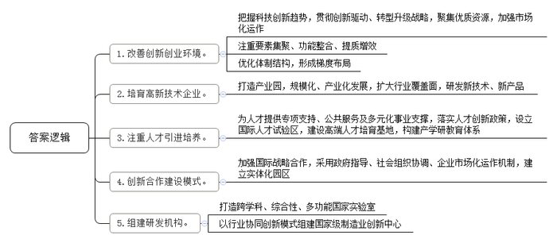
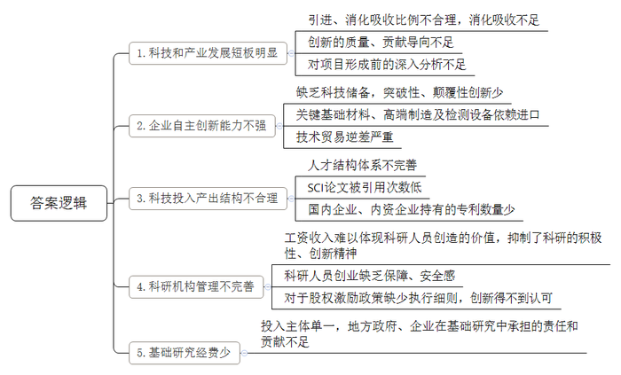
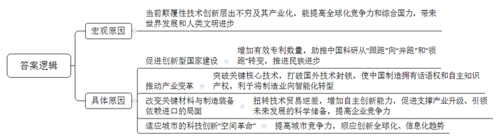
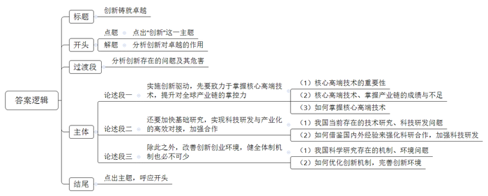

# 2019年上海市公考《申论》题（A卷）

<!-- gwy:overview:start -->
> **上海 · 2019 · 申论 · A类** ｜ 4 题 · 图片 4 处 · 答案随题折叠

导航：[题目](#题目) · [材料 1](#材料-1)
<!-- gwy:overview:end -->

> 候选采集稿。参考答案及解析来自粉笔页面，不代表官方答案或真实高分答卷；来源使用许可与原卷对应关系仍需人工核实。

## 给定材料

### 材料 1

本世纪初，国务院制订了《国家中长期科学和技术发展规划纲要》，正式提出，必须把提高自主创新能力作为国家战略，建设创新型国家。十多年来，我国创新型国家建设取得了重要进展。2016年全国共投入研究与试验发展经费15676.7亿元，比上年增加1506.9亿元，增长10.6%，占GDP的比重达到2.11%，其中企业的投入比重占到77.5%，科技进步的贡献率已经达到了56.2%。2016年我国发明专利申请受理量达到133.9万件，比上年增长了21.5%，有效发明专利保有量115.8万件，位居世界第三，PCT国际专利申请受理量超过4万件。《国家创新指数报2016-2017》显示，中国国家创新指数排名提升至第17位，成为唯一进入全球前20位的发展中国家。国际上一般认为，创新指数排名前15位的国家属于创新型国家。中国与这些国家的差距在逐步缩小，已非常接近创新型国家的行列了。

## 题目

### 第 1 题

**结合给定资料，概述张江国家自主创新示范区近年来取得的成功经验。（20分）**

关联材料：材料 1

作答要求：

要求：概括准确，条理清楚，语言精练，字数不超过300字。

第 1 题 · 答案与解析

**参考答案（粉笔题库参考内容）**

1.改善创新创业环境。把握科技创新趋势，贯彻创新驱动、转型升级战略，聚集优质资源，加强市场化运作；注重要素集聚、功能整合、提质增效；优化体制结构，形成梯度布局。

2.培育高新技术企业。打造产业园，规模化、产业化发展，扩大行业覆盖面，研发新技术、新产品。

3.注重人才引进培养。为人才提供专项支持、公共服务及多元化事业支撑，落实人才创新政策，设立国际人才试验区，建设高端人才培育基地，构建产学研教育体系。

4.创新合作建设模式。加强国际战略合作，采用政府指导、社会组织协调、企业市场化运作机制，建立实体化园区。

5.组建研发机构。打造跨学科、综合性、多功能国家实验室；以行业协同创新模式组建国家级制造业创新中心。

**解析**

**参考答案说明：**本参考答案从“改善创新创业环境”“培育高新技术企业”“注重人才引进培养”“创新合作建设模式”“组建研发机构”五个方面对张江国家自主创新示范区近年来取得的成功经验进行了分条撰写。各条要点之间在内容上是并列的，没有交叉。

**考点**：经验启示类

**来源**：2019年上海市公考《申论》题（A卷）

粉笔申论页面对本题只提供「解析视频」入口，该入口是会员推广位，页面无视频地址与文字解析。

### 第 2 题

**结合给定资料，从公共管理角度分析现阶段我国在创新发展中主要存在的不足。（20分）**

关联材料：材料 1

作答要求：

要求：概括准确，条理清楚，语言精练，字数不超过300字。

第 2 题 · 答案与解析

**参考答案（粉笔题库参考内容）**

1.科技和产业发展短板明显。引进、消化吸收比例不合理，消化吸收不足；创新的质量、贡献导向不足；对项目形成前的深入分析不足。

2.企业自主创新能力不强。缺乏科技储备，突破性、颠覆性创新少；关键基础材料、高端制造及检测设备依赖进口；技术贸易逆差严重。

3.科技投入产出结构不合理。人才结构体系不完善；SCI论文被引用次数低；国内企业、内资企业持有的专利数量少。

4.科研机构管理不完善。工资收入难以体现科研人员创造的价值，抑制了科研的积极性、创新精神；科研人员创业缺乏保障、安全感；对于股权激励政策缺少执行细则，创新得不到认可。

5.基础研究经费少。投入主体单一，地方政府、企业在基础研究中承担的责任和贡献不足。

**解析**

**参考答案说明：**本参考答案从“科技和产业发展短板明显”“企业自主创新能力不强”“科技投入产出结构不合理”“科研机构管理不完善”“基础研究经费少”这五个方面的不足进行分条撰写。各条答案要点之间在内容上是并列关系，没有交叉。

**考点**：问题类

**来源**：2019年上海市公考《申论》题（A卷）

粉笔申论页面对本题只提供「解析视频」入口，该入口是会员推广位，页面无视频地址与文字解析。

### 第 3 题

**结合当前经济社会发展形势，阐述为什么必须让创新成为驱动发展新引擎。（20分）**

关联材料：材料 1

作答要求：

要求：概括准确，条理清楚，语言精练，字数不超过300字。

第 3 题 · 答案与解析

**参考答案（粉笔题库参考内容）**

当前颠覆性技术创新层出不穷及其产业化，能提高全球化竞争力和综合国力，带来世界发展和人类文明进步。具体表现在：

1.促进创新型国家建设。增加有效专利数量，助推中国科研从“跟跑”向“并跑”和“领跑”转变，推进民族进步。

2.推动产业变革。突破关键核心技术，打破国外技术封锁，使中国制造拥有话语权和自主知识产权，利于将制造业向智能化转型。

3.改变关键材料与制造装备依赖进口的局面。扭转技术贸易逆差，增加自主创新能力，促进支撑产业升级、引领未来发展的科学储备，提高企业竞争力。

4.适应城市的科技创新“空间革命”。提高城市竞争力，顺应创新全球化、信息化趋势。

**解析**

**参考答案说明：**本参考答案以总分结构展开论述。先宏观介绍了必须让创新成为驱动发展新引擎的原因，技术创新对国家、世界、人类的重要性；又从“促进创新型国家建设”“推动产业变革”“改变关键材料与制造装备依赖进口的局面”“适应城市的科技创新‘空间革命’”这四个方面分析了具体原因，并做到了分类、分条撰写。各条要点之间彼此独立，没有交叉。

**考点**：原因类

**来源**：2019年上海市公考《申论》题（A卷）

粉笔申论页面对本题只提供「解析视频」入口，该入口是会员推广位，页面无视频地址与文字解析。

### 第 4 题

**追求卓越是上海城市精神的重要内容。结合给定资料，以“创新驱动与追求卓越”为主题，写一篇文章。（40分）**

关联材料：材料 1

作答要求：

要求：

（1）自选角度，自拟题目；

（2）观点明确，联系实际，分析具体，条理清楚，语言流畅；

（3）总字数800～1000字。

第 4 题 · 答案与解析

**参考答案（粉笔题库参考内容）**

**创新铸就卓越**

“海纳百川、追求卓越、开明睿智、大气谦和”是上海城市精神。创新驱动，则是上海继续作为排头兵引领全国经济社会转型升级的顶级战略。走创新驱动的道路，其实就是在不断追求卓越，实现更高层次、高水平、高目标的卓越。所以说，创新驱动是追求卓越的必由之路。

然而，当前我国创新体制不健全，企业自主创新能力不强，科技投入产出结构失衡，科研机构管理不完善，基础研究经费少……种种问题都影响着国家竞争力的提升，制约着创新型强国的迈进。可见，加强创新已迫在眉睫。

**实施创新驱动，先要致力于掌握核心高端技术，提升对全球产业链的掌控力**。核心高端技术是创新发展的基石。当前，我国在高铁、大飞机制造、航天制造等“硬件”制造方面掌握了一些核心技术，具备了相当的竞争力。但在与信息技术相关的芯片制造、计算机操作系统，以及新材料等“软件”制造方面，却远远落后。去年以来，欧美日等发达国家在这方面给我们设置障碍，意图阻滞中国制造2025战略，阻碍中国5G通信技术发展。加快在核心高端技术领域的追赶，争取话语权，是上海使命和国运所在。

**还要加快基础研究，实现科技研发与产业化的高效对接，加强合作**。与英美等发达国家相比，我国存在高校、科研院的科技研发和企业对接不畅，对市场不敏感等问题。这需要我们积极借鉴国内外经验，如：学习美国波士顿创新区，上海张江科技示范区等经验，采用多元主体参与，政府指导、社会组织协调、企业市场化运作机制，建设技术研发与转化的平台，加速科研成果和企业、市场的顺畅对接，以充分释放科研人才的创新力量，助推科研从“跟跑”向“并跑”和“领跑”转变。

**除此之外，改善创新创业环境，健全体制机制也必不可少**。我国的科学研究既有缺乏人文使命的精神底蕴的问题，也缺乏让科学家自由探索的乐趣。还存在科研体制僵化，对科研人员激励不足，缺乏保障，导致科研人员缺少安全感，科研积极性不高，创新精神难以发挥等问题。所以，我们在引才、育才、用才时，应给予充分的政策支持，提供完善的配套服务，给予多元化的事业支撑，集聚社会优质资源，从而更好地推动创新，实现卓越发展。

不论是一个国家，还是一个城市，要实现卓越，指定离不开创新。为此，我们要抓住发展契机，加快引进全球性创新人才，大力引进新知识新技术，着力把中国创新产品推向全世界，进而为建设卓越国家，书写华丽新篇章！

**解析**

**文章分析**

**创新铸就卓越**

【**标题的优点：**范文的标题“创新铸就卓越”突出了“创新驱动”与“追求卓越”等主题词。】

（1）“海纳百川、追求卓越、开明睿智、大气谦和”是上海城市精神。（2）创新驱动，则是上海继续作为排头兵引领全国经济社会转型升级的顶级战略。走创新驱动的道路，其实就是在不断追求卓越，（3）实现更高层次、高水平、高目标的卓越。**所以说，创新驱动是追求卓越的必由之路。**

【**开头的优点：★内容方面：**范文的开头是紧扣“创新驱动与追求卓越”这一主题展开的。首先，开头在段首处点出主题，做到了主题明确。其次，对“创新驱动与追求卓越”这一主题进行了分析阐述，指出了（1）上海城市精神的特点；（2）创新驱动的内涵；（3）创新驱动对追求卓越的重要作用。**★文字表达方面：**长短句配合使用，使语言表达有节奏感，使行文更加紧凑、流畅、简洁、规范。】

然而，当前我国创新体制不健全，企业自主创新能力不强，科技投入产出结构失衡，科研机构管理不完善，基础研究经费少……种种问题都影响着国家竞争力的提升，制约着创新型强国的迈进。可见，加强创新已迫在眉睫。

【**过渡段的优点：**范文的过渡段分析了我国创新驱动发展面临的主要问题。此外，还要注意过渡段末尾的“可见，加强创新已迫在眉睫”是用来引起下文的过渡句，起到了承上启下的作用。】

**实施创新驱动，先要致力于掌握核心高端技术，提升对全球产业链的掌控力**。（1）核心高端技术是创新发展的基石。当前，（2）我国在高铁、大飞机制造、航天制造等“硬件”制造方面掌握了一些核心技术，具备了相当的竞争力。（3）但在与信息技术相关的芯片制造、计算机操作系统，以及新材料等“软件”制造方面，却远远落后。去年以来，欧美日等发达国家在这方面给我们设置障碍，意图阻滞中国制造2025战略，阻碍中国5G通信技术发展。（4）加快在核心高端技术领域的追赶，争取话语权，是上海使命和国运所在。

【**论述段1的优点：★观点句：**范文的观点句是紧扣“创新驱动与追求卓越”这一文章主题提出的。形式上，它在段首处直接写出，位置突出，容易发现。内容上，关键词突出，内容要点明确，可以明显看出它是从“技术”这一方面入手，指出了要想实现创新驱动需掌握核心高端技术。**★论述内容：**（1）介绍了核心高端技术的重要性；（2）介绍了我国核心高端技术方面的成绩；（3）介绍了我国掌握产业链方面的不足；（4）介绍了掌握核心高端技术的重要举措。以上几个方面的内容都是紧扣“实施创新驱动，先要致力于掌握核心高端技术，提升对全球产业链的掌控力”这个观点进行分析论述的，论述的针对性强，内容层次丰富。最后，在论述方法上采取了举例子的方式进行展开，做到了论述有力。】

**还要加快基础研究，实现科技研发与产业化的高效对接，加强合作**。与英美等发达国家相比，（1）我国存在高校、科研院的科技研发和企业对接不畅，对市场不敏感等问题。（2）这需要我们积极借鉴国内外经验，如：学习美国波士顿创新区，上海张江科技示范区等经验，采用多元主体参与，政府指导、社会组织协调、企业市场化运作机制，建设技术研发与转化的平台，加速科研成果和企业、市场的顺畅对接，以充分释放科研人才的创新力量，助推科研从“跟跑”向“并跑”和“领跑”转变。

【**论述段2的优点：★观点句：**范文的观点句是紧扣“创新驱动与追求卓越”这一文章主题提出的。形式上，它在段首处直接写出，位置突出，容易发现。内容上，关键词突出，内容要点明确，可以明显看出它是从“科研”这一方面入手，指出了要想实现创新驱动需加快基础研究，加强科研与产业、企业的对接与合作。**★论述内容：**（1）介绍了我国在科技研发上存在的主要问题；（2）介绍了加快基础研究，实现科技研发的重要措施。以上两个方面的内容都是紧扣“还要加快基础研究，实现科技研发与产业化的高效对接，加强合作”这个观点进行分析论述的，论述的针对性强，内容层次丰富。最后，在论述方法上主要采取了讲道理和举例子相结合，做到了丰富多样。】

**除此之外，改善创新创业环境，健全体制机制也必不可少**。（1）我国的科学研究既有缺乏人文使命的精神底蕴的问题，也缺乏让科学家自由探索的乐趣。还存在科研体制僵化，对科研人员激励不足，缺乏保障，（2）导致科研人员缺少安全感，科研积极性不高，创新精神难以发挥等问题。所以，（3）我们在引才、育才、用才时，应给予充分的政策支持，提供完善的配套服务，给予多元化的事业支撑，集聚社会优质资源，从而更好地推动创新，实现卓越发展。

【**论述段3的优点：★观点句：**范文的观点句是紧扣“创新驱动与追求卓越”这一文章主题提出的。形式上，它在段首处直接写出，位置突出，容易发现。内容上，关键词突出，内容要点明确，可以明显看出它是从“创业”这一方面入手，指出了要想实现创新驱动需改善创新创业环境，健全体制机制。**★论述内容：**（1）介绍了我国科学研究在机制和环境方面存在的主要问题；（2）介绍了对科研人员产生的危害；（3）介绍了优化创新机制和完善创新环境方面的重要措施。以上三个方面的内容都是紧扣“除此之外，改善创新创业环境，健全体制机制也必不可少”这个观点进行分析论述的，论述的针对性强，内容层次丰富。最后，在论述方法上主要采取了讲道理与举例子相结合，做到了丰富多样。】

【**论述段之间的关系：★内容的内在逻辑：**范文的论述段之间是依照“并列”逻辑展开的。论述段1先从掌握核心高端技术方面写了如何实现创新驱动，论述段2再从加快基础研究方面写了如何实现创新驱动，论述段3最后从优化创业机制与环境方面写了如何实现创新驱动。3个论述段是从技术、科研、创业这三大领域展开的。**★段与段的外在衔接：**3个论述段句式结构相似，使读者能够迅速看懂论述段的并列关系。】

不论是一个国家，还是一个城市，（1）要实现卓越，指定离不开创新。为此，我们要抓住发展契机，加快引进全球性创新人才，大力引进新知识新技术，（2）着力把中国创新产品推向全世界，进而为建设卓越国家，书写华丽新篇章！

【**结尾的优点：**范文的结尾回扣了“创新驱动与追求卓越”这一主题。（1）再次提到“创新”“卓越”等主题词；（2）阐述了深刻意义。】

**考点**：文章写作题

**来源**：2019年上海市公考《申论》题（A卷）

粉笔申论页面对本题只提供「解析视频」入口，该入口是会员推广位，页面无视频地址与文字解析。

