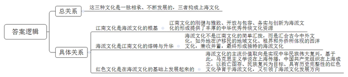
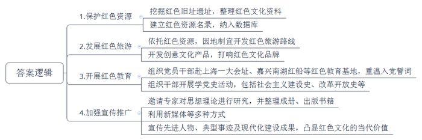
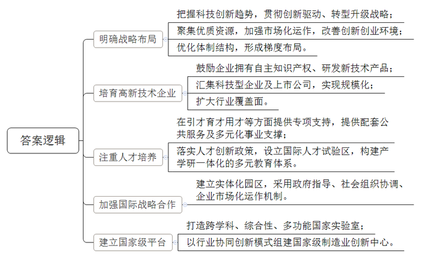
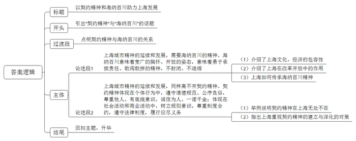

# 2019年上海市公考《申论》题（B、选调卷）

<!-- gwy:overview:start -->
> **上海 · 2019 · 申论 · 选调生** ｜ 4 题 · 图片 4 处 · 答案随题折叠

导航：[题目](#题目) · [材料 1](#材料-1)
<!-- gwy:overview:end -->

> 候选采集稿。参考答案及解析来自粉笔页面，不代表官方答案或真实高分答卷；来源使用许可与原卷对应关系仍需人工核实。

## 给定材料

### 材料 1

近一个世纪以来，红色文化一直是上海这座城市的底色。党的十九大闭幕后不久，习近平总书记就带领中央政治局常委一同瞻仰上海中共一大会址和浙江嘉兴南湖红船。在上海中共一大会址，习近平总书记和常委同志重温入党誓词，宣示了“不忘初心”的红色文化情结。

我国的红色文化在上海萌芽、发展和传播不是偶然的。20世纪初，便利的交通、发达的印刷业、频繁的国际交流以及民族资产阶级和无产阶级的兴起，使上海成为思想舆论传播的重镇，各类思想学说争相登场、展开论战。1920年，由陈望道翻译的《共产党宣言》在沪出版，上海成为当时宣传马克思主义的新中心。同时，我国的马克思主义知识分子作为桥梁，把马克思主义与工人运动结合起来。在此基础上，上海成为中国共产党的创建地，这奠定了上海在红色历史文化传承中的重要地位。

红色文化的历史完整性，成为上海文化的一大特色。它不只涵盖革命时期的上海，而且包括社会主义建设和改革开放时期的上海。新中国成立后，上海积极支援全国建设，涌现出一大批社会主义建设的先进人物和典型事迹。改革开放以来，上海成为改革开放排头兵、创新发展先行者，成为展示中国现代化建设成果的重要窗口，凸显了以红色文化为基色的上海文化资源的当代价值。

### 材料 2

文化品牌承载着城市精神品格和理想追求，是城市软实力的重要依托。2018年上海制订了《关于全力打响“上海文化”品牌加快建成国际文化大都市三年行动计划》，明确三大重点任务——全面打响上海红色文化品牌、海派文化品牌、江南文化品牌。在中国特色社会主义进入新时代这一历史方位，全力打响“上海文化”品牌、加快建成国际文化大都市这一战略目标具有重要意义，要对标国际文化大都市的最高标准，虚心学习兄弟省市的好做法好经验，加快打造一批海派特色突出、城市特质彰显、内涵价值丰富、感知识别度高的国内国际知名文化品牌，着力构筑上海文化发展新优势，不断提升城市文化软实力。

上海是中国近现代社会走向世界的港口城市，是中华民族优秀历史文化实现创造性转化、创新性发展的成功典范。1843年11月上海开埠后，古今中外文化交融汇合，上海人兼收并蓄，形成独特的海派文化。实现中华民族伟大复兴，逐渐成为海派文化的主流价值取向。马克思主义学说在上海传播，中国共产党组织在上海成立，以救亡图存、民族复兴为目标的红色文化，孕育于海派文化，又引领了海派文化发展方向。

城市是现代文化的载体。上海位于长江出海口，自古以来就是一片不断生长着的土地。从考古发现上看，从最初的马家浜文化，过渡到崧泽文化，再到良渚文化、马桥文化，精益求精、创新发展、海纳百川，是这片土地上的先民们大体相同的文化性格特征和生存智慧。开埠以前的千百年间，从春申君封邑到沪渎渔村，从华亭善治到云间繁华，从海上丝绸之路重镇的青龙港，到江海通津、东南都会的上海港，上海由水而起，因港而兴，江南文化的刚健与雅致、开放与包容、务实与创新，为海派文化形成提供了丰厚的中华优秀传统文化资源。明清之际，上海人徐光启在中西文化交流上，首开合作互鉴、为我所用、求真务实的先河。

### 材料 3

六朝以后的江南，特别明清时期的江南，是中国经济、文化最为发达的地区。宋代以后，棉、丝、盐和茶在江南经济中占有相当高比例。明清时期的江南，由于人口密度高，不同区域自然禀赋有所不同，形成了一个多样化、专业化、精细化、有着充分市场的经济结构，已有粮食、棉花与蚕桑产区的专业分工。粮食产区面积最广，涉及苏、松、杭、嘉、湖、常、镇七府，棉花产区以松江为主，蚕桑产区以湖州为主。蚕桑区的中心是苏、湖、嘉、杭四府交接地区，尤以湖州的长兴、德清，嘉兴的桐乡、石门和苏州的吴江等地最为发达。茶、苎麻、蓝靛、漆、桐、柏、竹、木、渔、盐等，也都有专业化生产，甚至植桑与养蚕也有分工。乌镇曾有远近闻名的桑叶市场，有些农户从养蚕产业链中独立出来，专门种植桑树、生产桑叶、运输桑叶、销售桑叶而不养蚕。手工业生产的专业化程度也很高，丝织、棉纺、陶瓷、制糖、酿造、造纸、矿冶、五金等，各有专家。研究成果表明，宋代以后，江南地区士大夫必兼农桑之业方得赡家，亦农亦商、士商一家的情况相当普遍，商贾地位不断提高，传统的“士-农-工-商”的顺序，实质上已经是“士-商-农-工”了。

明清上海本是松江府属一县，一直浸润、成长在江南文化之中。明代与西洋来华传教士合作翻译西方书籍的著名学者杨廷筠、李之藻都是江南人，研究西洋文化非常出名的王锡阐也是江南人。顾炎武著《天下郡国利病书》等书，为倡导经世致用之学的杰出代表。在地理学方面做出非凡贡献的徐霞客、顾祖禹，都是江南人。长期居住在苏州的唐甄所著《潜书》，对社会积弊提出多方面的批评，在清代思想史上留下重要一页。清代学者所编《畴人传》（包括续编、三编与四编），共收明末以后的各地天文、数学方面的学者220人，籍贯确切可考者201人，其中江南人占了一半以上，充分说明江南地区科技人才众多。

近代上海移民来自全国各地，但绝大部分来自江南。据统计，1930年，江苏、浙江两省籍人占公共租界人口的88.4%，占华界人口的85.5%。1950年1月，江苏、浙江与上海本地籍人，占上海总人口的88.9%。由此可见，近代上海人中，江南人士占了八成以上。江南文化与海派文化有直接的渊源关系。当然，海派文化并不是江南文化的简单汇拢，而是经过上海这个特大城市的集聚与熔铸，吸收了中国其他地方在沪移民所体现出来的地域文化，以及租界和外侨所体现的西洋文化，才得以形成的。以移民为主体、以陌生人社会为重要特征的特大城市，对于文化的集聚、熔铸与升华能力，与以本地人为主体、以熟人社会为重要特征的乡村城镇对于文化的影响，具有巨大的、甚至是本质的差异。

上海开埠时，在江南城市中并不占显要地位，人口体量与文化地位均比不上苏州、南京、杭州。开埠以后，经过多种因素错综复杂的影响，很快跃升为江南地区首位城市，1860年以后，其经济、文化地位已经超过了苏州、南京、杭州。1935年，上海人口超过370万，为世界第五大城市，仅次于伦敦、纽约、东京与柏林。1947年，上海人口相当于北平、南京与天津三大城市人口的总和。

### 材料 4

上世纪80年代，上海上缴中央财政的资金占当年的地方财政大约86%～90%。资金困难的同时，上海还存在“两个一百万”的巨大难题：在大规模的产业结构调整过程中，有一百多万的工人大转岗；在大规模的城市改造过程中，有一百多万的市民大动迁。牵一发而动全身，处理不当，会引发社会震荡，改革、发展便无从谈起。难题面前，上海没有回避，而是迎难而上。90年代初，上海提出了“三个保证”：保证坚持社会主义方向、保证服从国家宏观调控、保证超额完成财政上缴，启动了对发展至关重要的“三项改革”：率先改革、自主改革、自费改革。这是上海向党中央立下的军令状，破釜沉舟，自我加压，敢于承担历史风险和历史责任。上海的干部群众没有等、靠、要，而是积极主动担当起“重振大上海雄风”的历史使命。

进入新时代，上海肩负新的历史使命，唯有拿出“改革开放再出发”的决心和勇气，才能赢得新的优势。而上海改革开放再出发的精神动力，是上海城市精神更具体的表达、更生动的诠释。上海是个讲“大局”的城市。2008年上海纪念改革开放30周年，总结出的第一条经验就是“坚持服从、服务国家战略，自觉把上海发展放在全国发展的大环境中来思考和谋划”。习近平同志2007年在上海工作，他曾说：上海能成其大，就是靠内联外拓，才成为现在的国际化大都市，今后还要这么走下去。

中央要求上海继续当好“改革开放的排头兵、创新发展的先行者”，期许上海能拿出全国前列的优秀经验和卓越成就来。上海现在是全国改革“试验田”，“司法改革”“群团改革”“教育改革”“自贸区”“科创中心”等都在上海先行先试。上世纪八九十年代的上海改革，大多涉及经济领域，现在许多改革都触及政治体制、社会民生等方面，难度不比当年小，没有“复制粘贴”的可能。但这是国家交给上海的任务，上海责无旁贷，一定要把国家交予的这份试卷做好。

### 材料 5

城市规划、建设、管理、衣食住行，上海都是开风气之先。改革大幕拉开后，上海的“潜能”被激发。上海在改革开放历程中“闯”出许多“全国第一”：新中国第一只真正意义的股票就诞生在上海；新中国第一家证券交易中介机构——上海证券交易所在浦江饭店成立。曾经，“股票”“证券交易所”都是市场经济的代名词，争议很大：向个人发售股票，会不会搞成变相“私有化”？发行股票债券，会不会分流国有银行储蓄？证券买卖带点赌博性质，会不会助长投机思想、不利于社会安定？再如，新中国第一次以国际招标形式进行的土地批租，也在上海发生。土地批租对于改变上海的城市面貌起到了关键作用，但也面临巨大争议：这么做是不是违反了我国宪法？是不是搞土地私有化？土地批租与解放前上海“租界”有什么区别？都是一道道大问题。到2000年底，上海通过土地批租，筹集资金超过1000多亿。按原来上海的财力算，完成旧城区改造恐怕需要100年，整整一个世纪，但是通过土地批租，大大缩短了时间，而这与上海敢闯敢拼的创新精神是分不开的。

海派文化有讲究“精致”“细腻”的一面。90年代上海有一句总结：认准的东西，走小步，不停步，坚决不走回头路。坚持不懈，稳扎稳打，注重细节，不好高骛远，不敷衍了事，要做就做得精彩、争取做到最好，有领导指出，上海相较浙江、江苏，不过是个城市，地域不大，就是个“大基层”，上海的文化就是基层的文化，就是“操作”的文化，就是务实的文化。90年代，在上海干部当中有句话非常流行：“少说多做、只做不说”。凡事不争论，不讨价还价，首先把上海自己的事情做好，“实干”是上海的城市特征。

上海善于归纳、提炼、总结，不仅做事，而且“想事”，有理性思维、有专业精神，既要干好，又要干巧。通过大讨论，广泛吸收意见，充分酝酿，科学规划。浦东新区某领导谈到他在浦东工作的六字体会是“先用心，再用力”。不用心就用力，看起来大胆，但是有盲目性。上海做事情宁可慢一点，想清楚再动手。大的战略一旦制定出来，一代接着一代干。80年代搞的“上海经济发展规划”，管了几十年。上海最新的城市总体规划已经到了2035年，这是党的十九大之后，国务院批准的第一个超大城市总体规划。

### 材料 6

上海人教育子女，最重视“做规矩”三字，实质是守法制，敬良俗，重规则。同时，上海这座城市有厚重的契约精神，尊重制度与合约，这是商业文明高度发达而衍生出的城市传统。

70多年前，一位在上海避难的犹太学校校长卡尔（Carl）先生在回国之前，将两千册外文书籍托付给上海人林道志先生——二战时期原犹太难民隔离区“慕义”教会学校校长，并留下一句：请帮忙照管，我会回来取的。面对这份嘱托，林先生坚守承诺，倍加小心地呵护这批书籍。当年林先生家的隔壁曾是日本人的军火库，鉴于这块地方很危险，林先生便雇了十余名挑夫，携家人肩挑手提将书全部运回了老家浙江黄岩。不久美军投弹轰炸了这片区域，这个区域的房子被夷为平地，林先生的家和周围很多房子都所剩无几。由于林先生未雨绸缪，这些书和家人都幸免于难。抗战胜利后，林先生又不辞劳苦地将这批书籍搬运回了上海。为了寻找到书的主人，林先生曾经找了两位在上海的德国留学生，帮助写了一封德文的书信，按照犹太校长之前留下的地址寄出去。但在苦苦等候之后，信最终被退回来。林家三代人一直守候并通过德国驻沪总领事馆帮助寻找其后人，两千本书就这样“躺”在林家70年。

林家一直居住在上海虹口区，随着虹口区改造的推进和加快，将搬离多年的居住地。林道志先生的后人为了了却老人的遗愿，寻求上海犹太难民纪念馆的帮助，以找回当年嘱托代为保管书籍的那位犹太校长或者他的亲属。上海犹太难民纪念馆经与林家后人商量，请德国驻沪领事馆继续帮助在德国寻找书籍主人。

### 材料 7

作为上海曾经的主流民居，石库门发端于19世纪下半叶的租界，兴盛于20世纪二三十年代。石库门这种独特模式可能与早期开发商选用两层“联体排式”有关。由于石库门几乎与上海城市建设和上海市民社会孕育同步，它的样态、功能自然适应着市民的生存方式，刻烙下上海文化精神的诸多风貌，尤其是市民社会健康发展不可或缺的契约精神。

石库门具有现代市场经济运作下的“商品”特性。石库门里的房客、房东之间是以有形的“租赁”和无形的群体“契约”形式组成共同体。不管房客以前的身份与背景，不管是来自城市还是乡村，当下的身份都是承租人。租金多，可以租稍好点的前楼、前客堂；租金少，租无窗的后楼、后客堂，或者带有“老虎窗”（英文Roof的音译与中文“窗”称谓的组合）的“三层阁”。而文人们则青睐于租金适中，又处于相对安静、独立位置的“亭子间”。从郁达夫的小说中能看到，当年他“蜗居”于提篮桥邓脱路（今丹徒路）的石库门里，与他为邻的烟厂女工则住在出入需用临时木梯攀登的“二层阁”。然而他们却有一种拘谨而友好的交往，这来源于独立个体在“契约共同体”情景中的自尊与相互尊重。石库门沿街开有夫妻店，规模虽小，却也参与到上海商品交易的大循环中。账都是按月、季度结算的，如果钱紧，还可以协商延后。商品流通中遵循的契约精神又通过夫妻店传递到石库门的人际关系中。

石库门无论内部还是外部都是“裸露”的。石库门屋与屋之间通常用木板分割；做饭集中在公共灶头间；晾衣晒被不是在晒台、天井、窗外，就是在弄堂里、马路边。是山珍海味还是咸菜泡饭，是丝绸裘皮还是破衣烂衫，无疑是家底的大曝光。石库门的弄堂很窄，但却是交通与社区交流、活动场所，还是一个信息交流中心。所以在这里，人人都是透明的。上海市民社会共同遵循的公开、透明理念和底线规则在隐隐地起着规范与调节作用。大家心知肚明，知道遵守底线则双赢，于是养成了上海人尊重隐私底线的意识。

### 材料 8

任何社会都需要法律来维持秩序，对人的行为具有强制力的契约不可或缺。例如，在中国古代，除了刑律，田契、典约等契约文本名目繁多，虽然就形式而言，契约总是经双方同意签订的，但签约双方是否具有法律上的平等地位，很值得探究。在专制集权的封建社会，法律是强者的统治工具，它偏重于强制性和惩罚性。严格意义上的契约是指与现代商业精神和工业革命相联系的法律制度，这里讨论的就是这种契约。它不仅具有约束性，而且具有合意性，契约之所以有效和正当，盖源于平等自愿的基础。

契约的文化属性更体现在非正式契约中。传统文化在维系人们的社会关系和教化人们的道德观念方面发挥过重要的作用。例如诚信，孔子在《论语》中多次提到“敬事而信”是针对统治者的，“文、行、忠、信”“谨而信”“言忠信，行笃敬”是告诫学生的，“言必信，行必果”和“人而无信，不知其可也”是要求常人的；《孟子》强调：“诚者，天之道也；思诚者，人之道也。”这些倡导都具有积极向上的价值，但把道德准则转变为社会契约，还需要具备操作性和扩展性。

契约精神是社会主义核心价值观的本质要求之一。党的十八届四中全会决定指出：“加强公民道德建设，弘扬中华优秀传统文化，增强法治的道德底蕴，强化规则意识，倡导契约精神，弘扬公序良俗。发挥法治在解决道德领域突出问题中的作用，引导人们自觉履行法定义务、社会责任、家庭责任。”2018年中共中央印发的《社会主义核心价值观融入法治建设立法修法规划》强调：“以保护产权、维护契约、统一市场、平等交换、公平竞争等为基本导向，完善社会主义市场经济法律制度。”

### 材料 9

科技是国家强盛之基，创新是民族进步之魂。作为全国创新发展的先行者，加快建设具有全球影响力的科技创新中心，是党中央、国务院交给上海的重大战略任务，也是上海在新时代服务国家发展的重大历史使命。张江国家自主创新示范区作为上海科技创新的核心区和重要载体，牢牢把握科技创新的大趋势，进一步贯彻执行创新驱动、转型升级的发展战略，通过集聚社会优质资源、加强市场化运作实现创新创业环境的优化配置及综合改进。张江国家自主创新示范区在要素集聚、功能整合、人才发展、提质增效上，正在向成为“科创中心的中心”目标迈进，向引领和服务市科创中心建设转型升级。近几年，张江示范区“一区22园”的体制结构不断优化，其中包括了超百家的园中园，总占地面积531平方公里，分布于上海16个区，形成了“一核三带多园点”的梯度布局。

张江示范区注重对高新技术企业的培育与孵化，取得了卓有成效的成果。据统计，张江规模以上企业营业收入4.69万亿，其中工业总产值1.44万亿，利税6230.54亿元，拥有自主知识产权15.6万件，世界领先、国内首创的新技术、新产品达到数千个。张江示范区区域内汇集科技型企业7万余家，各类上市公司593家，其中，在纽交所、纳斯达克、新加坡等境外上市公司数量为34家，在香港上市公司数量为24家；在沪深主板上市91家，在中小板上市12家，在创业板上市22家，在新三板和上海股权交易中心挂牌分别为301和109家。从分布情况来看，主要集中在计算机、传媒、医药、综合、机械、电子元器件、房地产、商贸零售、通信等行业。

人才是张江科学城最宝贵的财富，更是张江最关键的动力引擎。截至目前，张江示范区内集聚了210万名从业人员，1900多个研发机构，300余个公共服务平台，44所高校，汇聚了上海80%以上的高端人才。除在引才、育才、用才等方面给予专项支持外，张江示范区还为各类人才发展提供配套的公共服务以及多元化的事业支撑。自2015年4月被纳入自贸区扩区范围以来，依托自贸试验区优势，张江全面落实上海市“人才20条”“人才30条”“加快实施人才高峰工程行动方案”，以及浦东“人才35条”等人才创新政策。经过多年酝酿积累，国家外国专家局与上海市政府于2016年签署合作备忘录，提出了23项创新举措，持续推进张江国家自主创新示范区建设国际人才试验区。与此同时，张江示范区继续加快联合培养实验室、院士专家工作站、博士后工作站、研究生联合培养基地等建设，实现优势产业与传统教育优势互补，推动产学研一体化的多元教育体系建设，形成了产业与高校联合培养高端人才的创新机制。2016年，上海市张江高新技术产业开发区管委会与美中合作发展委员会达成战略合作，在波士顿建立了实体化园区，大胆创新建设模式。上海张江波士顿企业园是我国率先采用政府指导、社会组织协调、企业市场化运作机制的海外科技园区项目。

作为科学之城，张江是上海科技创新的重要窗口和国家级科技高地。2017年9月，中科院和上海市政府共同挂牌启动了张江实验室。据悉，张江实验室定位是主要依托以上海光源为代表的光子科学科技基础设施集群，面向生命健康科学、集成电路信息技术、类脑智能等领域，打造成为跨学科、综合性、多功能的国家实验室，被称为是打造国家创新体系战略科技力量的重大决策部署，也被誉为上海科创中心建设的“皇冠上的明珠”和最闪亮的“金字招牌”。

2018年7月初，国家集成电路创新中心、国家智能传感器创新中心在张江同时宣告启动。它们是我国第六、第七个制造业创新中心，也是上海首次获批建设的国家级制造业创新中心。此次落地张江的国家集成电路创新中心，由复旦大学牵头，联合行业龙头企业中芯国际、华虹集团，以行业协同创新模式组建。

目前，上海张江已经崛起成为世界上集聚程度最高的大科学装置群，主要包括上海光源、国家蛋白质科学研究（上海）设施、软X射线自由电子激光、超强超短激光装置、活细胞结构和功能成像平台等。未来在全力推进张江综合性国家科学中心建设，加强生命科学、量子科学等领域前瞻布局的同时，还将新建北斗导航、机器人、工业互联网、低碳技术、临床研究等共性技术研发与转化平台。在上海建设具有全球影响力的科创中心的新征程中，张江综合性国家科学中心正成为高端创新资源集聚的新地标，助推中国科研从“跟跑”向“并跑”和“领跑”转变。

## 题目

### 第 1 题

**结合给定资料，阐述“上海文化”形成的过程中，红色文化、海派文化和江南文化之间的关系。（20分）**

关联材料：材料 1、材料 2、材料 3、材料 4、材料 5、材料 6、材料 7、材料 8、材料 9

作答要求：

要求：概括准确，条理清楚，语言精练，字数不超过300字。

第 1 题 · 答案与解析

**参考答案（粉笔题库参考内容）**

这三种文化是一脉相承、不断发展的，三者构成上海文化。

1.江南文化是海派文化的根基。江南文化的刚健与雅致、开放与包容、务实与创新为海派文化的形成提供了丰厚的中华优秀传统文化资源。

2.海派文化是江南文化的熔铸与升华。海派文化不是江南文化的简单汇拢，而是汇合古今中外文化，如外地在沪移民的地域文化、租界和外侨所体现的西洋文化，兼收并蓄，最终形成独特的海派文化。

3.红色文化是在海派文化的基础上发展起来的。海派文化的主流价值取向是实现中华民族伟大复兴，基于此，马克思主义学说在上海传播，中国共产党组织在上海成立，以救亡图存、民族复兴为目标、具有历史完整性的红色文化孕育于海派文化，又引领了海派文化发展方向。

**参考答案说明：**本参考答案先对题干给定的“红色文化、海派文化和江南文化之间的关系”进行了总结；接着具体介绍了“江南文化与海派文化的关系”，“海派文化与江南文化的关系”，“红色文化与海派文化的关系”。

**解析**

**考点**：其他类

**来源**：2019年上海市公考《申论》题（B、选调卷）

> 粉笔申论页面对本题只提供「解析视频」入口，该入口是会员推广位，页面无视频地址与文字解析。

### 第 2 题

**结合给定资料，阐述上海在全方位传承红色基因、传播红色文化方面可以采取哪些措施。（20分）**

关联材料：材料 1、材料 2、材料 3、材料 4、材料 5、材料 6、材料 7、材料 8、材料 9

作答要求：

要求：措施得当，条理清楚，语言精练，字数不超过300字。

第 2 题 · 答案与解析

**参考答案（粉笔题库参考内容）**

1.保护红色资源。挖掘红色旧址遗址，整理红色文化资料；建立红色资源名录，纳入数据库。

2.发展红色旅游。依托红色资源，因地制宜开发红色旅游路线；开发创意文化产品，打响红色文化品牌。

3.开展红色教育。组织干部开展学党史活动，包括社会主义建设史、改革开放史等；组织党员干部赴上海一大会址、嘉兴南湖红船等红色教育基地，重温入党誓词。

4.加强宣传推广。邀请专家对思想理论进行研究，并整理成册、出版书籍；利用新媒体等多种方式；宣传先进人物、典型事迹及现代化建设成果，凸显红色文化的当代价值。

**参考答案说明**：本参考答案“保护红色资源”“发展红色旅游”“开展红色教育”“加强宣传推广”这四个方面进行了分条撰写。各条要点之间在内容上相互并列，没有交叉。

**解析**

**考点**：概括措施类

**来源**：2019年上海市公考《申论》题（B、选调卷）

> 粉笔申论页面对本题只提供「解析视频」入口，该入口是会员推广位，页面无视频地址与文字解析。

### 第 3 题

**结合给定资料，概述张江国家自主创新示范区近年来取得的成功经验。（20分）**

关联材料：材料 9

作答要求：

要求：概括准确，条理清楚，语言精练，字数不超过300字。

第 3 题 · 答案与解析

**参考答案（粉笔题库参考内容）**

1.明确战略布局。把握科技创新趋势，贯彻创新驱动、转型升级战略；聚集优质资源，加强市场化运作，改善创新创业环境；优化体制结构，形成梯度布局。

2.培育高新技术企业。鼓励企业拥有自主知识产权、研发新技术产品；汇集科技型企业及上市公司，实现规模化；扩大行业覆盖面。

3.注重人才培养。在引才育才用才等方面提供专项支持，提供配套公共服务及多元化事业支撑；落实人才创新政策，设立国际人才试验区，构建产学研一体化的多元教育体系。

4.加强国际战略合作。建立实体化园区，采用政府指导、社会组织协调、企业市场化运作机制。

5.建立国家级平台。打造跨学科、综合性、多功能国家实验室；以行业协同创新模式组建国家级制造业创新中心。

**参考答案说明：**本参考答案从“明确战略布局”“培育高新技术企业”“注重人才培养”“加强国际战略合作”“建立国家级平台”五个方面对张江国家自主创新示范区近年来取得的成功经验进行了分条撰写。各条要点之间在内容上是并列的，没有交叉。

**解析**

**考点**：经验启示类

**来源**：2019年上海市公考《申论》题（B、选调卷）

> 粉笔申论页面对本题只提供「解析视频」入口，该入口是会员推广位，页面无视频地址与文字解析。

### 第 4 题

**海纳百川是上海城市精神的重要内容。结合给定资料，以“契约精神与海纳百川”为主题，写一篇文章。（40分）**

关联材料：材料 1、材料 2、材料 3、材料 4、材料 5、材料 6、材料 7、材料 8、材料 9

作答要求：

要求：

（1）自选角度，自拟题目；

（2）观点明确，联系实际，分析具体，条理清楚，语言流畅；

（3）总字数800～1000字。

第 4 题 · 答案与解析

**参考答案（粉笔题库参考内容）**

**以契约精神和海纳百川助力上海发展**

上海，是红色文化的发源地，江南文化的代表，海派文化的典型。在不同时代、不同类型的文化交融与碰撞中，上海市逐渐形成了“海纳百川”的城市精神，同时，上海城市精神中还有另一个重要的组成部分——契约精神。

海纳百川是开放、包容的精神，是勇于改革、不断尝试的勇气。契约精神是尊重制度、合约的精神，是诚实守信、遵守底线的品质。二者是紧密联系的——海纳百川，需要契约精神的保障，否则就容易陷入堆砌、无序、混乱的状态；契约精神在不同时代，也有着不同的内涵，需要不断更新、完善。可以说，海纳百川与契约精神是相辅相成、紧密联系的，契约精神是海纳百川的保障，海纳百川能助推契约精神的形成。现如今，上海应把握好两者之间的辩证关系，坚守传承城市精神，从而书写好新时代的答卷。

**上海城市精神的延续和发展，需要海纳百川的精神。海纳百川意味着宽广的胸怀、开放的姿态，意味着勇于承担责任、敢闯敢拼的精神，不封闭、不退缩。**上海是我国重要的贸易港口，它吸收了西洋文化、江南文化、海派文化、红色文化等古今中外文化；同时，上海还在经济发展上体现着开放的精神，与国际不断合作，发展对外贸易，出台政策吸引大量人才，推动科技发展。此外，上海还是改革开放的排头兵，抓住机遇在教育、司法等领域先行先试，体现出了大城市的责任与担当。可以想见，上海的发展离不开兼收并蓄、合作互鉴、为我所用、美人之美的海纳百川精神。在深化改革开放的历程中，上海要“多想”，对人口、技术、文化、思想等方面继续开放、科学规划，同时“多做”，敢闯敢拼，脚踏实地，多归纳总结，从而实现良性循环。

**上海城市精神的延续和发展，同样离不开契约精神。契约精神体现在个体行为中，遵守道德规范、公序良俗，尊重他人、有底线意识，诚信为人、一诺千金；体现在社会活动和商业活动中，树立规则意识，尊重制度合约，遵守法律制度，履行应尽义务。**契约精神在上海无处不在，譬如上海家庭教育子女要讲规矩、重规则，代代传承，形成了一个个家庭乃至城市的传统；譬如老上海的主流民居石库门，房客、房东之间以有形“契约”形成租赁关系，同时其中各类群体在相处过程中都能遵循某种规范和底线，守护好无形的“契约”；而在商业文明高度发达的当下的上海，契约精神更是无处不在，无时无刻不在发挥着它的作用……因此，上海要实现更好的发展，必须重视契约精神的建立与深化，一方面，需要依靠法治手段解决道德领域问题，将契约精神的相关内容入法，另一方面，也需要持续更新经济领域的法律规定，以应对、指导新形势下的日渐丰富、多元的商业形态。

林则徐曾说：“海纳百川，有容乃大。”卢梭有言：“人生而自由，却无往不在枷锁之中。”我想，上海这座城市的发展，既需要这个“格局”，也需要这个“枷锁”，唯有两者结合，才能让上海真正成为中国的上海、世界的上海！

**文章分析**

**以契约精神和海纳百川助力上海发展**

【**标题的优点：**首先，范文的标题“以契约精神和海纳百川助力上海发展”突出了“契约精神与海纳百川”这一主题。其次，通过城市精神这一纽带将二者有机结合在一起，使标题更加完整、饱满。】

（1）上海，是红色文化的发源地，江南文化的代表，海派文化的典型。（2）在不同时代，不同类型的文化交融与碰撞中，**上海市逐渐形成了海纳百川的城市精神****，****同时，****上海城市精神中还有另一个重要的组成部分****——契约精神****。**

【**开头的优点：**★内容方面：范文的开头是紧扣题目给定的“契约精神与海纳百川”这一主题展开的。（1）首先，指出了上海是各种文化的融合之地。（2）其次，指出了“海纳百川”与“契约精神”都是上海精神组成部分。★文字表达方面：采取短句进行表达，短小精悍，使文字表达更加有力。】

海纳百川是开放、包容的精神，是勇于改革、不断尝试的勇气。契约精神是尊重制度、合约的精神，是诚实守信、遵守底线的品质。**二者是紧密联系的**——海纳百川，需要契约精神的保障，否则就容易陷入堆砌、无序、混乱的状态；契约精神在不同时代，也有着不同的内涵，需要不断更新、完善。可以说，海纳百川与契约精神是相辅相成、紧密联系的，契约精神是海纳百川的保障，海纳百川能助推契约精神的形成。现如今，上海应把握好两者之间的辩证关系，坚守传承城市精神，从而书写好新时代的答卷。

【**过渡段的优点：**范文过渡段先简单分析了“海纳百川”和“契约精神”的内涵，并阐述了二者关系点。此外，过渡段末尾还论述了应把握好两者之间的辩证关系，以引起下文。】

**上海城市精神的延续和发展，需要海纳百川的精神。海纳百川意味着宽广的胸怀、开放的姿态，意味着勇于承担责任、敢闯敢拼的精神，不封闭、不退缩。**（1）上海是我国重要的贸易港口，它吸收了西洋文化、江南文化、海派文化、红色文化等古今中外文化；同时，上海还在经济发展上体现着开放的精神，与国际不断合作，发展对外贸易，出台政策吸引大量人才，推动科技发展。（2）此外，上海还是改革开放的排头兵，抓住机遇在教育、司法等领域先行先试，体现出了大城市的责任与担当。（3）可以想见，上海的发展离不开兼收并蓄、合作互鉴、为我所用、美人之美的海纳百川精神。在深化改革开放的历程中，上海要“多想”，对人口、技术、文化、思想等方面继续开放、科学规划，同时“多做”，敢闯敢拼，脚踏实地，多归纳总结，从而实现良性循环。

【**论述段****1****的优点：**★观点句：范文的观点句是紧扣“契约精神与海纳百川”这一文章主题提出的。形式上，它在段首处直接写出，位置突出，容易发现。内容上，关键词突出，内容要点明确，可以明显看出它是从“海纳百川的精神”入手，指出了要提升“海纳百川的精神的内涵”。★论述内容：（1）介绍了上海文化、经济的包容性；（2）介绍了上海在改革开放中的作用；（3）上海如何传承海纳百川精神。以上三个方面的内容都是紧扣“海城市精神的延续和发展，需要海纳百川的精神”这个观点句进行分析论述的，论述的针对性强，内容层次丰富。最后，在论述方法上采取了道理论证方式论述丰富、深刻；关联词的使用使文章之间的逻辑更为清晰、紧密。】

**上海城市精神的延续和发展，同样离不开契约精神。契约精神体现在个体行为中，遵守道德规范、公序良俗，尊重他人、有底线意识，诚信为人、一诺千金；体现在社会活动和商业活动中，树立规则意识，尊重制度合约，遵守法律制度，履行应尽义务。**（1）契约精神在上海无处不在，譬如上海家庭教育子女要讲规矩、重规则，代代传承，形成了一个个家庭乃至城市的传统；譬如老上海的主流民居石库门，房客、房东之间以有形“契约”形成租赁关系，同时其中各类群体在相处过程中都能遵循某种规范和底线，守护好无形的“契约”；而在商业文明高度发达的当下的上海，契约精神更是无处不在，无时无刻不在发挥着它的作用……（2）因此，上海要实现更好的发展，必须重视契约精神的建立与深化，一方面，需要依靠法治手段解决道德领域问题，将契约精神的相关内容入法，另一方面，也需要持续更新经济领域的法律规定，以应对、指导新形势下的日渐丰富、多元的商业形态。

【**论述段****2****的优点：**★观点句：范文的观点句是紧扣“契约精神与海纳百川”这一文章主题提出的。形式上，它在段首处直接写出，位置突出，容易发现。内容上，关键词突出，内容要点明确，可以明显看出它是从“契约精神”入手，指出如何“契约精神的内涵”。★论述内容：（1）举例说明契约精神在上海无处不在；（2）指出上海重视契约精神的建立与深化的对策。以上两个个方面的内容都是紧扣“上海城市精神的延续和发展，同样离不开契约精神”进行分析论述的，论述针对性强，内容层次丰富。最后，在论述方法上采取了举例子的方式，具有一定说服力。表达方面关联词的使用，让语句之间衔接更加密切。】

【**论述段之间的关系：**★内容的内在逻辑：论述段之间是“并列”关系。范文论述段1先分析了“上海精神的延续需要海纳百川”，论述段2接着论述了“上海精神的延续需要契约精神”。★段与段的外在衔接：两个论述段先分析海纳百川，再论述契约精神，段与段之间的衔接紧密，过渡自然、流畅。】

（1）林则徐曾说：“海纳百川，有容乃大。”现在的上海市已经形成了这种**开放包容**的城市精神，但如何能让这种精神走的长远、走的坚定。我想，（2）卢梭的话给出了最中肯答案——人生而自由，却无往不在枷锁之中。城市精神的发展也需要这个“枷锁”，这种**契约的精神**。

【**结尾的优点**：范文的结尾回扣了“契约精神与海纳百川”这一主题。（1）引用林则徐的名言重申了上海海纳百川的城市精神；（2）用卢梭的话重申了“契约精神”。并阐述了意义。】

**解析**

**考点**：文章写作题

**来源**：2019年上海市公考《申论》题（B、选调卷）

> 粉笔申论页面对本题只提供「解析视频」入口，该入口是会员推广位，页面无视频地址与文字解析。

