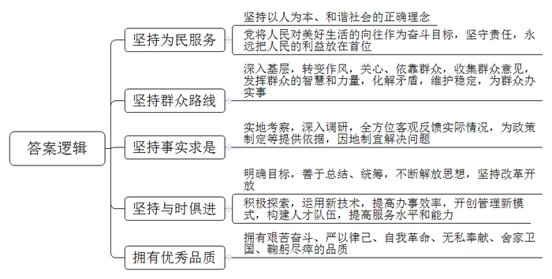
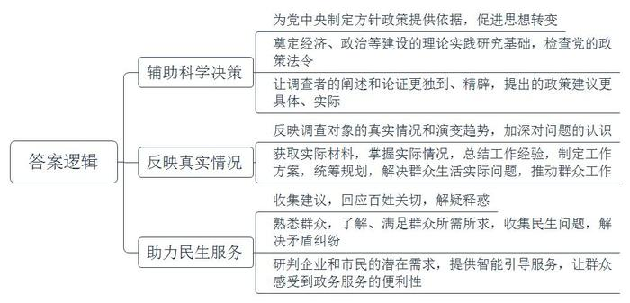
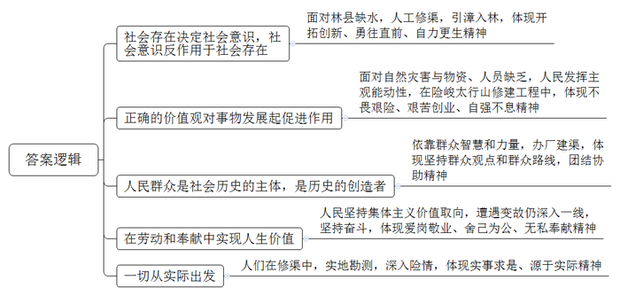
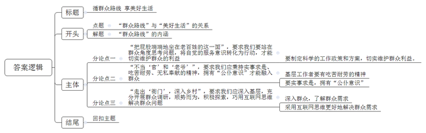

# 2020年上海市公考《申论》题（A卷）

<!-- gwy:overview:start -->
> **上海 · 2020 · 申论 · A类** ｜ 4 题 · 图片 4 处 · 答案随题折叠

导航：[题目](#题目)
<!-- gwy:overview:end -->

> 候选采集稿。参考答案及解析来自粉笔页面，不代表官方答案或真实高分答卷；来源使用许可与原卷对应关系仍需人工核实。

## 给定材料

### 材料 material-76931d92a8c69d64

习近平同志指出，人民对美好生活的向往，就是我们的奋斗目标。我们的责任，就是要团结带领全党全国各族人民，继续解放思想，坚持改革开放，不断解放和发展社会生产力，努力解决群众的生产生活困难，坚定不移走共同富裕的道路。

### 材料 material-13b999a3596d0186

红旗渠，是一条人工修建的灌渠，位于河南省林州市（原林县），处于河南、山西、河北三省交界处。渠首位于山西省平顺县石城镇侯壁断下。总干渠长70.6公里，渠底宽8米，渠墙高4.3米，纵坡为1／8000，设计最大流量为23立方米每秒，全部开凿在峰峦迭嶂的太行山腰上，工程险峻，被中外人士誉为太行山上的“人工天河”。

林县干旱缺水，年平均降水量只有670毫米，且时间分布不均，当地石多土薄，涵水能力差。当时全县共有90多万亩耕地，只有1万多亩水浇地，其他耕地全是靠天种植，全县550个行政村，就有305个村人畜吃水困难，有的跑5里、10里去取水，还有的跑更远路程去取水。在吃水如油的日子里，当地常常因水发生打架斗殴、伤人亡命的事故。1960年，时任中共林县县委书记的杨贵发出了“重新安排山河”的号召，决定把浊漳河的水引到林县来，自此，一个伟大的水利工程建设拉开了序幕。

在上世纪60年代，在险峻的太行山上修建一项水利工程谈何容易。当时正值三年自然灾害时期，全县只有15000千克粮食，300万元储备金、28名水利技术人员。面对重重困难，林县人民以“重新安排山河”的豪情壮志，于1960年2月开工修建红旗渠，在修建过程中，没有住的地方，民工们就睡在山崖下、石缝中，有的垒石庵，有的挖窑洞，有的露天打铺，睡在没有房顶、没有床、更没有火的石板上，薅把茅草当铺草，真是铺地盖天。没有工具，民工们带着家里的铁镢、铁锹、小推车上了工地。没有石灰，就全县广招烧制石灰的能手，在学习的基础上创新烧灰法，彻底解决了工地用石灰难的问题。没有炸药，就招聘制造炸药的人才，办工厂，解决了炸药难的问题。依靠群众的智慧和力量，工地先后办起了机械厂、荆编厂、车辆修配厂等。逐步解决了资金和物资短缺的问题。该工程共削平了1250座山头，架设151座渡槽，开凿211个隧洞，修建各种建筑物12408座，挖砌土石达2225万立方米。据计算，如把这些土石垒筑成高2米，宽3米的墙，可纵贯祖国南北，绕行北京，把广州与哈尔滨连接起来。

在红旗渠修建的10年中，涌现出许多英雄人物，先后有81位干部和群众献出了自己宝贵的生命。其中年龄最大的63岁，年龄最小的只有17岁。红旗渠总设计师吴祖太，在接到设计红旗渠的任务后，不畏艰险，翻山越岭，进行实地勘测。期间他遭遇了母亲病故和妻子救人牺牲的巨大变故，仍没有停下手中的工作，坚持奋斗在红旗渠建设的第一线。1960年3月28日下午，吴祖太听说王家庄隧洞洞顶裂缝掉土严重，深入洞内察看险情，却不幸被洞顶坍塌掉下的巨石砸中，夺去了年仅27岁的生命。

红旗渠彻底改善了林县人民靠天等雨的恶劣生存环境，解决了56.7万人吃水问题。54万亩耕地得到灌溉，粮食亩产由未修建初期的100公斤增加到1991年的476.3公斤，被林州人民称为“生命渠”“幸福渠”。周总理生前十分关心支持红旗渠，并对红旗渠的建设倾注了很多心血。他曾自豪地告诉国际友人：“新中国有两大奇迹，一个是南京长江大桥，一个是林县红旗渠。”

## 题目

### 第 1 题

**根据给定资料，总结中国共产党能够团结带领全党全国各族人民，攻坚克难，从胜利走向胜利的主要原因。（20分）**

关联材料：材料 material-76931d92a8c69d64

作答要求：

要求：概括准确，条理清楚，语言精练，字数不超过300字。

第 1 题 · 答案与解析

**参考答案（粉笔题库参考内容）**

1.坚持为民服务。坚持以人为本、和谐社会的正确理念；党将人民对美好生活的向往作为奋斗目标，坚守责任，永远把人民的利益放在首位。

2.坚持群众路线。深入基层，转变作风，关心、依靠群众，收集群众意见，发挥群众的智慧和力量，化解矛盾，维护稳定，为群众办实事。

3.坚持实事求是。实地考察，深入调研，全方位客观反馈实际情况，为政策制定等提供依据，因地制宜解决问题。

4.坚持与时俱进。明确目标，善于总结、统筹，不断解放思想，坚持改革开放；积极探索，运用新技术，提高办事效率，开创管理新模式，构建人才队伍，提高服务水平和能力。

5.拥有优秀品质。拥有艰苦奋斗、严以律己、自我革命、无私奉献、舍家卫国、鞠躬尽瘁的品质。

**解析**

**参考答案说明：**本参考答案从“坚持为民服务”“坚持群众路线”“坚持实事求是”“坚持与时俱进”“拥有优秀品质”这五个方面进行了分条撰写。各条答案要点之间在内容上相互并列，没有交叉。

**考点**：考点原因类

**来源**：来源2020年上海市公考《申论》题（A卷）

粉笔申论页面对本题只提供「解析视频」入口，该入口是会员推广位，页面无视频地址与文字解析。

### 第 2 题

**根据给定资料，分析调查研究的重要性。（20分）**

关联材料：材料 material-76931d92a8c69d64

作答要求：

要求：观点明确，条理清楚，语言精练，字数不超过300字。

第 2 题 · 答案与解析

**参考答案（粉笔题库参考内容）**

1.辅助科学决策：为党中央制定方针政策提供依据，促进思想转变；奠定经济、政治等建设的理论实践研究基础，检查党的政策法令；让调查者的阐述和论证更独到、精辟，提出的政策建议更具体、实际。

2.反映真实情况：反映调查对象的真实情况和演变趋势，加深对问题的认识；获取实际材料，掌握实际情况，总结工作经验，制定工作方案，统筹规划，解决群众生活实际问题，推动群众工作。

3.助力民生服务：收集建议，回应百姓关切，解疑释惑；熟悉群众，了解、满足群众所需所求，收集民生问题，解决矛盾纠纷；研判企业和市民的潜在需求，提供智能引导服务，让群众感受到政务服务的便利性。

**解析**

**参考答案说明：**本参考答案从“辅助科学决策”“反映真实情况”“助力民生服务”这三个方面对调查研究的重要性进行了分条撰写。每条答案要点之间在内容上相互并列，没有交叉。

**考点**：考点影响类

**来源**：来源2020年上海市公考《申论》题（A卷）

粉笔申论页面对本题只提供「解析视频」入口，该入口是会员推广位，页面无视频地址与文字解析。

### 第 3 题

**结合给定资料，从历史唯物主义角度阐述红旗渠代表了怎样的精神传承。（20分）**

关联材料：材料 material-13b999a3596d0186

作答要求：

要求：观点明确，条理清楚，语言精练，字数不超过300字。

第 3 题 · 答案与解析

**参考答案（粉笔题库参考内容）**

1.社会存在决定社会意识，社会意识反作用于社会存在。面对林县缺水，人工修渠，引漳入林，体现开拓创新、勇往直前、自力更生精神。

2.正确的价值观对事物发展起促进作用。面对自然灾害与物资、人员缺乏，人民发挥主观能动性，在险峻太行山修建工程中，体现不畏艰险、艰苦创业、自强不息精神。

3.人民群众是社会历史的主体，是历史的创造者。依靠群众智慧和力量，办厂建渠，体现坚持群众观点和群众路线，团结协助精神。

4.在劳动和奉献中实现人生价值。人民坚持集体主义价值取向，遭遇变故仍深入一线，坚持奋斗，体现爱岗敬业、舍己为公、无私奉献精神。

5.一切从实际出发。人们在修渠中，实地勘测，深入险情，体现实事求是、源于实际精神。

**解析**

**参考答案说明：**本参考答案从“社会存在决定社会意识，社会意识反作用于社会存在”“正确的价值观对事物发展起促进作用”“人民群众是社会历史的主体，是历史的创造者”“在劳动和奉献中实现人生价值”“一切从实际出发”这五个方面入手，对“红旗渠”的精神传承进行了分条撰写。各条答案要点之间在内容上相互并列，没有交叉。

**考点**：考点其他类

**来源**：来源2020年上海市公考《申论》题（A卷）

粉笔申论页面对本题只提供「解析视频」入口，该入口是会员推广位，页面无视频地址与文字解析。

### 第 4 题

**结合习仲勋《贯彻司法工作的正确方向》的讲话，围绕****“群众路线和美好生活”这一主题，写一篇文章。（40分）**

关联材料：材料 material-76931d92a8c69d64

作答要求：

要求：

（1）自选角度，自拟题目；

（2）观点明确，联系实际，分析具体，条理清楚，语言流畅；

（3）总字数800~1000字。

第 4 题 · 答案与解析

**参考答案（粉笔题库参考内容）**

**循群众路线 享美好生活**

天地之大，黎元为先，人民对美好生活的向往是我们不断奋斗的目标。1943年习仲勋在《贯彻司法工作的正确方向》讲话中提到：“把屁股端端地坐在老百姓的这一面，不当‘官’和‘老爷’，走出‘衙门’，深入乡村”，以此点明为五十二万群众服务的方式。而今，遵循群众路线，深入基层，转变作风，真正为群众想办法，办实事，仍是我们需要一以贯之的价值坚守。

**“把屁股端端地坐在老百姓的这一面”，要求我们要站在群众角度思考问题，将自觉的服务意识转化为行动，才能切实维护群众的利益。**“民为邦本，本固邦宁”，得民心者得天下，失民心者失天下，从周幽王烽火戏诸侯到李世民实施休养生息政策，固本安邦，都向我们印证了这一颠扑不破的真理。作为老一辈无产阶级革命家的习仲勋，在错综复杂的绥德治理中通过办冬学，打造普及文化知识的重要阵地，通过科学制定移民工作方案，在鼓励群众南下移民的同时，切实维护移民群众的利益，向世人展示了他的治理智慧。欲流之远者，必浚其泉源，我们应在前人的指引下，传承老一辈革命家的优良品质，对群众赤诚相待，增进人民福祉。

**“不当‘官’和‘老爷’”，要求我们应秉持实事求是、吃苦耐劳、无私奉献的精神，拥有“公仆意识”才能融入群众。**古人常说：“天将降大任于斯人也，必先苦其心志，劳其筋骨，饿其体肤，空乏其身”，基层工作的艰苦众所周知，但这并不是放弃的理由，吃苦耐劳是中华民族的传统美德，是作为我们评价优秀干部作风品行、发展潜力的重要指标。从习仲勋、习近平，再到吴祖太，正因他们坦诚相待，真诚地与乡亲们打成一片，自觉地接受艰苦生活的磨炼，才换来群众的信任与支持，才奠定群众幸福生活的根基。

**“走出‘衙门’，深入乡村”，要求我们应深入基层，充分开展群众调研，顺势而为，积极探索，巧用互联网思维解决群众问题。**“民之所需，政之所向”。延安时期的晋陕调查，通过熟悉群众，检查党的政策法令，为当时党内加深认识，制定政策打下重要基础。而在新时期下，在人民日益增长的美好生活需要和不平衡不充分发展的矛盾中，深入群众，问需于民，开展调查研究成为解决问题的必行之策。同时，调研之后能切实发现问题，满足群众需求，枫桥经验与上海“一网通办”建设则巧借互联网，开拓治理的新思路。唯有坚持问题导向、需求导向和效果导向，才能研判群众潜在需求，提供智能引导服务，让群众服务从“能办”向“好办”转变。

群之所为事无不成，众之所举业无不胜。延展中国发展的历史卷轴，无数共产党人一直与人民同呼吸、共命运、心连心。在当下变革期，更应遵循群众路线，站在群众角度思考问题，拥有“公仆意识”，深入基层顺势而为，以丰富生动的实践回应时代脉搏，满足人民需求，才能让发展更有温度、幸福更有质感、生活更加美好。

**解析**

**文章分析**

**循群众路线** **享美好生活**

【**标题的优点**：首先，范文的标题突出了“群众路线和美好生活”这一主题。其次，它在形式上采用对称式结构，前半句点出主题，后半句点出了目的，使标题更加完整、饱满。】

天地之大，黎元为先，（1）人民对美好生活的向往是我们不断奋斗的目标。1943年习仲勋在《贯彻司法工作的正确方向》讲话中提到：“把屁股端端地坐在老百姓的这一面，不当‘官’和‘老爷’，走出‘衙门’，深入乡村”，以此点明为五十二万群众服务的方式。（2）而今，遵循群众路线，深入基层，转变作风，真正为群众想办法，办实事，仍是我们需要一以贯之的价值坚守。

【**开头的优点：**★内容方面。范文的开头是紧扣“群众路线”这一主题展开的。首先，开头指出了“群众路线”这一主题。其次，对“群众路线”这一主题进行了分析阐述：（1）先指出了“群众路线”与“美好生活”的关系；（2）接着指出了“群众路线”的内涵。】

**“把屁股端端地坐在老百姓的这一面”，要求我们要站在群众角度思考问题，****将****自觉的服务意识转化为行动，才能切实维护群众的利益。**“民为邦本，本固邦宁”，得民心者得天下，失民心者失天下，从周幽王烽火戏诸侯到李世民实施休养生息政策，固本安邦，都向我们印证了这一颠扑不破的真理。作为老一辈无产阶级革命家的习仲勋，在错综复杂的绥德治理中通过办冬学，打造普及文化知识的重要阵地，通过科学制定移民工作方案，在鼓励群众南下移民的同时，切实维护移民群众的利益，向世人展示了他的治理智慧。欲流之远者，必浚其泉源，我们应在前人的指引下，传承老一辈革命家的优良品质，对群众赤诚相待，增进人民福祉。

【**论述段****1****的优点**：★观点句：范文的观点句是紧扣“群众路线”这一文章主题提出的。形式上，它在段首处直接写出，位置突出，容易被发现；内容上，关键词突出，内容要点明确，可以明显看出它是从“站在群众角度思考问题”“将自觉的服务意识转化为行动”等角度入手，指出要有自觉为群众服务的意识和行动。★论述内容：本段主要围绕“群众路线”这一主题进行分析阐述，介绍了：要制定科学的工作政策和方案，切实维护群众利益。注意：以上内容都是紧扣观点句“‘把屁股端端地坐在老百姓的这一面’，要求我们要站在群众角度思考问题，将自觉的服务意识转化为行动，才能切实维护群众的利益”进行分析论述的，针对性强、内容层次丰富。最后，在论证方法和论据选取方面，讲道理和举例子相结合，做到了丰富多样。】

**“不当‘官’和‘老爷’”，要求我们应秉持实事求是、吃苦耐劳、无私奉献的精神，拥有“公仆意识”才能融入群众。**古人常说：“天将降大任于斯人也，必先苦其心志，劳其筋骨，饿其体肤，空乏其身”，（1）基层工作的艰苦众所周知，但这并不是放弃的理由，吃苦耐劳是中华民族的传统美德，是作为我们评价优秀干部作风品行、发展潜力的重要指标。从习仲勋、习近平，再到吴祖太，（2）正因他们坦诚相待，真诚地与乡亲们打成一片，自觉地接受艰苦生活的磨炼，才换来群众的信任与支持，才奠定群众幸福生活的根基。

【**论述段****2的优点**：★观点句：范文的观点句是紧扣“群众路线”这一文章主题提出的。形式上，它在段首处直接写出，位置突出，容易被发现；内容上，关键词突出，内容要点明确，可以明显看出它是从“实事求是，吃苦耐劳”“公仆精神”等角度入手，指出群众路线要能够无私奉献，融入群众。★论述内容：本段主要围绕“群众路线”这一主题进行分析阐述，介绍了：（1）基层工作者要有吃苦耐劳的精神；（2）要实事求是，拥有“公仆意识”。注意：以上两个方面的内容都是紧扣观点句“‘不当“官”和“老爷”’，要求我们应秉持实事求是、吃苦耐劳、无私奉献的精神，拥有‘公仆意识’才能融入群众”进行分析论述的，针对性强、内容层次丰富。最后，在论证方法和论据选取方面，讲道理和举例子相结合，做到了丰富多样。】

**“走出‘衙门’，深入乡村”，要求我们应深入基层，充分开展群众调研，顺势而为，积极探索，巧用互联网思维解决群众问题。**“民之所需，政之所向”。延安时期的晋陕调查，通过熟悉群众，检查党的政策法令，为当时党内加深认识，制定政策打下重要基础。而在新时期下，在人民日益增长的美好生活需要和不平衡不充分发展的矛盾中，（1）深入群众，问需于民，开展调查研究成为解决问题的必行之策。同时，（2）调研之后能切实发现问题，满足群众需求，枫桥经验与上海“一网通办”建设则巧借互联网，开拓治理的新思路。唯有坚持问题导向、需求导向和效果导向，才能研判群众潜在需求，提供智能引导服务，让群众服务从“能办”向“好办”转变。

【**论述段****3****的优点**：★观点句：范文的观点句是紧扣“群众路线”这一文章主题提出的。形式上，它在段首处直接写出，位置突出，容易被发现；内容上，关键词突出，内容要点明确，可以明显看出它是从“深入群众，发现群众需求”“开拓治理思路，提供智能服务”等角度入手，指出群众路线需要了解群众需求，并想办法解决好群众需求。★论述内容：本段主要围绕“群众路线”这一主题进行分析阐述，介绍了：（1）深入群众，了解群众需求；（2）采用互联网思维更好地解决群众需求。注意：以上两个方面的内容都是紧扣观点句“‘走出“衙门”，深入乡村’，要求我们应深入基层，充分开展群众调研，顺势而为，积极探索，巧用互联网思维解决群众问题”进行分析论述的，针对性强、内容层次丰富。最后，在论证方法和论据选取方面，讲道理和举例子相结合，做到了丰富多样。】

【**论述段之间的关系**：内容上，三个论述段分别指出了《贯彻司法工作的正确方向》讲话中的“把屁股端端地坐在老百姓的这一面”、“不当‘官’和‘老爷’”和“走出‘衙门’，深入乡村”这三个方面的具体要求。内在逻辑上，范文的论述段之间呈现出递进关系，先指出“群众路线”需要将服务意识转化为行动，接着指出“群众路线”需要有吃苦耐劳的服务精神；最后指出要积极行动起来，想办法为群众做好服务。】

群之所为事无不成，众之所举业无不胜。延展中国发展的历史卷轴，无数共产党人一直与人民同呼吸、共命运、心连心。在当下变革期，（1）更应遵循群众路线，站在群众角度思考问题，拥有“公仆意识”，深入基层顺势而为，以丰富生动的实践回应时代脉搏，满足人民需求，（2）才能让发展更有温度、幸福更有质感、生活更加美好。

【**结尾的优点：**范文的结尾回扣了“群众路线”这一主题。（1）再次总结了“群众路线”的基本要求；（2）阐述了“群众路线”的重要意义。】

**考点**：考点文章写作题

**来源**：来源2020年上海市公考《申论》题（A卷）

粉笔申论页面对本题只提供「解析视频」入口，该入口是会员推广位，页面无视频地址与文字解析。

