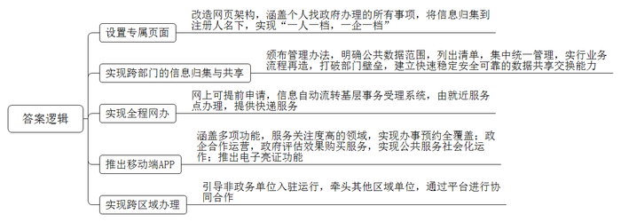
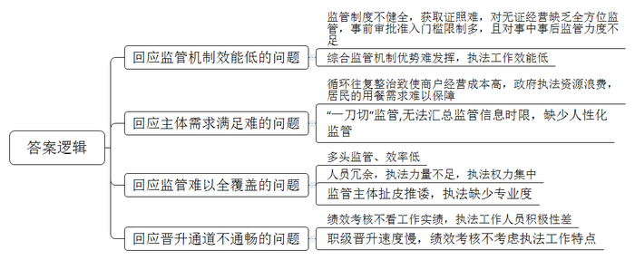
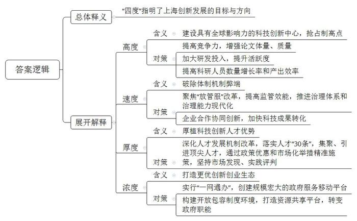
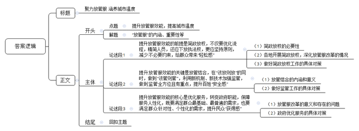

# 2020年上海市公考《申论》题（B、集中选调卷）

<!-- gwy:overview:start -->
> **上海 · 2020 · 申论 · 选调生** ｜ 4 题 · 图片 4 处 · 答案随题折叠

导航：[题目](#题目) · [材料 1](#材料-1)
<!-- gwy:overview:end -->

> 候选采集稿。参考答案及解析来自粉笔页面，不代表官方答案或真实高分答卷；来源使用许可与原卷对应关系仍需人工核实。

## 给定材料

### 材料 1

习近平总书记在全国网络安全和信息化工作会议上要求：“加快推进电子政务，构建全流程一体化在线服务平台，更好解决企业和群众反映强烈的办事难、办事慢、办事繁的问题。”李克强总理在上海调研时指出，“一网通办”表面看似小，实质是转变政府职能的大举措。

找政府办事，能否像网购一样便利？上海用探索给出答案：可以！不带身份证原件、营业执照，就可以申请企业名称变更，浦东企业服务中心综合受理窗口这一幕现在已是常态。申请人掏出手机打开“随申办”APP，进入他的专属页面，点击“我的证照”，身份证、营业执照就跳出来，窗口工作人员一扫就确认身份了。“早先还要交纸质复印件，现在连这也不用了，省好多事。”

在全国率先实行政务服务“一网通办”后，上海把目标锁定“更好、更高效地办成一件事”。“每个人、每个企业都应该在‘一网通办’中有自己的专属页面，办啥事就进自己的页面申请、提交，是不是更好？”基于此，上海重新改造“一网通办”网页架构，并于2018年10月17日正式上线，实现了“一人一档、一企一档”。只要持上海身份证的居民，或在上海注册的企业，在“一网通办”系统注册后即生成自己的专属页面。为便利个人用户，“一网通办”还推出移动端APP“随申办”，市民走到哪儿都可办个人或企业事务。

这个“个人页面”几乎包含了当下个人找政府办理的所有事项，包括养老金、医保金、公积金、纳税查询、信用报告、健康档案、交通违法记录、公用事业费用缴纳等。自己办了多少证件，交了多少养老金，纳了多少税，是否有信用违约，一目了然。只要注册了，身份确认，所有相关信息都将归集到注册人名下。

数据归集技术层面不难，难的是各部门能否把数据和信息拿出来共享。上海依法推进跨部门的信息归集，颁布了公共数据和“一网通办”管理办法，明确公共管理和服务机构在履职过程中获取的公共数据，由市大数据中心按照应用需求列出数据清单集中统一管理，实行业务流程再造。打通部门壁垒不仅要投入精力，更需要展现实力。起初一些部门担心数据传输和存储安全，坚持数据不出库。后来了解到平台已根据国家安全管理要求建立了快速、稳定、安全、可靠的数据共享交换能力，才打消疑虑。2018年底，上海又把电力、水务、燃气等多家公用事业企业数据归集纳入集中攻关范畴。至今，上海市大数据中心已归集各级各类数据的一半，其中审批事项的数据已100%接入。据统计，上海已有771万个人用户在“一网通办”实名建立档案，占实有人口30%以上；189万企业法人建立企业档案，约占设立企业的90%；“随申办市民云”用户已超过1000万。

### 材料 2

57岁的Z女士来到长宁区江苏路街道社区事务受理服务中心申领她的第五本《就医记录册》。不同于过去需要取号、排队，动辄等待半个小时，这一次，已经提前在网上完成申请的她，只用几分钟就领到了新的《就医记录册》。她还从社区工作人员那里得知，在网上完成申请后，如果自取不便，《就医记录册》还可以通过快递直接寄到她家里。

《就医记录册》是每位参保人看病都要出示的白色小册子，每年上海新申领和补发的《就医记录册》约为210万册。按照原来的办事流程，参保人需至窗口现场办理或自助办理，不仅流程较为繁琐，耗时也较长。该服务接入“一网通办”系统后，参保人只需登录“一网通办”网上申请，该申请信息会自动流转至社区事务受理系统，再根据网上录入的地址由就近街道服务点工作人员完成制册后通过快递交付参保人，参保人无需前往窗口提交材料，实现“零跑动”。线下办理变为全程网办，大大缓解了上班族、外地出差工作人员及出行不便人群等办理制册遇到的困难，避免了参保人员办理时间与医保经办时间的不匹配。

“再也不用来回奔波了，方便了我们这些在外地工作生活的人。”今年68岁的W是一名支内回沪人员，2011年退休前在湖北襄阳工作生活了30多年。由于大多亲朋好友都还在湖北，每年他都要回湖北住上半年。作为一名上海参保职工，过去他在湖北看病住院，需要回到社区事务受理服务中心现场办理跨省异地就医登记备案。在接入“一网通办”后，办理跨省异地就医登记备案只需提交网上申请，医保经办系统自动校验，符合条件的直接予以办理，无需提交材料，更不用来回奔波，在湖北就可以办理完成。

### 材料 3

作为“一网通办”重要渠道的移动端APP，依托的是上海早在2013年就上线的“市民云”平台。目前该移动端已实现了面向个人和法人办事的指南查询、在线预约、亮证扫码、进度查询、服务找茬等五方面功能。政务事项也涉及交通出行、劳动就业、企业开办等多个公众关注度高的领域，实现了办事预约的全覆盖。用户可以通过手机查到所有的办事指南、轻松完成办事预约、随时查看办事状态。

“市民云”源于2004年市政府的实事工程市民信箱，之后又经历了2013年移动平台的上线，到2017年底已达到700万用户，2018年作为“一网通办”政府服务的移动端总门户，“市民云”在频道内容、服务事项和用户总数上不断刷新纪录，目前已达到1000万级用户，这是全国第一个用户数到千万级的政府服务移动平台。

在用户数突破千万后，“一网通办”APP被正式命名为“随申办市民云”。对于这个名字，为体现上海元素和服务特点，经综合平衡和广泛征求意见，在原有“市民云”三个字上增加了“随申办”三个字，申就是申城，代表上海，“随申办”也取“随身办”谐音，寓意用户只要掏出手机就能随时随地办理各类事务，更加突出移动端服务的理念。

“市民云”的承建单位上海市民信箱信息服务有限公司总经理表示，“市民云”并不是一个传统意义上的政府项目，“它实际上是由公司跟政府联合在建设运营。先做出实际效果，有老百姓实际在用，政府反过来根据效果再来评估购买服务，所以无论是对整体风险的把握，还是快速反应的节奏上，在全国都是比较有特色的，这也呼应了国家近两年在提的公共服务社会化运作的趋势。”

目前用户在“随申办市民云”中不仅可以查询和订阅三金、生活账单以及纳税情况，还可以申请办理一千多个事项，上海16个区的行政服务中心，220个社区事务受理服务中心可以在这里预约，包含了政务服务、公共服务、社区生活服务，有什么问题直接就可以联动市民热线12345。

比如市民去车管局排队领免检标志，或办理出入境手续，或到公立医院预约挂号等细碎的事项都可以在“随申办市民云”中进行办理，“车辆来不及验了直接在市民云上点，点完马上看到办理进度，年检走到哪一步，快递员是谁，从哪个地方出发，什么时候寄送到我家里。出入境的服务，打开市民云后，直接关联周边出入境点了解排队情况，等多少分钟才能轮到你，如果不想等，直接在线预约，线下过去时，直接验证身份后所有表格都在。上海所有的公立医院，不需要托人、找关系，直接在市民云上公平、免费地预约，还可以在上面查询健康档案，不用请假去拿体检报告，直接到市民云上看。”

此外，“随申办市民云”新推出的“电子亮证功能”已汇聚了如身份证、结婚证、居住证、营业执照、出生医学证明等17个电子证照，为市民企业办事免交材料提供有力支撑。“我们到线下窗口办事时，只要登录市民云，当场亮证扫码，可以解决两个问题：一是身份认证问题，不需要带着大量的纸质材料自证身份；二是后台会发生大量数据流动，在事务受理系统里，相关的数据会自动作为电子材料出现。亮证以后能够实现材料的免交，真正让电子证照库或个人数据库发挥出应有的价值，让老百姓感觉到自己的数据为我所用。”

“随申办市民云”未来还将持续升级，“考虑到残疾人输入不方便，怎样通过机器人，通过语音客服解决？我们还在不断学习积累知识库的过程中，将来直接用语音，像聊天一样就可以把一些服务办掉。此外也希望未来的市民云能够在均等化、公平服务的基础上追求个性化、智能化，不是说数百项、数千项服务都在这儿等着你来找，而是跟我相关的服务主动推送、提醒，从幼年到老年，从早到晚各种生活场景下市民云能够成为最懂你的人。”

### 材料 4

2019年8月2日上午，黄律师来到上海市徐汇区法院，为自己代理的一起劳动合同纠纷申请立案。“我这起案子的被告在南京，原本我要到南京市六合区法院才能立案。”听说现在上海和江苏法院之间可以通过“一网通办”跨区域立案，她就来到徐汇区法院试试。15分钟后，该案在六合区法院正式立案。这也是全国首例通过长三角政务服务“一网通办”平台实现跨域立案的案件。

在徐汇区法院跨域立案窗口，立案庭法官助理快速审核好黄律师提交的材料后，打开“中国移动微法院·长三角政务服务‘一网通办’专窗”页面，点击“上海市”按钮，屏幕上出现一个二维码，扫描二维码进入“中国移动微法院跨域立案”平台页面后，法官助理根据系统提示按步骤输入案件相关的信息材料，立案信息便被提交到了江苏省南京市六合区法院。收到申请后，六合区法院跨域立案专员立即审查材料，并当场予以立案。15分钟后，徐汇区法院的平台页面审核进度上显示“管辖法院已受理”。

2019年3月1日，上海法院诉讼服务平台入驻“一网通办”开始试运行，上海法院成为全国首家入驻“一网通办”的非政务服务单位。5月，长三角沪苏浙皖一市三省政务服务“一网通办”正式开通运行。为了让诉讼服务接入长三角“一网通办”服务，上海市高院作为牵头法院，积极组织长三角四地法院共同商讨诉讼服务接入事项，江苏法院率先回应这一诉讼服务建设并积极协同推进相关工作。7月31日，上海法院、江苏法院诉讼服务率先接入长三角“一网通办”。通过长三角政务服务“一网通办”平台跨域立案，当事人只需就近选择一家法院，向该协作法院提交书面材料并由协作法院协助当事人网上立案登记，管辖法院将确保15分钟之内答复回应。此举进一步实现了人民法院“让数据多跑路，让群众少跑腿”的理念。

### 材料 5

早上卖煎饼、中午卖炒饭、晚上卖烤串，小小餐饮店“一天三张脸”；干净美味又便宜的包子铺竟然是无证经营……这些容易被老百姓忽视的餐饮乱象，却都是监管机制效能提升的重要空间。2017年，上海市政府审议通过了《上海市小型餐饮服务提供者临时备案监督管理办法（试行）》。6月9日，徐汇区发布区域内首批获得小餐饮备案资格的单位，10家符合食品安全、消防、不扰民标准的小餐饮企业获得临时备案资格，同时获颁《便民饮食店临时备案公示卡》。这10家单位的“试用期”最长不超过3年，徐汇区市场监管局将对其食品产地、店铺设施、卫生、消防安全、仓储、废弃物处理、员工健康证等进行全方位监管，在放宽事前审批准入门槛的同时，加强对小餐饮单位的事中事后监管。

位于龙华路的一家“招牌红烧牛肉面”是徐汇区首批10家获得小餐饮备案资格的单位之一。店铺李老板35岁，来自河南许昌。10年前，带着正宗拉面制作技艺的他来到上海。按他的话说，自己在上海开店多久，就跟餐饮证照“死磕”了多久。“上一家店房东原来是钉子户，不肯给房产证，我们就办不了证照……现在这家店大房东不肯给房产证，我们又办不了证照。”李老板口中描述的因无法提供房屋产权证明而无法办理证照的案例，在小餐饮中颇为常见。店铺所在的龙华古玩城区域内，由于建设年代较早，缺少商业和餐饮配套设施，居民和白领就餐十分不便，这便催生了周边小餐饮市场的发展。然而，房屋产权人拒绝为经营户提供房屋产权资料，使得包括“招牌红烧牛肉面”在内的4家小餐饮店铺迟迟无法办理经营证照。

李老板的牛肉面店铺装修整洁明亮，菜单均明码标价。徐汇区市场监管局方面表示，该店及周围无法办理证照的店铺都具备完整的原料采购记录、安全有效的消毒措施，就店内布局和食品加工工艺流程而言，均符合食品经营许可条件。但根据法定职责，市场监管部门必须对无法出具房屋产权证明的店铺予以取缔。

此时，新的问题又出现了。“店铺取缔后周边居民用餐选择大幅降低，不少人都向街道提出，恢复这些小店的经营。”徐汇区市场监管局相关负责人表示，关停、整治、恢复营业，如此循环往复，不仅经营户不敢加大投入改进店铺设施、卫生条件和食材用料，政府执法资源也重复浪费。更重要的是，居民的餐饮需求和用餐品质得不到长效保障，经营户、执法部门和居民“三方俱疲”的状态持续不断。

“老百姓并不了解具体法规，只看到家门口的店开了关、关了开，换了一家又一家，如何踏实用餐？”家住附近小区的吴小姐表达了她的担忧。根据徐汇区市场监管局提供的数据，至2017年初，徐汇区无证照经营户存量3242户，共消除475户。存量无证照经营户中，无证餐饮数量约占50%，均为主营小炒菜、小吃、面、粉、粥等简餐的小型及以下餐饮企业。

监管部门表示，无证照餐饮的成因主要有房屋属性问题、环保规定限制、硬件条件不够和经营者不愿意办证四种，多数为多种因素并存。与此同时，小餐饮因准入门槛低、经济效益见效快，为来沪务工人员创造了数量可观的就业岗位。此外，在大型居住区、交通枢纽、大型医院周边和新建办公园区，商业配套设施不足，居民、白领对小餐饮市场存在刚性需求。中心城区人流量集中，历史遗留的无证照经营现象数量较多，对监管提出了多重挑战。

如何让符合食安、卫生、消防条件的“无证餐饮”成为食品经营的“正规军”，是监管部门聚焦“放管服”改革创新试验的重点。2017年3月20日，《上海市食品安全条例》开始实行，根据该条例制定的《上海市小型餐饮服务提供者临时备案监督管理办法》（以下简称《办法》）也正式实施。《办法》规定，对于确属群众生活需要，不扰民且无安全隐患、符合区域业态导向的经营者，要认真按照小餐饮临时备案要求，引导其合法经营——小餐饮企业翘首企盼的备案细则终于出台。

“3月份刚搬来的时候一听说没法办证，大家都吓得不轻，生怕店铺一下子就被查封。”李老板说，这个端午节是他来上海10年中过得最舒坦的一次，因为店铺证照问题终于得解。更重要的是，“备案以后我们都有人管了，可以正大光明地开店，也敢多花钱装修店铺、多招人手了。”《办法》中明确，小餐饮企业将直接向街道提出临时备案申请，经营主体或经营范围发生变更，都需要重新办理备案手续，市场监管部门履行事中事后监管职责。同时，备案后街道的信息通报时限、监管部门的首次监管时限以及监管信息向街道反馈的时限等都将严格执行。徐汇区市场监管负责人表示，在以往“要么许可、要么取缔”的“一刀切”模式中，探索“备案”模式这一监管的“中间地带”，正是看似“硬邦邦”的改革背后体现出的“有温度的城市治理”。

### 材料 6

“所长，还有车吗？今天要出任务。”上午刚9点，离工作例会结束不到10分钟，已经有三四个小组来要求派车了。上海市徐汇区徐家汇市场监督管理所张所长，在担任市场监管所所长之前，是徐家汇工商所所长。2014年9月，上海中心城区启动市场综合监管执法体制改革，工商、质监、食药监和物价“3+1”机构合并，成立区级市场监督管理局，各街道、镇成立市场监督管理所。“合并以后，业务工作量成倍增长。”张所长说，1000多家餐饮企业，400多户近3000台特种设备，都要全覆盖检查。对无证和无照经营的食品企业，现在就市场监管所一家监管，想推诿也没处推。一天上午，所党支部钱书记带队去H宾馆做食品安全巡回保障，同去的小组长随身带着一本厚厚的文件夹，里面除了食品、药品、化妆品、医疗器械方面的监督意见书、法律约谈书、责令整改书等，还有质监、工商管理方面的管理文书。“每次出门都得带上，碰上质监、工商方面的问题，我们照样要检查。”

不久前，市场监督管理所综合监管组对S大厦内企业进行例行监管检查，发现大厦电梯存在漏油和抖动现象。完成企业巡查后，持有特种设备安全监察员证的执法人员当即约见了大厦物业管理方，经现场检查，判定该电梯存在安全隐患。监管人员迅速联系市特种设备监督检验技术研究院进行现场测试，当场开具了相关文书。责令限期整改。“改革的积极效应就在这里。”钱书记说，“大家在日常监管巡查中触类旁通、举一反三，这就充分发挥了综合监管的机制优势，提升了执法工作的效能。”

徐家汇市场监管所管理的辖区是上海的城市副中心之一，辖区内特种设备总数近3000台。改革前，徐汇区质监部门在基层没有派出机构，对特种设备和涉及民生安全的高风险领域的监管难以全面覆盖。改革后，局机关人员精简，执法力量下沉，执法权力下放，特种设备日常监管也下放到基层市场监管所。为增强特种设备日常监管力量，张所长带头考“上岗证”。全所30个人，已经有10多个人考取了特种设备安全监察员证。他们日常监管巡查的主要工作，是检查大厦内的厢式电梯、手扶电梯等特种设备的安全使用管理情况。某置业有限公司杜总经理说：“过去工商、食药监、质监每个部门都来执法检查，一年至少四次。改革后，同样是这些检查内容，一年最多两次就能搞定了。”

从H宾馆出来后，一组队员又赶到一家药店进行检查，回到所里已是中午12点多。张所长催着他们去吃饭：“下午1点又要出去检查，这些检查工作都是他们自己主动安排的。现在，我们执法类公务员职级晋升通道顺畅了，绩效考核不看职务看工作实绩，队伍更好带了。”

2015年底，上海选择浦东新区、徐汇区、嘉定区的市场监管、城管执法队伍开展公务员分类管理改革试点。改革后，行政执法公务员有了独立于行政级别之外的新的晋升渠道。首次职务套改中，徐汇区市场监管局有101人获得晋升，城管执法局有144人获得晋升，均占到套改人数三成以上。“按照这个速度，明年还能晋升一批，基本上3至4年可以完成一次晋升。”绩效考核与职务职级脱钩，向现场执法倾斜、向主办人员倾斜，同时与办案质量、管理成效挂钩，充分考虑了行政执法“白加黑”“户外执勤”以及早班、夜班、加班等特点。

正午时分，监管二组在某装饰城进行日常巡查，胡副所长与徐家汇街道城管执法中队小黄两人一组，从徐汇区拆除违法建筑联席会议办公室出发，上街摸排“五违”情况。“我们按区块进行摸排，今天摸排的是虹桥路最后4家商铺。”胡副所长说。跟着两人走下台阶，进入防空洞，眼前是一家搏击培训场所。小黄走到前台，拿出“业态整治工作信息表”，一项一项询问：营业执照、法人信息、开业时间、场所属性等，前台表示“老板不在，不清楚”，小黄就让他们转达，并仔细叮嘱需要递交什么材料。胡副所长在一边不断拿着手机拍照，“我们的工作轨迹都要规范地留存下来。”拍到墙上的营业执照，“登记场所不是我们徐汇区的嘛，属于异地经营。”近一个小时，4家商铺摸排结束。“摸排情况当天就要输入电脑。”胡副所长说，“这条街上13家商铺已全部摸排结束，有5家属于无照经营。”“‘五违’整治巡查是联合行动，城管、公安等在街道搭建的大平台上展开，社会多方共治，才能提升监督效能。”张所长说。

### 材料 7

党的十九大报告指出：创新是引领发展的第一动力。必须坚持和完善中国特色社会主义制度，不断推进国家治理体系和治理能力现代化，坚决破除一切不合时宜的思想观念和体制机制弊端，突破利益固化的藩篱，吸收人类文明有益成果，构建系统完备、科学规范、运行有效的制度体系，充分发挥我国社会主义制度优越性。

2000年“中国地方政府创新奖”设立，这是首个对政府改革进行全面系统评估的奖项。该奖项评选活动每两年举办一届，申请项目者包括省级以下、乡镇以上所有地方层级，涉及党委、政府、人大、政协、群团组织等多个主体。“中国地方政府创新奖”申请项目分布广泛、特征突出、内容详实，具有鲜明的代表性。

### 材料 8

“许多名目繁多的检查搞得企业无所适从，经常处于疲于应付的状态。有些监管部门一拍脑袋说查就查，这种随意任性的监管很容易滋生寻租空间。”李克强总理在2018年6月的国务院常务会议上要求，“下一步要全面推行‘双随机、一公开’市场监管，着力打造更加公平公正的市场竞争环境和法治化便利化的营商环境。”

2014年，李克强总理考察天津新港海关时，海关的负责人介绍，他们利用电脑摇号随机确定抽检对象、随机确定检查人员的“双随机”做法，既从源头上清除了灰色寻租行为，也大大节省了通关时间。李克强总理称赞这种“双随机”抽检方式是“一种创造”。第二年，海关在进出口货物监管领域全面实施“双随机”抽检方式，并将抽检结果及时公开。同年7月，国务院办公厅发布《关于推广随机抽查规范事中事后监管的通知》，要求在市场监管领域推广“双随机、一公开”监管。

自2016年起，“双随机、一公开”连续3年被写入《政府工作报告》。李克强总理曾经讲到一件实例：几年前，去欧洲某国考察家庭农场，当地负责人介绍，为了保障食品安全，当地政府每年明确对农场开展两次检查，一次是固定时间普查，所有农场无一例外，另一次则是通过摇号随机抽查。也许好几年都抽查不到你，然而一旦被抽查到，又发现你的产品不合格，轻则取消农业补贴，重则永久逐出市场。所以，没有人敢心存侥幸。

我国目前推行的“双随机、一公开”，就等于给检查对象和检查人员戴上了“紧箍咒”，让大多数人不敢心存侥幸。这一招不仅从根本上遏制了人情监管，也提高了监管效能和公正性。李克强总理特别强调，对有投诉举报等情况需要专项或重点检查的，要严格规范程序。“不在‘双随机、一公开’监管范围内的要及时回应市场关切，但也要依照一定的合规程序开展检查，决不能谁想查就查，想查谁就查谁。”

“既然此次机构改革中成立了市场监管总局，那就应该积极发挥这个部门的牵头作用。要尽量多采取跨部门联合监管。”“不能这一拨刚走下一拨又来检查，让企业整天烦不胜烦，一点预期也没有。”

### 材料 9

上海在全球20个创新热点城市中，科技创新实力排名第几？《2019国际科技创新数据洞见》显示，近五年上海的研发投入强度和增长率名列前茅，在科研论文产出体量上拥有绝对优势。

全球化程度日益加深，跨国界的科学技术合作更加频繁，数据量以ZB级在增长。科技数据正成为传播最快，影响面最广，开发潜力最大的科技资源。《2019国际科技创新数据洞见》通过海量数据挖掘及分析，从创新要素、科学研究竞争力、技术创新竞争力、知识转化竞争力和研发投入五个维度，对全球20个热点城市的科技创新进行了比较研究。这20个热点城市，参考了国内外知名机构发布的全球创新城市榜单。最终，亚洲的上海、北京、深圳、香港、东京、大阪、首尔、新加坡，北美洲的纽约、波士顿、芝加哥、洛杉矶、旧金山、多伦多，欧洲的柏林、伦敦、巴黎、斯德哥尔摩、莫斯科、阿姆斯特丹，共计20个城市成为样本城市。

城市创新要素主要包含活跃的科研人员、创新企业、知名高校和科研基础设施等。从科研人员来看，2014～2018年，90%的热点城市活跃科研人员都呈现增长趋势，上海活跃科研人员数量的增长率较高，且科研人员的产出效率较高。得益于较为稳定的科研环境，上海吸引人才优势明显，有超过整体20%的“本土固定研究人员”愿意长期在上海从事研究工作。目前，上海的科研人员主要分布在高校，在人工智能、生命科学和集成电路三个重点领域的科研产出影响力较强。

科研论文产出的体量、质量和国际化，足以看出一个地区的科学创新竞争力。从论文产出体量来看，过去五年上海的论文发文总量、活跃科研人员人均发文量、论文总被引量以及科研发文被浏览下载总次数等，均排入20个城市的前五名。由论文发表数量看学科相对比较优势，上海在化学工程、材料科学、化学及工程类学均具有明显优势，在医学学科相对竞争力较弱。从论文产出的质量来看，上海虽然与旧金山、波士顿、阿姆斯特丹等城市存在一定差距，但高于世界平均水平且在不断增长。在TOP1%高被引论文和TOP1%高被引CAGR指标中，上海均位于前五。同时，上海在CNS上的发文总量虽处于20个城市的中间位置，但CNS发文量的增长率位居20城市之首，高达34.4%。

是否在科技创新上花大力气，研发投入的真金白银很有发言权。从投入量来看，上海的研发投入强度和投入增长率最高；从研发经费投入产出率来看，上海在顶尖科学研究上拥有绝对优势。同等投入下，上海的CNS顶尖学术成果产出率最高。不过，上海的技术创新活跃度尚不如深圳，而高质量技术创新的产出率与北京存在差距。通过对全球研发投入密集型行业的指标进行分析发现，目前制药和生物技术、电子电气设备、技术硬件设备、汽车及零部件和软件及计算机服务占据了全球研发投入总额的前五位。五大领域的研发投入金额占全球总研发投入的70%以上，是全球重点关注与重点投入的方向。从整体来看，上海企业的研发投入在20个热点城市中处于后位。

### 材料 10

2018年3月上海市科学技术奖励大会举行，市委书记李强在会上强调，创新是引领发展的第一动力，要提升上海创新“高度”，加快上海创新“速度”，夯实上海创新“厚度”，提高上海创新“浓度”。

2016年9月，上海市委、市政府发布《关于进一步深化人才发展体制机制改革加快推进具有全球影响力的科技创新中心建设的实施意见》（即“人才‘30条’”），围绕“聚天下英才而用之”和“放权松绑”，深入推进人才发展体制机制改革。人才“30条”发布以来，上海各相关职能部门扎实推进，累计出台了69项配套政策，确保人才“30条”可操作、可执行、可落地。海外人才集聚方面，在国家相关部委的大力支持下，上海在全国率先试点了降低外国人永久居留证申办条件、放宽外籍人才就业年龄、简化入境和居留手续等累计25条集聚海外人才的政策组合拳，确立市场、单位、行业的人才评价决定权。目前，在沪工作外国人才达到21.5万人，占全国的23.7%，位居全国首位。在高层次人才集聚方面，上海则通过综合运用国际通行的合同管理、议价薪酬、异地工作等市场化举措，以“不求所有、但求所用，不求所在、但求所为”的方式，面向全球集聚人才，海外顶尖人才引进方面因此取得突破性进展。

如今，上海集聚了以诺贝尔奖得主弗兰克·威彻克、巴里·夏普莱斯、伯纳德·费林加为代表的一批顶尖人才。上海科技大学通过全球招聘已选聘387位专任教师，其中包括98位常任教授、289位特聘教授，除3位诺奖得主外，还有6位美国国家科学院院士、2位英国皇家学会会士。

2017年9月，上海的一个科技成果转化合作项目，卖出了4.57亿美元（约合28.8亿元人民币）的高价，引发轰动。这也是目前中国制药领域金额最大的成果转化合作项目。中科院上海有机所与信达生物制药（苏州）有限公司达成授权开发合作协议：信达生物以首付款、研发里程碑和销售里程碑付款共计4.57亿美元另加销售提成的方式，获得该所肿瘤免疫靶向小分子抑制剂IDO的全球独家开发许可权。

正如李强书记在上海市科学技术奖励大会上指出，“创新驱动实质上是人才驱动，谁拥有一流人才，谁就拥有科技创新的优势和主导权。”他表示，上海要以更大的力度引才聚才，抓好人才“30条”落实，聚焦重点、优势领域和顶尖人才精准施策，打造人才高峰，建设全球性人才高地。对拥有关键核心技术的非常之才，要不拘一格、大力引进，不简单唯学历、职称，坚持市场发现、实践评判。要以更好的环境用才兴才，持续深化人才培养、使用、评价机制的改革创新。

## 题目

### 第 1 题

**结合给定材料，总结上海率先实现“一网通办”过程中所形成的可复制经验。（20分）**

关联材料：材料 1、材料 2、材料 3、材料 4

作答要求：

要求：概括准确，条理清楚，语言精练，字数不超过300字。

第 1 题 · 答案与解析

**参考答案（粉笔题库参考内容）**

1.设置专属页面。改造网页架构，涵盖个人找政府办理的所有事项，将信息归集到注册人名下，实现“一人一档，一企一档”。

2.实现跨部门的信息归集与共享。颁布管理办法，明确公共数据范围，列出清单，集中统一管理，实行业务流程再造，打破部门壁垒，建立快速稳定安全可靠的数据共享交换能力。

3.实现全程网办。网上可提前申请，信息自动流转基层事务受理系统，由就近服务点办理，提供快递服务。

4.推出移动端APP。涵盖多项功能，服务关注度高的领域，实现办事预约全覆盖；政企合作运营，政府评估效果购买服务，实现公共服务社会化运作；推出电子亮证功能。

5.实现跨区域办理。引导非政务单位入驻运行，牵头其他区域单位，通过平台进行协同合作。

**参考答案说明：**答案从“设置专属页面”“实现跨部门的信息归集与共享”“实现全程网办”“推出移动端APP”“实现跨区域办理”五个方面进行了分类，每类要点内部又进行了分条撰写，并提炼出了总括句前置。每条要点之间在内容上各自独立，没有交叉。

**解析**

**考点**：经验启示类

**来源**：2020年上海市公考《申论》题（B、集中选调卷）

> 粉笔申论页面对本题只提供「解析视频」入口，该入口是会员推广位，页面无视频地址与文字解析。

### 第 2 题

**结合给定材料，分析上海市场监管创新改革主要回应了实践中的哪些问题。（20分）**

关联材料：材料 5、材料 6

作答要求：

要求：观点明确，条理清楚，语言精练，字数不超过300字。

第 2 题 · 答案与解析

**参考答案（粉笔题库参考内容）**

1.回应监管机制效能低的问题。监管制度不健全，获取证照难，对无证经营缺乏全方位监管，事前审批准入门槛限制多，且对事中事后监管力度不足；综合监管机制优势难发挥，执法工作效能低。

2.回应主体需求满足难的问题。循环往复整治致使商户经营成本高，政府执法资源浪费，居民的用餐需求难以保障；“一刀切”监管，无法汇总监管信息时限，缺少人性化监管。

3.回应监管难以全覆盖的问题。多头监管、效率低；人员冗余，执法力量不足，执法权力集中；监管主体扯皮推诿，执法缺少专业度。

4.回应晋升通道不通畅的问题。绩效考核不看工作实绩，执法工作人员积极性差；职级晋升速度慢，绩效考核不考虑执法工作特点。

**参考答案说明：**本参考答案从“回应监管机制效能低的问题”“回应主体需求满足难的问题”“回应监管难以全覆盖的问题”“回应晋升通道不通畅的问题”四个方面进行了分条撰写。各条要点之间在内容上相互并列，没有交叉。

**解析**

**考点**：问题类

**来源**：2020年上海市公考《申论》题（B、集中选调卷）

> 粉笔申论页面对本题只提供「解析视频」入口，该入口是会员推广位，页面无视频地址与文字解析。

### 第 3 题

**结合给定材料，阐述上海创新“高度”“速度”“厚度”和“浓度”的含义。（20分）**

关联材料：材料 7、材料 1、材料 2、材料 3、材料 4、材料 8、材料 5、材料 6、材料 9、材料 10

作答要求：

要求：观点明确，条理清楚，语言精练，字数不超过300字。

第 3 题 · 答案与解析

**参考答案（粉笔题库参考内容）**

“四度”指明了上海创新发展的目标与方向。

1.高度指建设具有全球影响力的科技创新中心，抢占制高点。提高科研人员数量增长率和产出效率；提高竞争力，增强论文体量、质量；加大研发投入，提升活跃度。

2.速度指破除体制机制弊端。聚焦“放管服”改革，提高监管效能，推进治理体系和治理能力现代化；企业合作协同创新，加快科技成果转化。

3.厚度指厚植科技创新人才优势。深化人才发展机制改革，落实人才“30条”，集聚、引进顶尖人才，通过政策优惠和市场化举措精准施策，坚持市场发现、实践评判。

4.浓度指打造更优创新创业生态。实行“一网通办”，创建规模宏大的政府服务移动平台；构建开放包容制度环境，打造资源共享平台，转变政府职能。

**参考答案说明：**思路方面，本参考答案按照词句解释题“总体释义+展开解释”的一般答题思路展开。内容方面，本参考答案先对“四度”的含义进行了总体释义；然后分别展开解释了“高度”“速度”“厚度”和“浓度”的具体含义以及相关的对策。

**解析**

**考点**：词句解释类

**来源**：2020年上海市公考《申论》题（B、集中选调卷）

> 粉笔申论页面对本题只提供「解析视频」入口，该入口是会员推广位，页面无视频地址与文字解析。

### 第 4 题

**结合给定材料，以“提升放管服效能，建设有温度的城市”为主题写一篇文章。**（40分）

关联材料：材料 7、材料 1、材料 2、材料 3、材料 4、材料 8、材料 5、材料 6、材料 9、材料 10

作答要求：

要求：

（1）自选角度，自拟题目；

（2）观点明确，联系实际，分析具体，条理清楚，语言流畅；

（3）总字数800-1000字。

第 4 题 · 答案与解析

**参考答案（粉笔题库参考内容）**

**聚力放管服** **涵养城市温度**

从“一网通办”便民举措，到市场监管系列创新改革，再到“放权松绑”人才发展机制改革，上海一系列“放管服”举措，让百姓感觉到生活的便利，感受到社会的公平。未来，我们要继续推进简政放权、放管结合、优化服务三位一体，不断提升放管服效能，为上海持续“加温”。

**提升放管服效能的前提是简政放权，不仅要优化流程，精简人员，还应下放执法权，更应坚持原则，减少不必要约束，给群众带来“轻松感”。**简政放权是民之所望、施政所向。近年来，各地从简政放权入手，深化放管服改革，持续优化营商环境。但有些地方在放管服上做虚文章、设隐门槛，影响简政放权成效。因此，政府要持续推进流程再造，取消不必要审批，精简整合队伍；要推进行政执法力量向基层下沉，优化基层执法干事环境；还要坚持把人民利益作为权力下放的基本原则，避免一放就乱。唯有如此，才能让百姓生活更方便、办事无负担。

**提升放管服效能的关键是放管结合，在“该放则放”的同时，做到“该管则管”，利用新机制、新技术加强监管，做到监管全方位且有重点，提升百姓“安全感”**。“放是放活，而不是放任；管要管好，而不是管死。”放管服改革的关键是在放的同时加强管，并让管更好地服务于放。只有放管结合，才能迸发基层治理活力。为此，我们要聚焦“放管服”改革，破除体制机制弊端，如探索“双随机、一公开”这类监管机制，遏制人情监管，做到该管的管起来；还要借助互联网技术，构建在线服务平台，如推行“一网通办”APP，打通数据壁垒，服务群众高度关注的领域，做到有重点监管，为百姓生活提供“安全屏障”。

**提升放管服效能的核心是优化服务，转变政府职能，保障服务人性化，既要满足群众最基础、最普遍的需求，也要满足群众针对性、个性化的需求，提升民众“获得感”**。近年来，“放管服”改革深入推进，有效激发了市场主体活力，但仍有一些群众反映强烈的问题亟待解决。为此，政府需要继续转变政府职能，坚持以人为本，不断优化服务，大力改善民生，让群众有更多获得感。这就要从广大群众最迫切、最广泛的需求着手，提供“打包式”“一条龙”服务；还要关注群众特殊需求，提供针对性、精细化服务。如面对“银发族”触网烦恼，推出移动端适老服务；面对符合标准的“无证餐饮”，采取特事特办策略。

利民之事，丝发必兴。提升放管服效能要做好简政放权、放管结合和优化服务，使民众幸福，使城市有温度。

**文章分析**

**聚力放管服** **涵养城市温度**

【**标题的优点：**首先，范文的标题“聚力放管服 涵养城市温度”突出了“提升放管服效能，建设有温度的城市”这一主题。其次，形式上，文字简洁明快。】

（1）从“一网通办”便民举措，到市场监管系列创新改革，再到“放权松绑”人才发展机制改革，上海一系列“放管服”举措，让百姓感觉到生活的便利，感受到社会的公平。（2）未来，我们要继续推进简政放权、放管结合、优化服务三位一体，不断提升放管服效能，为上海持续“加温”。

【**开头的优点：**★内容方面。范文的开头是紧扣题目给定的“提升放管服效能，建设有温度的城市”这一主题展开的。首先，开头点出主题，做到了主题明确。其次，对“提升放管服效能，建设有温度的城市”这一主题进行了分析阐述：（1）介绍了上海采取的放管服举措及其意义；（2）指出了“放管服”的内涵，并点明未来要继续提升放管服效能，提高城市温度。★文字表达方面。使用了“从……到……再到……”等关联词，使语言表达有逻辑性。】

**提升放管服效能的前提是简政放权，不仅要优化流程，精简人员，还应下放执法权，更应坚持原则，减少不必要约束，给群众带来“轻松感”。**（1）简政放权是民之所望、施政所向。（2）近年来，各地从简政放权入手，深化放管服改革，持续优化营商环境。但有些地方在放管服上做虚文章、设隐门槛，影响简政放权成效。（3）因此，政府要持续推进流程再造，取消不必要审批，精简整合队伍；要推进行政执法力量向基层下沉，优化基层执法干事环境；还要坚持把人民利益作为权力下放的基本原则，避免一放就乱。唯有如此，才能让百姓生活更方便、办事无负担。

【**论述段1的优点：**★观点句：范文的观点句是紧扣“提升放管服效能，建设有温度的城市”这一文章主题提出的。形式上，它在段首处直接写出，位置突出，容易发现。内容上，关键词突出，内容要点明确，可以明显看出它是从“简政放权”这一角度入手，指出了“提升放管服效能需要政府精简流程，下放执法权，减少不必要的约束”。★论述内容：（1）先介绍了“简政放权”的必要性；（2）接着介绍了“各地开展‘简政放权’，深化放管服改革”的情况；（3）最后介绍了“做好‘简政放权’工作”的具体对策。注意：以上三个方面的内容都是紧扣“提升放管服效能的前提是简政放权，不仅要优化流程，精简人员，还应下放执法权，更应坚持原则，减少不必要约束，给群众带来‘轻松感’”这个观点句进行分析论述的，论述的针对性强，内容层次丰富。最后，在论述方法上主要采用了讲道理的方式，论证充分、有力。】

**提升放管服效能的关键是放管结合，在“该放则放”的同时，做到“该管则管”，利用新机制、新技术加强监管，做到监管全方位且有重点，提升百姓“安全感”**。（1）“放是放活，而不是放任；管要管好，而不是管死。”放管服改革的关键是在放的同时加强管，并让管更好地服务于放。只有放管结合，才能迸发基层治理活力。（2）为此，我们要聚焦“放管服”改革，破除体制机制弊端，如探索“双随机、一公开”这类监管机制，遏制人情监管，做到该管的管起来；还要借助互联网技术，构建在线服务平台，如推行“一网通办”APP，打通数据壁垒，服务群众高度关注的领域，做到有重点监管，为百姓生活提供“安全屏障”。

【**论述段2的优点：**★观点句：范文的观点句是紧扣“提升放管服效能，建设有温度的城市”这一文章主题提出的。形式上，它在段首处直接写出，位置突出，容易发现。内容上，关键词突出，内容要点明确，可以明显看出它是从“放管结合”这一角度入手，指出了“提升放管服效能需要政府加强监管，做到全方位监管、有重点监管”。★论述内容：（1）先介绍了“放管结合”的内涵和意义；（2）再介绍了“做好监管工作”的具体对策。注意：以上两个方面的内容都是紧扣“提升放管服效能的关键是放管结合，在‘该放则放’的同时，做到‘该管则管’，利用新机制、新技术加强监管，做到监管全方位且有重点，提升百姓‘安全感’”这个观点句进行分析论述的，论述的针对性强，内容层次丰富。最后，在论述方法和论据的选取上做到了讲道理、举例子相结合，让论述内容丰富多样。】

**提升放管服效能的核心是优化服务，转变政府职能，保障服务人性化，既要满足群众最基础、最普遍的需求，也要满足群众针对性、个性化的需求，提升民众“获得感”**。（1）近年来，“放管服”改革深入推进，有效激发了市场主体活力，但仍有一些群众反映强烈的问题亟待解决。（2）为此，政府需要继续转变政府职能，坚持以人为本，不断优化服务，大力改善民生，让群众有更多获得感。这就要从广大群众最迫切、最广泛的需求着手，提供“打包式”“一条龙”服务；还要关注群众特殊需求，提供针对性、精细化服务。如面对“银发族”触网烦恼，推出移动端适老服务；面对符合标准的“无证餐饮”，采取特事特办策略。

【**论述段3的优点：**★观点句：范文的观点句是紧扣“提升放管服效能，建设有温度的城市”这一文章主题提出的。形式上，它在段首处直接写出，位置突出，容易发现。内容上，关键词突出，内容要点明确，可以明显看出它是从“优化服务”这一角度入手，指出了“提升放管服效能需要政府转变职能，提供人性化的服务”。★论述内容：（1）先介绍了“放管服改革”的意义和存在的问题；（2）再介绍了“政府优化服务”的具体对策。注意：以上两个方面的内容都是紧扣“提升放管服效能的核心是优化服务，转变政府职能，保障服务人性化，既要满足群众最基础、最普遍的需求，也要满足群众针对性、个性化的需求，提升民众‘获得感’”这个观点句进行分析论述的，论述的针对性强，内容层次丰富。最后，在论述方法和论据的选取上做到了讲道理、举例子相结合，让论述内容丰富多样。】

【**论述段之间的关系：**★内容的内在逻辑：范文的论述段之间是依照并列逻辑展开的。论述段1先写了“简政放权”，即放管服中的“放”；论述段2再写了“放管结合”，即放管服中的“管”；论述段3接着写了“优化服务”，即放管服中的“服”。三个论述段逻辑清晰。】

利民之事，丝发必兴。提升放管服效能要做好简政放权、放管结合和优化服务，使民众幸福，使城市有温度。

【**结尾的优点：**范文的结尾回扣了“提升放管服效能，建设有温度的城市”这一主题，语言精悍，不拖沓。】

**解析**

**考点**：文章写作题

**来源**：2020年上海市公考《申论》题（B、集中选调卷）

> 粉笔申论页面对本题只提供「解析视频」入口，该入口是会员推广位，页面无视频地址与文字解析。

