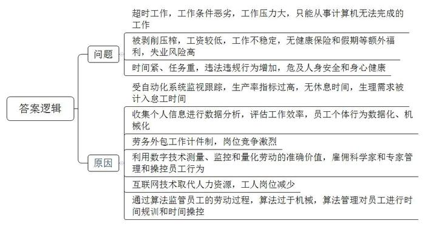
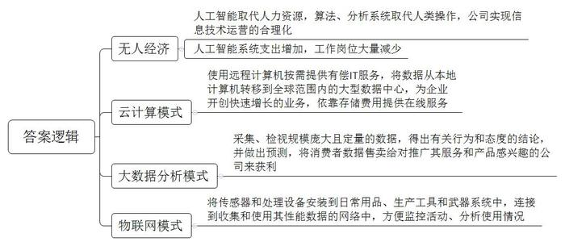
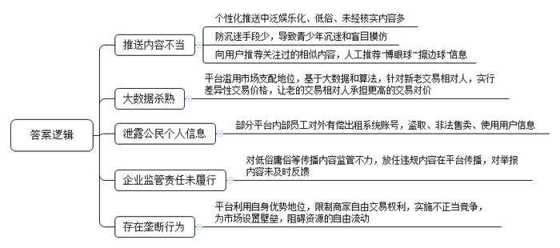
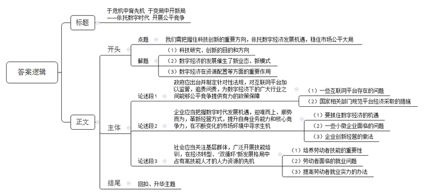

# 2021年上海市公考《申论》题（A卷）

> 候选采集稿。参考答案及解析来自粉笔页面，不代表官方答案或真实高分答卷；来源使用许可与原卷对应关系仍需人工核实。

## 给定材料

### 材料 material-41388a9979ebb343

作为28岁的单身母亲，易卜拉欣每天从下午5点半到清晨6点上12个半小时的夜班，在机场、渔船工作过的她认为，亚马逊仓库的工作条件是最恶劣的。她表示：“每天我走进那扇门时都充满了恐惧，认为今晚将成为我被解雇的时刻。当你在仓库工作时，你必须做好心理和身体准备，但我以前从未感受过像这样的职场压力。我想为了家人竭尽所能地挣钱，但有时我无法忍受这种压力。”因为与巴尔的摩的一名前员工存在劳动纠纷，亚马逊向美国全国劳资关系委员会出示了开除员工的名单和理由，在这份被公开的文件中，代表亚马逊的律师承认，该公司在2017年8月至2018年9月期间因未能达到生产率指标而解雇了巴尔的摩仓库中心至少300名员工。这个数字并非小数，巴尔的摩仓库中心目前有大约2500名全职员工。假设这个比例稳定的话，这意味着亚马逊每年因生产力原因解雇的员工将超过10%。在整个北美范围，亚马逊运营着超过75个仓库，拥有超过12.5万名全职员工，每年被解雇的人数可想而知。这份文件还显示，亚马逊的AI监工系统可以实现深度自动化的跟踪过程。如果员工的工作速度变慢，或者长时间没有接触包裹(上厕所、喝水等情况)，该系统会将这些情况视作偷懒，算在怠工时间内。可怕的是，如果生产率指标多次不达标，AI系统会自动生成警告，并且最终在线生成解雇员工的指令，这个过程不需要主管的意见。也就是说，亚马逊的基层员工可以因为AI的判断而自动被开除。去年，美国明尼苏达州仓库的东非移民工人组织了抗议亚马逊的活动。仓库员工易卜拉欣称，当时仓库要求的打包速度是每小时240个包裹，但在旺季时最高可达每小时400个包裹。英国一家劳工保护组织的问卷调查显示，有74%的英国亚马逊仓库员工表示不敢在上班期间正常去厕所。

2019年《华尔街日报》曾经报道，微软公司会用自己公司的Office365服务，收集员工跟客户之间的聊天、发邮件和开会的频率，甚至是员工日历上的日程，然后微软会对这些数据进行分析，来评估员工的工作效率或者管理的成效。年初，每个微软员工都收到一份个性化的报告，报告里的表格展示了每个人把时间都花在哪里，并且还针对他们如何能建立更好的社会网络给出了建议。微软还把这个分析软件出售给其他企业，包括零售巨头梅西百货，以及做房地产贷款的房地美公司。而这种软件其实还是比较基础的，更高科技的软件可以通过自然语言处理的技术，分析员工打电话的语调或者会议室的对话，从而判断一个团队的团队文化怎么样，比如说是不是有人霸占对话不让别人说话，谁会经常表示反对，谁特别不愿意聊一些情绪化的问题等等。这些现象都指向同向，那就是在职场上，越来越多的员工行为都可以被转化成数据，而当管理者对于数据进行充分地挖掘和分析的时候，他们可以找到所谓更高效的方式来开展业务，甚至是针对每一个员工的个体行为进行优化。

### 材料 material-7e0a34d993e7c728

自从1994年美国明尼苏达大学研究组推出第一个自动化推荐系统，算法推荐技术如今已深入到资讯、社交、电商、短视频、搜索引擎等平台和互联网应用中，互联网平台变得越来越“懂”用户。一些新闻资讯、网络社交等平台的个性化推送存在“泛娱乐化信息多、低俗内容多、未经核实内容多”的“三多”现象。一些网络社交平台防沉迷手段较少，容易导致青少年沉迷和盲目模仿。北京大学中国社会与发展研究中心邱主任表示，对自我的偏好是人类认知偏好的部分，“偏好”阅读可能加速形成“信息茧房”效应和“情绪传染”效应，前者易导致视野局限，后者易使个人情绪受他人感染。部分平台为留住用户，不断向用户推荐其关注过的相似内容，其中掺杂低俗媚俗、色情暴力、真假难辨、缺乏深度、价值观导向错乱等信息。一些互联网平台为增加点击率和流量，还会进行人工推荐，主动推荐“博眼球”、打“擦边球”信息。

2017年10月，一位刘姓律师与几位同事在杭州出差。他们使用某网约车平台服务时发现，当时他们约了两辆专车从杭州某酒店同时出发，前往客户的公司。因为路线一致几乎同时到达，但最后付款时，他付了35元，而同事只付了25元，两辆专车的收费标准是一样的。为何会有这样的差别？刘律师想起，他在该网约车平台的账号属于金卡会员，而同事的账号只是普通会员。事后，刘律师打电话向该网约车平台投诉，客服人员回应称可以返给他一些优惠券，但不承认存在针对性价格问题。刘律师决定，以后要逐步收集证据，以验证各个网络平台的服务是否存在“看人下菜碟”的做法。事实上，有很多人在网络社区中分享了自己的类似经历。在交通、酒店、电影、电商等网络平台上，购买同样的网络服务或商品，老用户看到的价格反而比新用户要贵的情况不少。

2020年11月，在邯郸市警方破获的一起案件中，不法分子与圆通快递公司多位“内鬼”勾结，通过有偿租用圆通员工系统账号盗取公民个人信息，再层层倒卖公民个人信息至不同下游犯罪人员。对此，圆通方面回应称已报案，相关嫌疑人已落网，坚决配合打击非法售卖和使用快递用户信息的行为。

## 题目

### 第 1 题

**根据****“材料**1**”~“材料**4**”，概述数字经济中劳动者可能遭遇哪几类不利问题，并分别简述其原因。（20分）**

关联材料：材料 material-41388a9979ebb343

作答要求：

要求：概括准确，条理清楚，语言精练，字数不超过300字。

### 第 2 题

**根据给定材料，概括下一代互联网技术驱动的经济新业态新模式的类型及其特点。（****20分）**

关联材料：材料 material-41388a9979ebb343

作答要求：

要求：概括准确，条理清楚，语言精练，字数不超过300字。

### 第 3 题

**根据****“材料**8**”~“材料**10**”，分析平台经济发展过程中存在的主要问题。（20分）**

关联材料：材料 material-7e0a34d993e7c728

作答要求：

要求：观点明确，层次清楚，语言精练，字数不超过300字。

### 第 4 题

**结合给定材料，围绕****“数字时代”“公平竞争”这两个关键词，写一篇文章。（40分）**

关联材料：材料 material-41388a9979ebb343

作答要求：

要求：

（1）自选角度，自拟题目；

（2）观点明确，联系实际，分析具体，条理清楚，语言流畅；

（3）总字数800~1000字。

## 答案与解析

第 1 题

**参考答案（粉笔题库参考内容）**

问题：超时工作，工作条件恶劣，工作压力大，只能从事计算机无法完成的工作。被剥削压榨，工资较低，工作不稳定，无健康保险和假期等额外福利，失业风险高。时间紧、任务重，违法违规行为增加，危及人身安全和身心健康。

原因：受自动化系统监视跟踪，生产率指标过高，无休息时间，生理需求被计入怠工时间。收集个人信息进行数据分析，评估工作效率，员工个体行为数据化、机械化。劳务外包工作计件制，岗位竞争激烈。利用数字技术测量、监控和量化劳动的准确价值，雇佣科学家和专家管理和操控员工行为。互联网技术取代人力资源，工人岗位减少。通过算法监管员工的劳动过程，算法过于机械，算法管理对员工进行时间规训和时间操控。

**解析**

**参考答案说明**：本参考答案宏观上分成了“问题”和“原因”两个方面。在“问题”和“原因”的内部又进行了分层撰写。各答案要点之间在内容上相互并列，没有交叉。

**考点**：考点多要素组合类

**来源**：来源2021年上海市公考《申论》题（A卷）

粉笔申论页面对本题只提供「解析视频」入口，该入口是会员推广位，页面无视频地址与文字解析。

第 2 题

**参考答案（粉笔题库参考内容）**

1.无人经济：人工智能取代人力资源，算法、分析系统取代人类操作，公司实现信息技术运营的合理化；人工智能系统支出增加，工作岗位大量减少。

2.云计算模式：使用远程计算机按需提供有偿IT服务，将数据从本地计算机转移到全球范围内的大型数据中心，为企业开创快速增长的业务，依靠存储费用提供在线服务。

3.大数据分析模式：采集、检视规模庞大且定量的数据，得出有关行为和态度的结论，并做出预测，将消费者数据售卖给对推广其服务和产品感兴趣的公司来获利。

4.物联网模式：将传感器和处理设备安装到日常用品、生产工具和武器系统中，连接到收集和使用其性能数据的网络中，方便监控活动、分析使用情况。

**解析**

**参考答案说明**：本参考答案介绍了下一代互联网技术驱动的四种经济新业态新模式，即“无人经济”“云计算模式”“大数据分析模式”“物联网模式”，并分别阐释了每种类型的特点。四种类型进行了分条撰写，各条要点之间在内容上相互并列，没有交叉。

**考点**：考点特点类

**来源**：来源2021年上海市公考《申论》题（A卷）

粉笔申论页面对本题只提供「解析视频」入口，该入口是会员推广位，页面无视频地址与文字解析。

第 3 题

**参考答案（粉笔题库参考内容）**

1.推送内容不当。个性化推送中泛娱乐化、低俗、未经核实内容多；防沉迷手段少，导致青少年沉迷和盲目模仿；向用户推荐关注过的相似内容，人工推荐“博眼球”“擦边球”信息。

2.大数据杀熟。平台滥用市场支配地位，基于大数据和算法，针对新老交易相对人，实行差异性交易价格，让老的交易相对人承担更高的交易对价。

3.泄露公民个人信息。部分平台内部员工对外有偿出租系统账号，盗取、非法售卖、使用用户信息。

4.企业监管责任未履行。对低俗庸俗等传播内容监管不力，放任违规内容在平台传播，对举报内容未及时反馈。

5.存在垄断行为。平台利用自身优势地位，限制商家自由交易权利，实施不正当竞争，为市场设置壁垒，阻碍资源的自由流动。

**解析**

**参考答案说明**：本参考答案从“推送内容不当”“大数据杀熟”“泄露公民个人信息”“企业监管责任未履行”“存在垄断行为”五个方面对平台经济发展过程中存在的问题进行了分条撰写，各条要点之间在内容上是并列关系，没有交叉，并且撰写每条要点时，都提炼出了概括性较强的总括句并前置，做到了观点明确、层次清楚。

**考点**：考点问题类

**来源**：来源2021年上海市公考《申论》题（A卷）

粉笔申论页面对本题只提供「解析视频」入口，该入口是会员推广位，页面无视频地址与文字解析。

第 4 题

**参考答案（粉笔题库参考内容）**

**于危机中育先机** **于变局中开新局**

**——依托数字时代 开展公平竞争**

习近平总书记指出，“科学研究既要追求知识和真理，也要服务于经济社会发展和广大人民群众。”可以说，任何科技创新都应以服务社会为出发点，以改善和提升人民生活质量为宗旨。当下，数字经济发展迅猛，在催生新业态、新模式的同时也带来了新挑战，呈现出新的时代变局。此时，**我们需把握住科技创新的重要方向，依托数字经济发展机遇，稳住市场公平大局**。

数字经济是中国经济发展的新引擎，在此之下，生产力出现了新的组织方式。零工经济、共享经济等新职业的兴起表明，互联网平台经济已成为经济发展新动能，并在优化资源配置、促进行业融通、增加创业就业等方面发挥着关键作用。尤其在疫情期间，线上产业的繁荣让我们看到了数字经济的巨大活力。

但新事物必定会带着“幼小”与“不成熟”。随着数字经济的不断推进，其发展初期的弊端也随之显现：劳动者就业危机、大数据杀熟带来信息泛滥、平台垄断带来不正当竞争……可见，要想促进数字经济健康发展，许多方面还需改进。

**政府应出台并制定针对性法规，对互联网平台加以监管，追责问责，为数字经济下的广大行业之间能够公平竞争提供有力的政策保障。**借助数字经济发展特征，一些互联网平台不断向用户推送垃圾信息的现象越来越多。随着个人信息的泄露、泛娱乐化信息的增多、网络诈骗等案件屡见不鲜。一些专门应用于数字经济时代的法律法规已经被越来越多的人所呼吁。如今，在国家相关部门的监督下，已经有部分平台积极落实主体责任，并进行技术升级。未来，我们需要更多政策性文件和管理办法，保障更多经营者和用户的合法权益。

**企业应当把握数字时代发展机遇，迎难而上、顺势而为，革新经营方式，提升自身业务能力和核心竞争力，在不断变化的市场环境中寻求生机。**习近平总书记在浙江考察期间指出，“要抓住产业数字化、数字产业化赋予的机遇。”目前，企业发展随着数字经济时代的到来也出现了各种新问题，尤其今年在新冠肺炎的大背景下，一些小微企业出现了严重的业绩亏损。但同时，有部分企业看准市场，迅速反应，创造性地采取“线上+线下”的经营方式，不仅没有亏损，甚至还为社会提供更多就业岗位。可见，只有及时调整经营方式，懂得革新，顺应时代大潮，才能勇立潮头。

**社会应当关注基层群体，广泛开展技能培训，在经济转型、****“双循环”新发展格局中占有高技能人才的人力资源的先机。**技能是一个人具备竞争力的重要标准，大力培养技能人才，不断提升技能培训水平，是促进社会发展进步的重要保证。数字经济时代，人工智能的出现让一部分传统职业被机器取代，从一定程度上削减了人力成本，也减少了一部分岗位。我们应当关注基层群体的就业问题，以培育高技能人才发展为先机，提升人才就业实力，为社会发展提供动力。

在人类历史上，每一次动荡都孕育着进步的可能。纵然数字经济的发展充斥“危机”，但也同样暗藏“新机”，唯有携手共进，乘风破浪，才能推动数字经济站上新台阶，为中国乃至世界经济注入新活力！

**解析**

**文章分析**

**于危机中育先机** **于变局中开新局**

**——依托数字时代 开展公平竞争**

【**标题的优点：**内容上，主标题引用了习总书记的讲话，副标题突出了“数字时代”“公平竞争”这两个关键词。形式上，采用了主副搭配的结构，使文章主题清晰，情感饱满，有吸引力。】

（1）习近平总书记指出，“科学研究既要追求知识和真理，也要服务于经济社会发展和广大人民群众。”可以说，任何科技创新都应以服务社会为出发点，以改善和提升人民生活质量为宗旨。（2）当下，数字经济发展迅猛，在催生新业态、新模式的同时也带来了新挑战，呈现出新的时代变局。此时，**我们需把握住科技创新的重要方向，依托数字经济发展机遇，稳住市场公平大局**。

数字经济是中国经济发展的新引擎，在此之下，生产力出现了新的组织方式。零工经济、共享经济等新职业的兴起表明，（3）互联网平台经济已成为经济发展新动能，并在优化资源配置、促进行业融通、增加创业就业等方面发挥着关键作用。尤其在疫情期间，线上产业的繁荣让我们看到了数字经济的巨大活力。

【**开头的优点：**★内容方面。范文的开头是紧扣“发展数字经济，开展公平竞争”这一主题展开的。首先，文章开头便点出主题，做到了主题明确。其次，对“发展数字经济，开展公平竞争”这一主题进行了分析阐述，指出了（1）科技研究、创新的目的和方向；（2）数字经济的发展催生了新业态、新模式；（3）数字经济在资源配置等方面的重要作用。★文字表达方面。长短句配合使用，使语言表达有节奏感。】

但新事物必定会带着“幼小”与“不成熟”。随着数字经济的不断推进，其发展初期的弊端也随之显现：劳动者就业危机、大数据杀熟带来信息泛滥、平台垄断带来不正当竞争……可见，要想促进数字经济健康发展，许多方面还需改进。

【**过渡段的优点：**范文过渡段用“但”字转折，引出了“发展数字经济”过程中存在的问题、危害等方面的内容，此外，还要注意过渡段末尾的“要想促进数字经济健康发展，许多方面还需改进”是用来引起下文的过渡句。】

**政府应出台并制定针对性法规，对互联网平台加以监管，追责问责，为数字经济下的广大行业之间能够公平竞争提供有力的政策保障。**（1）借助数字经济发展特征，一些互联网平台不断向用户推送垃圾信息的现象越来越多。随着个人信息的泄露、泛娱乐化信息的增多、网络诈骗等案件屡见不鲜。一些专门应用于数字经济时代的法律法规已经被越来越多的人所呼吁。（2）如今，在国家相关部门的监督下，已经有部分平台积极落实主体责任，并进行技术升级。未来，我们需要更多政策性文件和管理办法，保障更多经营者和用户的合法权益。

【**论述段****1的优点：**★观点句：范文的观点句是紧扣“发展数字经济，开展公平竞争”这一文章主题提出的。形式上，它在段首处直接写出，位置突出，容易发现。内容上，关键词突出，内容要点明确，可以明显看出它是从“政府提供政策制度保障”入手，指出了“发展数字经济，保障公平竞争的对策”。★论述内容：（1）先介绍了“一些互联网平台存在的问题”；（2）接着介绍了“国家相关部门规范平台经济采取的措施”。注意：以上两个方面层次清晰，论述的针对性强。在论述方法上主要采用了讲道理的方式，论述比较深刻。】

**企业应当把握数字时代发展机遇，迎难而上、顺势而为，革新经营方式，提升自身业务能力和核心竞争力，在不断变化的市场环境中寻求生机。**（1）习近平总书记在浙江考察期间指出，“要抓住产业数字化、数字产业化赋予的机遇。”（2）目前，企业发展随着数字经济时代的到来也出现了各种新问题，尤其今年在新冠肺炎的大背景下，一些小微企业出现了严重的业绩亏损。但同时，（3）有部分企业看准市场，迅速反应，创造性地采取“线上+线下”的经营方式，不仅没有亏损，甚至还为社会提供更多就业岗位。可见，只有及时调整经营方式，懂得革新，顺应时代大潮，才能勇立潮头。

【**论述段****2****的优点：**★观点句：范文的观点句是紧扣“发展数字经济，开展公平竞争”这一文章主题提出的。形式上，它在段首处直接写出，位置突出，容易发现。内容上，关键词突出，内容要点明确，可以明显看出它是从“企业创新经营，提高自身能力”入手，指出了“发展数字经济，保障公平竞争的对策”。★论述内容：（1）先介绍了“要抓住数字经济的机遇”；（2）接着介绍了“一些小微企业面临的问题”；（3）最后介绍了“企业创新经营的做法”。注意：以上三个方面层次清晰，论述的针对性强。在论述方法上主要采用了讲道理的方式，论述比较有力。】

**社会应当关注基层群体，广泛开展技能培训，在经济转型、****“双循环”新发展格局中占有高技能人才的人力资源的先机。**（1）技能是一个人具备竞争力的重要标准，大力培养技能人才，不断提升技能培训水平，是促进社会发展进步的重要保证。数字经济时代，（2）人工智能的出现让一部分传统职业被机器取代，从一定程度上削减了人力成本，也减少了一部分岗位。（3）我们应当关注基层群体的就业问题，以培育高技能人才发展为先机，提升人才就业实力，为社会发展提供动力。

【**论述段****3****的优点：**★观点句：范文的观点句是紧扣“发展数字经济，开展公平竞争”这一文章主题提出的。形式上，它在段首处直接写出，位置突出，容易发现。内容上，关键词突出，内容要点明确，可以明显看出它是从“提高劳动者的就业技能”入手，指出了“发展数字经济，保障公平竞争的对策”。★论述内容：（1）先介绍了“培养劳动者技能的重要性”；（2）接着介绍了“劳动者面临的就业问题”；（3）最后介绍了“提高劳动者就业实力的办法”。注意：以上三个方面层次清晰，论述的针对性强。在论述方法上主要采用了讲道理的方式，论述比较到位。】

【**论述段之间的关系：**范文的论述段之间依照“并列”的逻辑展开的。论述段1先写了“政府提供政策制度保障”，论述段2再写了“企业创新经营，提高自身能力”，论述段3接着写了“提高劳动者的就业技能”。三个论述段的逻辑清晰、层次分明。】

在人类历史上，每一次动荡都孕育着进步的可能。纵然数字经济的发展充斥“危机”，但也同样暗藏“新机”，唯有携手共进，乘风破浪，才能推动数字经济站上新台阶，为中国乃至世界经济注入新活力！

【**结尾的优点**：范文的结尾回扣了“发展数字经济，开展公平竞争”这一主题。再次提到了数字经济的发展，阐述了深远意义。】

**考点**：考点文章写作题

**来源**：来源2021年上海市公考《申论》题（A卷）

粉笔申论页面对本题只提供「解析视频」入口，该入口是会员推广位，页面无视频地址与文字解析。

