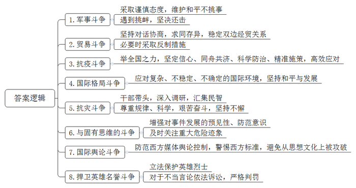
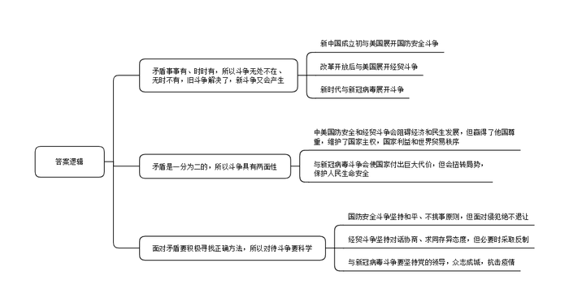
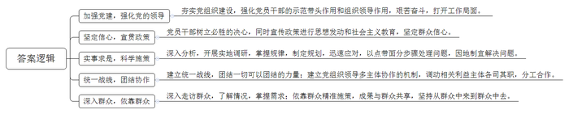
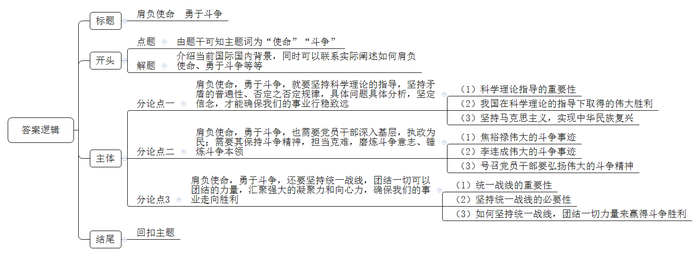

# 2021年上海市公考《申论》题（B、定向选调卷）

<!-- gwy:overview:start -->
> **上海 · 2021 · 申论 · 选调生** ｜ 4 题 · 图片 4 处 · 答案随题折叠

导航：[题目](#题目) · [材料 1](#材料-1)
<!-- gwy:overview:end -->

> 候选采集稿。参考答案及解析来自粉笔页面，不代表官方答案或真实高分答卷；来源使用许可与原卷对应关系仍需人工核实。

## 给定材料

### 材料 1

新中国成立后，毛泽东多次申明，新中国是爱好和平的社会主义国家、奉行睦邻友好的和平外交政策，愿意与世界各国和平共处，决不会主动挑衅滋事，或者去侵略其他国家。1951年10月，他在政协一届三次会议的开幕词中明确指出：“我们不要去侵犯任何国家，我们只是反对帝国主义者对于我国的侵略。”维护和平不挑事，也是毛泽东基于新中国自身利益做出的战略抉择。他在会见外国友人时曾反复谈到，新中国面临着发展经济、改善民生的艰巨任务，十分需要和平友好的外部环境，不愿意打仗。在与美国开展具体斗争，特别是军事斗争时，毛泽东采取了十分谨慎的态度。

当时，由于美国政府派兵协助台湾国民党政府防守东南沿海岛屿，美军的飞机军舰就在我前线附近活动，极易擦枪走火。1954年6月1日，时任副总参谋长的粟裕向中央军委报告说，舟山群岛南部海面发现美军巡洋舰及驱逐舰共8艘，并有飞机伴随，系美舰向我军进行挑衅。他明确指示我军部队，严密监视美舰情况并随时报告，如美舰不向我开火，我军不得向其射击，以免引起冲突。第二天，毛泽东在粟裕的报告上批示：“处理正确，不要先向美军开炮，只取守势，尽量避免冲突。”一个月后，毛泽东在修改中央军委“关于保卫领海主权及护航注意事项”的指示稿时强调：我军护航任务仅限于防止国民党军的抢劫行为，对其他任何外国海空军不发生自卫问题，一律不得采取攻击行动。同年夏，在决定攻击大陈岛时，毛泽东特别提出：“请注意，需确实查清没有美舰美机的时机，方可对上下大陈进行攻击，否则不要攻击。”1958年炮击金门时，毛泽东也十分注意，明确指示只打蒋舰不打美舰。

但是，毛泽东也认为，维护和平要靠斗争，一味退让最终得不到和平。“如果帝国主义一定要发动战争，我们也不要害怕。我们对待这个问题的态度，同对待一切‘乱子’的态度一样，第一条，反对；第二条，不怕。”1959年3月，毛泽东在会见美国著名记者安娜·路易斯·斯特朗时指出：如果帝国主义一定要发动侵略战争，你害怕也没用，“你怕也好，不怕也好，战争反正要到来。你越是害怕，战争也许还会来得早一些。”1964年6月，毛泽东在会见越南客人时又说：“还有一个怕不怕美国的问题。如果你怕了，美国就客气，那么怕也好。如果怕了，美国就撤退，那怎么不好？问题是，你越怕它越欺负你，该怎么办？只好不怕，只好干。”

毛泽东是这样说的，也是这样做的。1950年，美国不听中国政府劝告，肆意扩大朝鲜战争并将战火烧到中朝边境。为了保家卫国，毛泽东决定出兵朝鲜，在战场上进行了3年大规模的战争，打退了美军的进攻，也赢得了美国的尊重。炮击金门期间，毛泽东在紧守不挑事原则、只打蒋舰不打美舰的同时，也强调指出，“金门海域，美国人不得护航。如有护航，立即开炮”，如果美军侵入我领海、领空，我必须坚决打击。越南战争期间，美国为查明我军事部署和活动，频频派军机入侵我国境内侦察袭扰。1965年4月8日、9日，美机连日侵入我海南岛榆林港上空，我起飞战机进行监视，美机却连续发射导弹攻击我机。情况报到毛泽东那里，他明确指示：“美机入侵海南岛，应该打，坚决打。”“美机昨天是试探，今天又是试探，真的来挑衅啦！既来，就应该坚决打。”在毛泽东的领导下，我空军和海军航空兵紧密配合，前后击落击伤入侵美机30余架，有力打击了美国的嚣张气焰。

### 材料 2

改革开放以来，中国经济迅猛发展，尤其自2001年加入世界贸易组织后，中国对外贸易广度与深度不断增加，一跃成为全世界最大的发展中国家。迅速崛起的中国市场，加之中西方文化政治观念的差异，中美贸易出现摩擦。2017年8月14日，美国总统特朗普下令依据《美国贸易法》“301条款”，单方面对中国是否侵犯美国知识产权展开调查，此举被视为他针对中国采取的第一个直接贸易措施。2018年6月3日，美国决定自当年7月6日起对中国进口的340亿美元商品征收25%关税，同时对另外160亿美元商品加征关税开始征求公众意见。9月24日美国正式对2000亿美元的中国进口商品征收10%的关税，并表示这一比例将在2019年1月1日上调至25%。2019年5月10日美国对2000亿美元中国输美商品加征的关税正式从10%上调至25%。

面对这种局面，中国从维护两国共同利益和世界贸易秩序大局出发，坚持通过对话协商解决争议的基本原则，以最大的耐心和诚意回应美国关切，以求同存异的态度妥善处理分歧，克服各种困难，同美国开展多轮对话磋商，提出务实解决方案，为稳定双边经贸关系作出了艰苦努力。对于贸易战，中国不愿打、不怕打、必要时不得不打。在美方公布拟对中国600亿美元商品加征关税后，中方立即决定对原产于美国的659项约500亿美元进口商品加征25%的关税。在美国决定对华2000亿美元进口商品加征关税之后，中方于2018年8月8日公布了针对自美进口约600亿美元商品加征关税的反制措施。2019年9月1日，美国对华3000亿美元输美产品中第一批加征15%关税措施正式实施，中国就此在世贸组织争端解决机制下提起诉讼。

2019年10月12日，特朗普在白宫表示，美中经贸磋商取得了实质性的第一阶段成果，美国将暂缓下周15号的对华加征关税。12月15日，为落实中美双方关于经贸问题的磋商结果，根据《中华人民共和国海关法》《中华人民共和国对外贸易法》《中华人民共和国进出口关税条例》等法律法规和国际法基本原则，国务院规定，对原计划于12月15日12时01分起加征关税的原产于美国的部分进口商品，暂不征收10%、5%关税，对原产于美国的汽车及零部件继续暂停加征关税。

### 材料 3

新型冠状病毒肺炎是近百年来人类遭遇的影响范围最广的全球性大流行病，对全世界是一次严重危机和严峻考验，也是一场全人类与病毒的战争。在中国共产党领导下，全国上下贯彻“坚定信心、同舟共济、科学防治、精准施策”总要求，打响抗击疫情的人民战争。经过艰苦卓绝的努力，中国付出巨大代价和牺牲，有力扭转了疫情局势，用一个多月的时间初步遏制了疫情蔓延势头，用两个月左右的时间将本土每日新增病例控制在个位数以内，用3个月左右的时间取得了武汉保卫战、湖北保卫战的决定性成果。

疫情中，中国举全国之力实施规模空前的生命大救援，用10多天时间先后建成火神山医院和雷神山医院，大规模改建16座方舱医院，迅速开辟600多个集中隔离点，19个省区市对口帮扶除武汉以外的16个市州，最优秀的人员、最急需的资源、最先进的设备千里驰援，在最短时间内实现了医疗资源和物资供应从紧缺向动态平衡的跨越式提升。各行各业扛起责任，国有企业、公立医院勇挑重担，460多万个基层党组织冲锋陷阵，400多万名社区工作者在全国65万个城乡社区日夜值守，各类民营企业、民办医院、慈善机构、养老院、福利院等积极出力，广大党员、干部带头拼搏，人民解放军指战员、武警部队官兵、公安民警奋勇当先，广大科研人员奋力攻关，数百万快递员冒疫奔忙，180万名环卫工人起早贪黑，新闻工作者深入一线，千千万万志愿者和普通人默默奉献。

全国数百万名医务人员奋战在抗疫一线，给病毒肆虐的漫漫黑夜带来了光明。54万名湖北省和武汉市医务人员同病毒短兵相接，率先打响了疫情防控遭遇战。346支国家医疗队、4万多名医务人员毅然奔赴前线，很多人在万家团圆的除夕之夜踏上征程。广大医务人员用血肉之躯筑起阻击病毒的钢铁长城，挽救一个又一个垂危生命，诠释了医者仁心和大爱无疆！我国广大医务人员是有高度责任感的人，身患渐冻症的张定宇同志说：“我必须跑得更快，才能从病毒手里抢回更多病人。”

### 材料 4

2020年7月30日中共中央政治局召开会议。会议认为，当今世界正经历百年未有之大变局，和平与发展仍然是时代主题，同时，国际环境日趋复杂，不稳定性、不确定性明显增强。我国已进入高质量发展阶段，发展具有多方面优势和条件，同时发展不平衡不充分问题仍然突出。

西方出现了自工业革命以来的第一次全面颓势，老牌强国云集的欧洲已陷入老龄化深渊，社会结构受到多子化的穆斯林与中东涌入的数百万难民的冲击，经济增长长期乏力，领人类启蒙运动与工业化之先的欧洲日益成为暮气之地，甚至被称为人类“博物馆”。美国也不再是18世纪末《独立宣言》发表时的那个“美国”，央格鲁-撒克逊传统在美国出现式微之势。在移民融合中，白人可能会在2035年前后在人口比例中降到50%以下。力挺保护主义、民粹主义与孤立主义的特朗普以“退群”“砌墙”“贸易战”等方式，试图力挽美国霸权之颓势。同时，新兴国家集体崛起，全球政治出现大觉醒，西方发展经验在非西方世界出现“水土不服”，各国根据国情走自己道路之风日盛。国际社会的行为体现出“新中世纪主义”浪潮，非国家行为体如跨国公司、非政府组织、意见领袖，还有“独狼”式恐怖主义者、极端力量甚至智能机器等或好或坏的因素都日趋成为与国家平行的国际形势影响因子。从全球权力重心的角度看，当下也正处于百年未有之大变局，国际领导力继20世纪初之后再次出现洲际式转移。一战后，全球权力重心从欧洲西移至北美，现在，随着亚洲崛起，全球权力重心正在逐渐向亚洲转移，这反映在亚洲国家的市场活跃度、创新研发投入、工业制造规模、电子商务普及度、移动支付普惠性、基础设施便捷化等方面，甚至还包括时尚、旅游、电影、小说等消费文化行业，亚洲的全球号召力与软实力越来越多地使西方相形见绌，以至于出现了集体性的西方焦虑。

### 材料 5

1962年冬，焦裕禄同志怀着改变灾区面貌的雄心壮志，来到了兰考。展现在焦裕禄面前的兰考大地，是一幅严重的灾荒景象。横贯全境的两条黄河故道，是一眼望不到边的黄沙；片片内涝的洼窝里，结着青色的冰凌；白茫茫的盐碱地上，枯草在寒风中抖动。这一年，春天风沙打毁了二十万亩麦子，秋天淹坏了三十万亩庄稼，盐碱地上有十万亩禾苗被碱死，全县的粮食产量下降到历史的最低水平。焦裕禄同志说：“感谢党把我派到最困难的地方，越是困难的地方，越能锻炼人。请组织上放心，不改变兰考的面貌，我决不离开这里。”

第二天，当大家知道他是新来的县委书记时，他已经深入到农田一线调查访问去了。开座谈会，全面了解灾情及其原因，寻找救灾办法。深入到每家每户，了解情况，宣传政策，进行思想发动，进行社会主义教育。他经常住在农民的草庵子里，蹲在牛棚里，跟群众一起吃饭，一起劳动。他在广大群众中间询问着、倾听着、观察着。他听到许多农民要求“翻身”、要求革命的呼声，看到许多村自力更生，奋发图强对“三害”斗争的革命精神，他在群众中学到了不少治沙、治水、治碱的办法，总结了不少可贵的经验。群众的智慧，使他受到了极大的鼓舞，也更坚定了他战胜灾害的信心。通过调查，他感慨万千。他说：“兰考的贫下中农是革命的，他们有改变家乡面貌，由穷变富的强烈要求，就像在1080平方公里的土地上布满干柴一样，只要崩出一个火星，就可以引起熊熊烈火。”

1963年2月，县委决定在全县范围内开展治沙、治水、治碱的斗争，成立除“三害”办公室。他先后抽调了120名干部、老农和技术员组成一支“三结合”的“三害”调查队，在全县展开了大规模的追洪水、查风口、探流沙的调查研究工作。当时，焦裕禄同志的肝病已相当严重，许多同志劝他不要下去，劝他在家里听汇报。他说：“吃别人嚼过的馍没味道。”他背着干粮、拿起雨伞，和大家一起在兰考的原野上日夜奔波。追沙，他一直追到沙落地；查水，他又是查到水归槽。干旱季节，他亲自用舌头辨别盐碱的种类和土的含碱量。在同自然灾害的斗争中，焦裕禄同志不顾重病缠身，忍受着严重疾病的折磨，在风里、雨里、沙窝里、激流里，坚持度过了一百二十多个白天和黑夜，跑了一百二十多个大队，跋涉五千余里，终于摸清了兰考“三害”的底细，全县有大小风口八十四个，经调查队一个个查清，编了号、绘了图；全县有大小沙丘一千六百个，也一个个经过丈量，编了号、绘了图；全县的千河万流，淤塞的河渠，阻水的路基，涵闸等也调查得清清楚楚，绘成了详细的排涝泻洪图。这种大规模的调查研究，使县委基本上掌握了水、沙、碱发生、发展的规律，几个月的辛苦奔波，换来了一整套又具体又详细的资料，从而县委制定出了切实可行的改造兰考大自然的规划。为了取得经验，焦裕禄同志亲自率领干部、群众进行了小面积翻淤压沙、翻淤压碱、封闭沙丘试验。然后以点带面，全面铺开。焦裕禄同志既是指挥员又是战斗员，同干部、群众一起出力流汗。他给自己规定，把参加劳动作为日常生活的重要内容。下乡时就地劳动；在机关值班时，就近劳动。不论在治理“三害”的土地上，还是在平时田间管理中，他走到哪里干到哪里。群众都把焦裕禄看成是“跟咱一样的庄户人”。通过一年的艰苦奋战，兰考的除“三害”工作取得了明显的成效。

### 材料 6

欧洲人在发现澳洲之前，一直都认为天鹅全都是白色的。然而，在到了澳洲之后，他们竟然发现了黑色羽毛的天鹅，就是这一只黑天鹅，让欧洲人上千年结论彻底被推翻：原来天鹅不仅有白色的，还有黑色的！后来，美国著名投资人塔勒布便以“黑天鹅”事件特指极其罕见，无法预测，但是一旦发生影响足以颠覆以往任何经验的重大事件。

业内人士认为，1997年的亚洲金融危机即为“黑天鹅”事件。泰国政府宣布泰铢与美元脱钩后，当天泰铢就贬值近20%。随后，超出意料的引发马币林吉特、新加坡元、菲律宾比索、印尼盾等下挫。这场金融危机使大部分东亚货币贬值、国际股市暴跌、多国社会秩序陷入混乱、甚至政权更迭。由此可见，了解和防范“黑天鹅”事件，无论是对于个人投资还是社会发展，都是非常必要的。

除了“黑天鹅”，近年来人们还经常提到“灰犀牛”。灰犀牛是非洲大陆上的巨无霸，体重达2-5吨，它平时性情温和，只要不侵犯到它的领域或者挑衅它，基本不会对人或者其他动物造成威胁。但是，一旦某些因素刺激到它，这个庞然大物会朝着挑衅者冲刺过去，这就好比一辆载满沙石的货车，一旦加速，想停就没那么容易了，往往惨剧就是这么发生的。灰犀牛体型笨重、反应迟缓，你能看见它在远处，却毫不在意，一旦它向你狂奔而来，定会让你猝不及防，直接被扑倒在地。它并不神秘，却更危险。可以说，“灰犀牛”是一种大概率危机，在社会各个领域不断上演。很多危机事件，与其说是“黑天鹅”，其实更像是“灰犀牛”，在爆发前已有迹象显现，但却被忽视。

美国次贷危机就是典型的“灰犀牛”事件。当时大家知道“次债”有风险，却并未足够重视。因为投资回报高，“次债”相当一段时期内受到投资者的追捧，表现稳定。2007年房价开始回落，“次债”市场风险爆发，风险被迅速传导到其它市场，最终酿成了史无前例的全球性金融危机。

### 材料 7

长期以来，西方媒体拥有强大的话语权，在国际舆论斗争中占据明显优势。美联社、路透社、法新社三大通讯社几乎占据全世界国际新闻发稿量的80%，全世界国际新闻供稿量90%以上由西方媒体提供。更为关键的是，这些强大的西方媒体还搞强强联合，在重大国际问题与全球议题上，特别是在对付非西方、广大发展中国家的议题上，协同配合，常常保持一个语气、一个声音、一个腔调。正因如此，非西方国家在国际舆论场上很难发声，发出声来往往也没人关注。很多研究资料都曾提到，在海湾战争中，全世界都在传播由美国有线电视新闻网CNN拍摄的画面，CNN创始人特纳夸下海口：“CNN的镜头摇到哪里，安理会的议程就讨论到哪里。”与此相对应，伊拉克完全被消音，国家政权被颠覆，而作为对伊实施武力讨伐借口的“大规模杀伤性武器”，尽管后来被证明是美国情报机构与西方媒体联手撒下的弥天大谎，也无法追究他们的责任。

“颜色革命”是21世纪以来美国对其它国家民主输入、更迭政权、实现战略目标的重要手段。从独联体国家和中亚地区蔓延开来的“颜色革命”，在多国造成了社会动荡、国家分裂乃至冲突战争的严重后果，威胁地区稳定和世界和平。近几年，特朗普政府和美国右翼势力大力推动“颜色革命”干涉他国内政、实施霸权主义，增加了我国外部环境复杂严峻的程度。一些西方敌对势力总是披着所谓“民主、人权、平等”这种“美丽的外衣”，借种种经不起历史检验、实践检验的“荒唐借口”，运用不合理、非道义的卑鄙手段和行径，来搞乱一个国家、一个地区。美国搞“颜色革命”，手段、程序、逻辑都很清晰：首先，让世界一切国家都崇拜西方的标准，向西方标准看齐。其次，用西方的标准来检验他国的发展道路，然后让那个国家得出结论：西方的月亮比其他国家的圆。既然西方的月亮比较圆，其他国家的月亮就比较缺，这就为历史虚无主义提供了理论基础，从而否定他国历史、文化、传统。最后，就是文化攻心、思想解体，攻破他国的思想长城。

### 材料 8

作家郁达夫说过：“一个没有英雄的民族是不幸的，一个有英雄却不知敬重爱惜的民族是不可救药的”。2018年十三届全国人大常委会第二次会议全票表决通过英雄烈士保护法，全面加强对英雄烈士的保护，维护社会公共利益，弘扬社会主义核心价值观。《中华人民共和国英雄烈士保护法》自2018年5月1日起实施。英烈保护法强调，以侮辱、诽谤或其他方式侵害英雄烈士的姓名、肖像、名誉、荣誉，损害社会公共利益的，依法承担民事责任；构成违反治安管理行为的，由公安机关依法给予治安管理处罚；构成犯罪的，依法追究刑事责任。

近些年来，自媒体的兴盛发达，让网络世界里的声音难免良莠不齐，泥沙俱下。为了追求点击率、粉丝量，一些自媒体不顾法律法规和良知底线，使尽各种招数。有的网民为了吸引眼球，也尽出歪言怪论。比如，2019年3月30日，四川省凉山州木里县发生森林火灾，27名森林消防员和3名地方干部群众在救火中不幸牺牲。各界群众纷纷自发地以各种方式沉痛悼念英雄们。然而，少数网民竟公然在网上发帖恶意诋毁、侮辱在火灾中牺牲的消防英雄及其家人，其言论极大地伤害了国人的感情。福建省南平市顺昌县的黄某某于4月2日至4月5日期间多次使用QQ及微信账号在10余个群内发表不当言论，辱骂牺牲的烈士，造成了极其恶劣的影响，严重侵犯了英烈的名誉和荣誉权。陕西省榆林市张某于4月1日在新浪微博发表不当言论，侮辱四川凉山因救火牺牲的英雄烈士，造成了极其恶劣的社会影响，损害了社会公共利益。事发后，陕西省榆林市的张某被检察机关提起刑事附带民事公益诉讼，请求法院判令其在全国性媒体发表道歉声明，就其侵害英雄烈士名誉的行为，向四川省木里县火灾中牺牲的英雄烈士家属公开赔礼道歉，消除因其不当言论引发的恶劣社会影响。福建省南平市顺昌县人民法院判决被告人黄某某犯寻衅滋事罪，判处有期徒刑七个月，同时在国家级媒体上书面公开赔礼道歉。

### 材料 9

矛盾是客观存在的，事事有矛盾、时时有矛盾。事物的发展一个过程连着一个过程，过程的更替要通过肯定、否定、否定之否定的周期来实现。马克思主义思想学说的建立，充分体现了矛盾运动的普遍性和否定之否定的趋势道路。从早期马克思、恩格斯与青年黑格尔派在哲学上的斗争，到与魏特林和格律恩在社会主义学说上的斗争，再到与布朗基主义、蒲鲁东主义、巴枯宁主义、拉萨尔主义、杜林主义的斗争等，马克思主义与其他思想流派的斗争不断出现、不断解决，又不断产生，推动马克思主义理论体系在博采众长中发展成熟。作为一个开放的思想体系，今天马克思主义仍然面临着自身怎样与时俱进、进一步增强解释力、说服力、影响力的重大课题。马克思主义的发展没有终点，与形形色色非马克思主义的斗争还远没有完结。

“哲学家们只是用不同的方式解释世界，而问题在于改变世界”。以共产主义、社会主义理想来改造社会，前景光明，道路漫长，不会一帆风顺。国际共产主义运动经验表明，运动遭遇挫折和低潮，往往源于指导思想的混乱。苏东剧变的发生发展并非一夜间的事，戈尔巴乔夫多年推行新思维，使得颠倒历史、混淆是非的种种歪理邪说大行其道。面对峰谷叠现的历史进程，面对各种杂音、噪音的干扰，我们只有做好进行长期艰苦思想理论斗争的准备，才能以坚定的信念确保发展方向不跑偏、以科学的理论指导“人间正道”走得更平坦。

### 材料 10

统一战线就其广义而言，是指不同社会政治力量在一定条件下，为了一定的共同目标而建立的政治联盟或联合；就其狭义而言，是指无产阶级及其政党的战略策略，主要是无产阶级自身团结和同盟军问题。在中国革命、建设和改革的各个历史时期，统一战线都是中国共产党的一大重要法宝。统一战线的根本问题，是无产阶级解放运动的自身统一、坚持无产阶级的领导权和团结同盟军的问题。中国共产党人在长期的统一战线实践中，把马克思列宁主义的普遍原理与中国的具体实际相结合，逐步总结出一套具有中国特色的统一战线理论和政策：在统一战线中牢牢坚持中国共产党的领导权和独立自主原则；以工农联盟为坚固基础，争取、团结农民和其他劳动人民以外的广大非劳动者同盟军；创造性地将中国资产阶级区分为官僚买办资产阶级和民族资产阶级两部分。在民主革命阶段将民族资产阶级作为直接同盟军，并且利用官僚买办资产阶级内部矛盾，与其一部分结成暂时联盟，将其当作间接同盟军；坚持同资产阶级又联合又斗争的政策，同官僚买办资产阶级斗争时，强调执行有理、有利、有节的原则。在社会主义改造时期，对民族资产阶级实行赎买政策，并把改造所有制与改造人巧妙地结合起来。在社会主义革命与社会主义建设时期，仍然坚持同各民主党派和党外人士建立“长期共存，互相监督，肝胆相照，荣辱与共”的亲密合作关系，并以人民政治协商会议作为统一战线的组织形式。党的十一届三中全会以后，我国进入了改革开放和社会主义现代化建设的历史新时期，爱国统一战线成为有各民主党派和各人民团体参加的，包括全体社会主义劳动者、社会主义事业的建设者、拥护社会主义的爱国者和拥护祖国统一的爱国者的最广泛的联盟。它的任务主要是团结一切可以团结的力量，调动一切积极因素，为建设有中国特色的社会主义、统一祖国、振兴中华服务。

毛泽东同志在著名的《论十大关系》一文中指出：什么是国内外的积极因素？在国内，工人和农民是基本力量。中间势力是可以争取的力量。反动势力虽是一种消极因素，但是我们仍然要做好工作，尽量争取化消极因素为积极因素。在国际上，一切可以团结的力量都要团结，不中立的可以争取为中立，反动的也可以分化和利用。总之，我们要调动一切直接和间接的力量，为把我国建设成为一个强大的社会主义国家而奋斗。

### 材料 11

2019年9月3日，习近平总书记在中央党校（国家行政学院）中青年干部培训班开班式上发表重要讲话，他指出，社会是在矛盾运动中前进的，有矛盾就会有斗争。领导干部不论在哪个岗位、担任什么职务，都要勇于担当、攻坚克难，既当指挥员、又当战斗员，培养和保持顽强的斗争精神、坚韧的斗争意志、高超的斗争本领。

2020年8月24日，习近平总书记主持召开经济社会领域专家座谈会，他指出，当前新冠肺炎疫情全球大流行使这个大变局加速变化，保护主义、单边主义上升，世界经济低迷，全球产业链、供应链因非经济因素而面临冲击，国际经济、科技、文化、安全、政治等格局都在发生深刻调整，世界进入动荡变革期。国内发展环境也经历着深刻变化，我国已进入高质量发展阶段，社会主要矛盾已经转化为人民日益增长的美好生活需要和不平衡不充分的发展之间的矛盾，人民对美好生活的要求不断提高。

## 题目

### 第 1 题

**根据“材料**2**”到“材料**9**”的内容，概括“斗争”的不同类型并简述主要特点。（20分）**

关联材料：材料 1、材料 2、材料 3、材料 4、材料 5、材料 6、材料 7、材料 8

作答要求：

要求：概括准确，条理清楚，语言精练，字数不超过300字。

第 1 题 · 答案与解析

**参考答案（粉笔题库参考内容）**

1.军事斗争。采取谨慎态度，维护和平不挑事；遇到挑衅，坚决还击。

2.贸易斗争。坚持对话协商，求同存异，稳定双边经贸关系；必要时采取反制措施。

3.抗疫斗争。举全国之力，坚定信心、同舟共济、科学防治、精准施策，高效应对。

4.国际格局斗争。应对复杂、不稳定、不确定的国际环境，坚持和平与发展。

5.抗灾斗争。干部带头，深入调研，汇集民智；尊重规律、科学，艰苦奋斗，坚持不懈。

6.与固有思维的斗争。增强对事件发展的预见性、防范意识；及时关注重大危险迹象。

7.国际舆论斗争。防范西方媒体舆论控制，警惕西方标准，避免从思想文化上被攻破。

8.捍卫英雄名誉斗争。立法保护英雄烈士；对于不当言论依法诉讼，严格判罚。

**参考答案说明：**参考答案从“军事斗争”“贸易斗争”“抗疫斗争”“国际格局斗争”“抗灾斗争”“与固有思维的斗争”“国际舆论斗争”“捍卫英雄名誉斗争”这八个方面分条撰写，具体要点按照“类型+特点”的形式书写，各条答案要点之间在内容上是并列关系，没有交叉。

**解析**

**考点**：特点类

**来源**：2021年上海市公考《申论》题（B、定向选调卷）

> 粉笔申论页面对本题只提供「解析视频」入口，该入口是会员推广位，页面无视频地址与文字解析。

### 第 2 题

**运用矛盾的普遍性原理，分析“材料**2**”“材料**3**”和“材料**4**”中反映出的斗争的共性。（20分）**

关联材料：材料 9、材料 1、材料 2、材料 3

作答要求：

要求：概括准确，条理清楚，语言精练，字数不超过300字。

第 2 题 · 答案与解析

**参考答案（粉笔题库参考内容）**

1.矛盾事事有、时时有，所以斗争无处不在、无时不有，旧斗争解决了，新斗争又会产生。新中国成立初与美国展开国防安全斗争；改革开放后与美国展开经贸斗争；新时代与新冠病毒展开斗争。

2.矛盾是一分为二的，所以斗争具有两面性。中美国防安全和经贸斗争会阻碍经济和民生发展，但赢得了他国尊重，维护了国家主权，国家利益和世界贸易秩序。与新冠病毒斗争会使国家付出巨大代价，但会扭转局势，保护人民生命安全。

3.面对矛盾要积极寻找正确方法，所以对待斗争要科学。国防安全斗争坚持和平、不挑事原则，但面对侵犯绝不退让；经贸斗争坚持对话协商、求同存异态度，但必要时采取反制；与新冠病毒斗争要坚持党的领导，众志成城，抗击疫情。

**参考答案说明：**本参考答案从“矛盾事事有、时时有，所以斗争无处不在、无时不有，旧斗争解决了，新斗争又会产生”“矛盾是一分为二的，所以斗争具有两面性”“面对矛盾要积极寻找正确方法，所以对待斗争要科学”等三个方面进行了分条撰写。每条要点之间内容上没有交叉。

**解析**

**考点**：对比分析类

**来源**：2021年上海市公考《申论》题（B、定向选调卷）

> 粉笔申论页面对本题只提供「解析视频」入口，该入口是会员推广位，页面无视频地址与文字解析。

### 第 3 题

**根据“材料**4**”“材料**6**”和“材料**10**”，分析我们赢得斗争胜利的主要方法。(20分）**

关联材料：材料 3、材料 5、材料 10

作答要求：

要求：观点明确，条理清楚，语言精练，字数不超过300字。

第 3 题 · 答案与解析

**参考答案（粉笔题库参考内容）**

1.加强党建，强化党的领导。夯实党组织建设，强化党员干部的示范带头作用和组织领导作用，艰苦奋斗，打开工作局面。

2.坚定信心，宣贯政策。党员干部树立必胜的决心，同时宣传政策进行思想发动和社会主义教育，坚定群众信心。

3.实事求是，科学施策。深入分析，开展实地调研，掌握规律，制定规划，迅速应对，以点带面分步骤处理问题，因地制宜解决问题。

4.统一战线，团结协作。建立统一战线，团结一切可以团结的力量；建立党组织领导多主体协作的机制，调动相关利益主体各司其职，分工合作。

5.深入群众，依靠群众。深入走访群众，了解情况，掌握需求；依靠群众精准施策，成果与群众共享，坚持从群众中来到群众中去。

**参考答案说明：**本参考答案从“加强党建，强化党的领导”“坚定信心，宣贯政策”“实事求是，科学施策”“统一战线，团结协作”“深入群众，依靠群众”五个层面提出对策，进行了分类、分条撰写。各条要点彼此独立、没有交叉。

**解析**

**考点**：概括措施类

**来源**：2021年上海市公考《申论》题（B、定向选调卷）

> 粉笔申论页面对本题只提供「解析视频」入口，该入口是会员推广位，页面无视频地址与文字解析。

### 第 4 题

**时代在动荡和变革，国内外格局在调整和重组。只有每一代人肩负起使命和担当，才能确保我们的事业不断取得新的胜利。结合给定材料，围绕****“使命”和“斗争”这两个关键词，写一篇文章。（40分）**

关联材料：材料 9、材料 1、材料 2、材料 3、材料 4、材料 5、材料 6、材料 7、材料 8、材料 10、材料 11

作答要求：

要求：

（1）自选角度，自拟题目；

（2）观点明确，联系实际，分析具体，条理清楚，语言流畅；

（3）总字数800-1000字。

第 4 题 · 答案与解析

**参考答案（粉笔题库参考内容）**

**肩负使命** **勇于****斗争**

当前，世界面临百年未有之大变局，国内发展环境也经历着深刻变化，我国社会的主要矛盾已转化为人民日益增长的美好生活需要和不平衡不充分的发展之间的矛盾。为了不断满足人民对美好生活的需求，需要我们每一代人都肩负起使命和担当，勇于斗争，为中国人民谋幸福，为中华民族谋复兴，才能赢得伟大事业的胜利。

**肩负使命，勇于斗争，就要坚持科学理论的指导****，****坚持矛盾的普遍性、否定之否定规律，具体问题具体分析，坚定信念，才能确保我们的事业行稳致远。**科学理论是成功实践的行动指南和指路明灯。我国之所以能赢得新民主主义革命胜利，凭借的是毛泽东思想的指导；我们能取得改革开放新的伟大革命巨大成就，靠的是邓小平理论的指导；党的十八大以来，我们能取得历史性突破、创造历史性伟业，得益于习近平新时代中国特色社会主义思想。可见，面对一次次斗争，我党始终坚持以马克思主义思想为指导，精准施策，不断推动马克思主义中国化、时代化、大众化，才能在实现中华民族伟大复兴的历史征程中乘风破浪、扬帆远航。

**肩负使命，勇于斗争，****也需****要党员干部****深入基层，执政为民；需要其****保持斗争精神****，****担当克难，****磨炼斗争意志、****锤炼斗争本领。**亲民爱民的典范焦裕禄，就是一名怀抱初心和信念的优秀共产党人，他全心全意为人民服务，不忘初心，脚踏实地，俯首为牛，解决了一个又一个困难，用实际行动赢得群众认可。还有“吃亏”书记李连成，担任村支书29年，他敢于吃亏，心系百姓，努力带领乡亲们圆脱贫致富梦……广大党员干部都应以这些模范为镜，弘扬伟大革命精神，直面困难，勇往直前，在一次次斗争中为人民撑起幸福生活的“大伞”。

**肩负使命，勇于斗争，****还****要坚持统一战线，团结一切可以团结的力量，汇****聚****强大的凝聚力和向心力，确保我们的事业走向胜利。**毛泽东同志曾指出，统一战线是我们的一大法宝。现阶段，我国面临的国内国际局势异常复杂、各种新旧挑战极其尖锐，为了战胜某些政治势力和自然灾害的影响，必须坚持和利用好这个历久弥新的法宝，在坚持中国共产党的正确领导下，团结国内外一切可以团结的力量，发挥其作用、听取其意见和批评、排除阻碍其发挥作用的屏障，让社会各界力量汇入到我们各项伟大斗争中，为赢得我们使命和初心的胜利汇聚磅礴的力量。

实现中华民族伟大复兴离不开“具有许多新的历史特点的伟大斗争”。新时代，我们唯有肩负使命和担当，敢于斗争，才能赢得胜利，走向未来！

**文章分析**

**肩负使命** **勇于****斗争**

【**标题的优点：**首先，范文的标题突出了“使命”“斗争”这两个主题词。其次，它在形式上采用对称式结构，使标题更加饱满，更具吸引力。】

（1）当前，世界面临百年未有之大变局，国内发展环境也经历着深刻变化，我国社会的主要矛盾已转化为人民日益增长的美好生活需要和不平衡不充分的发展之间的矛盾。（2）为了不断满足人民对美好生活的需求，需要我们每一代人都肩负起使命和担当，勇于斗争，为中国人民谋幸福，为中华民族谋复兴，才能赢得伟大事业的胜利。

【**开头的优点：**★内容方面。范文的开头是紧扣“使命”“斗争”这两个主题词展开的。首先，开头点出主题，做到了主题明确。其次，对“使命”“斗争”这两个主题词进行了分析阐述，指出了：（1）当前国际和国内的社会背景；（2）提出观点我们要肩负使命，勇于斗争。★文字表达方面。使用了“为了”“才能”等关联词，使语言表达有逻辑性；长短句配合使用，使语言表达有节奏感。】

**肩负使命，勇于斗争，就要坚持科学理论的指导****，****坚持矛盾的普遍性、否定之否定规律，具体问题具体分析，坚定信念，才能确保我们的事业行稳致远****。**（1）科学理论是成功实践的行动指南和指路明灯。（2）我国之所以能赢得新民主主义革命胜利，凭借的是毛泽东思想的指导；我们能取得改革开放新的伟大革命巨大成就，靠的是邓小平理论的指导；党的十八大以来，我们能取得历史性突破、创造历史性伟业，得益于习近平新时代中国特色社会主义思想。（3）可见，面对一次次斗争，我党始终坚持以马克思主义思想为指导，精准施策，不断推动马克思主义中国化、时代化、大众化，才能在实现中华民族伟大复兴的历史征程中乘风破浪、扬帆远航。

【**论述段****1的优点：**★观点句：范文的观点句是紧扣“使命”“斗争”这两个主题词展开的。形式上，它在段首处直接写出，位置突出，容易发现；内容上，关键词突出，内容要点明确，可以明显看出它是从“科学理论指导”这一角度出发进行论述。★论述内容：（1）指出科学理论指导的重要性；（2）介绍了我国在科学理论的指导下取得的伟大胜利；（3）坚持马克思主义，实现中华民族复兴。注意：以上三个方面的内容都是紧扣“肩负使命，勇于斗争，就要坚持科学理论的指导，坚持矛盾的普遍性、否定之否定规律，具体问题具体分析，坚定信念，才能确保我们的事业行稳致远”这个观点进行分析论述的。论述的针对性强，内容层次丰富。最后，在论述方法和论据的选取上做到了讲道理与举例子相结合，做到了丰富多样。】

**肩负使命，勇于斗争，也需要党员干部深入基层，执政为民；需要其保持斗争精神，担当克难，磨炼斗争意志、锤炼斗争本领。**（1）亲民爱民的典范焦裕禄，就是一名怀抱初心和信念的优秀共产党人，他全心全意为人民服务，不忘初心，脚踏实地，俯首为牛，解决了一个又一个困难，用实际行动赢得群众认可。（2）还有“吃亏”书记李连成，担任村支书29年，他敢于吃亏，心系百姓，努力带领乡亲们圆脱贫致富梦……（3）广大党员干部都应以这些模范为镜，弘扬伟大革命精神，直面困难，勇往直前，在一次次斗争中为人民撑起幸福生活的“大伞”。

【**论述段****2****的优点：**★观点句：范文的观点句是紧扣“使命”“斗争”这两个主题词展开的。形式上，它在段首处直接写出，位置突出，容易发现；内容上，关键词突出，内容要点明确，可以明显看出它是从“斗争精神”这一角度出发进行论述。★论述内容：（1）介绍了焦裕禄伟大的斗争事迹；（2）介绍了李连成伟大的斗争事迹；（3）号召党员干部要弘扬伟大的斗争精神。注意：以上三个方面的内容都是紧扣“肩负使命，勇于斗争，也需要党员干部深入基层，执政为民；需要其保持斗争精神，担当克难，磨炼斗争意志、锤炼斗争本领”这个观点进行分析论述的。论述的针对性强，内容层次丰富。最后，在论述方法和论据的选取上做到了讲道理与举例子相结合，做到了丰富多样。】

**肩负使命，勇于斗争，****还****要坚持统一战线，团结一切可以团结的力量，汇****聚****强大的凝聚力和向心力，确保我们的事业走向胜利**。（1）毛泽东同志曾指出，统一战线是我们的一大法宝。（2）现阶段，我国面临的国内国际局势异常复杂、各种新旧挑战极其尖锐，为了战胜某些政治势力和自然灾害的影响，必须坚持和利用好这个历久弥新的法宝，（3）在坚持中国共产党的正确领导下，团结国内外一切可以团结的力量，发挥其作用、听取其意见和批评、排除阻碍其发挥作用的屏障，让社会各界力量汇入到我们各项伟大斗争中，为赢得我们使命和初心的胜利汇聚磅礴的力量。

【**论述段****3****的优点：**★观点句：范文的观点句是紧扣“使命”“斗争”这两个主题词展开的。形式上，它在段首处直接写出，位置突出，容易发现；内容上，关键词突出，内容要点明确，可以明显看出它是从“坚持统一战线”这一角度出发进行论述。★论述内容：（1）指出了统一战线的重要性；（2）介绍了坚持统一战线的必要性；（3）如何坚持统一战线，团结一切力量来赢得斗争胜利。注意：以上三个方面的内容都是紧扣“肩负使命，勇于斗争，还要坚持统一战线，团结一切可以团结的力量，汇聚强大的凝聚力和向心力，确保我们的事业走向胜利”这个观点进行分析论述的。论述的针对性强，内容层次丰富。最后，在论述方法和论据的选取上做到了讲道理与举例子相结合，做到了丰富多样。】

实现中华民族伟大复兴离不开“具有许多新的历史特点的伟大斗争”。新时代，我们唯有肩负使命和担当，敢于斗争，才能赢得胜利，走向未来！

【**结尾的优点**：范文的结尾重申了“使命”“斗争”这两个主题词，语言精炼，不拖沓。】

**解析**

**考点**：文章写作题

**来源**：2021年上海市公考《申论》题（B、定向选调卷）

> 粉笔申论页面对本题只提供「解析视频」入口，该入口是会员推广位，页面无视频地址与文字解析。

