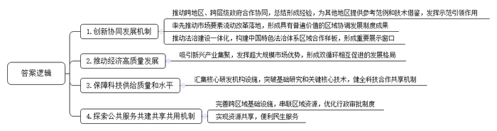
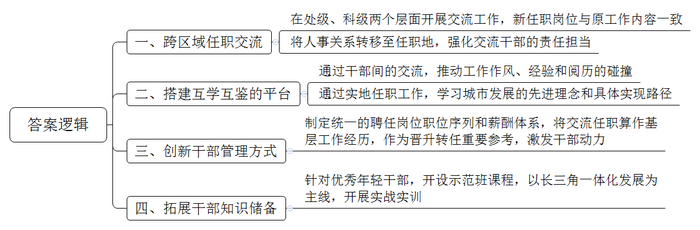
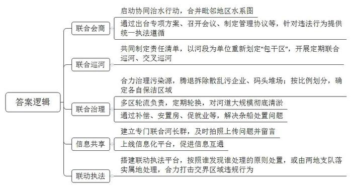
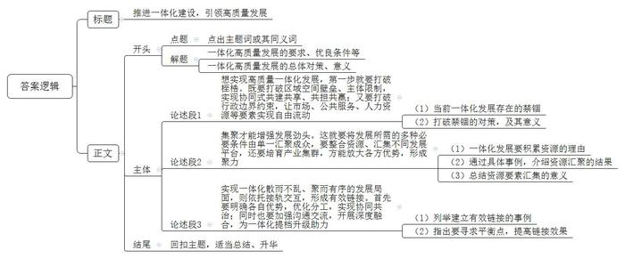

# 2022年上海市公考《申论》题（B、定向选调卷）

> 候选采集稿。参考答案及解析来自粉笔页面，不代表官方答案或真实高分答卷；来源使用许可与原卷对应关系仍需人工核实。

## 给定材料

### 材料 1

实施长三角区域一体化发展战略，是以习近平同志为核心的党中央作出的重大决策部署。2018年11月5日，习近平总书记在首届中国国际进口博览会上宣布，支持长江三角洲区域一体化发展并上升为国家战略，同“一带一路”建设、京津冀协同发展、长江经济带发展、粤港澳大湾区建设相互配合，完善中国改革开放空间布局。

2020年8月20日，习近平总书记在扎实推进长三角一体化发展座谈会上强调，要深刻认识长三角区域在国家经济社会发展中的地位和作用，结合长三角一体化发展面临的新形势新要求，坚持目标导向、问题导向相统一，紧扣一体化和高质量两个关键词抓好重点工作。2021年一季度，长三角区域生产总值突破6万亿元，占全国经济总量的比重达24.55%，较去年同期提高0.44个百分点。

### 材料 2

2019年11月1日，长三角生态绿色一体化发展示范区正式揭牌。这个横跨沪苏浙两省一市，由上海青浦区、江苏苏州吴江区、浙江嘉兴嘉善县三地共同组成的示范区紧紧围绕一体化制度创新，改革攻坚取得了良好开局。

2020年6月18日，上海市规划和自然资源局、江苏省自然资源厅和浙江省自然资源厅的网站上出现了同一份公示文件：《长三角生态绿色一体化发展示范区国土空间总体规划（2019-2035年）》。这份规划涉及范围并不大，主要包括青浦、吴江、嘉善“两区一县”。但这2400多平方公里的土地，地跨三个省级行政区，参与规划制定的部门却不少：省级层面，有上海市、江苏省、浙江省；设区市层面，有苏州市、嘉兴市；再加上“两区一县”，地方政府就有“三级八方”。

总规作为国内首个省级行政主体共同编制的跨省域国土空间规划，对长三角乃至全国都有示范引领作用。规划制定过程中参与部门众多，尤其强调协同性。在空间组织方面，不搞集中成片、大规模、高强度开发建设，推动存量用地布局优化、结构调整和内涵提升。示范区总规在治理方式上，强调共建共享、共担共赢，建立区域一体化发展新机制。通过这份规划，将实现“一张蓝图管全域”。在规划编制过程中，示范区总结形成了跨省域的国土空间规划编制指导手册，为实现跨域规划编制提供参考范例和技术借鉴，促进一体化发展规划在更大范围内实践和推广。

### 材料 3

“原本以为公司迁出上海要跑很多部门，递交很多材料，没想到材料提交后，几天就办好了。”最近，一家电子科技企业要从上海青浦迁到苏州太仓，便利的办事手续，让公司负责人十分惊喜。更方便的是，企业原有纳税信用级别等资质信息、增值税期末留抵税额等权益信息均得以承继，到了太仓之后不用再“从头来过”。

企业跨省迁移，一度是件难事——需要来回奔波迁出和迁入两地的多个部门，手续烦琐、材料众多。2019年年底，国家税务总局出台16项支持服务长三角区域一体化发展举措，其中明确规定长三角区域纳税信用级别为A级、B级的企业，因住所、经营地点在区域内跨省（市）迁移涉及变更主管税务机关的，税务机关可为符合相应条件的企业办理跨省（市）迁移手续。作为长三角一体化发展改革“试验田”，示范区率先推动改革举措落地。

“依托数据交互，纳税人向迁出地税务机关申请后，各项数据传输到迁入地税务机关。”上海市青浦区税务局有关负责人介绍，这种模式实现了迁出手续即时办，迁入手续“自动办”，办理时限最短缩减至1个工作日。优化企业自由迁移服务机制，是沪苏浙联合制定的《关于支持长三角生态绿色一体化发展示范区高质量发展的若干政策措施》中一项重要内容，其目的是在不打破行政隶属的前提下，打破行政边界的约束，让市场要素实现自由流动。围绕改革赋权、财政金融支持、用地保障、新基建建设、管理和服务创新等多个方面提出多条主要内容。示范区建设就是要聚焦面临的共性突出问题，进行系统性改革实践，形成具有普遍价值的区域协调发展制度成果。

近年来，示范区的创新产业加速集聚。28项产业创新类项目重点推进：华为青浦研发中心项目已全面开工，建成后预计导入3万～4万名科研人才；国家重点支持的“关键战略材料”，英诺赛科氮化镓项目落户吴江汾湖高新区，一期已经建成。“相较于传统材料，氮化镓半导体材料体积更小、能耗更低，在5G通信、工业互联网等应用市场拥有巨大潜力。”英诺赛科工厂运营副总表示，长三角地区高水平的科研能力，较为完备的产业链和巨大的市场，对于氮化镓这类新材料项目有极强的吸引力。在当前全球市场萎缩的外部环境下，发挥国内超大规模市场优势，率先形成以国内大循环为主体、国内国际双循环相互促进的新发展格局，已经成为长三角区域的重要使命，作为长三角一体化发展的“样板间”，示范区更是要率先“探路”。示范区成立一年来，一体化制度创新的红利推动区域高质量发展。2020年前三季度，示范区两区一县合计实现地区生产总值同比增长1.8%，新增企业登记数量同比增长12.6%，实到外资同比增长31.8%，成为发展的新热土。

### 材料 4

2021年5月14日，一个激动人心的消息从中国科学院上海高等研究院传出：我国首台X射线自由电子激光用户装置，实现2.0纳米波长自由电子激光放大出光，达到设计目标波长，这标志着我国在软X射线自由电子激光研制方面已步入国际先进行列。此前一周，位于安徽合肥的中国科学技术大学成功研制目前国际上超导量子比特数量最多的量子计算原型机“祖冲之号”，操纵的超导量子比特达到62个，并在此基础上实现了可编程的二维量子行走，研究成果在国际权威学术期刊《科学》上发表。

在扎实推进长三角一体化发展座谈会上，习近平总书记指出，当前，新一轮科技革命和产业变革加速演变，更加凸显了加快提高我国科技创新能力的紧迫性。上海和长三角区域不仅要提供优质产品，更要提供高水平科技供给，支撑全国高质量发展。全国共有4个综合性国家科学中心，长三角以张江与合肥而占据半数。承担提供高水平科技供给的重任，勇当我国科技和产业创新的开路先锋，长三角责无旁贷。截至2020年底，张江已集聚330家国家级研发机构、14个国家重大科技基础设施。基础研究和关键核心技术领域取得了一批标志性成果，墨子号、黑洞照片、超强超短激光等科学新发现、新发明不断涌现，C919首飞成功，超导、石墨烯等关键技术取得突破，2020年上海科学家在《科学》《自然》《细胞》等全球顶尖期刊发表论文数占全国的32%。

“基础研究是整个科学技术体系的源头，也是突破关键核心技术问题的根源所在。”上海科委主任表示，要深入推进长三角科技创新共同体建设，深化国内科技合作，健全合作共享机制，提升科技供给质量和水平。2020年6月，沪苏浙皖三省一市科技部门签署了《共同创建长三角国家技术创新中心的框架协议》。共同筹建长三角国家技术创新中心，打造支撑长三角科技创新共同体建设的引领性平台，被写进了上海市、安徽省2021年政府工作报告。2021年1月，沪苏浙皖科技主管部门等联合发布《关于开展长三角科技创新券通用通兑试点的通知》，上海市青浦区、江苏省苏州市吴江区、浙江省嘉善县、安徽省马鞍山市参与试点。长三角科技创新券通用通兑试点平台于2021年4月1日测试上线，如今资源池里已有458家服务机构的8955项服务项目、24022台套大型科学仪器等科技资源。一个多月里，已有109家企业注册通用通兑平台，27家单位申请科技创新券，发券金额1060万元。

### 材料 5

元荡湖位于上海淀山湖以西，横跨沪苏两地，总面积12.9平方公里，1/5属上海青浦，4/5属苏州吴江。元荡湖东面是上海青浦的东航路，西面是江苏吴江的康力大道，两条路，到了元荡湖戛然而止，成了“断头路”。青浦、吴江两地居民之间的走动很多。因为元荡湖的阻隔，对面的青浦区金泽镇居民想过来，得绕行一旁的国道，很不方便。

2018年，沪苏浙皖一市三省共同签署《长三角地区打通省际断头路合作框架协议》，东航路—康力大道省际断头路贯通工程成为首批17个重点项目之一。在沪苏两地的大力推进下，东航路与康力大道通过一座元荡桥连接在了一起。青浦区、吴江区两地设计团队采用多控制点联测确保线型无缝对接，可谓“规划一张图，标准一把尺”。2020年11月，东航路—康力大道省际断头路贯通工程正式通车，项目建成后，吴江到青浦的交通时间由40分钟缩短为5分钟，对提高省际路网可达性具有重要意义。

在这条车行道通车的同时，一座500多米长的景观人行桥也建设完成，把周边丰富的旅游资源串联在一起。由于项目横跨青浦、吴江两地，在事项审批部门、流程、材料申报等方面都存在一定差异。为了简化审批流程、提高效率，两地相关部门积极协商，最后达成“一枚公章管审批”，以“多方委托、一方受理”模式，完成项目审批。截至2021年6月，沪苏浙皖共同确定的17条省际断头路贯通工程中，已有7条建成通车，长三角居民越来越感受到一体化发展红利。

### 材料 6

小女儿住在青浦区，家在吴江区黎里镇的陈凤仙老人常去小住。但因身患糖尿病，每次出发前，她都要在吴江的医院配好药带在身边，药快吃完的时候，还得惦记着回去。老人的这点不痛快，如今已经得到了彻底解决。2020年6月，上海青浦、浙江嘉善和江苏吴江三地医保局签署了《长三角生态绿色一体化示范区医保一体化建设合作协议》，到9月份，医保一卡通2.0版在示范区率先开通。

三地率先实现异地门诊就医免备案直接刷卡结算，参保人在示范区内异地就诊时，医保待遇与参保地保持一致。三地共有85家医保定点医疗机构已接入门急诊联网结算系统，覆盖三地参保人230余万。门诊大病的异地结算也联网成功，尿毒症门诊血透、腹透大病患者可在示范区内任何一家有资质的医疗机构就诊结算，方便患者就近医疗，减少患者等候时间，实现医疗资源便利共享。2020年8月份以来，三地异地直接结算人次为1万左右。国家医保部门推行医保电子凭证之后，又实现了跨区域就诊不带社保卡也能看病。青浦、吴江、嘉善三地参保人员到示范区内85家定点医疗机构门急诊异地就诊，可以直接在手机上出示医保电子凭证，不需要带卡也能结算，优化了候诊查询、就诊、缴费等就医全流程。目前，医院异地在线结算、跨省统一经办服务清单、全方位异地监管等均已开展长三角面上试点，从而形成良性循环，方便更多群众。

对青嘉吴三地既有公共服务标准的差异，在调研居民的体验度和获得感的前提下，示范区探索推进公共服务共建共享共用新机制，形成了第一批公共服务项目清单，涵盖卫生健康、医疗保障、教育、文化旅游、体育、养老、交通、政务服务等八大领域共20项。

### 材料 7

2021年1月6日，长三角一体化干部交流合作座谈会暨一体化示范区领导干部示范培训班开班式在苏州市吴江区举行，长三角一体化干部交流合作打开新通道——上海、苏州两地共同探索干部交流任职，分处级、科级两个层面进行试点，首批共交流8名干部。具体来说，苏州与上海市级之间各对应交流2名处级干部，苏州市吴江区和上海市青浦区之间各对应交流2名科级干部。在长三角一体化发展上升为国家战略两年、长三角生态绿色一体化发展示范区成立满周岁之际，这项干部跨省交流任职的破冰之举，引起广泛关注。

2020年8月，习近平总书记在合肥主持召开扎实推进长三角一体化发展座谈会并发表重要讲话，要求“要探索建立同长三角一体化发展相适应的干部交流机制”。在长三角一体化发展背景下，如何让干部交流机制更加适应长三角一体化发展、更好发挥效用，亟需找出最优解。面对这道全新课题，沪苏浙皖三省一市党委组织部门积极沟通、抓紧对接。特别是上海、苏州两地，率先实质性启动。

“过去，我是新上海人；今后，就是新苏州人了。”谢主任在上海金融领域工作20多年，这次离开上海担任苏州地方金融监管局局长、党组书记，兼任金融办主任。尽管干的还是老本行，但从上海地方金融监管局中层干部到苏州地方金融监管局一把手，角色变了、责任重了。“我要把参与上海国际金融中心建设、参与上海金融改革开放积累的本领和知识，毫无保留地带到苏州，促进苏州金融提速换挡，实现高质量发展。”

### 材料 8

此次干部交流任职，长三角生态绿色一体化发展示范区的成员青浦区、吴江区展现出了示范区的担当。一体化示范区挂牌以来，示范区三地组织部门始终保持“热线”联系。“在传统政绩观影响下，干部容易着眼于本地利益，陷入各自为政的禁锢中。”在中国人民大学刘研究员看来，区域一体化首先是干部队伍的一体化，打破干部壁垒，是长三角进行深度交流、社会分工协作的基础。

从苏州到上海，从相城区副区长到上海市商委会展业处副处长，陈处长感慨颇多，“上海是国际会展之都，在这个岗位上，我能学到很多先进经验。”太仓市浏河镇张镇长到上海交流任职后，担任临港新片区市场监管局副局长。“上海自贸区临港片区是制度创新的试验田，这里以市场主体为中心，落实中央要求、对标国家标准，营造更公平便利、更有活力的营商环境。”他跟分管科室的新同事见面后对上海干部有了初步印象：研究问题深，工作标准高，追求精致精细，“我也能把江苏干部低调务实不张扬的特质，把这么多年工作形成的综合能力、丰富阅历带过来，与大家多碰撞，没准能发生化学反应，为企业准入制度改革提供新的思路。”

### 材料 9

2020年11月，吕镇长从吴江区桃源镇交流到青浦区金泽镇，他从江苏南大门来到上海西大门，正推动着两地探索跨界河湖联合治理体制机制，以雪落漾湖为试点启动一体招标，后续还将开展一体监测、执法等。“实地交流任职，代入感和参与感更强，也让两地搭建起加强交流、互学互鉴的新桥梁。通过金泽镇这个窗口去理解上海发展的战略布局，在每一项具体工作中去领会上海发展的先进理念和实现路径，在干事创业中为推动长三角一体化发展作出贡献。”

从上海市青浦区市场监管局交流到吴江区市场监管局任知识产权局副局长，不同于以往的干部挂职交流，金局长的人事和组织档案已经全部转移到吴江区，他说：“这意味着，我们不是来‘打酱油’‘走过场’的，而是正儿八经要任实职、担责任、创业绩。我原本就在市场监管系统工作，加上长三角一体化以来交流频繁，会适应得很快。”金局长到吴江的一个月时间里，跑了5个街道、乡镇市场监管部门，力求尽快熟悉情况。

### 材料 10

2019年11月，长三角一体化示范区挂牌成立，搭建了“理事会+执委会+发展公司”的三层次管理架构。作为理事会的执行机构，执委会在上海市登记为“新型法人”。示范区不同于以往的开发区，示范区执委会也不同于传统的管委会。干部应该怎么选、怎么管、怎么培养？挂牌之际，35位来自沪苏浙两省一市的干部集合到青浦区朱家角镇，成为执委会的首批干部。目前，执委会下设综合协调组、政策法规组、生态和规划建设组、营商和产业发展组、公共服务和社会发展组，每个组都确保有来自两省一市的干部。着眼于激发干部最大动力，执委会干部管理也不同于传统思路。比如，授权执委会研究制定聘任（用）岗位的职位序列和薪酬体系，明确在执委会任职经历可视同基层工作经历，并作为职务、职级、岗位等级等晋升或者转任的重要参考等。“示范区建设就像在‘无人区’里闯新路，要运用科学的方法论。在酝酿时表达各自的想法，协商时努力形成共同的看法，落实时按照统一的做法。”在示范区执委会唐主任看来，干部队伍的管理创新将有力推动示范区工作在充分协商、交流的基础上迈向更高水平。

2021年1月6日启动的示范班课程为期10天，课程设置以长三角一体化发展为主线，突出实战实训，涉及数字经济、智慧城市、产业招商、工业互联网等领域，以全面拓宽参训学员知识储备和视野格局，46名示范班学员以80后、85后的处级和科级优秀年轻干部为主。过去干部任职调动多是高层领导调动，在社会治理现代化大背景下，推动基层干部异地交流对于改善干部“生态结构”具有重要意义。近年来青浦区加大了在毗邻地区开展干部互派挂职、交流等工作。2020年底举行的长三角一体化示范区建设工作现场会上，32项制度创新、60个亮点项目正式对外发布，诸多探索获得好评。这与示范区执委会干部队伍建设的诸多创新分不开。

### 材料 11

太浦河流经两省一市，全长57.62公里，江苏吴江段有40余公里，浙江嘉善段有1.53公里，上海青浦段15.5公里。一条太浦河，把青嘉吴三地串联在一起，三地百姓同饮一河水。但正因如此，情况变得有些复杂，比如，嘉善县与吴江区的边界，把太浦河沿线的汾湖一剖为二；又比如，嘉善县西塘镇的钟葫村，站在村子北首的太浦河边向北望、对岸左边是江苏，右边是上海，若没有省界牌，本地人也难分哪儿是苏浙沪。

青浦、昆山、吴江、嘉善四地，界河有69条。吴江境内就有大小河道2600多条、50亩以上的湖泊320多个。吴江境内河道长度占了大头，又处于上游，治水治污压力更大。2016年前，经济发展方式和管理粗放，吴江境内的太浦河沿线遍布着大量“散、乱、污”企业，水葫芦在河道中常年滋生漫布，水体污染严重，到了雨季水流大时，水葫芦往往会借着水势流到中下游；过了一夜，潮汐或风向变化，水葫芦又漂回来了，于是双方的打捞人员都懒得费时费力，任由水葫芦随波逐流。

水葫芦还是小事，饮水安全与防汛抗旱可是大事。同一条河流，上游认为，太浦河是太湖的泄洪通道，下游则认为，你要保证我饮用水备用水源的标准。如何协调？2016年11月，大家看着漂来漂去的水葫芦们很快集聚，继而遍布大半个河道。到了2017年，河道污染问题更是全面爆发。河道水质也严重下降，无法达到标准。那时河水是五颜六色的，看颜色就知道是哪类工厂的污水，光靠一地根本难以整治。两省一市相关部门只能坐下来协商共治。太浦河战线这么长，怎么治？三方2018年初建立“联合河长制”，推动太浦河共治。

三地水务部门启动协同治水行动，先将三地毗邻地区“各自为战”的水系图合并，成为“一图治水”。首先向污染源开战：仅吴江区就腾退拆除太浦河周边“散”“乱”“污”企业3000多家；而隔河相望的浙江嘉善，也先后拆除40多个码头堆场，800多家钢铁经营户。通过三地协同治理，目前太浦河水质稳定在Ⅲ类。2019年10月，三方联合青嘉吴三地区（县）、镇（街）、村（社区）三级河长，共同制定责任清单，不以省界为单位，而以河段为单位重新划定了“包干区”，开展定期联合巡河、交叉巡河。河长们建立了专门的联合河长群，三地河长在交叉巡河时发现问题，第一时间拍照上传留言，不少问题一下就解决了。如今，河道出现了水葫芦和垃圾，大家都主动出手，不再有推诿敷衍。2019年8月，交界河吴江段水葫芦泛滥，嘉善的河长马上调来设备增派人手，原本半个月的工作量，3天就完成了。

### 材料 12

交界河湖水环境共同治理，一直是个难题。“流经张家港与常熟两地的走马塘，弯弯绕绕，一段是张家港的，一段是常熟的，交界区有十几处。推行联合河长制后，我们意识到，虽然行政区域河段交错融合，但河道保洁工作是可以分的，于是按照岸线长度比例来划分保洁任务，确定集中边片河段为各自的保洁区域。”常熟市河道管理处陶主任介绍，走马塘在常熟境内12.13公里，张家港境内15.59公里，通过测算，最终在张家港枢纽下游800米划界区分上下游保洁任务。

黄花泾北岸为苏州高新区，南岸为姑苏区，是一条界河，也是两区行洪、排涝河道。过去底泥淤积，还有大量围网养殖、乱搭乱建、住家渔船等。2017年，黄花泾蓝藻大爆发，两区痛定思痛，联手对水岸面貌综合整治。联合河长制改变了黄花泾的面貌。为避免出现以往南北岸责任不清、分工不明等情况，黄花泾河道保洁由姑苏区和高新区轮流负责，每两年轮换一次。2020年7月，黄花泾首次实施大规模彻底清淤。此次不光对黄花泾4.21公里的河道全程疏浚，还将对垃圾、砖屑瓦砾、沉积性淤泥土、杂草、沉船等彻底清除。黄花泾治理工作还牵涉到杂船处置问题，涉及姑苏区和高新区共97条杂船、57户人家、100多位船民。72岁的戴老汉以前一直生活在船上，靠在黄花泾里打渔为生，此次黄花泾整治时，他获得了10多万元的赔偿，即将搬进安置房。“我在街道的帮助下摆摊做些水产生意，每个月能赚两千多块钱，再加上我们老两口每人每月一千多元的农保，生活不成问题。”截至2020年7月底，97条船只无一遗漏，全部签约交船，5万平方米受污染水面随着围网与地笼的清理焕然一新。

### 材料 13

2019年10月，青浦、吴江、嘉善联合启动示范区协同治水，三地区级总河长联合发文互聘联合河长，实现了示范区省际交界河湖联合河长制全覆盖。9月30日，《长三角生态绿色一体化发展示范区重点跨界水体联保专项方案》印发，为重点跨界水体的保护和治理提供了基本遵循，10月30日，太浦河共保联治江苏先行工程启动，“联合河长制”信息化平台上线。2019年开始，吴江与上海青浦、嘉兴秀洲、湖州南浔等地召开水葫芦联防联控会议，目前，水葫芦联防联控工作已在吴江周边地区全覆盖。2020年9月，昆山花桥水利站和上海青浦区白鹤水务所对界河虬江河联合巡河时发现，岸坡存在垦种及违章建设等问题。双方联合执法，共同到达现场，很快将所有违建全部拆除。

非法采砂多发生在交界水域，具有“流窜作案”的特点。上海新江村整体嵌在花桥地域中，一开始单方面整治，花桥执法人员来时他们就把东西拖到青浦，青浦执法人员来了他们流窜到花桥，和执法人员打“游击战”。2020年4月，“两岸四地”联合打击长江非法采砂座谈会在苏州举行，苏州、无锡、南通、泰州“两岸四地”共同构筑起长江采砂管理协议。协议签订后，四地共同搭建联动执法平台，合力打击交界水城非法采砂、采砂船只非法移动等行为，对发现的非法采（运）砂船，通过联动执法平台，按照谁发现谁处理的原则处置，或由两地支队落实属地处理，跨区域非法采砂活动得到有效遏制。

### 材料 14

经济发展离不开区域长期稳定。2018年以来，随着长三角区域一体化发展上升为国家战略，有着深厚区域警务合作基础的沪苏浙皖一市三省公安机关，在公安部的统筹协调和各地党委政府的坚强领导下，围绕“勇当长三角更高质量一体化发展新标杆，为全国区域警务一体化提供新方案”的战略目标，持续推动长三角区域警务一体化朝着更高起点、更深层次迈进。如今，这张由四地警方携手共答的“联考卷”，不仅成为构建具有中国特色的现代警务体系区域合作领域中的样板，更是展示平安中国的“重要窗口”。

2018年8月，长三角区域警务一体化领导小组成立，四地警方抽调专人在上海集中办公，组建实体化运作的长三角警务办，逐步建立起涵盖32个警种、128个部门、130余名联络员的常态化、网格化沟通协作机制。上海大力推进“就近办、掌上办”，率先在全国实现四大警种窗口业务“一窗融合”；江苏上线运行公安“一体化在线政务服务平台”，深入推进权力事项标准化建设；浙江以“最多跑一次”改革为牵引，积极打造全省“互联网+可信身份认证”平台；安徽打造“皖警便民服务e网通”平台，实现290项服务事项“一网通办”。

如果说“数字经济”是展示长三角区域一体化高质量发展成果的“金名片”，那么科技引领、智慧赋能便是推动长三角区域警务一体化提档升级的“新引擎”。走进上海市公安局智慧公安办公室，一张标有G60科创走廊的交通区位图颇为引人注目，红线勾勒之处，长三角区域智慧公安一体化建设的“任务书”和“规划图”也在这里一览无余。警务大数据的实时汇集、深度融合和智能应用是衡量区域警务一体化水平的“重要标尺”。沪苏浙皖公安机关充分打通数据汇聚链路，全域全量开放一市三省公安大数据资源，助推四地警力、科技、数据、勤务深度融合，让智慧公安“大基座”的支撑力、续航力更加强劲持久。目前，长三角警务数据资源池已汇聚33类、1200亿条数据。海量数据的背后，是四地警方借助“数字长三角的先发优势、领跑优势，持续加快推进大数据智能化建设和应用步伐的生动实践”。

### 材料 15

长三角地区人口和企业众多，经济关系错综复杂，交织着各种利益与矛盾。因地缘相近、人缘相亲，发生在沪苏浙皖的民商事案件往往有一定相似度。但长期以来，各地审判资源不均衡、裁判尺度不统一，处理同一类问题，有时会产生不同结果。嘉兴一家基层法院几年前受理了一起花露水商标侵权案，判赔几千元。原告不服提起上诉，原因是类似案件在浙南地区的法院可以判赔上万元。形成较大差距的背后，是每名法官对裁判尺度的把握不一。不出省界尚且如此，跨省审理的差异度可想而知。

自从长三角区域一体化发展上升为国家战略后，四地类型相同的案件越来越多，优化长三角营商环境、实现司法一体化的呼声高涨。长三角的法官突破原有限制，共同审理长三角的案件，让案件只有审级之分，没有地域之别，到底有没有可行性？在一次四地法院交流中，上海、江苏、浙江、安徽的法院院长一起大胆地作了设想。大家提出，不如探索建立不同类型案件的跨域一体化办案团队、专业法官会议和专家学者咨询团队等，对案件审理或纠纷化解的地区差异性问题进行协商，统一给出最佳方案。这样，对企业和老百姓来说，无论在哪里诉讼，一次就能得到最专业、最权威的结果。

从最影响营商环境的知识产权案件率先试点，嘉兴法院在全市遴选出7名骨干法官组建跨域示范审判团队，自主研发跨域一体化办案平台，实行类型化、集约化、专业化审理，使“全部案件上线、全部法官上线、全部流程上线”。之后，这一做法逐渐扩大到长三角地区，嘉兴法院联合上海、江苏、安徽的法院形成跨域专业法官会议制度，创新跨域法律统一适用机制，汇集各地最优秀的法官联动云办案。“我手上有个疑难案件，希望听一下各位的专业意见。”2020年6月，嘉兴市南湖区人民法院、上海市浦东新区人民法院、南京市玄武区人民法院共同召开的跨域专业法官会议上，南湖区人民法院知识产权审判庭许庭长一上来就向其他法官征求意见。许庭长前期在梳理案件时发现，长三角地区几家法院都收到了某个商标的侵权案件，如何确定赔偿数额成为关键点和难点。各地法官互相介绍案情后，对这些案件的证据审查标准、法律适用等问题讨论出了一致意见，过去审理案件各自判，现在大家协商统一了裁判尺度。

## 题目

### 第 1 题

**结合给定资料，阐述长三角一体化发展国家战略的重大意义。（20分）**

关联材料：material-1、material-2、material-3、material-4、material-5、material-6、material-7、material-8、material-9、material-10、material-11、material-12、material-13、material-14、material-15

作答要求：

要求：语言精炼，层次要点分明，字数不超过300字。

### 第 2 题

**结合给定资料**7**\-**10**，提炼长三角一体化干部交流合作机制的创新经验。（20分）**

关联材料：material-7、material-8、material-9、material-10

作答要求：

要求：概括准确，条理清楚，语言精炼，字数不超过300字。

### 第 3 题

**结合给定资料**11**\-**13**，剖析“联合河长制”运行的基本模式。（20分）**

关联材料：material-11、material-12、material-13

作答要求：

要求：条理清晰，内容准确全面，字数不超过300字。

### 第 4 题

**阅读但不拘泥于给定资料，以“一体化高质量发展”为主题写一篇文章。（40分）**

关联材料：material-1、material-2、material-3、material-4、material-5、material-6、material-7、material-8、material-9、material-10、material-11、material-12、material-13、material-14、material-15

作答要求：

要求：

（1）自选角度，自拟题目；

（2）观点明确，联系实际，分析具体，条理清楚，语言流畅；

（3）总字数800-1000字。

## 答案与解析

第 1 题

**参考答案（粉笔题库参考内容）**

1.创新协同发展机制。推动跨地区、跨层级政府合作协同，总结形成经验，为其他地区提供参考范例和技术借鉴，发挥示范引领作用；率先推动市场要素流动改革落地，形成具有普遍价值的区域协调发展制度成果；推动法治建设一体化，构建中国特色法治体系区域合作样板，形成重要展示窗口。

2.推动经济高质量发展。吸引新兴产业集聚，发挥超大规模市场优势，形成双循环相互促进的发展格局。

3.保障科技供给质量和水平。汇集核心研发机构设施，突破基础研究和关键核心技术，健全科技合作共享机制。

4.探索公共服务共建共享共用机制。完善跨区域基础设施，串联区域资源，优化行政审批制度；实现资源共享，便利民生服务。

**参考答案说明**：本答案分别从“创新协同发展机制”“推动经济高质量发展”“保障科技供给质量和水平”“探索公共服务共建共享共用机制”四个方面分别阐述了长三角一体化发展国家战略的意义，且每条要点之间在内容上相互并列，没有交叉。

**解析状态：unknown（来源未提供）**

第 2 题

**参考答案（粉笔题库参考内容）**

一、跨区域任职交流。在处级、科级两个层面开展交流工作，新任职岗位与原工作内容一致；将人事关系转移至任职地，强化交流干部的责任担当。

二、搭建互学互鉴的平台。通过干部间的交流，推动工作作风、经验和阅历的碰撞；通过实地任职工作，学习城市发展的先进理念和具体实现路径。

三、创新干部管理方式。制定统一的聘任岗位职位序列和薪酬体系，将交流任职算作基层工作经历，作为晋升转任重要参考，激发干部动力。

四、拓展干部知识储备。针对优秀年轻干部，开设示范班课程，以长三角一体化发展为主线，开展实战实训。

**参考答案说明：**本参考答案从“跨区域任职交流”“搭建互学互鉴的平台”“创新干部管理方式”“拓展干部知识储备”四个方面展开，各条答案要点之间在内容上相互并列，没有交叉。

**解析状态：unknown（来源未提供）**

第 3 题

**参考答案（粉笔题库参考内容）**

1.联合会商。启动协同治水行动，合并毗邻地区水系图；通过出台专项方案、召开会议、制定管理协议等，针对违法行为提供统一执法遵循。

2.联合巡河。共同制定责任清单，以河段为单位重新划定“包干区”，开展定期联合巡河、交叉巡河。

3.联合治理。合力治理污染源，腾退拆除散乱污企业、码头堆场；按比例划分，确定各自保洁区域；多区轮流负责，定期轮换，对河道大规模彻底清淤；通过补偿、安置房、促就业等，解决杂船处置问题。

4.信息共享。建立专门联合河长群，及时拍照上传问题并留言；上线信息化平台，促进信息互通。

5.联动执法。搭建联动执法平台，按照谁发现谁处理的原则处置，或由两地支队落实属地处理，合力打击交界区域违规行为。

**参考答案说明：**本参考答案从“联合会商”“联合巡河”“联合治理”“信息共享”和“联动执法”五个方面展开，各条答案要点之间在内容上相互并列，没有交叉。

**解析状态：unknown（来源未提供）**

第 4 题

**参考答案（粉笔题库参考内容）**

**推进一体化建设，引领高质量发展**

习近平总书记强调，要深刻认识长三角区域在国家发展中的地位和作用，结合新形势、新要求，紧扣一体化和高质量两个关键词抓好重点工作。长三角地区区域位置得天独厚，资源丰富，为一体化高质量发展提供了优良条件。因此，要推进一体化发展，就要打破界限，汇聚一体，深度交融，从而提升群众幸福感，促进经济高速发展。

**想实现高质量一体化发展，第一步就要打破桎梏。既要打破区域空间壁垒、主体限制，实现协同式共建共享、共担共赢；又要打破行政边界约束，让市场、公共服务、人力资源等要素实现自由流动。**在一体化的当下，由于地理、部门组织跨度大，行政边界感强，无论是自然资源规划、公共服务标准等方面都存在资源间孤岛效应，各自为战的禁锢较强，各地间难以形成良性循环。高质量一体化建设就是要聚焦面临的共性突出问题，强调协同性，才能在改革攻坚中实现“一张蓝图管全域”。

然而，先破而后立，“打破”只是基础，**集聚才能增强发展劲头。这就要将发展所需的多种必要条件由单一汇聚成众，要整合资源、汇集不同发展平台，还要培育产业集群，方能放大各方优势，形成聚力。**资源的积累是一体化发展的主要动力。创新券的通用通兑将科技资源汇聚一池，“断头路”的贯通将周边旅游资源串联一线。除此之外，三省一市率先打造一体化发展“样板间”，吸引高新技术产业落户，接洽外资企业入驻，不断扩容“朋友圈”，着力加速产业集聚。各种资源要素汇集一体，才能提升整体抗风险能力，增加市场竞争优势，激发巨大发展潜力。

**最终实现一体化散而不乱、聚而有序的发展局面，则依托接轨交互，形成有效链接。首先要明确各自优势，优化分工，实现协同共治；同时也要加强沟通交流，开展深度融合，为一体化提档升级助力。**嘉兴法院自主研发的办案平台，汇集各地最优秀的法官联动云办案；各地间干部交流任职让两地搭建起加强交流、互学互鉴的新桥梁。在破除禁锢与加强聚合的尝试中，各地资源优势不一，差异性较大，只有在资源要素协调融通中寻求平衡点，才能在干事创业的氛围中，实现1+1＞2的效果。

一体化高质量发展是下好“一盘棋”，唱好“多城记”的真实写照，体现了大局观念。在当前全球市场疲软之际，长三角地区更要在危机中育新机，抱团发展，打破僵局，充分集聚，精准衔接，助力未来发展迈上更高的台阶！

**文章分析**

**推进一体化建设，引领高质量发展**

【**标题的优点：**标题中包含了主题“一体化高质量发展”，做到了文章主题突出、清晰；同时，形式上采取对称式，使标题美观饱满。】

习近平总书记强调，（1）要深刻认识长三角区域在国家发展中的地位和作用，结合新形势、新要求，紧扣一体化和高质量两个关键词抓好重点工作。（2）长三角地区区域位置得天独厚，资源丰富，为一体化高质量发展提供了优良条件。（3）因此，要推进一体化发展，就要打破界限，汇聚一体，深度交融，从而提升群众幸福感，促进经济高速发展。

【**开头的优点：**★内容方面。范文的开头是紧扣“一体化高质量发展”这一主题展开的。首先，开头通过领导人讲话，阐释了一体化高质量发展的要求，并点明主题词“一体化”“高质量”；其次，介绍了一体化高质量发展的优良条件；最后，引出一体化高质量发展的总体对策，及其意义。★文字表达方面。引用了领导人讲话，增加了论述内容的权威性；使用了“因此”“从而”等逻辑词，增强了文章的逻辑性和语言的节奏感。】

**想实现高质量一体化发展，第一步就要打破桎梏。既要打破区域空间壁垒、主体限制，实现协同式共建共享、共担共赢；又要打破行政边界约束，让市场、公共服务、人力资源等要素实现自由流动。**（1）在一体化的当下，由于地理、部门组织跨度大，行政边界感强，无论是自然资源规划、公共服务标准等方面都存在资源间孤岛效应，各自为战的禁锢较强，各地间难以形成良性循环。（2）高质量一体化建设就是要聚焦面临的共性突出问题，强调协同性，才能在改革攻坚中实现“一张蓝图管全域”。

【**论述段1的优点：**★观点句：范文的观点句是紧扣“一体化高质量发展”这一文章主题提出的。形式上，它在段首处直接写出，位置突出，容易发现。内容上，关键词突出，内容要点明确，可以明显看出是从“要打破桎梏”的角度，论述“一体化高质量发展”的对策。★论述内容：（1）先介绍了当前一体化发展存在的禁锢；（2）介绍了打破禁锢的对策，及其意义。注意：以上几个方面的内容都是紧扣“想实现高质量一体化发展，第一步就要打破桎梏。既要打破区域空间壁垒、主体限制，实现协同式共建共享、共担共赢；又要打破行政边界约束，让市场、公共服务、人力资源等要素实现自由流动”这个观点句进行分析论述的，论述的针对性强，内容层次清晰。】

然而，先破而后立，“打破”只是基础，**集聚才能增强发展劲头。这就要将发展所需的多种必要条件由单一汇聚成众，要整合资源、汇集不同发展平台，还要培育产业集群，方能放大各方优势，形成聚力。**（1）资源的积累是一体化发展的主要动力。（2）创新券的通用通兑将科技资源汇聚一池，“断头路”的贯通将周边旅游资源串联一线。除此之外，三省一市率先打造一体化发展“样板间”，吸引高新技术产业落户，接洽外资企业入驻，不断扩容“朋友圈”，着力加速产业集聚。（3）各种资源要素汇集一体，才能提升整体抗风险能力，增加市场竞争优势，激发巨大发展潜力。

【**论述段2的优点：**★观点句：范文的观点句是紧扣“一体化高质量发展”这一文章主题提出的。形式上，它在段首处直接写出，位置突出，容易发现。内容上，关键词突出，内容要点明确，可以明显看出是从“形成聚力”的角度，论述“一体化高质量发展”的对策。★论述内容：（1）先指出一体化发展要积累资源的理由；（2）再通过具体事例，介绍了资源汇聚的结果；（3）最后总结了资源要素汇集的意义。以上几个方面的内容都是紧扣“集聚才能增强发展劲头。这就要将发展所需的多种必要条件由单一汇聚成众，要整合资源、汇集不同发展平台，还要培育产业集群，方能放大各方优势，形成聚力”这个观点句进行分析论述的，论述的针对性强，内容层次丰富。最后，在论述方法上采取了举例子和讲道理，论证丰富。】

**最终实现一体化散而不乱、聚而有序的发展局面，则依托接轨交互，形成有效链接。首先要明确各自优势，优化分工，实现协同共治；同时也要加强沟通交流，开展深度融合，为一体化提档升级助力。**（1）嘉兴法院自主研发的办案平台，汇集各地最优秀的法官联动云办案；各地间干部交流任职让两地搭建起加强交流、互学互鉴的新桥梁。（2）在破除禁锢与加强聚合的尝试中，各地资源优势不一，差异性较大，只有在资源要素协调融通中寻求平衡点，才能在干事创业的氛围中，实现1+1＞2的效果。

【**论述段3的优点：**★观点句：范文的观点句是紧扣“一体化高质量发展”这一文章主题提出的。形式上，它在段首处直接写出，位置突出，容易发现。内容上，关键词突出，内容要点明确，可以明显看出是从“有效链接”的角度，论述“一体化高质量发展”的对策。★论述内容：（1）列举了建立有效链接的事例；（2）指出要寻求平衡点，提高链接效果。以上几个方面的内容都是紧扣“实现一体化散而不乱、聚而有序的发展局面，则依托接轨交互，形成有效链接。首先要明确各自优势，优化分工，实现协同共治；同时也要加强沟通交流，开展深度融合，为一体化提档升级助力”这个观点句进行分析论述的，论述的针对性强，内容层次丰富。最后，在论述方法上主要采取讲道理和举例子相结合，做到了丰富多样。】

【**论述段之间的关系**：★内在逻辑上：范文的论述段之间呈现出递进的关系，论述段1和论述段2按照“先破后立”的逻辑，先指出要打破约束，再积聚力量；最后，要确保有序聚力，还要保障沟通衔接的顺畅，即论述段3提出的有效链接。】

（1）一体化高质量发展是下好“一盘棋”，唱好“多城记”的真实写照，体现了大局观念。在当前全球市场疲软之际，（2）长三角地区更要在危机中育新机，抱团发展，打破僵局，充分集聚，精准衔接，助力未来发展迈上更高的台阶！

【**结尾的优点**：范文的结尾回扣了主题，（1）先重申了一体化高质量发展的重要性，（2）再总结了一体化高质量发展的对策，并对未来发出展望。】

**解析状态：unknown（来源未提供）**

