# 2022 上海市公务员录用考试 行测（B类）

> 行测 · 130 题 · 上海 2022

## 材料 1

        习近平总书记在庆祝中国共产党成立100周年大会上的重要讲话中指出：“中国共产党为什么能，中国特色社会主义为什么好，归根到底是因为马克思主义行！”100年来，闪耀着真理光芒、彰显着真理力量的马克思主义指引我们走好了过往的奋斗路，也必将继续指引我们走好前方的奋进路。马克思主义是我们认识世界、把握规律、追求真理、改造世界的强大思想武器，是党和国家必须始终遵循的指导思想。习近平总书记指出：“马克思主义基本原理是普遍真理，具有永恒的思想价值，但马克思主义经典作家并没有穷尽真理，而是不断为寻求真理和发展真理开辟道路。”100年来，我们党坚定不移坚持以马克思主义为指导，同时创造性地把马克思主义基本原理同中国具体实际相结合、同中华优秀传统文化相结合，以实事求是的态度发展马克思主义，不断推进马克思主义中国化，不断开辟马克思主义新境界，创立了毛泽东思想、邓小平理论，形成了“三个代表”重要思想、科学发展观，创立了习近平新时代中国特色社会主义思想，为党和人民事业发展提供了科学理论指导。马克思主义在中国大地、在人民群众心中落地生根，充分表明了马克思主义行；马克思主义不断解答中国发展提出的新课题、回应人类社会面临的新挑战，有力证明了马克思主义行。

### 第 1 题　qid 4652006 · 新思想

习近平总书记指出：马克思主义博大精深，归根到底就是一句话，                    。

- **A**. 为人类求解放
- **B**. 实现共产主义
- **C**. 无产阶级专政
- **D**. 全心全意为人民服务

### 第 2 题　qid 4651951 · 新思想

2021年8月30日，中央全面深化改革委员会第二十一次会议指出，“十四五”时期，我国生态文明建设进入以（    ）为重点战略方向，促进经济社会发展全面绿色转型、实现生态环境质量改善由量变到质变的关键时期。

- **A**. 节能
- **B**. 减排
- **C**. 降碳
- **D**. 增效

### 第 3 题　qid 4651966 · 新思想

2021年9月21日，国家主席习近平出席第七十六届联合国大会一般性辩论并发表重要讲话。他指出，要把疫苗作为全球公共产品，确保发展中国家的可及性和可负担性，当务之急是要：

- **A**. 支持和参与全球科学溯源
- **B**. 向发展中国家无偿捐赠疫苗
- **C**. 统筹疫情防控和经济社会发展
- **D**. 在全球范围内公平合理分配疫苗

### 第 4 题　qid 4651965 · 新思想

1940年3月6日，中共中央首次提出了“三三制”原则，规定在根据地政权人员配备上，共产党员、党外进步人士和（    ）各占三分之一，推动了根据地的民主运动和政权建设。

- **A**. 中间派
- **B**. 开明地主
- **C**. 进步官僚
- **D**. 先进工人

### 第 5 题　qid 4651946 · 新思想

1949年，中国共产党在带领中国人民历经28年浴血奋战之后取得了新民主主义革命的胜利，建立了新中国。新民主主义革命的胜利为实现中华民族伟大复兴创造了根本社会条件。这具体体现在，新民主主义革命：
①确立了社会主义基本制度
②结束了旧中国一盘散沙的局面
③结束了旧中国半殖民地半封建社会的历史
④废除了列强强加给中国的不平等条约和帝国主义在中国的一切特权

- **A**. ①②③
- **B**. ①②④
- **C**. ②③④
- **D**. ①③④

## 材料 1

        习近平总书记在庆祝中国共产党成立100周年大会上的重要讲话中指出：“中国共产党为什么能，中国特色社会主义为什么好，归根到底是因为马克思主义行！”100年来，闪耀着真理光芒、彰显着真理力量的马克思主义指引我们走好了过往的奋斗路，也必将继续指引我们走好前方的奋进路。马克思主义是我们认识世界、把握规律、追求真理、改造世界的强大思想武器，是党和国家必须始终遵循的指导思想。习近平总书记指出：“马克思主义基本原理是普遍真理，具有永恒的思想价值，但马克思主义经典作家并没有穷尽真理，而是不断为寻求真理和发展真理开辟道路。”100年来，我们党坚定不移坚持以马克思主义为指导，同时创造性地把马克思主义基本原理同中国具体实际相结合、同中华优秀传统文化相结合，以实事求是的态度发展马克思主义，不断推进马克思主义中国化，不断开辟马克思主义新境界，创立了毛泽东思想、邓小平理论，形成了“三个代表”重要思想、科学发展观，创立了习近平新时代中国特色社会主义思想，为党和人民事业发展提供了科学理论指导。马克思主义在中国大地、在人民群众心中落地生根，充分表明了马克思主义行；马克思主义不断解答中国发展提出的新课题、回应人类社会面临的新挑战，有力证明了马克思主义行。

### 第 6 题　qid 4652003 · 人文常识

，是马克思主义活的灵魂，是我们适应新形势、认识新事物、完成新任务的根本思想武器。

- **A**. 解放思想
- **B**. 实事求是
- **C**. 开拓创新
- **D**. 与时俱进

### 第 7 题　qid 4652008 · 人文常识

100年来，在推进马克思主义中国化的进程中，我们党始终坚持并不断发展马克思主义人民观，明确回答                    的重大命题，坚持发展为了人民、发展依靠人民、发展成果由人民共享。

- **A**. “为了谁、依靠谁、领导谁”
- **B**. “为了谁、依靠谁、我是谁”
- **C**. “为了谁、针对谁、我是谁”
- **D**. “我是谁、从哪里来、到哪里去”

### 第 8 题　qid 4652013 · 人文常识

马克思主义为什么行，既是一个基本的理论问题，又是一个重要的实践问题。下列能够回答这个问题的是：

- **A**. 马克思主义占据真理制高点，科学回答“历史之问”
- **B**. 马克思主义占据道义制高点，科学回答“人民之问”
- **C**. 马克思主义占据实践制高点，科学回答“实践之问”
- **D**. 马克思主义占据时代制高点，科学回答“时代之问”

### 第 9 题　qid 4652015 · 人文常识

是马克思主义之所以成为科学的两大理论基石。正是在此基础之上，马克思建立了马克思主义政治经济学、科学社会主义理论，形成了关于自然、社会和人类思维规律的一系列原理、观点和结论，创立了为无产阶级和全人类实现解放的最科学、最彻底的理论体系。

- **A**. 唯物史观和剩余价值理论
- **B**. 唯物史观和劳动价值论
- **C**. 劳动价值论和剩余价值理论
- **D**. 唯物史观和辩证法思想

## 材料 2

        行政处罚是行政机关有效实施行政管理，保障法律法规贯彻施行的重要手段。《行政处罚法》的修订工作深入贯彻习近平新时代中国特色社会主义思想特别是习近平法治思想，是贯彻落实党中央关于全面依法治国重大决策部署的体现，亦是巩固行政执法领域重大改革成果的体现。《行政处罚法》于2019年10月形成修订草案征求意见稿，多次征求国务院部门、各省市人大常委会法制工作机构，以及基层立法联系点、部分高等院校、科研单位的意见。2020年6月委员长会议将《行政处罚法（修订草案）》提请十三届全国人大常委会一审，2020年10月再次审议，2021年1月22日三审通过。新修订的《行政处罚法》于2021年7月15日起施行。

        此次修改的主要内容有：第一，全面落实行政执法体制改革要求。增加综合行政执法制度，推动解决多头执法、重复执法和执法力量分散问题，规定国家在特定领域推行建立综合行政执法制度，相对集中行政处罚权。第二，严格规范公正文明执法要求。一是丰富行政处罚种类、完善没收违法所得制度、延长追责期限。二是完善执法程序，将行政执法公示、执法全过程记录、重大执法决定法制审核“三项制度”明确纳入《行政处罚法》。三是明确行政处罚裁量权基准制度，规范行使行政处罚自由裁量权。规范非现场执法和行政处罚信息化，提高行政效率的同时体现便民原则，强化当事人的陈述、归辩等权利保护等等。

### 第 10 题　qid 4651981 · 法律常识

《行政处罚法》的修订是对社会主义法治理念            内容的反映。

- **A**. 依法治国
- **B**. 执法为民
- **C**. 公平正义
- **D**. 服务大局

### 第 11 题　qid 4651986 · 法律常识

《行政处罚法》的修订过程体现了                    的立法原则。

- **A**. 依照法定的程序和权限
- **B**. 发扬社会主义民主
- **C**. 高效便民
- **D**. 以经济建设为中心

### 第 12 题　qid 4652001 · 法律常识

根据新修订的《行政处罚法》，在            领域可建立综合行政执法制度。

- **A**. 市场监管
- **B**. 生态环境
- **C**. 文化市场
- **D**. 交通运输

### 第 13 题　qid 4652002 · 法律常识

新修订的《行政处罚法》中增加的行政处罚种类有：

- **A**. 通报批评
- **B**. 责令改正
- **C**. 降低资质等级
- **D**. 责令关闭

### 第 14 题　qid 4652005 · 法律常识

新修订的《行政处罚法》将行政执法公示、执法全过程记录等制度明确纳入，体现了行政法基本原则中的：

- **A**. 行政公开原则
- **B**. 程序正当原则
- **C**. 信赖保护原则
- **D**. 合法行政原则

## 材料 3

        2021年4月8日，上海浦东新区上线了升级版的城市大脑，该版本将此前涉及经济治理104个场景、城市治理50个场景和社会治理11个场景进行了整合集成，形成了10类57个整合场景。在物业管理场景中，升级后的城市大脑可以通过视频捕获智能识别楼道充电、飞线充电行为，发现后即通过平台推送物业公司进行劝阻，如劝阻无效，即通过区城运中心指挥平台推送城管、公安、消防等部门进行执法处置。

        同时，城市大脑还会推送居委会、业委会，通过召开“三会”等方式，商议建设集中充电设施来缓解充电矛盾，实现治理全流程无缝衔接；推动各方业务流程精准衔接，建立高效联动响应机制，通过村居“微闭环”、街镇（片区）“小闭环”、部门“中闭环”、政府市场社会“大闭环”，实现智能发现、自动派单、管理闭环、高效处置。

        2020年12月，浦东城市大脑升级版启动上线试运行，7个全面融合经济、社会、城市治理要素的智能化场景深化整合后投入实战运行。近年来，浦东围绕重大风险防范和治理体系治理能力现代化持续创新探索，从以“城市大脑”为基础的城市治理创新到以“家门口”服务体系为基础的社会治理创新，超大城市治理的制度体系日趋完整。

        场景建设从无到有、从少到多、从多到精的过程背后，是浦东打破部门之间、条线之间、层级之间职责壁垒。其中，垃圾分类应用场景就是一个典型。上海实施垃圾分类以来，浦东作为特大型区，面临产生点位多、收运覆盖面广、全程分类体系监管难度大等特点。城市大脑通过物联感知设备、大数据分析和智能监测，从源头收集到中转运输和末端处置全过程智能发现小包垃圾、跑冒滴漏等管理顽疾，整合集成包括政府管理部门、物业公司和收运企业等市场主体，居委会和志愿者等自治共治组织在内的各方力量，实现治理需求和资源、制度供给高效衔接。如今垃圾分类场景已经将浦东新区全区2662个住宅小区、337个行政村、2441个垃圾产生单位、43627个沿街商铺、91个小压站、12个中转站、4个处置场全部落图管理。

        在养老服务场景中，浦东新区共有120多家养老机构，2万6千多个养老床位，传统管理按照部门“单打独斗”和人工管理模式，监管难度很大。此次城市大脑通过深化整合，针对养老机构共制定出38个治理要素，其中城市治理分成场所、设备两大类7个要素，经济治理要素分成人员、资金、制度、证照、经营五大类20个要素，社会治理分成信访舆情、紧急救助、防疫管理等三类5个要素。这明确了行业监管范围和职责边界，推动各方治理职责全覆盖衔接，缺位的完善补位，交叉的优化协同，在党建引领下，实现政府、市场、社会同向发力。

### 第 15 题　qid 4652022 · 人文常识

阅读资料可知，以下有关城市大脑的描述正确的是：

- **A**. 浦东新区于2021年正式启动城市大脑项目
- **B**. 城市大脑是电力时代技术进步的重要产物
- **C**. 城市大脑兼容互联网架构与智慧城市建设
- **D**. 城市大脑推动城市治理并彻底解决城市病

### 第 16 题　qid 4652023 · 人文常识

城市大脑最为关键的功能体现在：

- **A**. 预判问题
- **B**. 转移问题
- **C**. 处置问题
- **D**. 终结问题

### 第 17 题　qid 4652024 · 人文常识

城市大脑运行依托的主体包括：

- **A**. 政府部门
- **B**. 互联网企业
- **C**. 社会组织
- **D**. 自治组织

### 第 18 题　qid 4652025 · 人文常识

分析材料可知，城市大脑具有：

- **A**. 感知现实场景的能力
- **B**. 数据采集、分析、应用能力
- **C**. 大数据计算能力
- **D**. 精细化管理能力

### 第 19 题　qid 4652041 · 人文常识

根据材料可推断，在养老服务场景中，城市大脑通过深化整合实现了：

- **A**. 从以服务对象为中心向以部门合作为中心转变
- **B**. 从传统治理方式向数字化治理方式的转变
- **C**. 从碎片化治理目标向整体性治理目标的转变
- **D**. 从单一部门应对问题向多部门协同联动的转变

### 第 20 题　qid 4651958 · 人文常识

历史充分证明，江山就是人民，人民就是江山，人心向背关系党的生死存亡。赢得人民信任，得到人民支持，党能够克服任何困难，就能够无往而不胜。从哲学的角度来看，人民与江山的关系体现了：

- **A**. 唯物主义认识论：实践是认识发展的动力
- **B**. 唯物辩证法：整体由部分组成、部分服从于整体
- **C**. 唯物史观：人民群众是历史的创造者
- **D**. 辩证唯物论：矛盾的主次方面在一定条件下相互转化

### 第 21 题　qid 4651959 · 人文常识

2021年5月，上海市推出首本《劳动教育特色课程范例》，劳动教育进课堂有了具体的教学内容和教学要求。从历史唯物主义的视角来看，加强劳动教育的哲学依据是：

- **A**. 人生的真正价值就在于自我价值的实现
- **B**. 劳动和奉献是实现人生价值的根本途径
- **C**. 奋斗才能让理想摆脱条件制约变为现实
- **D**. 劳动是推动和引领社会发展的第一动力

### 第 22 题　qid 4651962 · 人文常识

某市政协扎实推进“请你来协商”平台建设，开展“请你来协商”重点活动，通过面对面协商、点对点交流，不少意见建议得到采纳并转化为工作举措。从实质民主角度看，“请你来协商”平台：

- **A**. 丰富了公众通过政协行使民主权利的形式
- **B**. 是拓宽公民行使知情权、监督权的渠道
- **C**. 是实现人民当家作主的有益探索
- **D**. 进一步完善了政治协商制度

### 第 23 题　qid 4651968 · 人文常识

社区是城市基层治理的“最后一公里”。特别是城市化进入当前阶段，社区成为承载群众对美好生活的需求和日常矛盾最集中的单元。加上社区工作人员往往缺口较大，所辖人群基数又大，容易出现“小马拉大车”的情况。破解基层治理难题应该主要依靠：

- **A**. 人大代表，针对具体的问题向人大提出意见和建议
- **B**. 社区工作者，提高业务水平，增强独立决策的能力
- **C**. 科技，提高基层治理社会化、智能化及专业化水平
- **D**. 群众，做实参与机制，推动社区治理的“多元共治”

### 第 24 题　qid 4651970 · 人文常识

“幽灵，一个共产主义的幽灵，在欧洲游荡。为了对这个幽灵进行神圣的围剿，旧欧洲的一切势力，教皇和沙皇、梅特涅和基佐、法国的激进派和德国的警察，都联合起来了。”旧势力围剿“幽灵”的原因是：

- **A**. 它宣告资产阶级的灭亡是不可避免的
- **B**. 它否定了资本主义社会存在的合理性
- **C**. 它实现了团结全体社会劳动者的壮举
- **D**. 它引发了资产阶级和无产阶级的矛盾

### 第 25 题　qid 4651984 · 人文常识

1953年9月25日，《人民日报》正式公布了由毛泽东提出的过渡时期的总路线，总路线内容是：要在一个相当长的历史时期内，                    。

- **A**. 大力发展重工业，努力提高农业生产
- **B**. 解放生产力、发展生产力，尽快进入社会主义
- **C**. 将落后的农业国变成先进的工业国、最终全面实现现代化
- **D**. 基本上实现国家工业化和对农业、手工业、资本主义工商业的社会主义改造

### 第 26 题　qid 4651992 · 人文常识

“每一场革命都有它自身的传奇。毛泽东率领数万名工农红军所完成的战略转移，就是中国革命史上的伟大传奇。”下列选项中，（    ）是描述这一“伟大传奇”的诗词。

- **A**. 天连五岭银锄落，地动三河铁臂摇。借问瘟君欲何往，纸船明烛照天烧。
- **B**. 钟山风雨起苍黄，百万雄师过大江。虎踞龙盘今胜昔，天翻地覆慨而慷。
- **C**. 一山飞峙大江边，跃上葱茏四百旋。冷眼向洋看世界，热风吹雨洒江天。
- **D**. 金沙水拍云崖暖，大渡桥横铁索寒。更喜岷山千里雪，三军过后尽开颜。

### 第 27 题　qid 4651950 · 法律常识

社会保险通过政府、单位、个人三方共同筹集资金，保障公民在年老、疾病、工伤、失业、生育等情况下依法从国家和社会获得物质帮助。以下选项属于社会保险的是：

- **A**. 社区居民在医院接种新冠疫苗
- **B**. 利用医保账户购买“沪惠保”
- **C**. 通过“水滴筹”为患者捐款治病
- **D**. 生病时使用医保卡进行住院报销

### 第 28 题　qid 4651964 · 人文常识

为了助力体育企业纾困发展，激发体育消费市场活力，近期，全国多地陆续推出体育消费券，发放形式及体量也在不断升级。上海推出“消费券”配送升级版，五一小长假期间，上海体育消费券累积领券42542张，产生订单7916笔，拉动定点场馆直接消费70多万元。“消费券”助推经济发展，其传导路径应该是：

- **A**. 
发放体育消费券提高居民消费意愿带动体育消费上升促进体育经济发展

- **B**. 
发放消费券扩大居民劳动性收入增强居民实际购买力推动体育事业发展

- **C**. 
发放消费券降低商品消费价格刺激居民的消费欲望增加新的消费对象

- **D**. 
增加居民实际收入提振居民消费信心扩大线上消费比例带动体育经济的发展

### 第 29 题　qid 4651967 · 法律常识

如果将“公共政策”定义为执政党或者国家机关为解决某一公共问题而制定和实施的具有权威性的行为规范、行动准则和活动策略，那么基于此定义，（    ）不属于公共政策。

- **A**. 中华人民共和国最高人民法院民事判决书
- **B**. “一带一路”国家战略
- **C**. 《中华人民共和国环境保护法》
- **D**. 2021年中央一号文件

### 第 30 题　qid 4651971 · 科技常识

目前，上海市加快推进“一网通办”“一网通管”平台建设，通过大数据、云计算、人工智能等技术，让城市变得更智慧，让城市管理“更艺术”，这体现了行政技术有助于：

- **A**. 行政资源的扩大
- **B**. 行政层级的增加
- **C**. 行政幅度的拓展
- **D**. 行政管理的精细化

### 第 31 题　qid 4651975 · 法律常识

按照我国《公务员法》对考录制度的规定，国家公务员实行公开考试、竞争择优的进入体制。随着人事制度改革的深化，普通公民经过法定程序进入政府机关将成为经常的、普遍的政治现象。这体现了人事行政具有（    ）的功能与作用。

- **A**. 巩固国家政权、保持政治稳定
- **B**. 提高行政管理质量和效率
- **C**. 推进政治民主化进程
- **D**. 促进人才国际竞争

### 第 32 题　qid 4651979 · 法律常识

根据我国《立法法》的规定，行政法规公布的形式为：

- **A**. 由总理签署国务院令公布
- **B**. 由主席签署主席令公布
- **C**. 由国务院法制机构公布
- **D**. 由国务院办公厅公布

### 第 33 题　qid 4651983 · 人文常识

我国是人民民主专政的社会主义国家，民主的主体具有广泛性，爱国统一战线就是这种广泛民主性的突出表现。爱国统一战线通过（    ）这一组织形式行使参政议政等民主权利。

- **A**. 各级人民代表大会
- **B**. 中共中央统一战线工作部
- **C**. 国家统一战线工作委员会
- **D**. 中国人民政治协商会议

### 第 34 题　qid 4651990 · 法律常识

中国银行保险监督管理委员会是国务院直属事业单位，其主要职责是依照法律法规统一监督管理银行业和保险业，其在行使银行业、保险业监督管理职责时，属于：

- **A**. 行政机关
- **B**. 受委托组织
- **C**. 被授权组织
- **D**. 行业协会组织

### 第 35 题　qid 4651998 · 科技常识

电子在原子核外很小的空间内作高速运动，其运动规律跟一般物体不同，没有明确的轨道。因此，人们常用一种能够表示电子在一定时间内在核外空间各处出现机会的模型来描述电子运动,并称之为“电子云”。如图是氢原子的电子云，图中的点表示的含义是：

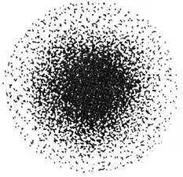

- **A**. 一个电子
- **B**. 电子个数
- **C**. 电子运动的轨迹
- **D**. 电子在核外空间出现的几率

### 第 36 题　qid 4651974 · 人文常识

中国的瓷器驰名世界，传统陶瓷是以黏土等天然硅酸盐为主要原料烧成的制品，黏土的主要成分为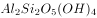，而广泛用于航空的压电陶瓷材料是锆钛酸铅。下列有关说法错误的是：

- **A**. 
黏土的主要成分也可以表示为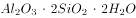

- **B**. 
陶瓷材料是人类应用最早的硅酸盐材料

- **C**. 
唐三彩、秦兵马俑制品属于陶瓷制品

- **D**. 
传统陶瓷材料的成分与压电陶瓷材料的成分相同

### 第 37 题　qid 4651978 · 科技常识

生物群落是指在一定时间内一定空间上分布的各物种的种群集合，包括动物、植物、微生物等各物种的种群，共同组成生态系统中有生命的部分。下列不能构成生物群落的是：

- **A**. 西双版纳热带雨林中的生物
- **B**. 无菌培养基被污染后长出的共生菌落
- **C**. 无菌培养基上接种后长出的大肠杆菌菌落
- **D**. 内蒙古大草原上的生物

### 第 38 题　qid 4651980 · 人文常识

田山歌，作为吴歌形式的一个组成部分，是以稻作文化为基础的一种歌曲形式。稻作文化是人们在农事劳作中产生的一种文化。细数田山歌产生的历史，就能够感受到浓厚的稻作文化。田山歌的原始形态产生于：

- **A**. 新石器时代的太湖流域
- **B**. 南北朝时期长江下游的江南一带
- **C**. 春秋时期的江浙一带
- **D**. 青铜时代的长江流域

### 第 39 题　qid 4651989 · 人文常识

我们每个人都有自己的姓氏。在上古三代，姓和氏不同，氏是从姓派生出来的，从汉代开始，姓氏合二为一，考其来历，有多种类别。下列对姓氏来源分类错误的一项是：

- **A**. 以所封诸侯国为姓氏，如齐、鲁、郑、吴、秦、楚、韩、魏等
- **B**. 以居住地为姓氏，这类姓氏中，复姓较多，如闾丘、西门、东郭等
- **C**. 以技艺为姓氏，如巫、卜、陶、屠等
- **D**. 以社会阶层为姓氏，如司徒、司马、司空、司寇等

### 第 40 题　qid 4651994 · 人文常识

下列诗歌各表现了一个传统节日，按节日的先后，排序正确的是：
①未得渡清浅，相对遥相望
②昨日登高罢，今朝更举觞
③海上生明月，天涯共此时
④日暮汉宫传蜡烛，轻烟散入五侯家

- **A**. ④①③②
- **B**. ④①②③
- **C**. ①④③②
- **D**. ①④②③

## 材料 1

        技术塑造全新的理论范式。大数据技术给公共管理带来了一场新的范式革命，这场范式革命表现在：第一，方法论范式的转型。大数据借助于云平台而具有数据搜集、分析、管理、挖掘和重组的功能，以及基于多类型数据和海量数据的预测功能，从而形成一整套基于大数据技术的方法。此类方法在大数据技术诞生前是完全没有的。其数据能实时更新，且接近于全数据，因此被广泛运用于恐怖主义研究、移民研究、战争与冲突研究、国际反腐败研究等社会科学的各个领域。面对这样一个时代和技术，传统的管理方法如定性和定量研究、比较分析、案例分析等基于“小数据”的研究方法，将更多地为数据挖掘、全数据分析等全新的研究方法所代替。简言之，“大数据+”开创了社会科学研究的新技术和新方法。第二，研究思维范式的转型。过去的案例研究、样本研究体现的是数据“精确性”思维、因果关系思维和定性思维，而借助于大数据技术，现已转向“量化”思维，即以全数据为目标的思维，以“混杂性”思维为形式，以量化数据值之间的“相关关系”为核心内容。单纯的“计算社会科学”也并不完全反映“量化”思维。第三，研究对象的转变。大数据技术诞生前，公共管理的对象是人及其相互关系。人既成为管理对象，也成为管理的工具，结果是人成为管理者的“被管理者”。大数据的公共管理对象是人所有活动所产生的数据，目的是用数据及其产生的价值来为人服务，体现了人本主义管理思想。第四，绩效检验方式的转变。此前，绩效检验的目的是以政策的落实和政策对人发挥规制作用来衡量，但政策是否科学则容易被忽视，而且，往往采取刚性强制手段。就是说政策确实发挥了作用，但人也可能因强制而对政策产生抱怨，甚至有些情况下有些人成为反政策的一员。大数据条件下的绩效检验则强调技术对人的所有社会活动产生的数据进行收集、整理、分析，最终使数据通过服务于人来体现其价值，使人在享受价值服务的过程中自觉维护良好的秩序。

        从具体的实践层面看，也有了变化。第一，大数据技术使公共管理的实践内容从流量管理向数据管理转化。传统的公共管理尤其强调流程的重要性，这主要是基于行政的科层体制。但在实践中，这会慢慢演变成流程的刻板化，效率日趋下降，甚至影响流程的合法性。而大数据技术则专注于对管理对象的数据收集、分析，它管理的对象是数据，核心是对数据进行处理。第二，大数据使公共管理的实践从事后机械应对转向智能化预先治理。传统的方式，无论是管理还是治理，都是出现了问题才采取措施。即便有所谓的预防性治理或预防性管理，也常常非常盲目，甚至可能没有任何针对性。因此，其典型特征就是事后的机械性。大数据条件下则截然不同，其核心就是预测。它通常被视为人工智能的一部分，是把数学算法运用到海量的数据上来预测事情发生的可能性。之所以能够成功，关键在于它是建立在海量数据的基础之上的，而不是基于某个人的主观判断。

### 第 41 题　qid 4651924 · 片段阅读

依据文段，下列判断不正确的一项是：

- **A**. 大数据极大地改变了我们的研究思维
- **B**. 传统的公共管理方法如定性和定量研究的数据不能实时更新
- **C**. 虽然有大量计算的存在，但大数据不等同于“计算社会科学”
- **D**. 传统的公共管理是“量化”思维

### 第 42 题　qid 4651927 · 片段阅读

依据文段，下列陈述不正确的一项是：

- **A**. 大数据下的公共管理体现了人本思想
- **B**. 传统的公共管理往往有一种强制性
- **C**. 传统的公共管理有预测性
- **D**. 基于大数据的管理是客观的

### 第 43 题　qid 4651929 · 片段阅读

第一段论述的结构属于：

- **A**. 递进关系
- **B**. 总分关系
- **C**. 并列关系
- **D**. 条件关系

### 第 44 题　qid 4651932 · 片段阅读

上述文段的核心思想是论：

- **A**. 大数据技术下公共管理范式的转型
- **B**. 传统公共管理与大数据下公共管理的区别
- **C**. 大数据技术赋予公共管理的特色
- **D**. 传统公共管理向大数据技术管理转变的必要性

## 材料 2

        孙坚字文台，吴郡富春人，盖孙武之后也。

        少为县吏。年十七，与父共载船至钱唐，会海贼胡玉等从匏里上掠取贾人财物，方於岸上分之，行旅皆住，船不敢进。坚谓父曰：“此贼可击，请讨之。”父曰：“非尔所图也。”坚行操刀上岸，以手东西指麾，若分部人兵以罗遮贼状。贼望见，以为官兵捕之，即委财物散走。坚追，斩得一级以还。父大惊。由是显闻，府召署假尉。

        会稽妖贼许昌起於句章，自称阳明皇帝，与其子韶扇动诸县，众以万数。坚以郡司马募召精勇，得千馀人，与州郡合讨破之。是岁，熹平元年也。刺史臧旻列上功状，诏书除坚盐渎丞，数岁徙盱眙丞，又徙下邳丞。

### 第 45 题　qid 4651940 · 逻辑填空

孙坚驱散海贼所采用的策略是            。

- **A**. 虚张声势
- **B**. 分进合击
- **C**. 请君入瓮
- **D**. 擒贼擒王

### 第 46 题　qid 4651943 · 片段阅读

本文说明孙坚            。

- **A**. 足智多谋
- **B**. 智勇双全
- **C**. 勇猛过人
- **D**. 身先士卒

### 第 47 题　qid 4651947 · 片段阅读

“与其子韶扇动诸县”的意思是：

- **A**. 与他的儿子（许）韶一起煽动各县
- **B**. 参与他的儿子（许）韶煽动各县的阴谋
- **C**. 和他的一个儿子韶扇走动（于）各县
- **D**. 给他一个叫子韶的人去煽动各县（参与起义）

### 第 48 题　qid 4651949 · 片段阅读

本文的主要内容是：

- **A**. 说明孙坚的性格特征
- **B**. 讲述孙坚擒拿海贼的故事
- **C**. 描述孙坚投笔从戎的过程
- **D**. 记述孙坚早年的事迹

### 第 49 题　qid 4651917 · 逻辑填空

科技一直在改变社会：通讯技术        了时空的距离，互联网等新科技        了学习知识的成本，人工智能        了越来越多的工作岗位，基因技术        了人类的价值观······这些改变有的已经发生，有的愈演愈烈。
填入画横线处的词语最恰当的一项是：

- **A**. 缩短 改变 取代 减少
- **B**. 缩短 减少 取代 改变
- **C**. 减少 取代 缩短 改变
- **D**. 减少 缩短 改变 取代

### 第 50 题　qid 4651920 · 逻辑填空

真正的精英，有一种夯实金字塔基础的抱负，有一种纠正时代错误的使命感。他们离成功的标尺越远，就越能心无旁骛地实现宏图大志。        ，        精英与世俗意义上的成功无缘，        成功实在        精英坚守自身信念的副产品而已。
填入画横线处的词语最恰当的一项是：

- **A**. 当然 不是 就是 只是
- **B**. 当然 不是 而是 不过是
- **C**. 因此 虽然 但是 不过是
- **D**. 因此 虽然 而是 只是

### 第 51 题　qid 4651925 · 逻辑填空

在5000多年文明发展中        的中华优秀传统文化，        着中华民族最深层的精神追求，代表着中华民族        的精神标识。
填入画横线处的词语最恰当的一项是：

- **A**. 形成 反映 自主
- **B**. 创造 顺应 崇高
- **C**. 传承 擘画 展示
- **D**. 孕育 积淀 独特

### 第 52 题　qid 4651930 · 逻辑填空

一部真正意义上的通史，决非只是对史事的            ，而是要努力探求历史变迁的内在联系。所以通史不仅指史事在时序上的先后承继、转合        ，而且还包括历史文化中各重要问题的        与变迁的            ，即所谓“通古今之变，成一家之言”。
填入画横线处的词语最恰当的一项是：

- **A**. 客观描述 变幻 沿革 理性诠释
- **B**. 客观演绎 变幻 延革 感性抒发
- **C**. 主观判断 变换 延革 理性描述
- **D**. 主观诠释 变换 沿革 客观评价

### 第 53 题　qid 4651938 · 逻辑填空

“两弹一星”功勋奖章获得者于敏院士回忆起研发的往事时说：“一个人的名字，早晚是要没有的，能把        的力量融进祖国的强盛之中，便足以自慰了。”这样的            至今仍            。
依次填入画横线处的词语最恰当的一项是：

- **A**. 单薄 金玉良言 振聋发聩
- **B**. 微薄 金玉良言 掷地有声
- **C**. 微薄 肺腑之言 掷地有声
- **D**. 单薄 肺腑之言 振聋发聩

### 第 54 题　qid 4651944 · 语句表达

下列句子中，语序最恰当的是：

- **A**. 参加集体婚礼的新人们今天早上都在滨江大道上在摄像机镜头前向大家笑容甜蜜地挥手致意。
- **B**. 今天早上都在滨江大道上参加集体婚礼的新人们在摄像机镜头前笑容甜蜜地向大家挥手致意。
- **C**. 在滨江大道上参加集体婚礼的新人们今天早上都在摄像机镜头前笑容甜蜜地向大家挥手致意。
- **D**. 今天早上在滨江大道上参加集体婚礼的新人们都在摄像机镜头前笑容甜蜜地向大家挥手致意。

### 第 55 题　qid 4651913 · 语句表达

下列句子中，有语病的是：

- **A**. 有人戏言，人生最大的修行就是饥来餐饭倦来眠。作者在这本书中介绍了九十四道地方美食、九十四段独属于他的乡愁和对过往的回忆。
- **B**. 随着海平面的上升，旅游胜地马尔代夫正面临灭顶的威胁。近年来，他们的旅游营销口号是：“趁我们还在这里，快来看看吧。”
- **C**. 欧阳修的文学成就，在我国文学史上享有很高的地位，称他为北宋诗文革新运动的领袖和文坛盟主是实至名归的。
- **D**. “厦庇五洲客，门纳万顷涛。”九月的厦门，草木葱茏，生气勃勃。

### 第 56 题　qid 4651928 · 片段阅读

下列选项中，两句话表达的意思不一致的是：

- **A**. （1）敢于这样做的人，难道不是一个英雄吗？（2）敢于这样做的人，肯定就是一个英雄。
- **B**. （1）看到这一幕，有谁会感到滑稽可笑呢？（2）看到这一幕，没有谁不感到滑稽可笑的。
- **C**. （1）谁说癌症是不可治愈的绝症？（2）癌症并非是不可治愈的绝症。
- **D**. （1）只要天不塌下来，他就会来。（2）除非天塌下来，他才会不来。

### 第 57 题　qid 4651935 · 片段阅读

下列几个句子按顺序排列，语意最连贯的是：
①也就是通过人格的自我完善来达到永恒的生命境界
②这种感觉所带来的，决不仅仅是无可奈何的缕缕忧伤
③而更多地浸透着珍惜时光、热爱生命的积极进取精神
④正如诗中所写：“老冉冉其将至兮，恐修名之不立。”
⑤以及由此而产生的时不我待、分秒必争的急切心情

- **A**. ④①②③⑤
- **B**. ④⑤②③①
- **C**. ②④③①⑤
- **D**. ②③①⑤④

### 第 58 题　qid 4651942 · 语句表达

下列语句中理解上会产生歧义的是：

- **A**. 我国的火箭目前只有一个名称，统一叫“长征”，如长征一号、长征二号、长征三号等，每个型号还根据发射的不同产品及轨道辅以ABCDE等系列。
- **B**. 清代李渔在美食鲜蔬中很是推崇蕈，他认为“食此物者，犹吸山川草木之气，未有无益于人者也”。
- **C**. 党的十九大闭幕不久，部分省市人大代表、政协委员就认真学习、座谈，畅谈自己的体会。
- **D**. 被雨水洗刷过的天空分外澄净，被雨水冲洗过的树木更显青翠。

### 第 59 题　qid 4651960 · 片段阅读

抚今追昔，历史的车轮总会在字里行间留下深浅不一的痕迹，文字的变迁也在响应一个时代的风起云涌，并与之同频共振。殷商的甲骨文，证实了一个王朝的存在，并烙刻下诸多与国运生死攸关的大事；秦朝的小篆，见证了一统江山的恢宏，并因为“书同文”的国策实现了从多元向一元的转变；五四时期的白话文，记录了救亡图存的革命者为探寻出路而前赴后继、上下求索的历史，并在新文化运动的号召下焕然一新，顺应时代大势所趋。
对上文意思概括最为准确的是：

- **A**. 语言文字折射并记录时代，同时也为时代所重塑和改变
- **B**. 语言文字是时代最为活跃的要素，促进了时代的发展
- **C**. 时代的发展和社会的进步使语言文字更加丰富
- **D**. 任何时代都会有鲜明的政治、经济、文化特色，语言文字也不例外

### 第 60 题　qid 4651952 · 语句表达

放眼知识原野，遍布鲜花秀草，亦多毒木荆棘。鱼龙混杂，良莠并存。古人说：“                    。”只有不唯书、戒盲从、善思考、勤探究，才能了解真相、认识规律、掌握真理。此乃读书之大道、治学之根本。
在横线中应填入的最恰当的一项是：

- **A**. 人皆知以食愈饥，莫知以学愈愚
- **B**. 尽信书，则不如无书
- **C**. 六经三史，诸子百家，非无可观，皆足为治
- **D**. 读书之法无他，惟是笃志虚心，反复详玩，为有功耳

### 第 61 题　qid 4651915 · 片段阅读

运气学说，是探讨自然变化的周期性规律及其对人体健康和疾病影响的一门学问。这里讲的周期性规律，是基于自然界六气六律和五气更立的六、五节律，即五运六气节律。运气学说认为，天人合一是天人间动态节律的同步和谐，这是人体健康的基础，而天人合一的失调是一切疾病产生的根本原因。《黄帝内经》中的五运六气学说，传承发挥了中华文明的五六之律，凝聚了黄帝时代的文化精粹，是黄帝文化的活化石，故能成为打开中华文明宝库的钥匙。
上面文字说明的重点是：

- **A**. 运气学的丰富内涵
- **B**. 研究运气学的意义
- **C**. “五运六气”在中华传统文化中的地位
- **D**. 运气学探讨的“五运六气”的出处

### 第 62 题　qid 4651922 · 片段阅读

一部人类文明史，就是国与国之间不断对外开放的历史。无数事实已经昭示，唯有对外开放，才能顺应和平、发展、合作、共赢的时代潮流，才能契合各国追求发展的共同愿望。然而，各个国家的发展终究不是在同一起跑线上，有些国家已经步入发达国家行列，总担心别人“分肥”自己的发展红利，于是贸易壁垒搭起、单边主义盛行。把门关起来的逆向操作，只会拉开距离、产生摩擦。所以，要“坚持‘拉手’而不是‘松手’，坚持‘拆墙’而不是‘筑墙’”。
关于上文所运用的写作手法，下列分析不正确的一项是：

- **A**. 文段起笔运用概述历史的方式，阐明了开放才是国家文明的表现
- **B**. “把门关起来的逆向操作，只会拉开距离、产生摩擦”形象分析了建壁垒逆潮流而动的后果
- **C**. “坚持‘拆墙’而不是‘筑墙’”，既有引用，又有比喻和对比
- **D**. 文段中的“拆墙”喻指有些国家实行的单边主义政策的自私本质

### 第 63 题　qid 4651933 · 片段阅读

生活的起起落落，其实和四时变换是一样的道理，生活总会有高潮和低谷，但即便在低谷之中，我们也不必感到悲伤，在对未来的期待中，我们永远拥有不灭的希望。与此同时，我们也能用行动为自己赋予渡过难关的力量。
上述内容用一句诗来表达，最恰当的是：

- **A**. 三十功名尘与土，八千里路云和月
- **B**. 仰天大笑出门去，我辈岂是蓬蒿人
- **C**. 人有悲欢离合，月有阴晴圆缺
- **D**. 长风破浪会有时，直挂云帆济沧海

### 第 64 题　qid 4651948 · 片段阅读

单层石墨烯的透光率高达97.7%，肉眼看过去几乎是完全透明的。它有着绝佳的导热性，热传导能力是金刚石的两倍以上。石墨烯的机械强度极大，比钢铁还要强200倍，如果把1平方米的单层石墨烯做成一张吊床，区区0.34纳米的厚度便可以稳稳地承载一只猫。石墨烯的导电性比银和铜还强，载流子迁移率比碳纳米管和硅还高。
上面文字表明：

- **A**. 石墨烯的用途非常广泛
- **B**. 石墨烯有许多普通材料不具备的优异性质
- **C**. 人们对石墨烯的应用寄予厚望
- **D**. 人们对石墨烯的研究已取得重大突破

### 第 65 题　qid 4651955 · 片段阅读

社会变迁常是发生在旧有社会结构不能应付新环境的时候。新的环境发生了，人们最初遭遇到的是旧方法不能获得有效的结果，生活上发生了困难。人们不会在没有发觉旧方法不适用之前就把它放弃的。旧的生活方法有习惯的惰性。但是如果它已不能答复人们的需要，它终必会失去人们对它的信仰，守住一个没有效力的工具是没有意义的，会引起生活上的不便，甚至蒙受损失。另一方面，新的方法却又不是现存的，必须有人发明，或是有人向别种文化去学习、输入。此外，还得经过实验，才能被人接受，完成社会变迁的过程。
概括文段的主要内容，以下选项恰当的是：

- **A**. 社会变迁是如何发生的
- **B**. 新旧社会结构的交替
- **C**. 社会环境如何适应时代发展
- **D**. 社会生活习惯的改变与文化输入

## 材料 1

        上海市以“双千兆宽带城市”建设为基础，打造“一网通办”“一网统管”现代化城市治理体系。目前固定宽带光纤实现全市99%家庭覆盖，平均下载速率和千兆用户渗透率均排名全国第一，5G基站总量同样位列全国第一。5G基站建设过程中，至2020年8月底，上海市P区共布设5G室外基站7246个，较同年3月增长75.24%。

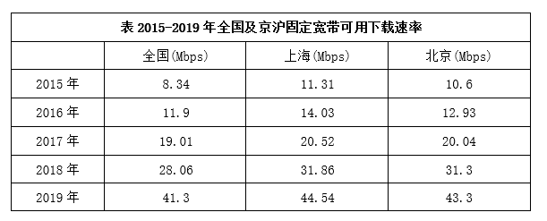

        Mbps是Megabits per second的缩写，MB/s是MegaByte per second的缩写，都是传输速率单位，指每秒传输的位（比特）数量。换算关系为1Mbps=0.125MB/s。

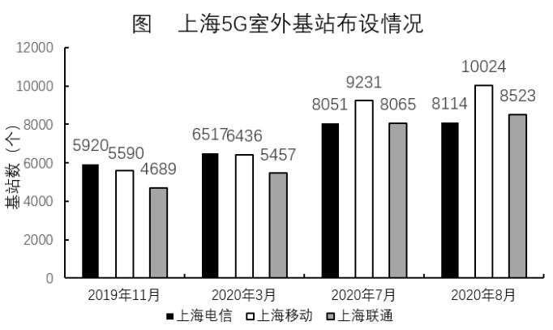

### 第 66 题　qid 4651977 · 数学运算

2016年，上海固定宽带可用下载速率约为（    ）MB/s。

- **A**. 1.41
- **B**. 1.75
- **C**. 2.57
- **D**. 1.62

### 第 67 题　qid 4651985 · 数学运算

2020年8月底，P区5G室外基站布设总量在全市5G室外基站布设总量的占比位于（    ）区间内。

- **A**. [0，20%]
- **B**. (20%，40%]
- **C**. (40%，60%]
- **D**. (60%，100%]

### 第 68 题　qid 4651993 · 数学运算

2020年3—7月，上海移动5G室外基站的月平均增长量约为（    ）个。

- **A**. 699
- **B**. 1609
- **C**. 2212
- **D**. 2795

### 第 69 题　qid 4651996 · 数学运算

2016—2019年，上海固定宽带可用下载速率的年增长率变化情况是：

- **A**. 先上升后下降
- **B**. 先下降后上升
- **C**. 一直上升
- **D**. 一直下降

### 第 70 题　qid 4651999 · 数学运算

结合材料所给数据，下列选项正确的是：

- **A**. 2020年3月，三大运营商在上海5G室外基站总量超过20000个
- **B**. 2020年3月，P区共布设5G室外基站超过4000个
- **C**. 2020年8月，上海移动的5G室外基站总量占三大运营商上海室外总基站比重低于30%
- **D**. 2015—2019年，北京固定宽带可用下载速率逐年提升，且提升量逐年下降

## 材料 2

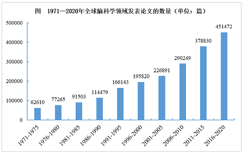

### 第 71 题　qid 4651937 · 数学运算

结合表中所给数据，2016-2020年脑科学领域论文总被引频次排名第二的国家，其ESI高水平论文数量排名第：

- **A**. 一
- **B**. 二
- **C**. 三
- **D**. 四

### 第 72 题　qid 4651957 · 数学运算

结合材料，关于全球脑科学领域论文发表情况，能够推出的是：

- **A**. 2016-2020年，就论文发表量来看，表中排名第二和排名第三的国家论文发表量总和是排名第一的一半
- **B**. 2016-2020年，CNS及其子刊论文数占比最高的国家，其论文发表量在全球的占比不足5%
- **C**. 2016-2020年，论文篇均被引频次最高的国家，其总被引频次也最高
- **D**. 2016-2020年，日本论文发表量约是我国的2.4倍，但其中ESI高水平论文数只有我国的56%

## 材料 3

        《2021年第2季度中国城市交通报告》选取我国100个主要城市，通过大数据客观反映城市的交通拥堵状况。报告采用“通勤高峰拥堵指数”作为表征城市交通拥堵状况的指标，即工作日的早晚高峰时段（7∶00—9∶00，17∶00—19∶00），在各城市的主城区实际行程时间和畅通行程时间的比值。采用“周末拥堵指数”作为表征城市周末交通拥堵状况的指标，即周末8∶00—20∶00，在各城市的主城区实际行程时间和畅通行程时间的比值。

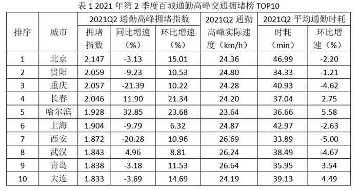

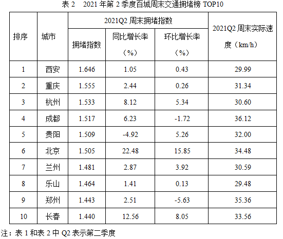

### 第 73 题　qid 4652007 · 数学运算

按照2021年第一季度通勤高峰拥堵指数从大到小排序，下列城市的排序依次为：

- **A**. 重庆、长春、哈尔滨
- **B**. 重庆、哈尔滨、长春
- **C**. 长春、哈尔滨、重庆
- **D**. 哈尔滨、长春、重庆

### 第 74 题　qid 4652010 · 数学运算

将变化率定义为增长率的绝对值。相比于2020年第二季度，2021年第二季度通勤高峰拥堵指数变化率最大和第二大的两个城市，其2021年第二季度平均通勤时耗的平均值约为：

- **A**. 24
- **B**. 27
- **C**. 35
- **D**. 39

### 第 75 题　qid 4652011 · 数学运算

对于同时进入两份拥堵榜的几个城市，其通勤高峰实际速度与周末实际速度差异值的绝对值最大的城市是：

- **A**. 北京
- **B**. 长春
- **C**. 西安
- **D**. 贵阳

### 第 76 题　qid 4652014 · 数学运算

根据材料判断下列四对指标的相关关系：①“2021Q2通勤高峰拥堵指数”和“2021Q2通勤高峰实际速度”；②“2021Q2通勤高峰拥堵指数”和“2021Q2平均通勤时耗”；③“2021Q2周末拥堵指数”和“2021Q2周末实际速度”；④“2021Q2通勤高峰拥堵指数”和“2021Q2周末拥堵指数”，表述正确的是：

- **A**. 第①对具有正相关关系
- **B**. 第②对具有正相关关系
- **C**. 第③对不具有正相关关系
- **D**. 第④对具有正相关关系

### 第 77 题　qid 4652018 · 数学运算

若以极差（即最大值减最小值）刻画差异性，那么10个城市的指标中，拥堵变化情况的差异性最大的是：

- **A**. 通勤高峰拥堵榜中拥堵指数同比2020年第二季度增长率
- **B**. 通勤高峰拥堵榜中拥堵指数环比2021年第一季度增长率
- **C**. 周末拥堵榜中周末拥堵指数同比2020年第二季度增长率
- **D**. 周末拥堵榜中周末拥堵指数环比2021年第一季度增长率

### 第 78 题　qid 4651976 · 数学运算

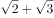，5，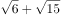，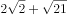，（    ）

- **A**. 
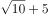

- **B**. 
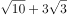

- **C**. 
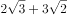

- **D**. 
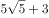

### 第 79 题　qid 4652012 · 数学运算

一个质点从原点O出发，按照下图所示前进，若已知（1，0），（1，），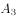（，），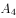（，），则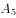的坐标是<u>        </u>。

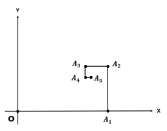

- **A**. 
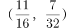

- **B**. 
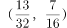

- **C**. 
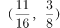

- **D**. 
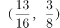

### 第 80 题　qid 4652017 · 数学运算

数列：（1，1，1），（2，2，4），（3，4，12），（4，8，32），······，第8个括号内最后一个数是        。

- **A**. 256
- **B**. 512
- **C**. 1024
- **D**. 2048

### 第 81 题　qid 4652019 · 数学运算

根据下列图形上的数字规律，“？”处的数字应为<u>        </u>。

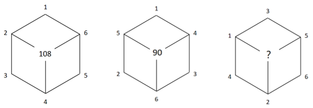

- **A**. 64
- **B**. 88
- **C**. 96
- **D**. 104

### 第 82 题　qid 4651918 · 数学运算

数列：1，2，2，3，3，3，1，1，2，2，2，3，3，3，3，1，1，1，2，2，2，2，3，······，按照其规律，第50个数和第51个数的和为（    ）。

- **A**. 3
- **B**. 4
- **C**. 5
- **D**. 6

### 第 83 题　qid 4651919 · 数学运算

小李进行健身运动，计划运动时间不少于1小时且不多于2小时，有以下备选项目：30分钟自行车、30分钟划船、40分钟慢跑、1小时羽毛球、1.5小时步行，每个项目限选一次且最多可以选择三项，那么小李的运动计划共有        种。

- **A**. 8
- **B**. 12
- **C**. 16
- **D**. 24

### 第 84 题　qid 4651921 · 数学运算

某快递员一天可派件150件，每件派件费1元。安装快递柜后部分快递可放入快递柜中，派件效率提高，一天可派件180件，然而每件快递需向快递柜所属公司缴纳0.2元。为维持收入不变，这180件快递中有        件快递须派送上门。

- **A**. 25
- **B**. 30
- **C**. 36
- **D**. 40

### 第 85 题　qid 4651926 · 数学运算

某水果店销售水果有三种方式：
（1）直接出售，每公斤价格10元，1吨水果一周时间可以全部卖完；
（2）对水果进行粗加工（例如去皮等）后出售，每公斤价格15元，每天能够售出100公斤；
（3）对水果进行精加工（例如制作水果捞等）后出售，每公斤价格30元，每天能够售出10公斤。
该水果店进了1吨水果，一周内需要卖完，否则水果就会腐烂。如果上述三种销售方式可同时组合使用，那么该水果店出售这1吨水果的销售额最大为        元。

- **A**. 10000
- **B**. 14900
- **C**. 15000
- **D**. 30000

### 第 86 题　qid 4651936 · 数学运算

对于两个有序数组（a，b）和（c，d），将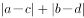称作这两个数组的距离，那么，在下列选项中，与数组（13，26）的距离最大的是<u>        </u>。

- **A**. （20，21）
- **B**. （21，20）
- **C**. （22，19）
- **D**. （23，18）

### 第 87 题　qid 4651939 · 数学运算

某单位进行了一次绩效考评打分，满分为100分。有5位员工的平均分为90分，而且他们的分数各不相同，其中分数最低的员工得分为77分，那么排第二名的员工至少得         分。（员工分数取整数）

- **A**. 90
- **B**. 92
- **C**. 94
- **D**. 96

### 第 88 题　qid 4651941 · 数学运算

据测算，使用电动公交车综合减排效益为12%，就是说用电动公交车替代柴油公交车可减少12%的碳排放。某市公交车公司称通过更换电动公交车降低了8%的碳排放，则该公交车公司现在拥有的电动公交车占比约为：

- **A**. 20%
- **B**. 67%
- **C**. 80%
- **D**. 96%

### 第 89 题　qid 4651969 · 数学运算

如图所示，某操场可近似看作是由两个半圆和一个矩形组成，其中AB段与CD段分别是以O与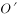为圆心的半圆弧，半圆弧的弧长均为100米，BC段与DA段都是直线段，长度均为100米。在O处安装了一个照明灯，工作人员沿着ABCDA的路线测量不同位置的光照强度。已知某处光照强度和该处到光源距离的平方成反比，则按工作人员行走路线测量的过程中，下列坐标图正确地反映了行走路程与光照强度关系的是<u>        </u>。

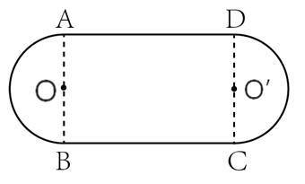

- **A**. 
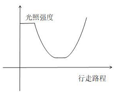

- **B**. 
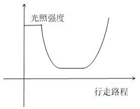

- **C**. 
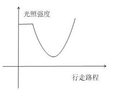

- **D**. 
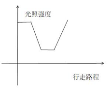

### 第 90 题　qid 4651914 · 数学运算

某高速公路上发生一起车祸交警前往处置并疏导交通。当前拥堵路段已积压车辆约300辆，因时值节假日高峰时段预计在30分钟内还将汇入约200辆，30分钟后每分钟汇入该路段约3辆。已知在交警疏导下每分钟能通行10辆，则大约（    ）分钟后道路基本疏通。

- **A**. 40
- **B**. 50
- **C**. 60
- **D**. 70

### 第 91 题　qid 4651916 · 数学运算

车辆行驶过程中会造成轮胎磨损，某款汽车后轮行驶满4万公里需要更换；前轮磨损较大，行驶满3万公里就需要更换。若前后轮使用的轮胎相同，那么大约行驶（    ）万公里后将前后轮胎交换，可以实现同一时间更换前后轮胎。

- **A**. 1.5
- **B**. 1.7
- **C**. 2
- **D**. 2.2

### 第 92 题　qid 4651923 · 数学运算

有一个花坛的形状是一个直角扇形，由三个半径分别为1、2、3米的圆弧构成现用两条线段将此扇形圆心角平均分割成三部分。（如图）设计者在阴影部分和空白部分分别种上不同的花卉，那么阴影部分花卉的种植面积为多少平方米？

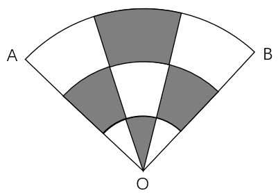

- **A**. 

- **B**. 

- **C**. 

- **D**. 
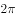

## 材料 1

一小区某单元共3层住着甲、乙、丙、丁、戊、己6户人家。每层2户，1户东向，1户西向。已知：

（1）乙与甲或者丙住在同一层；

（2）丁朝向是东向；

（3）甲、戊两户1户东向、1户西向。

### 第 93 题　qid 4652026 · 逻辑判断

根据材料信息，下列哪项是可能的？

- **A**. 甲和戊住在同一层，且甲是西向
- **B**. 甲和丙住在同一层，且甲是西向
- **C**. 丁和甲住在同一层，且甲是东向
- **D**. 丁和乙住在同一层，且丁是东向

### 第 94 题　qid 4652027 · 类比推理

若己朝向是东向，则下列        项中的两户可能住在同一层。

- **A**. 甲和己
- **B**. 丁和丙
- **C**. 乙和丙
- **D**. 戊和丙

### 第 95 题　qid 4651908 · 类比推理

翟志刚、王亚平、叶光富3名航天员乘神舟十三号载人飞船进入天和核心舱。在太空中，如果航天员想在天和核心舱中进行以下实验，其中最难完成的是               。

- **A**. 将金粉和铜粉混合
- **B**. 将牛奶加入水中混合
- **C**. 用漏斗、滤纸过滤除去水中的泥沙
- **D**. 用金属环制作水膜

### 第 96 题　qid 4651909 · 类比推理

石油分馏是将几种不同沸点的混合物分离的一种方法，属于物理变化。右图是石油分馏塔的示意图，下列有关说法错误的是：

- **A**. 石油是一种混合物
- **B**. a、b、c中沸点最高的是a
- **C**. 柴油中碳元素的百分含量比重油低
- **D**. 分馏的残留物还可以制得其他产品

### 第 97 题　qid 4651910 · 类比推理

汽车安全气囊中的填充物主要成分是、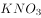和。汽车发生猛烈碰撞时，分解，生成甲、乙两种单质，有关的化学方程式为；的作用是与可能会对人体造成伤害的单质甲反应，生成单质乙和两种氧化物。以下推断错误的是<u>　　</u>。

- **A**. 
汽车安全气囊里的气体是氮气

- **B**. 
单质甲是金属钠

- **C**. 
安全气囊中受到剧烈撞击反应迅速 

- **D**. 
与单质甲反应后有氮氧化合物生成 

### 第 98 题　qid 4651911 · 逻辑判断

如图所示为一定质量的水的体积在0-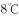范围内随温度变化的图像。根据图像及水的其他性质，下列分析判断正确的是<u>　   　</u>。

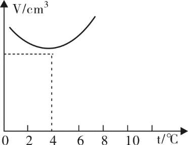

- **A**. 
因热胀冷缩，任何情况下水的体积都随温度升高而增大

- **B**. 
在冬季气温为的情况下，池塘里水温可能是上热下冷

- **C**. 
在冬季气温为的情况下，池塘里水温可能是上冷下热

- **D**. 
夏季池塘中上层的水可能比下层的水凉 

### 第 99 题　qid 4651912 · 逻辑判断

如图所示为某人设计的一种测量装置的电路，其中AB部分为四分之一圆弧的电阻丝，一段柔软的细金属丝拴一小球悬挂于O点并与电阻丝良好接触，将其放在水平行驶的汽车中，则该装置可以测量汽车的<u>            </u>。

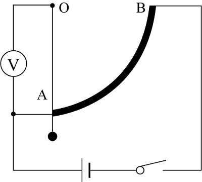

- **A**. 速度大小，电压表数值越大，汽车速度越大
- **B**. 速度大小，电压表数值越大，汽车速度越小
- **C**. 加速度大小，电压表数值越大，汽车加速度越大
- **D**. 加速度大小，电压表数值越大，汽车加速度越小

### 第 100 题　qid 4652032 · 逻辑判断

当远洋货轮从中纬度的东海开往赤道附近的过程中，由于地球赤道半径比两极半径更大，同一物体在低纬度所受的地心引力比高纬度地区小，因此可判断船在行进的过程中所受浮力会______。假设海水的密度一定，则此过程中轮船排开水的体积______。

- **A**. 变小，不变
- **B**. 变大，变小
- **C**. 不变，不变
- **D**. 变小，变大

### 第 101 题　qid 4652037 · 逻辑判断

应用储能介质（某种结晶水合物）储存和再利用太阳能是一项新技术。其原理是：当白天阳光照射时，储能介质熔化，同时吸收热能；当夜晚降温时，储能介质凝固，同时释放出热能。某地区白天气温可达，夜晚可下降至，若应用上述技术调节室温，根据下表中几种常见的储能介质的数据，最佳选用<u>            </u>。

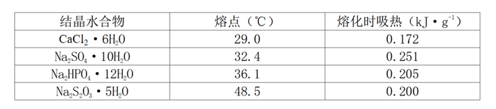

- **A**. 

- **B**. 
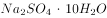

- **C**. 
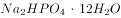

- **D**. 
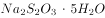

### 第 102 题　qid 4652038 · 类比推理

F1赛车中，赛车手为了提升成绩，往往喜欢追求高速转弯。但高速转弯很容易侧滑出跑道引起事故。当赛车进入如图的弯道时，图中的4条路线中较合理的是<u>          </u>。

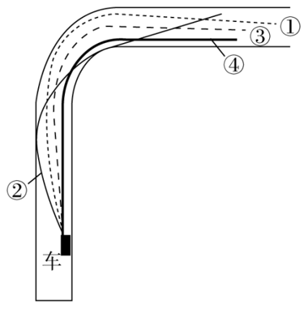

- **A**. 虚线①
- **B**. 实线②
- **C**. 虚线③
- **D**. 实线④

### 第 103 题　qid 4652043 · 逻辑判断

一般情况下，洗衣机在正常工作时是非常平稳的。而关掉电源以后，洗衣机先是振动越来越剧烈，之后振动又逐渐减弱直至停止振动。对这一现象，下列解释正确的是        。

- **A**. 正常工作时，洗衣机波轮的运转频率比洗衣机的固有频率大很多
- **B**. 正常工作时，洗衣机波轮的运转频率比洗衣机的固有频率小很多
- **C**. 正常工作时，洗衣机波轮的运转频率与洗衣机的固有频率相等
- **D**. 关掉电源后，洗衣机的固有振动频率发生了改变

### 第 104 题　qid 4652044 · 类比推理

一款手机充电宝标有“20000mAh，5V”的字样，某手机电池的容量为“4200mAh，5V”。当上述的充电宝显示电量为45%时，对电量显示为55%的上述手机进行充电。充电时电流为2A，则        。

- **A**. 充电宝恰好能把手机充足电
- **B**. 充电宝不能将手机充足电
- **C**. 手机充足电需要的时间约为1小时
- **D**. 充电宝供电时是将电能转化为化学能

### 第 105 题　qid 4652047 · 逻辑判断

如图所示为蜂鸟在空中悬停的受力分析，根据图示内容判断蜂鸟能够悬停的主要原因是：

- **A**. 蜂鸟振翅的频率高，每秒可达50~70次
- **B**. 蜂鸟振翅的幅度大
- **C**. 蜂鸟振翅的方向非常接近水平面
- **D**. 蜂鸟体重轻

### 第 106 题　qid 4652034 · 图形推理

下列选项中，符合所给图形的变化规律的是（    ）。

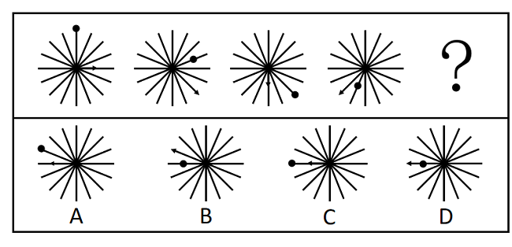

- **A**. A
- **B**. B
- **C**. C
- **D**. D

### 第 107 题　qid 4652031 · 图形推理

下列选项中，符合所给图形的变化规律的是（    ）。

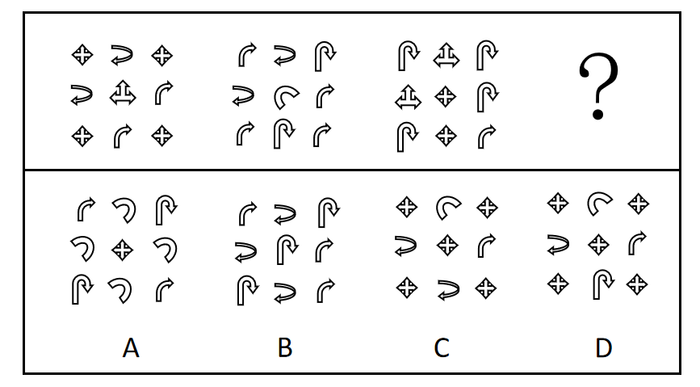

- **A**. A
- **B**. B
- **C**. C
- **D**. D

### 第 108 题　qid 4652042 · 图形推理

下列选项中，符合所给图形的变化规律的是（    ）。

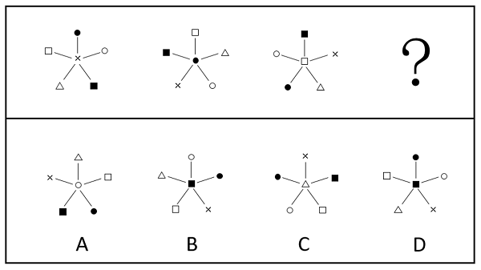

- **A**. A
- **B**. B
- **C**. C
- **D**. D

### 第 109 题　qid 4652033 · 图形推理

下列选项中，符合所给图形的变化规律的是（    ）。

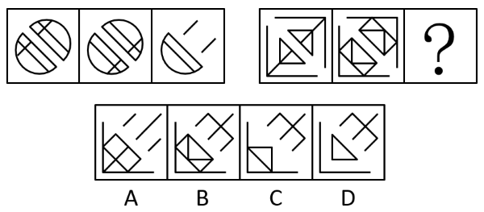

- **A**. A
- **B**. B
- **C**. C
- **D**. D

### 第 110 题　qid 4651982 · 图形推理

下列选项中，符合所给图形的变化规律的是（    ）。

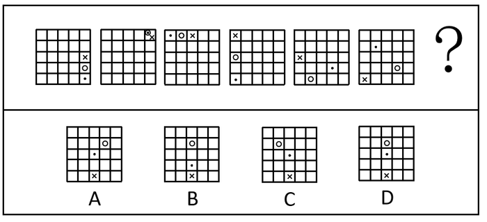

- **A**. A
- **B**. B
- **C**. C
- **D**. D

### 第 111 题　qid 4651991 · 图形推理

下列选项中，符合所给图形的变化规律的是：

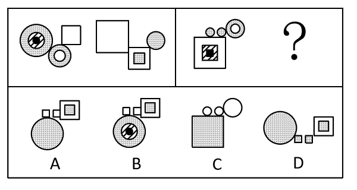

- **A**. A
- **B**. B
- **C**. C
- **D**. D

### 第 112 题　qid 4651995 · 图形推理

下列选项中，符合所给图形的变化规律的是：

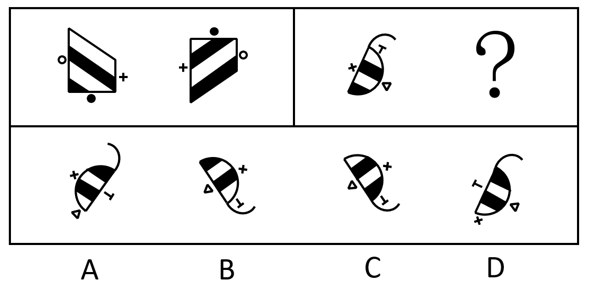

- **A**. A
- **B**. B
- **C**. C
- **D**. D

### 第 113 题　qid 4651997 · 图形推理

下列选项中，符合所给图形变化规律的是：

- **A**. A
- **B**. B
- **C**. C
- **D**. D

### 第 114 题　qid 4652004 · 图形推理

下列选项中立方体①肯定能转成立方体②的是：

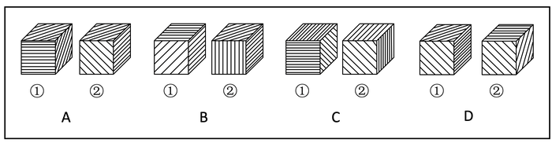

- **A**. A
- **B**. B
- **C**. C
- **D**. D

### 第 115 题　qid 4651963 · 类比推理

把（1）图放在最左边，（2）（3）（4）图放在后面，共有6种排列，其中<u>        </u>能使四图之间存在逻辑关系。

- **A**. 只有一种排列
- **B**. 有两种排列
- **C**. 有三种排列
- **D**. 有四种排列

### 第 116 题　qid 4651988 · 图形推理

将下列六个图形按一定规律分为两大类，正确的是：

- **A**. ①③⑥，②④⑤
- **B**. ①③⑤，②④⑥
- **C**. ①⑤⑥，②③④
- **D**. ①②④，③⑤⑥

### 第 117 题　qid 2616493 · 图形推理

下列两组图形均由（1）（2）（3）三个图形组成，三个图形之间存在一定变化规律。按其规律右边这组图形中，图（3）应为：

- **A**. A
- **B**. B
- **C**. C
- **D**. D

### 第 118 题　qid 4652016 · 逻辑判断

处于北方的甲城干旱少雨，高大的乔木树种在这里无法存活，南方常见的阔叶树种在这里几乎看不到，生长在甲城的树都是耐旱树，即使是市民在室内种植的盆栽树种也以松柏类为主。
根据以上陈述，可以得出下列（    ）项。

- **A**. 市民在室内种植的盆栽树种在南方不常见
- **B**. 有些耐旱树并不是高大的乔木树种
- **C**. 有些生长在南方的松柏类树种可以长成高大的乔木
- **D**. 有些阔叶树也可以在室内种植

### 第 119 题　qid 4652020 · 逻辑判断

在一次人工智能测试中，测试员让一个人类被试者和人工智能一起回答同一组试题，得到两份答案。另一群不知情的专家通过分析两份答案来判断哪一份出自人类，哪一份出自计算机，结果判断的错误率接近50%。看起来人工智能表现过于优异，其智能水平远超预期。有人认为，这个结果表明试题本身的设计可能有问题。
为了使上述结论成立，下列（    ）项命题最适合作为补充条件。

- **A**. 这个人工智能之前并没有通过图灵测试
- **B**. 专家的判断能力是很强的
- **C**. 测试员并没有在测试过程中作弊
- **D**. 该人工智能从设计上不应该与人类有如此接近的表现

### 第 120 题　qid 4651931 · 逻辑判断

业主小赵问物业公司的老王：“你是物业公司的员工吗？”
老王：“是的。”
小赵：“物业是为业主服务的吗？”
老王：“是的。”
小赵：“那么，你为什么不为我服务？”
下列（    ）项和上述小赵的论证错误最为类似。

- **A**. 甲乙两国是邻邦，所以，作为两国人的你我应该成为好朋友
- **B**. 你们村应该感谢我们公司每年提供大量无息贷款和捐赠物资，所以，你应该感谢我
- **C**. 每片雪花都不愿意承认自己是雪崩的罪魁祸首，但其实每片雪花都对雪崩负有责任
- **D**. 张某、陈某都是甲地人，他们两人都获得了医学博士学位，由此可见，甲地出医学人才

### 第 121 题　qid 4651945 · 逻辑判断

宫观位于高山之巅，层峦拥翠，巉岩宿云，登临其上，顿感天近云低，有如离尘绝世。宫后有亭，登亭纵目，眼底群峦，尽伏槛下，清江如带，横呈天际，平畴庐舍，宛若图画。想到所见道观所在无不是名山大川，游览者小陈推测，古代道观的选址，一定都在风景绝美之处。
下列各项如果为真，（    ）项最能质疑小陈的推测。

- **A**. 不仅是道教建筑处于名山大川，其他宗教建筑大多也风景如画
- **B**. 由于长期以来环保意识薄弱，许多道观周边风景遭到了很大的破坏
- **C**. 周边景色一般的道观，往往地处城镇，历经战乱和改建，基本消失绝迹了
- **D**. “小隐隐于野，中隐隐于市，大隐隐于朝”真正的道德之士追求的是精神的净土和心灵的宁静

### 第 122 题　qid 4651956 · 逻辑判断

去年全年甲城市的空气质量优良天数比乙城市的空气质量优良天数多了15%。因此，甲城市的管理者去年在环境保护和治理方面采取的措施比乙城市的更加有效。
下列哪项问题的答案最能对上述结论做出评价？

- **A**. 甲、乙两个城市在环境保护和治理方面采取的措施有何不同
- **B**. 在环境保护和治理方面采取的措施能否在短时间内起到提升空气质量的效果
- **C**. 甲城市的居民因空气质量引发的健康问题是否比乙城市更少
- **D**. 如果采取了甲城市的措施，乙城市的空气质量是否也能得到显著提升

### 第 123 题　qid 4651973 · 逻辑判断

为了明确B型烟粉虱和温室白粉虱在温度逆境下的生存特性对其种群发展的影响，研究人员对其进行了高温和低温暴露试验。结果表明，B型烟粉虱和温室白粉虱对温度逆境的适应性存在差异：B型烟粉虱对高温的适应性要高于温室白粉虱；温室白粉虱对高温敏感，但对低温的适应性要显著高于B型烟粉虱。研究人员据此推测，两种粉虱对温度逆境适应性的差异是导致其种群发展存在差异的一个重要原因。
下列各项如果为真，                    项能支持上述研究人员的推测。
（1）B型烟粉虱和温室白粉虱的卵、伪蛹和成虫在37℃～45℃下暴露1～2小时，其存活率均随着温度的上升而降低；
（2）B型烟粉虱的卵、伪蛹和成虫在37℃、39℃、41℃、43℃、45℃下暴露1～2小时后，3种供试虫态的存活率均高于温室白粉虱；
（3）B型烟粉虱在2℃下暴露2～12天，各供试虫态的存活率迅速下降，卵、2～3龄若虫、伪蛹在2℃下暴露12天后均不能存活，成虫在2℃下暴露4天后也全部死亡；而温室白粉虱卵、伪蛹在2℃下暴露12天后其存活率还能超过45%，成虫在2℃下暴露7天后仍有80%能够存活。

- **A**. 仅（1）（2）
- **B**. 仅（1）（3）
- **C**. 仅（2）（3）
- **D**. （1）（2）（3）均可

### 第 124 题　qid 4651987 · 逻辑判断

虫洞和黑洞都是爱因斯坦广义相对论预言的特殊时空结构，黑洞的存在已经被观测所证实，而虫洞依然属于理论假定。如果能证明虫洞真的存在，天文学研究将获得巨大突破。在近期的一项研究中，研究人员通过数值模拟的方法，发现黑洞落入虫洞会产生一种特殊的引力波频率渐降的信号——“反啾啾声”，这与双黑洞碰撞所产生的引力波频率渐高的“啾啾声”是不同的。研究者据此推测，未来人们可以根据这种特殊的引力波信号来搜寻宇宙中可能存在的虫洞。
以下各项如果为真，（    ）项最能质疑上述研究者的推测。

- **A**. 黑洞落入虫洞后可能存在三种结局：一是瞬间穿过虫洞到达另外一个宇宙；二是停留在虫洞喉部；三是黑洞落入虫洞后，由于引力的相互作用，又被拉回到原来的宇宙
- **B**. 黑洞围绕大质量天体绕行时，如果其运行的是椭圆轨道，所产生的引力波频率会不断变化，渐近时频率会逐渐增高，渐远时频率会逐渐降低
- **C**. 黑洞落入虫洞后，由于引力的相互作用，又被拉回到原来的宇宙，此时他发出的引力波频率越来越小，发出“反啾啾声”
- **D**. 在此次研究中，研究人员模拟了一个五倍太阳质量黑洞，落入一个稳定、不旋转、可穿越的200倍太阳质量虫洞

### 第 125 题　qid 4652009 · 类比推理

某小型规划设计工作室总共有42人，小明说：“这个工作室应该有人有注册规划类的证书”，小李说：“这个工作室应该有人没有注册规划类的证书”，小王说：“工作室的负责人应该没有注册规划类的证书”。若只有一个人说对了，那么这个工作室有        人有注册规划类的证书。

- **A**. 42
- **B**. 41
- **C**. 1
- **D**. 0

### 第 126 题　qid 4652000 · 逻辑判断

近年来，面向大众的哲学教育逐渐普及到了青少年甚至儿童群体中。让孩子在很小的时候接受思想的启蒙与教化是一件好事。但是，从事这一教育工作的大部分教师的本职工作都是在高校中教授哲学，对于青少年的哲学教育并没有统一标准和成熟的纲领计划。如果哲学教师不懂得青少年的心智发展规律，使用不恰当的教育方式，反而对孩子的心智开发没有正面效果，甚至弊大于利。
下面（    ）项最能够成为上述结论的例证。

- **A**. 张老师想让初中同学理解哲学与自然科学的关联，经常在哲学课上提到自然科学中的案例
- **B**. 王老师每次上课都使用自己的PPT进行生动的解释说明，但很少引用哲学家的原著或原话来阐发哲学观点
- **C**. 赵老师希望告诉学生严密的论证对于哲学思想具有关键意义，在课程中展示了许多推理与反驳的案例
- **D**. 李老师为了让实验小学的学生明白阅读经典哲学家的原著对于理解哲学的必要性，规定同学每天回家阅读至少20页德国哲学家胡塞尔的巨著《纯粹现象学与现象学哲学的观念》

### 第 127 题　qid 4652021 · 类比推理

阿根廷大学的一位老师让五位留学生看校史上的五位大数学家的画像，让每位学生任意挑选两幅画像说出名字。
张说：“2号是高斯，3号是黎曼。”
倪说：“1号是希尔伯特，2号是闵可夫斯基。”
朱说：“3号是闵可夫斯基，5号是希尔伯特。”
韦说：“2号是高斯，4号是外尔。”
方说：“4号是外尔，1号是黎曼。”
老师发现每位学生都只说对了一半，那么1号画像是        。

- **A**. 黎曼
- **B**. 闵可夫斯基
- **C**. 希尔伯特
- **D**. 高斯

## 材料 1

### 第 128 题　qid 4651934 · 增长

1976至2020年期间，全球脑科学领域五年论文发表量的同比增长量最多的是：

- **A**. 1991-1995
- **B**. 2006-2010
- **C**. 2011-2015
- **D**. 2016-2020

### 第 129 题　qid 4651953 · 增长

下列选项中，图（    ）展示了2001-2020年间全球脑科学领域发表论文数量的同比增长情况。

- **A**. 

- **B**. 

- **C**. 

- **D**. 

### 第 130 题　qid 4651954 · 增长

按照全球脑科学领域论文发表量上个五年的同比增速预测，2021-2025年我国在脑科学领域的论文发表数量约为（    ）万篇。

- **A**. 1.2
- **B**. 2.1
- **C**. 8.6
- **D**. 9.4

## 答案与解析

第 1 题

**答案**：A

**来源参考解析（非官方标准答案）**

本题考查政治常识。
习近平总书记在纪念马克思诞辰200周年大会上的讲话中提到，马克思主义是人民的理论，第一次创立了人民实现自身解放的思想体系。马克思主义博大精深，归根到底就是一句话，为人类求解放。
故正确答案为A。

---

第 2 题

**答案**：C

**来源参考解析（非官方标准答案）**

本题考查政治常识。
2021年8月30日，中央全面深化改革委员会第二十一次会议指出：“近年来，我们推动污染防治的措施之实、力度之大、成效之显著前所未有。‘十四五’时期，我国生态文明建设进入以降碳为重点战略方向、推动减污降碳协同增效、促进经济社会发展全面绿色转型、实现生态环境质量改善由量变到质变的关键时期，污染防治触及的矛盾问题层次更深、领域更广，要求也更高。”
故正确答案为C。

---

第 3 题

**答案**：D

**来源参考解析（非官方标准答案）**

本题考查政治常识。
D项正确，A、B、C三项错误，国家主席习近平9月21日在北京以视频方式出席第七十六届联合国大会一般性辩论并发表题为《坚定信心 共克时艰 共建更加美好的世界》的重要讲话。讲话指出，要把疫苗作为全球公共产品，确保发展中国家的可及性和可负担性，当务之急是要在全球范围内公平合理分配疫苗。中国将努力全年对外提供20亿剂疫苗，在向“新冠疫苗实施计划”捐赠1亿美元基础上，年内再向发展中国家无偿捐赠1亿剂疫苗。中国将继续支持和参与全球科学溯源，坚决反对任何形式的政治操弄。
故正确答案为D。

---

第 4 题

**答案**：A

**来源参考解析（非官方标准答案）**

本题考查毛中特。
A项正确，B、C、D三项错误，1940年3月6日，中共中央发出毛泽东同志起草的关于《抗日根据地的政权问题》的党内指示：在政权工作人员中，共产党员、非党的左派进步分子和中间派应各占三分之一，实行“三三制”。
故正确答案为A。

---

第 5 题

**答案**：C

**来源参考解析（非官方标准答案）**

本题考查毛中特。
①错误，从1953年起，在过渡时期总路线的指引下，中国开始对农业、手工业和资本主义工商业进行社会主义改造，并于1956年基本完成改造任务，初步建立起了社会主义的基本制度。社会主义基本制度的建立，奠定了新中国以后一切进步和发展的制度基础。
②③④正确，十九届六中全会通过的《中共中央关于党的百年奋斗重大成就和历史经验的决议》中指出：“经过二十八年浴血奋斗，党领导人民，在各民主党派和无党派民主人士积极合作下，于一九四九年十月一日宣告成立中华人民共和国，实现民族独立、人民解放，彻底结束了旧中国半殖民地半封建社会的历史，彻底结束了极少数剥削者统治广大劳动人民的历史，彻底结束了旧中国一盘散沙的局面，彻底废除了列强强加给中国的不平等条约和帝国主义在中国的一切特权，实现了中国从几千年封建专制政治向人民民主的伟大飞跃，也极大改变了世界政治格局，鼓舞了全世界被压迫民族和被压迫人民争取解放的斗争。”
故正确答案为C。

---

第 6 题

**答案**：ABD

**来源参考解析（非官方标准答案）**

本题考查政治常识。
习近平总书记指出，“解放思想、实事求是、与时俱进，是马克思主义活的灵魂”。这一重要论断深刻总结了中国特色社会主义的历史成就与宝贵经验，包含了彻底的辩证唯物主义和历史唯物主义，展现了当代中国马克思主义和21世纪马克思主义发展的新高度。新时代坚持马克思主义、坚持社会主义，必须始终坚持解放思想、实事求是、与时俱进，奋力开拓中国特色社会主义新境界。
故正确答案为ABD。

---

第 7 题

**答案**：B

**来源参考解析（非官方标准答案）**

本题考查政治常识。
历史和实践证明，一百年来，我们党正是毫不动摇地坚持并不断发展马克思主义人民观，明确回答“为了谁、依靠谁、我是谁”的重大命题，坚持发展为了人民、发展依靠人民、发展成果由人民共享，始终牢记“江山就是人民、人民就是江山，打江山、守江山，守的是人民的心”，才凝聚起众志成城的磅礴力量，团结带领人民共创历史伟业。
故正确答案为B。

---

第 8 题

**答案**：ABCD

**来源参考解析（非官方标准答案）**

本题考查政治常识。
A项正确，马克思主义是无产阶级的科学世界观和方法论，是关于自然、社会和思维发展的一般规律的学说，是关于社会主义必然代替资本主义、最终实现共产主义的学说。它对人类的最大贡献就是“两大发现”：揭示历史之谜的唯物史观和揭示资本主义之谜的剩余价值学说。这两大发现创造性地揭示了人类社会发展的一般规律和资本主义发展的特殊规律，为人民指明了实现自由和解放的道路。
B项正确，人民性是马克思主义的鲜明品格。人民至上是马克思主义的政治立场，马克思主义政党把人民放在心中最高位置，一切奋斗都致力于实现最广大人民的根本利益，这是马克思主义最鲜明的政治立场。坚持人的自由全面发展的观点，一切从群众中来、到群众中去的观点等，都是马克思主义人民性的具体内容。
C项正确，实践的观点是马克思主义首要的、基本的观点。马克思认为，理论的真理性和现实性只能在实践中得到检验和实现。马克思主义的实践性，集中体现为中国共产党人的思想路线，即一切从实际出发，理论联系实际，实事求是，在实践中检验真理和发展真理。
D项正确，时代性是马克思主义的鲜明特征，与时俱进是马克思主义的理论品质，是其能够永葆蓬勃生命力的根本途径。一部马克思主义发展史，就是马克思主义创始人及后继者根据时代和实践的发展而不断创新发展马克思主义的历史。
故正确答案为ABCD。

---

第 9 题

**答案**：A

**来源参考解析（非官方标准答案）**

本题考查政治常识。
A项正确，B、C、D三项错误，唯物史观和剩余价值理论是马克思主义之所以成为科学的两大理论基石。正是在唯物史观和剩余价值理论的坚实基础之上，马克思建立了马克思主义政治经济学、科学社会主义理论，形成了关于自然、社会和人类思维规律的一系列原理、观点和结论，创立了为无产阶级和全人类实现解放的最科学、最彻底的理论体系。
故正确答案为A。

---

第 10 题

**答案**：ABCD

**来源参考解析（非官方标准答案）**

本题考查法律常识。
A项正确，依法治国是社会主义法治的核心内容，包括“科学立法、严格执法、公正司法、全民守法”的“十六字方针”。《行政处罚法》的修订反映了严格执法的方针，也反映了依法治国的理念。
B项正确，执法为民是社会主义法治的本质要求，内涵是：以人为本；保障人权；文明执法。《行政处罚法》修改的内容中，强化当事人的陈述、申辩等权利保护等内容反映了执法为民的理念。
C项正确，公平正义是社会主义法治的价值追求，其内涵包括：法律面前人人平等；合法合理；程序正当；及时高效。《行政处罚法》修改的内容中，明确行政处罚裁量权基准制度，规范行使行政处罚自由裁量权等反映了公平正义的理念。
D项正确，服务大局是社会主义法治的重要使命。材料中“《行政处罚法》的修订是贯彻落实党中央关于全面依法治国重大决策部署的体现”反映了服务大局。
故正确答案为ABCD。

---

第 11 题

**答案**：AB

**来源参考解析（非官方标准答案）**

本题考查法律常识。
A项正确，《立法法》第二十六条第一款规定：“委员长会议可以向常务委员会提出法律案，由常务委员会会议审议。”《立法法》第二十九条第一款规定：“列入常务委员会会议议程的法律案，一般应当经三次常务委员会会议审议后再交付表决。”《行政处罚法》的修订过程“2020年6月委员长会议将《行政处罚法（修订草案）》提请十三届全国人大常委会一审，2020年10月再次审议，2021年1月22日三审通过。新修订的《行政处罚法》于2021年7月15日起施行。”符合《立法法》的规定，体现了依照法定的程序和权限的立法原则。
B项正确，《行政处罚法》于2019年10月形成修订草案征求意见稿，并且根据各方面意见，对征求意见稿进一步修改完善，形成了《行政处罚法（修订草案）》。这体现了发扬社会主义民主的立法原则。
C项错误，高效便民，是指行政机关应依法高效率、高效益地行使职权，最大程度地方便人民群众，从而更好地服务于人民和实现行政管理的目标。主要体现在行政执法过程中，“修订过程”是立法程序，二者并无太大关系。
D项错误，以经济建设为中心是指中国共产党在社会主义初级阶段基本路线的中心，是兴国之要，是党和国家兴旺发达和长治久安的根本要求。根据《行政处罚法》第一条规定：“为了规范行政处罚的设定和实施，保障和监督行政机关有效实施行政管理，维护公共利益和社会秩序，保护公民、法人或者其他组织的合法权益，根据宪法，制定本法。”行政处罚法的修订并非体现以经济建设为中心的立法原则。
故正确答案为AB。

---

第 12 题

**答案**：ABCD

**来源参考解析（非官方标准答案）**

本题考查法律常识。
根据《行政处罚法》第十八条第一款规定：“国家在城市管理、市场监管、生态环境、文化市场、交通运输、应急管理、农业等领域推行建立综合行政执法制度，相对集中行政处罚权。”
故正确答案为ABCD。

---

第 13 题

**答案**：ACD

**来源参考解析（非官方标准答案）**

本题考查法律常识。
修订前的《行政处罚法》第八条规定：“行政处罚的种类：（一）警告；（二）罚款；（三）没收违法所得、没收非法财物；（四）责令停产停业；（五）暂扣或者吊销许可证、暂扣或者吊销执照；（六）行政拘留；（七）法律、行政法规规定的其他行政处罚。”修订后的《行政处罚法》第九条规定：“行政处罚的种类：（一）警告、通报批评；（二）罚款、没收违法所得、没收非法财物；（三）暂扣许可证件、降低资质等级、吊销许可证件；（四）限制开展生产经营活动、责令停产停业、责令关闭、限制从业；（五）行政拘留；（六）法律、行政法规规定的其他行政处罚。”通报批评、降低资质等级、责令关闭属于新增加的行政处罚种类，责令改正不属于行政处罚。
故正确答案为ACD。

---

第 14 题

**答案**：B

**来源参考解析（非官方标准答案）**

本题考查法律常识。
A项错误，B项正确，程序正当原则包括行政公开原则、公众参与原则和回避原则，行政公开原则是程序正当原则的内容之一，指的是除涉及国家秘密和依法受到保护的商业秘密、个人隐私外，行政机关实施行政管理应当做到信息公开。《行政处罚法》规定行政执法公示、执法全过程记录等制度，将行政处罚中的相关信息进行公开，体现了程序正当原则。
C项错误，信赖保护原则指非因法定事由并经法定程序，行政机关不得撤销、变更已经生效的行政决定；因国家利益、公共利益或者其他法定事由需要撤回或者变更行政决定的，应当按照法定权限和程序进行，并对行政管理相对人因此而受到的财产损失依法予以补偿。题中并未体现信赖保护原则。
D项错误，合法行政原则指行政机关必须遵守和执行法律，一切行政活动都要以法律为依据，严格遵守法律的有关规定，不得享有法外的特权，超越其权限的行为无效，违反法律导致相应的后果，一切行政违法行为都必须承担相应的法律责任。题中并未体现信赖保护原则。
故正确答案为B。

---

第 15 题

**答案**：C

**来源参考解析（非官方标准答案）**

本题考查政治常识。
A项错误，浦东“城市大脑”于2020年7月正式上线，并非于2021年正式启动。
B项错误，19世纪60年代后期，各种新技术、新发明层出不穷，并被应用于各种工业生产领域，促进经济的进一步发展，第二次工业革命蓬勃兴起，人类进入了“电气时代”。城市大脑以互联网为依托，是信息时代技术进步的产物。
C项正确，城市大脑依托于互联网，一般都会定位自身是“基于云计算、大数据、物联网、人工智能等新一代信息技术”所构建的系统与应用，其是智慧城市的一个有机组成部分，更多地属于智慧城市中的管理与决策系统，强调的数据资源依然来自构建智慧城市的物联网等信息技术基础设施。故“城市大脑兼容互联网架构与智慧城市建设”的说法正确。
D项错误，城市大脑连接散落在城市各个单元的数据资源，打通城市神经网络，让数据帮助城市来做思考、决策和运营，形成城市基础运行能力、城市实时“健康”状态的大视图，形成“全时段、全区域、自动化、多途径”的事件预警网络和协同治理体系，为城市综合治理提供决策依据，让城市管理工作更加有效。但“城市大脑推动城市治理并彻底解决城市病”的表述过于绝对。
故正确答案为C。

---

第 16 题

**答案**：C

**来源参考解析（非官方标准答案）**

本题考查管理常识。
C项正确，A、B、D三项错误，城市大脑是支撑未来城市可持续发展的全新基础设施，其核心是利用实时全量的城市数据资源全局优化城市公共资源，将散布在城市各个角落的数据连接起来，通过对大量数据的分析和整合，对城市进行全域的即时分析、指挥、调动、管理，从而实现对城市的精准分析、整体研判、协同指挥。材料描述的几类主要场景中，可以看出城市大脑最终还是为了缓解社会治理中的矛盾和问题，所以其最为关键的功能体现在处置问题上。
故正确答案为C。

---

第 17 题

**答案**：ACD

**来源参考解析（非官方标准答案）**

本题考查管理常识。
A、C、D三项正确，B项错误，根据第四段“上海实施垃圾分类以来，浦东作为特大型区，面临产生点位多、收运覆盖面广、全程分类体系监管难度大等特点。城市大脑通过物联感知设备、大数据分析和智能监测，从源头收集到中转运输和末端处置全过程智能发现小包垃圾、跑冒滴漏等管理顽疾，整合集成包括政府管理部门、物业公司和收运企业等市场主体，居委会和志愿者等自治共治组织在内的各方力量，实现治理需求和资源、制度供给高效衔接”，可知，城市大脑的运行依托的主体包括：政府管理部门、居委会（自治组织）和志愿者（社会力量）等自治共治组织在内的各方力量和物联感知设备，未涉及到互联网企业。
故正确答案为ACD。

---

第 18 题

**答案**：ABCD

**来源参考解析（非官方标准答案）**

本题考查管理常识。
A项正确，材料所述：“在物业管理场景中，升级后的城市大脑可以通过视频捕获智能识别楼道充电、飞线充电行为，发现后即通过平台推送物业公司进行劝阻。”说明城市大脑具有感知现实场景的能力。
B项正确，材料所述：“城市大脑通过物联感知设备、大数据分析和智能监测，从源头收集到中转运输和末端处置全过程智能发现小包垃圾、跑冒滴漏等管理顽疾，整合集成包括政府管理部门、物业公司和收运企业等市场主体，居委会和志愿者等自治共治组织在内的各方力量，实现治理需求和资源、制度供给高效衔接。”说明城市大脑具有数据采集、分析、应用能力。
C项正确，材料所述“升级后的城市大脑可以通过视频捕获智能识别楼道充电、飞线充电行为，发现后即通过平台推送物业公司进行劝阻，如劝阻无效，即通过区城运中心指挥平台推送城管、公安、消防等部门进行执法处置。”“城市大脑通过物联感知设备、大数据分析和智能监测，从源头收集到中转运输和末端处置全过程智能发现小包垃圾”说明城市大脑具有大数据计算能力，通过大数据计算发现问题，进行推送处理。
D项正确，材料所述：“如今垃圾分类场景已经将浦东新区全区2662个住宅小区、337个行政村、2441个垃圾产生单位、43627个沿街商铺、91个小压站、12个中转站、4个处置场全部落图管理。”说明城市大脑具有精细化管理能力。
故正确答案为ABCD。

---

第 19 题

**答案**：BCD

**来源参考解析（非官方标准答案）**

本题考查管理常识。
A项错误，B、D两项正确，城市大脑场景建设从无到有、从少到多、从多到精的过程背后，是浦东打破部门之间、条线之间、层级之间职责壁垒，坚持以群众和市场主体需求为中心推动治理流程再造的自我革命。整合后的场景充分体现了从以部门为中心向以服务对象为中心的转变，从各部门依据职责各司其职向围绕服务对象需求主动跨前、协同联动、集成服务的转变，从传统治理方式向数字化转型引领数字治理转变。
C项正确，此次城市大脑通过深化整合，针对养老机构共制定出38个治理要素，这明确了行业监管范围和职责边界，推动各方治理职责全覆盖衔接，缺位的完善补位，交叉的优化协同，在党建引领下，实现政府、市场、社会同向发力。体现了从碎片化治理目标向整体性治理目标的转变。
故正确答案为BCD。

---

第 20 题

**答案**：C

**来源参考解析（非官方标准答案）**

本题考查政治常识。
A项错误，实践是认识发展的动力强调实践中产生的新问题需要新的认识去解决，从而推动认识的发展。与题干无关。
B项错误，整体与部分的辩证关系表现在二者是不可分割的，整体由部分组成，整体只有对于组成它的部分而言，才是一个确定的整体，没有部分就无所谓整体；部分是整体中的部分，只有相对于它所构成的整体而言，才是一个确定的部分，没有整体也无所谓部分，任何部分离开了整体，它就失去了原来的意义。与题干无关。
C项正确，人民群众是历史的主体和历史的创造者，主要体现在：人民群众是社会物质财富的创造者，人民群众是社会精神财富的创造者，人民群众是实现社会变革的决定力量。题干指出“人心向背关系党的生死存亡”强调了人民群众的重要性，体现了该哲理。
D项错误，一个矛盾中两个方面的地位和作用不平衡，其中居于支配地位，对事物的发展起主导作用的矛盾方面叫做矛盾的主要方面，对事物的发展不起主导作用的叫做矛盾的次要方面。事物的性质主要是由矛盾的主要方面决定，次要方面对事物的性质也有一定的影响，一定条件下二者可以相互转化。与题干无关。
故正确答案为C。

---

第 21 题

**答案**：B

**来源参考解析（非官方标准答案）**

本题考查政治常识。
A项错误，人生价值包括个人对社会的责任和贡献（社会价值）、社会对个人的承认与满足（自我价值）两个方面，人生的真正价值在于社会价值与个人价值的统一。
B项正确，实现人生价值的根本途径是投身于人民群众的社会实践，进行积极的创造性的实践活动，而劳动在本质上就是人的创造性实践活动，人只有在劳动中才能进行创造性活动。题干中提到加强劳动教育，意在强调劳动的重要性。
C项错误，客观规律作为限制条件，始终制约着主观能动性的发挥，必须在尊重客观规律的基础之上发挥主观能动性，因此即便奋斗也无法摆脱条件制约。
D项错误，创新是引领发展的第一动力，而不是劳动。
故正确答案为B。

---

第 22 题

**答案**：C

**来源参考解析（非官方标准答案）**

本题考查政治常识。
A项错误，C项正确，社会主义协商民主的最终目的就是要让人民更好的当家作主，让人民群众更加直接、便捷地参与到公共生活中来，让人民群众更多的能在涉及自身利益的事务中发出声音，让人民群众真正参与到中华民族伟大复兴的生动实践中来。“请你来协商”平台丰富了公众行使民主权利的形式，但并未通过政协这一组织。通过“请你来协商”这个平台，人民群众更多的能在涉及自身利益的事务中发出声音、表达意见，是实现人民当家作主的有益探索。
B项错误，知情权指知悉、获取官方信息的自由与权利，是公民作为民事主体所必须享有的人格权的一部分；监督权，是指公民有监督一切行使公共权力人员的权利。“请你来协商”平台是人民群众参与管理的方式，并未体现知情权和监督权。
D项错误，政治协商制度是指在中国共产党领导下，各政党、各人民团体、各少数民族和社会各界的代表，以中国人民政治协商会议为组织形式，经常就国家的大政方针进行民主协商的一种制度。“请你来协商”只是群众提意见的平台，与政治协商制度无关。
故正确答案为C。

---

第 23 题

**答案**：D

**来源参考解析（非官方标准答案）**

本题考查管理常识。
D项正确，A、B、C三项错误，社区是城市基层治理的“最后一公里”。特别是城市化进入当前阶段，社区成为承载群众对美好生活的需求和日常矛盾最集中的单元。加上社区工作人员往往缺口较大，所辖人群基数又大，容易出现“小马拉大车”的情况。突出依靠群众，做实参与机制，推动社区治理“多元共治”成为破解基层治理难题的重要手段。要坚持依靠居民、依法有序组织居民群众参与社区治理，实现人人参与、人人尽力、人人共享。
故正确答案为D。

---

第 24 题

**答案**：A

**来源参考解析（非官方标准答案）**

本题考查人文常识。
A项正确，B、C、D三项错误，题干文段出自《共产党宣言》，“幽灵”是旧欧洲反动势力对共产主义的污蔑和攻击。共产主义一出场，就公开宣布用暴力摧毁资产阶级的统治，资产阶级自然就把共产主义当作洪水猛兽看待，指责它是“鬼怪”“怪物”“幽灵”。由于共产党人坚信，共产主义要“使整个社会永远摆脱剥削、压迫和阶级斗争”，这必然会引起反动力量的恐惧和仇视。所以，包括资产阶级在内的“旧欧洲的一切势力”都攻击共产主义。而“幽灵”的降临就是要宣告：“资产阶级的灭亡和无产阶级的胜利是同样不可避免的。”共产党人的目的“只有用暴力推翻全部现存的社会制度才能达到······无产者在这个革命中失去的只是锁链。他们获得的将是整个世界”。故旧势力围剿“幽灵”的原因是其宣告了资产阶级的灭亡是不可避免的。
故正确答案为A。

---

第 25 题

**答案**：D

**来源参考解析（非官方标准答案）**

本题考查毛中特。
D项正确，A、B、C项错误，1953年9月25日，《人民日报》正式公布了由毛泽东提出的过渡时期的总路线。总路线内容是：要在一个相当长的历史时期内，基本上实现国家工业化和对农业、手工业、资本主义工商业的社会主义改造。这是国民经济发展的基本要求，又是实现三大改造的物质基础；而实现对农业、手工业和资本主义工商业社会主义改造又是实现国家工业化的必要条件。两者互相依赖、相辅相成。
故正确答案为D。

---

第 26 题

**答案**：D

**来源参考解析（非官方标准答案）**

本题考查毛中特。
由“毛泽东率领数万名工农红军所完成的战略转移”，可知题干中的“伟大传奇”是指长征。
A项错误，“天连五岭银锄落，地动三河铁臂摇。借问瘟君欲何往，纸船明烛照天烧”出自毛泽东的《七律二首·送瘟神·其二》，是毛泽东在1958年6月30日《人民日报》上读到余江县消灭了血吸虫的消息后写下的组诗作品。该诗写新时代新社会人民当家作主、改天换地的壮举和人民幸福安康、瘟神被逐的情景，浓情歌颂了伟大的时代和英雄的人民。与长征无关。
B项错误，“钟山风雨起苍黄，百万雄师过大江。虎踞龙盘今胜昔，天翻地覆慨而慷”出自毛泽东的《七律·人民解放军占领南京》，该诗描绘了1949年解放军渡江解放南京的雄伟场面，赞颂了南京解放所取得的历史性胜利，抒发了欢庆南京解放的革命豪情。与长征无关。
C项错误，“一山飞峙大江边，跃上葱茏四百旋。冷眼向洋看世界，热风吹雨洒江天”出自毛泽东的《七律·登庐山》，全诗紧扣诗题“登庐山”来写，概写登山过程和抒写登山后的所见所思所感，歌颂了新中国的新社会现实，并对反华势力表示极大的蔑视，表达了自己高度乐观的形势观。与长征无关。
D项正确，“金沙水拍云崖暖，大渡桥横铁索寒。更喜岷山千里雪，三军过后尽开颜”出自毛泽东的《七律·长征》，意思是不惧急流巧渡金沙江，不畏严寒飞夺泸定桥；翻过白雪皑皑的千里岷山，红军战士个个喜笑颜开。《七律·长征》高度概括了红军长征的战斗历程，描绘了红军的英雄形象，充满了革命英雄主义和乐观主义精神，也展现了作者对革命胜利的坚定信念。
故正确答案为D。

---

第 27 题

**答案**：D

**来源参考解析（非官方标准答案）**

本题考查经济常识。
A项错误，我国新冠疫苗属于公共物品，在医院免费接种新冠疫苗属于社会福利，不属于社会保险。
B项错误，“沪惠保”是针对上海市基本医保参保人定制推出的上海城市定制型商业补充医疗保险，因此属于普惠性商业保险，不属于社会保险。
C项错误，水滴筹属于互助计划平台，通过“水滴筹”为患者捐款治病指的是部分家庭或者个人对其他人的帮助行为，因此属于社会互助，不属于社会保险。
D项正确，生病时使用医保卡进行住院报销属于医疗报销，是我国社会保障制度中的医疗保险，因此属于社会保险。
故正确答案为D。

---

第 28 题

**答案**：A

**来源参考解析（非官方标准答案）**

本题考查经济常识。
消费券是专用券的一种，为实现经济政策的工具之一。消费券的功能与现金一样，但只能用来买商品，不能兑换成现金。消费券一般都会指定购物地点，在指定的商场才可以购买商品，而且要一次性消费完毕，不设找零。
A项正确，政府发放体育类消费券，能够使居民购买体育类产品时有巨大优惠，从而提高其消费意愿，进而带动体育类产品消费提高，使体育产业的供给增加，最终促进体育产业的蓬勃发展。
B项错误，消费券的发放是政府的无偿性福利支出，并没有扩大居民的劳动性收入。
C项错误，发放消费券指的是居民购买产品时可以使用消费券进行消费，居民实际支付中有巨大优惠，并不会降低商品的消费价格。
D项错误，发放政府消费券不可以兑换成现金，因此并没有增加居民的实际收入。
故正确答案为A。

---

第 29 题

**答案**：A

**来源参考解析（非官方标准答案）**

本题考查政治常识。
A项错误，中华人民共和国最高人民法院民事判决书是人民法院代表国家行使审判权，对受理的民事案件和经济纠纷案件按照民事诉讼法规定的第一审普通程序或简易程序审理终结后，依照国家的民事法律、法规或经济法律、法规，就解决案件的实体问题作出的具有法律效力的书面文书处理决定。而公共政策是为了解决公共问题，二者并不一致。
B项正确，“一带一路”战略体现了国内公共政策与国家对外政策的紧密结合，是以调整社会公共利益为目标的国家外交战略，将有助于形成切实有效的、可持续发展的外交政策。属于公共政策。
C项正确，《中华人民共和国环境保护法》是为保护和改善环境，防治污染和其他公害，保障公众健康，推进生态文明建设，促进经济社会可持续发展，制定的法律。属于公共政策。
D项正确，2021年2月21日，《中共中央 国务院关于全面推进乡村振兴加快农业农村现代化的意见》，即2021年中央一号文件发布。2021年中央一号文件针对全面推进乡村振兴，加快农业农村现代化，提出了相关举措。属于公共政策。
本题为选非题，故正确答案为A。

---

第 30 题

**答案**：D

**来源参考解析（非官方标准答案）**

本题考查管理常识。
A项错误，行政资源是行政组织所拥有的实现组织目标的人力、物力、财力、权力、信息等一切要素的总称。通过大数据、云计算、人工智能等技术，让城市变得更智慧并不会扩大行政资源。
B项错误，行政层级指的是行政组织中的层次数目。按层级组建的行政组织，被划分为若干层次，形成一个等级分明的金字塔结构，处在塔尖的行政高层通过一个等级垂直链控制着整个行政体系。通过大数据、云计算、人工智能等技术，让城市变得更智慧并不会增加行政层级。
C项错误，行政幅度又称行政控制幅度，指的是一个层次的行政机构或一位行政领导所能直接、有效控制的下级机构或人员的数目。通过大数据、云计算、人工智能等技术，让城市变得更智慧并不会拓展行政幅度。
D项正确，行政技术指行政方法当中运用自然科学与工程科学方面的技术；行政管理的精细化就是落实管理责任，将管理责任具体化、明确化，以最大限度地减少管理所占用的资源和降低管理成本为主要目标的管理方式。题中，通过大数据、云计算、人工智能等技术，让城市变得更智慧，让城市管理“更艺术”，体现了行政技术有助于行政管理的精细化。
故正确答案为D。

---

第 31 题

**答案**：C

**来源参考解析（非官方标准答案）**

本题考查管理常识。
A项错误，人事行政作为国家政治制度的重要方面，对整个国家的政治发展和政权建设起着十分重要的作用。科学的人事行政制度能保证政府工作的连续性和正常化，不因领导人的更替或突发事件的发生而影响“行政机器”的运转。这既是政治稳定的一个重要标志，也是影响政治稳定的一个重要因素。该功能与题干表述无关。
B项错误，所有的行政管理活动以及行政管理过程的各个环节都要通过人去组织进行。公务员的素质与行为对政府管理的质量与效率具有关键作用，甚至决定着政府管理的成败。科学的人事行政管理能造就一支高素质的国家公务员队伍，并能充分调动和发挥他们的积极性、主动性与创造性，从而能最有效地提高行政效率，实现政府的管理目标。该功能与题干表述无关。
C项正确，按照《公务员法》对考录制度的规定，国家公务员实行公开考试、竞争择优的进入机制，每个公民都有权利报考公务员，经过公开、平等、竞争、择优的录用考试，一部分优秀人才进入公务员队伍，直接参与政府管理工作。普通公民经过法定程序进入政府机关成为经常的、普遍的政治现象，这是政治民主化的重要体现，也是社会主义民主政治的必然要求。
D项错误，当今世界各国之间的竞争是综合国力的竞争，其实质是科学技术、管理与人力资源的竞争。哪个国家高度重视人才资源的开发和利用，哪个国家就会在国际竞争中处于领先地位。因此，充分开发利用一切人才资源就成为我国在国际竞争中立于不败之地的根本保证。此功能与题干表述无关。
故正确答案为C。

---

第 32 题

**答案**：A

**来源参考解析（非官方标准答案）**

本题考查法律常识。
根据《立法法》第七十条第一款规定：“行政法规由总理签署国务院令公布。”
故正确答案为A。

---

第 33 题

**答案**：D

**来源参考解析（非官方标准答案）**

本题考查法律常识。
D项正确，A、B、C三项错误，中国人民政治协商会议是中国人民爱国统一战线的组织，是中国共产党领导的多党合作和政治协商的重要机构，是我国政治生活中发扬社会主义民主的重要形式，是社会主义协商民主的重要渠道和专门协商机构，是国家治理体系的重要组成部分，是具有中国特色的制度安排。爱国统一战线包括全体社会主义劳动者、社会主义事业的建设者、拥护社会主义的爱国者、拥护祖国统一和致力于中华民族伟大复兴的爱国者，其通过中国人民政治协商会议行使参政议政等民主权利。
故正确答案为D。

---

第 34 题

**答案**：C

**来源参考解析（非官方标准答案）**

本题考查法律常识。
C项正确，A、B、D三项错误，根据《保险法》第一百三十三条规定：“保险监督管理机构依照本法和国务院规定的职责，遵循依法、公开、公正的原则，对保险业实施监督管理，维护保险市场秩序，保护投保人、被保险人和受益人的合法权益。”《商业银行法》第十条规定：“商业银行依法接受国务院银行业监督管理机构的监督管理，但法律规定其有关业务接受其他监督管理部门或者机构监督管理的，依照其规定。”中国银行保险监督管理委员会作为银行业和保险业的监督管理机构，其根据《保险法》和《商业银行法》的授权行使银行业、保险业监督管理职责，属于被授权组织。
故正确答案为C。

---

第 35 题

**答案**：D

**来源参考解析（非官方标准答案）**

本题考查科技常识。

A项错误，电子是一种带有负电的亚原子粒子，通常标记为。

B项错误，电子个数即电子数，代表电子的数量。电子数一般是指原子或离子的核外电子的数目。

C项错误，D项正确，电子云就是用小黑点疏密来表示空间各电子出现概率大小的一种图形。电子在原子核外很小的空间内作高速运动，其运动规律跟一般物体不同，它没有明确的轨道。根据量子力学中的测不准原理，我们不可能同时准确地测定出电子在某一时刻所处的位置和运动速度，也不能描画出它的运动轨迹。因此，人们常用一种能够表示电子在一定时间内在核外空间各处出现机会的模型来描述电子在核外的运动。在这个模型里，某个点附近的密度表示电子在该处出现的机会的大小。密度大的地方，表明电子在核外空间单位体积内出现的机会多；反之，则表明电子出现的机会少。由于这个模型很像在原子核外有一层疏密不等的“云”，所以，人们形象地称之为“电子云”。

故正确答案为D。

---

第 36 题

**答案**：D

**来源参考解析（非官方标准答案）**

本题考查科技常识。

A项正确，黏土的主要成分为，该化学式可以分开写，也可以表示为，即黏土主要成分高岭石的化学式。

B项正确，陶瓷材料是指用天然或合成化合物经过成形和高温烧结制成的一类无机非金属材料，它具有高熔点、高硬度、高耐磨性、耐氧化等优点。陶瓷是人类利用物质特有的属性首先试制成功为自身生活服务的最早的硅酸盐材料，据考古学家发现，远在距今六七千年以前，我国就已经有了陶器。

C项正确，唐三彩是中国古代陶瓷烧制工艺的珍品，全名唐代三彩釉陶器，是盛行于唐代的一种低温釉陶器，釉彩有黄、绿、白、褐、蓝、黑等色彩，而以黄、绿、白三色为主，所以人们习惯称之为“唐三彩”。秦始皇陵兵马俑大部分是采用陶冶烧制的方法制成，1974年3月，兵马俑被发现。1987年，秦始皇陵及兵马俑坑被联合国教科文组织批准列入《世界遗产名录》，并被誉为“世界第八大奇迹”。

D项错误，陶瓷材料分为普通陶瓷（传统陶瓷）材料和特种陶瓷（现代陶瓷）材料两大类。传统陶瓷材料采用天然原料如长石、粘土和石英等烧结而成，是典型的硅酸盐材料，主要组成元素是硅、铝、氧，这三种元素占地壳元素总量的90%。压电陶瓷材料属于现代陶瓷材料，常用的压电陶瓷有钛酸钡系、锆钛酸铅二元系及在二元系中添加第三种ABO3(A表示二价金属离子，B表示四价金属离子或几种离子总和为正四价）型化合物。

本题为选非题，故正确答案为D。

---

第 37 题

**答案**：C

**来源参考解析（非官方标准答案）**

本题考查科技常识。
一般组成群落的各种生物种群不是任意地拼凑在一起的，而是有规律地组合在一起才能形成一个稳定的群落。群落可理解为居住在一个地区的一切生物所组成的共同体，它们彼此通过各种途径相互作用和相互影响，是不同种群之间通过种间关系（互利共生、竞争、寄生、捕食等）形成的有机整体。
A项正确，“西双版纳热带雨林中的生物”指的是热带雨林生态系统中各种物种种群的集合，属于群落。
B项正确，“无菌培养基被污染后长出的共生菌落”是指培养基被污染后自然长出的各种菌类种群的集合，属于群落。
C项错误，“无菌培养基上接种后长出的大肠杆菌菌落”是在人类干预下产生的大肠杆菌种群，是一个种群，不属于群落。
D项正确，“内蒙古大草原上的生物”指的是草原生态系统中所有生物种群的集合，属于群落。
本题为选非题，故正确答案为C。

---

第 38 题

**答案**：A

**来源参考解析（非官方标准答案）**

本题考查人文常识。
A项正确，B、C、D三项错误。青浦田山歌是上海市青浦区的传统民歌，当地劳动人民在耘稻、耥稻时，由一人领唱，众人轮流接唱的田山歌，又称吆卖山歌、落秧歌、大头山歌。主要流传于青浦区的赵巷、练塘等地区。
田山歌的历史源头，一直可以追溯到新石器时代。早在七、八千年前，当太湖流域开始有了原始的栽培水稻农业时，包括上海在内的整个吴越水网地区就已经产生了田山歌的原始形态。
故正确答案为A。

---

第 39 题

**答案**：D

**来源参考解析（非官方标准答案）**

本题考查人文常识。
A项正确，以所封诸侯国为姓氏，如春秋战国时期的诸侯国，齐、鲁、郑、吴、秦、楚、韩、魏等。
B项正确，以居住地为姓氏，这类姓氏中，复姓较多，一般都带邱、门、乡、闾、里、郭等字，表示不同环境的居住地点，如闾丘、西门、东郭等。
C项正确，以技艺为姓氏，古代有一些职业，技术性很强，以技艺传家，用技艺名称命名姓氏，如巫、卜、陶、屠等。
D项错误，“司徒、司马、司空、司寇”是以官职为姓氏，古代有五官，即司徒、司马、司空、司士、司寇，他们的后代都以这些官职为姓氏。
本题为选非题，故正确答案为D。

---

第 40 题

**答案**：A

**来源参考解析（非官方标准答案）**

本题考查人文常识。
①句出自唐代孟郊的《古意》，意为（牛郎和织女）不能渡过银河（相会），只能遥遥地隔岸相望。表现的节日是农历7月7日七夕节。
②句出自唐代李白的《九月十日即事》，意为昨天刚登完龙山，今天是小重阳，又要举杯宴饮。表现的节日是农历9月9日重阳节。
③句出自出自唐代张九龄的《望月怀远》，意为茫茫的海上升起一轮明月，此时你我都在天涯共相望。这首诗是望月怀思的名篇，表现的节日是农历8月15日中秋节。
④句出自出自唐代韩翃的《寒食》，意为寒食节这天家家都不能生火点灯，但皇宫却例外，天还没黑，宫里就忙着分送蜡烛，除了皇宫，贵近宠臣也可得到这份恩典。表现的节日是寒食节，在清明节前一二日。
按照节日先后的排序为④①③②。
故正确答案为A。

---

第 41 题

**答案**：D

**来源参考解析（非官方标准答案）**

A项，根据第一段“大数据技术给公共管理带来了一场新的范式革命，这场范式革命表现在······第二，研究中的思维范式转型”可知，大数据改变了我们的研究思维，表述正确，排除；
B项，根据第一段“大数据借助于云平台······从而形成一整套基于大数据技术的方法。此类方法在大数据技术诞生前是完全没有的。由于其数据能实时更新”可知，数据实时更新属于大数据诞生后的新方法，传统的数据不能实时更新，表述正确，排除；
C项，根据第一段“而借助于大数据技术，已转向‘量化’思维······单纯的‘计算社会科学’也并不完全反映‘量化’思维”可知，大数据与“计算社会科学”存在差别，表述正确，排除；
D项，根据第一段“过去的案例研究、样本研究体现的是数据‘精确性’思维、因果关系思维和定性思维，而借助于大数据技术，已转向‘量化’思维”可知，传统的公共管理是“精确性”思维、因果关系思维和定性思维，表述错误，当选。
本题为选非题，故正确答案为D。
【文段出处】中国社科网《胡键：大数据技术与公共管理范式的转型》

---

第 42 题

**答案**：C

**来源参考解析（非官方标准答案）**

A项，根据文章第一段“大数据的公共管理对象是人所有活动所产生的数据，目的是用数据及其产生的价值来为人服务，体现了人本主义管理思想”可知，表述正确，排除；
B项，根据文章第一段“此前，绩效检验的目的是以政策的落实和政策对人发挥规制作用来衡量，但政策是否科学则容易被忽视，而且，往往采取刚性强制手段”可知，表述正确，排除；
C项，根据文章第二段“传统的方式，无论是管理还是治理，都是出现了问题才采取措施······其典型特征就是事后的机械性。大数据条件下则截然不同，其核心就是预测”可知，具有预测性的是大数据而非传统方式，偷换概念，当选；
D项，根据文章第二段“大数据条件下则截然不同······之所以能够成功，关键在于它们是建立在海量数据的基础之上的，而不是某个人的主观判断”可知，表述正确，排除。
本题为选非题，故正确答案为C。
【文段出处】中国社科网《胡键：大数据技术与公共管理范式的转型》

---

第 43 题

**答案**：B

**来源参考解析（非官方标准答案）**

文段开篇指出大数据技术给公共管理带来了新的范式革命，接下来通过第一“方法论范式的转型”、第二“研究中的思维范式转型”、第三“研究对象的转变”、第四“绩效检验方式的转变”进行具体论述，故文段属于观点＋解释说明的总分结构，对应B项。
A项、C项、D项均不属于总分关系，排除。
故正确答案为B。
【文段出处】中国社科网《胡键：大数据技术与公共管理范式的转型》

---

第 44 题

**答案**：A

**来源参考解析（非官方标准答案）**

本文围绕“大数据技术”“公共管理”展开，第一自然段从“理论范式”层面介绍了“大数据技术”给“公共管理”带来的四个变化，第二自然段从“实践”层面介绍“大数据技术”给“公共管理”带来的两个变化，故本文从理论、实践两个层面介绍了“大数据技术”给“公共管理”带来的变化，对应A项。
B项，本文重点强调“大数据技术”给“公共管理”带来的变化，而非两种公共管理的区别，排除；
C项，“特色”强调独特性、与众不同，而本文强调“大数据技术”给“公共管理”带来的变化，排除；
D项，“必要性”指传统公共管理必须向大数据技术管理转变，而本文是对“大数据技术”已经给“公共管理”带来变化的客观陈述，偏离重点，排除。
故正确答案为A。
【文段出处】中国社科网《胡键：大数据技术与公共管理范式的转型》

---

第 45 题

**答案**：A

**来源参考解析（非官方标准答案）**

第二段“坚行操刀上岸，以手东西指麾，若分部人兵以罗遮贼状。贼望见，以为官兵捕之，即委财物散走”，译为“孙坚就要持刀上岸，用手向东西指挥，好似分派部署人马包抄海盗的样子。盗贼们远远看见，以为官兵来捕捉他们，当即扔下财物四散而逃”，可知孙坚的策略是假造官府的声势，吓唬海贼，对应A项“虚张声势”。
B项“分进合击”即几股兵力从几条路线攻击一个目标，合作完成围歼任务，C项“请君入瓮”比喻以其人之道还治其人之身，D项“擒贼擒王”即捉贼先捉贼的头领，均与孙坚的策略不符，排除。
故正确答案为A。
【文段出处】《三国志卷四十六•吴书一》

---

第 46 题

**答案**：B

**来源参考解析（非官方标准答案）**

由第二段“坚行操刀上岸，以手东西指麾，若分部人兵以罗遮贼状”，译为“孙坚就要持刀上岸，用手向东西指挥，好似分派部署人马包抄海盗的样子”，可知孙坚富有智慧。由第二段“坚追，斩得一级以还”，译为“孙坚追去，砍下一个盗贼的首级回来”，第三段“会稽妖贼许昌起于句章，自称阳明皇帝，与其子韶扇动诸县，众以万数。坚以郡司马募召精勇，得千余人，与州郡合讨破之”，译为“熹平元年会稽郡贼人许昌在句章县谋反，自称为阳明皇帝，与他的儿子许韶煽动周围各县，共召集几万人。孙坚以郡司马的身份召兵，共得千余人。与州郡共同合作讨伐并消灭了许昌”，可知孙坚不仅勇追海贼，取得贼人首级，还召兵仅千余人，便与州郡合作消灭几万敌人，均可证明他处事勇敢。故孙坚既有智慧，又很勇敢，对应B项“智勇双全”。
A项，“足智多谋”即富有智慧，善于谋划，不能体现孙坚处事勇敢，表述片面，排除；
C项，“勇猛过人”即比别人勇敢，不能体现孙坚的智慧，表述片面，排除；
D项，“身先士卒”即作战时，将帅亲自上阵，冲在士兵前面，并非文段强调的重点，排除。
故正确答案为B。
【文段出处】《三国志卷四十六•吴书一》

---

第 47 题

**答案**：A

**来源参考解析（非官方标准答案）**

“与”意思是和，“其”在文中代指许昌，“韶”是许昌儿子的名字，“扇动”同煽动，故全句意思是和他（许昌）的儿子韶一起煽动各县（参与起义），对应A项。
B项，“与”并非参与之意，排除；
C项，“韶”为许昌儿子的名字，而非“韶扇”，排除；
D项，句中“与”并非给的意思，且“韶”为名字，而非“子韶”，排除。
故正确答案为A。
【文段出处】《三国志卷四十六•吴书一》

---

第 48 题

**答案**：D

**来源参考解析（非官方标准答案）**

第一段介绍孙坚的姓名来历，第二段讲述了孙坚十七岁时平定海贼的事迹，第三段讲述孙坚讨伐并歼灭许昌的事迹，随后得到了皇帝的任命。故本文主要介绍了孙坚年轻时候平定叛乱的事迹，对应D项。
A项，“性格特征”非重点，排除；
B项，只对应文中第二段，表述片面，排除；
C项，文中没有提到“投笔从戎”，排除。
故正确答案为D。
【文段出处】《三国志卷四十六•吴书一》

---

第 49 题

**答案**：B

**来源参考解析（非官方标准答案）**

第一空，横线处所填词语搭配“时空的距离”，A、B两项“缩短”指使原有长度、距离、时间变短，搭配得当，保留；C、D两项“减少”指减去一部分，与“时空的距离”搭配不当，排除。
第二空，横线处所填词语搭配“学习知识的成本”，B项“减少”搭配得当，保留；A项“改变”指事物发生显著的差别，置于此处搭配不当，排除。
第三空，代入验证，B项“人工智能取代工作岗位”搭配得当，保留。
第四空，代入验证，B项“改变人类的价值观”，搭配得当，当选。
故正确答案为B。
【文段出处】《韩少功：文理互盲，还是文理互补》

---

第 50 题

**答案**：B

**来源参考解析（非官方标准答案）**

本题可从第二、三空入手，根据“······精英与世俗意义上的成功无缘”和“成功实在······精英坚守自身信念的副产品而已”可知，前后语义相反，横线处应填入能体现相反关系的关联词，B项“不是······而是······”能体现相反关系，保留。A项“不是······就是······”表示选择关系，排除；C项“虽然······但是······”表示转折关系，填入文段，前后语义相矛盾，排除；D项“虽然······而是······”关联词搭配不当，且填入文段，前后逻辑不符，排除。
第一空，代入验证，B项“当然”表示合乎情理，没有疑问之意，符合语境，保留。
第四空，代入验证，“不过是精英坚守自身信念的副产品而已”，符合语境，B项当选。
故正确答案为B。
【文段出处】《〈无问西东〉问精英》

---

第 51 题

**答案**：D

**来源参考解析（非官方标准答案）**

第一空，搭配“中华优秀传统文化”，且要表达出“文明发展”促使“文化”产生之意。A项“形成”指通过发展变化而成为某种事物或出现或发生某种情况，B项“创造”是指首先想出或做出前所未有的事物，D项“孕育”指怀胎而生育，或指一样事物衍生及帮助了另一样事物的发展生长，均可体现出文化产生之意，保留。C项“传承”指传授、继承，文明发展和文化之间不存在传授和继承的关系，排除。
第二空，搭配“精神追求”，且要表达出文化带来了中华民族的精神追求之意。D项“积淀”指在长期积累中形成（多用于抽象事物），符合文意，保留。A项“反映”比喻把客观事物的实质表现出来，与文意不符，排除；B项“顺应”指顺着某种趋势去适应，文段未提及文化适应精神追求，且与“精神追求”搭配不当，排除。
第三空，代入验证，“独特的精神标识”搭配恰当，D项当选。
故正确答案为D。
【文段出处】《【每日一习话】文化自信是更基础、更广泛、更深厚的自信》

---

第 52 题

**答案**：A

**来源参考解析（非官方标准答案）**

第一空，根据“决非只是······而是”可知，横线处与后文“探求历史变迁的内在联系”应构成反义关系，即横线处要体现出没有人为干预的意思，A项“客观描述”、B项“客观演绎”均符合文意，保留。C项“主观判断”、D项“主观诠释”均侧重强调人为干预，与文意相悖，排除。
第二空，A、B两项均为“变幻”，保留。
第三空，根据“先后承继”“变迁”等可知，横线处要体现出问题的延续，A项“沿革”指事物发展、变化的历程，保留。B项“延革”为词语的误用，实际词典中不存在这一词语，误用后与“沿革”含义一致，保留。
第四空，依据文段主题词“通史”可知，“通史”的特点应该是客观严谨，A项“理性诠释”能体现出“通史”客观性这一特点，当选。B项“感性抒发”与通史客观的特性不符，排除。
故正确答案为A。
【文段出处】蒋廷黻-《中国近代史》

---

第 53 题

**答案**：C

**来源参考解析（非官方标准答案）**

第一空，根据于敏院士的话和横线后“融进祖国的强盛之中”可知，于敏院士认为个人荣誉不重要，应以国家为重，故横线处要体现祖国强盛之中的一股小小力量，A、D两项“单薄”多形容穿衣少或身体瘦弱，B、C两项“微薄”指微小单薄，“微薄”更贴合文意且“微薄的力量”属于常见搭配，保留B、C两项，排除A、D两项。
第二空，横线处指代前文于敏院士的话，B项“金玉良言”指像黄金和美玉一样宝贵的忠告或教诲，C项“肺腑之言”指发自内心的真诚的话，根据文意，这句话是于敏院士对研发“两弹一星”时的感慨，并非对他人的忠告和教诲，两项对比，“肺腑之言”更贴合文意，保留C项，排除B项。
第三空，代入验证，C项“掷地有声”形容话语铿锵有力，符合文意，当选。
故正确答案为C。
【文段出处】《他从不以“中国氢弹之父”自居》

---

第 54 题

**答案**：D

**来源参考解析（非官方标准答案）**

根据选项内容可知，均为记叙的内容，依据记叙文六要素，应按照“时间、地点、人物、事情的起因、经过、结果”的顺序。“今天早上”为时间，“在滨江大道上”为地点，“参加集体婚礼的新人们”为人物，“在摄像机镜头前笑容甜蜜地向大家挥手致意”为事件，对应D项。
A项，“参加集体婚礼的新人们今天早上都在滨江大道上在摄像机镜头前”语序错误，时间、地点应该放到人物之前，排除；
B项，“今天早上都在滨江大道上参加集体婚礼的新人们”语序错误，“都”应该放在主语“新人们”之后，排除；
C项，“在滨江大道上参加集体婚礼的新人们今天早上都在摄像机镜头前”语序错误，时间应该放到地点之前，排除。
故正确答案为D。

---

第 55 题

**答案**：C

**来源参考解析（非官方标准答案）**

C项，“文学成就”与“地位”搭配不当，应改为“欧阳修在我国文学史上享有很高的地位······”，存在语病，当选。
A、B、D三项均表意明确，没有语病，排除。
故正确答案为C。

---

第 56 题

**答案**：B

**来源参考解析（非官方标准答案）**

A项，两句话意思均为“敢于这样做的人是英雄”，意思一致，排除；
B项，（1）句为反问句，意思为“看到这一幕，没有人会感到滑稽可笑”，（2）句意思为“看到这一幕谁都会感到滑稽可笑”，意思不一致，当选；
C项，两句话意思均为“癌症是可以治愈的”，意思一致，排除；
D项，两句话意思均为“他会来”，意思一致，排除。
本题为选非题，故正确答案为B。

---

第 57 题

**答案**：D

**来源参考解析（非官方标准答案）**

对比选项，确定首句。②句提到“这种感觉”，④句提到“正如诗中所写”，两句均有不适合作首句的特征，但从选项设置来看首句必须为二者之一，此时可观察②④两句前的指代或论证内容在所给的语句中是否出现，若有其指代或论证内容，则不合适作首句。对比可知，④句“老冉冉其将至兮，恐修名之不立”意思是我觉得老境将要渐渐到来，只担心美好的名声来不及树立，强调要有一种紧迫感、用好每一分每一秒，为⑤句的举例论证，因此④句不适合作首句；②句前应提及“某种感觉”，在已给语句中并无关于此话题的论述，故对比之下②句可作为首句，排除A、B两项。
根据⑤④两句构成捆绑，锁定D项。
故正确答案为D。
【文段出处】《中国古典诗歌中“生命意识”的内涵与泛化》

---

第 58 题

**答案**：C

**来源参考解析（非官方标准答案）**

C项，“部分”的修饰内容会产生歧义，可能是部分省市，也可能是省市的部分人大代表和政协委员，存在歧义，当选。
A、B、D三项均无歧义，表述正确，排除。
故正确答案为C。

---

第 59 题

**答案**：A

**来源参考解析（非官方标准答案）**

文段开篇提出观点，“历史的车轮总会在字里行间留下深浅不一的痕迹”，即历史会影响文字；另外，“文字的变迁也在响应一个时代的风起云涌，并与之同频共振”，即文字的变迁也能反映时代的特征。接着通过殷商的甲骨文、秦朝的小篆、五四时期的白话文这三个例子论证了前文观点。故文段重点在文段开篇观点句，即文字和时代的相互影响，对应A项。
B项，“语言文字是时代最为活跃的要素”文段未提及，无中生有，且未体现文字也会随时代而变迁之意，表述片面，排除；
C项，未体现文字会见证并记录时代之意，表述片面，排除；
D项，“任何时代都会有鲜明的政治、经济、文化特色”文段未提及，无中生有，排除。
故正确答案为A。
【文段出处】《尊重语言，就是尊重我们自己》

---

第 60 题

**答案**：B

**来源参考解析（非官方标准答案）**

横线出现在文段中间，需要结合前后文内容进行分析。前文指出知识有好也有坏，后文指出不能一味相信书本，要善于思考，故横线处表达书的内容有好有坏，不能一味相信书本，B项“尽信书，则不如无书”意思是读书不要拘泥于书上或迷信书本，与前后文衔接恰当，当选。
A项，“人皆知以食愈饥，莫知以学愈愚”意思是人们都知道用食物去解决饥饿，却不知道用学习来驱除愚昧，文段并未体现用学习来驱除愚昧，与前后文衔接不当，排除；
C项，“六经三史，诸子百家，非无可观，皆足为治”意思是六经三史以及诸子百家的著作，并不是没有可以效法的，而且依照这些史籍所阐述的道理都足以治理好国家，侧重借助书籍可以治理国家，与前后文衔接不当，排除；
D项，“读书之法无他，惟是笃志虚心，反复详玩，为有功耳”意思是读书的方法没有别的，只有专心致志，虚心探索，深刻领会，才能收到成效，侧重读书要专心，与前后文衔接不当，排除。
故正确答案为B。
【文段出处】新华网《励学赋》

---

第 61 题

**答案**：C

**来源参考解析（非官方标准答案）**

文段开篇引出“运气学说”这一概念，并指出“运气学说”中的“周期性规律”是基于“五运六气节律”而建立，进而引出“五运六气节律”这一话题。紧接着从运气学说中“天人合一”的和谐以及失调正反两个方面指出“节律”的重要性。尾句从《黄帝内经》来阐述“五运六气”传承中华文明的五六之律，凝聚黄帝时代的文化精粹，并通过“故”对前文进行总结，强调“五运六气”是打开中华文明宝库的钥匙，对应C项。
A项，“运气学的丰富内涵”对应首句引出话题部分，非重点，排除；
B项，“研究运气学的意义”文段未提及，无中生有，排除；
D项，“‘五运六气’的出处”文段未提及，无中生有，排除。
故正确答案为C。
【文段出处】光明日报《为什么说中医药学是打开中华文明宝库的钥匙》

---

第 62 题

**答案**：D

**来源参考解析（非官方标准答案）**

A项，根据首句“一部人类文明史，就是国与国之间不断对外开放的历史”可知，“文章起笔运用概述历史的方式”表述正确，排除；
B项，“把门关起来的逆向操作，只会拉开距离、产生摩擦”中“把门关起来的逆向操作”对应“建壁垒逆潮流而动”，“只会拉开距离、产生摩擦”对应“后果”，表述正确，排除；
C项，“坚持‘拉手’而不是‘松手’，坚持‘拆墙’而不是‘筑墙’”引用自习近平主席在主旨演讲中所用的佳喻，并且“拆墙”和“筑墙”之间形成一组对比，故“既有引用，又用了比喻和对比”，表述正确，排除；
D项，根据“坚持‘拆墙’而不是‘筑墙’”可知，“拆墙”是一种积极的措施，强调要打破贸易壁垒，故与文意相悖，当选。
本题为选非题，故正确答案为D。
【文段出处】《【光明网评】对外开放，始终是中国发展的关键词》

---

第 63 题

**答案**：D

**来源参考解析（非官方标准答案）**

文段开篇说明生活有高潮和低谷，接着通过转折标志词“但”强调在低谷时，我们要充满希望，并通过实际行动渡过难关。故文段重在强调希望与行动。D项“长风破浪会有时，直挂云帆济沧海”意为相信总有一天，我们能乘长风破万里浪，高高挂起云帆，在沧海中勇往直前，体现了面对困难时不绝希望，勇于拼搏，与文段重点相符，当选。
A项，“三十功名尘与土，八千里路云和月”意为多年功名犹如尘土微不足道，还需披星戴月付出更大的努力，强调要建功立业，精忠报国，偏离文段中心，排除；
B项，“仰天大笑出门去，我辈岂是蓬蒿人”意为仰面朝天纵声大笑着走出门去，我怎么会是长期身处草野之人，表现出狂傲自负与踌躇满志的人物形象，偏离文段中心，排除；
C项，“人有悲欢离合，月有阴晴圆缺”意为人们有离别的痛苦、团聚的欢欣，月亮也会有阴伏晴出、团圆亏损，强调人事总处在变化之中，有好的时候也有不好的时候，对应“四时变换”，为转折之前的内容，非重点，排除。
故正确答案为D。
【文段出处】《阴霾终究会被阳光驱散 困难终究会被努力打败》

---

第 64 题

**答案**：B

**来源参考解析（非官方标准答案）**

文段开篇指出石墨烯的透光率非常高，接着说明其热传导能力强于金刚石，并指出其机械强度高于钢铁、导电性优于银和铜、载流子迁移率比碳纳米管和硅还高，故文段为并列结构，强调石墨烯的各种性质优于其他材料，对应B项。
A项，“用途”仅对应“把1平方米的单层石墨烯做成一张吊床”，无法概括全文，表述片面，排除；
C项“人们对石墨烯的应用寄予厚望”、D项“取得重大突破”文段均未提及，无中生有，排除。
故正确答案为B。
【文段出处】《石墨烯，潜在应用令人惊喜》

---

第 65 题

**答案**：A

**来源参考解析（非官方标准答案）**

文段开篇指出社会变迁发生在旧有社会结构不能应付新环境的时候，接着进行详细的解释，即旧方法不能获得有效的结果就会失去人们对它的信仰，后文通过并列关联词“另一方面”指出有人发明新方法并经过试验后，才会完成社会变迁。文段意在强调发生社会变迁的过程，对应A项。
B项“新旧社会结构”、C项“社会环境”、D项“社会生活习惯”均缺少主题词“社会变迁”，排除。
故正确答案为A。
【文段出处】《乡土中国》名实的分离

---

第 66 题

**答案**：B

**来源参考解析（非官方标准答案）**

定位表格材料可得：2016年，上海固定宽带可用下载速率为14.03Mbps。定位文字材料可得：1Mbps=0.125MB/s。故2016年，上海固定宽带可用下载速率为MB/s。

故正确答案为B。

---

第 67 题

**答案**：B

**来源参考解析（非官方标准答案）**

根据题干“2020年8月底······占比位于······区间内”，可判定本题为现期比重问题。定位文字材料可得：至2020年8月底，上海市P区共布设5G室外基站7246个。定位图形材料可得：2020年8月，上海电信、上海移动、上海联通分别布设5G室外基站8114个、10024个、8523个。故2020年8月底，P区5G室外基站布设总量在全市5G室外基站布设总量的占比，位于(20%,40%]的区间内。

故正确答案为B。

---

第 68 题

**答案**：A

**来源参考解析（非官方标准答案）**

根据题干“······的月平均增长量”，可判定本题为年均增长量计算问题。定位图形材料可得：2020年3月上海移动5G室外基站为6436个，2020年7月上海移动5G室外基站为9231个。故2020年3—7月，上海移动5G室外基站的月平均增长量个，最接近A项。

故正确答案为A。

---

第 69 题

**答案**：A

**来源参考解析（非官方标准答案）**

根据题干“2016—2019年······的年增长率变化情况”，可判定本题为一般增长率比较问题。定位表格材料，根据公式：增长率，2016年增长率；2017年增长率；2018年增长率；2019年增长率。可知增长率在2016—2018年上升，2018—2019年下降，即先上升后下降。

故正确答案为A。

---

第 70 题

**答案**：B

**来源参考解析（非官方标准答案）**

A项：定位图形材料可得：2020年3月三大运营商在上海5G室外基站总量为6517+6436+5457=18410个，小于20000个，错误；

B项：定位文字材料可得：至2020年8月底，上海市P区共布设5G室外基站7246个，较同年3月增长75.24%，则2020年3月，P区共布设5G室外基站数为：个，超过4000个，正确；

C项：定位图形材料可得：2020年8月，上海移动的5G室外基站总量为10024个，三大运营商上海室外总基站总量为：8114+10024+8523=26661个，所占比重为：，高于30%，错误；

D项：定位表格材料，直接查找数据，2015—2019年北京固定宽带可用下载速率逐年提升，每年提升量为：2016年，12.93-10.6=2.33；2017年，20.04-12.93=7.11；2018年，31.3-20.04=11.26；2019年，43.3-31.3=12。提升量逐年上升，并非逐年下降，错误。

故正确答案为B。

---

第 71 题

**答案**：C

**来源参考解析（非官方标准答案）**

定位统计表，可知2016-2020年各主要国家在脑科学领域论文总被引频次及ESI高水平论文数量。总被引频次排名第二的为德国（471966篇），其对应ESI高水平论文数量（479篇）排名第三。
故正确答案为C。

---

第 72 题

**答案**：D

**来源参考解析（非官方标准答案）**

A项：定位统计表可知，2016-2020年论文发表量排名第一的国家是美国（149978篇），排名第二和第三的是德国（36010篇）、加拿大（25790篇）。。则排名第二和排名第三的国家论文发表量总和不足排名第一的一半，错误；

B项：定位统计表可知，2016-2020年CNS及其子刊论文数占比最高的国家是日本（19.37%），其论文发表量为23912篇；定位统计图可知，2016-2020年全球论文发表量为451472篇。则日本的论文发表量占全球的比重为，错误；

C项：定位统计表可知，2016-2020年论文篇均被引频次最高的国家是英国（14.39），其总被引频次为197768，并非最高，错误；

D项：定位统计表可知，2016-2020年日本论文发表量为23912篇，我国为9861篇，日本是我国的倍；2016-2020年日本ESI高水平论文数126篇，我国为225篇，日本是我国的，正确。

故正确答案为D。

---

第 73 题

**答案**：A

**来源参考解析（非官方标准答案）**

根据题干“按照2021年第一季度通勤高峰拥堵指数从大到小······”，结合材料时间为2021年第2季度，可判定本题为基期比较问题。定位统计表1可得，2021年第2季度重庆、长春、哈尔滨的通勤高峰拥堵指数分别为2.057、2.046、1.928，环比增速分别为10.22%、21.34%、23.68%。根据公式：基期量可知，2021年1季度通勤高峰拥堵指数为重庆、长春、哈尔滨，故正确排序依次为重庆、长春、哈尔滨。

故正确答案为A。

---

第 74 题

**答案**：D

**来源参考解析（非官方标准答案）**

根据题干“2021年第二季度平均通勤时耗的平均值约为”，结合材料时间为2021年第二季度，可判定本题为现期平均数计算问题。定位表1可知，相比于2020年第二季度，2021年第二季度通勤高峰拥堵指数变化率最大和第二大的两个城市分别是哈尔滨（32.85%）、重庆（-21.39%），其2021年第二季度通勤高峰平均通勤时耗分别为36.66分钟、40.93分钟，则所求平均值为分钟，与D项最接近。

故正确答案为D。

---

第 75 题

**答案**：A

**来源参考解析（非官方标准答案）**

定位表1可得，4个城市通勤高峰实际速度分别为：北京24.36km/h、长春24.20km/h、西安26.69km/h、贵阳24.80km/h；定位表2可得，4个城市周末实际速度分别为：北京34.48km/h、长春33.56km/h、西安29.99km/h、贵阳32.00km/h。通勤高峰实际速度与周末实际速度差异值的绝对值分别为：北京km/h、长春km/h、西安km/h、贵阳km/h。比较可知，所求差异值的绝对值最大的城市是北京。

故正确答案为A。

---

第 76 题

**答案**：C

**来源参考解析（非官方标准答案）**

根据表格材料，依次判定四对指标的相关关系，可得：
①定位表1可得，“2021Q2通勤高峰拥堵指数”由北京到大连逐项降低，“2021Q2通勤高峰实际速度” 由北京到大连有增有减，二者不具有正相关关系，A项错误；
②定位表1可得，“2021Q2通勤高峰拥堵指数”由北京到大连逐项降低，“2021Q2平均通勤时耗” 由北京到大连有增有减，二者不具有正相关关系，B项错误；
③定位表2可得，“2021Q2周末拥堵指数”由西安到长春逐项降低，“2021Q2周末实际速度” 由西安到长春有增有减，二者不具有正相关关系，C项正确；
④定位表1和表2可得，“2021Q2通勤高峰拥堵指数”和“2021Q2周末拥堵指数”排名前10位的城市并不完全一致，无法判定其是否具有正相关关系。且“2021Q2通勤高峰拥堵指数”北京＞西安，但“2021Q2周末拥堵指数”西安＞北京，二者不具有正相关关系，D项错误。
故正确答案为C。

---

第 77 题

**答案**：A

**来源参考解析（非官方标准答案）**

定位表格材料可得各类拥堵指数最大值与最小值，分别计算极差进行比较。
A项：通勤高峰拥堵榜中拥堵指数同比2020年第二季度增长率最高的为32.85%（哈尔滨），最低为-21.39%（重庆），极差为32.85%-（-21.39%）=54.24%；
B项：通勤高峰拥堵榜中拥堵指数环比2021年第一季度增长率最高的为23.68%（哈尔滨），最低为6.32%（上海），极差为23.68%-6.32%=17.36%；
Ｃ项：周末拥堵榜中周末拥堵指数同比2020年第二季度增长率最高的为22.48%（北京），最低为-4.92%（贵阳），极差为22.48%-（-4.92%）=27.4%；
Ｄ项：周末拥堵榜中周末拥堵指数环比2021年第一季度增长率最高的为15.85%（北京），最低为-5.63%（郑州），极差为15.85%-（-5.63%）=21.48%。
比较可知，拥堵变化情况的差异性最大的是A项。
故正确答案为A。

---

第 78 题

**答案**：B

**来源参考解析（非官方标准答案）**

观察数列，有特殊符号“+”，考虑机械划分。原数列可转化，，，，（    ），“+”之前部分：，，，，根号下是公差为2的等差数列，则所求项“+”之前；“+”之后部分：，，，，根号下是公差为6的等差数列，则所求项“+”之后。故所求项为。

故正确答案为B。

---

第 79 题

**答案**：D

**来源参考解析（非官方标准答案）**

观察所给坐标图可知，的纵坐标与的纵坐标相同，为。观察坐标变化规律：O到的距离为1-0=1，到的距离为，到的距离为，到的距离为，即该质点每次前进的距离为：1，，，，是公比为的等比数列，所以到的距离应为，因此，的横坐标应为，故的坐标是。

故正确答案为D。

备注：本题无需计算，仅通过观察即可确定：的纵坐标与的纵坐标相同，均为，排除A、B两项；观察横坐标发现在与之间，即的横坐标，排除C项，D项当选。

---

第 80 题

**答案**：C

**来源参考解析（非官方标准答案）**

结合括号内规律可知，每个括号内第一项分别为：1，2，3，4，是公差为1的等差数列；第二项分别为：1，2，4，8，是公比为2的等比数列。每个括号中，第三项=第一项×第二项；结合规律，第8个括号内第一项为8，第二项为128，第三项=第一项×第二项=8×128=1024。
故正确答案为C。

---

第 81 题

**答案**：D

**来源参考解析（非官方标准答案）**

图形数列，有中心优先凑中心：
第一个图形：（2+4+6）×（1+3+5）=108；
第二个图形：（5+6+4）×（1+2+3）=90。
规律为在每个正六边形中，与中心数字相连的三个数之和×其他三个数之和=中心数字。
根据以上规律，第三个图形中，？=（1+2+5）×（3+4+6）=104。
故正确答案为D。

---

第 82 题

**答案**：B

**来源参考解析（非官方标准答案）**

观察数列，可将数列做如下划分
第一组：1，2，2，3，3，3，（1个1、2个2、3个3）；
第二组：1，1，2，2，2，3，3，3，3，（2个1、3个2、4个3）；
推测第三组为：1，1，1，2，2，2，2，3，3，3，3，3，（3个1、4个2、5个3）。
即从第二组开始，每组比前一组多1个1，1个2，1个3。则前三组分别有6项、9项、12项，即项数是公差为3的等差数列，则第四组有15项、第五组有18项，前四组共有6+9+12+15=42项。所以第50个数和第51个数出现在第五组。所求为第五组的第8、9项，第五组：1，1，1，1，1，2，2，2，2，······，第8、9项为2、2，即第50个数和第51个数的和为2+2=4。
故正确答案为B。

---

第 83 题

**答案**：B

**来源参考解析（非官方标准答案）**

凑时间且情况数比较少，采用枚举法。情况如下：

总共12种情况。

故正确答案为B。

---

第 84 题

**答案**：B

**来源参考解析（非官方标准答案）**

设有X件快递须派送上门，则有（180-X）件可放入快递柜。收入=派件数×每件派件费，根据收入不变，可列方程：，解得X=30。

故正确答案为B。

---

第 85 题

**答案**：B

**来源参考解析（非官方标准答案）**

一周内卖完销售额最大情况：30元/公斤一周销售10×7=70公斤；15元/公斤一周销售100×7=700公斤；10元/公斤一周销售1000-700-70=230公斤。由销售额=单价×销量，则销售额最大为30×70+15×700+10×230=14900元。
故正确答案为B。

---

第 86 题

**答案**：D

**来源参考解析（非官方标准答案）**

选项为一组数，考虑代入排除法。由两组数距离公式得：

A项：；

B项：；

C项：；

D项：。

故正确答案为D。

---

第 87 题

**答案**：B

**来源参考解析（非官方标准答案）**

要使分数排第二名的员工得分最少，就要让其他员工得分尽量高。设排第二名的员工至少得x分，则排第一名的员工最多可得满分100分。由于“他们的分数各不相同”则得分排第三名和第四名的员工最高得分分别比前一名员工少1分。由题意可知，得分排第五名的员工（即分数最低的员工）为77分，如下表所示：

又因为“5位员工的平均分为90分”，故5人总分为90×5=450分，所以100+x+（x-1）+（x-2）+77=450，解得x=92。

故正确答案为B。

---

第 88 题

**答案**：B

**来源参考解析（非官方标准答案）**

赋值该公交车公司原有公交车100辆，设更换了x辆电动公交车，每台柴油公交车的碳排放量为y千克。根据“通过更换电动公交车降低了8%的碳排放”，可得，解得，则该公交车公司现在拥有的电动公交车占比为。

故正确答案为B。

---

第 89 题

**答案**：C

**来源参考解析（非官方标准答案）**

根据题意，工作人员沿着ABCDA的路线测量，将行走路线分成几部分：

①AB段：由于AB段是以O为圆心的半圆弧，工作人员在行走过程中与O点的直线距离保持不变，因某处光照强度和该处到光源距离的平方成反比，则AB段的光照强度也保持不变，结合选项均符合。

②BC段：由于BC段是直线段，当工作人员在行走过程中与O点的直线距离逐渐变大。半圆弧的弧长为100米，设半圆弧的半径为R，则有，解得。设该工作人员某一时刻在BC段行走路程为x，工作人员在行走过程中与O点直线距离的平方。因某处光照强度和该处到光源距离的平方成反比，则BC段的光照强度是一个函数曲线，排除D项。

③CD段：CD段是以为圆心的半圆弧，如下图所示，行走在CD弧上某处E点时， O点与E点距离的平方 。因某处光照强度和该处到光源距离的平方成反比，则CD段的光照强度也是一个函数曲线，并非有平直线段部分，排除A、B两项。

故正确答案为C。

---

第 90 题

**答案**：C

**来源参考解析（非官方标准答案）**

设大约x分钟后道路基本疏通。结合选项x&gt;30，由题意可列方程：300+200+3×（x-30）=10x，解得，与C项最接近。

故正确答案为C。

---

第 91 题

**答案**：B

**来源参考解析（非官方标准答案）**

赋值轮胎使用寿命为12，则前轮每万公里消耗寿命，后轮每万公里消耗寿命。设大约行驶x万公里后将前后轮胎交换，可以实现同一时间更换前后轮胎，即将前后轮胎交换之后，新前后轮胎的剩余寿命之比为4：3，可得，解得，与B项最接近。

故正确答案为B。

---

第 92 题

**答案**：C

**来源参考解析（非官方标准答案）**

根据扇形面积公式：，直角扇形的圆心角为，故直角扇形的面积为。由三个半径不同的圆弧构成，对各部分分别计算：

（1）圆弧半径为1米的阴影部分面积：平方米；

（2）圆弧半径为1米和圆弧半径为2米间的阴影部分面积：平方米；

（3）圆弧半径为2米和圆弧半径为3米间的阴影部分面积：平方米；

故阴影部分总面积平方米。

故正确答案为C。

---

第 93 题

**答案**：A

**来源参考解析（非官方标准答案）**

本题属于组合排列材料题。问可能的情况，可优先考虑代入。
代入A项：甲与戊同一层，同时可以保证甲西向，戊东向；根据条件（1），乙与丙同一层，方向无约束；最后丁与己同一层，根据条件（2），丁东向则己西向即可，与材料不矛盾，即可能，当选；
代入B项：甲与丙同一层，则乙与甲或丙无法在同一层，与条件（1）冲突，排除；
代入C项：丁与甲同一层，甲是东向，则丁为西向，与条件（2）冲突，排除；
代入D项：丁与乙同一层，则乙与甲或丙无法在同一层，与条件（1）冲突，排除。
故正确答案为A。

---

第 94 题

**答案**：B

**来源参考解析（非官方标准答案）**

第一步：分析题干。

①乙与甲或者丙住在同一层；

②丁朝向是东向；

③甲、戊两户1户东向、1户西向。

提问方式为“可能”，优先考虑代入法解题，题干信息较多可辅助列表。

第二步：逐一代入选项。

代入A项，甲和己在同一层，根据题中已知条件己朝向是东向及②丁是东向可知：

再根据①乙与甲或者丙住在同一层，甲已经和己在同一层，所以乙只能和丙在同一层，剩下戊只能和丁同一层。此时，戊和甲同为西向。

不满足③甲、戊两户1户东向、1户西向，排除；

代入B项，丁和丙在同一层，根据题中已知条件己朝向是东向及②丁是东向可知：

结合③甲、戊两户1户东向、1户西向，以及①乙与甲或者丙住在同一层，可以得到如下表格：

符合题干要求，当选；

代入C项，乙和丙在同一层，根据题中已知条件己朝向是东向及②丁是东向可知：

剩下的甲和戊都是在西向，不满足③甲、戊两户1户东向、1户西向，排除；

代入D项，戊和丙在同一层，根据题中已知条件己朝向是东向及②丁是东向可知：

剩下的乙和甲分别在两层的西侧，不满足①乙与甲或者丙住在同一层，排除。

故正确答案为B。

---

第 95 题

**答案**：C

**来源参考解析（非官方标准答案）**

物质在天和核心舱中完全失重，所以需要重力的作用才能完成的实验难以进行。因为物质的混合与重力无关，所以金粉与铜粉的混合、牛奶与水的混合均可以在天和核心舱中实现，A、B两项均错误；用漏斗、滤纸过滤可以除去水中的泥沙，是因为将水与泥沙倒入放有滤纸的漏斗中时，水与泥沙受到重力的作用向下运动，水可以通过滤纸，而泥沙无法通过，所以水中的泥沙被去除，可见过滤操作需要利用重力，在天和核心舱中很难实现，C项正确；用金属环制作水膜时，水膜的形成是由于水的表面张力，与重力作用无关，在天和核心舱中可以实现，D项错误。
故正确答案为C。

---

第 96 题

**答案**：B

**来源参考解析（非官方标准答案）**

A项：石油是由多种烷烃、环烷烃等有机物组成的混合物，正确；
B项：石油分馏塔越往上温度越低，石油蒸气在石油分馏塔内上升的过程中，沸点高的物质会先进行液化，沸点低的物质则会逐渐上升，在塔的高处液化，所以越往上物质的沸点越低，所以a、b、c中沸点最高的是c，错误；
C项：由B项的分析可知重油的沸点比柴油的沸点高，沸点的高低与物质中碳原子的多少有关，物质中碳原子越多，物质的沸点也就越高，所以柴油中碳元素的百分含量比重油低，正确；
D项：石油分馏出的残留物主要是沥青，可以用于制造涂料、塑料等，正确。
本题为选非题，故正确答案为B。

---

第 97 题

**答案**：D

**来源参考解析（非官方标准答案）**

A、B两项：金属钠（）为非常活泼的金属，接触皮肤会与皮肤表面的水分发生剧烈的化学反应，生成强碱，会对人体造成伤害，而氮气（）不会对人体造成伤害，可知单质甲为金属钠，单质乙为氮气，根据反应方程式可知分解后产生了大量氮气，而也可以与反应生成氮气，因此安全气囊里的气体是氮气，A、B两项均正确；

C项：由于安全气囊需要在汽车发生事故的极短时间内充气来保护驾驶员和乘客，因此安全气囊中受到剧烈撞击后，会在极短时间内释放，即安全气囊中受到剧烈撞击反应迅速，正确；

D项：根据与反应生成单质乙和两种氧化物，单质乙为，则另外两种氧化物分别为钠的氧化物和钾的氧化物，故没有氮氧化合物生成，错误。

本题为选非题，故正确答案为D。

---

第 98 题

**答案**：C

**来源参考解析（非官方标准答案）**

A项：根据图像可知，在0-时，水的体积随温度的升高而减小，在大于时，水的体积随温度的升高而增大，因此不是在任何情况下水的体积都随温度升高而增大，错误；

B、C两项：当冬季气温为时，池塘表面的水温接近外界气温，约为，由图像可知，一定质量的水在1℃时的体积大于在时的体积，即水在时的密度小于在时的密度，因此的水会由于密度更大而下沉，所以冬季池塘里的水温可能是上冷下热，B项错误，C项正确；

D项：根据图像可知，在以上时，随温度升高，水的体积增大，密度减小。在夏季（温度远大于），池塘表面的水与气温接近，温度较高，则密度较小，而温度稍低的水会由于密度更大而沉到底部，即下层的水比上层的水凉，D项错误。

故正确答案为C。

---

第 99 题

**答案**：C

**来源参考解析（非官方标准答案）**

如图所示，小球由细金属丝连接于O点，小球可绕O点摆动，当小球运动到图一所示的位置时，金属丝与电阻丝相交于C点，此时电压表测量AC段电阻两端电压；

若汽车做匀速直线运动，小球也做匀速直线运动，即处于平衡状态，则不会绕O点摆动，金属丝与电阻丝相交于A点，此时电压表无示数，故无法测量汽车速度大小，A、B两项错误；

若汽车水平方向存在加速度，小球与车的加速度相同，根据牛顿第二定律可知，小球水平方向的加速度越大，水平方向所需要的合外力越大，如图二所示，对小球进行受力分析，将小球受到的拉力分解成水平方向和竖直方向，竖直方向上的分力与重力大小相等，方向相反，水平方向上的分力即为小球所受合外力，由受力分析图可知，，若车的加速度越大，小球为了与车达到相同的加速度，需要更大的合外力，即也会更大，金属丝与竖直方向的夹角也越大，则AC段长度越大，电压表所检测部分电阻越大，根据串联分压规律可知，电压表示数将会越大。因此该装置可以用于测量汽车加速度大小，且电压表数值越大，表示汽车加速度越大。

故正确答案为C。

---

第 100 题

**答案**：A

**来源参考解析（非官方标准答案）**

根据题意可知，同一物体在低纬度所受的地心引力比高纬度地区小，物体所受重力是由地心引力提供，所以物体在低纬度地区所受重力较小，则该船由中纬度地区向赤道附近（低纬度）行进的过程中，所受重力会变小，由于船舶始终漂浮于海面上，其所受浮力与重力大小相等，因此船舶所受浮力会变小，B、C两项均错误；根据重力公式可知，物体质量不变，重力减小是因为重力加速度变小，根据浮力公式，可知，

当物体质量与液体密度不变时，也不变，即轮船排开水的体积不变，A项正确，D项错误。

故正确答案为A。

---

第 101 题

**答案**：B

**来源参考解析（非官方标准答案）**

根据题干信息可知，选取的物质需要满足白天能熔化、晚上能凝固的条件，也就是要求选取的物质熔点在-的范围内，D项错误；根据表格中各结晶水合物熔化时吸收的热量大小可知，单位质量可储存的能量最多，故最佳选用为储能介质。

故正确答案为B。

---

第 102 题

**答案**：B

**来源参考解析（非官方标准答案）**

赛车在转弯时做圆周运动，需要向心力，该向心力由车轮与地面之间的侧向静摩擦力提供，赛车高速转弯时若该静摩擦力不足以提供向心力，则赛车很容易侧滑出跑道。为避免赛车高速转弯时引起事故，根据向心力公式可知，当赛车以相同的速度行驶时，轨道半径越大，所需向心力越小，越不容易侧滑出跑道，由图可知，2号轨道的半径最大，故选择2号路线。

故正确答案为B。

---

第 103 题

**答案**：A

**来源参考解析（非官方标准答案）**

关掉电源以后，洗衣机波轮的运转频率逐渐降低，之所以振动越来越剧烈，是因为运转频率逐渐接近洗衣机的固有频率，发生了共振，当运转频率与固有频率相等时，振动达到最强，之后运转频率继续减小，逐渐远离洗衣机固有频率，振动越来越弱，可见在洗衣机正常工作时，波轮的运转频率大于洗衣机的固有频率，A项正确，B、C两项均错误；洗衣机的固有频率是其本身的属性，与其他因素无关，固有频率不会因关掉电源而发生变化，D项错误。
故正确答案为A。

---

第 104 题

**答案**：C

**来源参考解析（非官方标准答案）**

mAh为电量单位，充电宝剩余电量为，手机充满电需要的电量为，远远小于充电宝剩余电量，故充电宝不仅可以把手机电池的电量充满，还会有电量剩余，故A、B两项错误；根据电流定义公式可知，充电时间，故手机充满电需要的时间约为1小时，C项正确；充电宝供电是化学能转变为电能的过程，D项错误。

故正确答案为C。

---

第 105 题

**答案**：C

**来源参考解析（非官方标准答案）**

一般鸟类上下扇动翅膀时，不但会得到升力，还会得到向前的力，因此既会上升，同时也会往前飞。蜂鸟可以自由调节其翅膀的角度，由图可见，蜂鸟振翅的方向非常接近水平面，这导致其几乎不会获得向前的动力，而会获得与竖直方向很接近的净升力。若将净升力进行分解，其水平方向的分力将与净阻力在水平方向的分力平衡，因此净升力与净阻力的合力为竖直向上，刚好能与竖直向下的重力平衡，从而使蜂鸟悬停在空中。因此，蜂鸟悬停的关键因素是其振翅的方向，C项正确。
故正确答案为C。

---

第 106 题

**答案**：C

**来源参考解析（非官方标准答案）**

元素组成相同，优先考虑位置规律。观察发现，小黑球每次顺时针平移3步，位置依次在线的外端、线的内部循环；小箭头每次顺时针平移2步，位置依次在线的内部、线的外端循环。因此？处图形的小黑球应在左侧横线的外端，小箭头应在左侧横线的内部，只有C项符合。
故正确答案为C。

---

第 107 题

**答案**：A

**来源参考解析（非官方标准答案）**

元素组成不同，且无明显属性规律，考虑数量规律。题干出现多个小元素，优先考虑元素的种类和个数。观察发现，题干每幅图形均出现了4种元素，且每种元素的数量呈4、2、2、1分布，故？处应选择一个由4种元素构成，且每种元素的数量分别是4、2、2、1的图形，只有A项符合。
故正确答案为A。

---

第 108 题

**答案**：B

**来源参考解析（非官方标准答案）**

元素组成相同，优先考虑位置规律。每幅图位于左上角的元素沿顺时针移动1格，位于左下角的元素沿逆时针移动2格，位于右上角的元素沿顺时针移动1格，位于右下角的元素沿顺时针移动2格，位于顶部的元素移动到中间，位于中间的元素移动到左下角，只有B项符合。
故正确答案为B。

---

第 109 题

**答案**：D

**来源参考解析（非官方标准答案）**

图形元素组成相似，且相同线条重复出现，优先考虑样式规律中的加减同异。观察发现，在第一组图形中，第一个图形与第二个图形的右上部分去同存异得到第三个图形的右上部分，第一个图形与第二个图形的左下部分求同得到第三个图形的左下部分，故第二组图形应遵循同样的规律，只有D项符合。
故正确答案为D。

---

第 110 题

**答案**：D

**来源参考解析（非官方标准答案）**

元素组成相同，优先考虑位置规律。黑点先在外圈按照逆时针方向，每次移动4格，到图四走完外圈所有位置之后图五进入内圈，继续逆时针移动4格，到？处应该在图形第三行第三列的位置（移动轨迹如下图红线所示）；先在外圈按照逆时针方向，每次移动3格，到图五经历完外圈之后，图六进入内圈继续逆时针移动3格，到？处应该在图形第二行第三列的位置（移动轨迹如下图蓝线所示）；×在外圈按照逆时针方向，每次移动2格，到？处应该在图形第五行第三列的位置（移动轨迹如下图黄线所示），只有D项符合。

故正确答案为D。

---

第 111 题

**答案**：A

**来源参考解析（非官方标准答案）**

元素组成相似，优先考虑样式规律。观察发现，第一组图一中圆圈和方块互换得到图二，排除C、D两项。继续观察发现，第一组图一中带有黑圆的阴影部分在图二中没有保留，故第二组中图一带有黑方块的阴影部分也不应该保留，只有A项符合。
故正确答案为A。

---

第 112 题

**答案**：C

**来源参考解析（非官方标准答案）**

元素组成相同，优先考虑位置规律。第一组图1上下翻转后得到 ，左右两个小元素位置互换，梯形内部黑白颜色互换得到图2；第二组遵循相同规律，图1上下翻转后得到，左右两个小元素位置互换，半圆内部黑白颜色互换得到C项。

故正确答案为C。

---

第 113 题

**答案**：D

**来源参考解析（非官方标准答案）**

解法一：元素组成不同，可以考虑数量规律。观察发现，题干图形明显被分割，可以考虑面数量。题干图形的面数量依次为6、8、10、8、？，可以得出根据题干图3左右两边图形面数量对称，故？处图形的面数量应为6，只有D项满足规律。
故正确答案为D。
解法二：元素组成不同，可以考虑属性规律。观察发现，题干图形依次为轴+中心对称图形、非对称图形、轴+中心对称图形、非对称图形、？，可以得出题干图形为轴+中心对称图形与非对称图形交替出现，故？处图形应为轴+中心对称图形，只有C项满足规律。
故正确答案为C。
注：本题这两种解题规律都不常规，上海考生简单了解基本解题思路即可，其他省份考生无需作为备考重点。

---

第 114 题

**答案**：D

**来源参考解析（非官方标准答案）**

将每个面标上序号，如下图所示，逐一分析选项。

A项：以三个面的公共点为起点，在面a内沿顺时针方向画边，立方体①中边1与面a内的线条垂直，立方体②中边1与面a内的线条平行，立方体①和立方体②中的三个面相对位置不同，因此立方体①不一定能转成立方体②，排除；

B项：立方体①中面a内的斜线指向三个面的公共点，而立方体②中面a内的斜线不指向三个面的公共点，立方体①和立方体②中的三个面相对位置不同，因此立方体①不一定能转成立方体②，排除；

C项：立方体①中面a内的斜线指向三个面的公共点，而立方体②中面a内的斜线不指向三个面的公共点，立方体①和立方体②中的三个面相对位置不同，因此立方体①不一定能转成立方体②，排除；

D项：以三个面的公共点为起点，在面a内沿逆时针方向画边，立方体①中边1与面a内的线条垂直，立方体②中边1也与面a内的线条垂直，因此立方体①和立方体②中的三个面相同，且相对位置也没有问题，立方体①肯定能转成立方体②，当选。

故正确答案为D。

---

第 115 题

**答案**：B

**来源参考解析（非官方标准答案）**

题干每幅图均由大圆形、小圆形、小黑点和短折线组成，元素组成相同，优先考虑位置规律。根据题干要求，把（1）图放在最左边，（2）（3）（4）图放在后面，共有6种排列顺序。当排列顺序为（1）（2）（3）（4）时，小黑点绕着小圆形每次顺时针旋转，短折线按照在大圆形的右侧、左侧、右侧、左侧的顺序交替出现，四图之间存在逻辑关系。

当排列顺序为（1）（4）（3）（2）时，小黑点绕着小圆形每次逆时针旋转，短折线按照在大圆形的右侧、左侧、右侧、左侧的顺序交替出现，四图之间存在逻辑关系。

当排列顺序为（1）（2）（4）（3）、（1）（3）（2）（4）、（1）（3）（4）（2）或（1）（4）（2）（3）时，小黑点和短折线的位置均不存在逻辑关系。故共有两种排列能使四图之间存在逻辑关系。

故正确答案为B。

---

第 116 题

**答案**：C

**来源参考解析（非官方标准答案）**

本题为分组分类题目。观察发现，每个图形都有两个小黑点，考虑功能元素。将题干图形的两个小黑点进行连线后发现，图①⑤⑥中两个小黑点的连线与图形内部线条垂直，图②③④中两个小黑点的连线与图形内部线条平行，故图①⑤⑥为一组，图②③④为一组。
故正确答案为C。

---

第 117 题

**答案**：C

**来源参考解析（非官方标准答案）**

本题为两组图形式，先看第一组图找规律。观察发现，图（1）和图（2）元素组成相同，考虑位置规律，图（1）顺时针旋转可以得到图（2）；图（3）与前两幅图元素组成相似，有相同线条重复出现，考虑样式规律，图（1）图（2）相加可以得到图（3）。第二组遵循此规律，图（1）旋转后得到图（2）如下图所示，图（1）图（2）相加得到图（3），只有C项符合，当选。

故正确答案为C。

---

第 118 题

**答案**：B

**来源参考解析（非官方标准答案）**

日常结论题，根据题干信息逐一分析选项。
A项：题干中指出“市民在室内种植的盆栽树种以松柏类为主”，但并未提及松柏类在南方是否常见，无中生有，无法推出，排除；
B项：题干中指出“高大的乔木树种在甲城无法存活”“生长在甲城的树都是耐旱树”，说明生长在甲城的这些耐旱树不是高大的乔木，可以推出，当选；
C项：文段没有提及生长在南方的松柏类树种，无中生有，无法推出，排除；
D项：题干中指出“阔叶树种在甲城几乎看不到”“市民在室内种植的盆栽树种以松柏类为主”，并未提及阔叶树是否可以在室内种植，无中生有，无法推出，排除。
故正确答案为B。

---

第 119 题

**答案**：D

**来源参考解析（非官方标准答案）**

第一步：找出论点和论据。
论点：这个结果表明试题本身的设计可能有问题。
论据：在一次人工智能测试中，测试员让一个人类被试者和人工智能一起回答同一组试题，得到两份答案。另一群不知情的专家通过分析两份答案来判断哪一份出自人类，哪一份出自计算机，结果判断的错误率接近50%。看起来人工智能表现过于优异，其智能水平远超预期。
本题论据说的是人工智能表现过于优异，论点说的是试题可能有问题，论点和论据话题不一致，优先考虑搭桥，即在“人工智能表现过于优异”和“试题本身设计可能有问题”之间建立联系。
第二步：逐一分析选项。
A项：该项指出人工智能之前没有通过图灵测试（注：图灵测试是一种测试机器是不是具备人类智能的方法），即在图灵测试中，这个人工智能不具备人类智能，试题可能真的有问题，补充论据加强，保留；
B项：该项指出专家的判断能力是很强的，说明论据的可信度很高，补充论据加强，保留；
C项：测试员没有作弊，肯定了人工智能优异表现的客观性，补充论据加强，保留；
D项：该人工智能从设计上不应该与人类有如此接近的表现，即不可能过于优秀得让专家判断不出来谁是计算机谁是人类，所以可能是试题本身存在问题，建立了“人工智能表现过于优异”和“试题本身设计可能有问题”之间的联系，搭桥项，可以加强，保留。
对比上述选项，搭桥的加强力度大于补充论据，D项当选。
故正确答案为D。

---

第 120 题

**答案**：B

**来源参考解析（非官方标准答案）**

第一步：分析题干论证方式。
题干为物业为“业主”服务，这里的“业主”是整体概念，而小赵偷换概念，变成了“每一位业主”，即为小赵个人服务，论证错误为“整体概念”被偷换为其中的“每个人概念”。
第二步：逐一分析选项。
A项：该项中甲乙两国是“邻邦”，即相邻，你和我应该成为好朋友，即关系好，前后说的完全是两件不同的事，而题干都在说“服务”，与题干逻辑错误不一致，排除；
B项：该项中你们村应该感谢我们公司，这里“我们公司”是整体概念，而句中偷换概念，变成了个人“我”，与题干逻辑错误一致，当选；
C项：该项中前后两句的“每片雪花”都是在表达每个个体的意思，前后并没有偷换概念，与题干逻辑错误不一致，排除；
D项：该项中张某、陈某都是甲地人，且都获得医学博士学位，所以推出甲地出医学人才，属于从部分推出整体，与题干逻辑错误不一致，排除。
故正确答案为B。

---

第 121 题

**答案**：C

**来源参考解析（非官方标准答案）**

第一步：找出论点与论据。
论点：古代道观的选址，一定都在风景绝美之处。
论据：所见道观所在无不是名山大川。
论点论据均在探讨道观选址风景优美，话题一致，削弱优先考虑削弱论点。
第二步：逐一分析选项。
A项：该项说的是其他宗教建筑大多也风景如画，而论点讨论的是古代道观选址是否都在风景绝美之处，话题不一致，无法削弱，排除；
B项：该项说的是许多道观周边风景遭到了破坏，与论点讨论的古代道观选址是否都在风景绝美之处无关，话题不一致，无法削弱，排除；
C项：该项指出道观也会选址在周边景色一般的地方，只不过由于战乱和改建的原因而绝迹看不到了，直接削弱论点，当选；
D项：该项说的是真正的道德之士追求的是精神的净土和心灵的宁静，与论点讨论的古代道观选址是否都在风景绝美之处无关，话题不一致，无法削弱，排除。
故正确答案为C。

---

第 122 题

**答案**：D

**来源参考解析（非官方标准答案）**

第一步：找出论点和论据。
论点：甲城市的管理者去年在环境保护和治理方面采取的措施比乙城市的更加有效。
论据：去年全年甲城市的空气质量优良天数比乙城市的空气质量优良天数多了15%。
第二步：逐一分析选项。
A项：讨论甲、乙两个城市采取的措施的差异，但论点讨论的是甲、乙两个城市哪个城市的措施更有效，话题不一致，无法评价，排除；
B项：讨论环境保护和治理方面采取的措施的时效性，但论点讨论的是甲、乙两个城市哪个城市的措施更有效，话题不一致，无法评价，排除；
C项：讨论甲、乙两个城市居民的健康问题，但论点讨论的是甲、乙两个城市哪个城市的措施更有效，话题不一致，无法评价，排除；
D项：讨论甲、乙两个城市措施的效果，如果采取了甲城市的措施，乙城市的空气质量可以显著提升，则说明甲城市的措施比乙城市的更有效果。反之，则无法证明甲城市的措施比乙城市的更有效，可以评价，当选。
故正确答案为D。

---

第 123 题

**答案**：C

**来源参考解析（非官方标准答案）**

第一步：找出论点和论据。
论点：两种粉虱对温度逆境适应性的差异是导致其种群发展存在差异的一个重要原因。
论据：B型烟粉虱对高温的适应性要高于温室白粉虱；温室白粉虱对高温敏感，但对低温的适应性要显著高于B型烟粉虱。
论点讨论的是两种粉虱对温度适应性的差异导致了种群发展差异，论据解释了B型烟粉虱对高温的适应性更高，温室白粉虱对低温的适应性更高，即讨论了两种粉虱对温度适应性的差异，论点、论据话题一致，加强优先考虑补充论据。
第二步：逐一分析选项。
（1）：两种粉虱在37℃～45℃下暴露相同时间时，存活率均随着温度的上升而降低，说明两种粉虱在相同温度下暴露相同时间，其存活情况相同，削弱论点，无法支持；
（2）：B型烟粉虱在37℃、39℃、41℃、43℃、45℃下存活率均高于温室白粉虱，说明B型烟粉虱在相对较高的温度下，适应性高于温室白粉虱，补充论据，可以支持；
（3）：在2℃下，B型烟粉虱的存活率低于温室白粉虱，说明在相对低温下，温室白粉虱的适应性高于B型烟粉虱，补充论据，可以支持。
综上，仅（2）（3）项能支持上述研究人员的推测。
故正确答案为C。

---

第 124 题

**答案**：B

**来源参考解析（非官方标准答案）**

第一步：找出论点和论据。
论点：未来人们可以根据这种特殊的引力波信号来搜寻宇宙中可能存在的虫洞。
论据：研究人员通过数值模拟的方法，发现黑洞落入虫洞会产生一种特殊的引力波频率渐降的信号——“反啾啾声”，这与双黑洞碰撞所产生的引力波频率渐高的“啾啾声”是不同的。
论点论据均在讨论黑洞落入虫洞会产生一种特殊的引力波频率渐降的信号，可利用该信号搜寻虫洞，论点论据话题一致，削弱优先考虑削弱论点，即无法通过引力波频率渐降的信号来搜寻虫洞。
第二步：逐一分析选项。
A项：黑洞落入虫洞后可能存在三种结局，但未明确指出这三种结局与引力波频率渐降的信号之间的关系，无法得知是否可以通过引力波频率渐降的信号来搜寻虫洞，无关选项，排除；
B项：黑洞围绕大质量天体绕行时，如果其运行的是椭圆轨道，渐远时引力波频率会逐渐降低，而宇宙中的大质量天体并非只有虫洞，那么即便探测到引力波频率渐降的信号，也不代表搜寻到了虫洞，所以就无法通过引力波频率渐降的信号来搜寻虫洞，削弱论点，当选；
C项：解释了黑洞落入虫洞后会发出“反啾啾声”的原因，补充论据，为加强项，排除；
D项：详细描述了研究人员的研究内容，与论点讨论的通过引力波频率渐降的信号来搜寻虫洞无关，无关选项，排除。
故正确答案为B。

---

第 125 题

**答案**：A

**来源参考解析（非官方标准答案）**

第一步：找出题干反对命题。
（1）有人有注册规划类的证书；
（2）有人没有注册规划类的证书；
（3）工作室的负责人应该没有注册规划类的证书。
条件（1）与（2）为两个“有的”，必有一真。而根据只有一个人说对了可知唯一的一真在条件（1）和（2）中，那么条件（3）一定为假。
第二步：看其余。
根据条件（3）为假，其矛盾命题“工作室的负责人有注册规划类的证书”为真，可推出条件（1）有人有注册规划类的证书为真。由于题干只有一句话为真，那么条件（2）为假，其矛盾命题“所有人都有注册规划类证书”为真，所有人即为42人，对应A项。
故正确答案为A。

---

第 126 题

**答案**：D

**来源参考解析（非官方标准答案）**

第一步：找出论点和论据。
论点：如果哲学教师不懂得青少年的心智发展规律，使用不恰当的教育方式，反而对孩子的心智开发没有正面效果，甚至弊大于利。
论据：无
本题只有论点没有论据，且提问方式为“下面哪项最能够成为上述结论的例证”，加强考虑补充论据，说明不恰当的教育方式对孩子的心智开发没有正面效果。
第二步：逐一分析选项。
A项：张老师通过举例的方式帮助初中同学理解哲学与自然科学的关联，是恰当的教育方式，因此无法成为例证，无法加强，排除；
B项：王老师利用PPT生动地为学生解释说明，很少直接用哲学家的话来阐发观点，该做法便于学生理解和接受，是恰当的教育方式，因此无法成为例证，无法加强，排除；
C项：赵老师通过案例帮助学生理解严密论证的意义，是恰当的教育方式，因此无法成为例证，无法加强，排除；
D项：李老师让实验小学的学生每天读哲学家胡塞尔的巨著，该方式是不恰当的，因为小学生的识字、阅读、理解能力都有限，而哲学家的哲学原著往往较为晦涩，所以学生的阅读会异常艰难，无法达到良好的效果，甚至可能引发学生的畏难和抵触情绪，带来负面影响，可以成为例证，可以加强，当选。
故正确答案为D。

---

第 127 题

**答案**：D

**来源参考解析（非官方标准答案）**

此题为组合排列题，题干信息不确定，优先考虑代入法解题。
代入A项，1号是黎曼，要保证张说的只对一半，则2号是高斯，但此时倪的说法均错误，不符合题干要求，排除；
代入B项，1号是闵可夫斯基，此时倪的说法均错误，不符合题干要求，排除；
代入C项，1号是希尔伯特，要保证朱说的只对一半，则3号是闵可夫斯基，此时要保证张说的只对一半，则2号是高斯，要保证韦说的只对一半，则4号不是外尔，但此时方的说法均错误，不符合题干要求，排除；
代入D项，1号是高斯，可推出3号是黎曼，2号是闵可夫斯基，5号是希尔伯特，4号是外尔，符合题干要求，当选。
故正确答案为D。

---

第 128 题

**答案**：C

**来源参考解析（非官方标准答案）**

根据题干“1976至2020年期间······同比增长量最多”，判定本题为增长量比较问题。定位统计图，可知各时间段全球脑科学领域五年论文发表量。根据公式：增长量=现期量-基期量，可得下列年份全球脑科学领域五年论文发表量的增长量分别为

1991-1995年：篇；

2006-2010年：篇；

2011-2015年：篇；

2016-2020年：篇。

则增长量最多为2011-2015年。

故正确答案为C。

---

第 129 题

**答案**：C

**来源参考解析（非官方标准答案）**

根据题干“2001-2020年间······同比增长情况”，结合选项为图表且数据都为百分数，可判定本题为一般增长率问题。定位统计图，可知各时间段全球脑科学领域发表论文的数量。代入公式：增长率，则2001-2005年、2006-2010年、2011-2015年、2016-2020年全球脑科学领域发表论文数量的同比增长率分别为

2001-2005年：；

2006-2010年：；

2011-2015年：；

2016-2020年：。

结合选项，只有C项符合。

故正确答案为C。

---

第 130 题

**答案**：A

**来源参考解析（非官方标准答案）**

根据题干“按······同比增速预测······2021-2025年······发表数量约为······万篇“，判定本题为现期追赶问题。定位统计图可知：2016-2020年全球脑科学领域发表论文的数量为451472篇，2011-2015年为378830篇，则2016-2020年全球脑科学领域论文发表量的同比增长率。定位表统计表可知：2016-2020年我国在脑科学领域的论文发表量为9861篇，代入公式：现期量=基期量×（1+增长率），则题干所求为篇，即小于2万篇，只有A项符合。

故正确答案为A。

---

