# 2023年上海市公务员录用考试《行测》题（A类）（网友回忆版）

<!-- gwy:overview:start -->
> **上海 · 2023 · 行测 · A类** ｜ 130 题 · 图片 335 处 · 答案随题折叠

| 题型模块 | 题量 | 题号 |
| --- | ---: | ---: |
| 言语理解与表达能力 | 25 | 1–25 |
| 数理能力 | 30 | 26–55 |
| 判断推理能力 | 35 | 56–90 |
| 常识应用能力 | 25 | 91–115 |
| 综合分析能力 | 15 | 116–130 |
| **合计** | **130** | |

导航：[题型与作答说明](#题型与作答说明) · [题目](#题目) · [材料 1](#材料-1)
<!-- gwy:overview:end -->

> 候选采集稿。参考答案及解析来自粉笔页面，不代表官方答案或真实高分答卷；来源使用许可与原卷对应关系仍需人工核实。

## 题型与作答说明

言语理解与表达能力

（25题）

本部分包括表达与理解两方面的内容。请根据题目要求，在四个选项中选出一个最恰当的答案。

数理能力

（30题）

在这部分试题中，包括数字推理、数学应用和资料分析三部分题目，要求你迅速、准确地计算出答案。

判断推理能力

（35题）

本部分包括科学推理、图形推理、分析推理三种类型的试题。

常识应用能力

（25题）

本部分均为单项选择题，从所给的选项中选出最符合题意的一项。

综合分析能力

（15题）

本部分均为不定项选择题，每小题给出的4个选项中，至少有1个选项符合题意。请将正确选项全部选出，不选.多选.少选或错选，均不得分。

## 题目

### 第 1 题

初心在最开始的时候，往往简单        ，但是它会慢慢长大，就像一颗种子能够长成参天大树，又仿佛站在零的起点慢慢        成很长很长的道路。到最后我们发现，所谓初心，就是在所有的愿望、誓言和        当中离自己本心最近的那颗心。

依次填入横线处最恰当的一项是：

A. 质朴 延伸 梦境

B. 朴素 绵延 梦想

C. 素净 延展 想象

D. 宁静 绵展 理想

第 1 题 · 答案与解析

**参考答案（粉笔题库参考内容）**

B

**解析**

第一空，形容“初心”，且与“简单”意思相近，A项“质朴”是一种自然状态，形容朴实、不矫饰，B项“朴素”形容朴实、不浮夸、不虚假，均可体现“简单”，符合文意，保留。C项“素净”指色彩不鲜艳，淡雅朴素，与“初心”搭配不当，排除；D项“宁静”形容（环境、心情）安静，侧重平静、不喧闹，与文意不符，排除。

第二空，A项“延伸”指延长、伸展，B项“绵延”指延续不断，均符合文意，保留。

第三空，横线处与“愿望”“誓言”并列，形容期望实现的事，B项“梦想”是对未来的一种期望，心中努力想要实现的目标，符合文意，当选。A项“梦境”指梦中经历的情境，无法象征期望、目标，排除。

故正确答案为B。

【文段出处】《初心》——《朗读者》第二季第一期开场白

### 第 2 题

金属，作为大自然给予人类的珍贵馈赠，        着人类文明的发展和社会的进步。考古学家将石器时代之后的文明时期命名为青铜时代、铁器时代，将金属材料的        作为时代的标志性特征，充分说明金属在人类社会的各个转型期起到了举足轻重的作用。

依次填入横线处最恰当的一项是：

A. 标志 产生

B. 凝聚 材质

C. 见证 应用

D. 承载 转换

第 2 题 · 答案与解析

**参考答案（粉笔题库参考内容）**

C

**解析**

第一空，横线处要体现“金属”和“人类文明的发展”“社会的进步”的关系，A项“标志”指能够表明特征的记号或事物，C项“见证”指证人或证物，均能体现“金属”和“人类文明的发展”“社会的进步”的关系，符合文意，保留。B项“凝聚”指物质由气体变为液体的过程，也指“聚集”，常与“心血”“力量”等搭配，D项“承载”指承受支撑物体，也指“承受、负载”，常与“梦想”“希望”等搭配，均与“人类文明的发展”“社会的进步”搭配不当，排除。

第二空，根据前文“考古学家将石器时代之后的文明时期命名为青铜时代、铁器时代”以及后文“金属在人类社会的各个转型期起到了举足轻重的作用”可知，金属材料在青铜时代、铁器时代被人类使用，C项“应用”指使用，符合文意，当选。A项“产生”指由已有事物中生出新的事物，与文意不符，排除。

故正确答案为C。

【文段出处】《熔古铸今话金工》

### 第 3 题

依次填入划横线部分最恰当的一项是：

（1）随着生活水平的提高，人们对食品安全的诉求，早已超越了简单的有没有毒、有没有害，而是延伸到对健康、环保        的追求。

（2）民心是最大的政治，严肃查处群众身边的“微腐败”，        民心，合乎民意。

（3）改革再往前走，会有破冰的艰辛，需要攻坚的勇气，但无论怎样，公平正义是不可偏移的指针，增强群众获得感的任务        不能忘记。

A. 观念 响应 倏忽

B. 理想 呼应 俄顷

C. 理念 顺应 须臾

D. 信念 照应 转瞬

第 3 题 · 答案与解析

**参考答案（粉笔题库参考内容）**

C

**解析**

第一空，搭配“健康”和“环保”，C项“理念”通常指思想，有时亦指表象或客观事物在人脑里留下的概括的形象，“健康理念”“环保理念”均为常见搭配，保留。A项“观念”指思想意识，客观事物在人脑里留下的概括形象，多搭配“法治、文明”等，与“健康”和“环保”搭配不及C项“理念”恰当，排除；B项“理想”指对未来事物的美好想象和希望，D项“信念”指自己认为正确并坚信不移的观点，均与“健康”和“环保”搭配不当，排除。

第二空，代入验证，搭配“民心”，且与后文“合乎民意”构成并列，C项“顺应”指顺从、适应，符合文意，且“顺应民心”为固定搭配，保留。

第三空，代入验证，根据“公平正义是不可偏移的指针”可知，横线处所在句子应体现时刻不能忘记之意，C项“须臾”指片刻，填入此处能够体现时刻不能忘记之意，当选。

故正确答案为C。

【文段出处】《对食品安全问题绝不能下不为例》《“雁过拔毛”式腐败不容小觑》《平安需要改革来守护》

### 第 4 题

时下，不少博物馆都在大力开发文创产品，凝结智慧结晶的国宝文物        需要借文创产品“活”起来、“潮”起来，        更需要将其文化艺术价值深植人心，        实现可持续传承。

填入横线处的词语最恰当的一组是：

A. 之所以 是因为 从而

B. 固然 但是 从而

C. 不但 而且 为了

D. 一边 一边 为了

第 4 题 · 答案与解析

**参考答案（粉笔题库参考内容）**

B

**解析**

本题为虚词填空题。第一空和第二空均通过“需要”提出对策，且根据第二空后“更”字可知，后者比前者程度更深，A项“之所以······是因为”表示因果关系，D项“一边······一边”表示并列关系，均无法体现程度更深，排除；C项“不但······而且”虽然表示递进关系，但是“而且”和“更”语义重复，排除。B项“固然······但是”表示转折关系，可以体现后者程度更深，符合文意，保留。

第三空，代入验证，“实现可持续传承”为前文两个对策带来的结果，B项“从而”可以表示因果关系，符合文意，当选。

故正确答案为B。

【文段出处】《“故宫口红”遭遇市场热冷变脸尴尬了谁》

### 第 5 题

京剧与中医、武术、国画并称中国的“四大国粹”，半个世纪前，那些名角、“头牌”演出时，往往            ，一票难求。而在当今，年轻一代往往对本土传统文化弃之如敝屣，对带洋字的文化则            。

填入横线处的成语最恰当的一组是：

A. 万人空巷 趋之若鹜

B. 洛阳纸贵 炙手可热

C. 门庭若市 众星拱月

D. 万头攒动 敬而远之

第 5 题 · 答案与解析

**参考答案（粉笔题库参考内容）**

A

**解析**

第一空，由横线后“一票难求”可知，“名角”“头牌”的演出极其受欢迎，观看的人很多。A项“万人空巷”指街巷里的人都出来了，形容庆祝、欢迎等盛况，可体现演出受欢迎之意，保留；D项“万头攒动”形容群众聚集的景象，可体现出人多，符合文意，保留。B项“洛阳纸贵”比喻著作有价值，流传广，C项“门庭若市”形容往来人多，十分热闹，多用于修饰地点，均与“演出”搭配不当，排除。

第二空，依据文段可知当今和以前的情况是不一样的，年轻一代对传统文化弃之如敝履，故横线处应体现出对“带洋字的文化”追捧的语义。A项“趋之若鹜”比喻许多人争着去追逐某些不好的事物，符合语境，且感情色彩偏消极，与文段感情色彩相符，当选。D项“敬而远之”表示尊敬却有所顾虑不愿接近，与文意不符，排除。

故正确答案为A。

【文段出处】《文化自信与创造性姿态》

### 第 6 题

下列各句中划线词语使用恰当的一项是：

A. 他的研究成果彻底解决了十多亿人的吃饭问题，令全世界为之侧目。

B. 中国军团在2010年广州亚运会囊括金牌199枚，位居金牌榜首位。

C. 近年来，汉语受到越来越多的国家和人民的钟爱，影响力越来越大。

D. 做保密工作要有高度的责任感和警惕性，不能因懈怠泄漏国家机密。

第 6 题 · 答案与解析

**参考答案（粉笔题库参考内容）**

C

**解析**

A项，“侧目”指不敢从正面看，斜着眼睛看，形容畏惧而又愤恨，“解决了十多亿人的吃饭问题”是一件好事，置于此处与文段语境不符，排除；

B项，“囊括”指全部包罗在内，只要不是将比赛金牌全部赢走，便不能使用该词，置于此处使用不当，排除；

C项，“钟爱”指特别喜爱，置于此处可表达汉语受到人们的特别喜爱，使用恰当，当选；

D项，“泄露国家机密”为固定搭配，“泄漏”多指液体、气体等漏出，置于此处搭配不当，排除。

故正确答案为C。

### 第 7 题

下列各句中如把划线的成语改换成括号里的成语后，句意基本不变的一句是        。

A. 在经济发展的同时，各地的民间文化艺术也精彩纷呈、别具一格。（百花齐放）

B. 他用工笔画画出这一幅幅惟妙惟肖、细腻逼真的作品，非日积月累，何臻于此？（经年累月）

C. 东晋大画家顾恺之把江南风景描绘成“千岩竞秀、万壑争流，草木蒙笼其上，若云兴霞蔚”一般的美妙。（重峦叠嶂）

D. 有时，大象无形、大美无言、真水无香，绚烂之极归于平淡的完美呈现才真正是达到了艺术的最高境界。（大音希声）

第 7 题 · 答案与解析

**参考答案（粉笔题库参考内容）**

D

**解析**

A项，“精彩纷呈”指美好的场面和事物纷纷呈现出来，侧重“呈现”。“百花齐放”有两层意思，一是指各种鲜花一齐开放，形容繁荣的景象，侧重“齐”，强调好的事物一齐出现，与“精彩纷呈”的意思不一致；二是比喻不同形式和风格的各种艺术作品自由发展，与“精彩纷呈”的意思也不一致，若替换后会改变句意，排除；

B项，“日积月累”指长时间地积累，侧重强调积累的时间长。“经年累月”指经历很多年月，形容时间很长，体现不出积累的意思，二者意思不一致，若替换后会改变句意，排除；

C项，“千岩竞秀”指重山叠岭的风景好像互相比美，侧重强调山景秀丽。“重峦叠嶂”指重重叠叠的山峰，仅能体现山峰重叠，体现不出山景秀丽的意思，二者意思不一致，若替换后会改变句意，排除；

D项，“真水无香”出自明代张源《茶录品泉》：“茶者水之神，水者茶之体。非真水莫显其神，非精茶曷窥其体。流动者愈于安静，负阴者胜于向阳。真源无味，真水无香。”该句本意是表水，真水不在于显示自身价值，而能助茶发挥到极致，比喻真正至纯、至高的境界是表面平淡，不张扬的。“大音希声”出自《道德经》“大音希声，大象无形。”指最大最美的声音乃是无声之音。“真水无香”和“大音希声”均强调至纯至真至美的事物是平淡的、不显眼的，已经到了和自然融为一体的境界，强调自然的、而非人为的美，二者意思一致，替换后基本不会改变句意，当选。

故正确答案为D。

### 第 8 题

下面一段话中，有语病的一句是        。

①我们的老祖宗是不缺微量元素的，他们靠打猎和采集为生，食物的来源非常丰富。②农业的出现，大大减少了食物的种类，但最新的研究表明，起码在农业的早期，农民们仍然会采集野生植物来吃，微量元素肯定也是不缺乏的。③直到农业发展后期导致人口过剩，很多穷人都吃不饱，人类社会才第一次出现了微量元素缺乏这种毛病。④资本主义工业化的出现加剧了这一现象，因为那些以牟利为终极目标的食品制造商不断地通过精细加工来提升食品的口感，微量元素在加工过程中大量流失掉了。

A. ①

B. ②

C. ③

D. ④

第 8 题 · 答案与解析

**参考答案（粉笔题库参考内容）**

C

**解析**

文段第③句“直到农业发展后期”为时间状语，它与“人口过剩”之间不需要用谓语动词“导致”连接，成分赘余，应该删除“导致”一词，并加逗号，改为“直到农业发展后期，人口过剩······”，存在语病，对应C项。

①②④句均表意明确，没有语病，排除A、B、D三项。

故正确答案为C。

【文段出处】《微量营养素 多吃可能无益》

### 第 9 题

将“所谓好钢用在刀刃上”这句话填入下列文段，位置最合理的是        。

我们必须清醒认识到，技术只是赋能，并非全能。①在安全生产上，技术能否发挥实效，关键还看人的使用。②安全生产具有很高的专业性，添加新技术应当科学合理，不可盲从。③比如某些大数据监管，以数据汇报替代现场检查，反而容易掩藏隐患、蒙蔽监管。④运用新技术，不妨多些问题思维，直奔痛点、难点、堵点去解决，才能真正使安全生产水平迈上新台阶。

A. ①

B. ②

C. ③

D. ④

第 9 题 · 答案与解析

**参考答案（粉笔题库参考内容）**

D

**解析**

题干文字“好钢用在刀刃上”比喻优势资源集中用在最需要、最紧急的地方，才能产生更好的效果，强调做事时应该切中要害，抓住最主要的环节。故前后文应围绕集中资源，精准发力进行论述。④处之前通过举例论证指出大数据监管存在的问题，④处之后“直奔痛点、难点、堵点去解决”强调运用新技术精准解决问题，题干文字置于④处衔接恰当，对应D项。

A项，①处之前指出“技术并非全能”的观点，之后强调“技术关键还看人的使用”，与题干话题不一致，排除；

B项，②处之前强调“技术关键还看人的使用”，之后指出“添加新技术应当科学合理，不可盲从”，与题干话题不一致，排除；

C项，③处之前强调“添加新技术应当科学合理，不可盲从”，之后举例论述大数据监管存在的问题，与题干对策衔接不当，排除。

故正确答案为D。

【文段出处】人民网-观点频道《人民网评：拥抱新技术，赋能新安全》

### 第 10 题

下列句子中语法结构不同于其它三句的是        。

A. 碧螺春茶是产于苏州吴中区洞庭东山和西山的一种名贵绿茶。

B. 规模宏大、结构严谨的《清明上河图》从总体上看可以分为郊野、汴河和街市三个部分。

C. 游客们或闲谈于席间，或凭眺于窗前，有着一种身居闹市“而无车马喧”的闲适宁静的意趣。

D. 南宋时期的南北文化大交流、思想大碰撞、社会大融合，形成了当时杭州特有的生活环境和方式。

第 10 题 · 答案与解析

**参考答案（粉笔题库参考内容）**

C

**解析**

C项的语法结构与其他三项不同。C项为复句，存在两套谓语结构，即“闲谈、凭眺”和“有着”，且前半句充当了后半句的主语，当选。

A项为单句结构，只有一套谓语，即“是”，排除；

B项为单句结构，只有一套谓语，即“分为”，排除；

D项为单句结构，只有一套谓语，即“形成”，排除。

故正确答案为C。

### 第 11 题

记忆的重要性不仅适用于人类历史，个人的历史也是一样。一个人倘若没什么值得记忆的事，人生就会变得贫乏。20世纪初的教育改革家就完全忽略了这回事。他们研究证明，“机械性的背诵”不是储存与搜集资讯的有效方法。在他们的努力争取下，背诵式学习被排除在学校之外。如果记忆只是为了解决实际问题，这一派教育改革家的论证或许很正确。但如果我们把控制意识看得跟完成工作同样重要，那么把复杂的资讯模式牢记在心中，绝不能说是一种浪费。稳定的内涵能使心灵更丰富，所谓创造力与背诵式学习不兼容，其实是一项错误的假设。多位最具创意的科学家，都以能记忆大量音乐、诗歌及历史资讯而著称。

对以上语段概括最恰当的一项是：

A. 20世纪初的教育改革家认为记忆对个人学习而言并不重要

B. 背诵式学习无法有效储存和搜集资讯，不利于发展创造力

C. 多位科学家证明：记忆能丰富人的心灵，提升人的创造力

D. 记忆不应被排除在学校之外，它对个人发展有重要意义

第 11 题 · 答案与解析

**参考答案（粉笔题库参考内容）**

D

**解析**

文段开篇指出记忆对于个人的重要性，接着进行了反面论证，后文通过“20世纪初的教育改革家”和“多位最具创意的科学家”进行举例，分别从反面、正面两个角度进行论证，故文段首句是重点，强调记忆对于个人的重要性，对应D项。

A项“20世纪初的教育改革家”、B项“背诵式学习”和C项“多位科学家”均对应例子中的内容，非重点，排除。

故正确答案为D。

【文段出处】《记忆的价值》

### 第 12 题

因为传统媒体的式微，媒体所扮演的传统的守门人角色也被淡化，每个人都可以拥有自己的信息分发渠道，更多机构可以利用大数据和算法为消费者提供定制化的资讯。在“你需要知道的”与“你想要知道的”两者之间，如果“你想要知道的”资讯唾手可得，那很多人就很难走出自己的“舒适地带”。有研究发现，即使在上世纪60年代的英国，人们也会选择符合自己文化偏见的电视节目。数字经济时代，强化这种偏见的趋势更是急剧加强。

这段文字主要说明的是：

A. 随着互联网的发展，媒体所扮演的传统的守门人角色被淡化

B. 由于每个人都拥有自己的信息渠道，这使人际交往比以往变得更加便利和频繁

C. 机构可以利用大数据为你提供“你需要知道的”和“你想要知道的”任何信息

D. 在信息交流中，人们乐于待在自己的舒适地带

第 12 题 · 答案与解析

**参考答案（粉笔题库参考内容）**

D

**解析**

文段开篇指出传统媒体式微，每个人都可以拥有自己的信息分发渠道，接着指出在面对“你需要知道的”与“你想要知道的”时，如果选择“你想要知道的”的信息容易获得，就会导致很多人更愿意待在自己的“舒适地带”，随后举例说明，尾句再次强调数字经济时代，选择待在自己“舒适地带”的趋势更强，故文段重在强调在面对信息选择时人们更愿意待在自己的“舒适地带”，对应D项。

A项，属于文段开篇介绍背景的内容，非重点，排除；

B项，“使人际交往比以往变得更加便利和频繁”文段未提及，无中生有，排除；

C项，“提供‘你需要知道的’和‘你想要知道的’任何信息”表述错误，文段论述的是“更多机构可以利用大数据和算法为消费者提供定制化的资讯”，且为非重点内容，排除。

故正确答案为D。

【文段出处】经济观察报-《互联网平台需要拥抱“公共精神”》

### 第 13 题

扶贫题材创作要求创作者走向现实的更深处，突破自我想象的限度。不然，作品中对扶贫现实困境的展示至多也只能激发起观众的一份短暂的同情与痛心而已。对困境的书写赋予电视剧创作以深刻的现实意义，而这里的“现实”理应包含无法克服的困难与始终未解的难题。如此，作品将被贯注更深沉、更冷峻的现实主义精神，并以此突破当前扶贫题材创作的限度，迈向更高的台阶。

与上述语段意思符合的一项是：

A. 扶贫题材创作的限度是只停留在无法克服的困难与始终未解的难题上而缺少想象力

B. 对扶贫现实困境的展示激发起观众的同情与痛心，这使电视剧具有深刻的现实意义

C. 扶贫题材创作的高度是在于关照“扶真贫”后续的一系列彻底解决困难的具体实践

D. 创作者对扶贫工作的现实困境缺少更加具体深入的了解，作品多局限在自我想象中

第 13 题 · 答案与解析

**参考答案（粉笔题库参考内容）**

D

**解析**

A项，根据“扶贫题材创作要求创作者走向现实的更深处，突破自我想象的限度”可知，扶贫题材创作会被创作者的自我想象限制，而非“缺少想象力”，偷换概念，排除；

B项，根据“对困境的书写赋予电视剧创作以深刻的现实意义”可知，“对困境的书写”使电视剧创作具有深刻的现实意义，“对扶贫现实困境的展示激发起观众的同情与痛心”概念混搭，且根据“作品中对扶贫现实困境的展示至多也只能激发起观众的一份短暂的同情与痛心而已”可知，“同情与痛心”前缺少“短暂”这一限定条件，排除；

C项，“关照‘扶真贫’后续的一系列彻底解决困难的具体实践”文段并未提及，无中生有，排除；

D项，根据“扶贫题材创作要求创作者走向现实的更深处，突破自我想象的限度”可知，目前扶贫创作多是自我想象；且根据“包含无法克服的困难与始终未解的难题。如此······并以此突破当前扶贫题材创作的限度”可知，当前扶贫创作是存在局限的，即未体现无法克服的困难与始终未解的难题，故创作者对扶贫工作了解不够深入，表述正确，当选。

故正确答案为D。

【文段出处】《从冷峻的现实困境中突破，绽放理想信念的光芒》

### 第 14 题

据史料记载，从明代永乐年间开始，官窑瓷器上便有落帝王年号款的传统。然而，十五世纪中期，即明代的正统、景泰、天顺时期，帝位更迭频繁，政局动荡，至今未见任何一件有明确纪年的陶瓷器物。由于不书年款，史料记载语焉不详，这三朝的官窑面貌一直模糊不清，被称为中国陶瓷史上的“空白期”或“黑暗期”。

这段时期之所以被称为“空白期”或“黑暗期”是因为：

A. 瓷器上未落帝王年号款

B. 帝位更迭频繁，政局动荡

C. 未有这三朝的陶瓷器物存世

D. 史料记载语焉不详

第 14 题 · 答案与解析

**参考答案（粉笔题库参考内容）**

A

**解析**

文段开篇介绍背景，从明代永乐年间开始，官窑瓷器有落帝王年号款的传统。随后通过“然而”转折强调，因帝位更迭频繁、政局动荡，明代正统、景泰、天顺三朝的瓷器缺乏明确纪年。接着通过“由于”表示，因为这一时期的瓷器上没有写年款，史料记载模糊，很难明确这三朝瓷器的具体面貌，因此这一时期被称为中国陶瓷史上的“空白期”或“黑暗期”。由此可见，瓷器上没有落帝王年号款直接导致了我们无法准确找到属于这三朝的瓷器，最终造成了这一时期成为了中国陶瓷史上的“空白期”“黑暗期”，对应A项。

B项，“帝位更迭频繁，政局动荡”对应转折后面官窑瓷器上不落帝王年号款的原因，并非这段时期被称为“空白期”或“黑暗期”的原因，排除；

C项，文段仅论述“未见任何一件有明确纪年的陶瓷器物”，并非“未有这三朝的陶瓷器物存世”，偷换概念，排除；

D项，造成“空白期”“黑暗期”的核心原因是未见到明确属于这一时期的瓷器，史料记载详实与否并非最核心的因素，排除。

故正确答案为A。

【文段出处】文汇报《解密中国陶瓷史上的“空白期”》

### 第 15 题

近代上海不光是中国特大城市，还是外国人居住比例最高的城市。人口规模越大，人们互动、交流机会便越多。在市场经济作用下，这必然导致分工细密、技术革新与产品升级。创造与创新的增长速率通常高于人口增长速率。城市人口异质程度越高，不同文化之间的差异越大，相互取长补短的概率越高，创新速率越大。

这段文字主要说明的是：

A. 近代上海已是中国的特大城市

B. 创造、创新速率高与人口增长速率高有关

C. 人口异质程度高的城市创新速率也高

D. 近代上海创新能力强与人口规模大、人口异质程度高有关

第 15 题 · 答案与解析

**参考答案（粉笔题库参考内容）**

D

**解析**

文段开篇指出近代上海是中国特大城市和外国人居住比例最高的城市，紧接着说明人口规模越大交流机会越多，随后通过指代词“这”指代前文进行总结，强调人口规模大给城市带来分工细密、技术革新与产品升级，创造与创新的增长速率也会变高。尾句论述人口异质程度越高，城市的创新速率越大。故文段为并列结构，重点强调上海的创新能力强与人口规模大、人口异质程度高有关，对应D项。

A项，对应文段首句话题引入部分，非重点，且未提到文段核心话题“创新”，排除；

B项，偏离文段核心话题“人口规模”“人口异质程度”，文段主要强调创造、创新速率高与人口规模大和人口异质程度高有关，排除；

C项，“人口异质程度高”表述片面，文段还论述了“人口规模”，排除。

故正确答案为D。

【文段出处】《熊月之：海派文化以江南文化为底蕴，孕育出新文明》

### 第 16 题

随着人类遗传学的发展，研究人员认识到，人类最基本的遗传单位是染色体上的基因，基因是“制造”和“操纵”人类机体的蓝图，它指挥着细胞合成人类生命的基础——蛋白质。但是，当基因发生变化时，其编码的蛋白质不能履行自己正常的功能，这种情况下可能会出现疾病。

依据上文，以下对“基因”这一概念的说明，不正确的是：

A. 基因是人类最基本的遗传单位

B. 基因指挥着细胞合成人类生命的基础——蛋白质

C. 基因是“制造”和“操纵”生物机体的蓝图

D. 当基因发生变化且不能履行自己正常的功能时，人类就会出现疾病

第 16 题 · 答案与解析

**参考答案（粉笔题库参考内容）**

D

**解析**

A项，根据“人类最基本的遗传单位是染色体上的基因”可知，表述正确，排除；

B项，根据“它指挥着细胞合成人类生命的基础——蛋白质”可知，表述正确，排除；

C项，根据“基因是‘制造’和‘操纵’人类机体的蓝图”可知，表述正确，排除；

D项，根据“当基因发生变化时，其编码的蛋白质不能履行自己正常的功能，这种情况下可能会出现疾病”可知，文段强调的是蛋白质不能履行自己正常的功能，而非基因，偷换概念，并且“就会出现疾病”表述绝对，当选。

本题为选非题，故正确答案为D。

【文段出处】查询网《神奇的“基因疗法”：研究人类健康和长寿的希望》

## 材料 1

根据今天的考古发现，公元前3000年前的苏美尔人就开始酿造啤酒了，对苏美尔人来说，啤酒被称作“kas”，也就是“嘴巴渴望的东西”。在古埃及，啤酒被当作报酬支付给那些建造金字塔的工人们。对古埃及人来说，拥有一座啤酒坊就意味着幸福。古时的人们可能因为啤酒而联系在一起，在那些非自然的聚居地聚集到一起，定居下来，形成城市。到今天，写作《啤酒圣经》的兰迪·穆沙认为，啤酒有助于人们磨去棱角，变得温和。而使得城市更适宜居住，啤酒相当于城市的“社会润滑剂”。饮用啤酒的生活方式，或者说社交方式，从两河流域以及金字塔奇迹开始就嵌入了人类的文明史。

过去半个世纪以来，围绕农业源起的研究，已经诞生了许多发现，也证实了这一假说：农业的开始乃至城市社会或者人类文明的诞生，确实与啤酒有关。

当大约一万年前冰川退去，成片野草出现，首先在“肥沃的新月区”，人类开始发现有些野草可以培育得穗粒更大、淀粉更多、以便食用，就是各种谷物，包括了小麦、大麦和燕麦等。对基因图谱的研究表明，大麦首先在今天的以色列-约旦一带被种植，然后伊拉克的库尔德斯坦、伊朗的西南部，然后逐渐扩散到埃及、摩洛哥，以及阿富汗、巴基斯坦和喜马拉雅山区。在这些最初的大麦种植区也发现了最早的啤酒，如苏美尔人石刻的啤酒酿造和饮用场景，埃及金字塔周边的啤酒遗迹。

最关键的，人们为什么要种植谷物？小麦可以做面包，大麦可以酿啤酒，这些似乎是天然的食物来源和加工方式到底是怎么形成的，并且影响着人类文明和生活方式？要知道，直到今天，世界上仍然有许多人对谷物过敏，不得不食用专门“不含麸质”的加工食物。人类的基因并不是天然适合谷物的。

人类学家和脑科学研究者们揭开了这个谜。宾州大学的人类学者SolomonKatz和博物馆学者MaryVoigt在1986年发表了一篇论文《面包与啤酒》，颇有开创性地指出，谷物和牛奶一样都包含一种外啡肽，能够起到镇痛、安抚紧张的作用，而且效果比牛奶所含的外啡肽还强。人们对后者的研究比较多，早就证实喝牛奶对婴儿有减少啼哭的镇静作用，这可以解释晚上临睡前喝一杯牛奶的镇静功效确实存在。只是，传统上牛奶并非成年人的常有饮料，而谷物却能起到相同的作用，这对人类社会的聚居和政治社会的形成可能是至关重要的。

从膳食品种的热量和蛋白质来说，谷物未必是人类的最佳选择。种植谷物还意味着两次收获期之间可能面临饥荒。但是，谷物特有的外啡肽却以大脑奖励的方式改变人的行为方式，让人变得温和而更具社会性。这可以帮助人在那些谷物种植区安顿下来，结成村庄。谷物还以其便于衡量财富的量化特性，即所谓多少石或蒲式耳计算的收获和交易，促进着贸易、分工和财富积累，规模约为一万人的最小城市便在农业开始的同时成为可能。

而大麦，因其外壳自然附有的酶，如同葡萄外皮的酶一样，天然适合发酵，也天然有利于吸附、过滤杂质，从种植的一开始似乎就被利用来酿酒而非食用。大麦发酵为啤酒，进一步强化了谷物的镇静功能和幸福意义，奖励着人类农业种植的选择。

### 第 17 题

根据本文内容，我们可以推知            。

A. 在古代社会，种植谷物和酿造啤酒可以得到部族的奖励

B. “肥沃的新月区”应该是当时世界上最大的野草生长区

C. 依赖谷物为主的农耕民族可能比依赖肉食为主的游牧民族更具有社会性

D. 中国古代没有啤酒

第 17 题 · 答案与解析

**参考答案（粉笔题库参考内容）**

C

**解析**

A项，文章并未提及“种植谷物和酿造啤酒可以得到部族的奖励”，无中生有，排除；

B项，根据第三段“首先在‘肥沃的新月区’，人类开始发现有些野草可以培育得穗粒更大、淀粉更多、以便食用，就是各种谷物，包括了小麦、大麦和燕麦等”可知，在肥沃的新月区，人们只是发现了有些野草可以培育得穗粒更大、淀粉更多、以便食用，“是当时世界上最大的野草生长区”无中生有，排除；

C项，根据第六段“谷物特有的外啡呔却以大脑奖励的方式改变人的行为方式，让人变得温和而更具社会性”与“这可以帮助人在那些谷物种植区安顿下来，结成村庄”可知，人们可以在谷物种植区安顿下来，谷物也能让人们变得更具社会性，所以相较于不依赖谷物的游牧民族，依赖谷物为主的农耕民族更具有社会性，且选项中“可能”表述也比较温和，可以推知，当选；

D项，文章并未提及中国古代是否有啤酒，无中生有，排除。

故正确答案为C。

【文段出处】《总有一天你会明白，啤酒才是幸福和生活的本质》

### 第 18 题

根据本文内容，人类文明的诞生与啤酒有关的原因是            。

A. 种植酿造啤酒所需的谷物促进了人们发展农业，形成聚居

B. 在人类最早的大麦种植区都发现了啤酒遗迹

C. 牛奶并非古人一直可以获得的饮料，而啤酒可以发挥相同的功用

D. 啤酒在古代可以作为报酬直接支付给劳工从而促进文明发展

第 18 题 · 答案与解析

**参考答案（粉笔题库参考内容）**

A

**解析**

人类文明的诞生与啤酒有关的内容定位文章第二段，接下来进行具体的原因分析。根据第五段“谷物却能起到相同的作用，这对人类社会的聚居和政治社会的形成可能是至关重要的”，第六段“谷物特有的外啡呔却以大脑奖励的方式改变人的行为方式······这可以帮助人在那些谷物种植区安顿下来，结成村庄······规模约为一万人的最小城市便在农业开始的同时成为可能”以及第七段“大麦发酵为啤酒，进一步强化了谷物的镇静功能和幸福意义，奖励着人类农业种植的选择”可知，种植酿造啤酒所需的谷物促进了农业等发展，进而对人类社会的聚居产生影响，对应A项。

B项，对应文章第三段“在这些最初的大麦种植区也发现了最早的啤酒，如苏美尔人石刻的啤酒酿造和饮用场景，埃及金字塔周边的啤酒遗迹”，未体现啤酒与人类文明的诞生有关，排除；

C项，对应文章第五段“谷物和牛奶一样都包含一种外啡呔，能够起到镇痛、安抚紧张的作用”，仅能体现谷物能够起到镇痛、安抚紧张的作用，未体现啤酒与人类文明的诞生有关，排除；

D项，对应文章第一段“在古埃及，啤酒被当作报酬支付给那些建造金字塔的工人们”，仅能体现啤酒在当时古埃及的作用，未体现啤酒与人类文明的诞生有关，排除。

故正确答案为A。

【文段出处】《总有一天你会明白，啤酒才是幸福和生活的本质》

### 第 19 题

本文最有可能发表在            。

A. 啤酒吧的宣传海报

B. 人类学的学术期刊

C. 博物馆的讲解资料

D. 互联网上的科普宣传

第 19 题 · 答案与解析

**参考答案（粉笔题库参考内容）**

D

**解析**

文章第一段提出啤酒的话题，第二段和第三段指出农业与啤酒息息相关，并进行具体的介绍，第四段提出疑问人们为什么要种植谷物，第五段至第七段介绍了人类学家和脑科学研究者们对这一问题的研究，故全文属于科普性质的说明文，最有可能是发表在互联网上的科普文章，对应D项。

A项，“宣传海报”一般指需要进行广而告之而做的宣传画报，“啤酒吧的宣传海报”是为了促销啤酒，且一般情况下宣传的内容应简洁明了，与文章表述不符，排除；

B项，“学术期刊”通常是一种经过同行评审的期刊，发表在学术期刊上的文章通常涉及特定的学科，当前文章前半部分的语体风格与专业的“学术期刊”不符，排除；

C项，“讲解资料”通常会浅显易懂，而文章后半部分从科学研究的角度进行介绍，与“讲解资料”的形式不符，且与D项相比，文章核心话题“啤酒”出现在“博物馆”的可能性会比出现在“互联网”上更低，排除。

故正确答案为D。

【文段出处】《总有一天你会明白，啤酒才是幸福和生活的本质》

### 第 20 题

给本文加一个标题，下列最恰当的是            。

A. 《啤酒与文明起源》

B. 《面包与啤酒》

C. 《神奇的外啡肽》

D. 《啤酒：幸福的本质》

第 20 题 · 答案与解析

**参考答案（粉笔题库参考内容）**

A

**解析**

文章第一段指出啤酒从两河流域以及金字塔奇迹开始就嵌入了人类的文明史，第二段指出人类文明的诞生与啤酒有关，第三段介绍了最早的啤酒是在人类最初的大麦种植区发现的，第四、五、六段介绍了人类种植谷物的原因，即谷物对人类社会的聚居和政治社会的形成可能至关重要，第七段指出大麦被发酵成啤酒强化了谷物的镇静功能和幸福意义，故文章主要介绍“啤酒”与“人类文明”二者间的关系，对应A项。

B项，对应第五段的具体内容，非重点，排除；

C项，“外啡肽”对应第五段的具体内容，非重点，且缺少文章主题词“啤酒”，排除；

D项，缺少文章主题词“文明”，排除。

故正确答案为A。

【文段出处】《总有一天你会明白，啤酒才是幸福和生活的本质》

## 材料 2

今夫权衡规矩，一定而不易，不为秦楚变节，不为胡越改容，常一而不邪，方行而不流，一日刑之，万世传之，而以无为为之。故国有亡主，而世无废道；人有困穷，而理无不通。由此观之，无为者，道之宗。故得道之宗，应物无穷；任人之才，难以至治。

汤、武，圣主也，而不能与越人乘斡舟而浮于江湖；伊尹，贤相也，而不能与胡人骑骡马而服驹駼；孔、墨博通，而不能与山居者入榛薄险阻也。由此观之，则人知之于物也，浅矣。而欲以遍照海内，存万方，不因道之数，而专己之能，则其穷不达矣。故智不足以治天下也，桀之力，制觡伸钩，索铁歙金，椎移大牺，水杀鼋鼍，陆捕熊罴，然汤革车三百乘，困之鸣条，擒之焦门。由此观之，勇力不足以持天下矣。

智不足以为治，勇不足以为强，则人材不足任，明也。而君人者不下庙堂之上，而知四海之外者，因物以识物，因人以知人也。故积力之所举，则无不胜也。众智之所为，则无不成也。坎井之无鼋鼍，隘也；园中之无修木，小也。夫举重鼎者，力少而不能胜也，及至其移徙之，不待其多力者。故千人之群无绝梁，万人之聚无废功。

### 第 21 题

下面论点与上文作者论述内容无关的是                    。

A. 万事万物皆依循“道”而生长和发生变化

B. “道”是永恒存在的，不会随着时间的推移而消逝，也不会随着社会的变更而改变

C. “道”不仅关系着国家的发展方向，而且关乎王朝的生存与兴衰

D. 无论人类存在什么样的限制和困境，世界还将按照“道”的规律而运行和发展

第 21 题 · 答案与解析

**参考答案（粉笔题库参考内容）**

C

**解析**

A项，根据“······一日刑之，万世传之，而以无为为之。故国有亡主，而世无废道”译文“······一旦定型，便万世传下去，它们就是在无知无觉中为人们做着度量物体的事情。所以，世上会有被废弃的亡国君主，却不会有被废弃的道术”可知，文段表述“道”为人们做着度量物体的事情，即万物依循道而变，选项表述与文章内容有关，排除；

B项，根据“······一日刑之，万世传之，而以无为为之。故国有亡主，而世无废道”译文“······一旦定型，便万世传下去，它们就是在无知无觉中为人们做着度量物体的事情。所以，世上会有被废弃的亡国君主，却不会有被废弃的道术”可知，文段表述“道”不会随任何事情发生变化，选项表述与文章内容有关，排除；

C项，文章并未提及“道”与国家发展、王朝兴衰之间的关系，无中生有，选项表述与文章内容无关，当选；

D项，根据“人有困穷，而理无不通。由此观之，无为者，道之宗。故得道之宗，应物无穷”译文“人会有穷困潦倒的时候，而事理却不会有困阻行不通的时候。由此看来，‘无为’是道之根本。人能掌握无为之道，就能应对任何变化”可知，无论人类情况如何，世界都将正常按照“道”的规律发展，选项表述与文章内容有关，排除。

本题为选非题，故正确答案为C。

【文段出处】节选自《淮南子·主术训》

### 第 22 题

上文作者用汤王、武王、伊尹、孔子、墨子的史实是为了证明                    。

A. 人的智能对事物的认知和驾驭是有限的

B. 地位再高、学问再大，脱离生活、脱离人民也将一事无成

C. 圣人因循道术，不去实践，算不上圣明

D. 智勇双全才能治天下

第 22 题 · 答案与解析

**参考答案（粉笔题库参考内容）**

A

**解析**

根据提问方式定位文章第二段，文章第二段首先提及“汤、武，圣主也，而不能与越人乘斡舟而浮于江湖”，意思是汤王、武王虽然是圣主，却无法像越人那样乘小舟而游泛于江湖，接着论述伊尹“不能与胡人骑骡马而服驹駼”即伊尹无法像北方胡人那样骑着骏马去驯服野马，然后继续论述孔子、墨子“不能与山居者入榛薄险阻也”，意思是孔子、墨子不能像山民那样出入草莽丛林、高山峻岭，最后由总结词“由此观之”进行总结，指出人的智能对于事物的认知和把握是有限的。故作者用汤王、武王、伊尹、孔子、墨子的史实意在论证“人的智能对于事物的认知和把握是有限的”，对应A项。

B项，“脱离生活、脱离人民”文段并未提及，无中生有，排除；

C项，作者用汤王、武王、伊尹、孔子、墨子的史实意在论证“人的智能对于事物的认知和把握是有限的”而非强调怎么做才算圣明，偏离文段核心话题，且“不去实践”文段并未提及，无中生有，排除；

D项，作者用汤王、武王、伊尹、孔子、墨子的史实意在论证“人的智能对于事物的认知和把握是有限的”而非强调智勇双全才能治理天下，偏离文段核心话题，且文段强调要遵循道术，而非要智勇双全，故与文段表述不一致，排除。

故正确答案为A。

【文段出处】节选自《淮南子·主术训》

### 第 23 题

上文没有用到的论证方法是            。

A. 举例论证

B. 引用论证

C. 比喻论证

D. 对比论证

第 23 题 · 答案与解析

**参考答案（粉笔题库参考内容）**

B

**解析**

A项，对应第二段“汤、武，圣主也，而不能与越人乘斡舟而浮于江湖。伊尹，贤相也，而不能与胡人骑骡马而服驹駼。孔、墨博通，而不能与山居者入榛薄险阻也”，可译为“汤王、武王虽然是圣主，却无法像越人那样乘小舟而游泛于江湖；伊尹是贤明的宰相，但无法像北方胡人那样骑着骏马去驯服野马；孔子、墨子尽管博学多才，却不能像山民那样出入草莽丛林、高山峻岭”，此处以汤王、武王、伊尹、孔子、墨子为例进行举例论证，排除；

B项，文章中并未使用引用论证，当选；

C项，对应第三段“坎井之无鼋鼍，隘也；园中之无修木，小也”，可译为“井里、小水坳内之所以没有鼋鼍，是因为太狭窄；园圃中之所以没有参天大树，是因为园圃太有限”，此处以水井、园圃进行比喻论证，强调群体的力量，排除；

D项，对应第二段“桀之力，制觡伸钩，索铁歙金，椎移大牺，水杀鼋鼍，陆捕熊罴，然汤革车三百乘，困之鸣条，擒之焦门”，可译为“夏桀算得上勇武有力，能徒手折断骨角、拉直铁钩、绞铁成索、揉合金块；桀王手下的椎移、大牺，下水能杀大鳖和鼍龙、上山能擒熊罴；但是一到商汤率兵车三百于鸣条围着夏桀、擒困椎移、大牺于南巢时，这些勇武有力最终有力无用处”，此处夏桀、桀王手下的椎移、大牺与商汤之间形成对比，为对比论证，排除。

本题为选非题，故正确答案为B。

【文段出处】节选自《淮南子·主术训》

### 第 24 题

上文阐述的中心论点是                    。

A. 得道者能够得天下

B. 无为是为了更好地有为

C. 治理国家需要顺天应人，积聚集体力量和智慧，则能战无不胜，事无不成

D. 有勇气能坚持敢突破又有智慧擅谋略的人，事业成功有望

第 24 题 · 答案与解析

**参考答案（粉笔题库参考内容）**

C

**解析**

文章第一段通过“由此观之”总结段落大意，结合“得道之宗，应物无穷；任人之才，难以至治”可知，文段意在强调治理国家仅凭个人才智是不够的，需掌握“无为之道”；文章第二段先列举“商汤”“伊尹”“夏桀”等例子，尾句再次通过“由此观之”得出结论，强调仅凭个人勇力难以保全天下；文章第三段由“故”总结前文，结合“故千人之群无绝梁，万人之聚无废功”可知，此段重在强调集体力量的重要性。综合文章三段内容可知，全文主要围绕“顺应天道”和“积聚众人力量”两个方面展开论述，对应C项。

A项“得道者”和B项“无为”，均仅对应“顺应天道”一方面内容，表述片面，排除；

D项，文段强调的是要积聚“众人”的力量，而非仅强调个人的有勇有谋，排除。

故正确答案为C。

【文段出处】节选自《淮南子·主术训》

### 第 25 题

下列选项与上文阐述的观点不一致的是                    。

A. 汉屈群策，群策屈群力。（扬雄《法言》）

B. 千金之裘，非一狐之腋也；台榭之榱，非一木之枝也；三代之际，非一士之智也。信哉！（司马迁《史记·刘敬叔孙通列传》）

C. 欲以一人之智，周天下之务，而不能与贤人共天职也。（范祖禹《唐鉴·太宗下》）

D. 以天下之目视，则无不见也；以天下之耳听，则无不闻也；以天下之心虑，则无不知也。（管仲《管子·九守·主明》）

第 25 题 · 答案与解析

**参考答案（粉笔题库参考内容）**

C

**解析**

文段先通过“故”指出“得道之宗，应物无穷；任人之才，难以至治”，即只凭个人才智难以实现天下大治，又通过“由此观之”指出“勇力不足以持天下矣”，即凭个人的勇力保不住天下，最后得出结论，即智慧不足以治国、勇力不足以逞强，积集体力量，聚集体智慧才能战无不胜事无不成，故文段重点强调要集聚集体力量。

A项，“汉屈群策，群策屈群力”意思是大家出主意，大家尽力量，强调集体的力量，与文中观点相符，排除；

B项，“千金之裘，非一狐之腋也；台榭之榱，非一木之枝也；三代之际，非一士之智也。信哉”意思是千金之贵的裘皮大衣，不是用一只狐狸腋下的软皮就能缀好的；楼台亭榭的椽子，不是靠一棵树的枝材就能修建的；累及三世的际遇，不是通过一人的智慧就能预设的，强调集体的力量，与文中观点相符，排除；

C项，“欲以一人之智，周天下之务，而不能与贤人共天职也”意思是用一个人的力量处理天下的政务，而不是和其余有贤才的人共事，并未体现出集体的力量，与文中观点不符，当选；

D项，“以天下之目视，则无不见也；以天下之耳听，则无不闻也；以天下之心虑，则无不知也”意思是若能用天下人的眼睛观察事物，就没什么看不见；用天下人的耳朵探听消息，就没有什么听不到；用天下人的心智思考问题，就没有什么事情不知道，强调集体的力量，与文中观点相符，排除。

本题为选非题，故正确答案为C。

【文段出处】节选自《淮南子·主术训》

### 第 26 题

根据数表中的规律，“？”处应填        。

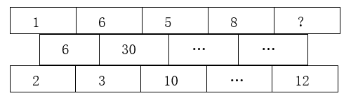

A. 5

B. 6

C. 7

D. 8

第 26 题 · 答案与解析

**参考答案（粉笔题库参考内容）**

B

**解析**

题干出现图形，判定为图形数阵。观察图形，可发现：1×6=6=2×3，6×5=30=3×10，即规律为：第一行相邻两数的乘积=第二行的数=第三行相邻两数的乘积。根据规律可知：5×8=第二行的第三项=10×第三行的第四项，则第二行的第三项为40，第三行的第四项为。同理：8×？=第二行的第四项=4×12，则第二行的第四项为48，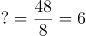。

故正确答案为B。

### 第 27 题

数列：1，3/2，2，，，3，，，，4，（ ）

A. 

B. 

C. 

D. 21/5

第 27 题 · 答案与解析

**参考答案（粉笔题库参考内容）**

D

**解析**

数列大部分为分数，考虑分数数列。原数列可转化为：，3/2，，，，，，，，，（ ）。观察发现，分母数值与以其为分母的分数个数相同，则将数列分组为：{，3/2}，{，，}，{，，，}，{，（ ），······}，每组的分子均为连续自然数，故所求项为21/5。

故正确答案为D。

### 第 28 题

数列：12，42，48，69，831，（ ）

A. 945

B. 1659

C. 2023

D. 2661

第 28 题 · 答案与解析

**参考答案（粉笔题库参考内容）**

D

**解析**

观察发现：12×2=24，其倒序数（即数字从后往前看形成的数）为42；42×2=84，其倒序数为48；48×2=96，其倒序数为69；69×2=138，其倒序数为831，故规律为：第一项×2=第二项的倒序数。因此，所求项应为831×2=1662的倒序数，即2661。

故正确答案为D。

### 第 29 题

数列：（3，5），（5，7），（11，13），（17，19），（29，31），（ ）

A. （41，43）

B. （57，59）

C. （61，65）

D. （71，73）

第 29 题 · 答案与解析

**参考答案（粉笔题库参考内容）**

A

**解析**

数列各项均两两分组，考虑多重数列。观察发现，题干各项均为质数，且每个括号内均是差值为2的两个连续质数。根据连续质数列2、3、5、7、11、13、17、19、（23）、29、31、（37）、41、43······可知（29，31）之后的两个差值为2的连续质数为（41，43）。

故正确答案为A。

### 第 30 题

根据下列数字关系，“?”中的数字不可能是        。

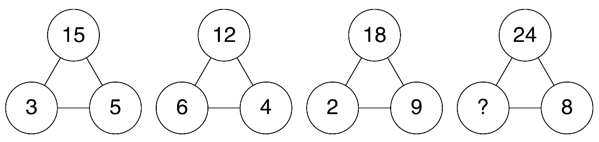

A. 3

B. 6

C. 9

D. 12

第 30 题 · 答案与解析

**参考答案（粉笔题库参考内容）**

C

**解析**

观察题干发现，各数阵之间无法形成统一的递推规律，考虑数字特性。分析可得，3与5均为15的约数，6与4均为12的约数，2与9均为18的约数，即在每个数阵中，下面两个数字均为上面数字的约数。按此规律，选项中只有C项9不是24的约数，C项当选。

故正确答案为C。

### 第 31 题

小李父子俩佩戴智能手表跑步锻炼，同时从小区门口出发，绕小区一圈后又同时到达小区门口，手表给出如下锻炼“时间—配速”图线。根据图线分析，在        ，小李的跑动距离与父亲相同。

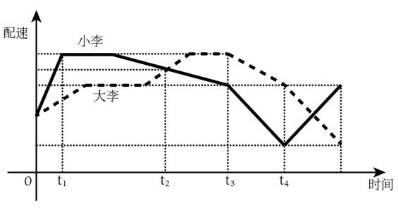

A. 时刻

B. 时刻

C. 时刻

D. 时刻

第 31 题 · 答案与解析

**参考答案（粉笔题库参考内容）**

D

**解析**

假设小李父子在时刻到达小区门口。分析图线可知，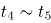时刻小李父子均为匀变速运动，且小李的初速度与父亲的末速度相同，小李的末速度与父亲的初速度相同。根据匀变速运动距离公式：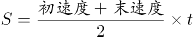，可知时刻小李父子的跑动距离相等。又因为小李父子同时到达小区门口，则在时刻小李的跑动距离与父亲相同。

故正确答案为D。

注：在时间—配速图线中，可用图线与坐标轴所围成图形的面积表示移动距离。

### 第 32 题

某班有48位同学，教室里有6排，每排8个座位。若在每个周一早上班里同学按照如下要求换座位：①第一排同学换到最后一排，其他每排同学向前换一排；②最左边一列的同学换到最右边一列，其他每列同学向左换一列。那么坐在第一排最左边的同学经过        后首次回到第一排最左边。

A. 12周

B. 24周

C. 36周

D. 48周

第 32 题 · 答案与解析

**参考答案（粉笔题库参考内容）**

B

**解析**

根据题意可得：第一排的同学6周循环一次重回第一排；最左边一列的同学8周循环一次重回最左边一列。若要满足题意，需同时符合两种周期循环，6和8的最小公倍数为24，故坐在第一排最左边的同学经过24周后首次回到第一排最左边。

故正确答案为B。

### 第 33 题

某超市设有10个人工收银台。周末10个收银台全开，顾客结账平均排队20分钟。为提高效率，超市撤了4个人工收银台，并改造为6个自助收银台。若自助收银的效率是人工收银效率的90%。改造后，周末当人工收银台和自助收银台全开，预计顾客结账平均排队耗时约为        。

A. 12分钟

B. 14分钟

C. 16分钟

D. 18分钟

第 33 题 · 答案与解析

**参考答案（粉笔题库参考内容）**

D

**解析**

根据题意，假设每个人工收银台的效率为1，则每个自助收银台的效率为1×90%=0.9。改造前后结账效率之比为（10×1）：（6×1+6×0.9）=50：57，则改造前后顾客结账平均排队时间之比为57：50。已知改造前顾客结账平均排队20分钟，则改造后预计顾客结账平均排队耗时为分钟，约为18分钟。

故正确答案为D。

### 第 34 题

在一个坡面角约为的山坡上有一个泉眼，从泉眼开挖一条正对山脚向下到山脚的灌溉水渠。已知泉眼距地面的垂直高度约为100米，开挖水渠每米的土方量约为0.3立方米，则开挖整条水渠的土方量约为            。（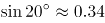，，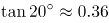）

A. 10立方米

B. 32立方米

C. 88立方米

D. 980立方米

第 34 题 · 答案与解析

**参考答案（粉笔题库参考内容）**

C

**解析**

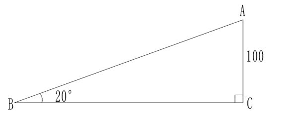

根据题意，如上图所示，，已知泉眼距地面的垂直高度约为100米，即AC⊥BC，且AC=100米。因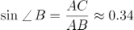，则从泉眼开挖一条正对山脚向下到山脚的灌溉水渠米，故开挖整条水渠的土方量约为立方米。

故正确答案为C。

### 第 35 题

足球比赛在每个半场结束时都有一段时间的伤停补时，这是由当值主裁判决定的。某场比赛的主裁判确定伤停补时的规则为：每次处理受伤增加30秒，每次换人增加20秒，其他情况每次增加10秒。在下半场即将结束时，主裁判确定伤停补时的时长为4分30秒。若已知下半场比赛时间内，处理受伤、换人和其他情况都存在且共计有10次，那么下半场两队总共换了    人。

A. 1

B. 2

C. 3

D. 4

第 35 题 · 答案与解析

**参考答案（粉笔题库参考内容）**

A

**解析**

设下半场两队共处理受伤a次、换人b次、其他情况c次。根据题意可列方程组：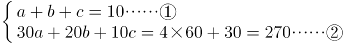，

②-①×10可得2a+b=17。根据奇偶特性，b为奇数，排除B、D两项；代入A项，解得a=8，c=1，满足题意，当选；代入C项，解得a=7，c=0，不满足题意，排除。

故正确答案为A。

### 第 36 题

某公司生产A、B两种产品，其中B是A的升级产品。经过调研，预判2022年市场对A产品的需求比2021年下降30%（A产品的价格不变）。因此公司决定增加对B产品营销，使B产品在2022年的销售收入比2021年增长70%，这样恰好使公司2022年的总销售收入比2021年增长10%。则2021年B产品的销售额占总销售额的比例是    。

A. 40%

B. 50%

C. 60%

D. 70%

第 36 题 · 答案与解析

**参考答案（粉笔题库参考内容）**

A

**解析**

方法一：设2021年A产品的销售收入为x，B产品的销售收入为y。根据“2022年市场对A产品的需求比2021年下降30%（A产品的价格不变）”及“B产品在2022年的销售收入比2021年增长70%”，可知2022年A产品的销售收入为（1-30%）x=0.7x，B产品的销售收入为（1+70%）y=1.7y，则有：，解得，所求。

方法二：根据题意可知，A产品的价格不变，2022年市场对A产品的需求比2021年下降30%，故2022年A产品的销售收入比2021年下降30%，2022年B产品的销售收入比2021年增长70%，2022年的总销售收入比2021年增长10%。由于“A产品的销售收入+B产品的销售收入=总销售收入”，根据线段法：距离与量成反比，可知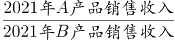，所求。

故正确答案为A。

### 第 37 题

某公园有一个圆形的湖，在湖的直径EB处有一座观光桥，横穿整个湖。园区在平行于观光桥的MN处建造了一片雕塑群，用以介绍中国古代礼仪与民俗，其长度等于湖的半径。某游客在湖边与观光桥上边走边欣赏湖中的雕塑群，走过了A、B、C、D四处位置。如图所示，A为该湖的圆心，N、D、C在一条线上，且ND⊥AB。那么在这四处位置，游客的观察视角大于的有    处。（观察视角，即游客在该点处观看景物的视野张角，例如在D点处，其观察视角为∠MDN）

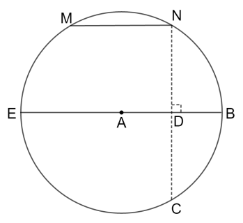

A. 1

B. 2

C. 3

D. 4

第 37 题 · 答案与解析

**参考答案（粉笔题库参考内容）**

B

**解析**

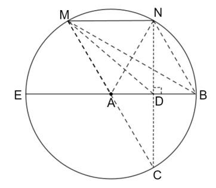

如图，连接AM、AN、BM、BN、CM、DM，则游客在A、B、C、D四处位置的观察视角分析如下：

A点，由于MN长度等于湖的半径，则MN=AM=AN，是等边三角形，故；

B点，∠MBN、∠MAN分别为弧MN的圆周角、圆心角。根据圆周角定理“同弧所对的圆周角等于它所对的圆心角的一半”，则；

C点，∠MCN也为弧MN的圆周角，则；

D点，由于、ND⊥AB，则，；在直角中，AN＞ND，由于MN=AN，则MN＞ND，∠MDN>∠NMD，故。

综上，在A、B、C、D这四处位置，游客的观察视角大于的有A点和D点，共2处。

故正确答案为B。

### 第 38 题

地球绕太阳公转的周期为365天5小时48分46秒。为了弥补历法规定造成的一年365天与地球公转周期的时间差，每4年设立一个闰年，闰年共有366天，并每百年减去一个闰年。若地球绕太阳公转的周期为365天8小时，而历法规定每一年仍是365天，那么为了补足地球公转周期的时间差，需要每（ ）设置一个闰年。

A. 1年

B. 2年

C. 3年

D. 4年

第 38 题 · 答案与解析

**参考答案（粉笔题库参考内容）**

C

**解析**

根据题干“地球绕太阳公转的周期为365天8小时，而历法规定每一年仍是365天”，说明每个地球绕太阳公转的周期比历法规定的每一年多8小时，由于，即3个地球绕太阳公转的周期比历法规定的每一年多1天，需要每3年设置一个闰年。

故正确答案为C。

### 第 39 题

老李5月份在鱼塘放养了5000尾鱼苗，年底前为了估测鱼苗的存活情况，老李随机捞取了100尾鱼苗做上记号后放回鱼塘。若干天后老李又先后10次随机捞取100尾，捞取后放回，并分别统计其中标有记号的鱼苗，依次得：1、19、6、5、7、6、11、2、7、6，则此时鱼苗的存活数量最接近    。

A. 900尾

B. 1400尾

C. 2700尾

D. 4200尾

第 39 题 · 答案与解析

**参考答案（粉笔题库参考内容）**

B

**解析**

老李先后10次捞取的标有记号的鱼苗的平均数量为尾。设此时鱼苗的存活数量为x尾，则，解得，与B项最接近。

故正确答案为B。

实际上本题应该用带标记的鱼的实际存活总量（是未知数，不一定为100）来计算，但是照此计算则没有确切数值范围，亦无答案可选，可能是因为题目有漏洞或者回忆题目有误。

### 第 40 题

粉笔暂未收录本题（来源缺题，题位保留）

第 40 题 · 答案与解析

**答案状态：unknown（来源未提供）**

**解析状态：unknown（来源未提供）**

## 材料 3

独角兽公司是投资界术语，一般指成立不超过10年，估值超过10亿美元，少部分估值超过100亿美元的企业，其不仅是优质和市场潜力无限的绩优股，而且商业模式很难被复制。

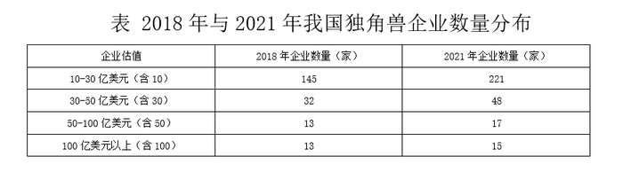

### 第 41 题

2021年我国独角兽企业数量比2018年增长了约        。

A. 200%

B. 150%

C. 100%

D. 50%

第 41 题 · 答案与解析

**参考答案（粉笔题库参考内容）**

D

**解析**

根据题干“2021年······比2018年增长了约······”，结合选项为百分数，可判定本题为一般增长率问题。定位表格材料可得：2018年我国独角兽企业各类估值的企业数量分别为145、32、13、13家，2021年各类估值的企业数量分别为221、48、17、15家。根据公式：增长率，则所求增长率，与D项最接近。

故正确答案为D。

### 第 42 题

2021年在我国独角兽企业中随机抽一家，该企业恰好属于估值在100亿美元及以上的可能性大约为        。

A. 5%

B. 6%

C. 8%

D. 16%

第 42 题 · 答案与解析

**参考答案（粉笔题库参考内容）**

A

**解析**

根据题干“2021年在······中······的可能性大约为”，结合选项为百分数，可判定本题为现期比重问题。定位表格材料可得：2021年我国独角兽企业数量分布为10-30亿美元（含10）221家、30-50亿美元（含30）48家、50-100亿美元（含50）17家、100亿美元以上（含100）15家。2021年我国独角兽企业共有221+48+17+15=301家，根据公式：比重，则所求为。

故正确答案为A。

### 第 43 题

2018年如果想调查我国独角兽企业的经营状况，至少要抽取        家公司才能保证至少有一家公司估值不低于50亿美元。

A. 27

B. 59

C. 178

D. 191

第 43 题 · 答案与解析

**参考答案（粉笔题库参考内容）**

C

**解析**

定位表格材料可得：2018年我国独角兽企业估值10-30亿美元（含10）的企业数量有145家、30-50亿美元（含30）的企业数量有32家。考虑最不利情况为抽取了145+32=177家公司，其企业估值均在50亿美元以下，在此基础上再抽取1家公司，即可保证至少有一家公司估值不低于50亿美元，因此至少要抽取177+1=178家公司。

故正确答案为C。

### 第 44 题

2021年，我国估值在100亿美元及以上的独角兽企业15家合计估值为7280亿美元，占据全部独角兽企业估值的54.03%。若2021年我国独角兽企业市场总估值较2018年增长了32.21%，则2018年我国独角兽企业市场总估值约为        亿美元。

A. 22750

B. 13474

C. 12630

D. 10191

第 44 题 · 答案与解析

**参考答案（粉笔题库参考内容）**

D

**解析**

根据题干“2021年······则2018年······亿美元”，结合题干给出100亿美元及以上的独角兽企业15家合计估值以及该估值占全部独角兽企业估值的比重和2021年我国独角兽企业市场总估值较2018年的增长率，可判定本题为基期计算问题。由题干可知，2021年我国估值在100亿美元及以上的独角兽企业15家合计估值为7280亿美元，占据全部独角兽企业估值的54.03%。根据公式：整体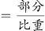，则2021年我国全部独角兽企业估值为亿美元。又由题干可知，2021年我国独角兽企业市场总估值较2018年增长了32.21%。根据公式：基期量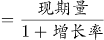，则2018年我国独角兽企业市场总估值亿美元，与D项最接近。

故正确答案为D。

### 第 45 题

行业集中度，是指某行业的相关市场内前N家最大的企业（头部企业）所占市场份额（产值、产量、销售额、销售量、职工人数、资产总额等）的总和，是对整个行业的市场结构集中程度的测量指标，用来衡量企业的数目和相对规模的差异，是市场势力的重要量化指标。如果将独角兽企业视为一个行业，而头部企业均选取13家，与2018年相比，2021年的行业集中度        。

A. 提高

B. 不变

C. 降低

D. 条件不足，无法判断

第 45 题 · 答案与解析

**参考答案（粉笔题库参考内容）**

D

**解析**

根据题干“与2018年相比，2021年的行业集中度······”，结合题干中对于行业集中度的诠释（头部企业占市场份额的总和），可判定本题为两期比重问题。材料并未给出市场份额相关数据，故无法比较2021年行业集中度相比于2018年的变化，即条件不足，无法判断。

故正确答案为D。

## 材料 4

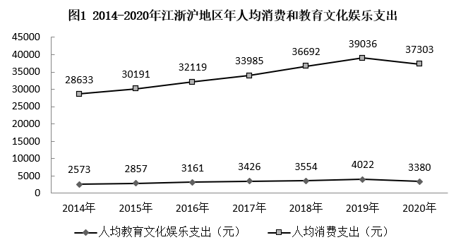

### 第 46 题

2020年，江浙沪地区年人均教育文化娱乐支出在年人均消费支出中的占比约为        。

A. 5%

B. 7%

C. 9%

D. 15%

第 46 题 · 答案与解析

**参考答案（粉笔题库参考内容）**

C

**解析**

根据题干“2020年······在······中的占比约为”，可判定本题为现期比重问题。定位图1可得：2020年江浙沪地区年人均教育文化娱乐支出和年人均消费支出分别为3380元和37303元。根据公式：比重，则2020年，江浙沪地区年人均教育文化娱乐支出在年人均消费支出中的占比。

故正确答案为C。

### 第 47 题

以下年份中，江浙沪地区年人均消费支出年增长额最多的是        。

A. 2015年

B. 2017年

C. 2018年

D. 2019年

第 47 题 · 答案与解析

**参考答案（粉笔题库参考内容）**

C

**解析**

根据题干“······年增长额最多的是”，可判定本题为增长量比较问题。定位图1可得：2014-2019年江浙沪地区年人均消费支出分别为28633、30191、32119、33985、36692、39036元。根据公式：增长量=现期量-基期量，可得2015年人均消费支出年增长额=30191-28633=元；2017年年增长额=33985-32119=元；2018年年增长额=36692-33985=元；2019年年增长额=39036-36692=元。比较可知，2018年江浙沪地区年人均消费支出年增长额最多。

故正确答案为C。

### 第 48 题

根据2020年江浙沪地区年人均支出情况，可估算2021年江苏省南通市的消费市场规模和教育文化娱乐市场规模分别约为        亿元和        亿元。

A. 2787，253

B. 2885，261

C. 2656，241

D. 2324，251

第 48 题 · 答案与解析

**参考答案（粉笔题库参考内容）**

B

**解析**

根据题干“根据2020年······人均支出情况，可估算2021年······消费市场规模和教育文化娱乐市场规模······约为······亿元”，结合材料给出2020年江浙沪地区年人均消费和教育文化娱乐支出情况以及2021年南通市常住人口情况，可判定本题为现期平均数问题。定位图1可得：2020年江浙沪地区年人均消费支出为37303元，年人均教育文化娱乐支出为3380元；定位图2可得：2021年南通市常住人口为773.3万人。根据2020年江浙沪地区年人均支出情况，可估算2021年江苏省南通市的消费市场规模=年人均消费支出×常住人口数=37303×773.3万＞3.7万×770万=2849亿元，只有B项符合。

故正确答案为B。

### 第 49 题

若以上海、苏州、南京和温州这四个城市的教育文化娱乐市场为总体，假定各城市2021年人均教育文化娱乐支出都为3380元，那么下图中        最可能展示了这四个城市2021年教育文化娱乐市场规模的占比情况。

A. 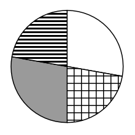

B. 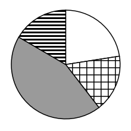

C. 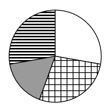

D. 

第 49 题 · 答案与解析

**参考答案（粉笔题库参考内容）**

B

**解析**

根据题干“······四个城市2021年教育文化娱乐市场规模的占比情况”，可判定本题为现期比重问题。定位图2可得：2021年上海、苏州、南京和温州常住人口数分别为2489.43万、1279.8万、942.3万、964.5万。由于教育文化娱乐市场规模=人均教育文化娱乐支出×常住人口数，且2021年这四个城市的人均教育文化娱乐支出相同（均为3380元），则上海、苏州、南京和温州这四个城市的教育文化娱乐市场规模的占比就是它们的常住人口数的占比。根据公式：比重，上海的占比最大，其占比为，接近饼图的一半，只有B项符合。

故正确答案为B。

注：本题与公考常考的默认顺序不同，若按照“从 12 点钟方向，依次顺时针排列”这一默认顺序来排列，本题无正确答案。

### 第 50 题

与2015年相比，2020年江浙沪地区年人均教育文化娱乐支出增量        年人均消费支出增量，年人均教育文化娱乐支出增长率        年人均消费支出增长率。

A. 高于，高于

B. 高于，低于

C. 低于，高于

D. 低于，低于

第 50 题 · 答案与解析

**参考答案（粉笔题库参考内容）**

D

**解析**

根据题干“与2015年相比，2020年······增量······，······增长率······”，结合选项为高于/低于，可判定本题为增长量比较问题和一般增长率问题。定位图1可得：2015年、2020年江浙沪地区年人均教育文化娱乐支出分别为2857元、3380元，2015年、2020年江浙沪地区年人均消费支出分别为30191元、37303元。根据公式：增长量=现期量-基期量，可得与2015年相比，2020年江浙沪地区年人均教育文化娱乐支出增量=3380-2857=523元，年人均消费支出增量=37303-30191=7112元，前者低于后者，排除A、B两项；根据公式：增长率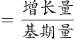，可得与2015年相比，2020年江浙沪地区年人均教育文化娱乐支出增长率，年人均消费支出增长率，前者低于后者，D项当选。

故正确答案为D。

## 材料 5

2022年2月，“东数西算”工程正式全面启动。云计算在“东数西算”产业链中游占据重要位置。2020年上半年和2021年上半年，中国整体云服务市场规模分别为1171亿元和1620亿元，其三个细分领域市场IaaS（基础设施即服务）、PaaS（平台即服务）和SaaS（软件即服务）的规模如下表1。

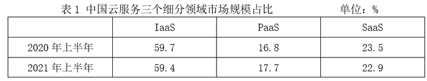

在中国整体云服务市场中，2020年上半年和2021年上半年，公有云市场规模分别为830亿元和1235亿元。在公有云市场份额方面，阿里云、华为云、腾讯云位列2021年上半年中国IaaS公有云市场和中国IaaS+PaaS公有云市场前三名，具体占比如下表2。

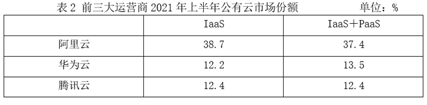

### 第 51 题

在IaaS+PaaS公有云市场中，前三大运营商2021年上半年市场占比总和位于            区间。

A. \[60%，61%）

B. \[61%，62%）

C. \[62%，63%）

D. \[63%，64%）

第 51 题 · 答案与解析

**参考答案（粉笔题库参考内容）**

D

**解析**

定位表2可得：2021年上半年，阿里云、华为云、腾讯云前三大运营商在IaaS+PaaS公有云市场中的占比分别为37.4%、13.5%、12.4%。则所求占比总和=37.4%+13.5%+12.4%=63.3%，在D项范围内。

故正确答案为D。

### 第 52 题

在2021年上半年PaaS公有云市场中，相对于腾讯云的市场份额，阿里云的市场份额                    。

A. 更小

B. 持平

C. 更大

D. 资料不足，无法判断

第 52 题 · 答案与解析

**参考答案（粉笔题库参考内容）**

D

**解析**

根据题干“在2021年上半年PaaS公有云市场中······腾讯云······阿里云的市场份额”，而市场份额又称市场占有率（即比重），可判定本题为现期比重问题。定位统计表2可得：在2021年上半年，IaaS公有云市场中，阿里云、腾讯云的市场份额分别为38.7%、12.4%；IaaS+PaaS公有云市场中，阿里云、腾讯云的市场份额分别为37.4%、12.4%。

方法一：根据公式：部分=整体×比重，可得2021年上半年，阿里云PaaS公有云市场规模=IaaS+PaaS公有云市场规模×37.4%-IaaS公有云市场规模×38.7%，由于材料并未给出2021年上半年IaaS+PaaS公有云市场规模、IaaS公有云市场规模，因此无法推出阿里云PaaS公有云市场规模；同理，腾讯云的对应市场规模亦无法推出，故无法判断腾讯云和阿里云市场份额的大小关系。

方法二：由于IaaS+PaaS公有云市场规模=IaaS公有云市场规模＋PaaS公有云市场规模，则运营商的IaaS+PaaS公有云市场份额（比重）为混合比重，根据混合比重口诀“混合居中但不正中”，可得PaaS公有云市场中，阿里云占比<37.4%，腾讯云占比=12.4%。但材料并未给出2021年上半年IaaS+PaaS、IaaS公有云市场规模的相关数据，因此无法进一步判断阿里云占比与腾讯云占比（12.4%）的大小关系。

故正确答案为D。

备注：材料中表2的运营商的公有云市场份额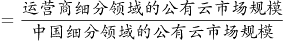，此比重的部分和整体都是“公有云市场规模”的相关数据，根据实际统计规则和文字材料第二段“在公有云市场份额方面，阿里云、华为云、腾讯云位列······具体占比如下表2”，都可以证实。

但有某观点认为“阿里云IaaS公有云市场份额（38.7%）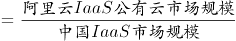，阿里云IaaS+PaaS公有云市场份额（37.4%）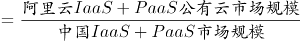，从而计算阿里云PaaS公有云市场规模=1620×（59.4%+17.7%）×37.4%-1620×59.4%×38.7%；腾讯云PaaS公有云市场规模=1620×（59.4%+17.7%）×12.4%-1620×59.4%×12.4%，进而判断阿里云市场份额>腾讯云市场份额，选C。”小粉笔认为这种理解是偏颇的，故小粉笔倾向于本题正确答案为D。

### 第 53 题

2021年上半年同比增长率最大的是                    市场。

A. IaaS

B. PaaS

C. SaaS

D. 资料不足，无法判断

第 53 题 · 答案与解析

**参考答案（粉笔题库参考内容）**

B

**解析**

根据题干“2021年上半年同比增长率最大······”，结合材料给出2020年上半年和2021年上半年各个领域市场规模占比，可判定本题为两期比重问题。定位表1可得，2020年上半年和2021年上半年IaaS的市场规模占比分别为59.7%、59.4%，PaaS的市场规模占比分别为16.8%、17.7%，SaaS的市场规模占比分别为23.5%、22.9%。根据两期比重逆运用结论：比重上升，则部分增长率＞整体增长率；比重下降，则部分增长率＜整体增长率。观察发现，IaaS、SaaS的比重下降，则两者同比增长率均小于中国整体云服务市场规模的同比增长率；PaaS的比重上升，则其同比增长率大于中国整体云服务市场规模的同比增长率。综上，PaaS的同比增长率最大。

故正确答案为B。

### 第 54 题

2021年上半年，前三大运营商在IaaS+PaaS公有云市场中的份额差最大值为        。

A. 1.1%

B. 23.9%

C. 25.0%

D. 26.5%

第 54 题 · 答案与解析

**参考答案（粉笔题库参考内容）**

C

**解析**

定位表2可得，2021年上半年，前三大运营商在IaaS+PaaS公有云市场中的份额最大为阿里云37.4%，最小为腾讯云12.4%，故份额差最大值为37.4%-12.4%=25.0%。

故正确答案为C。

### 第 55 题

根据资料，下列说法错误的是                    。

A. 2021年上半年，我国整体云服务市场同比增长率超过30%

B. 2021年上半年，阿里云在IaaS和IaaS+PaaS两个公有云市场都占据龙头地位

C. 2021年上半年，公有云市场规模约占我国整体云服务市场规模的76.2%

D. 2021年上半年，非公有云市场规模同比增量高于50亿元

第 55 题 · 答案与解析

**参考答案（粉笔题库参考内容）**

D

**解析**

A项：定位文字材料第一段，2020年上半年和2021年上半年，中国整体云服务市场规模分别为1171亿元和1620亿元。根据公式：增长率，可得2021年上半年，我国整体云服务市场同比增长率，正确；

B项：定位表2，可知2021年上半年，阿里云在IaaS和IaaS+PaaS两个公有云市场份额分别为38.7%和37.4%，均排名第一，故阿里云都占据龙头地位，正确；

C项：定位文字材料第一段，2021年上半年，中国整体云服务市场规模为1620亿元；定位文字材料第二段，2021年上半年，公有云市场规模为1235亿元。根据公式：比重，可得2021年上半年，公有云市场规模占我国整体云服务市场规模的比重为，正确；

D项：定位文字材料第一段，2020年上半年和2021年上半年，中国整体云服务市场规模分别为1171亿元和1620亿元；定位文字材料第二段，2020年上半年和2021年上半年，公有云市场规模分别为830亿元和1235亿元。根据非公有云市场规模=中国整体云服务市场规模-公有云市场规模，可得：2021年上半年，非公有云市场规模为1620-1235=385亿元；2020年上半年，非公有云市场规模为1171-830=341亿元。根据公式：增长量=现期量-基期量，可得2021年上半年，非公有云市场规模同比增量为385-341=44亿元<50亿元，错误。

本题为选非题，故正确答案为D。

### 第 56 题

催化加氢可制取汽油，转化过程示意图如下（括号内是汽油中某些成分的球棍模型），根据图中的信息下列判断错误的是：

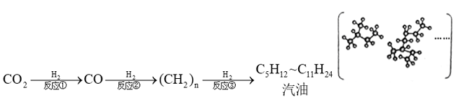

A. 反应①的生成物中，除了一氧化碳，可能还有水

B. 反应①②③过程中，C元素的化合价不发生改变

C. 球棍模型中的小球代表氢原子，大球代表碳原子

D. 推广制取汽油的技术，有利于实现“碳中和”的目标

第 56 题 · 答案与解析

**参考答案（粉笔题库参考内容）**

B

**解析**

A项：能与在高温的条件下，反应生成CO和，因此反应①的生成物中有水，正确；

B项：通过反应①生成CO，碳元素的化合价由+4价变为+2价，因此碳元素的化合价发生了变化，错误；

C项：在球棍模型中，球的大小表示原子的大小，氢原子比碳原子小，因此小球代表氢原子，大球代表碳原子，正确；

D项：碳中和是指国家、企业、产品、活动或个人在一定时间内直接或间接产生的二氧化碳或温室气体排放总量，通过植树造林、节能减排等形式，以抵消自身产生的二氧化碳或温室气体排放量，达到相对“零排放”。利用制取汽油，可以消耗，抵消人们在生产、生活中排放的部分，有利于实现“碳中和”的目标，正确。

本题为选非题，故正确答案为B。

### 第 57 题

氢气是一种可持续发展的新能源和工业原料。利用太阳能将水转化为氢气是一种理想途径。某种光分解水技术的反应过程如图所示，下列判断错误的是：

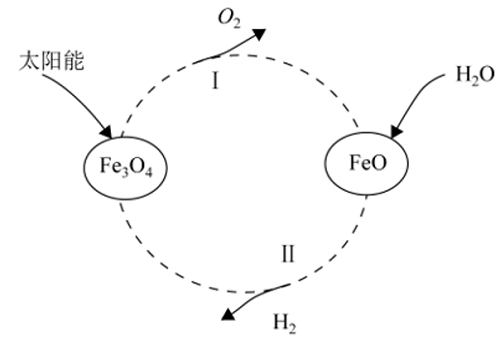

A. 的作用是作催化剂

B. 产物除外，还有和FeO

C. 该反应机理Ⅱ为FeO与反应生成和

D. 与电解水相比，该方法的优点是能耗低

第 57 题 · 答案与解析

**参考答案（粉笔题库参考内容）**

B

**解析**

A项：由图可知，过程Ⅰ的反应为在太阳光的作用下分解生成FeO和，过程Ⅱ的反应为FeO和生成和，由过程Ⅰ和过程Ⅱ的反应可知，整个过程的反应为：水在太阳光和的作用下分解生成了和，因此为整个过程的催化剂，正确；

B项：由A项的分析可知，整个过程的反应产物为和，错误；

C项：由图可知，过程Ⅱ的反应为FeO和生成和，正确；

D项：电解水是指水通电后生成氢气和氧气，此过程需要消耗电能。而光分解水技术是利用太阳能将水转化为氢气和氧气，此过程只需要太阳光的照射，不需要消耗电能，因此光分解水技术比电解水的能耗更低，正确。

本题为选非题，故正确答案为B。

### 第 58 题

国务院印发《2030年前碳达峰行动方案》，我国向世界承诺，2030年前实现碳达峰，2060年前实现碳中和。“碳中和”是指一定时间内排放的碳总量与吸收的碳总量相互抵消，实现碳“零排放”，下列化学变化能够实现降碳目标的是：

A. 甲烷燃烧：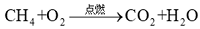

B. 活泼金属镁在CO₂中燃烧：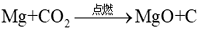

C. 用煤炭制水煤气：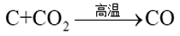

D. 光催化还原二氧化碳为甲酸：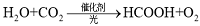

第 58 题 · 答案与解析

**参考答案（粉笔题库参考内容）**

D

**解析**

“碳中和”指的是排出的二氧化碳或温室气体被植树造林、节能减排等绿色可持续发展的形式抵消，从而达到相对“零排放”。

A项：甲烷燃烧不但没有减少二氧化碳的排放，反而会产生更多的二氧化碳，不符合“碳中和”的理念，错误；

B项：镁在二氧化碳中燃烧会造成金属镁的消耗和浪费，不符合节能和绿色可持续发展的理念，错误；

C项：用煤炭制水煤气虽然可以消耗二氧化碳，但是需要在高温条件下进行反应，会存在能耗大等问题，并且生成的一氧化碳有毒，因此不符合节能和可持续发展的理念，错误；

D项：利用光催化将二氧化碳还原为甲酸不仅可以消耗二氧化碳，同时还可以生产甲酸和氧气，且反应条件温和，原料简单，能在工业中普及，符合节能和可持续发展的理念，正确。

故正确答案为D。

### 第 59 题

纯碱是化工之母，实验室中通过以下实验模拟工业制纯碱。向饱和NaCl溶液中先通入氨气再通入二氧化碳：

发生反应的化学方程式为①，

加热得到纯碱的反应方程式为②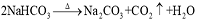

下列判断错误的是：

A. 纯碱工业的副产品氯化铵可以用作化肥

B. 反应②生成的可以为①循环使用

C. 从溶液中分离的方法是过滤

D. 得到的固体是纯净物

第 59 题 · 答案与解析

**参考答案（粉笔题库参考内容）**

D

**解析**

由题干信息可知，本题是侯氏制碱法的制碱流程，其原理是降温结晶。其具体过程为：在饱和食盐水中通入氨气，形成饱和氨盐水。随后通入二氧化碳，故而溶液中会存在大量的钠离子、铵根离子、氯离子和碳酸氢根离子，由于降温后的溶解度最小，所以是主要析出物，其余生成物处理后可作肥料或循环使用。

A项：氯化铵的含氮量为24%-25%，适用于小麦、水稻、玉米、油菜等作物，尤其对棉麻类作物有增强纤维韧性和拉力并提高品质的功效，故氯化铵可以用作化肥，正确；

B项：反应①消耗，而反应②生成，因此可以循环使用，正确；

C项：过滤法是常用的分离溶液与沉淀的操作方法，主要用于分离溶液中难溶于水的固体颗粒，由上述分析可知，降温结晶后是主要析出物，故可以利用过滤来分离，正确；

D项：纯净物指的是由单一物质组成的物质，由上述分析可知，降温结晶后是主要析出物，同时还伴随着少量的NaCl和等固体析出，故不是纯净物而是混合物，错误。

本题为选非题，故正确答案为D。

### 第 60 题

工业上经常需要研究和控制反应的速度，如通过添加抗氧化剂来减缓橡胶轮胎的老化速度；通过添加催化剂来加快反应速度。以下为探究外界因素对化学反应速度影响的实验方案，下列五组实验无法研究的影响因素是：

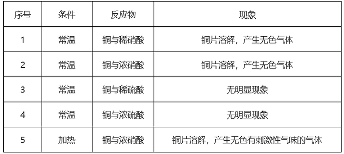

A. 酸的浓度

B. 反应温度

C. 金属的属性

D. 酸的种类

第 60 题 · 答案与解析

**参考答案（粉笔题库参考内容）**

C

**解析**

影响化学反应速率的因素有很多，为研究某一因素对反应速率的影响，通常采用控制变量法，即每次实验只改变一个要研究的因素，其余因素不变的实验方法。

A项：若研究酸的浓度对反应速率的影响，则应选择酸的浓度不同，但温度、金属的种类和酸的种类相同的一组实验进行对比，所以1和2、3和4这两组实验均符合条件，正确；

B项：若研究反应温度对反应速率的影响，则应选择温度不同，但反应物相同的一组实验进行对比，所以2和5这一组实验符合条件，正确；

C项：若研究金属的属性对反应速率的影响，则应选择金属的种类不同，但温度、酸的种类及浓度均相同的一组实验进行对比，本题五组实验中的金属均为铜，故不存在符合条件的一组实验，错误；

D项：若研究酸的种类对反应速率的影响，则应选择酸的种类不同，但温度、金属的种类和酸的浓度均相同的一组实验进行对比，所以1和3、2和4这两组实验均符合条件，正确。

本题为选非题，故正确答案为C。

### 第 61 题

下表中所示为部分燃料的热值。若要将10℃的水加热至60℃，假设燃料燃烧释放的能量全部给了水。已知水的比热容为J/kg·℃。下列判断正确的是：

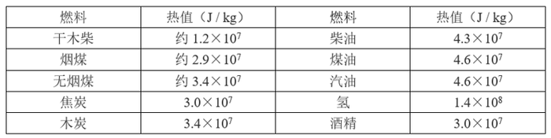

A. 消耗相同质量的焦炭和汽油，能加热水的质量比约为3：2

B. 分别加热等质量的水，消耗的木炭质量与煤油质量的比约为5：7

C. 2g氢可以加热约1.3kg的水

D. 加热1.5kg的水需要约3g的汽油

第 61 题 · 答案与解析

**参考答案（粉笔题库参考内容）**

C

**解析**

A项：由题可知，水的比热容已知，且均从10℃升高至60℃（温度改变量\=60℃-10℃=50℃），所以根据吸收热量的计算公式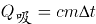可知，水吸收的热量（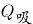）越大，则可加热的水的质量（m）越大，由于燃料燃烧的热量全部被水吸收，所以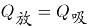，根据热量计算公式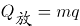可知，相同质量的焦炭和汽油燃烧所释放的热量之比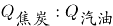，所以能加热水的质量比约为2：3，错误；

B项：由A项分析可知，加热相同质量的水所需的热量相同，由于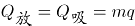，则木炭和煤油的质量之比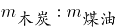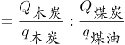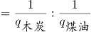，错误；

C项：2g氢气燃烧释放的能量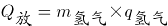J，由于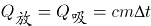，所以加热水的质量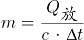kg，正确；

D项：加热1.5kg的水需要的热量J，则所需汽油的质量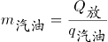kg=6.8g，错误。

故正确答案为C。

### 第 62 题

“蹦极”是一项惊险刺激的娱乐项目。下列v-t图能基本正确反映出蹦极中人在到达最低点之前的速度随时间变化关系的是：

A. 

B. 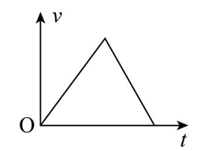

C. 

D. 

第 62 题 · 答案与解析

**参考答案（粉笔题库参考内容）**

D

**解析**

蹦极的过程如上图所示，在人下落的过程中，记O点为人从平台由静止开始下落的位置，A点为弹性绳的原长位置，B点为人受到弹性绳的弹力与自身重力相等的位置，C点为人到达的最低点。

人从O点运动到A点的过程中，只受重力的作用，加速度方向向下，大小恒为g；

从A点运动到B点的过程中，人受到竖直向下的重力和弹性绳对人向上的弹力，由于在B点处人所受弹力与重力相等，故在B点之前人所受弹力始终小于自身的重力，则，方向向下，由于人自身的重力保持不变，弹性绳不断被拉长，弹力逐渐增大，即逐渐减小，根据牛顿第二定律可知，人的加速度方向向下，且逐渐减小；在B点处人所受弹力与重力相等，即，人的加速度为0；

从B点运动到C点的过程中，人受到竖直向下的重力和向上的弹力，且弹力大于重力，即，方向向上，由于弹性绳继续被拉长，弹力逐渐增大，即逐渐增大，根据牛顿第二定律可知，人的加速度方向向上，且逐渐增大。

因此在整个过程中，人的加速度先保持不变，然后减小到0，再增大，由于v-t图像中，图像的斜率代表加速度，所以图像的斜率先保持不变，然后减小到0，再增大，故只有D项正确，A、B、C三项错误。

故正确答案为D。

### 第 63 题

如图所示是一种测定风速的装置，压力传感器固定在竖直墙上，弹簧一端固定在传感器上的M点，另一端N与迎风板相连，弹簧穿在光滑水平放置的电阻率较大的金属细杆上。根据以上信息推断下面说法正确的是：

A. 弹簧宜选用导电性良好的金属丝制成

B. 迎风板应选用不导电的材料制成

C. 压力传感器读数越大，电流传感器读数就越小

D. 压力传感器读数越大，电流传感器读数就越大

第 63 题 · 答案与解析

**参考答案（粉笔题库参考内容）**

D

**解析**

此装置测风速的原理是：金属杆与迎风板紧密接触，并接入电路中，当风将迎风板吹向左侧时，金属杆接入电路的长度变化，引起电阻变化，从而导致电流传感器的读数发生变化，进而确定风速。

A项：若弹簧选用导电性良好的金属丝制成，电阻会非常小，相当于导线，由于金属细杆的电阻率较大，所以弹簧会将金属细杆短路，此时整个电路的电流不会随着风速的改变而改变，即电流传感器的示数不变，此时电流传感器失去作用，错误；

B项：若迎风板选用不导电的材料制成，电流从电源的正极出发后无法回到电源的负极，即无法形成闭合回路，此时电流传感器无示数，错误；

C、D两项：当风速大时，迎风板会在风力的作用下向左移动并压缩弹簧，此时弹簧由于形变量变大，所以弹力也会变大，压力传感器所受压力也会变大，所以压力传感器的读数会变大，但此时金属细杆接入电路部分的长度变小，根据可知，当金属细杆的电阻率和横截面积保持不变时，接入电路的长度越小，电阻越小，故金属细杆的接入电路的电阻变小，电路的总电阻也会变小，根据可知，电路的总电流变大，即电流传感器的读数会变大，D项正确，C项错误。

故正确答案为D。

### 第 64 题

均热板是一个内壁具有微细结构的真空腔体，通常由铜制成。当热量由热源传导至蒸发区时，腔体里的冷却液吸收热能且体积迅速膨胀，气相的冷却介质迅速充满整个腔体，当气相介质接触到一个比较冷的区域时便会产生凝结的现象。借由凝结的现象释放出在蒸发时累积的热量，凝结后的冷却液会借由微结构的毛细管道再回到蒸发热源处，从而起到散热作用。

根据以上信息下列判断错误的是：

A. 均热板适合手机这样小体积需快速散高热的场合

B. 均热板在工作中涉及到物理中的汽化现象

C. 均热板在工作中涉及到物理中的液化现象

D. 均热板在工作中不涉及到物理中的热对流现象

第 64 题 · 答案与解析

**参考答案（粉笔题库参考内容）**

D

**解析**

由题干可知，均热板由导热性较强的铜制成，是一种内部具有微细结构的填充有冷却液的真空腔体，一般做成扁平的片状，其体积一般较小，而均热板的特殊结构，又使其导热效率极高，因此可用于小体积需快速散高热的场合，A项正确；均热板的工作原理包括了传导、蒸发、对流、液化四个主要步骤，热由外部高温区传导进入板内，热源附近的水会迅速地吸收热量汽化成水蒸气，带走大量的热能，涉及汽化现象，B项正确；当板内蒸气由高压区（即高温区）扩散到低压区（即低温区）时，蒸气接触到温度较低的内壁，就会迅速地液化成液体并放出热能，涉及液化现象，C项正确；液化形成的水靠微结构的毛细作用流回热源点，完成一个热传循环，形成一个水与水蒸气并存的双相循环系统，涉及热对流现象（热对流是指靠液体或气体流动，将热量由一处传到另一处的传热过程），D项错误。

本题为选非题，故正确答案为D。

### 第 65 题

2021年6月11日，国家航天局公布了由祝融号火星车拍摄的着陆点全景、火星地形地貌、“中国印迹”和“着巡合影”等影像图。首批科学影像图的发布，标志着我国首次火星探测任务取得圆满成功。自祝融号2021年5月15日着陆火星开始，截至2022年5月1日，祝融号火星车累计行驶1921米，在火星表面工作342个火星日。

根据以上信息下列判断正确的是：

A. 1个火星日比1个地球日略短

B. 1个火星日比1个地球日略长

C. 1个火星日与1个地球日的时长完全相等

D. 1个火星年比1个地球年略短

第 65 题 · 答案与解析

**参考答案（粉笔题库参考内容）**

B

**解析**

由题干可知，祝融号由2021年5月15日至2022年5月1日，一共工作了351个地球日，而这351个地球日对应342个火星日，则每个火星日对应个地球日，即1个火星日比1个地球日略长，B项正确，A、C两项错误；要对比1个火星年与1个地球年的长短，需要知道火星的公转周期，但题中并无此信息，因此无法比较，D项错误。

故正确答案为B。

### 第 66 题

气压是作用在单位面积上的大气压力。气压不仅随温度变化，也因海拔高度而异。2022年7月的一天，测出三地（当天天气均为晴天）的气压分别为100.6KPa、87.4KPa、60.3KPa，则这三个地方最有可能依次是：

A. 广西北海、云南大理古城、重庆仙女山

B. 四川峨眉山、海南三亚、甘肃兰州

C. 海南三亚、重庆仙女山、西藏拉萨

D. 西藏拉萨、四川峨眉山、广西北海

第 66 题 · 答案与解析

**参考答案（粉笔题库参考内容）**

C

**解析**

由题干信息可知，气压与海拔高度有关，海拔高度越高，气压越低。

A项：广西北海（海拔约10-15m），云南大理古城（约2052m）与重庆仙女山（约2033m）中，广西北海海拔最低，气压最高，云南大理古城与重庆仙女山海拔高度相近，气压近似相等，而题干中三个地方的气压有明显差异，错误；

B项：四川峨眉山（海拔约3099m），海南三亚（约7m）与甘肃兰州（约1520m），气压由高到低为海南三亚，甘肃兰州，四川峨眉山，错误；

C项：海南三亚（海拔约7m），重庆仙女山（约2033m）与西藏拉萨（约4000m），气压由高到低为海南三亚，重庆仙女山，西藏拉萨，正确；

D项：西藏拉萨（海拔约4000m），四川峨眉山（约3099m）与广西北海（约10-15m），气压由高到低为广西北海，四川峨眉山，西藏拉萨，错误。

故正确答案为C。

### 第 67 题

下列选项中，符合所给图形的变化规律的是        。

A. A

B. B

C. C

D. D

第 67 题 · 答案与解析

**参考答案（粉笔题库参考内容）**

A

**解析**

元素组成相同，优先考虑位置规律。观察发现，题干图形均由上下叠加的两层组成，下层是一个圆内切一个五角星，上层是一个灰色半圆挖掉一个空心小圆，下层图形不发生变化，上层的图形依次逆时针旋转，？处图形上层的挖掉小圆的灰色半圆应在左下角位置，排除C、D两项，对比A、B两项，观察发现，由于下层的五角星内切于大圆，故透过上层被挖掉的小圆不可能看到五角星的整个角，排除B项，只有A项符合规律。

故正确答案为A。

### 第 68 题

下列选项中，符合所给图形的变化规律的是        。

A. A

B. B

C. C

D. D

第 68 题 · 答案与解析

**参考答案（粉笔题库参考内容）**

B

**解析**

九宫格图形优先看横行，元素组成相似，优先考虑样式规律。观察发现，题干每幅图形都可分为内圈、中圈、外圈，每幅图形都满足一个圈是白色、灰色和阴影构成的混合色，另外两个圈是纯白色，且第一行的三个图形中，混合色分别出现在了外圈、中圈和内圈，第二行图形混合色也是分别在内圈、外圈和中圈各出现一次，第三行图形应用此规律，？处的混合色应仅出现在外圈，排除A、C两项；再次观察发现，题干前两行图形均满足混合色中的白色、灰色和阴影三个颜色从图一至图三依次逆时针旋转一格，第三行应用此规律，只有B项满足。

故正确答案为B。

### 第 69 题

下列选项中，符合所给图形的变化规律的是        。

A. A

B. B

C. C

D. D

第 69 题 · 答案与解析

**参考答案（粉笔题库参考内容）**

C

**解析**

元素组成不同，且无明显属性规律，优先考虑数量规律。观察发现，题干图形存在明显的封闭区域，且所给图形均为立体图形，故考虑立体图形外表面的数量。题干立体图形外表面的数量依次为4、6、8、？，故问号处应为外表面的数量为10的立体图形，只有C项符合。

故正确答案为C。

### 第 70 题

下列选项中，符合所给图形的变化规律的是        。

A. A

B. B

C. C

D. D

第 70 题 · 答案与解析

**参考答案（粉笔题库参考内容）**

C

**解析**

元素组成基本相同，优先考虑位置规律。观察发现，图1和图2相比，图1左下角的六边形到了图2变到了相同位置图形的内部；图2和图3相比，图2右下角的五边形到了图3变成了相同位置图形的内部，故前一幅图形与后一幅图形相比，某个图形要变到下一个相同位置图形的内部，排除A项。继续观察发现，图1和图2相比，只有左下角图形的外框发生变化，图2和图3相比，只有右下角图形的外框发生了变化，？处与前一幅图形相比只有一个位置图形的外框发生了变化，只有C项符合。

故正确答案为C。

### 第 71 题

下列选项中，符合所给图形的变化规律的是        。

A. A

B. B

C. C

D. D

第 71 题 · 答案与解析

**参考答案（粉笔题库参考内容）**

C

**解析**

图形组成相似，优先考虑样式规律。观察第一组图形发现，图三由图一和图二求异后得到。将规律代入第二组图形中，将图一和图二求异后，得到的图形对应C项。

故正确答案为C。

### 第 72 题

下列选项中，符合所给图形的变化规律的是        。

A. A

B. B

C. C

D. D

第 72 题 · 答案与解析

**参考答案（粉笔题库参考内容）**

B

**解析**

元素组成相似，优先考虑加减同异。观察发现，第一组图形中，图1与图2线条相加，再顺时针旋转，如下图所示：

然后外框线条及第一幅图、第二幅图的重合线条缩短，其余线条延长，即得第三幅图。第二组图形遵循此规律，即图1与图2线条相加，再顺时针旋转，如下图所示：

然后外框线条及第一幅图、第二幅图的重合线条缩短，其余线条延长，即得第三幅图。只有B项符合。

故正确答案为B。

### 第 73 题

下列选项中，可以由左图给定的平面图折叠而成的是        。

A. A

B. B

C. C

D. D

第 73 题 · 答案与解析

**参考答案（粉笔题库参考内容）**

B

**解析**

将原展开图标上序号如下图，逐一进行分析。

A项：选项必然由面a、面e构成，其中面a和面e为相对面，不能同时出现，选项与题干展开图不一致，排除；

B项：选项由面c、面d和面e构成，选项与题干展开图一致，当选；

C项：选项由面a、面b和面c或面a、面b和面f构成，根据选项可知3个面内没有任何线条经过公共点，若由面a、面b和面c构成，在题干展开图中面b和面c内的两条斜线相交于公共点（如下图标记点1），选项与题干展开图不一致，若由面a、面b和面f构成，在题干展开图中面f中的斜线经过公共点（如下图标记点2），选项与题干展开图不一致，排除；

D项：选项由面a、面b和面c或面a、面b和面f构成，但由于面b和面c中的线相交于面a、面b和面c的公共点，而选项中只有一个面中的斜线交于这3个面的公共点，选项与题干展开图不一致，所以该项只能由面a、面b和面f构成，以面a、面b和面f三个面的公共点作为起始点，在面a上沿顺时针方向画边，选项中边1所对应的两个端点分别和面b和面f中的斜线相交，而题干展开图中边1只有一个端点与面f中的斜线相交，另一个端点不与面b中的斜线相交，选项与题干展开图不一致，排除。

故正确答案为B。

### 第 74 题

下列选项中，符合所给图形的规律的是        。

A. A

B. B

C. C

D. D

第 74 题 · 答案与解析

**参考答案（粉笔题库参考内容）**

D

**解析**

元素组成不同，优先考虑属性规律。题干图形整体比较规整，优先考虑对称性。观察发现，题干图形均为轴对称图形且只存在一条对称轴，排除A、C两项。继续观察发现，题干图形对称轴的方向均为左下-右上，只有D项符合。

故正确答案为D。

### 第 75 题

下列选项中，符合所给图形的变化规律的是        。

A. A

B. B

C. C

D. D

第 75 题 · 答案与解析

**参考答案（粉笔题库参考内容）**

D

**解析**

元素组成相似，且图形的轮廓和分割区域相同，优先考虑样式规律中的黑白运算。本题为金字塔类题目，要从下到上找规律，即下层相邻的两幅图之间进行运算得到上面的一幅图，则问号处图形应由第二行的两幅图运算得到（详见下图）。

每幅图都由横向的5个区域构成，每个区域内的图案存在5种可能性：、、、和。将第二行两幅图的对应区域进行运算可知，问号处图形从左至右每个区域分别对应+、+、+、+、+的运算结果，在下面三行的运算中找到以上运算对应的结果即可。观察下面三行的图形，根据第三行后两幅图中右侧第二个区域的运算可知：+\=，则问号处左侧第二个区域应为，排除A、B两项；根据第四行前两幅图中左侧第二个区域的运算可知：+\=，则问号处中间区域应为，排除C项。

故正确答案为D。

注：本题不严谨，因为问号处左侧第一个区域+的运算结果在下面三行中无法验证，但四个选项中左侧第一个区域内的图案均相同，且根据其他区域的运算结果可以排除明显错误的A、B、C三项，因此，根据对比择优的原则，小粉笔建议选择D项。

### 第 76 题

下列选项中，与其他三项不同的是        。

A. A

B. B

C. C

D. D

第 76 题 · 答案与解析

**参考答案（粉笔题库参考内容）**

B

**解析**

图形元素组成不同，且无明显属性规律，考虑数量规律。观察发现，题干图形均为封闭区域被分割，优先考虑数面。观察发现，总体面数量没有规律，且其他数量均无规律。再分析各个面的特征，发现A、C、D三项的图形中面的形状均为三角形，只有B项中面的形状为四边形。

本题为选非题，故正确答案为B。

### 第 77 题

下列选项中，符合所给图形的变化规律的是        。

A. A

B. B

C. C

D. D

第 77 题 · 答案与解析

**参考答案（粉笔题库参考内容）**

D

**解析**

元素组成相同，优先考虑位置规律。将每行中左侧小元素由左到右标号（如下图所示），可知小元素在每行的右侧进行位置变动。第一行中，左侧标号为1、2、3、4、5、6、7的元素，变为右侧5、1、3/6、4/7、4/7、2、3/6。其中不确定的元素由第二行观察可知，左侧位置变动到右侧后应为5、1、6、4、7、2、3，故第三行也符合该规律，只有D项符合。

故正确答案为D。

### 第 78 题

下列选项中，符合所给图形的变化规律的是        。

A. A

B. B

C. C

D. D

第 78 题 · 答案与解析

**参考答案（粉笔题库参考内容）**

C

**解析**

九宫格优先横行看，第一行中图1、图2和图3的线条可以组成一个完整的六面体；第二行规律验证成立；因此第三行中图1、图2和图3的线条可以组成一个完整的六面体（如下图所示），只有C项符合。

故正确答案为C。

### 第 79 题

约2.3万至2.1万年前，一位年轻人在一处远古湖泊旁潮湿的沙滩上走过，这里如今是美国新墨西哥州白沙国家公园，多年前那位年轻人留下的足迹已变成了化石。大约在这些足迹形成的同一时期，人类从亚洲走到美洲的路线被巨大的冰盖所阻挡。关于人类何时首次踏足美洲，科学家一直争论不休。许多专家认为，人类直到1.3万年前才首次出现在美洲。而此次在白沙国家公园发现的足迹有力地证明，人类早在2.1万年前便已开始在北美生活了。

下列    项最可能是以上论述的前提假设。

A. 美洲最初没有人类。

B. 美洲最早的人类是从别处迁移过去的，早期陆地旅行是可行的。

C. 一位年轻人的足迹化石就足以证明人类其时已踏足美洲。

D. 在从亚洲走到美洲的路线被巨大的冰盖所阻挡之前，人类就已经到达美洲。

第 79 题 · 答案与解析

**参考答案（粉笔题库参考内容）**

C

**解析**

第一步：找出论点和论据。

论点：人类早在2.1万年前便已开始在北美生活了。

论据：约2.3万至2.1万年前，一位年轻人在一处远古湖泊旁潮湿的沙滩上走过，这里如今是美国新墨西哥州白沙国家公园，多年前那位年轻人留下的足迹已变成了化石。

本题论据讨论的是“在美洲发现2.1万年前的人类足迹”，论点讨论的是“人类在2.1万年前已开始在美洲生活”，论据和论点话题不一致，且提问方式为“前提假设”，加强优先考虑搭桥，即在“足迹”和“生活”之间建立联系。

第二步：逐一分析选项。

A项：该项讨论的是美洲最初是否有人类，与论点讨论的人类早在2.1万年前便已开始在北美生活了，话题不一致，也不明确“最初”到底是什么时间节点，排除；

B项：该项讨论的是美洲最早的人类是否为从别处迁移过去的，与论点讨论的人类早在2.1万年前便已开始在北美生活了，话题不一致，排除；

C项：该项指出一位年轻人的足迹化石就足以证明人类其时已踏足美洲，说明年轻人已在美洲生活，即在“足迹”和“生活”之间建立联系，为搭桥项，保留；

D项：该项指出在从亚洲走到美洲的路线被巨大的冰盖所阻挡之前，人类就已经到达美洲，说明确实早在2.1万年前，人类已经登上美洲了，补充论据，可以加强，保留。

对比C、D两项，搭桥的力度比补充论据的力度强，C项当选。

故正确答案为C。

### 第 80 题

甲：交警不能无缘无故拦截私家车。

乙：你看视频了吗？女子高速闯卡，逃逸途中被警察拦截，要接受处理。

甲：我看了视频，附近根本没有高速公路，哪里有高速闯卡？

以下各项如果为真，最能质疑甲的观点的是（ ）项。

A. 交警可以对正常行驶的私家车进行例行检查

B. 对闯卡逃逸的驾驶人可以处警告或者二百元以下罚款

C. 高速闯卡既可能指在高速公路上闯卡，也可能指车速过快闯卡

D. 个人拍摄下来的交通违法行为，一旦核实是真实的也可成为重要的处罚证据

第 80 题 · 答案与解析

**参考答案（粉笔题库参考内容）**

C

**解析**

第一步：找出论点和论据。

论点：交警不能无缘无故拦截私家车，即认为视频里面的交警无缘无故拦截了私家车。

论据：甲看了视频，附近根本没有高速公路，不会有高速闯卡。

本题论点和论据都在讨论交警能否无缘无故拦截私家车，二者话题一致，削弱优先考虑削弱论点，其次考虑削弱论据。

第二步：逐一分析选项。

A项：该项指出交警在执行例行检查任务时可以拦截私家车，举了一个例子说明交警可以在有缘由（例行检查）的情况下拦截私家车，有加强作用，无法削弱，排除；

B项：该项指出对闯卡逃逸的驾驶人的处罚，与题干讨论的交警能否无缘无故拦截私家车无关，无法削弱，排除；

C项：该项指出高速闯卡可以指在高速公路上闯卡，也可以指车速过快闯卡，削弱了甲认为的“没有高速公路就不会有高速闯卡行为”，削弱论据，可以削弱，当选；

D项：该项指出个人拍摄的交通违法行为可以成为处罚证据，与题干讨论的交警能否无缘无故拦截私家车无关，无法削弱，排除。

故正确答案为C。

### 第 81 题

美国马萨诸塞州的防疫部门最近发表了一份检测报告，在该州境内接受检疫的野生白尾鹿里面，有70%感染上了某种病毒。据研究，该病毒最初是从人传播到鹿身上的，随后发生变异，可在鹿群中间传播。目前防疫部门只对和人类有过接触的白尾鹿进行检疫。防疫部门的专家由此推测，州内的野生白尾鹿中感染了此种病毒的比例将显著地小于70%。

下列各项如果为真，哪项最能够支持上述论点？

A. 在马萨诸塞州境内，感染了这种病毒的人只占全部人数的0.2%

B. 马萨诸塞州内与人有过接触的野生白尾鹿，只占其总数的20%

C. 感染此种病毒的白尾鹿远比健康的白尾鹿表现得更愿意与人类接触

D. 在附近的几个州并未出现大量关于白尾鹿感染病毒的报告

第 81 题 · 答案与解析

**参考答案（粉笔题库参考内容）**

C

**解析**

第一步：找出论点和论据。

论点：州内的野生白尾鹿中感染了此种病毒的比例将显著地小于70%。

论据：在该州境内接受检疫的野生白尾鹿里面，有70%感染上了某种病毒。据研究，该病毒最初是从人传播到鹿身上的，随后发生变异，可在鹿群中间传播。目前防疫部门只对和人类有过接触的白尾鹿进行检疫。

本题论据讨论的是州内接受检疫的的白尾鹿感染该病毒的比例，论点讨论的是州内白尾鹿感染该病毒的“整体比例”，论据和论点范围不一致，考虑搭桥。

第二步：逐一分析选项。

A项：该项讨论的是马萨诸塞州境内感染该病毒的人占全部人数的比例，而论点讨论的是野生白尾鹿感染该病毒的比例，主体不一致，无法加强，排除；

B项：20%的白尾鹿与人接触过，而题干已知这个群体的感染率是70%，那么剩下未与人接触过的白尾鹿，它们的感染率不得而知，是否小于70%也不确定，无法加强，排除；

C项：感染此种病毒的白尾鹿更愿意与人类接触，说明题干论据中检疫的大部分都是感染病毒的白尾鹿，所以“70%感染率”这个数据实际是偏高的，即未被检疫的白尾鹿感染率应该是小于70%的，那么可以推出白尾鹿整体的感染率是小于70%，建立了论据和论点之间的联系，搭桥项，当选；

D项：该项讨论的是附近几个州没有大量出现白尾鹿感染病毒的报告，而论点讨论的是“马萨诸塞州内”的白尾鹿感染病毒的情况，主体不一致，无法加强，排除。

故正确答案为C。

### 第 82 题

只要引进知名教练并投入充足的运营费用，就能够使一个俱乐部的球队在联赛的排名显著提升。只有对现行的买卖球员制度和奖金分配制度进行改革，才能引进到知名教练并获得充足的运营经费。某俱乐部经过几年的建设，其球队在联赛的排名并未得到显著提升。

上述断定如果为真，可以推出下列哪项为真？

A. 过去几年，该俱乐部由于招商不利，未能获得充足的运营经费

B. 过去几年，该俱乐部更换了多名教练，没有一位是知名教练

C. 过去几年，该俱乐部可能没有引进到知名教练，也可能没有获得充足的运营经费

D. 过去几年，该俱乐部继续沿用了原来的买卖球员制度和奖金分配制度

第 82 题 · 答案与解析

**参考答案（粉笔题库参考内容）**

C

**解析**

第一步：翻译题干。

①引进知名教练 且 充足运营费用球队在联赛的排名提升；

②引进知名教练 且 充足运营费用对现行制度进行改革；

③-某球队在联赛的排名提升。

从确定信息进行推理，条件③是对条件①的“否后”，根据“否后必否前”和德摩根定律可得④：-引进知名教练 或 -充足运营费用。

第二步：逐一分析选项。

A项：该项是“-充足运营费用”，是结论④或关系中可能出现的一种情况，无法确定是否运营费用不充足，无法推出，排除；

B项：该项是“-引进知名教练”，是结论④或关系中可能出现的一种情况，无法确定是否引进知名教练，无法推出，排除；

C项：该项是“可能没有引进知名教练”“可能没有充足运营费用”，是结论④或关系可能出现的两种情况，可以推出，当选；

D项：该项是“-对现行制度进行改革”，题干推出的结论④是对条件②的否前，否前无必然，无法确定是否对现行制度进行改革，无法推出，排除。

故正确答案为C。

### 第 83 题

有研究团队使用小鼠模型，发现敲除ASGR1基因会在肝细胞中抑制mTORC1信号通路，同时激活AMPK信号通路，最终导致胆固醇通过胆汁排出，并且通过粪便排泄到体外，从而降低了血液和肝脏中胆固醇水平。为了探索这一基因突变在治疗方面的应用，研究人员开发了靶向ASGR1的抗体疗法。实验结果显示，抗ASGR1抗体成功复制了ASGR1基因敲除对下游信号通路的影响，将小鼠的血清总胆固醇水平降低50%，同时将血清甘油三酯水平降低22%。这一抗体同时降低了肝脏中的总胆固醇水平和甘油三酯水平。

根据以上陈述，可以得出下列哪项结论？

A. 使用AMPK激动剂可导致胆固醇排出

B. ASGR1基因会导致体内胆固醇水平升高

C. 使用抗ASGR1抗体可激活AMPK信号通路

D. 胆固醇水平的降低将伴随甘油三酯水平的降低

第 83 题 · 答案与解析

**参考答案（粉笔题库参考内容）**

C

**解析**

日常结论题，根据题干信息逐一分析选项。

A项：题干中并没有提到“AMPK激动剂”，无中生有，无法推出，排除；

B项：题干中只是指出敲除ASGR1基因会降低血液和肝脏中胆固醇水平，但无法因此得出“ASGR1基因会导致体内胆固醇水平升高”，无法推出，排除；

C项：题干中指出敲除ASGR1基因会激活AMPK信号通路，且抗ASGR1抗体成功复制了ASGR1基因敲除对下游信号通路的影响，因此抗ASGR1抗体也会激活AMPK信号通路，可以推出，当选；

D项：题干中只是指出抗ASGR1抗体同时降低了肝脏中的总胆固醇水平和甘油三酯水平，但没有涉及“胆固醇水平”和“甘油三酯水平”之间的关系，无中生有，无法推出，排除。

故正确答案为C。

### 第 84 题

你若活着，则不可能知道自己已经死了；你若死了，则也不可能知道自己已经死了。你或者活着，或者死了，总之，你都不可能知道自己已经死了。

以下选项与上述论证方式最为相似的是哪项？

A. 这酒若真是“不死之酒”，则您杀不死我；这酒若不是“不死之酒”，则您何必为假酒而杀我。这酒或者是真酒或者是假酒。总之，您或者杀不死我或者不必杀我。

B. 你若工作，则整日忙碌而不得安闲；你若不工作，则没有收入，也不得安闲。你或者工作或者不工作，总之，你都不得安闲。

C. 若他的盾最坚固，则他的矛将不能刺穿他的盾；若他的矛最锋利，则他的矛将能刺穿他的盾。他的矛或者能够刺穿他的盾，或者不能刺穿他的盾。总之，他互相矛盾。

D. 若某人是罪犯，则他有作案动机；若某人是罪犯，则他有作案时间。某人或者没有作案动机，或者没有作案时间。总之，某人不是罪犯。

第 84 题 · 答案与解析

**参考答案（粉笔题库参考内容）**

B

**解析**

第一步：分析题干推理形式。

题干翻译为：活着不可能知道自己已经死了；死了不可能知道自己已经死了，不论活着或死了，你都不可能知道自己已经死了。

题干的论证方式为：AB，-AB；不论A 或 -A，一定得到B。

第二步：逐一分析选项。

A项：翻译为：“不死之酒”杀不死我，-“不死之酒”不必杀我，不论真酒或假酒，一定得到杀不死我或不必杀我，论证方式为：AB，-AC，不论A 或 -A，一定得到B 或 C，与题干论证方式不一致，排除；

B项：翻译为：工作不得安闲，-工作不得安闲，不论工作或不工作，一定不得安闲，论证方式为：AB，-AB；不论A 或 -A，一定得到B，与题干论证方式一致，当选；

C项：翻译为：盾最坚固矛刺穿盾，矛最锋利矛刺穿盾，矛刺穿盾 或 -矛刺穿盾，一定互相矛盾，论证方式为：AB，CB，不论B 或 -B，一定得到D，与题干论证方式不一致，排除；

D项：翻译为：某人是罪犯有作案动机，某人是罪犯有作案时间，-作案动机 或 -作案时间，某人不是罪犯，论证方式为：AB，AC，不论-B 或 -C，一定得到-A，与题干论证方式不一致，排除。

故正确答案为B。

### 第 85 题

某单位购买了一批影像资料，有科幻片、故事片、战争片等；有国内的、欧美的、印度的；有中文的，也有英文原版的。其中，所有的科幻片都不是英文原版的，所有的故事片都是英文原版的，所有的故事片都是印度的。战争片既有印度的，也有欧美的；既有中文的，也有英文原版的。

根据以上陈述，关于这批影像资料可以得出        项。

A. 有些印度片不是科幻片

B. 有些战争片也是故事片

C. 有些科幻片不是欧美的

D. 有些故事片是中文的

第 85 题 · 答案与解析

**参考答案（粉笔题库参考内容）**

A

**解析**

第一步：翻译题干。

①科幻片英文原版；

②故事片英文原版；

③故事片印度的；

④有的战争片印度的；

⑤有的战争片欧美的；

⑥有的战争片中文的；

⑦有的战争片英文原版。

①②串联得到：⑧科幻片英文原版故事片。

第二步：逐一分析选项。

A项：翻译为有的印度片科幻片，根据条件③可以推出“有的故事片印度的”，换位可以得到“有的印度片故事片”，“故事片”是对条件⑧的否后，否后推否前，可以得到“故事片科幻片”，即“有的印度片科幻片”，可以推出，当选；

B项：翻译为有的战争片故事片，根据条件④可知“有的战争片印度的”，“印度的”是对条件③的肯后，根据条件⑦可知“有的战争片英文原版”，“英文原版”是对条件②的肯后，肯后无必然结论，无法推出，排除；

C项：翻译为有的科幻片欧美的，根据条件⑧可知“科幻片英文原版故事片”，无法与“欧美的”建立起联系，无法推出，排除；

D项：翻译为有的故事片中文的，即“有的故事片英文原版”，与条件②矛盾，无法推出，排除。

故正确答案为A。

### 第 86 题

休谟的实践推理理论，是否具有实践推理能力对回答智能机器是否具有道德权利和道德地位等问题具有启发性。因为，根据休谟的理论，人类、非人类的智能机器都能够进行实践推理，尽管智能机器的信念和欲望相较于人类的非常有限，它们的实践推理能力也相对有限。但是，如果智能机器能够像人一样具有道德情感或自利概念等，那么它们也能做出像人一样的实践推理，拥有像人一样的道德权利和道德地位。

以下选项最准确地概括了上述论证的基本结构的是        项。

A. 甲和丙之间存在相关性，因为，有甲；若甲，则乙，若乙则丙

B. 乙和丙之间存在相关性，因为，有乙；若甲，则乙且丙

C. 甲和丙之间存在相关性，因为，有甲；若甲，则乙且丙

D. 乙和丙之间存在相关性，因为，有乙；若甲，则乙，若乙则丙

第 86 题 · 答案与解析

**参考答案（粉笔题库参考内容）**

B

**解析**

第一步：分析题干论证过程。

先提出理论：是否具有实践推理能力和智能机器是否具有道德权利和道德地位有关。然后阐述原因：因为，智能机器都能够进行实践推理；若智能机器具有道德情感或自利概念，则它们能像人一样实践推理，而且拥有道德权利和道德地位。

故论证方式为：A（实践推理能力）和B（道德权利和道德地位）存在相关性，因为，有A（实践推理能力）；若C（道德情感或自利概念），则A（实践推理能力） 且 B（道德权利和道德地位）。

第二步：逐一对照选项并判断正确答案。

根据上述论证方式可知，只有B项准确概括了题干论证的基本结构，B项当选。

故正确答案为B。

### 第 87 题

某处室共有李、王、陈、宋、文5人，办公室就该处室是否购买打印机和投影仪征询5人意见。5人表示如下：

李：不管买不买打印机，都要买投影仪；

王：两样都买；

陈：两样至少买一样；

宋：若买投影仪，则一定也买打印机；

文：两样至多买一样。

办公室经过综合考虑，最终完成了采购工作。

根据以上信息，可知办公室最终的采购不可能        。

A. 与其中4人的意见不冲突

B. 与其中3人的意见不冲突

C. 与其中2人的意见不冲突

D. 与其中1人的意见不冲突

第 87 题 · 答案与解析

**参考答案（粉笔题库参考内容）**

D

**解析**

第一步：分析题干条件。

李：投影仪；

王：投影仪 且 打印机；

陈：投影仪 或 打印机；

宋：投影仪打印机；

文：-投影仪 或 -打印机。

第二步：根据题干条件进行推理。

问题为“不可能”，且根据题干条件无法判断满足了几个人的意见，优先考虑假设法。

采购情况共分为4种，分别是投影仪 且 打印机，-投影仪 且 -打印机，投影仪 且 -打印机，打印机 且 -投影仪。分情况代入判断5个人意见的真假，其中王与文为矛盾关系，必有一真必有一假，可同步判断；宋的意见“投影仪打印机”为条件关系，无法直接判断，可先判断其矛盾“投影仪 且 -打印机”的真假，再判断宋的意见的真假。

第一种情况：投影仪 且 打印机，具体情况如下表所示，此时购买情况与其中4人的意见不冲突，故A项可能成立，排除A项；

第二种情况：-投影仪 且 -打印机，具体情况如下表所示，此时购买情况与其中2人的意见不冲突，故C项可能成立，排除C项；

第三种情况：投影仪 且 -打印机，具体情况如下表所示，此时购买情况与其中3人的意见不冲突，故B项可能成立，排除B项；

第四种情况：打印机 且 -投影仪，具体情况如下表所示，此时购买情况与其中3人的意见不冲突，与第三种情况相同，可排除B项。

综合上述四种情况可知，A、B、C三项都是可能的，只有D项不可能。

本题为选非题，故正确答案为D。

### 第 88 题

某国际会议期间，会务组招聘了张、王、李、陈、宋、孔、何7名志愿者，拟将他们分配至甲、乙、丙3个工作组，每组分配2至3人。已知：

（1）若王、李和孔中至少有一人分配在甲组或者丙组，则分配至乙组的是张和宋；

（2）若宋、何中至少有一人分配在乙组或者丙组，则分配至甲组的是张和李。

根据上述信息，下列        项中的两人是分配至丙组的。

A. 张和陈

B. 宋和孔

C. 陈和何

D. 张和宋

第 88 题 · 答案与解析

**参考答案（粉笔题库参考内容）**

A

**解析**

第一步：分析题干条件。

（1）（王在甲组或丙组）或（李在甲组或丙组）或（孔在甲组或丙组）张和宋在乙组；

（2）（宋在乙组或丙组）或（何在乙组或丙组）张和李在甲组。

第二步：根据题干条件进行推理。

题干条件均为不确定信息，考虑采用假设法。

假设条件（1）的前面“（王在甲组或丙组）或（李在甲组或丙组）或（孔在甲组或丙组）”为真，肯前必肯后，可以推出张和宋在乙组；

根据“宋在乙组”，可知条件（2）的前面“（宋在乙组或丙组）或（何在乙组或丙组）”为真，肯前必肯后，可以推出张和李在甲组；

此时张既在甲组又在乙组，前后矛盾，不满足题干条件，故假设不成立，即“（王在甲组或丙组）或（李在甲组或丙组）或（孔在甲组或丙组）”为假，可以推出王、李、孔不在甲组和丙组，那么王、李、孔在乙组；

根据“李在乙组”，可知条件（2）的后面“张和李在甲组”为假，否后必否前，可以推出“（宋在乙组或丙组）或（何在乙组或丙组）”为假，可以推出宋、何不在乙组和丙组，那么宋、何在甲组。

根据上述推理，王、李、孔在乙组，宋、何在甲组，可以推出张和陈在丙组。

故正确答案为A。

## 材料 6

年终某单位评优，拟从所属甲、乙、丙、丁、戊、己、庚、辛8个部门中推选出12名候选人。要求：

（1）甲、乙、丁、辛4部门人数较少，4部门合计推选出2名候选人；

（2）没有合适人选的部门不必勉强推荐，有合适人选的部门至多可以推选出4名候选人；

（3）若甲、丙两部门至少有1个部门推选出候选人，则戊、己、庚3部门至多有1个部门可推选出候选人。

### 第 89 题

根据上述信息，可以得出下列        项中的两个部门均推选出了候选人。

A. 戊和己

B. 庚和辛

C. 乙和丙

D. 戊和丁

第 89 题 · 答案与解析

**参考答案（粉笔题库参考内容）**

A

**解析**

第一步：分析题干条件。

（1）甲、乙、丙、丁、戊、己、庚、辛8个部门共推选12名候选人；

（2）甲、乙、丁、辛4部门合计推选2名候选人；

（3）每个部门可以推选0-4名候选人；

（4）甲 或 丙推选候选人戊、己、庚中至多有1个部门推选候选人。

第二步：根据题干条件进行推理。

根据条件（1）（2）可知，丙、戊、己、庚4部门合计推选10名候选人；此时根据条件（3）可知，丙、戊、己、庚4部门至少有3个部门推选候选人；再结合条件（4）的逆否等价可知，甲部门和丙部门均没有推出候选人，故戊、己、庚3部门均推选出了候选人，只有A项符合。

故正确答案为A。

### 第 90 题

若丙和戊两部门合计推选出2名候选人，则可以得出下列        项。

A. 甲和乙两部门合计推选出2名候选人

B. 戊和辛两部门合计推选出3名候选人

C. 丙和己两部门合计推选出4名候选人

D. 己和辛两部门合计推选出5名候选人

第 90 题 · 答案与解析

**参考答案（粉笔题库参考内容）**

C

**解析**

第一步：分析题干条件。

（1）甲、乙、丙、丁、戊、己、庚、辛8个部门共推选12名候选人；

（2）甲、乙、丁、辛4部门合计推选2名候选人；

（3）每个部门可以推选0-4名候选人；

（4）甲 或 丙推选候选人戊、己、庚中至多有1个部门推选候选人；

（5）丙和戊合计推选2名候选人。

第二步：根据题干条件进行推理。

由上一题可知，甲部门和丙部门均没有推选出候选人，此时根据条件（2）和（5）可知，戊部门推选出2名候选人，乙、丁、辛3部门共推选出2名候选人，还剩己部门和庚部门合计推选出8名候选人；根据条件（3）可知，己部门和庚部门各推选出4名候选人。此时可知丙和己两部门合计推选出4名候选人，C项正确。

故正确答案为C。

### 第 91 题

2022年10月16日，中国共产党第二十次全国代表大会在北京开幕。习近平代表第十九届中央委员会向大会作报告。他指出，十年来，我们经历了对党和人民事业具有重大现实意义和深远历史意义的三件大事。这三件大事是（ ）。

①迎来中国共产党成立一百周年

②中国特色社会主义进入新时代

③统筹疫情防控和经济社会发展取得重大积极成果

④完成脱贫攻坚、全面建成小康社会的历史任务，实现第一个百年奋斗目标

⑤坚决反对外部势力干涉，牢牢把握两岸关系主导权和主动权

⑥实施供给侧结构性改革，我国经济实力实现历史性跃升

A. ①②③

B. ②③④

C. ①②④

D. ③④⑤

第 91 题 · 答案与解析

**参考答案（粉笔题库参考内容）**

C

**解析**

本题考查政治常识。

①②④正确，2022年10月16日，习近平总书记在中国共产党第二十次全国代表大会上指出：“十年来，我们经历了对党和人民事业具有重大现实意义和深远历史意义的三件大事：一是迎来中国共产党成立一百周年，二是中国特色社会主义进入新时代，三是完成脱贫攻坚、全面建成小康社会的历史任务，实现第一个百年奋斗目标。”

故正确答案为C。

### 第 92 题

习近平总书记在党的二十大报告中指出，我们要实现好、维护好、发展好最广大人民根本利益，紧紧抓住人民最关心最直接最现实的利益问题，坚持尽力而为、量力而行，深入群众、深入基层，采取更多惠民生、暖民心举措，着力解决好人民群众急难愁盼问题，健全基本公共服务体系，提高公共服务水平，增强（ ），扎实推进共同富裕。

A. 普惠性和公平性

B. 均衡性和可及性

C. 普惠性和公益性

D. 均衡性和广泛性

第 92 题 · 答案与解析

**参考答案（粉笔题库参考内容）**

B

**解析**

本题考查政治常识。

B项正确，A、C、D三项错误，2022年10月16日，习近平总书记在中国共产党第二十次全国代表大会上指出：“我们要实现好、维护好、发展好最广大人民根本利益，紧紧抓住人民最关心最直接最现实的利益问题，坚持尽力而为、量力而行，深入群众、深入基层，采取更多惠民生、暖民心举措，着力解决好人民群众急难愁盼问题，健全基本公共服务体系，提高公共服务水平，增强均衡性和可及性，扎实推进共同富裕。”

故正确答案为B。

### 第 93 题

党的二十大报告指出，人心是最大的政治，统一战线是凝聚人心、汇聚力量的强大法宝。以（ ）为主线，坚定不移走中国特色解决民族问题的正确道路，坚持和完善民族区域自治制度，加强和改进党的民族工作，全面推进民族团结进步事业。

A. 全国各族人民大团结

B. 构建人类命运共同体

C. 铸牢中华民族共同体意识

D. 坚持大团结大联合

第 93 题 · 答案与解析

**参考答案（粉笔题库参考内容）**

C

**解析**

本题考查政治常识。

C项正确，A、B、D三项错误，2022年10月16日，习近平总书记在中国共产党第二十次全国代表大会上指出：“（四）巩固和发展最广泛的爱国统一战线。人心是最大的政治，统一战线是凝聚人心、汇聚力量的强大法宝。完善大统战工作格局，坚持大团结大联合，动员全体中华儿女围绕实现中华民族伟大复兴中国梦一起来想、一起来干。发挥我国社会主义新型政党制度优势，坚持长期共存、互相监督、肝胆相照、荣辱与共，加强同民主党派和无党派人士的团结合作，支持民主党派加强自身建设、更好履行职能。以铸牢中华民族共同体意识为主线，坚定不移走中国特色解决民族问题的正确道路，坚持和完善民族区域自治制度，加强和改进党的民族工作，全面推进民族团结进步事业······”

故正确答案为C。

### 第 94 题

党的二十大报告指出，坚持制度治党、依规治党，以党章为根本，以（ ）为核心，完善党内法规制度体系，增强党内法规权威性和执行力，形成坚持真理、修正错误，发现问题、纠正偏差的机制。

A. 全心全意为人民服务

B. 民主集中制

C. 党的自我革命

D. 完善权力监督制约机制

第 94 题 · 答案与解析

**参考答案（粉笔题库参考内容）**

B

**解析**

本题考查政治常识。

B项正确，A、C、D三项错误，2022年10月16日，习近平总书记在中国共产党第二十次全国代表大会上指出：“完善党的自我革命制度规范体系。坚持制度治党、依规治党，以党章为根本，以民主集中制为核心，完善党内法规制度体系，增强党内法规权威性和执行力，形成坚持真理、修正错误，发现问题、纠正偏差的机制。健全党统一领导、全面覆盖、权威高效的监督体系，完善权力监督制约机制，以党内监督为主导，促进各类监督贯通协调，让权力在阳光下运行。推进政治监督具体化、精准化、常态化，增强对“一把手”和领导班子监督实效。发挥政治巡视利剑作用，加强巡视整改和成果运用。落实全面从严治党政治责任，用好问责利器。”

故正确答案为B。

### 第 95 题

2022年是中国共产党第二十次全国代表大会召开之年，同时也是（ ）召开一百周年。

A. 中国共产党第一次全国代表大会

B. 中国共产党第二次全国代表大会

C. 中国共产党第三次全国代表大会

D. 中国共产党第四次全国代表大会

第 95 题 · 答案与解析

**参考答案（粉笔题库参考内容）**

B

**解析**

本题考查政治常识。

A项错误，中国共产党第一次全国代表大会于1921年召开，到2022年为一大召开一百零一周年。

B项正确，中国共产党第二次全国代表大会于1922年召开，到2022年为二大召开一百周年。

C项错误，中国共产党第三次全国代表大会于1923年召开，到2022年为三大召开九十九周年。

D项错误，中国共产党第四次全国代表大会于1925年召开，到2022年为四大召开九十七周年。

故正确答案为B。

### 第 96 题

新修改的《中国共产党章程》指出，习近平新时代中国特色社会主义思想是对马克思列宁主义、毛泽东思想、邓小平理论、“三个代表”重要思想、科学发展观的继承和发展，是当代中国马克思主义、二十一世纪马克思主义，是（ ）的时代精华，是党和人民实践经验和集体智慧的结晶，是中国特色社会主义理论体系的重要组成部分，是全党全国人民为实现中华民族伟大复兴而奋斗的行动指南，必须长期坚持并不断发展。

A. 中国革命文化

B. 中华文化和民族精神

C. 中国革命精神

D. 中华文化和中国精神

第 96 题 · 答案与解析

**参考答案（粉笔题库参考内容）**

D

**解析**

本题考查政治常识。

D项正确，A、B、C项错误，新修改的《中国共产党章程》指出：“十八大以来，以习近平同志为主要代表的中国共产党人，坚持把马克思主义基本原理同中国具体实际相结合、同中华优秀传统文化相结合，科学回答了新时代坚持和发展什么样的中国特色社会主义、怎样坚持和发展中国特色社会主义等重大时代课题，创立了习近平新时代中国特色社会主义思想。习近平新时代中国特色社会主义思想是对马克思列宁主义、毛泽东思想、邓小平理论、‘三个代表’重要思想、科学发展观的继承和发展，是当代中国马克思主义、二十一世纪马克思主义，是中华文化和中国精神的时代精华，是党和人民实践经验和集体智慧的结晶，是中国特色社会主义理论体系的重要组成部分，是全党全国人民为实现中华民族伟大复兴而奋斗的行动指南，必须长期坚持并不断发展。在习近平新时代中国特色社会主义思想指导下，中国共产党领导全国各族人民，统揽伟大斗争、伟大工程、伟大事业、伟大梦想，推动中国特色社会主义进入了新时代，实现第一个百年奋斗目标，开启了实现第二个百年奋斗目标新征程。”

故正确答案为D。

### 第 97 题

党的二十大报告提出，当前，世界之变、时代之变、历史之变正以前所未有的方式展开，人类社会面临前所未有的挑战。中国始终倡导构建人类命运共同体。其中，中国的外交政策宗旨是（ ）。

A. 构建新型大国关系

B. 共商、共建、共享

C. 国家统一、民族复兴

D. 维护世界和平、促进共同发展

第 97 题 · 答案与解析

**参考答案（粉笔题库参考内容）**

D

**解析**

本题考查政治常识。

D项正确，A、B、C三项错误。党的二十大报告中“十四、促进世界和平与发展，推动构建人类命运共同体”部分指出：“当前，世界之变、时代之变、历史之变正以前所未有的方式展开。一方面，和平、发展、合作、共赢的历史潮流不可阻挡，人心所向、大势所趋决定了人类前途终归光明。另一方面，恃强凌弱、巧取豪夺、零和博弈等霸权霸道霸凌行径危害深重，和平赤字、发展赤字、安全赤字、治理赤字加重，人类社会面临前所未有的挑战。世界又一次站在历史的十字路口，何去何从取决于各国人民的抉择。中国始终坚持维护世界和平、促进共同发展的外交政策宗旨，致力于推动构建人类命运共同体。”

故正确答案为D。

### 第 98 题

“如果不把党的历史搞清楚，不把党在历史上所走的路搞清楚，便不能把事情办得更好。”中国共产党人认识把握党史的根本方法是（ ）。

A. 坚决克服形式主义、官僚主义

B. 坚持唯物史观，树立正确的党史观

C. 加强组织领导，全党深入学习党史

D. 开展好“我为群众办实事”实践活动

第 98 题 · 答案与解析

**参考答案（粉笔题库参考内容）**

B

**解析**

本题考查政治常识。

B项正确，A、C、D三项错误。2021年习近平在党史学习教育动员大会上指出：“二是要树立正确党史观。唯物史观是我们共产党人认识把握历史的根本方法······”2021年十九届六中全会中通过的《中共中央关于党的百年奋斗重大成就和历史经验的决议》中指出：“全党要坚持唯物史观和正确党史观，从党的百年奋斗中看清楚过去我们为什么能够成功、弄明白未来我们怎样才能继续成功······”

故正确答案为B。

### 第 99 题

十月革命取得成功，建立了世界上第一个社会主义国家，科学社会主义由此从理论走向实践。第二次世界大战结束后，一批社会主义国家诞生，特别是我们党领导人民建立了新中国并建立了社会主义制度，科学社会主义由此（ ）。

A. 从欧洲走向东亚

B. 从部分成功走向全面成功

C. 从亚洲走向全球

D. 从一国实践走向多国发展

第 99 题 · 答案与解析

**参考答案（粉笔题库参考内容）**

D

**解析**

本题考查政治常识。

D项正确，A、B、C三项错误，2022年9月16日出版的第18期《求是》杂志发表中共中央总书记、国家主席、中央军委主席习近平的重要文章《坚持和发展中国特色社会主义要一以贯之》。文中指出：“170多年前，马克思、恩格斯在深入考察和研究资本主义社会基本矛盾的基础上，继承和扬弃圣西门、傅立叶、欧文等人的空想社会主义思想，提出唯物史观和剩余价值学说，给社会主义思想奠定了科学理论基础，创立了科学社会主义，社会主义由此从空想走向科学。科学社会主义同工人运动相结合，推动十月革命取得成功，建立了世界上第一个社会主义国家，科学社会主义由此从理论走向实践。第二次世界大战结束后，一批社会主义国家诞生，特别是我们党领导人民建立了新中国并建立了社会主义制度，科学社会主义由此从一国实践走向多国发展。”

故正确答案为D。

### 第 100 题

人民代表大会制度的重要原则和制度设计的基本要求，就是任何国家机关及其工作人员的权力都要受到监督和制约。在我国的国家监督体系中（ ）。

①各级人大要对执法司法工作进行监督

②“一府一委两院”要接受人大的监督

③地方人大接受全国人大的领导与监督

④各级国家政权机关都要接受人民监督

A. ①②③

B. ①②④

C. ①③④

D. ②③④

第 100 题 · 答案与解析

**参考答案（粉笔题库参考内容）**

B

**解析**

本题考查法律常识。

①②正确，根据《宪法》第三条第二款、第三款规定：“全国人民代表大会和地方各级人民代表大会都由民主选举产生，对人民负责，受人民监督。国家行政机关、监察机关、审判机关、检察机关都由人民代表大会产生，对它负责，受它监督。”“一府”是指人民政府，“一委”是指监察委员会，“两院”是指人民法院、人民检察院。故“一府一委两院”都要受到人民代表大会监督。

③错误，全国人民代表大会官方网站在《全国人大与地方人大的关系是领导关系吗？》一文中指出，全国人大与地方人大不存在领导关系，但存在着法律上的监督关系、工作上的联系和指导关系。

④正确，根据《宪法》第二十七条第二款规定：“一切国家机关和国家工作人员必须依靠人民的支持，经常保持同人民的密切联系，倾听人民的意见和建议，接受人民的监督，努力为人民服务。”

综上所述，①②④正确。

故正确答案为B。

### 第 101 题

受新冠肺炎疫情、气候变化、地区冲突等多种因素影响，世界粮食安全面临严峻挑战。从2013年发起“光盘行动”到2021年颁布实施《反食品浪费法》，再到呼吁世界各国加快行动、切实减少世界粮食损耗，中国倡议和举措为进一步保障世界粮食安全提供了理念和经验借鉴。由此可见：

A. 我国践行构建人类命运共同体理念，为维护世界粮食安全作出应有贡献

B. 粮食问题是全球性问题，已成为解决世界和平与发展问题的主要障碍

C. 我国以负责任大国的姿态，主导构建休戚与共的新型国际关系

D. 实现零饥饿、零贫困目标，是我国出于维护各国共同利益的考量

第 101 题 · 答案与解析

**参考答案（粉笔题库参考内容）**

A

**解析**

本题考查政治常识。

A项正确，粮食安全问题既是当代中国亟待解决的重大战略性问题，又是影响全人类长期发展的重要全球性问题，解决粮食安全问题一方面离不开中国的参与，另外又需要世界各国共同携手应对，建立人类命运共同体。中国在解决粮食安全问题方面积极作为既是基于自身发展需要，又是我国践行构建人类命运共同体理念的重要体现，为维护世界粮食安全作出自己应有的贡献。

B项错误，在当代，解决世界和平与发展问题的主要障碍是霸权主义和强权政治。

C项错误，西方发达国家主导的国际政治经济秩序存在诸多不公平不合理的问题，全球治理体系和多边机制不断受到冲击。中国秉持共商共建共享的全球治理观，倡导国际关系民主化，坚持国家不分大小、强弱、贫富，一律平等，推动建设相互尊重、公平正义、合作共赢的新型国际关系。因此，新型国际关系应由世界各国共商共建共享，并非由中国主导。

D项错误，实现零饥饿、零贫困目标，主要解决的是面临严重粮食不安全局面的国家以及面临严重经济社会发展困境的国家所亟需解决的现实问题，是站在全球、全人类的角度推动世界朝均衡发展、普惠发展方向迈进的举措，并非出于维护各国共同利益的考量。

故正确答案为A。

### 第 102 题

为了实现长远目标，中国共产党采取渐进策略，提出一个时期内的目标任务和实现路径，一步一步推进，积小胜为大胜。过去一百年，党向人民、向历史交出了一份优异的答卷。现在，党团结带领中国人民又踏上了实现第二个百年奋斗目标新的赶考之路。从马克思主义哲学角度看，这体现了：

A. 普遍性和特殊性的统一

B. 内因与外因的辩证统一

C. 量变与质变的辩证统一

D. 前进性与曲折性的统一

第 102 题 · 答案与解析

**参考答案（粉笔题库参考内容）**

C

**解析**

本题考查政治常识。

A项错误，普遍性和特殊性的辩证统一即共性与个性的辩证统一。共性指不同事物的普遍性质；个性指一事物区别于其他事物的特殊性质。本题题干不存在共性与个性辩证关系的有关表述。

B项错误，内因和外因是唯物辩证法关于事物发展原因和动力的一对基本范畴。内因指事物发展变化的内部原因，即内部矛盾；外因指事物发展变化的外部原因，即外部矛盾，是一事物和他事物之间的外在联系和相互作用。本题题干不存在内因与外因辩证关系的有关表述。

C项正确，量变是指事物量的规定性的变化，是事物数量的增减、场所的变更以及事物内部各个组成部分在空间排列组合上的变化。质变是指事物根本性质的变化。“一步一步推进，积小胜为大胜”体现了事物的发展总是从量变开始的，量变是质变的必要准备，质变是量变的必然结果。“现在，党团结带领中国人民又踏上了实现第二个百年奋斗目标新的赶考之路”体现了量变引起质变，质变又为新的量变开辟道路，事物在新质的基础上开始新的量变，为更新的质变做准备。

D项错误，唯物辩证法认为，事物发展的总趋势是前进的，新事物必然战胜旧事物。前途是光明的，道路是曲折的。任何事物的发展都是前进性与曲折性的统一。在前进中有曲折，在曲折中向前进，是一切新事物发展的途径。本题题干不存在前进性与曲折性辩证关系的有关表述。

故正确答案为C。

### 第 103 题

社会救助是我国社会保障制度的一项重要内容，是扶危济困、救急救难的兜底性制度安排。全社会要形成救助合力，切实做到弱有所扶、难有所帮、困有所助、应助尽助，把困难群众的民生底线兜住兜牢。以下属于社会救助措施的是：

A. 调整最低生活保障标准为每人每月1420元

B. 制定并发布《保障农民工工资支付条例》

C. 制定实施《社会保险基金行政监督办法》

D. 将诺西那生钠注射液纳入进新医保目录

第 103 题 · 答案与解析

**参考答案（粉笔题库参考内容）**

A

**解析**

本题考查经济常识。

A项正确，社会救助是指国家和社会对由于各种原因而陷入生存困境的公民，给予财物接济和生活扶助，以保障其最低生活需要的制度。调整最低生活保障标准针对的就是社会中的弱势群体，属于社会救助措施。

B项错误，2019年12月30日，国务院总理李克强就《保障农民工工资支付条例》的公告签署国务院令（国令第724号），公布该条例并于2020年5月1日起施行。《保障农民工工资支付条例》实施的目的是使农民工工资更加有保障，不属于社会救助措施。

C项错误，社会保险是一种为丧失劳动能力、暂时失去劳动岗位或因健康原因造成损失的人口提供收入或补偿的一种社会和经济制度。制定实施《社会保险基金行政监督办法》的目的是保障社会保险基金安全，规范和加强社会保险基金行政监督，不属于社会救助措施。

D项错误，国家建立基本养老保险、基本医疗保险、工伤保险、失业保险、生育保险等社会保险制度，保障公民在年老、疾病、工伤、失业、生育等情况下依法从国家和社会获得物质帮助的权利。将诺西那生钠注射液纳入进新医保目录，属于社会保险当中的基本医疗保险，不属于社会救助措施。

故正确答案为A。

### 第 104 题

2022年是落实《国企改革三年行动方案（2020-2022年）》收官之年，国企混改是推进国企改革的重要举措和重要突破口，上海通过深化混合所有制改革、健全激励约束机制，任务完成率达到84.6%。关于国企混改及其作用的传导正确的是（ ）。

A. 国企混改—改善产权结构—健全和完善现代企业制度—提高国企竞争力

B. 国企混改—推进战略重组—增强国有企业产业集中度—提高市场占有率

C. 国企混改—引进非公资本—推动国有经营市场化发展—发挥规模的优势

D. 国企混改—调整战略布局—控制重要行业和关键领域—提高国企控制力

第 104 题 · 答案与解析

**参考答案（粉笔题库参考内容）**

A

**解析**

本题考查经济常识。

国企混改，全称为国有企业混合所有制改革，是指按照完善治理、强化激励、突出主业、提高效率的总要求，以市场机制为原则，通过在国有独资及国有控股企业引入集体资本、非公有资本、外资等各类资本，促进国有企业转换经营机制，放大国有资本功能，提高国有资本配置和运行效率，实现各种所有制资本取长补短、相互促进、共同发展，以此让国企在改革中能够增加竞争力和活力。

A项正确，国企混改，可以实现不同所有制经济交叉持股、相互融合，有利于改善企业产权结构，推动现代企业制度健全和完善，最终实现国企竞争力的提升。

B项错误，国企混改，推进战略重组是重点，而并没有增强国有企业产业集中度。

C项错误，国企混改，将非公有资本引入，使企业真正成为独立的市场主体，在市场竞争中不断释放活力，可以推动国有经营市场化发展，而并非发挥规模优势。

D项错误，国企混改，为的是搞活国有企业，提高国有资本配置效率，提高核心竞争力，而不是调整战略布局，提高国企控制力。

故正确答案为A。

### 第 105 题

2022年政府工作报告攸关市场主体发展的“加减法”措施很实。减的是企业税费负担，增的是（ ）。减增之间，彰显了政府助企纾困、稳就业保民生的坚定决心和积极作为。

A. 生态环境监督

B. 政策支持和资金投入

C. 企业创新指导

D. 审批流程和资金投入

第 105 题 · 答案与解析

**参考答案（粉笔题库参考内容）**

B

**解析**

本题考查政治常识。

B项正确，A、C、D三项错误，2022年3月6日新华社发布题为《政府工作报告中的“加减法”》的文章，其中指出：“减税降费力度只增不减；新增财力要下沉基层······翻开今年政府工作报告，攸关市场主体发展的‘加减法’措施很实。减的是企业税费负担，增的是政策支持和资金投入。减增之间，彰显了政府助企纾困、稳就业保民生的坚定决心和积极作为。1.5亿户市场主体构成中国经济重要的力量载体。当前，广大市场主体经营发展存在不少困难，一些中小微企业面临的挑战尤甚。用好‘加减法’，让市场主体减轻负担、积蓄力量、稳健发展，方能稳定就业、保障民生、促进消费、扩大内需，让中国经济动力澎湃。”

故正确答案为B。

### 第 106 题

2022年7月1日，习近平总书记在出席庆祝香港回归祖国25周年大会暨香港特别行政区第六届政府就职典礼时强调，（ ），这是保证香港长治久安的必然要求，任何时候都不能动摇。

A. 把香港特别行政区管治权牢牢掌握在爱国者手中

B. 保持香港资本主义制度50年不变

C. 支持香港长期保持独特地位和优势

D. 坚持中央全面管治权和保障特别行政区高度自治权相统一

第 106 题 · 答案与解析

**参考答案（粉笔题库参考内容）**

A

**解析**

本题考查政治常识。

A项正确，B、C、D三项错误。2022年7月1日，习近平在庆祝香港回归祖国25周年大会暨香港特别行政区第六届政府就职典礼上的讲话中指出：“第三，必须落实‘爱国者治港’。政权必须掌握在爱国者手中，这是世界通行的政治法则。世界上没有一个国家、一个地区的人民会允许不爱国甚至卖国、叛国的势力和人物掌握政权。把香港特别行政区管治权牢牢掌握在爱国者手中，这是保证香港长治久安的必然要求，任何时候都不能动摇。守护好管治权，就是守护香港繁荣稳定，守护七百多万香港居民的切身利益。”

故正确答案为A。

### 第 107 题

上海在部分街道试点参与式社区规划，通过调动居民的积极性、主动性和创造性，从身边的小处着手，改善社区环境，让人民群众成为城市发展的积极参与者和最大受益者。这一举措能够：

A. 拓宽公民权利的行使渠道，推动科学执政

B. 有效规范权力的运行，保障公民合法权益

C. 推动公民参与基层治理，改进政府的工作

D. 推进国家治理现代化，有利社会长治久安

第 107 题 · 答案与解析

**参考答案（粉笔题库参考内容）**

C

**解析**

本题考查政治常识。

A项错误，题干表明该试点能调动居民的积极性，参与社区环境的改善，并享受最终的成果，与拓宽权利的行使渠道无关。

B项错误，规范权力的运行主体是政府，强调的内容有国家权力必须在宪法和法律限定的范围内行使、必须严格按照法定的途径和方式行使、必须加强对权力运行的制约和监督等。与题干中的调动居民积极性无关。

C项正确，参与式社区规划，就是让不同年龄结构、职业背景、文化层次的居民，在共同参与、共同治理社区美好家园的理念引领下，围绕各自关心的议题，因地制宜地提出社区改造方案，让更多的居民与社区产生情感联系，成为社区治理的创新力量。所以参与式社区规划，就是推动公民参与基层治理，让人民群众成为城市发展的积极参与者和最大受益者。

D项错误，“国家治理现代化”包括治理体系和治理能力的现代化。治理体系是指国家治理组织系统结构的现代化；治理能力是指国家治理者素质和方法方式的现代化。与题干中的调动居民积极性无关。

故正确答案为C。

### 第 108 题

某微博视频号发布了“外卖平台销量第一的炸鸡店有多脏？”的视频，反映H快餐店北京某加盟店发生的食品安全问题。获悉有关舆情后，上海市市场监管局迅速组织力量对H快餐店上海门店进行了专项突击检查，并约谈了H快餐店上海总部。此次约谈，是拥有行政职权的机关，通过约谈沟通、学习政策法规、分析讲评等方式，对相关组织运行中存在的问题予以纠正并规范的：

A. 内部行政行为

B. 单方行为

C. 行政指导

D. 依申请行为

第 108 题 · 答案与解析

**参考答案（粉笔题库参考内容）**

C

**解析**

本题考查法律常识。

A项错误，内部行政行为是外部行政行为的对称，发生于行政组织内部，基于行政隶属关系，是指只影响行政组织内部事务的措施。如行政首长对工作的指挥，对机关内部的组织和管理以及对下级公务员发布的命令和指示等。本题中，市场监管局约谈H快餐店上海总部，属于外部行政行为。

B项错误，狭义的单方行为指单方民事法律行为，即仅基于当事人一方意思表示即可依法成立的民事法律行为。本题属于行政法案例，粉笔认为应将单方行为理解为单方行政行为，即行政机关单方意思表示就能够成立的行为，由此产生法律效力，具有强制力、确定力和拘束力。本题中，市场监管局对于企业的约谈不会产生强制力，故本项无论是单方民事法律行为还是单方行政行为均错误。

C项正确，行政指导，是指行政主体在其职责、任务或其所管辖的事务范围内，为适应复杂多变的经济和社会生活的需要，基于国家的法律、法规和政策、在行政相对方的同意或协助下，适时灵活采取非强制手段，以有效地实现一定的行政目的，不直接产生法律效果的行为。本题中，上海市市场监管局通过约谈沟通、学习政策法规、分析讲评等方式，规范H快餐店上海总部经营活动，属于非强制手段，是行政指导。

D项错误，依申请行为是指行政主体根据相对一方当事人的申请而实施的行政行为，它以相对一方当事人的申请为前提条件。本题中，市场监管局主动约谈H快餐店上海总部，并不是H快餐店上海总部申请的行政行为。

故正确答案为C。

### 第 109 题

我国东西部协作和对口支援按照“按需选派”原则，支援地与受援地双方相互选派科级、处级干部赴当地交流学习，为巩固脱贫攻坚成效和推进乡村振兴提供强有力的人才保障和智力支撑。这属于我国公务员交流中的（ ）形式。

A. 调任

B. 转任

C. 轮换

D. 挂职锻炼

第 109 题 · 答案与解析

**参考答案（粉笔题库参考内容）**

B

**解析**

本题考查法律常识。

A项错误，根据《中华人民共和国公务员法》第七十条第一款规定：“国有企业、高等院校和科研院所以及其他不参照本法管理的事业单位中从事公务的人员，可以调入机关担任领导职务或者四级调研员以上及其他相当层次的职级。”由此说明，调任是由公务员队伍外向内调入进行交流，不符合本题机关内部相互学习交流的形式。

B项正确，根据《中华人民共和国公务员法》第七十一条第二款和第三款规定：“对省部级正职以下的领导成员应当有计划、有重点地实行跨地区、跨部门转任。对担任机关内设机构领导职务和其他工作性质特殊的公务员，应当有计划地在本机关内转任。”

C、D两项错误，根据《中华人民共和国公务员法》第六十九条第三款规定：“交流的方式包括调任、转任。”轮换和挂职锻炼均不是公务员的交流方式。

故正确答案为B。

### 第 110 题

甲系某地不动产登记中心工作人员，利用收取买房托管资金等职务便利，采取收取托管资金不入账等方式，非法获取人民币6000多万元，并用于个人奢侈消费，至案发时已挥霍殆尽。甲的行为构成：

A. 贪污罪

B. 挪用公款罪

C. 私分国有资产罪

D. 滥用职权罪

第 110 题 · 答案与解析

**参考答案（粉笔题库参考内容）**

A

**解析**

本题考查法律常识。

A项正确，根据《中华人民共和国刑法》第三百八十二条第一款规定：“国家工作人员利用职务上的便利，侵吞、窃取、骗取或者以其他手段非法占有公共财物的，是贪污罪。”第九十三条规定：“本法所称国家工作人员，是指国家机关中从事公务的人员。国有公司、企业、事业单位、人民团体中从事公务的人员和国家机关、国有公司、企业、事业单位委派到非国有公司、企业、事业单位、社会团体从事公务的人员，以及其他依照法律从事公务的人员，以国家工作人员论。”题中，甲作为国家工作人员，利用职务上的便利将6000多万元非法占为己有，构成贪污罪。

B项错误，根据《中华人民共和国刑法》第三百八十四条第一款规定：“国家工作人员利用职务上的便利，挪用公款归个人使用，进行非法活动的，或者挪用公款数额较大、进行营利活动的，或者挪用公款数额较大、超过三个月未还的，是挪用公款罪，处五年以下有期徒刑或者拘役；情节严重的，处五年以上有期徒刑。挪用公款数额巨大不退还的，处十年以上有期徒刑或者无期徒刑。”挪用公款罪的行为人仅是挪用，不以非法占为己有为目的。题中，甲将6000多万元用于个人奢侈消费，至案发时已挥霍殆尽，明显具有非法占为己有的目的，不构成挪用公款罪。

C项错误，根据《中华人民共和国刑法》第三百九十六条第一款规定：“国家机关、国有公司、企业、事业单位、人民团体，违反国家规定，以单位名义将国有资产集体私分给个人，数额较大的，对其直接负责的主管人员和其他直接责任人员，处三年以下有期徒刑或者拘役，并处或者单处罚金；数额巨大的，处三年以上七年以下有期徒刑，并处罚金。”题中，甲并未将国有资产私分，不构成私分国有资产罪。

D项错误，根据《中华人民共和国刑法》第三百九十七条第一款规定：“国家机关工作人员滥用职权或者玩忽职守，致使公共财产、国家和人民利益遭受重大损失的，处三年以下有期徒刑或者拘役；情节特别严重的，处三年以上七年以下有期徒刑。本法另有规定的，依照规定。”题中，甲并未滥用职权，而是利用职务上的便利非法占有公共财物，不构成滥用职权罪。

故正确答案为A。

### 第 111 题

最高人民法院印发《关于深入推进社会主义核心价值观融入裁判文书释法说理的指导意见》，强调在涉及国家利益、重大公共利益，社会广泛关注的案件中，要强化运用社会主义核心价值观释法说理。关于该意见的意义，下列说法错误的是（ ）。

A. 有利于发挥人民法院在培育和践行社会主义核心价值观方面的引领、规范和保障作用

B. 有利于增强人民群众对司法裁判的信任感

C. 有利于提升司法的权威性

D. 有利于解决不同法院之间的“同案不同判”问题，维护司法的统一性

第 111 题 · 答案与解析

**参考答案（粉笔题库参考内容）**

A

**解析**

本题考查法律常识。

A项错误，根据《关于深入推进社会主义核心价值观融入裁判文书释法说理的指导意见》：“为深入贯彻落实中共中央关于进一步把社会主义核心价值观融入法治建设的工作要求，正确贯彻实施民法典，充分发挥司法裁判在国家治理、社会治理中的规则引领和价值导向作用，进一步增强司法裁判的公信力和权威性，努力实现富强、民主、文明、和谐的价值目标，努力追求自由、平等、公正、法治的价值取向，努力践行爱国、敬业、诚信、友善的价值准则，结合审判工作实际，现提出如下意见。”《关于深入推进社会主义核心价值观融入裁判文书释法说理的指导意见》的原文为“充分发挥司法裁判在国家治理、社会治理中的规则引领和价值导向作用”而非“发挥人民法院在培育和践行社会主义核心价值观方面的引领、规范和保障作用”。

B、C两项正确，根据《关于深入推进社会主义核心价值观融入裁判文书释法说理的指导意见》第一条第二款第三款规定：“深入推进社会主义核心价值观融入裁判文书释法说理，应当坚持以下基本原则：（二）以人民为中心。裁判文书释法说理应积极回应人民群众对公正司法的新要求和新期待，准确阐明事理，详细释明法理，积极讲明情理，力求讲究文理，不断提升人民群众对司法裁判的满意度，以司法公正引领社会公平正义。（三）政治效果、法律效果和社会效果的有机统一。立足时代、国情、文化，综合考量法、理、情等因素，加强社会主义核心价值观的导向作用，不断提升司法裁判的法律认同、社会认同和情理认同。”可见实施《关于深入推进社会主义核心价值观融入裁判文书释法说理的指导意见》，可提升人民群众对司法裁判的满意度也能提升司法裁判的认同感。另外法律的权威来源于人民的内心拥护和真诚信仰，人民群众对司法裁判的满意度与认同感的提升，有利于提升司法的权威性。

D项正确，根据《关于深入推进社会主义核心价值观融入裁判文书释法说理的指导意见》第十二条规定：“人民法院应当认真落实《最高人民法院关于统一法律适用加强类案检索的指导意见（试行）》《最高人民法院关于完善统一法律适用标准工作机制的意见》等相关要求，统一法律适用，确保同类案件运用社会主义核心价值观释法说理的一致性。”可见实施《关于深入推进社会主义核心价值观融入裁判文书释法说理的指导意见》，有利于统一法律适用，确保同类案件的一致性，维护司法的统一性。

本题为选非题，故正确答案为A。

### 第 112 题

在扬州考古发掘中，唐代地层的陶瓷残片数量猛增，令人瞩目，可扬州本地并无瓷窑。最常见的长沙窑来自湖南，而长沙窑执壶上恰有“借问舡轻重，满载到扬州”“借问岳家舫，附歌到扬州”的诗句。河北邢台、河南巩县等地烧造的白瓷、唐青花、白釉绿彩在扬州也非常普遍。关于唐代扬州多陶瓷的原因，下列最可能的是（ ）。

A. 当时扬州在水路交通网络中的位置独特，运输方便，贸易发达

B. 唐代之前扬州曾有过瓷窑

C. 当时大量仕人、文人喜欢“烟花三月下扬州”，随身携带很多瓷器

D. 古代扬州将士四处征战缴获了大量战利品，其中有很多瓷器

第 112 题 · 答案与解析

**参考答案（粉笔题库参考内容）**

A

**解析**

本题考查人文常识。

A项正确，B项错误，扬州历史上并无烧瓷窑场，唐代扬州之所以多陶瓷，与隋唐大运河的开凿疏浚密切相关，通过永济渠、通济渠、淮水、邗沟的水道联通，北方地区的物产可以很方便地到达扬州，因此扬州借助优越的地理位置和发达的水路，汇集了各历史时期众多窑场的陶瓷产品。

C项错误，三月扬州因春景美丽，故吸引文人、仕人下扬州，但因瓷器较为脆弱，路途遥远，故不会随身携带很多瓷器。

D项错误，唐代扬州多陶瓷与隋唐大运河开凿疏浚密切相关，与战争无关。

故正确答案为A。

### 第 113 题

在我国古代的物候历，以五日为一候，三候为一气，六气一季，四季一年；故一年分二十四气，每季十八候，共七十二候。每候相对应一个物候现象，叫“候应”，表示一年中物候和气候变化的一般情况。《礼记·月令》在描述孟春（一月）的物候时说“东风解冻，蛰虫始振，鱼上冰，獭祭鱼，鸿雁来。”以春夏秋冬为序，下列候应按时间先后排序正确的是（ ）。

A. 东风解冻—草木萌动—桃始华—雷乃发声—鸣鸠拂羽—蜩始鸣

B. 东风解冻—玄鸟至—蝼蝈鸣—麦秋至—萍始生—大雨时行

C. 东风解冻—雷乃发声—水始涸—蚯蚓出—温风至—螳螂生

D. 东风解冻—桐始华—蟋蟀居壁—禾乃登—寒蝉鸣—菊有黄华

第 113 题 · 答案与解析

**参考答案（粉笔题库参考内容）**

A

**解析**

本题考查人文常识。

七十二候，是我国古代用来指导农事活动的历法补充。它是根据黄河流域的地理、气候、和自然界的一些景象编写而成。

A项正确，“东风解冻”是立春初候，“草木萌动”是雨水三候，二者均为农历一月物候；“桃始华”是惊蛰初候，“雷乃发声”是春分二候，二者均为农历二月物候；“鸣鸠拂羽”是谷雨二候，为农历三月物候；“蜩始鸣”是夏至二候，为农历五月物候。

B项错误，“东风解冻”是立春初候，为农历一月物候；“玄鸟至”是春分初候，为农历二月物候；“蝼蝈鸣”是立夏初候，“麦秋至”是小满三候，二者均为农历四月物候；“萍始生”是谷雨初候，为农历三月物候；“大雨时行”是大暑三候，为农历六月物候。正确排序应为：东风解冻—玄鸟至—萍始生—蝼蝈鸣—麦秋至—大雨时行。

C项错误，“东风解冻”是立春初候，为农历一月物候；“雷乃发声”是春分二候，为农历二月物候；“水始涸”是秋分三候，为农历八月物候；“蚯蚓出”是立夏二候，为农历四月物候；“温风至”是小暑初候，为农历六月物候；“螳螂生”是芒种初候，为农历五月物候。正确排序应为：东风解冻—雷乃发生—蚯蚓出—螳螂生—温风至—水始涸。

D项错误，“东风解冻”是立春初候，为农历一月物候；“桐始华”是清明初候，为农历三月物候；“蟋蟀居壁”是小暑二候，为农历六月物候；“禾乃登”是处暑三候，“寒蝉鸣”是立秋三候，二者均为农历七月物候，立秋节气在处暑前；“菊有黄华”是寒露三候，为农历九月物候。正确排序应为：东风解冻—桐始华—蟋蟀居壁—寒蝉鸣—禾乃登—菊有黄华。

故正确答案为A。

### 第 114 题

龙吸水多发生在海面或湖面上空，具有很大的吸吮作用，可将水吸离水面，形成水柱，甚至与云侧相接。对于这一自然现象，下列说法错误的是（ ）。

A. 龙吸水其实就是发生在水面上的龙卷风

B. 龙吸水的形成与暖湿空气强烈上升、冷空气下降有关

C. 龙吸水漩涡中间的气压极低

D. 龙吸水过后，这些液体会停留在空中很长一段时间

第 114 题 · 答案与解析

**参考答案（粉笔题库参考内容）**

D

**解析**

本题考查科技常识。

A项正确，龙吸水指的是发生在水面上的龙卷风。龙卷风是一种少见的局地性、小尺度、突发性的强对流天气，是在强烈的不稳定的天气状况下由空气对流运动造成的、强烈的、小范围的空气涡旋。

B、C两项正确，龙吸水的形成与暖湿空气强烈上升、冷空气下降和地形作用等有关。在极度不稳定的天气条件下，空气强烈的对流运动下而产生这一气候特征。当对流时，强烈的暖湿上升气流会与来自各个方向的切变风相互“扭打”的一起，从而像拧成一股绳的效果，而气流中部受到挤压就会上升。此时中间的气压低四周气压高，在空气漩涡在力的作用下越来越猛烈，就形成了一个像“漏斗”的云体。

D项错误，由于重力，液态水不可能长时间在天上。所以龙吸水过后，吸到天上的水就会落下来。就形成了雨，而且是暴雨。

本题为选非题，故正确答案为D。

### 第 115 题

近年来，上海以科技创新为引领，大力发展三大先导产业和六大高端产业集群，致力于构建“3+6”的新型产业体系。其中，三大先导产业是指（ ）。

A. 互联网、区块链、元宇宙

B. 电子信息、生命健康、高端装备

C. 集成电路、生物医药、人工智能

D. 新能源汽车、新材料、智能制造

第 115 题 · 答案与解析

**参考答案（粉笔题库参考内容）**

C

**解析**

本题考查政治常识。

C项正确，A、B、D三项错误，2021年7月14日，上海市政府官网发布《上海市先进制造业发展“十四五”规划》中指出：“发挥上海产业基础和资源禀赋优势，以集成电路、生物医药、人工智能三大先导产业为引领，大力发展电子信息、生命健康、汽车、高端装备、先进材料、时尚消费品六大重点产业，构建‘3+6’新型产业体系，打造具有国际竞争力的高端产业集群。”

故正确答案为C。

## 材料 7

人民民主是社会主义的生命，是全面建设社会主义现代化国家的应有之义。习近平总书记在党的二十大报告中把发展全过程人民民主确定为中国式现代化本质要求的一项重要内容，强调全过程人民民主是社会主义民主政治的本质属性，对“发展全过程人民民主，保障人民当家作主”作出全面部署、提出明确要求。这对于新时代新征程更好发挥我国社会主义政治制度优势、全面建设社会主义现代化国家、全面推进中华民族伟大复兴具有十分重要的意义。

党的十八大以来，以习近平同志为核心的党中央立足新的历史方位，深刻把握我国社会主要矛盾发生的新变化，积极回应人民对民主法治、公平正义的新要求新期待，坚持党的领导、人民当家作主、依法治国有机统一，深化对民主政治发展规律的认识，提出全过程人民民主重大理念，全面发展全过程人民民主，健全人民当家作主制度体系，发挥社会主义协商民主重要作用，丰富民主形式，畅通民主渠道，从各层次各领域扩大人民有序政治参与，推动全过程人民民主取得历史性成就，成为新时代我国民主政治领域具有重大创新意义的标志性成果。

### 第 116 题

2019年，习近平在上海市长宁区虹桥街道市民议事厅考察工作时强调指出：“我们走的是一条中国特色社会主义政治发展道路，人民民主是一种全过程的民主，所有的重大立法决策都是依照程序、经过民主酝酿，通过科学决策、民主决策产生的。”全过程人民民主包括        等过程。

A. 民主选举

B. 民主决策

C. 民主管理

D. 民主监督

第 116 题 · 答案与解析

**参考答案（粉笔题库参考内容）**

ABCD

**解析**

本题考查政治常识。

A、B、C、D四项正确，从过程环节来看，全过程人民民主包括民主选举、民主协商、民主决策、民主管理、民主监督等一系列环节制度建设，既有完整的制度程序，也有丰富的参与实践。从调研、审议、决策、实施到监督，全过程人民民主通过相应的程序、制度和渠道，保证人民的期盼、希望和诉求能够转化为党和政府的重大决策，人民意志在不同环节都能得到鲜活的体现。

故正确答案为ABCD。

### 第 117 题

改革开放以来，中国不断探索、积极推进政治建设，成功开辟并坚持了中国特色社会主义民主政治发展道路，为实现最广泛的人民民主确立了正确方向。该道路最根本的是“三者有机统一”，即坚持中国特色社会主义政治发展道路，关键就是要坚持                    有机统一。

A. 依法治国

B. 民主监督

C. 人民当家作主

D. 党的领导

第 117 题 · 答案与解析

**参考答案（粉笔题库参考内容）**

ACD

**解析**

本题考查政治常识。

A、C、D三项正确，B项错误，党的十九大报告中提出：“坚持党的领导、人民当家作主、依法治国有机统一是社会主义政治发展的必然要求。”坚持中国特色社会主义政治发展道路，关键就是要坚持党的领导、人民当家作主、依法治国有机统一。这与现代国家民主政治建构有着相同之处，都是在与政党政治、法治政治关系中有序有效展开的；也有中国特色，关键在于共产党不同于西方政党，是一个领导人民长期执政的使命型政党，对民主发展有着更高更远更根本的要求。

故正确答案为ACD。

### 第 118 题

我国全过程人民民主实现了过程民主和成果民主、程序民主和实质民主、直接民主和间接民主、人民民主和国家意志相统一，是全链条、全方位、全覆盖的民主，是最广泛、最真实、最管用的社会主义民主。下列能够体现全过程人民民主这一特征的有                    。

A. 虹桥街道立法点完成了全国人大68部法律草案的意见征集工作，上报建议1500余条，其中112条建议已被采纳

B. 基层立法点开门立法，扩大社会各方面有序参与立法的范围和途径

C. 上海市人大完成了30部地方性法规草案的意见征集工作，上报建议402条，其中23条已被采纳

D. 北京市人大代表和立法议题“双下沉”，实现“关系千家万户的法规，都由千家万户说了算”

第 118 题 · 答案与解析

**参考答案（粉笔题库参考内容）**

ABCD

**解析**

本题考查政治常识。

A、C两项正确，基层立法点开门立法的表现，将“民心”与“民主”连接起来，扩大社会各方面有序参与立法的范围和途径，生动诠释了全过程人民民主发展的图景。这也说明，全过程人民民主是具有优势和生命力的，因此我们要坚定走中国特色社会主义政治发展道路的信心和决心。

B项正确，基层立法点的建立为最基层群众参与立法提供了一个重要平台，是发展全过程人民民主的一个重要部分，是推动科学立法、民主立法，扩大社会公众尤其是基层群众参与立法的重要举措。

D项正确，近年来，北京市人大常委会坚持科学立法、民主立法、依法立法，通过“万名代表下基层”机制，依托覆盖全市的代表家站，组织人大代表和立法议题“双下沉”，实现了“关系千家万户的法规，都由千家万户说了算”的有益探索。万名代表下基层、代表家站、基层立法点三者点面结合吸纳民意、汇集民智，是北京全过程人民民主的实践。

故正确答案为ABCD。

### 第 119 题

习近平总书记创造性地提出的全过程人民民主重大理念，是一个总括性、纲领性、规范性命题。下列理解不正确的是                    。

A. 它是对党领导人民探索社会主义民主的成功经验的集中表达

B. 它是习近平总书记关于社会主义民主政治发展规律认识的思想主旨

C. 它是我们党对西方民主理论创新和实践经验的吸收与借鉴

D. 它是指导新时代中国特色社会主义民主政治发展的实践要求

第 119 题 · 答案与解析

**参考答案（粉笔题库参考内容）**

C

**解析**

本题考查政治常识。

A、B、D三项正确，2021年12月4日，国务院新闻办公室发表《中国的民主》白皮书，从“中国共产党领导人民实现全过程人民民主”、“具有科学有效的制度安排”、“具有具体现实的民主实践”、“广泛真实管用的民主”、“丰富人类政治文明形态”等方面，对中国发展全过程人民民主的主张作了系统性阐释。习近平总书记创造性地提出的全过程人民民主重大理念，是一个总括性、纲领性、规范性命题。其之所以“重大”，是因为它是习近平总书记关于社会主义民主政治发展规律认识的思想主旨，也是对党领导人民探索社会主义民主的丰富实践与成功经验的集中表达，更是指导新时代中国特色社会主义民主政治发展的实践要求。

C项错误，全过程人民民主是近代以来党团结带领人民长期奋斗历史逻辑、理论逻辑、实践逻辑的必然结果，是符合中国国情的民主新形态。

本题为选非题，故正确答案为C。

### 第 120 题

习近平总书记强调：“民主不是装饰品，不是用来做摆设的，而是要用来解决人民要解决的问题的。”我国社会主义民主的本质是人民当家作主，在制度设计和民主实践中，人民当家作主具体体现在很多方面。下列能够体现人民当家作主的是                    。

A. 依法保障人民民主管理、民主监督的权利

B. 投票选举权是宪法赋予公民的最重要的政治权利

C. 推进协商民主广泛多层制度化发展

D. 全国人大法工委在全国范围内增设10个立法联系点

第 120 题 · 答案与解析

**参考答案（粉笔题库参考内容）**

ABCD

**解析**

本题考查政治常识。

A项正确，我国的全过程人民民主不仅有完整的制度程序，而且需要完整的参与实践，主要为依法实行民主选举、民主协商、民主决策、民主管理、民主监督。故依法保障人民民主管理、民主监督的权利能够体现人民当家作主。

B项正确，投票选举权是宪法赋予公民的最重要的政治权利，是我国人民当家作主的重要体现。民主选举具有“自下而上”和“公平投票”的性质，是主权在民的必要条件，这是由我国人民当家作主的社会主义本质和以人民为中心的中国共产党的价值取向决定的。

C项正确，党的十九届六中全会《决议》指出：“推进社会主义协商民主广泛多层制度化发展，形成中国特色协商民主体系”。社会主义协商民主是我国社会主义民主政治中独特的、独有的、独到的民主形式，是全过程人民民主制度体系和生动实践的重要组成部分。中国特色协商民主体系的形成，极大丰富了民主形式、拓宽了民主渠道、深化了民主内涵，彰显出中国式民主的独特魅力和显著优势。

D项正确，全国人大常委会法制工作委员会发言人表示，新设基层立法联系点是按照“上下结合、通畅基层渠道；适当增加，积极稳妥推进；发挥作用，助力民主法治”的工作思路，根据有基础、有特色、有意愿的设点要求，在反复沟通、协商的基础上增设的。下一步，全国人大常委会法工委还将继续支持地方人大根据本地实际情况做好地方的基层立法联系点工作，共同努力，不断增强整体功能、提升整体水平，为新时代发展全过程人民民主和全面依法治国做出新的更大贡献。

故正确答案为ABCD。

## 材料 8

为了加强长江流域生态环境保护、保障生态安全，2020年底我国通过了第一部流域法律，即《中华人民共和国长江保护法》（自2021年3月1日起施行），将法治清流注入长江母亲河。

2021年6月19日，R市F区水利局收到举报线索，汉江河道F区龚洲渡口下游有工程船正在进行非法采砂作业，遂立即前往涉案水域进行查看。经调查，R市某石业公司M号采砂船在当日采期即将结束途中，在龚洲渡口下游500米处水域持续进行2小时左右的采砂作业，采砂量共计300吨，涉案价值达1.2万元。

R市F区水利局根据事发当日执法人员现场拍摄的照片、现场勘验记录及现场作业人员的询问笔录认定，R市某石业公司M号采砂船作业区域为禁采区，开采行为属于非法采砂，遂作出没收采砂船舶、没收违法所得1.2万元、罚款25万元的行政处罚。该石业公司认为行政处罚过重，向F区人民法院提起行政诉讼，要求撤销行政处罚。

R市F区人民法院审理后认为，M号采砂船在F区河道采砂规划禁采区域作业的行为，违反《长江保护法》第二十八条“禁止在长江流域禁止采砂区和禁止采砂期从事采砂活动”之规定，F区水利局作为涉案水域的河道主管机关，具有查处非法采砂等违法行为的法定职责，在作出行政处罚决定之前，已进行调查取证、举行听证会、并召开了重大案件集体讨论会，作出的行政处罚事实认定清楚、程序正当合法、法律适用正确，遂判决驳回该石业公司全部诉讼请求，维持F区水利局的行政处罚决定。

### 第 121 题

在该案诉讼证据中，某石业公司M号采砂船非法采砂300吨，这属于（ ）。

A. 物证

B. 书证

C. 现场笔录

D. 勘验笔录

第 121 题 · 答案与解析

**参考答案（粉笔题库参考内容）**

A

**解析**

本题考查法律常识。

根据《行政诉讼法》第三十三条第一款规定：“证据包括：（一）书证；（二）物证；（三）视听资料；（四）电子数据；（五）证人证言；（六）当事人的陈述；（七）鉴定意见；（八）勘验笔录、现场笔录。”可知，物证、书证、现场笔录、勘验笔录都属于《行政诉讼法》规定的证据类型。

A项正确，物证是指能够证明案件真实情况的，以物品的外部特征、物质属性以及它所处的位置，来证明案件事实的证据。300吨砂石需要以其外部特征、物质属性以及它所处的位置等来证明案件事实，属于物证。

B项错误，书证是指以文字、符号、图形等形式所记载的内容或表达的思想来证明案件事实的证据。300吨砂石不是以其记载的内容或表达的思想来证明案件事实，故不属于书证。

C项错误，现场笔录是指国家行政机关及其工作人员在进行当场处罚或其他紧急处理时，对有关事项当场所作的记录。300吨砂石并不是笔录，故不属于现场笔录。

D项错误，勘验笔录是在行政程序和诉讼过程中由勘验人员对与案件有关的场所、物品和现场进行勘查、检测、测量、拍照、绘图后所作的笔录。300吨砂石并不是笔录，故不属于勘验笔录。

故正确答案为A。

### 第 122 题

区水利局作出没收采砂船舶、没收违法所得1.2万元、罚款25万元的行政处罚，均属于（ ）。

A. 行为罚

B. 资格罚

C. 财产罚

D. 自由罚

第 122 题 · 答案与解析

**参考答案（粉笔题库参考内容）**

C

**解析**

本题考查法律常识。

A项错误，行为罚又称能力罚，是指行政主体限制或剥夺违法行为人特定的行为能力的制裁形式。责令关闭、责令停产停业、限制开展生产经营活动、限制从业均属于行为罚。

B项错误，资格罚主要是通过减损当事人的资格实现行政处罚的功能，减损当事人的资格。暂扣许可证件、降低资质等级、吊销许可证件均属于资格罚。

C项正确，财产罚是指行政主体依法对违法行为人给予的剥夺财产权的处罚形式。即与“钱”有关的处罚，包括罚款、没收违法所得、没收非法财物。

D项错误，人身罚也称自由罚，是指特定行政主体限制和剥夺违法行为人的人身自由的行政处罚，这是最严厉的行政处罚。人身罚主要是指行政拘留。

故正确答案为C。

### 第 123 题

下列关于行政处罚听证的说法中正确的有（ ）。

A. 听证须由非本案调查人员主持

B. 行政机关在作出较大数额罚款前须告知当事人有要求听证的权利

C. 当事人须承担行政机关组织听证的费用

D. 听证应当制作笔录

第 123 题 · 答案与解析

**参考答案（粉笔题库参考内容）**

ABD

**解析**

本题考查法律常识。

A项正确，根据《行政处罚法》第六十四条第四项规定：“听证应当依照以下程序组织：······（四）听证由行政机关指定的非本案调查人员主持；当事人认为主持人与本案有直接利害关系的，有权申请回避。”

B项正确，根据《行政处罚法》第六十三条第一款规定：“行政机关拟作出下列行政处罚决定，应当告知当事人有要求听证的权利，当事人要求听证的，行政机关应当组织听证：（一）较大数额罚款；（二）没收较大数额违法所得、没收较大价值非法财物；（三）降低资质等级、吊销许可证件；（四）责令停产停业、责令关闭、限制从业；（五）其他较重的行政处罚；（六）法律、法规、规章规定的其他情形。”

C项错误，根据《行政处罚法》第六十三条第二款规定：“当事人不承担行政机关组织听证的费用。”

D项正确，根据《行政处罚法》第六十四条第八项规定：“听证应当依照以下程序组织：······（八）听证应当制作笔录。笔录应当交当事人或者其代理人核对无误后签字或者盖章。当事人或者其代理人拒绝签字或者盖章的，由听证主持人在笔录中注明。”

故正确答案为ABD。

### 第 124 题

F区水利局作出行政处罚后，R市某石业公司的下列做法中正确的有（ ）。

A. 须直接向F区水利局缴纳罚款

B. 须当场向F区水利局缴纳罚款

C. 对行政处罚决定不服，可以申请行政复议

D. 对行政处罚决定不服，可以提起行政诉讼

第 124 题 · 答案与解析

**参考答案（粉笔题库参考内容）**

CD

**解析**

本题考查法律常识。

A项错误，根据《中华人民共和国行政处罚法》第六十七条规定：“作出罚款决定的行政机关应当与收缴罚款的机构分离。除依照本法第六十八条、第六十九条的规定当场收缴的罚款外，作出行政处罚决定的行政机关及其执法人员不得自行收缴罚款。当事人应当自收到行政处罚决定书之日起十五日内，到指定的银行或者通过电子支付系统缴纳罚款。银行应当收受罚款，并将罚款直接上缴国库。”

B项错误，根据《中华人民共和国行政处罚法》第六十八条规定：“依照本法第五十一条的规定当场作出行政处罚决定，有下列情形之一，执法人员可以当场收缴罚款：（一）依法给予一百元以下罚款的；（二）不当场收缴事后难以执行的。”另外根据第六十九规定：“在边远、水上、交通不便地区，行政机关及其执法人员依照本法第五十一条、第五十七条的规定作出罚款决定后，当事人到指定的银行或者通过电子支付系统缴纳罚款确有困难，经当事人提出，行政机关及其执法人员可以当场收缴罚款。”《中华人民共和国行政处罚法》第五十一条是关于简易程序的规定。题中，F区水利局并未适用简易程序作出处罚，石业公司并未位于边远、水上、交通不便地区，无须当场缴纳罚款。

C项正确，根据《中华人民共和国行政复议法》第六条规定：“有下列情形之一的，公民、法人或者其他组织可以依照本法申请行政复议：（一）对行政机关作出的警告、罚款、没收违法所得、没收非法财物、责令停产停业、暂扣或者吊销许可证、暂扣或者吊销执照、行政拘留等行政处罚决定不服的······”

D项正确，根据《中华人民共和国行政诉讼法》第十二条规定：“人民法院受理公民、法人或者其他组织提起的下列诉讼：（一）对行政拘留、暂扣或者吊销许可证和执照、责令停产停业、没收违法所得、没收非法财物、罚款、警告等行政处罚不服的······”

故正确答案为CD。

### 第 125 题

区人民法院在该案审理过程中（ ）《长江保护法》。

A. 必须适用

B. 可以不适用

C. 可以经本级法院审查后适用

D. 可以待上级法院批准后适用

第 125 题 · 答案与解析

**参考答案（粉笔题库参考内容）**

A

**解析**

本题考查法律常识。

A项正确，B、C、D三项错误，根据《中华人民共和国行政诉讼法》第六十三条第一款规定：“人民法院审理行政案件，以法律和行政法规、地方性法规为依据。地方性法规适用于本行政区域内发生的行政案件。”题中，M号采砂船在F区河道采砂规划禁采区域作业的行为，违反《长江保护法》第二十八条，而《长江保护法》属于法律，人民法院在审理该案件时，应当以其为依据。

故正确答案为A。

## 材料 9

在长三角（上海）智慧互联网医院，居家“数字”照护、“无墙医院”等新场景正渐次落地······围绕城市数字化转型工作，以提供更具温度的高品质生活为原则，青浦区在健康领域打造“长三角数字干线样板间”，为推进健康上海行动注入新内涵，同时也为长三角医疗数字化转型探索新路。

家住青浦区莲湖村76岁的李大伯由于偏瘫长期卧床，家人为他申请了家庭病床，莲湖村卫生站的家庭医生通过远程监测设备发现李大伯有心脏早搏异样情况，赶紧利用移动终端“健康云”远程协同平台向上级——朱家角人民医院发起远程门诊申请，经心内科医生看诊后开具了处方，病人足不出户，在床旁就享受到了优质医疗资源下沉服务。

朱家角人民医院不仅仅是一家实体医院，也是长三角（上海）智慧互联网医院的所在地。在这里，数字转型赋能便捷就医的青浦“样板”，正不断释放红利：“拆掉”医院物理概念上的围墙，为更多当地百姓看病带来便利。青浦区卫生健康委主任介绍，长三角（上海）智慧互联网医院自2020年10月正式投入运营，这一健康“数字枢纽”借助长三角医疗健康数字共享与交换平台，联合市级优质医疗资源，已逐渐实现与6家三甲医院的“对接”，并向下辐射到青浦区内3家医疗机构、12家社区卫生服务中心，以及12个村卫生室（站）。

2021年年初，上海市“便捷就医服务”数字化转型工作吹响号角，按照工作方案提出的“便捷就医”应用场景、探索2-3个数字健康城区的规划，青浦作为本市高质量发展的数字健康城区先行区，充分运用先进技术手段、现代健康理念，筑牢数字健康城区健康“网底”。让人印象深刻的是，青浦“数字干线”的服务半径越来越大：当前，长三角（上海）智慧互联网医院已向浙江嘉善二院、江苏吴江五院、安徽霍邱一院等长三角区域辐射。家住苏州吴江的王阿姨最近发现视力模糊，选择在吴江五院就诊，由于病情较为复杂，吴江五院的医生通过长三角（上海）智慧互联网医院预约了复旦大学附属眼耳鼻喉科医院的眼科专家进行会诊。会诊时，上海专家直接调阅了患者在吴江的检查报告及医学影像，患者不用来上海就完成了就诊。确定诊疗方案后，王阿姨需要持续用药一段时间，同样在长三角（上海）智慧互联网医院在线复诊后，实现了“在线便捷配药、药品快递到家”。通过跨域的互联互通互认及新型医疗服务模式，王阿姨不出吴江，就享受到了上海的优质医疗资源。上海市卫健委提供的信息显示，在对长三角地区患者的就医需求、就诊路径、疾病谱情况进行精准分析，并以此为基础建成长三角一体化示范区试点医院间检验检查结果的互认平台后，上海已与吴江、嘉善共同研究了三地（青浦、吴江、嘉善）医疗健康信息互认的业务规范，将进一步加速推进示范区试点医院间检验检查报告的互联互通互认工作，为居民在家门口带来更多就医体验度、获得感。

### 第 126 题

长三角医疗数字化转型的探索致力于解决                    的现实痛点。

A. 就诊环节繁琐

B. 就医体验度差

C. 医疗资源不均

D. 医疗水平参差

第 126 题 · 答案与解析

**参考答案（粉笔题库参考内容）**

ABCD

**解析**

本题考查管理常识。

A、B两项正确，根据材料“将进一步加速推进示范区试点医院间检验检查报告的互联互通互认工作，为居民在家门口带来更多就医体验度、获得感”从侧面可以看出在转型之前存在A项就诊环节繁琐和B项就医体验度差的问题。

C、D两项正确，根据材料“‘数字枢纽’借助长三角医疗健康数字共享与交换平台，联合市级优质医疗资源，已逐渐实现与6家三甲医院的‘对接’”“王阿姨不出吴江，就享受到了上海的优质医疗资源”从侧面可以看出在转型之前存在C项的医疗资源不均和D项的医疗水平参差的问题。

故正确答案为ABCD。

### 第 127 题

材料中“病人足不出户，在床旁就享受到了优质医疗资源下沉服务”的个案包含了“便捷就医”的（ ）应用场景。

A. 精准预约

B. 智能问诊

C. 互联互通

D. 智慧手术

第 127 题 · 答案与解析

**参考答案（粉笔题库参考内容）**

ABC

**解析**

本题考查管理常识。

A项正确，材料中“家住苏州吴江的王阿姨最近发现视力模糊，选择在吴江五院就诊，由于病情较为复杂，吴江五院的医生通过长三角（上海）智慧互联网医院预约了复旦大学附属眼耳鼻喉科医院的眼科专家进行会诊。”体现了“精准预约”。

B项正确，材料中“家住青浦区莲湖村76岁的李大伯由于偏瘫长期卧床，家人为他申请了家庭病床，莲湖村卫生站的家庭医生通过远程监测设备发现李大伯有心脏早搏异样情况，赶紧利用移动终端‘健康云’远程协同平台向上级——朱家角人民医院发起远程门诊申请，经心内科医生看诊后开具了处方，病人足不出户，在床旁就享受到了优质医疗资源下沉服务。”体现了“智能问诊”。

C项正确，材料中“上海市卫健委提供的信息显示，在对长三角地区患者的就医需求、就诊路径、疾病谱情况进行精准分析，并以此为基础建成长三角一体化示范区试点医院间检验检查结果的互认平台后，上海已与吴江、嘉善共同研究了三地（青浦、吴江、嘉善）医疗健康信息互认的业务规范，将进一步加速推进示范区试点医院间检验检查报告的互联互通互认工作，为居民在家门口带来更多就医体验度、获得感。”体现了“互联互通”。

D项错误，材料中未体现。

故正确答案为ABC。

### 第 128 题

长三角医疗数字化转型的前提条件为                    。

A. 医疗设备的网络化

B. 医疗服务的共性化

C. 医院管理的信息化

D. 医疗支出的扩大化

第 128 题 · 答案与解析

**参考答案（粉笔题库参考内容）**

AC

**解析**

本题考查管理常识。

A项正确，医疗数字化首先要信息互通，须实现医院内部设备资源的共享，如实现影像及文档资料的及时传输；在远程医疗方面，还需实现远程教学及电视会议、远程会诊及手术、网上查询及求助以及网上挂号、预约。材料第二段提到的远程监测设备、远程协同平台、远程门诊申请均属于医疗设备的网络化，其是长三角医疗数字化转型的前提条件。

B项错误，医疗数字化可以实现医疗服务的个性化，而非共性化。每个病人的实际情况不同，在数字化医疗的模式下，个人诊疗影像和数据可以通过网络直接传送到主治医生的面前，医生可以及时、准确地对病人做出针对性的诊治。

C项正确，医疗数字化须运用物联网、大数据等技术进行内部管理，主要指后勤、运营等领域的智慧用电、能耗在线监测等系统建设，也包括科研、教学方面智慧化管理的内容。管理者也须通过网络随时了解医院的运营情况及各部门的工作情况，使医院始终处于最佳运行状态。而且，医院可以随时为病人提供各种所需信息。材料中，在对长三角地区患者的就医需求、就诊路径、疾病谱情况进行精准分析后，以此为基础建成长三角一体化示范区试点医院间检验检查结果的互认平台，即属于医疗管理的信息化，其是长三角医疗数字化转型的前提条件。

D项错误，医疗数字化转型能大大提高整个医疗体系的效率，将有效节约医疗成本。因此，医疗支出的扩大化并非长三角医疗数字化转型的前提条件。

故正确答案为AC。

### 第 129 题

材料中，“长三角（上海）智慧互联网医院······已逐渐实现与6家三甲医院的‘对接’，并向下辐射到青浦区内3家医疗机构、12家社区卫生服务中心，以及12个村卫生室（站）”旨在说明                    。

A. “全域、全病、全程”系统打通

B. 涵纳基层的防治网络逐步形成

C. 新型分级诊疗体系完成构建

D. 智慧医院的数字化载体全落实

第 129 题 · 答案与解析

**参考答案（粉笔题库参考内容）**

BC

**解析**

本题考查管理常识。

A项错误，“全域、全病、全程”是指从居民签约到健康评估、慢病健康管理、基层首诊、远程联合门诊、双向转诊、疾病救治、重症急救，再到回社区康复的全流程闭环管理。材料中仅提到了长三角（上海）智慧互联网医院向下辐射到了数个医疗机构、服务中心和村卫生室（站），并未体现“全病”与“全程”。

B项正确，基层医疗卫生机构包括社区卫生服务中心和站点、乡镇卫生院和村卫生室，材料中提到的3家医疗机构、12家社区卫生服务中心以及12个村卫生室（站），包含了不同级别的基层医疗卫生机构，所以体现了涵纳基层的防治网络逐步形成。

C项正确，分级诊疗指按照疾病的轻重缓急及治疗的难易程度进行分级，不同级别的医疗机构承担不同疾病的治疗，逐步实现从全科到专业化的医疗过程。材料中提到长三角（上海）智慧互联网医院已逐渐实现与6家三甲医院的“对接”，并向下辐射到了数个医疗机构、社区卫生服务中心和村卫生室（站），说明其已建设村卫生室（站）、社区卫生服务中心、二、三级医院跨域互联网分级诊疗体系。

D项错误，根据材料，长三角（上海）智慧互联网医院虽然借助长三角医疗健康数字共享与交换平台，已逐渐实现了与数家三甲医院的“对接”及向部分地区的辐射，但尚未达到全落实的程度。选项表述过于绝对化。

故正确答案为BC。

### 第 130 题

从材料中可以推断，长三角一体化示范区数字医疗发展的方向为（ ）。

A. 数据打通

B. 流程优化

C. 制度改进

D. 协同服务

第 130 题 · 答案与解析

**参考答案（粉笔题库参考内容）**

ABCD

**解析**

本题考查政治常识。

A项正确，材料指出：“这一健康‘数字枢纽’借助长三角医疗健康数字共享与交换平台，联合市级优质医疗资源，已逐渐实现与6家三甲医院的‘对接’，并向下辐射到青浦区内3家医疗机构、12家社区卫生服务中心，以及12个村卫生室（站）。”这体现出建立在大数据基础上的“健康云”，将线下资源进行整合，实现线上共享，体现了数据打通。

B项正确，材料指出：“2021年年初，上海市‘便捷就医服务’数字化转型工作吹响号角，按照工作方案提出的‘便捷就医’应用场景、探索2-3个数字健康城区的规划，青浦作为本市高质量发展的数字健康城区先行区，充分运用先进技术手段、现代健康理念，筑牢数字健康城区健康‘网底’。”这体现出自2020年10月长三角（上海）智慧互联网医院正式投入运营以来，服务半径在扩大，服务流程在优化。

C、D两项正确，材料指出：“上海已与吴江、嘉善共同研究了三地（青浦、吴江、嘉善）医疗健康信息互认的业务规范，将进一步加速推进示范区试点医院间检验检查报告的互联互通互认工作”其中研究的业务规范将推进试点医院的工作，体现了制度改进；且业务规范由上海、吴江、嘉善三地共同研究，体现了协同服务、互相交流。

故正确答案为ABCD。

