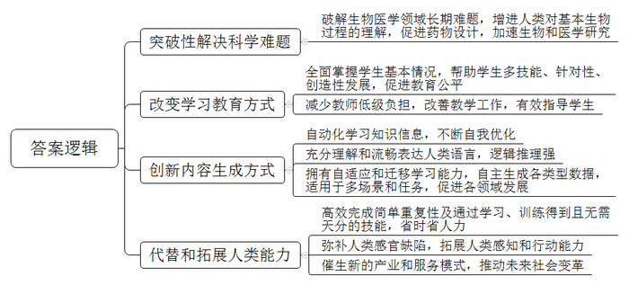
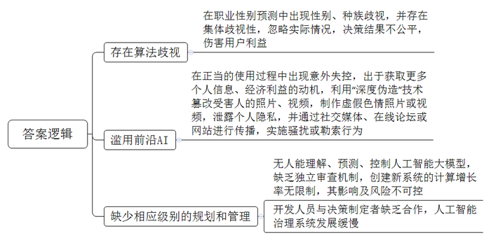
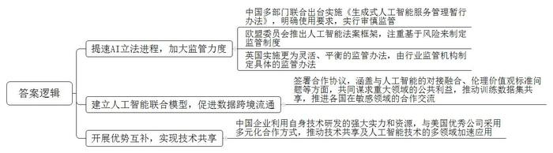
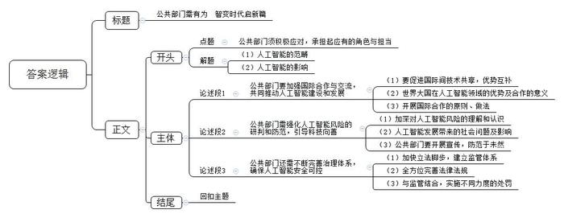

# 2024年上海市公考《申论》题（A卷）

> 候选采集稿。参考答案及解析来自粉笔页面，不代表官方答案或真实高分答卷；来源使用许可与原卷对应关系仍需人工核实。

## 给定材料

### 材料 material-940221d0efb7e90d

AI for Science是指以机器学习、深度学习等人工智能技术分析处理多维度、多模态、多场景下的模拟和真实数据，解决复杂推演计算问题，加快基础科学和应用科学的发现、验证、应用，打造下一代科学范式。AI for Science不只是一个新的科学浪潮，它更是开启了一个全新的科学时代。

在过去50年里，蛋白质折叠问题一直是生物学领域的重大挑战。蛋白质是由氨基酸链组成的、具有自身独特3D结构的大型复杂分子，其对人们理解生命形成的机制至关重要。蛋白质从氨基酸序列折叠成何种形状与其功能密切相关，而预测蛋白质结构对于理解其功能和工作原理至关重要，这就是“蛋白质结构预测问题”，被称为生物医学领域的“圣杯”。谷歌DeepMind公司创始人和CEO戴米斯·哈萨比斯和资深成员约翰·贾伯与DeepMind的团队一起开发了人工智能系统AlphaFold，可以在几分钟内预测由人类基因组编码和20个模式生物的几乎所有已知蛋白，并精确到原子级。这是第一种在已知没有相似结构的情况下构建高分辨率预测的方法。AlphaFold这种变革性方法，解决了从一维氨基酸序列预测三维蛋白质结构的长期难题，给出了50年来关于蛋白结构最准确、最完整的图像，破解了长期困扰生物医学研究领域的困境，增进了人类对基本生物过程的理解并促进了药物设计，为加速生物和医学研究打开了大门。在两年一度的蛋白质预测大赛CASP（蛋白质结构预测关键评估）中AlphaFold以绝对优势夺冠。AlphaFold2开源仅一周的时间里，98.5%的人类蛋白质结构被AlphaFold2所预测，而在此之前，全球多少顶尖科学家耗时数十年的努力，也只解码了覆盖人类蛋白质序列中17%的氨基酸残基。

## 题目

### 第 1 题

**根据给定资料，阐述为什么说新一代人工智能技术是****“颠覆性”技术。（15分）**

关联材料：material-940221d0efb7e90d

作答要求：

要求：语言精练，层次要点分明，字数不超过300字。

### 第 2 题

**根据给定资料，分析新一代人工智能技术社会风险的成因。（****15分）**

关联材料：material-940221d0efb7e90d

作答要求：

要求：分析准确，条理清楚，语言精练，字数不超过300字。

### 第 3 题

**结合给定资料，阐述全球各国应如何深化人工智能技术领域合作，引导人工智能朝着有利于人类文明进步的方向发展。（****20分）**

关联材料：material-940221d0efb7e90d

作答要求：

要求：条理清晰，内容准确全面，语言精练，字数不超过300字。

### 第 4 题

**阅读但不拘泥于给定资料，以****“人工智能时代，公共部门何为？”为主题写一篇文章。（****50分）**

关联材料：material-940221d0efb7e90d

作答要求：

要求：

（1）自选角度，自拟题目；

（2）观点明确，联系实际，分析具体，条理清楚，语言流畅；

（3）总字数800-1000字。

## 答案与解析

第 1 题

**参考答案（粉笔题库参考内容）**

1.突破性解决科学难题。破解生物医学领域长期难题，增进人类对基本生物过程的理解，促进药物设计，加速生物和医学研究。

2.改变学习教育方式。全面掌握学生基本情况，帮助学生多技能、针对性、创造性发展，促进教育公平；减少教师低级负担，改善教学工作，有效指导学生。

3.创新内容生成方式。自动化学习知识信息，不断自我优化；充分理解和流畅表达人类语言，逻辑推理强；拥有自适应和迁移学习能力，自主生成各类型数据，适用于多场景和任务，促进各领域发展。

4.代替和拓展人类能力。高效完成简单重复性及通过学习、训练得到且无需天分的技能，省时省人力；弥补人类感官缺陷，拓展人类感知和行动能力；催生新的产业和服务模式，推动未来社会变革。

**解析**

**参考答案说明：**本参考答案从“突破性解决科学难题”“改变学习教育方式”“创新内容生成方式”“代替和拓展人类能力”四个方面展开，各条答案要点之间在内容上相互并列，没有交叉。

**考点**：考点原因类

**来源**：来源2024年上海市公考《申论》题（A卷）

粉笔申论页面对本题只提供「解析视频」入口，该入口是会员推广位，页面无视频地址与文字解析。

第 2 题

**参考答案（粉笔题库参考内容）**

1.存在算法歧视。在职业性别预测中出现性别、种族歧视，并存在集体歧视性，忽略实际情况，决策结果不公平，伤害用户利益。

2.滥用前沿AI。在正当的使用过程中出现意外失控，出于获取更多个人信息、经济利益的动机，利用“深度伪造”技术篡改受害人的照片、视频，制作虚假色情照片或视频，泄露个人隐私，并通过社交媒体、在线论坛或网站进行传播，实施骚扰或勒索行为。

3.缺少相应级别的规划和管理。无人能理解、预测、控制人工智能大模型，缺乏独立审查机制，创建新系统的计算增长率无限制，其影响及风险不可控；开发人员与决策制定者缺乏合作，人工智能治理系统发展缓慢。

**解析**

**参考答案说明**：本参考答案从“存在算法歧视”“滥用前沿AI”“缺少相应级别的规划和管理”这三个方面展开，各条答案要点之间在内容上相互并列，没有交叉。

**考点**：考点原因类

**来源**：来源2024年上海市公考《申论》题（A卷）

粉笔申论页面对本题只提供「解析视频」入口，该入口是会员推广位，页面无视频地址与文字解析。

第 3 题

**参考答案（粉笔题库参考内容）**

1.提速AI立法进程，加大监管力度。中国多部门联合出台实施《生成式人工智能服务管理暂行办法》，明确使用要求，实行审慎监管；欧盟委员会推出人工智能法案框架，注重基于风险来制定监管制度；英国实施更为灵活、平衡的监管办法，由行业监管机构制定具体的监管办法。

2.建立人工智能联合模型，促进数据跨境流通。签署合作协议，涵盖与人工智能的对接融合、伦理价值观标准问题等方面，共同谋求重大领域的公共利益，推动训练数据集共享，推进各国在敏感领域的合作交流。

3.开展优势互补，实现技术共享。中国企业利用自身技术研发的强大实力和资源，与美国优秀公司采用多元化合作方式，推动技术共享及人工智能技术的多领域加速应用。

**解析**

**参考答案说明：**本参考答案从“提速AI立法进程，加大监管力度”“建立人工智能联合模型，促进数据跨境流通”和“开展优势互补，实现技术共享”这三个方面进行了分条撰写。各条答案要点在内容上相互并列，没有交叉。

**考点**：考点提出对策类

**来源**：来源2024年上海市公考《申论》题（A卷）

粉笔申论页面对本题只提供「解析视频」入口，该入口是会员推广位，页面无视频地址与文字解析。

第 4 题

**参考答案（粉笔题库参考内容）**

**公共部门需有为 智变时代启新篇**

ChatGPT的爆火，让更多人知道人工智能不仅仅是智能手机、智能家具、自动驾驶，还可能是语言、文字、思考的交互。但人工智能不仅改变着我们的生产方式、生活方式，也对社会治理、公共服务提出了新的挑战。面对这一历史性的变革，公共部门作为社会治理的重要力量，必须积极应对，承担起应有的角色与担当。

**公共部门要****加强国际合作与交流，共同****推动****人工智能****建设和发展。**要促进国际间先进技术的共享，进行优势互补，助力人工智能在各领域的进步和应用。俗话说：“单丝不成线，独木不成林”，世界各国合则两利、斗则俱伤。在人工智能领域，世界大国都有各自的优势，比如美国在人工智能研发领域的投入方面处于领先地位，我国则在语音识别、人脸识别、智能驾驶等领域有着相当的优势和创新成果，两国的合作有助于技术的研发和落地。在合作中要相互尊重、彼此信任、求同存异，让数据流动起来，让技术腾飞起来，让成果照进现实。

**公共部门需强化人工智能风险的研判和防范，引导科技向善。**加深对人工智能风险的理解和能力认识，做好人工智能伦理教育，提升公众对人工智能的认知和风险意识。随着人工智能研发技术脚步的加快，越来越多的社会问题产生了，比如恋爱骗局、版权威胁、病毒勒索、电信欺诈等，这些问题影响了公众的生产生活，破坏了网络安全，造成了社会经济的损失。对于随时可能发生的“黑天鹅”“灰犀牛”事件，公共部门不仅要提前意识到人工智能发展可能产生的不确定性，还必须做到居安思危、未雨绸缪，坚持预防为主的思路，在多渠道、多平台、多领域开展警醒宣传，防范于未然。

**公共部门还需不断完善治理体系****，确保人工智能安全可控。**加快立法脚步，建立监管体系，明确技术提供和使用要求，依法惩处违法行为，维护社会公平正义。古人云：“近来见得天地之道，刚柔互用，不可偏废，太柔则靡，太刚则折。”对于人工智能的风险化解规避亦是如此。立法要增强其预见性、前沿性，多角度、全方位健全完善法律法规，为技术的合规使用提供支撑，为其高速发展保驾护航，同时还要利用与监管相结合，鼓励人工智能创造，对不同领域、不同程度的风险，实施不同力度的处罚，避免一罚了之，保证发展活力。

人工智能是新时代的星星之火，我相信在政府部门多角度的努力下定能形成燎原之势，打造未来的新期待。

**解析**

**文章分析**

**公共部门需有为 智变时代启新篇**

【**标题的优点：**首先，标题中含有主题词，使文章主题更突出、清晰。其次，形式上采用对称式结构，使标题更加完整、饱满。】

（1）ChatGPT的爆火，让更多人知道人工智能不仅仅是智能手机、智能家具、自动驾驶，还可能是语言、文字、思考的交互。（2）但人工智能不仅改变着我们的生产方式、生活方式，也对社会治理、公共服务提出了新的挑战。（3）面对这一历史性的变革，公共部门作为社会治理的重要力量，必须积极应对，承担起应有的角色与担当。

【**开头的优点：**★内容方面。范文的开头是紧扣题目给定的“人工智能时代，公共部门何为”这一主题展开的。首先，开头点出主题，做到了主题明确。其次，对“人工智能时代，公共部门何为”这一主题进行了分析阐述，指出了：（1）人工智能的范畴。（2）人工智能的影响。（3）公共部门须积极应对，承担责任。★文字表达方面：长短句配合使用，使语言表达有节奏感。】

**公共部门要加强国际合作与交流，共同推动人工智能建设和发展。**（1）要促进国际间先进技术的共享，进行优势互补，助力人工智能在各领域的进步和应用。俗话说：“单丝不成线，独木不成林”，世界各国合则两利、斗则俱伤。（2）在人工智能领域，世界大国都有各自的优势，比如美国在人工智能研发领域的投入方面处于领先地位，我国则在语音识别、人脸识别、智能驾驶等领域有着相当的优势和创新成果，两国的合作有助于技术的研发和落地。（3）在合作中要相互尊重、彼此信任、求同存异，让数据流动起来，让技术腾飞起来，让成果照进现实。

【**论述段****1的优点：**★观点句：范文的观点句是紧扣“人工智能时代，公共部门何为”这一文章主题提出的。形式上，它在段首处直接写出，位置突出，容易发现。内容上，关键词突出，内容要点明确，可以明显看出主要从“加强国际合作与交流”的角度展开论述。★论述内容：（1）要促进国际间技术共享，优势互补；（2）世界大国在人工智能领域的优势及合作的意义；（3）开展国际合作的原则、做法。注意：以上三个方面的内容都是紧扣“公共部门要加强国际合作与交流，共同推动人工智能建设和发展”这个观点句进行分析论述的，论述的针对性强，内容层次丰富。在论述方法上采用了讲道理、举例子相结合的方式，论述充实有力。】

**公共部门需强化人工智能风险的研判和防范，引导科技向善。**（1）加深对人工智能风险的理解和能力认识，做好人工智能伦理教育，提升公众对人工智能的认知和风险意识。（2）随着人工智能研发技术脚步的加快，越来越多的社会问题产生了，比如恋爱骗局、版权威胁、病毒勒索、电信欺诈等，这些问题影响了公众的生产生活，破坏了网络安全，造成了社会经济的损失。（3）对于随时可能发生的“黑天鹅”“灰犀牛”事件，公共部门不仅要提前意识到人工智能发展可能产生的不确定性，还必须做到居安思危、未雨绸缪，坚持预防为主的思路，在多渠道、多平台、多领域开展警醒宣传，防范于未然。

【**论述段****2****的优点：**★观点句：范文的观点句是紧扣“人工智能时代，公共部门何为”这一文章主题提出的。形式上，它在段首处直接写出，位置突出，容易发现。内容上，关键词突出，内容要点明确，可以明显看出主要从“强化风险研判和防范”的角度展开论述。★论述内容：（1）加深对人工智能风险的理解和认识；（2）人工智能发展带来的社会问题及影响；（3）公共部门要开展宣传，防范于未然。注意：以上三个方面的内容都是紧扣“公共部门需强化人工智能风险的研判和防范，引导科技向善”这个观点句进行分析论述的，论述的针对性强，内容层次丰富。在论述方法上采用了讲道理、举例子相结合的方式，论述充实清晰。】

**公共部门还需不断完善治理体系，确保人工智能安全可控。**（1）加快立法脚步，建立监管体系，明确技术提供和使用要求，依法惩处违法行为，维护社会公平正义。古人云：“近来见得天地之道，刚柔互用，不可偏废，太柔则靡，太刚则折。”对于人工智能的风险化解规避亦是如此。（2）立法要增强其预见性、前沿性，多角度、全方位健全完善法律法规，为技术的合规使用提供支撑，为其高速发展保驾护航，（3）同时还要利用与监管相结合，鼓励人工智能创造，对不同领域、不同程度的风险，实施不同力度的处罚，避免一罚了之，保证发展活力。

【**论述段****3****的优点：**★观点句：范文的观点句是紧扣“人工智能时代，公共部门何为”这一文章主题提出的。形式上，它在段首处直接写出，位置突出，容易发现。内容上，关键词突出，内容要点明确，可以明显看出主要从“完善治理体系”的角度展开论述。★论述内容：（1）加快立法脚步，建立监管体系；（2）全方位完善法律法规；（3）与监管结合，实施不同力度的处罚。注意：以上三个方面的内容都是紧扣“公共部门还需不断完善治理体系，确保人工智能安全可控”这个观点句进行分析论述的，论述的针对性强，内容层次丰富。在论述方法上主要采用了讲道理的方式，论述清晰透彻。】

【**论述段之间的关系：**★内容的内在逻辑：范文的论述段之间是依照“并列”的逻辑展开的。论述段1先写了“公共部门要加强国际合作与交流，共同推动人工智能建设和发展”，论述段2再写了“公共部门需强化人工智能风险的研判和防范，引导科技向善”，论述段3接着写了“公共部门还需不断完善治理体系，确保人工智能安全可控”，论述逻辑清晰。】

人工智能是新时代的星星之火，我相信在政府部门多角度的努力下定能形成燎原之势，打造未来的新期待。

【**结尾的优点：**范文的结尾回扣了“人工智能时代，公共部门何为”这一主题，语言简练，不拖沓。】

**考点**：考点文章写作题

**来源**：来源2024年上海市公考《申论》题（A卷）

粉笔申论页面对本题只提供「解析视频」入口，该入口是会员推广位，页面无视频地址与文字解析。

