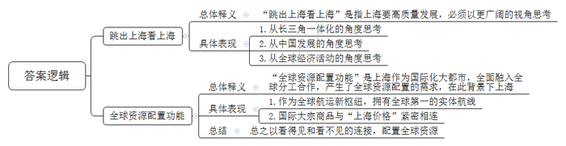
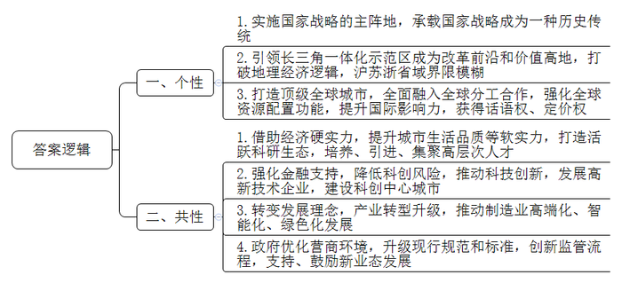
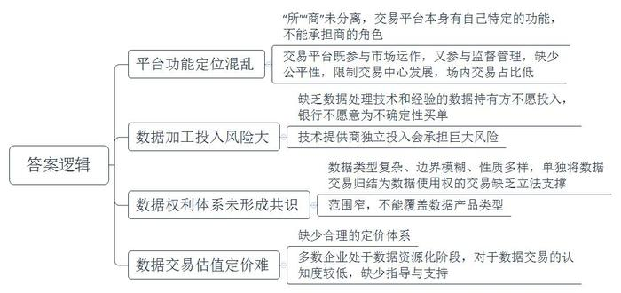
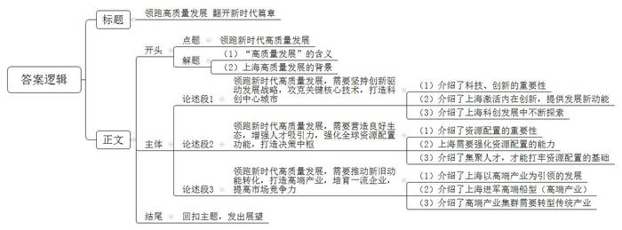

# 2024年上海市公考《申论》题（B卷）

> 候选采集稿。参考答案及解析来自粉笔页面，不代表官方答案或真实高分答卷；来源使用许可与原卷对应关系仍需人工核实。

## 给定材料

### 材料 material-6ce1cd4840ac3a76

党的二十大报告指出：加快实施创新驱动发展战略，坚持面向世界科技前沿、面向经济主战场、面向国家重大需求、面向人民生命健康，加快实现高水平科技自立自强，以国家战略需求为导向，集聚力量进行原创性、引领性科技攻关，坚决打赢关键核心技术攻坚战。

## 题目

### 第 1 题

**结合给定资料，阐述如何理解****“跳出上海看上海”的定位，并界定“全球资源配置功能”的内涵。****（****15分****）**

关联材料：material-6ce1cd4840ac3a76

作答要求：

要求：阐述规范扼要，表达准确到位，字数不超过200字。

### 第 2 题

**上海的高质量发展与全国其他地区有很多共性，但作为中国最大的经济中心城市，上海高质量发展又有一些个性特征。结合给定资料，论述上海高质量发展的个性特征和共性特征。****（****20分****）**

关联材料：material-6ce1cd4840ac3a76

作答要求：

要求：语言精练，层次要点分明，字数不超过300字。

### 第 3 题

**目前****，****全国****已****经建有数十家数据交易机构，但场内交易至今仍处于探索阶段****。****阅读给定资料，分析当前场内数据交易面临哪些难点。****（****15分****）**

关联材料：material-6ce1cd4840ac3a76

作答要求：

要求：分析有理有据，内容准确全面，字数不超过300字。

### 第 4 题

**阅读但不拘泥于给定资料，以****“领跑新时代高质量发展”为主题写一篇文章。****（****50分****）**

关联材料：material-6ce1cd4840ac3a76

作答要求：

要求：

（1）自选角度，自拟题目；

（2）观点明确，联系实际，分析具体，条理清楚，语言流畅；

（3）总字数800-1000字。

## 答案与解析

第 1 题

**参考答案（粉笔题库参考内容）**

“跳出上海看上海”是指上海要高质量发展，必须以更广阔的视角思考。具体是：1.从长三角一体化的角度思考；2.从中国发展的角度思考；3.从全球经济活动的角度思考。

“全球资源配置功能”是上海作为国际化大都市，全面融入全球分工合作，产生了全球资源配置的需求，在此背景下上海：1.作为全球航运新枢纽，拥有全球第一的实体航线；2.国际大宗商品与“上海价格”紧密相连。总之以看得见和看不见的连接，配置全球资源。

**解析**

**参考答案说明**：（1）思路方面，本参考答案按照词句解释题“总体释义+展开解释+总结”的一般答题思路展开。（2）内容方面，“跳出上海看上海”介绍了总体释义、具体表现；“全球资源配置功能”介绍了总体释义、具体表现和总结。

**考点**：考点词句解释类

**来源**：来源2024年上海市公考《申论》题（B卷）

粉笔申论页面对本题只提供「解析视频」入口，该入口是会员推广位，页面无视频地址与文字解析。

第 2 题

**参考答案（粉笔题库参考内容）**

一、个性：1.实施国家战略的主阵地，承载国家战略成为一种历史传统。2.引领长三角一体化示范区成为改革前沿和价值高地，打破地理经济逻辑，沪苏浙省域界限模糊。3.打造顶级全球城市，全面融入全球分工合作，强化全球资源配置功能，提升国际影响力，获得话语权、定价权。

二、共性：1.借助经济硬实力，提升城市生活品质等软实力，打造活跃科研生态，培养、引进、集聚高层次人才。2.强化金融支持，降低科创风险，推动科技创新，发展高新技术企业，建设科创中心城市。3.转变发展理念，产业转型升级，推动制造业高端化、智能化、绿色化发展。4.政府优化营商环境，升级现行规范和标准，创新监管流程，支持、鼓励新业态发展。

**解析**

**参考答案说明：**本参考答案宏观上先从“个性”和“共性”两个方面进行分段。在“个性”方面，又从“承担国家战略”“模糊省域界限”“打造国际化大都市”等不同方面进行了分条撰写。各条要点之间在内容上相互并列，没有交叉。在“共性”方面，又从“重视人才”“建设科创城市”“促进产业升级”“支持新业态”等不同方面进行了分条撰写。各条要点之间在内容上相互并列，没有交叉。

**考点**：考点多要素组合类

**来源**：来源2024年上海市公考《申论》题（B卷）

粉笔申论页面对本题只提供「解析视频」入口，该入口是会员推广位，页面无视频地址与文字解析。

第 3 题

**参考答案（粉笔题库参考内容）**

1.平台功能定位混乱。“所”“商”未分离，交易平台本身有自己特定的功能，不能承担商的角色；交易平台既参与市场运作，又参与监督管理，缺少公平性，限制交易中心发展，场内交易占比低。

2.数据加工投入风险大。缺乏数据处理技术和经验的数据持有方不愿投入，银行不愿意为不确定性买单；技术提供商独立投入会承担巨大风险。

3.数据权利体系未形成共识。数据类型复杂、边界模糊、性质多样，单独将数据交易归结为数据使用权的交易缺乏立法支撑；范围窄，不能覆盖数据产品类型。

4.数据交易估值定价难。缺少合理的定价体系；多数企业处于数据资源化阶段，对于数据交易的认知度较低，缺少指导与支持。

**解析**

**参考答案说明：**本参考答案从“平台功能定位混乱”“数据加工投入风险大”“数据权利体系未形成共识”“数据交易估值定价难”4个方面介绍了当前场内数据交易面临的问题，并进行了具体展开，各条要点之间在内容上是并列关系，没有交叉。

**考点**：考点问题类

**来源**：来源2024年上海市公考《申论》题（B卷）

粉笔申论页面对本题只提供「解析视频」入口，该入口是会员推广位，页面无视频地址与文字解析。

第 4 题

**参考答案（粉笔题库参考内容）**

**领跑高质量发展** **翻开新时代篇章**

高质量发展是我们党把握发展规律、从实践认识到再实践再认识的重大理论创新，是全面建设社会主义现代化国家的首要任务。而上海，作为中国最大的经济中心城市，也是世界观察中国的重要窗口，必须牢牢把握高质量发展这一新时代的硬道理，努力在推进中国式现代化中发挥龙头带动和示范引领作用，续写高质量发展的新篇章。

**领****跑新时代高质量发展，需要坚持创新驱动发展战略，攻克关键核心技术，打造科创中心城市**。谋科技就是谋未来，抓创新就是抓发展。上海只有走激活内在活力的创新发展之路，攻坚“卡脖子”难题，牢牢掌握关键核心技术，才能实现自力更生，为高质量发展提供新动能。从“借光”到上海光源“自主造光”；从买飞机到国产大飞机开启商业飞行；从高端医疗设备依赖进口到国产设备不断“破冰”出海……上海在科创发展的道路上从未停止探索的脚步。面对新一轮科技革命和产业变革的突飞猛进，上海必须强化科技创新的策源能力，实现高水平科技自立自强，加快向具有全球影响力的科创中心踔厉迈进。

**领跑新时代高质量发展，需要营造良好生态，增强人才吸引力，强化全球资源配置功能，打造决策中枢**。在全球科技竞争白热化的当下，赢得未来的关键在于配置资源的能力。上海作为中国面向世界的重要门户，必须要强化资源配置的能力，才能领跑经济高质量发展，打造具有世界影响力的国际化大都市。全球最好的医学医药人才，将旧金山变成了生命医学的创业圣地；前仆后继创业的天才程序员，让硅谷成为创新之源；世界顶尖的金融人才，塑造了资本永不眠的华尔街……增强城市“磁力”，源源不断地集聚高端人才，是一座城市配置全球资源的基础。

**领跑新时代高质量发展，需要推动新旧动能转化，打造高端产业，培育一流企业，提高市场竞争力**。从区块链到元宇宙，从先进材料到量子计算，从生命健康到人工智能……上海正以高端产业为引领，努力掌握产业链核心环节、占据价值链高端地位。沪东中华摒弃门槛较低的低端船型，进军技术含量高、附加值高、绿色化的高端船型，助力上海成为全球唯一集齐造船业三颗“皇冠明珠”的城市。因此，打造高端产业集群，需要培育一流企业，推动传统产业转型，发展先进制造业、新兴产业、未来产业。

前程远大，使命催征。展望未来，新时代的上海一定能创造出新的奇迹，牢牢把握高质量发展这个首要任务，守正创新、踔厉奋发、勇毅前行。

**解析**

**文章分析**

**领跑高质量发展** **翻开新时代篇章**

【**标题的优点：**首先，范文的标题“领跑高质量发展 翻开新时代篇章”突出了“领跑新时代高质量发展”这一主题词。其次，形式上，文字简洁明快有力，不拖沓。】

（1）高质量发展是我们党把握发展规律、从实践认识到再实践再认识的重大理论创新，是全面建设社会主义现代化国家的首要任务。（2）而上海，作为中国最大的经济中心城市，也是世界观察中国的重要窗口，必须牢牢把握高质量发展这一新时代的硬道理，努力在推进中国式现代化中发挥龙头带动和示范引领作用，续写高质量发展的新篇章。

【**开头的优点：****★内容方面。**范文的开头是紧扣“领跑新时代高质量发展”这一主题展开的。首先，开头在段首处点出主题，做到了主题明确。其次，对“领跑新时代高质量发展”这一主题进行了分析阐述，指出了（1）“高质量发展”的含义；（2）上海高质量发展的背景。**★文字表达方面：**使用了“是……是……”“而”等连接词，使语言表达有逻辑性。】

**领****跑新时代高质量发展，需要坚持创新驱动发展战略，攻克关键核心技术，打造科创中心城市。**（1）谋科技就是谋未来，抓创新就是抓发展。（2）上海只有走激活内在活力的创新发展之路，攻坚“卡脖子”难题，牢牢掌握关键核心技术，才能实现自力更生，为高质量发展提供新动能。（3）从“借光”到上海光源“自主造光”；从买飞机到国产大飞机开启商业飞行；从高端医疗设备依赖进口到国产设备不断“破冰”出海……上海在科创发展的道路上从未停止探索的脚步。面对新一轮科技革命和产业变革的突飞猛进，上海必须强化科技创新的策源能力，实现高水平科技自立自强，加快向具有全球影响力的科创中心踔厉迈进。

【**论述段****1的优点：★观点句：**范文的观点句是紧扣“领跑新时代高质量发展”这一主题词展开的。形式上，它在段首处直接写出，位置突出，容易发现。内容上，关键词突出，内容要点明确，可以明显看出它论述了“新时代的高质量发展需要坚持创新、攻克关键技术”。**★论述内容：**（1）介绍了科技、创新的重要性；（2）介绍了上海激活内在创新，提供发展新动能；（3）介绍了上海科创发展中不断探索。以上三个方面的内容都是紧扣“领跑新时代高质量发展，需要坚持创新驱动发展战略，攻克关键核心技术，打造科创中心城市”这个观点进行分析论述的，论述的针对性强，内容层次丰富。最后，在论述方法上主要采取了讲道理和举例子相结合，做到了丰富多样。】

**领跑新时代高质量发展，需要营造良好生态，增强人才吸引力，强化全球资源配置功能，打造决策中枢。**（1）在全球科技竞争白热化的当下，赢得未来的关键在于配置资源的能力。（2）上海作为中国面向世界的重要门户，必须要强化资源配置的能力，才能领跑经济高质量发展，打造具有世界影响力的国际化大都市。（3）全球最好的医学医药人才，将旧金山变成了生命医学的创业圣地；前仆后继创业的天才程序员，让硅谷成为创新之源；世界顶尖的金融人才，塑造了资本永不眠的华尔街……增强城市“磁力”，源源不断地集聚高端人才，是一座城市配置全球资源的基础。

【**论述段****2****的优点：****★观点句：**范文的观点句是紧扣“领跑新时代高质量发展”这一主题词展开的。形式上，它在段首处直接写出，位置突出，容易发现。内容上，关键词突出，内容要点明确，可以明显看出它论述了“新时代的高质量发展需要营造良好生态，强化资源配置”。**★论述内容：**（1）介绍了资源配置的重要性；（2）上海需要强化资源配置的能力；（3）介绍了集聚人才，才能打牢资源配置的基础。以上三个方面的内容都是紧扣“领跑新时代高质量发展，需要营造良好生态，增强人才吸引力，强化全球资源配置功能，打造决策中枢”这个观点进行分析论述的，论述的针对性强，内容层次丰富。最后，在论述方法上主要采取了讲道理和举例子相结合，做到了丰富多样。】

**领跑新时代高质量发展，需要推动新旧动能转化，打造高端产业，培育一流企业，提高市场竞争力。**（1）从区块链到元宇宙，从先进材料到量子计算，从生命健康到人工智能……上海正以高端产业为引领，努力掌握产业链核心环节、占据价值链高端地位。（2）沪东中华摒弃门槛较低的低端船型，进军技术含量高、附加值高、绿色化的高端船型，助力上海成为全球唯一集齐造船业三颗“皇冠明珠”的城市。（3）因此，打造高端产业集群，需要培育一流企业，推动传统产业转型，发展先进制造业、新兴产业、未来产业。

【**论述段****3****的优点：****★观点句：**范文的观点句是紧扣“领跑新时代高质量发展”这一主题词展开的。形式上，它在段首处直接写出，位置突出，容易发现。内容上，关键词突出，内容要点明确，可以明显看出它论述了“新时代的高质量发展需要打造高端产业”。**★论述内容：**（1）介绍了上海以高端产业为引领的发展；（2）介绍了上海进军高端船型（高端产业）；（3）介绍了高端产业集群需要转型传统产业。以上三个方面的内容都是紧扣“领跑新时代高质量发展，需要推动新旧动能转化，打造高端产业，培育一流企业，提高市场竞争力”这个观点进行分析论述的，论述的针对性强，内容层次丰富。最后，在论述方法上主要采取了讲道理和举例子相结合，做到了丰富多样。】

前程远大，使命催征。展望未来，新时代的上海一定能创造出新的奇迹，牢牢把握高质量发展这个首要任务，守正创新、踔厉奋发、勇毅前行。

【**结尾的优点：**范文的结尾回扣了“领跑新时代高质量发展”这一主题词，并发出了展望。】

**考点**：考点文章写作题

**来源**：来源2024年上海市公考《申论》题（B卷）

粉笔申论页面对本题只提供「解析视频」入口，该入口是会员推广位，页面无视频地址与文字解析。

