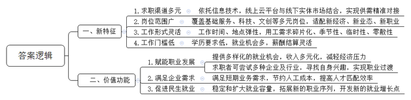
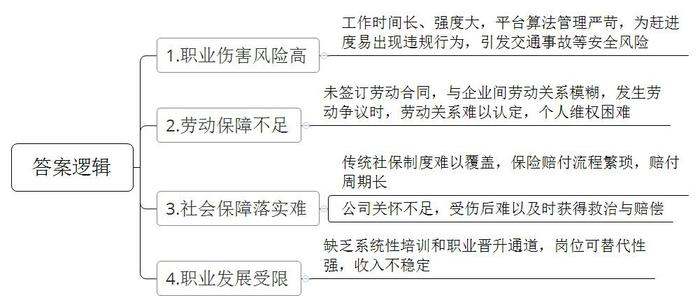
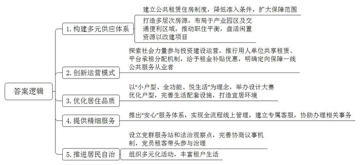
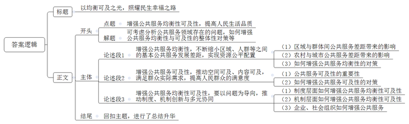

# 2025年上海市公考《申论》题（A卷）

<!-- gwy:overview:start -->
> **上海 · 2025 · 申论 · A卷** ｜ 4 题 · 图片 4 处 · 答案随题折叠

导航：[题目](#题目) · [材料 1](#材料-1)
<!-- gwy:overview:end -->

> 候选采集稿。参考答案及解析来自粉笔页面，不代表官方答案或真实高分答卷；来源使用许可与原卷对应关系仍需人工核实。

## 给定材料

### 材料 1

2024年，习近平总书记在中共中央政治局第十四次集体学习时强调，促进高质量充分就业，是新时代新征程就业工作的新定位、新使命，支持发展吸纳就业能力强的产业和企业，稳定和扩大就业容量。根据经济社会发展新趋势和人民群众高品质生活新期待，大力发展新业态、新模式，积极挖掘、培育新的职业序列，开发新的就业增长点。

### 材料 2

提到零工市场，很多人脑海中可能会闪过“马路市场”的景象：早年由于信息不畅，很多人找工作只能在马路边举牌，从事的是相对低端的工作。随着各种零工平台的出现，如今的零工市场与当年的“马路市场”，在工作范围、工作内容等方面已相去甚远，甚至很多新经济、新业态、新职业都出现了对零工的强烈需求。

比如，由于影楼订单量上涨，需要临时的摄影、修片师；工厂突接订单，急需打包、分拣、报单员；暑假旅游旺季，导游、酒店服务员成了抢手货；科技行业随着人工智能、大数据和物联网的发展，对技术零工的需求日益增长，包括软件开发、数据分析、网络安全等；文创产业中，广告、影视制作、平面设计等领域也常常需要短期零工来完成特定的项目；绿色能源和环保行业里，新能源项目以及环保工程常需要零工来参与建设和维护工作……信息技术让陌生人之间的协同成为可能，越来越多的行业订单出现“碎片化”趋势，而季节性、临时性、零散性的订单出现，催生了更多的零工岗位。

2022年，人力资源和社会保障部、民政部等五部门发布《关于加强零工市场建设 完善求职招聘服务的意见》，更好支持多渠道灵活就业，促进零工人员实现就业。上海2023年7月发布的相关通知提出：要强化零工市场支持，鼓励零工岗位供需较旺盛的地区推动公益性零工市场建设，完善零工求职招聘服务。

从全球来看，世界上许多国家和地区都将零工经济视为重要发展内容，美日等发达经济体的灵活就业人员比例更是长期保持在40%左右。近年来，零工经济在我国呈现出快速增长态势。据估计，2023年我国灵活用工市场规模已达1.3万亿元，是2019年的两倍多，四年年均复合增长率达28.4%。市场渗透率达9.2%，比2021年增加0.5个百分点。

中国目前灵活就业人员已达2亿人，占全国就业人口的27%，其中建筑业、餐饮住宿、快递物流、外卖配送、直播电商、远程客服、互联网文创等行业的灵活就业人员比例甚至超过60%。与此同时，大量用人单位也积极投身零工市场，据《中国灵活用工发展报告（2022）》蓝皮书数据显示，2021年我国有61.14%的企业正在使用灵活用工方式，且企业更倾向于扩大而非缩减灵活用工规模。

### 材料 3

2000年出生的小郭，2024年刚从省属理工大学毕业，一个月前来到上海找工作。“我关注了‘乐业上海’微信公众号，看到推文说9月27日闵行有零工市场招聘会，所以当天特地从浦东住处赶了过去。”小郭说道。

在招聘会现场，他获得了一家知名化妆品集团提供的零工岗位。这家企业共需招聘50位操作工，工资日结，每天240元-280元，工作内容是“根据订单对化妆品进行打包、分拣、发货”，对学历只要求初中及以上，但要“做事细心，稳重，有责任心，服从领导安排”。

不过，小郭最终放弃了这个机会。他坦言：“一是因为离家太远，路上需要一个半小时以上，二是因为自己毕竟是上过大学的，还是想找个长期稳定的工作。我刚通过了黄浦区一家公益组织的面试，明天开始去上班见习……”

1978年出生的小徐夫妻俩则通过零工市场，成功地在上海“迈出了第一步”。他们儿子今年在老家念高三，家庭感到了压力，决定趁年轻出来多赚点钱。7月刚到上海，租住在瑞丽路附近，最初有点迷茫，担心找不到工作。8月11日，夫妻俩在散步时，看到瑞丽路60号正在举行零工市场招聘会，于是进去逛了逛，结果双双获得一份零工岗位：小徐去一家食品厂做包装工，时薪23元，每天赚230元；丈夫小吴去一家企业做搬运工，日薪300多元。

如此一来，两人的经济压力大大缓解，每月800元的房租也轻松解决。眼下，小徐打零工已有10多天，准备在找到稳定工作前继续干下去。而小吴已经辞去了零工，刚面试找到了一份正式工作，在一家企业当操作工，月薪6000元-8000元。“我俩现在的收入至少是在老家时的两倍多，打零工帮我们顺利完成了初来上海的过渡。”

### 材料 4

49岁的老王来自中部省份，已在上海打工20多年，现在一家三代六口人租住在闵行七宝。他坦言“家庭经济负担较重”，所以不仅找了一份“做二休二”的学校保安工作，同时还在休息天兼职做顺丰骑手，每天可赚200多元，这样一个月下来总收入就能达到1万元左右。

小徐曾是一名品牌设计师，如今是一位全职宝妈，平时的工作主要就是照顾家庭。随着孩子渐渐长大，她终于有了一些自己的时间，就又萌生了回到职场的念头。然而，较长的空白期，偏大的年龄，需要较为灵活的时间接送孩子，这些不利因素让她在找工作的时候处处碰壁。一个偶然的机会，她走进零工市场。于是，小徐准备从这里开启自己的“打零工”生涯，一边做一些灵活的工作，一边“带娃”。“在零工市场看中新媒体相关的内容，只要在家通过手机和电脑就能工作，很适合现阶段的情况。”

上海小伙小沈通过“黄浦区‘新经济、新业态’零工就业云平台”找到了一份临时摄影师工作。他与其他摄影师一起到杭州出差一天，为当地一家企业提供拍摄员工照的服务。当天完成拍摄，企业当天结算报酬。

为小沈提供零工岗位的星光摄影器材城，在旺季时有很多短期的拍摄业务。“我们有时需要摄影师出差一两天到外地完成拍摄，或是完成数单的本地拍摄业务。招聘零工摄影师，既可以满足我们的业务需求，又能节约一些人工成本。”

企业的需求与小沈的想法不谋而合。出生于2000年的小沈是应届大学毕业生，主修摄影专业。在即将踏出校门时，小沈对未来的职业规划依旧迷茫。“不知道自己能胜任什么样的工作。”小沈最初不急于找到一份固定的工作，希望可以尝试不同的企业，甚至不同的行业。在同学的介绍下，他在零工就业云平台上找到了星光摄影器材城提供的临时摄影师岗位。第一次拍摄后，企业对小沈的表现很满意，后来又请他做了几次临时任务，并按时支付了报酬。

最近，星光摄影器材城一位全职摄影师退休了，企业急需找到能固定为企业服务的摄影师，人事经理想到了小沈。通过几次零工合作，小沈对在星光摄影器材城的工作产生了兴趣，也对企业文化比较接受。他与人事经理沟通后，签下了一年期的摄影师固定岗位合同。

### 材料 5

“招聘小时工，时薪在23-28元，工作内容包括安装汽车门把手、为化妆品贴中文标签、手工包装面包、扫描分拣订单等，工资可日结，也可周结、月结……”2024年9月5日一早，位于闵行区瑞丽路上的全市首个线下实体化“零工市场”里热闹异常，这里正在举行一场零工招聘会，10多家企业带来350多个就业岗位，吸引络绎不绝的求职者前来咨询、递简历。

在现场，这座“零工市场”宣布升级，“大零号湾乐业空间”正式启用。这是闵行精心打造的一南一北两大乐业空间之一，也是全市首个区域性一站式人社服务“综合体”，将提供更为精准、高效、多元、便捷的公共就业服务，可辐射闵行南部江川、吴泾、马桥、颛桥等多个街镇，覆盖1万多家企业、74万常住人口、6所高校和众多科创产业园区。

2023年6月，闵行区围绕“一南一北”战略以及“大零号湾”科技创新策源功能区建设，在区就业促进中心瑞丽分中心推出了全市首家线下实体化“零工市场”。据统计，闵行区“零工市场”运营一年以来，共开展9场线下专题招聘会，累计募集1415家次企业，发布2827个岗位，招聘总人数达3.6万多人。不过，由于此处场地、设施、环境老旧化明显，就业服务功能设置与街镇部分重合，无法满足群众日益增长的综合服务需求。因此，闵行区决定对整个建筑进行全面升级。

内外面貌焕然一新的“大零号湾乐业空间”正式亮相后，一楼主要提供“常态化”人社服务，作为升级版“零工市场”，布局了招聘服务大厅、综合服务区、岗位对接区等多个功能区域，并辅以电子大屏、自助信息查询电脑等现代化设备；二楼提供“集约化”人社服务，特设综合政务服务窗口，深度整合社会保障、劳动维权、工伤业务、职称受理等人社领域的核心业务；三楼提供“精细化”人社服务，作为多功能空间，包含沙龙讲座区域、谈心谈话空间与读书角以及用于线上“带岗直播”的直播间。

这里将进一步做强闵行“零工市场”，支持多渠道灵活就业。活动当天，云生集团、闵浦人才、聘也科技、天都人力资源等4家专业人力资源企业正式入驻闵行区“易就业”平台，依托“大数据”的支持与赋能强化零工市场服务，实现求职、招聘信息的及时发布，求职者和用人单位的信息管理，以及实时统计、动态分析功能，打造新经济业态下双轮驱动的“零工经济全生态服务平台”。

### 材料 6

2024年，徐家汇街道在万体汇社区就业服务站建设了首个青年零工驿站，服务可辐射周边六个居委，实现2万多居民共享“一站式”公共就业服务。零工驿站成立当天，7家企业的19个主推岗位吸引了附近几十人参加面试，400人选择在线上投递简历。

李同学是会展专业的毕业生，在活动现场了解到深光文化旅游公司承办的法国文旅项目正急需招募旅游、会展等行业的青年大学生，从事项目运营服务工作。经过深入了解后，双方都认为对方无论是从岗位职责还是专业要求上，都十分匹配，立即建立了用工意向。除了会展“老本行”，李同学对现场沉浸式剧场、主题餐饮、咖啡厅等零工机会也十分感兴趣。岗位大多不设学历要求，对专业技术要求较低，大部分岗位经过简单培训即可上岗。前来咨询的应聘者以中青年为主，甚至还有00后刚毕业的大学生。

正处于职业过渡期的小马5年前从大学毕业后在一家仓库负责物流，这几个月正以仓库管理员的岗位为目标，寻找新工作。“现在处在‘广撒网’的状态，有什么工作机会都想尝试一下，除了仓库内的岗位，也会考虑采购相关的工作。”小马说，以前找工作时，遇到过企业说的和实际情况不一样的情况。“官方组织的招聘会肯定更保险一点。”

近年来，上海正在进一步完善“家门口”就业服务体系，打造“15分钟就业服务圈”。“家门口就业服务小站”是区街协作的新型就业服务平台，让有就业需求的求职者在家门口就能享受到切实的就业帮助。作为徐汇首个零工服务专区，万体汇零工驿站开辟“万体汇零工精选”线上专区，集结区域周边实习、兼职、短期工等几千个零工岗位，涉及互联网、电子信息、金融、服务、教育等热门行业。求职者还可以浏览、筛选和申请符合自身需求的岗位，通过扫描二维码实现简历“码上投递”。

### 材料 7

2021年5月19日，我国多家社会组织在对343名骑手深入调查后发布《骑手生存与发展需求报告》，显示有接近两成的骑手每天工作时间超过12个小时，88.28%的骑手会为了按时送达而选择违反相应的交通规则。辽宁省检察院于2021年4月开展的检察公益诉讼助力整治网约配送交通违法现象的调研显示，外卖行业电动车发生交通事故的占比明显高于其在电动车保有量中的占比，交通事故伤亡人数呈逐年上升趋势。

新就业形态下，外卖平台制定具体详尽的工作规则，并依托大数据和智能算法对外卖骑手的送餐过程进行精密化管理。但与此同时，传统对劳动者权益的保障制度却无法应对共享经济平台快速发展引发的新问题和新挑战。

2021年7月16日，人力资源社会保障部等八部门联合出台《关于维护新就业形态劳动者劳动保障权益的指导意见》规定，不完全符合确立劳动关系情形但企业对劳动者进行劳动管理的，应指导企业与劳动者订立书面协议，合理确定企业与劳动者的权利义务。对采取外包等其他合作用工方式，劳动者权益受到损害的，平台企业依法承担相应责任。

也是在同一天，国家市场监督管理总局等七部门联合印发《关于落实网络餐饮平台责任 切实维护外卖送餐员权益的指导意见》，要求网络餐饮平台不得将“最严算法”作为考核要求，要切实维护外卖送餐员正当权益，发挥正向激励作用，并优化平台派单机制，督促平台建立外卖送餐员诉求反映的直接渠道等十条意见。

2021年12月24日，国家发展改革委等部门发布《关于推动平台经济规范健康持续发展的若干意见》，旗帜鲜明地强调要优化发展环境，加强新就业形态劳动者权益保障。该意见特别提出，要完善网约配送员等新就业形态劳动者与平台企业、用工合作企业之间的劳动关系认定标准，合理制定涉及劳动者权益的制度和算法规则等。

2021年12月底，人社部等十部门印发《关于开展新就业形态就业人员职业伤害保障试点工作的通知》。自2022年7月起，在北京、上海、江苏、广东、海南、重庆、四川7省市，选择部分规模较大的出行、外卖、即时配送和同城货运平台企业，开展新就业形态就业人员职业伤害保障试点。2022年7月，曹操出行、美团、饿了么、达达、闪送、货拉拉、快狗打车等7家规模较大的平台企业参与新就业形态就业人员职业伤害保障试点。与传统工伤保险不同，平台企业为新就业形态就业人员办理职业伤害保障时，采取按单计费、按月订单量申报缴费方式，既不以存在劳动关系为前提，也不以工资总额作为缴费基数。

### 材料 8

2023年，国定路上，为避让两个逆行的行人，小向送外卖的电动车失控撞向护栏。一直独来独往的外卖小哥被送进医院。医生要求立刻住院手术，小向拒绝了——1万元押金让他坚决选择了回家。在微信上向朋友借钱打了块固定的夹板，他回到了出租屋。在疼痛中煎熬的时候，小向并不知道，F大学一名学生在社交媒体上替他发了求助帖；两名学生去了两趟交警部门，为他开具责任认定书。第3天，平台同意为小向垫付手术费后，两位志愿者打车到他的住处，要把他“拖进医院”。

小向拥有两份保险，一份是平台每日强制扣除的骑手意外险，另一份是在7省市平台企业试点的新就业形态就业人员职业伤害保障，但两者都因流程复杂，无法在当下申请到足以支持他入院的费用。

受伤之后，小向按照客服的提示在系统上点击了保险赔付的申请，上传资料之后足足3天，界面一直停留在“待审核”状态。根据一些留言的志愿者的经验和平台客服的回复，以往准备“新职伤”的材料到赔偿金到手大概需要一个月以上。

在大学生志愿者的帮助下，小向的筹款链接被发出。“骑手”“送餐时跌倒”“放弃治疗”，尽管小向的自述很朴素，但这些字眼牵动着点开链接的人们。仅仅用了3小时，“水滴筹”设置的5万元就筹到了。也是在那一晚，平台留意到了受伤的他，打来电话，表示可以为他垫付医药费。有了“双重保险”，学生们陪同小向再次到了医院，然而根据医院的要求，入院费用无法通过公司账户转入医院，需要用私人账户转账，而“水滴筹”里的钱还没来得及取出，外卖平台派来的工作人员表示“没有用私人账户转账的惯例，需要向上级汇报”。

后来，送其就医的志愿者用自己的账户垫付了5000元。到了晚上，小向住进了骨科病房。在手术当天，几方达成了共识：医院降低预缴费标准，小向把手边筹集来的善款都转入医院账户后，就立即手术；平台虽没有垫付小向的医药费，但承诺：“如果还有不够的后续治疗费，平台会出面垫付。”

手术很顺利，小向给自己设定了康复计划：术后在医院康复一个礼拜，回家后再养两个礼拜，21天以后，就能尝试跑外卖了，轻轻地跑……

实际上，从进入社会就在基础服务业的小向，很少有向社会保障体系求助的机会。在上海的一家理发店工作时，老板曾提出由店里承担大头，给小向上社保，但小向不干。这样，他每个月能省下两三百元，能尽早还清银行的债务。

当被问起受伤后最失望的时刻，小向没有说筹集医药费的艰难，而是提到，平台没有把他摔倒后的超时订单取消。“这是举手之劳，如果不取消，我就会在系统里被降级、扣分……”外卖平台上显示，受伤那天，他因为“超距离点送达”收到了平台发出的两份罚单，一份扣款10元，一份扣款11元。事发3天之后，平台取消了这两笔罚单。

### 材料 9

郑某为进城务工人员，长期以来无稳定经济收入，家庭状况较为困难。2023年10月，郑某入职宁波某助农产品销售公司从事主播工作，未与公司签订书面劳动合同，仅口头约定月薪7000元，开播时间以公司安排为准，每日保证播出时长4小时以上，需接受不定时加班，工资由公司负责人微信转账。2023年12月，销售公司以直播效益不好、存在经营困难为由，通知郑某于次日开始停止上班。郑某对公司停工通知难以接受，在缺乏自我维权能力的情况下，向宁波市江北区总工会寻求帮助。

进入仲裁阶段后，因“主播”“弹性工作时间”这样的新型工作模式不同于传统的“打卡式”“坐班”模式，劳动关系的确认成为关键。援助律师从确定劳动关系“三要素”着手，依照《劳动合同法》的法条作支撑，提出论证：该主播公司为适格用人主体，应当与郑某订立劳动合同；郑某服从用人单位的安排，结合郑某的聊天记录及工作内容，每天开播前，公司均会给其安排直播内容及直播要求；郑某通过直播带货的形式销售农产品，也符合其业务内容。“因此，我们认为应当认定郑某与宁波某助农产品销售有限公司之间存在劳动关系，同时用人单位单方面通知解除属于违法解除。”劳动仲裁委员会认可援助律师的观点，确认了双方存在合法有效的劳动关系，因用人单位未与郑某签订书面的劳动合同，应当支付2倍工资差额；用人单位解除劳动合同未提前通知原告且未经民主程序，应当支付违法解除经济补偿金。

### 材料 10

2024年1月6日11点45分，饿了么平台众包骑手小罗在重庆市江北区北辰名都小区外马路上发生交通事故，导致左膝髌骨粉碎性骨折。通过平台APP，小罗第一时间点击“一键报案”，及时得到救治和医药费报销。

“对于众包骑手而言，职业伤害保障给我们节省了时间成本，提高了保障水平，让我们更安心工作。”小罗说。对新就业形态就业人员来说，“时间就是金钱”。在新就业形态就业人员中，农业户籍人员比例较高。一旦发生工伤，大多立即返回农村老家养伤，因而普遍希望提高待遇核付效率，优化简化小额费用报销流程。重庆充分发挥“行政+市场”两轮驱动，提高服务响应效率，为劳动者提供“一条龙”跟进服务。

截至2024年6月底，我国新就业形态就业人员职业伤害保障参保人数超过886.6万人。为打通职业伤害保障服务痛点堵点，广东省工伤保险部门建立保障待遇快办特办机制，以小额费用快审快支为重点，出台职业伤害保障待遇快审快支试行办法，对2000元以内小额医疗费在5个工作日内办结，对死亡等重大事故启动“急事特办”机制，全面提升保障待遇核付效率。广东开发建设全省集中式职业伤害保障信息系统，确保与全国信息平台完成顺畅对接，实现全省各地统一在系统上办理业务，做到全程可跟踪、数据省集中；同时，谋划建设职业伤害保障公共服务系统，以网上办、掌上办、现场办等方式提供优质公共服务。

### 材料 11

2023年11月29日，习近平总书记到上海市闵行区新时代城市建设者管理者之家考察。习近平总书记强调，要践行人民城市理念，不断满足人民群众对住房的多样化、多元化需求，确保外来人口进得来、留得下、住得安、能成业。

闵行区首个“新时代建设者管理者之家”，位于马桥镇中青路588弄，毗邻“大零号湾”科技创新策源功能区、闵行经济技术开发区、莘庄工业区，周边企业一线从业人员达18万人，对于租赁住房的需求旺盛。同时，这一项目交通便利，临近嘉闵高架，且门口设有北松公路中青路公交站，还开通了通往产业园区和地铁站的班车线路。

闵行区新时代城市建设者管理者之家所在的社区是上海市大型保障性租赁住房项目，于2022年6月纳入保障性租赁住房，2023年3月正式开业。供应对象主要是附近工业区、开发区人员，其中，“一套房”179间，面积为60平方米左右，月租金约3500元；“一间房”2166间，35平方米的月租金约2600元，30平方米的则约为2200元；“一张床”的房间面积在35平方米左右，分为两人间和四人间，月租金分别为每床500元和900元。

2023年7月12日，上海首批“新时代城市建设者管理者之家”项目集中揭牌。这些项目是上海为建设交通、环卫绿化、设施养护、物业管理、快递外卖、家政护工等行业的一线工作者提供的价格更可控、环境更宜居的住所。从2020年开始，上海聚焦环卫、快递、家政等为城市运行和市民生活提供基础性公共服务人员，定向提供1万余张床位，深受保障对象欢迎。在此基础上，2023年上海市积极探索由社会力量参与投资建设运营、用人单位共享租赁的“新时代城市建设者管理者之家”。

### 材料 12

2024年1月1日，上海普陀区桃浦镇武威东路718号的和欣公寓“新时代城市建设者管理者之家”敞开大门，欢迎首批外卖和快递骑手入住“骑手之家”。上海市五一劳动奖章获得者、普陀区江西蜂鸟互联网技术有限公司长风配送服务站经理小纵带着衣服和洗漱用品来到“骑手之家”。

推开宿舍房门，只见35平方米的房间窗明几净、温暖温馨，并排两张单人床上，天蓝色的床品四件套铺得整整齐齐。每个房间都有独立卫生间，床、桌椅、衣柜、空调、洗烘一体机、冰箱、热水器等一应俱全。自2020年3月来上海做骑手，小纵曾和同事在一个老旧小区合租，3人每月租金一共4800元，距离工作的站点有10公里远，住房问题没少让他头疼。小纵的情况并非个例。饿了么工会副主席介绍，据不完全统计，穿梭在上海街头的快递外卖骑手约有20万人。公司调查显示，骑手90%以上来自外地，平均年龄在35岁以下，能承受的住房租金在每月800至1000元之间。

除了骑手，上海还吸引着从事城市建设、基础公共服务的一线务工人员，他们是城市发展运行不可或缺的重要群体。城市空间寸土寸金，在租金预算不高的情况下，很多一线务工人员要么在市中心合租一套小房子，要么延长通勤时间，在郊区或城中村租农民自建房。加之近几年旧区改造和城市更新速度加快，合适的房源更加稀缺。

上海于2010年建立公共租赁住房制度，以合法就业和住房困难作为基本准入条件，不设收入线、不限上海户籍，在全国率先将新市民、青年人和一线务工人员等纳入保障范围。2021年，国务院办公厅印发《关于加快发展保障性租赁住房的意见》，提出突出住房的民生属性，扩大保障性租赁住房供给，明确保障性租赁住房主要解决符合条件的新市民、青年人等群体的住房困难问题。上海市委、市政府高度重视并积极落实，加快构建多层次租赁住房供应体系。

### 材料 13

和欣公寓紧邻中环，是一个由闲置厂房改建的保障性租赁住房项目，建筑面积约1.6万平方米，拥有550间宿舍型租赁住房。普陀区曾针对1000余名外卖骑手展开专项调研，充分了解他们的住房需求后，区委组织部统筹区房管局、体育局、总工会、团区委、桃浦镇和西部集团等资源，将和欣公寓3号楼打造成专门面向外卖和快递骑手的“骑手之家”。

“骑手之家”共有98间多人宿舍型租赁住房，共计300个床位，每个床位月租金在550-950元之间，主要户型为4-6人间，由外卖物流平台承租。平台在收到骑手们的租房申请后，根据跑单量、安全分、家庭困难程度等多个维度，筛选出了300多名申请者，并通过现场摇号进行房源分配。

在上海松江区一家康复中心从事护理工作的小商来自安徽合肥，曾跟随来沪务工的父母在松江泗泾住过许多年。大专毕业后，她选择回到上海就业。“在上海工作的5年间，我住过单位宿舍的上下铺，也和同事合租过市中心的老小区，换过很多住处，租金也比较贵。”2023年10月，通过单位推荐，她和同事一起签约租下中建·幸孚+公寓松江店一套50平方米的两居室，一人一间，拎包入住。有了独立空间，即使两人作息不一致，也不会相互影响。每人每月1200元的租金，单位补贴一半，自己承担600元，不到之前租金的一半。

中建·幸孚+公寓是松江规模最大的保障性租赁住房项目，总建筑面积近16万平方米，共有公寓2437套，户型涵盖26至84平方米的一居室、两居室和三居室。社区绿化率达35%以上，拥有1350平方米的共享空间和3299平方米的商业配套。

2023年，来自辽宁的小郑和父母在“一套房”里安了家。两年前，硕士毕业的小郑来到上海，入职中国航天科技集团有限公司第八研究院。2023年8月，她在闵行区华润有巢马桥AI人才公寓租下一套60平方米的两室一厅，把父母从老家接来，一家人在此团聚。“公寓的生活配套设施齐全，社区还配备了通勤班车，十几分钟就能到单位，每月2000多元的房租比周边房子的租金要低不少。”

### 材料 14

“房间虽然不大，但要让租户住得有品质，感受到家的归属感。”上海尤安建筑设计股份有限公司首席建筑师小王，一直记得承接保障性租赁住房设计项目时，委托方相关负责人的嘱咐。为在设计上更贴近租户需求，2022年3月，上海组织保障性租赁住房设计大赛，围绕“小户型、全功能、悦生活”理念，鼓励社会各界，特别是青年设计师参与保障性租赁住房创新设计。

2023年7月，中建·幸孚+公寓的一名租户通过微信求助，家中幼儿突然生病，但因工作繁忙，没时间带孩子去医院看病。楼栋专属客服小陈第一时间赶到租户家中，带着孩子和老人打车到最近的医院接受治疗。事后，为推动此类问题的解决，公寓管家联络到松江区一家三级医院，约定每月定期到公寓开展义诊，租户后续到医院随访时还可以免挂号费。

80后小陈是中建·幸孚+公寓18名楼栋专属客服之一，每天的主要工作就是登录社区微信公众号，及时响应住户的各类需求。公寓推出“安心”服务体系，实现从看房选房、签约缴费到报修、退租的全流程线上管理服务；提供智能门锁、水电表远程操作、高空抛物检测等全覆盖安全管理；协助住户办理人才政策积分、租赁备案等。

公寓建立了党群服务站，通过“双报到”制度，汇聚了33名党员租客，带头参与社区治理。公寓还与松江区司法部门联合设立法治观察点，开通法治意见箱，完善楼宇协商议事机制，推进居民自治。周一观影、周二台球、周三桌游……小陈打开手机，向楼栋微信群推送一周兴趣活动排期表，小商加入了租户组织的乒乓球微信群，下了班在群里喊一声，看谁有空，搭伴一起去社区广场打一场球。

### 材料 15

2020年11月24日，习近平总书记在全国劳动模范和先进工作者表彰大会上指出，要适应新技术新业态新模式的迅猛发展，采取多种手段，维护好快递员、网约工、货车司机等就业群体的合法权益。

## 题目

### 第 1 题

**结合给定资料，简述零工经济作为新就业形态的****“新”特征，并阐述零工经济的价值功能。****（****20分）**

关联材料：材料 1、材料 2、材料 3、材料 4、材料 5、材料 6、材料 7、材料 8、材料 9、材料 10、材料 11、材料 12、材料 13、材料 14、材料 15

作答要求：

要求：语言精炼，层次要点分明，字数不超过300字。

第 1 题 · 答案与解析

**参考答案（粉笔题库参考内容）**

一、新特征：1.求职渠道多元。依托信息技术，线上云平台与线下实体市场结合，实现供需精准对接。2.岗位范围广。覆盖基础服务、科技、文创等多元岗位，适配新经济、新业态、新职业。3.工作形式灵活。工作时间、地点弹性，用工需求碎片化、季节性、临时性、零散性。4.工作门槛低。学历要求低，就业机会多，薪酬结算灵活。

二、价值功能：1.赋能职业发展。提供多样化的就业机会，收入多元化，减轻经济压力；求职者可尝试多种企业及行业，寻找自身兴趣，实现职业过渡。2.满足企业需求。满足短期业务需求，节约人工成本，提高人才匹配效率。3.促进民生就业。稳定和扩大就业容量，拓展新的职业序列，开发新的就业增长点。

**参考答案说明**：本参考答案整体分为“新特征”和“价值功能”两个部分，其中“新特征”部分从“求职渠道多元”“岗位范围广”“工作形式灵活”“工作门槛低”四个方面展开，“价值功能”部分从“赋能职业发展”“满足企业需求”“促进民生就业”三个方面展开。各条答案要点之间在内容上相互并列，没有交叉。

**解析**

**考点**：多要素组合类

**来源**：2025年上海市公考《申论》题（A卷）

> 粉笔申论页面对本题只提供「解析视频」入口，该入口是会员推广位，页面无视频地址与文字解析。

### 第 2 题

**中国目前灵活就业人员已达****2亿人，占全国就业人口的27%。结合给定资料，分析灵活就业人员可能面临的职业风险。****（****15分）**

关联材料：材料 1、材料 2、材料 3、材料 4、材料 5、材料 6、材料 7、材料 8、材料 9、材料 10、材料 11、材料 12、材料 13、材料 14、材料 15

作答要求：

要求：分析准确、条理清楚，语言精炼，字数不超过200字。

第 2 题 · 答案与解析

**参考答案（粉笔题库参考内容）**

1.职业伤害风险高。工作时间长、强度大，平台算法管理严苛，为赶进度易出现违规行为，引发交通事故等安全风险。

2.劳动保障不足。未签订劳动合同，与企业间劳动关系模糊，发生劳动争议时，劳动关系难以认定，个人维权困难。

3.社会保障落实难。传统社保制度难以覆盖，保险赔付流程繁琐，赔付周期长；公司关怀不足，受伤后难以及时获得救治与赔偿。

4.职业发展受限。缺乏系统性培训和职业晋升通道，岗位可替代性强，收入不稳定。

**参考答案说明：**本参考答案从“职业伤害风险高”“劳动保障不足”“社会保障落实难”“职业发展受限”4个方面介绍了灵活就业人员面临的职业风险，并进行了具体展开，各条要点之间在内容上是并列关系，没有交叉。

**解析**

**考点**：问题类

**来源**：2025年上海市公考《申论》题（A卷）

> 粉笔申论页面对本题只提供「解析视频」入口，该入口是会员推广位，页面无视频地址与文字解析。

### 第 3 题

**为贯彻习近平总书记****“确保外来人口进得来、留得下、住得安、能成业”的指示精神****，****结合给定资料，概括上海所采取的保障性安居创新举措。（****15分）**

关联材料：材料 1、材料 2、材料 3、材料 4、材料 5、材料 6、材料 7、材料 8、材料 9、材料 10、材料 11、材料 12、材料 13、材料 14、材料 15

作答要求：

要求：条理清晰，内容准确全面，语言精炼，字数不超过300字。

第 3 题 · 答案与解析

**参考答案（粉笔题库参考内容）**

1.构建多元供应体系。建立公共租赁住房制度，降低准入条件，扩大保障范围；打造多层次房源，布局于产业园区及交通便利区域，推动职住平衡，盘活闲置资源以改建项目。

2.创新运营模式。探索社会力量参与投资建设运营，推行用人单位共享租赁、平台承租分配机制，给予租金补贴优惠，明确定向保障一线公共服务从业者。

3.优化居住品质。以“小户型、全功能、悦生活”为理念，举办设计大赛优化户型，完善生活配套设施，打造宜居环境。

4.提供精细服务。推出“安心”服务体系，实现全流程线上管理，建立专属客服，协助办理相关事务。

5.推进居民自治。设立党群服务站和法治观察点，完善协商议事机制，党员租客带头参与治理；组织多元化活动，丰富租户生活。

**参考答案说明**：本参考答案从“构建多元供应体系”“创新运营模式”“优化居住品质”“提供精细服务”“推进居民自治”五个方面展开，各条答案要点之间在内容上相互并列，没有交叉。

**解析**

**考点**：概括措施类

**来源**：2025年上海市公考《申论》题（A卷）

> 粉笔申论页面对本题只提供「解析视频」入口，该入口是会员推广位，页面无视频地址与文字解析。

### 第 4 题

**以****“增强公共服务均衡性可及性，提高人民生活品质”为主题写一篇文章。****（****50分）**

关联材料：材料 1、材料 2、材料 3、材料 4、材料 5、材料 6、材料 7、材料 8、材料 9、材料 10、材料 11、材料 12、材料 13、材料 14、材料 15

作答要求：

要求：

（1）自选角度，自拟题目；

（2）观点明确，联系实际，分析具体，条理清楚，语言流畅；

（3）总字数800-1000字。

第 4 题 · 答案与解析

**参考答案（粉笔题库参考内容）**

**以均衡可及之光，照耀民生幸福之路**

公共服务是人民美好生活的基石，其质量直接关系民生福祉与社会和谐。当前发展中不平衡不充分的矛盾，在公共服务领域具体表现为优质资源在区域、城乡、人群间配置不均，部分群众面临享有难、享有不优的困境。因此，着力增强公共服务的均衡性与可及性，已成为破解发展瓶颈、提升人民生活品质、扎实推进共同富裕的核心议题与关键路径。

**增强公共服务均衡性，不断缩小区域、人群等之间的基本公共服务发展差距，实现资源公平配置。**区域与群体间的公共服务差距，是制约社会公平的突出短板。农村地区优质师资流失严重，导致学生接受高质量教育的机会受限；而城市社区则面临养老设施不足、托育服务短缺等问题。这种差距拉大了生活水平的鸿沟，削弱了社会流动的通道。破解这一困局，需以制度创新为引擎，推动资源向薄弱地区倾斜，并进一步完善财政转移支付制度，建立“基本公共服务均等化”考核指标，确保每一寸土地都能共享发展红利。

**增强公共服务可及性，推动空间可及、内容可及，满足群众实际需求，提高人民群众的满意度。**可及性关注的是群众能否方便、顺畅、实际地获取并享受到所需的公共服务，它回应的是“最后一公里”甚至“最后一百米”的体验问题。公共服务不能是“政府端菜、群众被动接受”，而应转向“群众点菜、政府精准上菜”。这需要利用信息化手段，让数据多跑路、群众少跑腿；同时也需保留并优化传统服务渠道，加强适老化改造和无障碍环境建设，帮助老年人、残疾人等跨越鸿沟，确保服务不因技术、地域、身体条件而将任何人阻隔在外。

**增强公共服务均衡性可及性，要以问题为导向，推动制度、机制创新与多元协同。**制度层面，应完善“基本公共服务清单”制度，明确服务标准与责任主体，避免“重建设轻运营”。机制层面，需建立跨部门协同推进机制。例如，在教育领域，通过“教师编制统筹”“职称评审倾斜”等政策，促进城乡师资流动；在医疗领域，推广“医联体”模式，实现大医院与基层医疗机构的资源共享。此外，还需鼓励企业、社会组织通过“公益创投”“社区共建”等方式，补足公共服务短板。

公共服务的均衡性与可及性，是检验社会治理能力的“试金石”。唯有以制度创新为保障，以多元协同为路径，才能让公共服务真正“普惠于民”。

**文章分析**

**以均衡可及之光，照耀民生幸福之路**

【**标题的优点：**标题中包含“均衡性”“可及性”等主题词，使文章主题更突出、清晰。】

（1）公共服务是人民美好生活的基石，其质量直接关系民生福祉与社会和谐。（2）当前发展中不平衡不充分的矛盾，在公共服务领域具体表现为优质资源在区域、城乡、人群间配置不均，部分群众面临享有难、享有不优的困境。（3）因此，着力增强公共服务的均衡性与可及性，已成为破解发展瓶颈、提升人民生活品质、扎实推进共同富裕的核心议题与关键路径。

【**开头的优点：**★内容方面。范文的开头紧扣“增强公共服务均衡性可及性，提高人民生活品质”这一主题展开。（1）指出了公共服务与民生的关系；（2）介绍了公共服务领域存在的问题；（3）如何增强公共服务的均衡性与可及性的整体性对策。★文字表达方面。使用了“让……”等关联词，使语言表达有逻辑性；长短句配合使用，使得语言表达有节奏感。】

**增强公共服务均衡性，不断缩小区域、人群等之间的基本公共服务发展差距，实现资源公平配置。**（1）区域与群体间的公共服务差距，是制约社会公平的突出短板。（2）农村地区优质师资流失严重，导致学生接受高质量教育的机会受限；而城市社区则面临养老设施不足、托育服务短缺等问题。这种差距拉大了生活水平的鸿沟，削弱了社会流动的通道。（3）破解这一困局，需以制度创新为引擎，推动资源向薄弱地区倾斜，并进一步完善财政转移支付制度，建立“基本公共服务均等化”考核指标，确保每一寸土地都能共享发展红利。

【**论述段****1的优点：**★观点句：范文的观点句是紧扣“增强公共服务均衡性可及性，提高人民生活品质”这一主题提出的。形式上，它在段首处直接写出，位置突出，容易发现。内容上，关键词突出，内容要点明确，可以明显看出主要论述“公共服务的均衡性”。★论述内容：（1）区域与群体间公共服务差距带来的影响；（2）农村与城市公共服务差距带来的影响；（3）如何增强公共服务均衡性的对策。注意：以上几个方面的内容都是紧扣“增强公共服务均衡性，不断缩小区域、人群等之间的基本公共服务发展差距，实现资源公平配置”这个观点句进行分析论述的，论述的针对性强，内容层次丰富。在论述方法上主要采用了讲道理、举例子相结合的方式，论述充实深刻。】

**增强公共服务可及性，推动空间可及、内容可及，满足群众实际需求，提高人民群众的满意度。**（1）可及性关注的是群众能否方便、顺畅、实际地获取并享受到所需的公共服务，它回应的是“最后一公里”甚至“最后一百米”的体验问题。公共服务不能是“政府端菜、群众被动接受”，而应转向“群众点菜、政府精准上菜”。（2）这需要利用信息化手段，让数据多跑路、群众少跑腿；同时也需保留并优化传统服务渠道，加强适老化改造和无障碍环境建设，帮助老年人、残疾人等跨越鸿沟，确保服务不因技术、地域、身体条件而将任何人阻隔在外。

【**论述段****2****的优点：**★观点句：范文的观点句是紧扣“增强公共服务均衡性可及性，提高人民生活品质”这一主题提出的。形式上，它在段首处直接写出，位置突出，容易发现。内容上，关键词突出，内容要点明确，可以明显看出主要论述“公共服务的可及性”。★论述内容：（1）公共服务可及性的重要性；（2）如何增强公共服务可及性的对策。注意：以上几个方面的内容都是紧扣“增强公共服务可及性，推动空间可及、内容可及，满足群众实际需求，提高人民群众的满意度”这个观点句进行分析论述的，论述的针对性强，内容层次丰富。在论述方法上主要采用了讲道理、举例子相结合的方式，论述充实深刻。】

**增强公共服务均衡性可及性，要以问题为导向，推动制度、机制创新与多元协同。**（1）制度层面，应完善“基本公共服务清单”制度，明确服务标准与责任主体，避免“重建设轻运营”。（2）机制层面，需建立跨部门协同推进机制。例如，在教育领域，通过“教师编制统筹”“职称评审倾斜”等政策，促进城乡师资流动；在医疗领域，推广“医联体”模式，实现大医院与基层医疗机构的资源共享。（3）此外，还需鼓励企业、社会组织通过“公益创投”“社区共建”等方式，补足公共服务短板。

【**论述段****3****的优点：**★观点句：范文的观点句是紧扣“增强公共服务均衡性可及性，提高人民生活品质”这一主题提出的。形式上，它在段首处直接写出，位置突出，容易发现。内容上，关键词突出，内容要点明确，可以明显看出主要论述“公共服务的均衡性可及性”。★论述内容：（1）制度层面如何增强公共服务均衡性可及性；（2）机制层面如何增强公共服务均衡性可及性；（3）企业、社会组织如何增强公共服务。注意：以上几个方面的内容都是紧扣“增强公共服务均衡性可及性，要以问题为导向，推动制度、机制创新与多元协同”这个观点句进行分析论述的，论述的针对性强，内容层次丰富。在论述方法上主要采用了讲道理、举例子相结合的方式，论述充实深刻。】

【**论述段之间的关系**：★内在逻辑上：文章先论述“公共服务的均衡性”，再论述“公共服务的可及性”，最后论述“公共服务的均衡性可及性”，逻辑清晰严谨。】

公共服务的均衡性与可及性，是检验社会治理能力的“试金石”。唯有以制度创新为保障，以多元协同为路径，才能让公共服务真正“普惠于民”。

【**结尾的优点：**范文的结尾回扣了“增强公共服务均衡性可及性，提高人民生活品质”这一主题，并且进行了展望。】

**解析**

**考点**：文章写作题

**来源**：2025年上海市公考《申论》题（A卷）

> 粉笔申论页面对本题只提供「解析视频」入口，该入口是会员推广位，页面无视频地址与文字解析。

