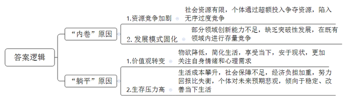
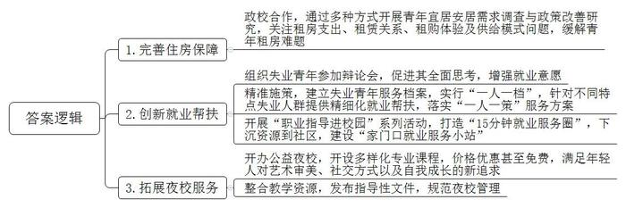
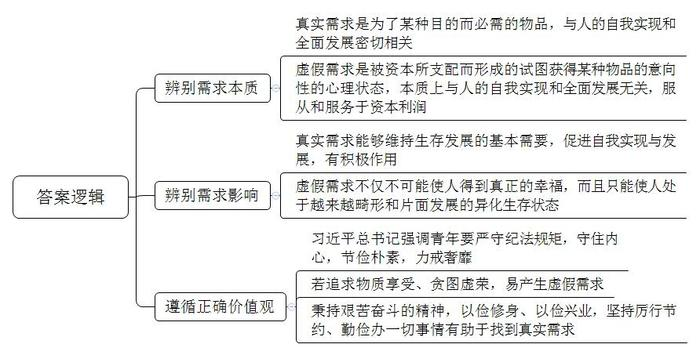
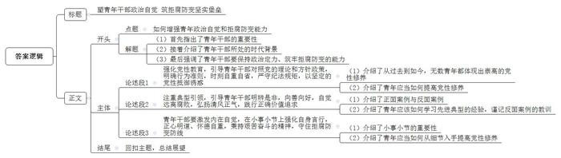

# 2025年上海市公考《申论》题（B卷）

<!-- gwy:overview:start -->
> **上海 · 2025 · 申论 · B卷** ｜ 4 题 · 图片 4 处 · 答案随题折叠

导航：[题目](#题目) · [材料 1](#材料-1)
<!-- gwy:overview:end -->

> 候选采集稿。参考答案及解析来自粉笔页面，不代表官方答案或真实高分答卷；来源使用许可与原卷对应关系仍需人工核实。

## 给定材料

### 材料 1

“叮叮叮……”手机的闹钟铃声成了阿琳每天早上最熟悉而又不胜其烦的声音。然而，这个在每天6：50准时响起的闹钟也只是一天10个闹钟里的“第一枪”。自从搬到了广州同和之后，阿琳的生活从此离不开魔鬼3号线。于是，她的闹钟也从7：30调到了6：50。“因为你无法预料晚到10分钟会怎样，我试过好几次，前10分钟畅通无阻，后10分钟就人头涌动了。在3号线，每个时间点都不一样。”而且，自从被同事开玩笑说自己皮肤黑之后，现在她每天怎么都会花上20分钟化妆。所以，前5个闹钟叫自己起床，接下来两个是化妆前后，一个提醒自己带齐东西，一个提醒自己出门，最后一个是出门deadline。“8：00的闹钟是提醒自己无论怎样都必须出门了，因为加上走路15分钟，我又必须坐上8：18的那趟地铁，才能保证不会迟到。”“我上一周的真实写照是前3天为了剪片堆积了很多稿件，接下来开始处理那些时不时突击的稿件，第一天写了5篇软文，第二天又写了2篇活动稿，第三天采访加写稿，最后一天写完了6篇软文。期间还要不断阅读一些资料……有时候赶稿赶到半夜3、4点想哭的时候，想想为了养活自己，一切也都不是事儿了。”“没人会喜欢赶deadline，但总会遇见赶deadline的情况。但年轻人，总得逼自己一把。”

跟阿琳不一样的是，阿昆选择了坐公交上班，不只是为了避开魔鬼3号线，也是为了刚出来实习能租个便宜的房。于是，每天赶公交成了他必不可少的日常。“我觉得，这种生活就像是每天有人拿着一把发令枪，而我就是那个准备起跑的运动员，我都跑过好多次了，500米，2分半。”很多时候不只是为了赶上那趟车，更是为了有个位置坐下吃早餐，更多的情形是阿昆赶上车的时候，手里提着喝了几口的豆浆，嘴里一边还在嚼着面包。他说：“我相信不会一直是这个状态，而且有时候环顾四周，见到的是像自己一样匆忙赶路的年轻人，忽然间觉得自己也是在努力的。”“如果每天心里没给自己发一枪，这一天也就活得很无所谓了吧。”

### 材料 2

“躺平”“佛系”的主要表现是采取一种什么都行、不走心、风轻云淡、得过且过的生活方式。比如，有一些比较自我的现象，不怎么关心其他事情，只关心自我；有一些与世无争的状态，随遇而安，什么都可以；有一些所谓“丧文化”现象，漫无目的、丧失志趣、颓丧绝望；表现得并不那么“自我”，只是什么都不关心，什么都不走心，样样都行、都可以、无所谓，他甚至对自己都漠不关心，更不要说关心他人，生活呈现出一种“漫无目的”的样态。

不到40岁的小张也曾是时尚达人，手机一两年就要换一部新的，永远走在潮流前线。可如今，他拿的是一部很多年前的手机，电池已经不行了，充电宝需要随时“备战”，提示内存“超标”的信息不时响起，这时，他就要手动删除。“前几年的一次投资，让我的积蓄顷刻清零，这些年工作的积累都在里面了。”当事情发生的那一刻，似乎所有欲望都“躺平”了，他过起深居简出的生活。“会突然觉得之前的奋斗、应酬、积极向上都没有意义，一朝回到解放前。”

这几年，小张基本上是“两点一线”，很少出门，甚至很少开车，不再应酬，不再像以前一样时刻鸡血沸腾，取而代之的是每天记账，每次要买东西之前都会问自己：这是生活必需品吗？久而久之，欲望降低了，日子照常过，对房子、车子也没有什么奢望，一日三餐因陋就简，对名牌、奢侈品没有什么需求，只要自己不背上债务就行。“这样的日子反而让我收获了安全感。”在小张看来，自己目前的状态正接近于时下正火的“躺平青年”，欲望在降低，不再追求别人眼中的成功，开始享受当下，学会了安于现状，这是一种自我疗伤，也是一种对于生活的妥协。

和小张“受伤”后的躺平有所不同，2月份辞职的90后小桑很享受自己现在的生活：看书、瑜伽、健身，然后“流浪”……她并不在意自己被贴上了“躺平”的标签，在她看来，无非就是选择过好当下，过着自己想要的生活而已。从2月下旬起，“提前退休”的小桑开始了“流浪”之旅。从贵州到云南，如今正在西藏享受纯净的天空。和以往上班休假游玩的“奢侈”截然不同，这一路，她会寻找合适的义工，从而节省吃住费用，她会早起坐绿皮车，只因车票比下午的便宜，即使睡觉的地方只是一张硬板床也无不可……“如果花光了所有的积蓄，那就再另辟蹊径去谋生，享受的是自洽的快乐。”小桑说，虽然辞去一份在别人眼里看起来相当体面的工作并不容易，但遵从自己内心的“自由”更重要，而这绝不是逃避，而是以自己喜欢的方式生活在世界上。即使在旅途中，小桑也保持着自律的生活节奏：每天早起，坚持读书、思考以及分享。“只能说，以前的我一直向外求，现在的我更多地向内看，会更关注自己的情绪、自己的心理需求。”

### 材料 3

2024年4月，中国人民银行原行长周小川在首届中国养老产业论坛上的讲话引起了广泛关注。他表示，养老金缺口压力正层层传导至年轻人，“现在上有老下有小的年轻人觉得即使劳动再多，也很难买房、结婚、养孩子，干脆直接躺平”。部分年轻人的顾虑之一是，他们缴纳的养老金都用来养现在的老年人，等自己领取养老金时，会不会面临无养老金可领的情况。如何平衡眼前的经济压力和未来的养老压力也让一些年轻人担忧。如果考虑到这些年社保缴费基数下限不断上调，个人缴费压力增大，这样的担忧有其现实的基础。说到底，年轻人对缴纳社保的顾虑出自对当下和未来的权衡。如果当下收入或收入预期下滑，一些人会更倾向于将有限的收入用于稳定或者改善当下的生活，而非压缩当期花费以保障未来。

与其他国家相比，我国人口老龄化有两大显著特点。一是基数大、速度快。我国是当今世界老年人数最多的国家，2023年底，已有60岁及以上老年人口超2.9亿，预计2025年将突破3亿，2033年将突破4亿，2053年将达到4.87亿的峰值。我国老年人口增长迅速，相关研究显示，65岁及以上老年人口比重从7%升到14%所经历的时间，法国115年，瑞典85年，美国66年，英国45年，而中国大约25年。二是底子薄、负担重。目前，世界上大多数国家在进入老龄化社会时已经处于较高的发展水平，而我国老龄化是在人均国民收入较低的情况下出现的。与此同时，我国出生人口自2017年以来已连续7年下降。

2022年全国妇联“企业生育成本负担对女性就业的影响”课题对29个省区市1043个企业的调查显示，三孩生育政策实施以来，有25.39%的被访企业承认存在只招男性或同等条件下男性优先的情况；在有女职工生育的930个被访企业中，有63.40%没有执行延长产假政策。同时调查也发现，被访企业中，有43.81%反映企业生育成本占工资总额的0.5%以上，即企业承担的生育成本与失业保险费率大体相当；82.36%希望对其承担的产假期间（含延长产假）社会保险费予以补贴，74.40%希望延长产假津贴由职工基本医疗保险（生育保险）支付，48.71%希望为当年有女职工生育的企业适当减税，有41.99%的被访企业希望政府优先采购女职工达到一定比例竞标企业的产品或服务。调查显示，在职女性工作日从事家务劳动时间为154分钟，约为男性的2倍。0至17岁孩子的日常照料由母亲承担的占76.1%。研究显示，“生育/照料孩子”是女性职业中断的主要原因。

### 材料 4

“内卷”这个概念，最早出现于美国人类学家格尔茨的著作《农业的内卷化》，指农业经济中边际效益递减的现象，是一种“很辛苦又很不经济”的模式。简单来说，内卷就是“向内演化，或绕圈圈”，更宽泛一点来讲，所有无实质意义的消耗都称之为“内卷”。“内卷”已经被演变成了描述社会某些领域内过度竞争的代名词，特别是在职场、教育以及企业竞争层面：家长为了孩子能上名校，不惜花费重金将孩子送入各种补习班；职场人为升职加薪，不惜透支时间，没日没夜地加班加点；企业为了赢得市场不惜放弃质量追求，大打低水平的价格战……凡此无序且过度的竞争，就是格尔茨所说的“边际效益递减”的真实写照。

但不能将发展都等同于内卷。例如，智能手机的诞生创造了一个全新的市场需求，从而带动了整个产业链的发展。20世纪70年代初，Motorola的研究员马丁·库珀用DynaTAC8000X首次进行了移动电话通话。DynaTAC8000X重约2.4磅，通话时间有限且价格昂贵。1987年，全球移动通信系统（GSM）的引入标志着移动通信技术的重大飞跃。GSM引入了数字传输、标准化的无线电频率和增强的安全措施，为今天我们使用全球标准奠定了基础。1989年，Motorola推出了MicroTAC，第一款翻盖手机，它的时尚、紧凑的设计引领了更小、更便携的手机时代。2007年，iPhone的推出标志着移动技术的范式转变，它的基于触摸的界面和去除物理按键，为智能手机设定了新的标准。智能手机的普及带来了大量新需求，例如移动应用程序、在线支付、社交媒体等相关行业蓬勃发展。智能手机不仅通过技术创新实现了产品差异化，更通过功能拓展、生态系统建设等手段，让手机成为现代人生活中不可或缺的工具。智能手机的成功在于识别出消费者对多功能设备的潜在需求，并将这种需求转化为巨大的市场机会。这种“无中生有”的创新能力，是突破内卷的重要途径。

### 材料 5

2023年11月，上海团市委、市青少年服务保护办、华东政法大学组成课题组，通过文献查阅、问卷调查和实地走访座谈等方式，开展上海青年宜居安居需求调查与政策改善研究。研究调研对象为生活在上海的年龄在20-35周岁的青年群体（非在校生），回收有效问卷2536份。调查显示，租住房屋支出占收入比重较大、租赁关系不稳定、租购体验度不佳、租房供给商业模式不完善4个问题成为阻拦申城年轻人实现宜居安居梦的主要因素。

数据显示，青年在租住房屋方面普遍面临着较大的经济压力。46.6%的青年表示“有一些经济压力，但仍可以承受”，34.4%的青年表示“经济压力较大，仍能勉力维持生计”，有7.1%的青年则认为“经济压力非常大”。上海青年租房平均换房周期为16.25个月，房东频繁调整房租以及工作变动，成为年轻人四处迁居的主要原因。

青年租房者普遍反映，中介规范度有待提高，房源信息不够透明。有的中介用低价虚假房源吸引租客看房，等租客到了现场却被告知房源已经下架，只有高价位房源可以选择；有的中介在房屋合同上耍花招，让涉世未深的年轻人苦于招架。一些租房区域生活服务不足，餐饮、文娱设施缺失，使租房者面临便利性和体验上的挑战。此外，租房建设地点与青年需求间存在偏差。受制于土地空余等各方面因素，保障性租赁住房主要集中在市郊，中心城区内部土地饱和，大面积建设保障性租赁住房客观无地可建，供给有限。在市郊，能够近地铁站的房源也同样存在供需紧张的问题，形成了青年需求与住房供给两者间的结构性差距。被访者反映，“希望有便捷的出行条件，比如有的社区有到地铁站的班车，但是车次很少，早高峰的时候共享单车也很紧张。”

### 材料 6

最近，一场特殊的辩论会在黄浦区直通车训练营中举行。参加这场辩论会的正反双方，是来自黄浦的长期失业青年。和其他辩论会不同，参与者可以在辩论过程中自由转换立场。通过同龄人之间的观点碰撞，“先择业”和“先就业”的利弊被一一阐述。不少年轻人的就业意愿得到了增强。

黄浦就业促进中心首席职业指导师表示，如今的待业青年呈现出学历高、眼界高、主见强的特点，深受网络上“慢就业”“Gap Year”“陪伴父母”等思潮影响。和他们沟通，传统的劝导往往会陷入各执己见的僵局。“用年轻人的方式和年轻人沟通，引导他们更加全面地看待问题，让他们自己通过思考得出结论，结果要更好。”她说。黄浦区是上海的商业中心，辖区内有外滩、豫园、南京路等知名旅游目的地。二十年前，当地大量消费服务类、旅游类岗位还能够吸引年轻人，而现在，大学生普遍对这类岗位不再感兴趣。而在经历几次求职失败后，一些年轻人的自信心也受到打击。去年，上海新增就业岗位60.6万个，2023届离校未就业高校毕业生帮扶就业率达93.5%，帮助长期失业青年就业创业1.23万人。重点服务人群从以往的“4050”人群转变为青年人后，公共就业服务机构的工作难点和以往相比也有了很大的不同。

一些公司把35岁以上管理人员列为重点裁员对象，对这些曾经收入较高的企业中层而言，很难接受从事一份落差太大的新工作，如何帮助他们重新开启职业生涯？硕士和博士毕业生的学历高，对求职的薪资待遇和专业对口的要求也高，对长期找不到对口工作的高学历人群如何帮扶？调研显示，本地年轻人希望上班通勤时间不要太长。“钱多、事少、离家近”虽然是一种调侃，但是能不能挖掘更多“离家近”的工作岗位？

为了更好做到精准施策，黄浦区人社部门为每位有就业需求的长期失业青年建立服务档案，实行“一人一档”，针对中年企业高管、高学历学术人才等不同特点的失业人群提供精细化就业帮扶，落实“一人一策”服务方案，满足青年的个性化需求。过去三年，来到黄浦区人社部门寻求帮助的大学应届毕业生人数一直在增加。为了提前一步做好工作，黄浦区还开展了“职业指导进校园”系列活动，引导青年人走好求职第一步。同时，黄浦区进一步打造“15分钟就业服务圈”，将资源下沉到社区，打通就业服务“最后一公里”。去年，黄浦区“家门口就业服务小站”累计开展就业服务135场，惠及17.86万人次。

在黄浦区人社部门的帮助下，不少30岁左右的青年人在经历短暂职业空窗期后重新出发。外滩街道2023届残疾大学生小吴有着视力残疾，工作意愿强烈。但毕业后，小吴的求职之路并不顺当，投出20余份简历均石沉大海。在区残联的鼓励下，小吴通过参与“普华永道”举办的“残健职场融合项目”和多场招聘会活动积累求职经验。黄浦区人社部门还为小吴提供了一对一全周期就业服务。最终，在多部门协同下，小吴顺利通过面试，在浦江社会组织促进中心主任助理岗位上开始了职业生涯。

### 材料 7

“白天上班，晚上学艺。”从去年开始，夜校，这个极具年代感的词汇再度“刷屏”，也成为不少年轻人“夜生活”的另一种打开方式。但一代人有一代人的夜校，与当年夜校以补习文化知识为主不同，这届夜校开设了“吉他民谣”“视频剪辑”“非遗手工”等课程，满足了年轻人对艺术审美、社交方式以及自我成长的新追求。

晚上19：30，重庆江北区不夜九街，潮流青年聚集地。观音桥街道九街新时代文明实践市级示范点亮起了灯光，等待着来上夜校的年轻人。晚上20：00，小蔡背着吉他来到这里，开启下班后的“夜生活”。“我住在附近，从去年开始就一直关注这边的夜校。”小蔡说，吉他教学课程一上线，他就赶紧抢名额。“夜校不仅让我购置已久的吉他发挥作用，更是让我的很多爱好能够得到发展。”

去年8月，观音桥街道尝试开办了第一家纯公益夜校，半年多来，又陆续开设了17个校区，课程设置涵盖非洲鼓、硬笔书法，甚至新疆烤包子制作等，每节课的名额经常是一释放出来就被秒光。“我们有一门课程原计划招收16名学员，结果来了30多人。”夜校负责人、观音桥街道团工委书记说，截至目前，辖区内的夜校已经吸引了4000多人次参加，学员年龄大多在20-35岁。目前，重庆有20余个区县开设了共39家青年夜校，超过1.2万人次参与培训。

“不是兴趣班上不起，而是夜校更有性价比。”在采访中，这句话成为不少学员的口头禅。在他们看来，课程设置多样化的夜校不仅能培养兴趣、丰富知识，还能结识朋友，最主要是价格优惠甚至免费。夜校负责人王老师介绍，夜校一节课一小时，收费50元。授课老师既有“海归”，也有专业院校高材生，还有品牌主理人、认证导师、产品顾问等。“50元一节课，很实惠。”学员小吴表示，夜校老师讲课专业，比自己在网上自学更容易学会。她坦言，与动辄几百元一节的兴趣课相比，夜校性价比更高。“免费或普惠的课程，让年轻人更愿意去尝试和印证自己的兴趣爱好。”西南大学国家治理学院社会学与社会工作系副主任黄教授说。在小吴看来，夜校吸引她的原因则是“能看到自己的另一种可能”。上班工作，回家带娃，每天两点一线的生活，让小吴觉得越来越缺失自我。“在夜校，我特地报了和自己生活、性格完全不搭边的拳击课程。在学习中，既挖掘了自己的另一面，也释放了工作和生活积攒的压力，让自己找到了一个更好的状态。”

“我们龙门夜校与其他夜校略为不同，它是街道‘龙门职通车’公共服务项目的延伸。”南岸区龙门浩街道工作人员周某介绍，“龙门职通车”主要针对辖区内失业人员进行免费技能培训。在这期间，出现了很多想学习但不符合条件的辖区青年，在他们的诉求下，街道整合辖区内的重庆创富职业培训学校教学资源，采用普惠方式，开办了龙门夜校。今年3月，重庆青年夜校的首个指导性文件《共青团重庆市委关于加强青年夜校建设管理的工作指引》发布，对各区县团委主导实施开设青年夜校的定位、功能和管理进行了规范和强化，明确了推动更多好项目、好资源融入青年夜校。

### 材料 8

从出国那天起，钱学森就从报纸、广播里关注着国内的局势。新中国成立的消息传到大洋彼岸，钱学森很快决定回国。归国后，钱学森卸下穿了二十载的西装，换上了简约的中山装，脚下则是一双地道的北京圆口布鞋。由于家中长辈体弱多病，医疗费用颇为沉重，钱学森之薪资尚需不时资助他亲，家境因而显得颇为拮据。家中室内陈设简朴，旧家具铭牌上“中国科学院”的红漆略显斑驳。冬日需自行燃煤取暖，饮食质朴无华，主食以粗粮为主，菜肴则多见市井间的萝卜青菜。即便如此，钱学森仍将获得的稿费共计15268元悉数捐赠给中国科技大学。至今，中科大校史馆仍珍藏着一封泛黄的感谢信，见证了钱学森对国家的深情厚谊。1994年，钱学森荣获香港何梁何利基金百万港币奖金；2001年，再获霍英东“科学成就终身奖”百万港元奖金。这两笔丰厚奖金，钱学森未曾亲睹支票，即命秘书转交治沙委员会，助力国家沙漠治理。

1956年2月，钱学森向国务院提交《建立我国国防航空工业的意见书》，第一次系统地提出了发展我国航天技术的建议，为中国火箭和导弹技术的发展制定了重要的实施方案。半年后，中国第一个火箭、导弹研究院——国防部第五研究院成立，钱学森出任院长。钱学森在试验基地一待就是一两个月。他身边带着一本《工作手册》，详细记录每次试验的具体情况。大大小小的异常、故障被列成表格，已经解决的注上“已换”“可用”；尚未解决、落实的，就用红笔作个星号。1960年8月，苏联撤走全部援华专家。然而，仅仅半个月后，中国就用苏联专家认为不合格的中国产燃料，第一次在自己的国土上成功发射了一枚苏制导弹。1964年6月，我国成功发射第一枚自行研制的导弹。4个月后，第一颗原子弹爆炸成功。1970年4月，第一颗人造地球卫星“东方红一号”升空。

这是晚年钱学森一日的生活：早上六点钟起床，打开收音机收听中央人民广播电台的科学知识普及讲座，然后洗漱、吃饭。上午、下午的时间用来看书、写文章或举办学术讨论班。到了晚上，他会坐在书房里看两三个小时的书才上床睡觉。今天，他积极倡导的信息技术研究应用，极大地推动了军队信息化建设；他于1984年提出的“知识密集型大农业”理念，已经在西部地区的“沙产业”中成为现实；他关于建设“山水城市”的观点，深刻地影响了中国城市规划建设的理论与实践……他的目光，早已超越了航天，超越了自然科学，超越了社会发展的今天。

### 材料 9

2014年12月10日，国家发改委原副主任、国家能源局原局长刘铁男等来了法院判决。刘铁男因受贿罪一审被判处无期徒刑，剥夺政治权利终身，并处没收个人全部财产。刘铁男本人在接受组织调查时所写的《悔过书》中提到，“错误的价值观”是其陷入沉沦的重要思想根源。

刘铁男家中姐弟较多，自幼生活贫困，1971年在北京特钢厂参加工作，1983年调到国家计委原材料局钢铁处，从此步入仕途。“小时候的苦日子一方面激励我严格要求自己，积极上进，忧患意识强；另一方面，在我内心深处，也有过富裕生活的欲望。”刘铁男追忆往事时说，1996年至1999年，他担任中国驻日本大使馆经济参赞期间，为节省开支以补贴家用，他经常在宿舍煮挂面吃，只有赶上宴请才吃顿像样的，而且为了多吃点还会提前饿着。

想过好日子，人之常情，无可厚非。但如何看待穷日子，如何过上好日子，反映出的却是一个人的价值追求，决定着一个人的人生走向。可惜，从一开始，刘铁男的判断就出了问题：“我觉得穷就没人看得起，就会被人轻易伤害，就没有地位、没有尊严，虚荣、好面子的思想开始在我内心深处滋生……”早期的刘铁男由于北京钢铁学院冶金专业的背景，给一些同事留下了“专家型”和喜欢谈论学术问题的印象。一位与他在日本期间熟悉的学者称，刘铁男当时比较低调，但可以看出非常懂行，和后来媒体上看到的形象截然不同。在庭审最后陈述阶段，刘铁男说：“如果时间能倒流，我应该做两袖清风、心无旁骛干事业的人。”

### 材料 10

《老子》曰：“五色令人目盲，五音令人耳聋，五味令人口爽，驰骋畋猎令人心发狂，难得之货令人行妨。是以圣人为腹不为目，故去彼取此。”就人性论而言，老子认为由道化生的性是和谐的、完满的，但会随着人的多欲、强为和妄为而有失真、扭曲的可能。

西方马克思主义理论家借用了马克思关于动物需要、人类需要的区别以及人的需要的本质和人的自我实现的关系的有关论述，区分“真实需要”和“主观欲望”、“真实需要”和“虚假需要”的不同。在他们看来，“真实需要”是为了某种目的而必需的物品，与人的自我实现和全面发展密切相关；“主观欲望”则是被资本所支配而形成的一种试图获得某种物品的意向性的心理状态，本质上是一种与人的自我实现和全面发展无关，服从和服务于资本追求利润的“虚假需要”。这种“虚假需要”不仅不可能使人得到真正的幸福，而且只能使人处于越来越畸形和片面发展的异化生存状态。

### 材料 11

习近平在2022年春季学期中央党校（国家行政学院）中青年干部培训班开班式上讲话指出，年轻干部必须牢记清廉是福、贪欲是祸的道理，经常对照党的理论和路线方针政策、对照党章党规党纪、对照初心使命，看清一些事情该不该做、能不能干，时刻自重自省，严守纪法规矩。守住拒腐防变防线，最紧要的是守住内心，从小事小节上守起，正心明道、怀德自重，勤掸“思想尘”、多思“贪欲害”、常破“心中贼”，以内无妄思保证外无妄动。

“我们平常穿的衣服，且不说补丁摞补丁，而且都要穿兄弟姐妹的衣服……”习近平曾在接受中央电视台《东方时空》节目专访时这样回忆童年生活。习仲勋的节俭几近苛刻，他和夫人齐心同志家教的严格也是众所周知的。孩子们年幼时，在和家人吃饭时他高声吟诵《悯农》，围坐在桌前的孩子们也会稚气地应和起来：“春种一粒粟，秋收万颗子。四海无闲田，农夫犹饿死。”吃饭时，不小心掉在桌上的饭粒，习仲勋也会捡起来吃掉，一丁点也不浪费。在父亲的言传身教下，习近平自小养成了勤俭节约的习惯。“他家的客厅，没有电视机，就有几张旧沙发，其他的什么也没有。”和习近平在正定共过事的王幼辉1983年曾到习家做客，他多年后回忆，“这叫我懂得了什么叫俭朴。”

习近平总书记这些年到地方考察，为减轻地方负担多次在专列上午休、过夜，降低接待规格；对于出访活动，他多次指示要精算代表团饭店入住天数，能省则省，不要浪费，住地不要豪华，干净舒适即可。“节俭朴素，力戒奢靡，是我们党的传家宝。现在，我们生活条件好了，但艰苦奋斗的精神一点都不能少，必须坚持以俭修身、以俭兴业，坚持厉行节约、勤俭办一切事情。”总书记身体力行。

## 题目

### 第 1 题

**结合给定资料，分析出现“内卷”和“躺平”现象的原因。（15分）**

关联材料：材料 1、材料 2、材料 3、材料 4、材料 5、材料 6、材料 7、材料 8、材料 9、材料 10、材料 11

作答要求：

要求：阐述规范扼要，表达准确到位，字数不超过200字。

第 1 题 · 答案与解析

**参考答案（粉笔题库参考内容）**

“内卷”原因：1.资源竞争加剧。社会资源有限，个体通过超额投入争夺资源，陷入无序过度竞争。2.发展模式固化。部分领域创新能力不足，缺乏突破性发展，在既有领域内进行存量竞争。“躺平”原因：1.价值观转变。物欲降低，简化生活，享受当下，安于现状，更加关注自身情绪和心理需求。2.生存压力高。生活成本攀升，社会保障不足，经济负担加重，努力回报比失衡，个体对未来预期悲观，倾向于稳定、改善当下生活。

**参考答案说明**：本参考答案分别介绍了“内卷”“躺平”的原因，其中“内卷”的原因从“资源竞争加剧”“发展模式固化”这两个方面展开；“躺平”的原因从“价值观转变”“生存压力高”这两个方面展开。各条答案要点之间在内容上相互并列，没有交叉。

**解析**

**考点**：原因类

**来源**：2025年上海市公考《申论》题（B卷）

> 粉笔申论页面对本题只提供「解析视频」入口，该入口是会员推广位，页面无视频地址与文字解析。

### 第 2 题

**结合给定资料，概括当前政府在缓解青年压力方面采取了哪些举措。（15分）**

关联材料：材料 1、材料 2、材料 3、材料 4、材料 5、材料 6、材料 7、材料 8、材料 9、材料 10、材料 11

作答要求：

要求：语言精练，层次要点分明，字数不超过300字。

第 2 题 · 答案与解析

**参考答案（粉笔题库参考内容）**

1.完善住房保障。政校合作，通过多种方式开展青年宜居安居需求调查与政策改善研究，关注租房支出、租赁关系、租购体验及供给模式问题，缓解青年租房难题。

2.创新就业帮扶。组织失业青年参加辩论会，促进其全面思考，增强就业意愿；精准施策，建立失业青年服务档案，实行“一人一档”，针对不同特点失业人群提供精细化就业帮扶，落实“一人一策”服务方案；开展“职业指导进校园”系列活动，打造“15分钟就业服务圈”，下沉资源到社区，建设“家门口就业服务小站”。

3.拓展夜校服务。开办公益夜校，开设多样化专业课程，价格优惠甚至免费，满足年轻人对艺术审美、社交方式以及自我成长的新追求；整合教学资源，发布指导性文件，规范夜校管理。

**参考答案说明：**本参考答案从“完善住房保障”“创新就业帮扶”和“拓展夜校服务”这三个方面进行了分条撰写。各条答案要点在内容上相互并列，没有交叉。

**解析**

**考点**：概括措施类

**来源**：2025年上海市公考《申论》题（B卷）

> 粉笔申论页面对本题只提供「解析视频」入口，该入口是会员推广位，页面无视频地址与文字解析。

### 第 3 题

**结合给定资料，分析青年在日常生活中应如何辨别“真实需求”与“虚假需求”。（20分）**

关联材料：材料 1、材料 2、材料 3、材料 4、材料 5、材料 6、材料 7、材料 8、材料 9、材料 10、材料 11

作答要求：

要求：分析有理有据，内容准确全面，字数不超过300字。

第 3 题 · 答案与解析

**参考答案（粉笔题库参考内容）**

1.辨别需求本质。真实需求是为了某种目的而必需的物品，与人的自我实现和全面发展密切相关；虚假需求是被资本所支配而形成的试图获得某种物品的意向性的心理状态，本质上与人的自我实现和全面发展无关，服从和服务于资本利润。

2.辨别需求影响。真实需求能够维持生存发展的基本需要，促进自我实现与发展，有积极作用；虚假需求不仅不可能使人得到真正的幸福，而且只能使人处于越来越畸形和片面发展的异化生存状态。

3.遵循正确价值观。习近平总书记强调青年要严守纪法规矩，守住内心，节俭朴素，力戒奢靡。若追求物质享受、贪图虚荣，易产生虚假需求；秉持艰苦奋斗的精神，以俭修身、以俭兴业，坚持厉行节约、勤俭办一切事情有助于找到真实需求。

**参考答案说明**：本参考答案分别从“辨别需求本质”“辨别需求影响”“遵循正确价值观”这三个方面分析辨别“真实需求”与“虚假需求”，各条答案要点之间在内容上互相并列，没有交叉。

**解析**

**考点**：其他类

**来源**：2025年上海市公考《申论》题（B卷）

> 粉笔申论页面对本题只提供「解析视频」入口，该入口是会员推广位，页面无视频地址与文字解析。

### 第 4 题

**以“如何增强青年政治自觉和拒腐防变能力”为主题，写一篇文章。（50分）**

关联材料：材料 1、材料 2、材料 3、材料 4、材料 5、材料 6、材料 7、材料 8、材料 9、材料 10、材料 11

作答要求：

要求：

（1）自选角度，自拟题目；

（2）观点明确，联系实际，分析具体，条理清楚，语言流畅；

（3）总字数800-1000字。

第 4 题 · 答案与解析

**参考答案（粉笔题库参考内容）**

**塑青年干部政治自觉 筑拒腐防变坚实堡垒**

青年干部作为党和国家事业发展的生力军，手握“接力棒”、肩扛“时代责”，既是国家战略的具体执行者，更是社会发展的重要推动者。在百年未有之大变局的时代浪潮中，青年干部既站在干事创业的黄金机遇期，也直面多元思潮的冲击与利益诱惑的严峻考验，如何淬炼政治定力、筑牢拒腐防变防线，已成为关乎党和国家事业薪火相传、长治久安的核心课题。

**强化党性教育，引导青年干部对照党的理论和方针政策，明确行为准则，时刻自重自省，严守纪法规矩，以坚定的党性抵御诱惑。**从革命年代无数青年秉持坚定信仰，为民族解放事业抛头颅、洒热血，到如今众多青年党员扎根基层，用实际行动践行党的宗旨，党性教育始终是青年成长的必修课。如张富清，在平凡岗位默默耕耘，深藏功名，以党的事业为先，倾心为民奉献，彰显出至纯至真的崇高党性修养。青年应深入学习党的理论，将党性要求内化为自身的行为准则，面对诱惑时，以党性的力量坚守底线，不越雷池一步。

**注重典型引领，引导青年干部明辨是非，向善向好，自觉远离腐败，弘扬清风正气，践行正确价值追求。**袁隆平毕生扎根稻田，将全部心血倾注于杂交水稻研究，只为让百姓端稳“中国饭碗”，他淡泊名利、无私奉献的精神，为青年树立了崇高的价值标杆；反观某些高官，往往在权力中迷失自我，最终沦为阶下囚，这也深刻警示青年：背离正道，必将付出沉重代价。以正面典型为榜样，青年能明晰奋斗方向；以反面案例为镜鉴，青年可筑牢思想防线，在人生道路上坚守本心，弘扬清风正气。

**青年干部要激发内在自觉，在小事小节上强化自身言行，正心明道、怀德自重，秉持艰苦奋斗的精神，守住拒腐防变防线。**千里之堤，溃于蚁穴，小事小节往往是拒腐防变的关键。习近平总书记自小在父亲习仲勋的言传身教下养成勤俭节约的习惯，在工作中也始终以身作则，践行艰苦奋斗精神。青年应从日常点滴做起，珍惜每一粒粮食、节约每一度电，在小事中培养良好品德。同时，在面对利益诱惑时，保持清醒头脑，坚守内心的道德准则，以艰苦奋斗为底色，以正心明道为指引，在人生道路上筑牢拒腐防变的坚固防线。

青年朋友们，让我们以党性为指引，向榜样看齐，从点滴做起。在人生航程中，坚守拒腐防变底线，以清正之姿，为国家发展注入蓬勃力量！

**文章分析**

**塑青年干部政治自觉** **筑拒腐防变坚实堡垒**

【**标题的优点**：标题中含有主题词，清晰地突出了文章主题。此外，对称式标题的写法也颇有亮点。】

（1）青年干部作为党和国家事业发展的生力军，手握“接力棒”、肩扛“时代责”，既是国家战略的具体执行者，更是社会发展的重要推动者。（2）在百年未有之大变局的时代浪潮中，青年干部既站在干事创业的黄金机遇期，也直面多元思潮的冲击与利益诱惑的严峻考验，（3）如何淬炼政治定力、筑牢拒腐防变防线，已成为关乎党和国家事业薪火相传、长治久安的核心课题。

【**开头的优点**：★内容方面。范文的开头是紧扣“如何增强青年政治自觉和拒腐防变能力”这一主题展开的。（1）首先指出了青年干部的重要性。（2）接着介绍了青年干部所处的时代背景。（3）最后强调了青年干部要保持政治定力、筑牢拒腐防变的能力。★文字表达方面。使用了“既是……更是”“既……也”等关联词，增强了语言表述的逻辑性。】

**强化党性教育，引导青年干部对照党的理论和方针政策，明确行为准则，时刻自重自省，严守纪法规矩，以坚定的党性抵御诱惑。**（1）从革命年代无数青年秉持坚定信仰，为民族解放事业抛头颅、洒热血，到如今众多青年党员扎根基层，用实际行动践行党的宗旨，党性教育始终是青年成长的必修课。如张富清，在平凡岗位默默耕耘，深藏功名，以党的事业为先，倾心为民奉献，彰显出至纯至真的崇高党性修养。（2）青年应深入学习党的理论，将党性要求内化为自身的行为准则，面对诱惑时，以党性的力量坚守底线，不越雷池一步。

【**论述段1的优点**：★观点句：范文的观点句是紧扣“如何增强青年政治自觉和拒腐防变能力”这一主题提出的。形式上，它在段首处直接写出，位置突出，容易发现。内容上，关键词突出，内容要点明确，可以明显看出主要论述“强化党性教育”。★论述内容：（1）介绍了从过去到如今，无数青年都体现出崇高的党性修养；（2）介绍了青年应当如何提高党性修养。以上两个方面的内容都是紧扣“强化党性教育，引导青年干部对照党的理论和方针政策，明确行为准则，时刻自重自省，严守纪法规矩，以坚定的党性抵御诱惑”这个观点句进行分析论述的，论述的针对性强，内容层次丰富。在论述方法上既有道理论证，也有举例论证，做到了有理有据。】

**注重典型引领，引导青年干部明辨是非，向善向好，自觉远离腐败，弘扬清风正气，践行正确价值追求。**（1）袁隆平毕生扎根稻田，将全部心血倾注于杂交水稻研究，只为让百姓端稳“中国饭碗”，他淡泊名利、无私奉献的精神，为青年树立了崇高的价值标杆；反观某些高官，往往在权力中迷失自我，最终沦为阶下囚，这也深刻警示青年：背离正道，必将付出沉重代价。（2）以正面典型为榜样，青年能明晰奋斗方向；以反面案例为镜鉴，青年可筑牢思想防线，在人生道路上坚守本心，弘扬清风正气。

【**论述段2的优点**：★观点句：范文的观点句是紧扣“如何增强青年政治自觉和拒腐防变能力”这一主题提出的。形式上，它在段首处直接写出，位置突出，容易发现。内容上，关键词突出，内容要点明确，可以明显看出主要论述“注重典型引领”。★论述内容：（1）介绍了正面案例与反面案例；（2）介绍了青年应该如何学习先进典型的经验，谨记反面案例的教训。以上两个方面的内容都是紧扣“注重典型引领，引导青年干部明辨是非，向善向好，自觉远离腐败，弘扬清风正气，践行正确价值追求”这个观点句进行分析论述的，论述的针对性强，内容层次丰富。在论述方法上既有道理论证，也有举例论证，做到了有理有据。】

**青年干部要激发内在自觉，在小事小节上强化自身言行，正心明道、怀德自重，秉持艰苦奋斗的精神，守住拒腐防变防线。**（1）千里之堤，溃于蚁穴，小事小节往往是拒腐防变的关键。习近平总书记自小在父亲习仲勋的言传身教下养成勤俭节约的习惯，在工作中也始终以身作则，践行艰苦奋斗精神。（2）青年应从日常点滴做起，珍惜每一粒粮食、节约每一度电，在小事中培养良好品德。同时，在面对利益诱惑时，保持清醒头脑，坚守内心的道德准则，以艰苦奋斗为底色，以正心明道为指引，在人生道路上筑牢拒腐防变的坚固防线。

【**论述段3的优点**：★观点句：范文的观点句是紧扣“如何增强青年政治自觉和拒腐防变能力”这一主题提出的。形式上，它在段首处直接写出，位置突出，容易发现。内容上，关键词突出，内容要点明确，可以明显看出主要论述“青年干部要激发内在自觉”。★论述内容：（1）介绍了小事小节的重要性；（2）介绍了青年应当如何从细节入手提高党性修养。以上两个方面的内容都是紧扣“青年干部要激发内在自觉，在小事小节上强化自身言行，正心明道、怀德自重，秉持艰苦奋斗的精神，守住拒腐防变防线”这个观点句进行分析论述的，论述的针对性强，内容层次丰富。在论述方法上既有道理论证，也有举例论证，做到了有理有据。】

【**论述段之间的关系**：★内在逻辑上：文章先论述“强化党性教育”，再论述“注重典型引领”，最后论述“青年干部要激发内在自觉”，三个论述段呈现出并列逻辑，彼此不交叉、不重复。】

青年朋友们，让我们以党性为指引，向榜样看齐，从点滴做起。在人生航程中，坚守拒腐防变底线，以清正之姿，为国家发展注入蓬勃力量！

【**结尾的优点：**范文的结尾回扣了“如何增强青年政治自觉和拒腐防变能力”这个主题，并且进行了展望，发出了号召。】

**解析**

**考点**：文章写作题

**来源**：2025年上海市公考《申论》题（B卷）

> 粉笔申论页面对本题只提供「解析视频」入口，该入口是会员推广位，页面无视频地址与文字解析。

