# 2025年上海市公务员录用考试《行测》题（A类）（网友回忆版）

<!-- gwy:overview:start -->
> **上海 · 2025 · 行测 · A类** ｜ 130 题 · 图片 141 处 · 答案随题折叠

| 题型模块 | 题量 | 题号 |
| --- | ---: | ---: |
| 政治理论 | 20 | 1–20 |
| 常识应用能力 | 15 | 21–35 |
| 言语理解与表达能力 | 25 | 36–60 |
| 判断推理能力 | 30 | 61–90 |
| 数理能力 | 25 | 91–115 |
| 综合分析能力 | 15 | 116–130 |
| **合计** | **130** | |

导航：[题型与作答说明](#题型与作答说明) · [题目](#题目) · [材料 1](#材料-1)
<!-- gwy:overview:end -->

> 候选采集稿。参考答案及解析来自粉笔页面，不代表官方答案或真实高分答卷；来源使用许可与原卷对应关系仍需人工核实。

## 题型与作答说明

政治理论

（20题）

从所给的选项中选出最符合题意的一项。

常识应用能力

（15题）

本部分均为单项选择题，从所给的选项中选出最符合题意的一项。

言语理解与表达能力

（25题）

本部分包括表达与理解两方面的内容。请根据题目要求，在四个选项中选出一个最恰当的答案。

判断推理能力

（30题）

本部分包括科学推理、图形推理、分析推理三种类型的试题。

数理能力

（25题）

在这部分试题中，包括数学应用和资料分析两部分题目，要求你迅速、准确地计算出答案。

综合分析能力

（15题）

本部分均为不定项选择题，每小题给出的4个选项中，至少有1个选项符合题意。请将正确选项全部选出，不选.多选.少选或错选，均不得分。

## 题目

### 第 1 题

“十个明确”“十四个坚持”“十三个方面成就”“六个必须坚持”内在贯通、有机统一，凝结着我们党认识世界、改造世界的宝贵经验和重大成果，体现了理论和实际相结合、认识论和方法论相统一的鲜明特色，共同构成了习近平新时代中国特色社会主义思想的科学体系。其中，（ ）在习近平新时代中国特色社会主义思想中发挥着统摄作用。

A. “十个明确”

B. “十四个坚持”

C. “十三个方面成就”

D. “六个必须坚持”

第 1 题 · 答案与解析

**参考答案（粉笔题库参考内容）**

A

**解析**

本题考查理论与政策。

A项正确，B、C、D三项错误，《习近平新时代中国特色社会主义思想概论》在“导论”中“三、习近平新时代中国特色社会主义思想是完整的科学体系”部分指出：“‘十个明确’是习近平新时代中国特色社会主义思想的主体内容，集中体现了这一思想体系的主要观点和基本精神，构成了这一思想体系的四梁八柱，发挥着统摄作用。”

故正确答案为A。

**考点**：新思想总论

**来源**：2025年上海市公务员录用考试《行测》题（B类）（网友回忆版）第1题

### 第 2 题

党的十九大以来，党中央和习近平总书记把整治形式主义为基层减负作为党的作风建设的重要内容来抓，统筹部署、持续推进，解决了一批突出问题，刹住了一些歪风邪气，纠治了一些多年来未除的顽瘴痼疾。中央纠治形式主义主要彰显了中国共产党：

①以作风建设推进全面从严治党

②始终把思想建设放在首要位置

③以基层组织建设调动干部群众干事创业的主动性

④以求真务实精神走好新时代“赶考”之路

A. ①②

B. ②④

C. ②③

D. ①④

第 2 题 · 答案与解析

**参考答案（粉笔题库参考内容）**

D

**解析**

本题考查理论与政策。

①正确，文章《全面从严治党开创管党治党新时代》指出：“党的十八大以来，以习近平同志为核心的党中央把作风建设作为推进全面从严治党的突破口，采取有力举措深入整治‘四风’，坚决刹住群众身边不正之风的蔓延势头，使作风建设成为全面从严治党的亮丽名片，赢得了人民群众的衷心拥护和广泛赞誉。”

②错误，2020年习近平总书记在陕西考察时指出：“要把政治建设摆在首位，严肃党内政治生活，严格落实中央八项规定及其实施细则精神，坚决破除形式主义、官僚主义，构建一体推进不敢腐、不能腐、不想腐体制机制，为各项事业发展提供坚强保障。”故“把思想建设放在首要位置”的说法错误。

③错误，习近平总书记在二十届中央纪委二次全会上强调“要把纠治形式主义、官僚主义摆在更加突出位置，作为作风建设的重点任务，研究针对性举措，科学精准靶向整治，动真碰硬、务求实效”，故纠治形式主义属于作风建设。选项中“基层组织建设”的说法错误。

④正确，《求是》杂志中题为《以务实之举纠治形式主义顽疾》的文章指出：“纠治形式主义必须秉持务实态度、锤炼扎实作风，切不可用形式主义反对形式主义。要不断涵养求真务实、担当作为、狠抓落实的优良作风，以严实作风狠刹形式主义歪风。”

综上，符合题意的有①④。

故正确答案为D。

**考点**：其他建设

**来源**：2025年上海市公务员录用考试《行测》题（B类）（网友回忆版）第2题

### 第 3 题

从党的八大到党的十一届六中全会再到党的十九大，我们党紧扣人民和社会发展需要，实现了对我国社会主要矛盾认识的三次转化。这充分：

①表明了党遵循社会发展规律，认识到我国社会主义所处的历史阶段发生了变化

②体现了党的全部工作以中国最广大人民的根本利益为根本出发点和落脚点

③体现了不断发展中国特色社会主义，站在了全面建成小康社会的历史新方位

④反映了党在我国社会发展新的阶段性特征下对社会主要矛盾的认识不断深化

A. ①②

B. ②④

C. ①③

D. ③④

第 3 题 · 答案与解析

**参考答案（粉笔题库参考内容）**

B

**解析**

本题考查理论与政策。

①错误，党的十九大报告中指出：“必须认识到，我国社会主要矛盾的变化，没有改变我们对我国社会主义所处历史阶段的判断，我国仍处于并将长期处于社会主义初级阶段的基本国情没有变，我国是世界最大发展中国家的国际地位没有变。”故“我国社会主义所处的历史阶段发生了变化”说法错误。

②正确，党的十九大报告中指出：“党的一切工作必须以最广大人民根本利益为最高标准。我们要坚持把人民群众的小事当作自己的大事，从人民群众关心的事情做起，从让人民群众满意的事情做起，带领人民不断创造美好生活！”

③错误，党的十九大报告中指出：“经过长期努力，中国特色社会主义进入了新时代，这是我国发展新的历史方位。”故“全面建成小康社会的历史新方位”说法错误。

④正确，《习近平新时代中国特色社会主义思想学习纲要》中指出：“中国特色社会主义进入新时代，我国社会主要矛盾已经转化为人民日益增长的美好生活需要和不平衡不充分的发展之间的矛盾。这是我们党根据我国社会主义初级阶段不断变化的新特点作出的重大战略判断，反映了我国社会发展的客观实际，明确了解决当代中国发展主要问题的根本着力点。”

故②④表述正确。

故正确答案为B。

**考点**：其他建设

**来源**：2025年上海市公务员录用考试《行测》题（B类）（网友回忆版）第5题

### 第 4 题

2024年6月28日，国家主席习近平出席和平共处五项原则发表70周年纪念大会并发表重要讲话指出，面对和平还是战争、繁荣还是衰退、团结还是对抗的历史抉择，我们比以往任何时候都更加需要弘扬和平共处五项原则的精神内涵，朝着（ ）的崇高目标不懈努力。

A. 构建亚太命运共同体

B. 推动世界可持续发展

C. 构建人类命运共同体

D. 推动世界文明交流互鉴

第 4 题 · 答案与解析

**参考答案（粉笔题库参考内容）**

C

**解析**

本题考查理论与政策。

C项正确，A、B、D三项错误，2024年6月28日，和平共处五项原则发表70周年纪念大会在北京人民大会堂隆重举行，国家主席习近平出席纪念大会并发表题为《弘扬和平共处五项原则，携手构建人类命运共同体》的重要讲话，指出：“未来值得期许，挑战必须应对。面对和平还是战争、繁荣还是衰退、团结还是对抗的历史抉择，我们比以往任何时候都更加需要弘扬和平共处五项原则的精神内涵，朝着构建人类命运共同体的崇高目标不懈努力。”

故正确答案为C。

**考点**：政治建设、重要会议讲话

**来源**：2025年上海市公务员录用考试《行测》题（B类）（网友回忆版）第7题

### 第 5 题

党的二十大报告首次提出“（ ）”，这是强化管党治党全面系统布局、协同高效推进的一个重大举措。

A. 强化权力运行制约和监督

B. 完善党的领导制度体系

C. 推进党的自我革命

D. 健全全面从严治党体系

第 5 题 · 答案与解析

**参考答案（粉笔题库参考内容）**

D

**解析**

本题考查理论与政策。

A、B、C三项错误，D项正确，《求是》杂志中题为《在新征程上一刻不停推进全面从严治党》的文章中指出：“习近平总书记在党的二十大报告中首次提出‘健全全面从严治党体系’，这是强化管党治党全面系统布局、协同高效推进的重大举措。这次全会上，总书记对健全全面从严治党体系作出进一步部署，必须认真学习领会、坚决贯彻落实。”

故正确答案为D。

**考点**：重要会议讲话、其他建设

**来源**：2025年上海市公务员录用考试《行测》题（B类）（网友回忆版）第4题

### 第 6 题

习近平总书记在庆祝改革开放40周年大会上指出：“改革开放是我们党的一次伟大觉醒，正是这个伟大觉醒孕育了我们党从理论到实践的伟大创造。”改革开放是中国人民和中华民族发展史上一次伟大革命，正是这个伟大革命推动了中国特色社会主义事业的伟大飞跃！对于改革开放这一“伟大觉醒”的现实动因，理解正确的有：

①是基于对党和国家的前途命运的深刻把握

②是基于对社会主义革命和建设实践的深刻总结

③是基于对我国发展的不平衡不充分的深刻洞察

④是基于对全体人民的期盼和需要的深刻体悟

A. ①②④

B. ①②③

C. ①③④

D. ②③④

第 6 题 · 答案与解析

**参考答案（粉笔题库参考内容）**

A

**解析**

本题考查理论与政策。

①②④正确，③错误，2018年12月18日，习近平总书记在庆祝改革开放40周年大会上的讲话中指出：“我们党作出实行改革开放的历史性决策，是基于对党和国家前途命运的深刻把握，是基于对社会主义革命和建设实践的深刻总结，是基于对时代潮流的深刻洞察，是基于对人民群众期盼和需要的深刻体悟。邓小平同志指出：‘贫穷不是社会主义’，‘我们要赶上时代，这是改革要达到的目的’。”

综上，①②④正确。

故正确答案为A。

**考点**：其他建设

**来源**：2025年上海市公务员录用考试《行测》题（B类）（网友回忆版）第3题

### 第 7 题

2013年、2018年、2022年，习近平总书记三次到海南考察调研，每次考察，他必去乡村；每次去乡村，他必看当地的特色产业。“小康不小康，关键看老乡”“乡村振兴要靠产业，产业发展要有特色”“把茶叶经营好，把日子过得更红火”······总书记的这番话表明：

A. 马克思主义理论是决定党和国家前途命运的根本力量

B. 要通过城乡融合发展，推动形成城乡互补互利的发展共同体

C. 党坚持立党为公、执政为民的执政理念

D. 是否以人民为中心是检验一个政党性质的试金石

第 7 题 · 答案与解析

**参考答案（粉笔题库参考内容）**

C

**解析**

本题考查理论与政策。

A项错误，人民是历史的创造者，是决定党和国家前途命运的根本力量，而不是马克思主义理论。

B项错误，题干中总书记的话主要强调的是乡村发展、老乡生活以及乡村产业等方面，重点在于乡村自身的发展，没有直接提及通过城乡融合发展推动形成城乡互补互利发展共同体的内容。

C项正确，“小康不小康，关键看老乡”“乡村振兴要靠产业，产业发展要有特色”“把茶叶经营好，把日子过得更红火”等话语，都体现了中国共产党始终把人民的利益放在首位，关心农民的生活，致力于让老百姓过上好日子，通过推动乡村特色产业发展等举措来实现人民的幸福，这充分体现了党坚持立党为公、执政为民的执政理念。

D项错误，题干中主要强调的是总书记对乡村发展等方面的指示和要求，没有涉及检验政党性质的相关内容。

故正确答案为C。

**考点**：社会建设

**来源**：2025年上海市公务员录用考试《行测》题（B类）（网友回忆版）第6题

### 第 8 题

习近平总书记强调，贯彻落实新时代党的建设总要求，进一步健全全面从严治党体系，要健全主体明确、要求清晰的责任体系。必须明确（ ）全面从严治党主体责任，明确（ ）监督责任，明确（ ）第一责任人责任，明确（ ）的管党治党责任，明确（ ）的具体责任。

①党员、干部

②领导班子成员

③党委（党组）

④党委（党组）书记

⑤各级纪委

A. ④⑤③②①

B. ③⑤④②①

C. ③②④⑤①

D. ④②③⑤①

第 8 题 · 答案与解析

**参考答案（粉笔题库参考内容）**

B

**解析**

本题考查理论与政策。

2024年6月27日，习近平总书记在中共中央政治局第十五次集体学习时强调，要健全主体明确、要求清晰的责任体系。必须分层分类建立健全责任体系，推动各级党组织和广大党员、干部知责、担责、履责。明确党委（党组）全面从严治党主体责任，明确各级纪委的监督责任，明确党委（党组）书记第一责任人责任，明确领导班子成员的管党治党责任，明确党员、干部的具体责任。健全精准科学的问责机制，层层传导压力，以责任主体到位、责任要求到位、考核问责到位，推动管党治党责任落实到位。

综上，正确排列顺序为③⑤④②①。

故正确答案为B。

**考点**：重要会议讲话、其他建设

**来源**：2025年上海市公务员录用考试《行测》题（B类）（网友回忆版）第13题

### 第 9 题

全面推进依法治国这件大事能不能办好，最关键的是方向是不是正确、政治保证是不是坚强有力，具体讲就是要（ ）。这构成了中国特色社会主义法治道路的核心要义，规定和确保了中国特色社会主义法治体系的制度属性和前进方向。

①坚持党的领导

②坚持中国特色社会主义制度

③坚持以人民为中心

④贯彻中国特色社会主义法治理论

A. ①②

B. ①②③

C. ①②④

D. ①②③④

第 9 题 · 答案与解析

**参考答案（粉笔题库参考内容）**

C

**解析**

本题考查理论与政策。

2022年2月15日，《求是》杂志发表习近平总书记重要文章《坚持走中国特色社会主义法治道路，更好推进中国特色社会主义法治体系建设》，文章指出：“第一，坚持法治体系建设正确方向。我讲过，全面推进依法治国这件大事能不能办好，最关键的是方向是不是正确、政治保证是不是坚强有力，具体讲就是要坚持党的领导，坚持中国特色社会主义制度，贯彻中国特色社会主义法治理论。”

综上，①②④表述正确。

故正确答案为C。

**考点**：其他建设

**来源**：2025年上海市公务员录用考试《行测》题（B类）（网友回忆版）第9题

### 第 10 题

2024年9月14日全国人大常委会在人民大会堂隆重举行庆祝全国人民代表大会成立70周年大会。习近平总书记出席会议并发表重要讲话指出，坚持和完善（ ）、各方参与的立法工作格局，加强重点领域、新兴领域、涉外领域立法，提高立法质量，不断完善中国特色社会主义法律体系。

A. 党委指导、人大负责、政府依托

B. 党委领导、人大主导、政府依托

C. 党委指导、政府主导、人大负责

D. 党委领导、政府主导、人大负责

第 10 题 · 答案与解析

**参考答案（粉笔题库参考内容）**

B

**解析**

本题考查理论与政策。

B项正确，A、C、D三项错误，2024年9月14日上午，中共中央、全国人大常委会在北京人民大会堂隆重举行庆祝全国人民代表大会成立70周年大会。中共中央总书记、国家主席、中央军委主席习近平出席会议并发表重要讲话指出，要充分发挥人大在立法工作中的主导作用。推进科学立法、民主立法、依法立法，必须坚持和完善党委领导、人大主导、政府依托、各方参与的立法工作格局，加强重点领域、新兴领域、涉外领域立法，提高立法质量，不断完善中国特色社会主义法律体系。要加快完善体现权利公平、机会公平、规则公平的法律制度，保障公民各项权利得到有效落实。

故正确答案为B。

**考点**：政治建设、重要会议讲话

**来源**：2025年上海市公务员录用考试《行测》题（B类）（网友回忆版）第10题

### 第 11 题

习近平总书记指出，党的十八大以来，我们坚定不移推进全面从严治党，取得一系列理论创新、实践创新、制度创新成果，构建起全面从严治党体系，开辟了百年大党自我革命新境界。同时也要看到，党面临的“四大考验”“四种危险”将长期存在。近年来，经济全球化遭遇逆流，保护主义、单边主义加剧，国际贸易和投资大幅萎缩，国际科技、文化、安全、政治等格局发生深刻调整，世界进入动荡变革期，直接反映出“四大考验”中的：

A. 长期执政考验

B. 改革开放考验

C. 市场经济考验

D. 外部环境考验

第 11 题 · 答案与解析

**参考答案（粉笔题库参考内容）**

D

**解析**

本题考查理论与政策。

D项正确，A、B、C三项错误，随着我国对外开放力度的加大，党越来越面临外部环境的严峻考验，如经济环境复杂多变、政治秩序不确定性增加、安全威胁不容轻视、文化环境纷繁复杂等。题干中“经济全球化”“国际”“世界”等直接反映出党面临的外部环境考验。

故正确答案为D。

**考点**：其他建设

**来源**：2025年上海市公务员录用考试《行测》题（B类）（网友回忆版）第8题

### 第 12 题

《中共中央关于加强党的政治建设的意见》强调，党是最高政治领导力量，党的领导是中国特色社会主义最本质的特征，是中国特色社会主义制度的最大优势。加强党的政治建设，要坚决做到“两个维护”。关于“两个维护”的表述，下列正确的是：

①坚持和加强党的全面领导，最重要的是坚决维护党中央权威和集中统一领导

②党中央提倡的坚决响应、党中央决定的坚决执行、党中央禁止的坚决不做

③坚决反对“四风”特别是形式主义、官僚主义

④坚决维护党中央权威和集中统一领导，最关键的是坚决维护习近平总书记党中央的核心、全党的核心地位

⑤坚决防止和纠正一切偏离“两个维护”的错误言行，不得搞任何形式的“低级红”“高级黑”

A. ①②④⑤

B. ②③④⑤

C. ①③④⑤

D. ①②③⑤

第 12 题 · 答案与解析

**参考答案（粉笔题库参考内容）**

A

**解析**

本题考查理论与政策。

《中共中央关于加强党的政治建设的意见》以下简称《意见》。

①②④⑤正确，《意见》“三、坚持党的政治领导”中“（四）坚决做到‘两个维护’”部分指出：“事在四方，要在中央。坚持和加强党的全面领导，最重要的是坚决维护党中央权威和集中统一领导；坚决维护党中央权威和集中统一领导，最关键的是坚决维护习近平总书记党中央的核心、全党的核心地位。要教育引导党员干部从历史和现实、理论和实践、国内和国际的结合上深刻认识、强化认同，不断增强拥护核心、跟随核心、捍卫核心的思想自觉政治自觉行动自觉，始终同以习近平同志为核心的党中央保持高度一致，做到党中央提倡的坚决响应、党中央决定的坚决执行、党中央禁止的坚决不做······要以正确的认识、正确的行动坚决做到‘两个维护’，坚决防止和纠正一切偏离‘两个维护’的错误言行，不得搞任何形式的‘低级红’、‘高级黑’，决不允许对党中央阳奉阴违做两面人、搞两面派、搞‘伪忠诚’。”

③错误，“坚决反对‘四风’特别是形式主义、官僚主义”属于《意见》“三、坚持党的政治领导”中“（六）改进党的领导方式”部分的内容。

故正确答案为A。

**考点**：其他建设

**来源**：2025年上海市公务员录用考试《行测》题（B类）（网友回忆版）第12题

### 第 13 题

党的二十大报告指出，中国式现代化是中国共产党领导的社会主义现代化。中国式现代化是社会主义现代化，而不是别的什么现代化。这是由中国共产党（ ）决定的。

①全心全意为人民服务的性质

②以人民为中心的发展思想

③“为中国人民谋幸福，为中华民族谋复兴”的初心使命

④“人民对美好生活的向往，就是我们的奋斗目标”的政策主张

A. ①②③

B. ②③④

C. ①③④

D. ①②③④

第 13 题 · 答案与解析

**参考答案（粉笔题库参考内容）**

C

**解析**

本题考查理论与政策。

①③④正确，②错误，2023年第11期《求是》杂志刊发的习近平总书记重要文章《中国式现代化是中国共产党领导的社会主义现代化》中指出：“党的领导决定中国式现代化的根本性质。党的性质宗旨、初心使命、信仰信念、政策主张决定了中国式现代化是社会主义现代化，而不是别的什么现代化。”“全心全意为人民服务”是中国共产党始终坚持的根本宗旨。“为中国人民谋幸福，为中华民族谋复兴”是中国共产党人的初心使命。中国共产党的政策主张始终围绕着满足人民对美好生活向往的奋斗目标。

故正确答案为C。

**考点**：其他建设

**来源**：2025年上海市公务员录用考试《行测》题（B类）（网友回忆版）第14题

### 第 14 题

习近平总书记指出：“堡垒最容易从内部被攻破，能打败我们的只有我们自己。我们这么大一个党，有着光荣的历史、伟大的成就，一些人很容易在执政业绩光环的照耀下出现忽略自身不足、忽视自身问题的现象，陷入‘革别人命容易，革自己命难’的境地”这警示我们党要（ ）解决大党独有难题。

A. 始终保持干事创业精神状态

B. 始终能够及时发现和解决自身存在的问题

C. 始终具备强大的执政能力和领导水平

D. 始终统一思想、统一意志、统一行动

第 14 题 · 答案与解析

**参考答案（粉笔题库参考内容）**

B

**解析**

本题考查理论与政策。

B项正确，A、C、D三项错误，一方面，大党往往掌握着更多的资源，具有更优势的地位，容易滋生骄傲自满情绪，忽视自身存在的问题。另一方面，大党容易陷入组织惯性和创新盲区，缺少对矛盾和风险的敏锐识别力。题干中习近平总书记强调“一些人很容易出现忽略自身不足、忽视自身问题的现象”，这就揭示了“始终能够及时发现和解决自身存在的问题”的重要性。只有“始终能够及时发现和解决自身存在的问题”，才能“解决大党独有难题”。

故正确答案为B。

**考点**：其他建设

**来源**：2025年上海市公务员录用考试《行测》题（B类）（网友回忆版）第15题

### 第 15 题

近代以来，中国人民面临着争取民族独立、人民解放和实现国家富强、人民幸福两大历史任务。我们党领导人民推翻三座大山，建立新中国，完成了民族独立、人民解放的历史任务。新中国成立以来，一代又一代中国共产党人继续为实现国家富强、人民幸福而顽强拼搏、不懈奋斗。下列关于两大历史任务的相互关系的表述正确的是：

A. 求得民族独立和人民解放要着重解决生产力问题

B. 实现国家繁荣富强和人民幸福要着重解决生产关系问题

C. 争取民族独立和人民解放是实现国家繁荣富强和人民幸福的前提条件

D. 争取民族独立和人民解放的最终目的是使中国实现现代化

第 15 题 · 答案与解析

**参考答案（粉笔题库参考内容）**

C

**解析**

本题考查理论与政策。

A项错误，求得民族独立和人民解放主要是从根本上推翻反动腐朽的政治上层建筑，推翻帝国主义、封建主义和官僚资本主义的统治，变革阻碍生产力发展的生产关系，着重解决的是生产关系问题，而非生产力问题。

B项错误，实现国家繁荣富强和人民幸福需要大力发展生产力，进行现代化建设，提高国家的经济实力和人民的文化水平，着重解决的是生产力问题，而非生产关系问题。

C项正确，党的十五大报告在“一、世纪之交的回顾和展望”部分指出：“鸦片战争后，中国成为半殖民地半封建国家。中华民族面对着两大历史任务：一个是求得民族独立和人民解放；一个是实现国家繁荣富强和人民共同富裕。前一任务是为后一任务扫清障碍，创造必要的前提。”只有先推翻帝国主义、封建主义和官僚资本主义的统治，争得民族独立和人民解放，才能为国家的经济社会发展创造稳定的政治环境。

D项错误，争取民族独立和人民解放的最终目的是为了实现国家富强和人民幸福，实现现代化只是实现国家富强和人民幸福的一个重要方面和途径，而非最终目的。

故正确答案为C。

**考点**：其他建设

**来源**：2025年上海市公务员录用考试《行测》题（B类）（网友回忆版）第16题

### 第 16 题

在全党开展党纪学习教育，是加强党的纪律建设、推动全面从严治党向纵深发展的重要举措。2024年4月，习近平总书记在重庆考察时强调，扎实开展党纪学习教育，引导党员、干部真正把纪律规矩转化为：

①政治自觉

②身份自觉

③思想自觉

④道德自觉

⑤行动自觉

A. ①②③

B. ①③④

C. ①④⑤

D. ①③⑤

第 16 题 · 答案与解析

**参考答案（粉笔题库参考内容）**

D

**解析**

本题考查理论与政策。

①③⑤正确，②④错误，2024年4月24日，习近平总书记听取了重庆市委和市政府工作汇报，对重庆各项工作取得的成绩给予肯定。习近平总书记指出，要毫不放松坚持党的领导、加强党的建设。巩固拓展主题教育成果，建立健全长效机制，推动党员、干部特别是领导干部增强政治能力、提高工作水平，真抓实干、积极进取、担当作为。持续深化整治形式主义为基层减负，为基层干部干事创业创造良好条件。扎实开展党纪学习教育，引导党员、干部真正把纪律规矩转化为政治自觉、思想自觉、行动自觉。一以贯之反对和惩治腐败，不断铲除腐败滋生的土壤和条件，营造风清气正的政治生态。

故①③⑤表述正确。

故正确答案为D。

**考点**：重要会议讲话、其他建设

**来源**：2025年上海市公务员录用考试《行测》题（B类）（网友回忆版）第11题

### 第 17 题

在十月革命的影响下，1919年五四运动之后，中国无产阶级开始以独立的政治力量登上历史舞台，（ ）。与之同时。马克思主义在中国得到广泛传播，逐步成为中国革命的指导思想。

A. 成为革命的主力军

B. 由自发阶级转变为自在阶级

C. 成为革命的预备队

D. 由自在阶级转变为自为阶级

第 17 题 · 答案与解析

**参考答案（粉笔题库参考内容）**

D

**解析**

本题考查马克思主义。

A项错误，农民占中国人口的绝大多数，是帝国主义和封建势力的主要压迫和剥削对象，具有强烈的反抗精神，是中国革命的主力军和无产阶级最可靠的同盟军，而非无产阶级成为革命的主力军。

B项错误，D项正确，自在阶级（又称自发阶段）是指无产阶级对资本主义社会的认识还处在感性阶段，没有认识到自己受剥削受压迫的真正原因，没有觉悟到资本家和工人队伍之间的整个阶级对立，不了解自己的阶级地位和历史使命，斗争是分散的、自发的，仅限于经济要求。自为阶级则是指无产阶级在理性认识的基础上，理解了资本主义社会的本质及其剥削关系，并认识到自身的阶级地位和历史使命。自为阶级的工人开始有组织地进行斗争，以马克思主义理论为指导，形成了自己的政党和革命纲领，斗争也从分散的、自发的形式转变为自觉的、有组织的阶级斗争。五四运动之后，中国无产阶级开始以独立的政治力量登上历史舞台，由自在阶级转变为自为阶级。

C项错误，五四运动之后，中国无产阶级以独立的政治力量登上历史舞台，开始肩负起领导中国革命的历史使命，成为了领导阶级，而非革命的预备队。

故正确答案为D。

**考点**：科学社会主义

**来源**：2025年上海市公务员录用考试《行测》题（B类）（网友回忆版）第17题

### 第 18 题

1925年12月1日，毛泽东发表了著名的《中国社会各阶级的分析》一文。文章运用马克思主义的阶级分析方法，将中国社会各阶级分为五大部分，即地主阶级和买办阶级、民族资产阶级、小资产阶级、半无产阶级、无产阶级。毛泽东初步阐明了中国新民主主义革命的基本思想：无产阶级团结占全国人口绝大多数的一切半无产阶级（主要是贫苦农民）、小资产阶级（主要是中农），争取中产阶级（主要是民族资产阶级）的左翼，以打倒帝国主义、军阀、官僚、地主、买办阶级，建立各革命阶级的联合统治。

下列对此解读正确的是：

A. 中国新民主主义革命是整个世界资产阶级革命的一部分

B. 中国新民主主义革命肩负反帝国主义、反封建主义、反民族资本主义三大任务

C. 无产阶级要取得革命胜利，必须团结一切可能团结的阶级和阶层

D. 初步阐明了新民主主义革命的领导权和革命道路

第 18 题 · 答案与解析

**参考答案（粉笔题库参考内容）**

C

**解析**

本题考查毛泽东思想。

A项错误，中国新民主主义革命是无产阶级领导的，属于世界无产阶级革命的一部分，而不是整个世界资产阶级革命的一部分。因为新民主主义革命发生在十月革命之后，此时世界已进入帝国主义和无产阶级革命的时代，中国革命的性质和任务决定了它是世界无产阶级革命的组成部分。

B项错误，新民主主义革命的任务是反对帝国主义、封建主义和官僚资本主义。民族资产阶级具有两面性，是中国革命可以争取和团结的力量。

C项正确，《中国社会各阶级的分析》中强调，无产阶级团结占全国人口绝大多数的一切半无产阶级（主要是贫苦农民）、小资产阶级（主要是中农），争取中产阶级（主要是民族资产阶级）的左翼等，这说明无产阶级要取得革命胜利，必须团结一切可能团结的阶级和阶层，组成广泛的统一战线，才能形成强大的革命力量，推翻反动统治。

D项错误，《中国社会各阶级的分析》初步提出了关于中国新民主主义革命的基本思想，是毛泽东思想萌芽的标志，但尚未明确提出新民主主义革命的道路。

故正确答案为C。

**来源**：2025年上海市公务员录用考试《行测》题（B类）（网友回忆版）第18题

### 第 19 题

2024年7月16日出版的第14期《求是》杂志发表中共中央总书记、国家主席、中央军委主席习近平的重要文章《必须坚持自信自立》。文章强调，党的百年奋斗成功道路是党领导人民独立自主探索开辟出来的，马克思主义的中国篇章是中国共产党人依靠自身力量实践出来的，贯穿其中的一个基本点就是：

A. 必须坚持把马克思主义基本原理与中华优秀传统文化相结合

B. 解决中国的问题必须坚持把国家和民族发展放在自己力量的基点上

C. 坚持群众路线，密切联系群众，不可脱离群众

D. 必须从中国基本国情出发，中国的问题由中国人自己来解答

第 19 题 · 答案与解析

**参考答案（粉笔题库参考内容）**

D

**解析**

本题考查理论与政策。

D项正确，A、B、C三项错误，2024年7月16日出版的第14期《求是》杂志发表中共中央总书记、国家主席、中央军委主席习近平的重要文章《必须坚持自信自立》。这是习近平总书记2013年1月至2024年3月期间有关重要论述的节录。文章强调，中国人民和中华民族从近代以后的深重苦难走向伟大复兴的光明前景，从来就没有教科书，更没有现成答案。党的百年奋斗成功道路是党领导人民独立自主探索开辟出来的，马克思主义的中国篇章是中国共产党人依靠自身力量实践出来的，贯穿其中的一个基本点就是中国的问题必须从中国基本国情出发，由中国人自己来解答。我们要坚持对马克思主义的坚定信仰、对中国特色社会主义的坚定信念，坚定道路自信、理论自信、制度自信、文化自信，以更加积极的历史担当和创造精神为发展马克思主义作出新的贡献，既不能刻舟求剑、封闭僵化，也不能照抄照搬、食洋不化。

故正确答案为D。

**考点**：政治建设、重要会议讲话

**来源**：2025年上海市公务员录用考试《行测》题（B类）（网友回忆版）第19题

### 第 20 题

中国共产党第二十届中央委员会第三次全体会议，于2024年7月15日至18日在北京举行。全会提出，（ ）是发挥社会主义市场经济体制优势的内在要求。必须完善宏观调控制度体系，统筹推进财税、金融等重点领域改革，增强宏观政策取向一致性。

A. 科学的宏观调控、有效的政府治理

B. 全面提高城乡规划、建设、治理融合水平

C. 健全推进新型城镇化体制机制

D. 加快完善落实绿水青山就是金山银山理念的体制机制

第 20 题 · 答案与解析

**参考答案（粉笔题库参考内容）**

A

**解析**

本题考查理论与政策。

A项正确，B、C、D三项错误，中国共产党第二十届中央委员会第三次全体会议，于2024年7月15日至18日在北京举行。全会提出，科学的宏观调控、有效的政府治理是发挥社会主义市场经济体制优势的内在要求。必须完善宏观调控制度体系，统筹推进财税、金融等重点领域改革，增强宏观政策取向一致性。要完善国家战略规划体系和政策统筹协调机制，深化财税体制改革，深化金融体制改革，完善实施区域协调发展战略机制。

故正确答案为A。

**考点**：经济建设、重要会议讲话

**来源**：2025年上海市公务员录用考试《行测》题（B类）（网友回忆版）第20题

### 第 21 题

战国时期，“飞鸟之景，未尝动也”是辩者的名辩命题；西方哲学史上也有两句名言，分别是“人不能两次踏进同一条河流”“人一次也不能踏进同一条河流”。关于三句话体现的哲学观点，下列表述正确的是：

A. 三句话都是形而上学的错误观点

B. 第一句是唯物主义的观点，第二句是客观唯心主义的观点，第三句是主观唯心主义的观点

C. 第一、三句是形而上学的观点，第二句是辩证法的观点

D. 第一句是古代朴素唯物主义的观点，第二、三句是诡辩论的观点

第 21 题 · 答案与解析

**参考答案（粉笔题库参考内容）**

C

**解析**

本题考查马克思主义。

C项正确，A、B、D三项错误，“飞鸟之景，未尝动也”意思是飞鸟的影子在每一瞬间都有确定的位置，所以看起来好像是不动的。它只看到了事物的静止状态，而忽略了其运动性，是形而上学中静止的错误观点。“人不能两次踏进同一条河流”强调河流是不断流动变化的，当人第二次踏入时，水已经不是原来的水了，体现了事物是绝对运动的。同时，它也承认在某一时刻，河流还是它自身，即相对静止，坚持了运动和静止的辩证统一，是辩证法的观点。“人一次也不能踏进同一条河流”认为河流无时无刻不在变化，人刚要踏入时，它已经不是原来的河流了，只强调了事物的绝对运动，而否定了相对静止，是形而上学中片面的错误观点。

故正确答案为C。

**考点**：唯物辩证法

**来源**：2025年上海市公务员录用考试《行测》题（B类）（网友回忆版）第23题

### 第 22 题

新质生产力，有别于传统生产力，是以科技创新作为主导推动力量、以战略性新兴产业和未来产业等作为重要产业载体，具有新的时代特质与丰富内涵的生产力。新质生产力“新”在：

①更高素养的劳动者

②更和谐的劳动关系

③更高技术的劳动资料

④更广泛的劳动对象

A. ①②③

B. ②③④

C. ①③④

D. ①②③④

第 22 题 · 答案与解析

**参考答案（粉笔题库参考内容）**

C

**解析**

本题考查理论与政策。

①正确，新质生产力以科技创新作为主导推动力量，这就需要劳动者具备更高的科学文化素养、专业技能和创新能力。例如在人工智能、量子计算等新兴领域，从事相关工作的劳动者需要掌握前沿的科学知识和专业技术，能够运用先进的技术和方法进行生产活动。

②错误，新质生产力强调的是科技创新、战略性新兴产业等方面带来的生产力变革，重点在于生产力本身的要素升级和创新，而更和谐的劳动关系主要侧重于生产关系中人与人之间的关系层面。

③正确，新质生产力以科技创新为核心，会催生出更高技术的劳动资料。比如在智能制造领域，先进的数控机床、自动化生产线等智能化、数字化的生产设备，相较于传统的劳动资料，具有更高的精度、效率和智能化水平，这些都是新质生产力中劳动资料“新”的体现。

④正确，随着科技创新的发展，新质生产力的劳动对象范围不断扩大和拓展。例如在新材料研发、太空探索等领域，出现了许多以往未被充分利用或开发的新物质、新空间等作为劳动对象，劳动对象的种类和范围更加广泛。

故①③④表述正确。

故正确答案为C。

**考点**：经济建设

**来源**：2025年上海市公务员录用考试《行测》题（B类）（网友回忆版）第26题

### 第 23 题

集成电路、生物医药、人工智能这三大先导产业，在上海高质量发展中“打头阵”。统计显示，2023年上海全市地区生产总值增长5%，达4.72万亿元，三大先导产业规模已达1.6万亿元。C919大型客机、国产首艘大型邮轮“爱达·魔都号”、中国空间站梦天实验舱、长征六号甲运载火箭、中国首台获准上市的国产质子治疗系统、世界首台2米PET-CT分子影像设备、通用人形机器人GR-1······一系列首个、首创从上海一飞冲天。材料反映出：

A. 事物发展的路径是量变和质变的统一

B. 新事物符合客观规律，具有远大发展前途

C. “从实践到认识，再从认识到实践”的认识过程

D. 事物发展的趋势是前进性和曲折性的统一

第 23 题 · 答案与解析

**参考答案（粉笔题库参考内容）**

B

**解析**

本题考查马克思主义。

A项错误，量变是质变的必要准备，质变是量变的必然结果，事物的发展是量变和质变相互转化、循环往复的过程。材料主要强调了上海在集成电路、生物医药、人工智能等先导产业以及一系列重大科技成果方面的发展成就，并没有体现出量变和质变相互转化的过程。

B项正确，新事物是符合客观规律、具有强大生命力和远大发展前途的事物。上海的集成电路、生物医药、人工智能这三大先导产业以及C919大型客机、国产首艘大型邮轮等一系列首个、首创成果，都是在科技进步和产业发展的大趋势下产生的新事物。它们代表了科技和产业发展的方向，具有远大发展前途。

C项错误，认识的过程是“从实践到认识，再从认识到实践”的循环往复、不断发展的过程。材料主要围绕上海的产业发展和科技成果进行阐述，并没有涉及到从实践中获取认识，再用认识指导实践这样的认识过程相关内容。

D项错误，事物发展的总趋势是前进的、上升的，道路是曲折的、迂回的。材料中主要突出了上海在产业和科技方面取得的成果，没有体现出事物发展过程中遇到的曲折以及前进性和曲折性相统一的内容。

故正确答案为B。

**考点**：唯物辩证法

**来源**：2025年上海市公务员录用考试《行测》题（B类）（网友回忆版）第24题

### 第 24 题

2024年一季度，我国服务贸易快速增长，服务进出口总额18167.4亿元，同比增长14.7%，其中出口7442亿元，增长9.4%，进口10725.4亿元，增长18.7%；服务贸易逆差3283.4亿元。下列有助于缩小我国服务贸易逆差的举措有：

A. 对欧洲等外国人入境实行免签政策

B. 支持鼓励中国游客到国外旅游观光

C. 引进含有国外先进技术的成套设备

D. 吸引更多的外国人到国内创业就业

第 24 题 · 答案与解析

**参考答案（粉笔题库参考内容）**

A

**解析**

本题考查经济常识。

服务贸易逆差是指服务贸易进口额大于出口额。要缩小服务贸易逆差，需要增加服务贸易出口，或者减少服务贸易进口。

A项正确，对欧洲等外国人入境实行免签政策，这会便利外国游客来我国旅游、商务活动等。更多外国人入境旅游，会增加我国旅游服务等相关服务产业的收入，属于服务贸易出口的增加，从而有助于缩小服务贸易逆差。

B项错误，支持鼓励中国游客到国外旅游观光，这会使中国游客在国外进行消费，这属于服务贸易进口的增加。从服务贸易角度看，本国居民在国外消费服务产品，等同于进口服务。此类举措会扩大服务贸易逆差。

C项错误，引进含有国外先进技术的成套设备，这属于货物贸易进口，而非服务贸易范畴，与缩小服务贸易逆差无关。

D项错误，吸引更多的外国人到国内创业就业，能够利用自身的海外渠道和人脉资源，帮助国内企业拓展国际市场，可能会增加服务贸易出口。但外国人创业就业也可能会带来一些服务进口需求，如技术引进、国际咨询服务等。因此对服务贸易逆差的影响不明确。

故正确答案为A。

**考点**：国际经济及组织

**来源**：2025年上海市公务员录用考试《行测》题（B类）（网友回忆版）第21题

### 第 25 题

人工智能是新一轮科技革命和产业变革的重要驱动力量，将对全球经济社会发展和人类文明进步产生深远影响。为弥合数字和智能鸿沟，特别是帮助全球南方在人工智能发展进程中平等受益，我国提出“人工智能能力建设普惠计划”，并呼吁各方对人工智能能力建设加大投入。其中，“坚持公平和非歧视原则，支持在联合国框架下建立兼顾发展中国家利益的全球可互操作的人工智能安全风险评估框架、标准和治理体系”这一条体现的愿景目标是：

A. 加强人工智能素养和人才培养

B. 促进人工智能和数字基础设施联通

C. 确保人工智能安全可靠可控

D. 提升人工智能数据安全和多样性

第 25 题 · 答案与解析

**参考答案（粉笔题库参考内容）**

C

**解析**

本题考查科技常识。

A项错误，加强人工智能素养和人才培养，重点在于通过教育、培训等方式，提升人们对人工智能的认知、理解以及运用能力，培养相关专业人才。题干主要围绕的是人工智能安全风险评估以及治理体系，没有涉及到人工智能素养和人才培养的相关内容。

B项错误，促进人工智能和数字基础设施联通，强调的是让人工智能技术与网络、通信、数据中心等数字基础设施实现更好的融合与协同工作，以便更高效地发挥人工智能的作用。题干主要聚焦于人工智能安全风险评估框架和治理体系，没有涉及到人工智能与数字基础设施联通的相关内容。

C项正确，题干中的举措旨在从制度层面确保人工智能在全球范围内的安全、可靠、可控发展。公平和非歧视原则保证了不同国家，尤其是发展中国家在人工智能发展中的平等地位；建立安全风险评估框架、标准和治理体系，能够对人工智能技术的研发、应用等各个环节进行规范和评估，提前识别和防范潜在风险，确保人工智能系统的安全性、可靠性、可控性。因此符合题意。

D项错误，提升人工智能数据安全和多样性，主要关注的是人工智能所依赖的数据资源，确保数据在采集、存储、使用等过程中的安全性，防止数据泄露、篡改等问题，同时鼓励数据来源和类型的多样化，以提高人工智能模型的准确性和泛化能力。题干强调的是建立安全风险评估框架、标准和治理体系，并非直接针对数据安全和多样性。

故正确答案为C。

**考点**：科技理论与成就

**来源**：2025年上海市公务员录用考试《行测》题（B类）（网友回忆版）第25题

### 第 26 题

中国遥感卫星地面站由中国科学院空天信息创新研究院建设运行，目前以北京总部为中心，与分布在全国各地的五站共同构成了庞大的卫星数据接收体系。2024年9月27日，（ ）正式投入运行，填补了我国西南地区无固定式卫星地面接收站的空白。

A. 云南大理站

B. 云南丽江站

C. 贵州毕节站

D. 新疆喀什站

第 26 题 · 答案与解析

**参考答案（粉笔题库参考内容）**

B

**解析**

本题考查科技常识。

2024年9月27日，中国遥感卫星地面站西南丽江卫星数据接收站（丽江站）正式建成投入运行，具备全自动化和高效的卫星数据接收能力。中国遥感卫星地面站丽江站建成运行，填补了中国西南地区无固定式卫星地面接收站的空白，以及中国西南地区对轨道高度500公里以下卫星的实时接收空缺，卫星数据接收范围覆盖中国西南及周边地区。

故正确答案为B。

**考点**：科技理论与成就

**来源**：2025年上海市公务员录用考试《行测》题（A类）（网友回忆版）第26题

### 第 27 题

行政组织职能的实现途径是一个复杂的系统过程，具体包括行政途径、经济途径、法律途径和宣传途径。下面推进垃圾治理的实现途径中，属于行政途径的是：

A. 明确对非居民厨余垃圾处理按“产生者付费”原则计量收费

B. 出台《关于进一步推进生活垃圾分类工作的若干意见》，推进生活垃圾分类工作

C. 通过深入宣传推广“生活垃圾分类达人”事迹，发挥榜样示范作用

D. 施行《中华人民共和国固体废物污染环境防治法》，明确推行生活垃圾分类制度

第 27 题 · 答案与解析

**参考答案（粉笔题库参考内容）**

B

**解析**

本题考查管理常识。

A项错误，经济途径即经济手段，指行政机关运用包括税收、罚款、开支、利息在内的各种经济杠杆，在尊重经济规律的前提下，通过调节经济变量的关系，达到行政执行的目的。“按‘产生者付费’原则计量收费”属于经济途径。

B项正确，行政途径即行政指令手段，指依靠行政机关内部层级节制的机制，通过命令、指挥、控制、规定、指令等实施政策执行的方法。行政手段的优点在于它具有强制性，并且能够依托行政体制内的各种行政资源，迅速有力地推动行政执行的实施。“出台《关于进一步推进生活垃圾分类工作的若干意见》”属于行政途径。

C项错误，宣传途径即思想工作手段，指行政机关通过宣传、动员、感化、鼓舞等沟通方式，将政策理念输人到人们脑海之中，使之理解政策的内容和意义，自觉地为行政执行服务。“宣传推广‘生活垃圾分类达人’事迹”属于宣传途径。

D项错误，法律途径即法律手段，指行政机关通过制定行政法律、法规、法令，对行政执行的实施过程进行规范的方法。“施行《中华人民共和国固体废物污染环境防治法》”属于法律途径。

故正确答案为B。

**来源**：2025年上海市公务员录用考试《行测》题（A类）（网友回忆版）第27题

### 第 28 题

税务局发现甲公司有逃税20万元的嫌疑，于是通知银行冻结其账户中的全部资金约100万元，导致甲公司无法支付乙公司的到期货款而被迫支付违约金5万元。对该违约金下列说法正确的是：

A. 冻结属于不可抗力，甲公司不应向乙公司支付违约金

B. 逃税和违约并无关联，甲公司应自行分别承担违法后果和违约责任

C. 甲公司可就该违约金向税务局要求国家赔偿

D. 税务局的冻结措施合法，甲公司的违约金损失与税务局无关

第 28 题 · 答案与解析

**参考答案（粉笔题库参考内容）**

B

**解析**

本题考查法律常识。

A项错误，根据《中华人民共和国民法典》第一百八十条规定：“因不可抗力不能履行民事义务的，不承担民事责任。法律另有规定的，依照其规定。不可抗力是不能预见、不能避免且不能克服的客观情况。”题中，税务局的冻结行为不属于不能预见、不能避免且不能克服的客观情况，不属于不可抗力。

B项正确，题中，逃税行为和违约行为并不存在因果联系，即引起与被引起的关系，甲公司应自行分别承担违法后果和违约责任。

C项错误，根据《中华人民共和国国家赔偿法》第三十六条第二项、第七项规定：“侵犯公民、法人和其他组织的财产权造成损害的，按照下列规定处理：（二）查封、扣押、冻结财产的，解除对财产的查封、扣押、冻结，造成财产损坏或者灭失的，依照本条第三项、第四项的规定赔偿；（七）返还执行的罚款或者罚金、追缴或者没收的金钱，解除冻结的存款或者汇款的，应当支付银行同期存款利息；”题中，若税务局冻结财产存在错误应解除冻结，并支付银行同期存款利息，而非向甲公司赔偿其所支付的违约金。

D项错误，根据《中华人民共和国行政强制法》第二十九条第二款规定：“冻结存款、汇款的数额应当与违法行为涉及的金额相当；已被其他国家机关依法冻结的，不得重复冻结。”题中，甲公司逃税涉及金额为20万元，税务局冻结约100万元的行为违法。

故正确答案为B。

**考点**：行政法

**来源**：2025年上海市公务员录用考试《行测》题（B类）（网友回忆版）第29题

### 第 29 题

甲在乙的食品店购买价值198元的蛋糕，用手机付款时错输入1980，对此，下列说法正确的是：

A. 乙应对甲承担违约责任，退还甲多付的金额

B. 甲因自己的过错造成损失，乙可以不退回其多付的金额

C. 甲可以缔约过失为理由要求乙退还其多付的金额

D. 甲可以不当得利为理由要求乙退还其多付的金额

第 29 题 · 答案与解析

**参考答案（粉笔题库参考内容）**

D

**解析**

本题考查法律常识。

A、B、C三项错误，D项正确，根据《中华人民共和国民法典》第九百八十五条规定：“得利人没有法律根据取得不当利益的，受损失的人可以请求得利人返还取得的利益，但是有下列情形之一的除外：（一）为履行道德义务进行的给付；（二）债务到期之前的清偿；（三）明知无给付义务而进行的债务清偿。”题中，甲错输入了1980元的金额，乙没有法律根据多获得了1782元的利益，甲因此遭受1782元的损失，该行为构成不当得利，乙应返还该1782元。

故正确答案为D。

**考点**：民法典

**来源**：2025年上海市公务员录用考试《行测》题（B类）（网友回忆版）第31题

### 第 30 题

A市药品监管局组织相关单位对本市药品生产、经营和使用单位开展了药品质量抽检，2024年第1期药品质量对12批次不符合规定药品进行通告。市药品监督管理局认定该12批次药品为不符合规定药品的行为属于：

A. 行政处罚

B. 行政强制

C. 行政指导

D. 行政确认

第 30 题 · 答案与解析

**参考答案（粉笔题库参考内容）**

D

**解析**

本题考查法律常识。

A、B、C三项错误，D项正确，行政确认是行政主体依法对行政相对人的法律地位、法律关系或有关法律事实进行甄别，给予确定、认定、证明（或证伪）并予以宣告的具体行政行为。题中，药品监管局认定12批次药品为不符合规定药品，是对药品质量的法律事实进行甄别，属于行政确认。

故正确答案为D。

**考点**：行政法

**来源**：2025年上海市公务员录用考试《行测》题（A类）（网友回忆版）第30题

### 第 31 题

标志着十年内战局面的结束，国内和平基本实现，成为扭转时局关键的事件是（ ）。这是中国共产党抗日民族统一战线的重大胜利，使面临危亡的中华民族，终于实现了由内战到团结抗战的历史转变。

A. “一二·九”运动的爆发

B. 瓦窑堡会议的召开

C. 西安事变的和平解决

D. 重庆谈判的举行

第 31 题 · 答案与解析

**参考答案（粉笔题库参考内容）**

C

**解析**

本题考查毛中特。

A项错误，“一二·九”运动又称“一二·九”抗日救亡运动。1935年12月9日，北平大中学生数千人举行了抗日救国示威游行，反对华北自治，反抗日本帝国主义，要求保全中国领土的完整，掀起全国抗日救国新高潮。

B项错误，1935年12月17日至25日，中共中央在陕西瓦窑堡召开政治局会议（即瓦窑堡会议）。会议着重讨论全国政治形势和党的策略路线、军事路线，确立了建立抗日民族统一战线的新策略。

C项正确，西安事变，又称“双十二事变”，是指1936年12月12日张学良、杨虎城为迫使蒋介石停止内战、联共抗日，发动的“兵谏”。西安事变的和平解决，迫使国民党放弃了“攘外必先安内”的错误方针，结束了长达十年的国共内战，为国共第二次合作，携手进行全国抗战创造了条件，成为中国由国内战争走向全国抗日战争的转折点，也成为中华民族命运转折的一个枢纽和关键。

D项错误，重庆谈判，是抗日战争胜利之际，中国共产党和中国国民党两党就中国未来的发展前途、建设大计在重庆进行的一次历史性会谈。从1945年8月29日至10月10日，经过43天谈判，国共双方达成《政府与中共代表会谈纪要》，即“双十协定”。

故正确答案为C。

**考点**：党的历史

**来源**：2025年上海市公务员录用考试《行测》题（A类）（网友回忆版）第31题

### 第 32 题

我国某公路长500多千米，南北贯穿了多冰川的山脉，并跨越了多条河流。公路南端海拔约1079米，为山前洪积平原上的绿洲。该公路山区段每年9月底至次年5月底封路禁行。据此推断，该公路位于（ ），该公路山区段定期封路禁行主要是因为（ ）。

A. 吉林，洪水频发

B. 内蒙古，泥石流多发

C. 西藏，路面冻融沉降

D. 新疆，路面积雪严重

第 32 题 · 答案与解析

**参考答案（粉笔题库参考内容）**

D

**解析**

本题考查地理国情。

D项正确，A、B、C三项错误，由材料可知，该公路是位于新疆的独库公路。独库公路，即217国道独山子至库车段，是连接新疆南北的国道217线南段，因横穿天山，又称天山公路。它北起北疆石油之城克拉玛依市独山子区，南至终点为天山南麓、塔里木盆地北缘的南疆阿克苏地区库车市，全长561千米。受天山山区冬季降雪、结冰等自然因素影响，该公路山区段每年9月底至次年5月底封路禁行，路面积雪严重影响行车安全。

故正确答案为D。

**考点**：中国地理

**来源**：2025年上海市公务员录用考试《行测》题（B类）（网友回忆版）第32题

### 第 33 题

2023年11月28日，习近平总书记在上海市考察上海科技创新成果展，了解上海推进国际科技创新中心建设等情况。近10年来，上海参与研制“天舟”“神舟”“羲和”“祝融”等一批国之重器，科创硕果累累。下列选项中，科技成果名称与科技领域对应不正确的是：

A. 天舟——空间站

B. 神舟——空间载人飞船

C. 羲和——超强超短激光实验装置

D. 祝融——火星车

第 33 题 · 答案与解析

**参考答案（粉笔题库参考内容）**

A

**解析**

本题考查科技常识。

A项错误，天舟系列货运飞船是中国空间技术研究院面向空间站建造和运营任务研制的货运飞船，由长征系列火箭提供动力。而中国空间站又称天宫空间站，是中华人民共和国建成的国家级太空实验室。

B项正确，神舟飞船是中国自行研制、具有完全自主知识产权、达到或优于国际第三代载人飞船技术的空间载人飞船。

C项正确，2020年12月28日，上海超强超短激光实验装置（又名“羲和激光装置”）项目通过验收。羲和激光装置是上海建设具有全球影响力科创中心、打造世界级重大科技基础设施集群首批启动建设的重大项目。

D项正确，祝融号是天问一号任务火星车。中国首辆火星车命名为“祝融号”，火神祝融登陆火星的意思。

本题为选非题，故正确答案为A。

**考点**：科技理论与成就

**来源**：2025年上海市公务员录用考试《行测》题（A类）（网友回忆版）第33题

### 第 34 题

“某”在现代汉语指不确定的人或事物，但在古代可以用来表示自称，指代“我”或者本名，以下“某”的用法不属于“自称”的是：

A. 某启：昨日蒙教，窃以为与君实游处相好之日久，而议事每不合，所操之术多异故也。

B. 君使士射，不能，则辞以疾；言曰：“某有负薪之忧。”

C. 关某若知皇叔所在，虽蹈水火，必往从之。

D. 单于居车儿立二十五年薨，子某立。

第 34 题 · 答案与解析

**参考答案（粉笔题库参考内容）**

D

**解析**

本题考查人文常识。

A项正确，选项出自宋代王安石的《答司马谏议书》，意思是：鄙人王安石请启：昨天承蒙（您来信）指教，我私下认为与君实您交往相好的日子很久了，但是议论起政事来（意见）常常不一致，（这是因为我们）所持的政治主张和方法大多不同的缘故啊。此处某代指“我”，即王安石。

B项正确，选项出自战国至秦汉年间儒家学者解释说明经书《仪礼》的文章选集《曲礼下》，意思是：“如果君主让士人射箭，士人不能射，就会以有病为由推辞，说：‘我有背柴的忧虑。’”此处某代指“我”，即士人。

C项正确，选项出自元末明初罗贯中的《三国演义》，意思是：如果我关羽知道皇叔（刘备）在哪里，即使赴汤蹈火，也一定会去跟随他。此处某代指“我”，即关羽。

D项错误，选项出自南朝宋范晔的《后汉书》，意思是：单于居车儿在位二十五年后去世，他的儿子某继位。这里的“某”是指单于的儿子，因此不属于自称的用法。

本题为选非题，故正确答案为D。

**考点**：文学常识

**来源**：2025年上海市公务员录用考试《行测》题（B类）（网友回忆版）第34题

### 第 35 题

“青海长云暗雪山，孤城遥望玉门关。黄沙百战穿金甲，不破楼兰终不还。”，王昌龄这首著名的《从军行》描绘了一幅壮阔苍凉的边陲风景，也展现了唐代边城不断的历史现实，诗中的青海就是唐军和（ ）多次交战的地方。

A. 东突厥

B. 吐蕃

C. 回纥

D. 南诏

第 35 题 · 答案与解析

**参考答案（粉笔题库参考内容）**

B

**解析**

本题考查人文常识。

A项错误，东突厥是南北朝隋唐时代中国北方由突厥民族建立的政权，大体上以金山（今阿尔泰山脉）为界，与西突厥划分汗国原来的疆域。

B项正确，“青海”指的是青海湖，位于今青海省境内，是唐代边疆的重要地点。吐蕃人是藏族的祖先，在青藏高原地区的西藏、四川、云南、甘肃、青海一带。因此青海地区是唐军与吐蕃多次交战的场所。

C项错误，回纥是维吾尔族祖先，是游牧民族地区最早过渡到城市生活的民族之一，主要分布于新疆，在内蒙古、甘肃、蒙古以及中亚的一些地区也有散居。

D项错误，南诏国是八世纪崛起于今云南一带的古代少数民族政权，洱海地区是南诏的首府所在地，以大厘城（今大理）为中心的十睑（赕）是南诏的政治、社会、经济、文化的中心。

故正确答案为B。

**考点**：中国历史

**来源**：2025年上海市公务员录用考试《行测》题（A类）（网友回忆版）第35题

### 第 36 题

随着科技发展，日本画在工具材料、表现形式、题材内容及审美观念上都在不断变化，新的人工矿物颜料被开发出来，并        到岩彩画创作中，被称为“新岩彩”。新岩彩分级更精细，色系更丰富，弥补了天然色一石一色的缺陷，有利于画家进行创新，而这一潮流又反过来影响了当今的中国画坛。        说，岩彩艺术给了我们一个管窥亚洲文明交流互鉴的        。

依次填入横线处最恰当的一项是：

A. 应用 所以 机会

B. 运用 因此 平台

C. 应用 可以 视角

D. 运用 难以 模式

第 36 题 · 答案与解析

**参考答案（粉笔题库参考内容）**

C

**解析**

本题可从第二空入手，搭配“说”，且根据文意可知，横线处表达总结之意，A项“所以”、C项“可以”均与“说”搭配恰当，且符合文意，保留。B项“因此”与“说”搭配不当，排除；D项“难以”无法体现总结之意，与文意不符，排除。

第三空，根据“管窥”可知，横线处表达岩彩艺术能让我们看到亚洲文明交流互鉴的情况，C项“视角”指观察、分析问题时所采取的角度或立场，符合文意，保留。A项“机会”侧重表示一种时机、机遇，岩彩艺术并非一种机遇，与文意不符，排除。

第一空，代入验证，C项“应用”侧重于使用，置于横线处可体现新的人工矿物颜料被使用到岩彩画创作中，符合文意，当选。

故正确答案为C。

【文段出处】中国日报网《亚洲文明交流图谱中的岩彩》

**考点**：词的辨析-搭配对象、对应关系-前后呼应、混搭填空

**来源**：2025年上海市公务员录用考试《行测》题（B类）（网友回忆版）第37题

### 第 37 题

面对恐怖主义、难民危机、重大传染性疾病、气候变化、贫困等持久且复杂的问题，世界各国一荣俱荣、一损俱损，没有一国可以独善其身或包打天下。在这样的现实背景下，人类命运已然            ，结成了命运共同体。

填入画横线部分最恰当的一项是：

A. 息息相关

B. 休戚与共

C. 唇齿相依

D. 荣辱与共

第 37 题 · 答案与解析

**参考答案（粉笔题库参考内容）**

B

**解析**

根据“一荣俱荣、一损俱损”“结成了命运共同体”可知，横线处应体现人类命运紧密相连且利害相关之意。B项“休戚与共”指彼此之间祸福、忧喜都共同承担，侧重在利害方面紧密相连，符合文意，当选。

A项“息息相关”形容关系极为密切，无法体现出利害相关，置于此处程度较轻，排除；C项“唇齿相依”比喻关系密切，相互依存，更侧重于客观的生存依赖，与文段人类命运共同体的主观语境不符，排除；D项“荣辱与共”指光荣与耻辱共同分享与承担，没有突出利害关系，与文意不符，排除。

故正确答案为B。

【文段出处】光明网-理论频道《【理响中国】人类命运共同体何以成为世界大合唱》

**考点**：词的辨析-程度轻重、对应关系-前后呼应、成语填空

**来源**：2025年上海市公务员录用考试《行测》题（A类）（网友回忆版）第37题

### 第 38 题

近期人民币汇率波动广受关注。报告称，当前人民币汇率没有        基本面，外汇市场        总体有序。无论从外部因素看，还是内部因素看，人民币汇率都不会单边走贬，而是会保持双向波动。下一阶段，人民银行和外汇局将综合施策、稳定预期，用好各项        储备工具，对市场顺周期、单边行为进行纠偏，坚决        汇率超调风险。

依次填入画横线部分最恰当的一项是：

A. 脱离 运作 调节 防止

B. 偏离 运行 调节 防止

C. 偏离 运行 调控 防范

D. 脱离 运作 调控 防范

第 38 题 · 答案与解析

**参考答案（粉笔题库参考内容）**

C

**解析**

第一空，根据“当前人民币汇率没有······基本面”“人民币汇率都不会单边走贬，而是会保持双向波动”与“单边行为进行纠偏”可知，横线处应体现出当前人民币汇率虽有波动，但没有离开基本面之意，B、C两项“偏离”指因出现偏差而离开确定的轨道、方向等，A、D两项“脱离”指离开、断绝，根据“保持双向波动”可知，人民币的汇率是在一定范围内围绕基本面波动的，而不是完全离开、断绝，B、C两项均保留，A、D两项程度过重，均排除。

第二空，形容外汇市场的运转状态，B、C两项“运行”指周而复始地运转，符合文意，均保留。

第三空，根据“人民银行和外汇局将综合施策、稳定预期，用好各项······储备工具，对市场顺周期、单边行为进行纠偏”可知，横线处应体现出人民银行和外汇局将采取多种措施来综合施策之意，C项“调控”指调节控制，多用于宏观上的综合控制与调节，符合文意，保留。B项“调节”指从数量上或程度上调整，使适应要求，多用于具体的、局部方面的调整，不如C项符合人民银行和外汇局等采取的宏观措施，排除。

第四空，代入验证。根据“对市场顺周期、单边行为进行纠偏”可知，横线处应体现出要预防汇率超调风险之意，C项“防范”指防备、戒备，符合文意，当选。

故正确答案为C。

【文段出处】青瞳视角《我国经济长期向好的基本面没有改变》

**考点**：词的辨析-程度轻重、实词填空、对应关系-前后呼应

**来源**：2025年上海市公务员录用考试《行测》题（A类）（网友回忆版）第38题

### 第 39 题

语言资源保护，最重要的还是语言的使用。        一种语言使用的人越来越多，那说明语言之河无“断流”之虞，        一时的调查研究有缺陷，也可以慢慢弥补，通过努力来完善。

依次填入画横线部分最恰当的一项是：

A. 因为 所以

B. 倘若 因而

C. 如果 即使

D. 因此 而且

第 39 题 · 答案与解析

**参考答案（粉笔题库参考内容）**

C

**解析**

第一空，搭配“那”，且根据文意可知，“一种语言使用的人越来越多”和“说明语言之河无‘断流’之虞”构成假设关系，B项“倘若”、C项“如果”均表示假设关系，且与“那”搭配恰当，保留。A项“因为”、D项“因此”均表示因果关系，且与“那”搭配不当，排除。

第二空，搭配“也”，且根据文意可知，“一时的调查研究有缺陷”为假设的问题，故横线处应填入表示假设关系的关联词，C项“即使”引导假设关系，且与“也”搭配恰当，当选。B项“因而”表示因果关系，且与“也”搭配不当，排除。

故正确答案为C。

【文段出处】羊城晚报《【人物】保护母语方言，你我共同努力！暨大甘于恩获中国语言资源保护奖》

**来源**：2025年上海市公务员录用考试《行测》题（B类）（网友回忆版）第39题

### 第 40 题

我们或许告别了老一辈科学家            的创业环境，但奋斗依然是时代的主旋律。不能因为道路的平坦、前途的光明，就放弃        自我的机遇；抵达成功的彼岸没有        ，贪图安逸者迟早会错过一整个时代。

依次填入画横线部分最恰当的一项是：

A. 栉风沐雨 砥砺 坦途

B. 筚路蓝缕 砥砺 捷径

C. 筚路蓝缕 训练 捷径

D. 栉风沐雨 训练 坦途

第 40 题 · 答案与解析

**参考答案（粉笔题库参考内容）**

B

**解析**

第一空，搭配“创业环境”且根据“但奋斗依然是时代的主旋律”可知，横线处所填成语应体现老一辈科学家艰苦奋斗的创业环境，B、C两项“筚路蓝缕”指驾着柴车，穿着破衣去开辟山林，形容创业的艰辛，符合文意，且与“创业环境”搭配恰当，均保留。A、D两项“栉风沐雨”指以风梳头，以雨洗发，形容不避风雨，奔波劳碌，文段重在强调科学家艰苦奋斗，而非在外奔波，且与“创业环境”搭配不当，均排除。

第二空，根据“不能因为道路的平坦、前途的光明，就放弃······自我的机遇”可知，横线处所填词语应体现不能因为道路的平坦、前途的光明就放弃对自我的磨砺，B项“砥砺”指磨炼锻炼，符合文意，保留。C项“训练”指有计划有步骤地使具有某种特长或技能，无法体现磨炼自己，与文意不符，排除。

第三空，代入验证，B项“捷径”指近路，比喻能较快地达到目的的巧妙手段或办法，与“贪图安逸者迟早会错过一整个时代”对应恰当，当选。

故正确答案为B。

【文段出处】中青在线《从老一辈科学家身上 我们汲取到哪些精神伟力》

**考点**：词的辨析-搭配对象、对应关系-前后呼应、混搭填空

**来源**：2025年上海市公务员录用考试《行测》题（B类）（网友回忆版）第38题

### 第 41 题

下列句子中没有使用比喻手法的一项是：

A. 违规吃喝乃至“余威变现”行为的背后，归根结底还是拎不清权与利、公与私的界限，松了清正廉洁的“弦”。

B. 退休“老虎”被查处、退休后不轨行为受监督的事例充分说明：退休不是“护身符”。

C. 党纪国法不会容忍退休干部胡作非为，监督与反腐“永远在路上”。

D. 国家监察体制改革和监察法的出台整合反腐资源，权力的篱笆越扎越紧，将“退而不休的权力”关进“笼子”。

第 41 题 · 答案与解析

**参考答案（粉笔题库参考内容）**

C

**解析**

A项，将“清正廉洁”比喻为“弦”，使用了比喻的修辞手法，排除；

B项，将“退休”比喻为“护身符”，使用了比喻的修辞手法，排除；

C项，“永远在路上”在这里更多表示引用和强调，并没有使用比喻的修辞手法，当选；

D项，将“体制和法律对权力的约束”比喻为“笼子”，使用了比喻的修辞手法，排除。

本题为选非题，故正确答案为C。

【文段出处】《人民网评：人走“查”未凉，退休仍不可任性胡为》

**来源**：2025年上海市公务员录用考试《行测》题（B类）（网友回忆版）第43题

### 第 42 题

下列各句中，划线的成语使用恰当的一项是：

A. 如果中欧陆海快线能建成，不论是享誉世界的“中国制造”，还是欧洲的优质产品，就有了一条方便的终南捷径，不仅到货快，而且还便宜。

B. 商品经济的发展在给文化生活以有益启发的同时,也带来急功近利与浅薄浮躁，当下的我们缺少力透纸背的经典作品，缺少精神火炬式的文化权威。

C. 对中国十大杰出青年连篇累牍的报道，使广大读者看到了希望，起到了振奋人心的作用。

D. 一个人单打独斗难成事，你要知道团结才是力量，合作才能共赢，正所谓“三人成虎”嘛!

第 42 题 · 答案与解析

**参考答案（粉笔题库参考内容）**

B

**解析**

A项，“终南捷径”比喻求官或求名利的便捷途径，含贬义，文段介绍“中欧陆海快线”建成对中欧产品带来的意义，感情色彩积极，成语置于此处与文段感情不符，排除；

B项，“力透纸背”形容书法刚劲有力，也常用来形容诗文等作品运力巧妙、内涵深刻，置于此处可表达当下存在急功近利与浅薄浮躁之风，缺少内涵深刻的作品，使用恰当，当选；

C项，“连篇累牍”形容篇幅过多，文词冗长，含贬义，文段是对“中国十大杰出青年”进行报道，感情色彩积极，成语置于此处与文段感情不符，排除；

D项，“三人成虎”比喻说的人多了，就能使人们把谣言当作事实，含贬义，文段论述“团结才是力量，合作才能共赢”，感情色彩积极，成语置于此处与文段感情不符，排除。

故正确答案为B。

**来源**：2025年上海市公务员录用考试《行测》题（B类）（网友回忆版）第42题

### 第 43 题

下列句子中，没有语病的一项是：

A. 要是一篇作品里的思想有问题，那么文字即使很不错，也是要不得的。

B. 传统文学与网络文学只有互相吸收对方优势，才能互相得益，共同提高文学的健康发展。

C. 一个人是否拥有健康的体魄，关键在于持之以恒地参加体育锻炼。

D. 戏剧是生活的镜子，是浓缩的人生。

第 43 题 · 答案与解析

**参考答案（粉笔题库参考内容）**

D

**解析**

A项，语序不当，应改为“那么即使文字很不错，也是要不得的”，排除；

B项，“提高”与“发展”搭配不当，可改为“推动文学的健康发展”，排除；

C项，存在“一面对两面”的错误，正确表述应为“关键在于是否持之以恒地参加体育锻炼”，排除；

D项，表述正确，没有语病，当选。

故正确答案为D。

**来源**：2025年上海市公务员录用考试《行测》题（A类）（网友回忆版）第43题

### 第 44 题

依次填入下面一段文字横线处的语句，衔接最恰当的一项是：

气候变化对全球生态环境的影响正在越来越明显地表现出来。                    。

①冰架崩解了，帝企鹅有可能消失，人类未来的处境也会岌岌可危

②亡羊补牢，为时未晚，只有现在行动起来，才能阻止生态环境恶化的趋势，重新获得与地球和谐相处的机会

③然而，地球糟糕的情况并未得到缓解，愈发严峻的事实已经摆在人类面前

④气候变化警钟长鸣，人们要时刻提醒自己，只有善待地球，人类才有未来

A. ①②③④

B. ③①②④

C. ①④②③

D. ③④①②

第 44 题 · 答案与解析

**参考答案（粉笔题库参考内容）**

B

**解析**

本题为语句填空题和语句排序题综合考查的题目，首句需要与横线前内容衔接。对比选项，确定首句。横线前指出气候变化对全球生态环境的影响表现得越来越明显，对比①句和③句，①句举例说明地球环境变得不好，人类的处境也更危险，③句指出地球糟糕的情况并未缓解，反而更严峻了，两句均可与前文衔接，体现气候变化对生态环境的影响，保留。

观察②句和④句，②句指出要行动起来才能阻止生态环境继续恶化，④句指出气候变化提醒人们，要善待地球，人类才有未来，两句均是针对阻止地球生态环境恶化提出的对策。分析发现，①、③两句提出问题，②、④两句针对问题提出对策，故①、③两句应在②、④两句之前，排除A、C、D三项。

验证B项，横线前指出气候变化对全球生态环境的影响表现得越来越明显，接着③句通过转折承接上文，指出地球糟糕的情况并未得到缓解反而更加严峻，之后①句对③句中“严峻的事实”进行具体解释，②句和④句针对问题提出对策，逻辑恰当，B项当选。

故正确答案为B。

【文段出处】《气候变化警钟长鸣》

**考点**：语句排序题、语句填空题混合题型

**来源**：2025年上海市公务员录用考试《行测》题（A类）（网友回忆版）第44题

### 第 45 题

这个世界上“唯一不变的是变化”。①变化是这个世界的常态，②没有变化也就没有进步。人生也罢，世界大势也好，一概无法逃脱变化之理。③然而，不要过度解读“变”。④因此，不变亦变，变亦不变。

把“变的背后，往往蕴含着不变。”这句话放回上文中，最合理的位置是：

A. ①

B. ②

C. ③

D. ④

第 45 题 · 答案与解析

**参考答案（粉笔题库参考内容）**

D

**解析**

给出的这句话强调“变”背后是“不变”，根据文意可知，④处之前均围绕“变”展开论述，④处之后通过“因此”进行总结指出，不变就是变，变就是不变，所以“变的背后，往往蕴含着不变”应放在④处，承接前文对“变”进行转折的内容，引出尾句通过“因此”对“变”与“不变”的关系升华的内容，对应D项。

①、②、③处均围绕“变”的话题进行论述，而语句重点话题是“不变”，与前后文衔接不当，排除A、B、C三项。

故正确答案为D。

【文段出处】中国网《中国定位》

**考点**：特殊题型-问语句在文中的位置

**来源**：2025年上海市公务员录用考试《行测》题（B类）（网友回忆版）第44题

### 第 46 题

从人类思想史早期开始，我们就一直重视学科划分，以期达成更加合理的分工，维护学术研究的秩序。另一方面，随着学术实践的深化，我们也越来越懂得合作。在我看来，没有什么观点比T·威廉姆森的更合宜了。威廉姆森认为，科学和哲学之间没有实质性的界限、也不应该有界限。科学家也进行先验推理，也思考概念，而哲学家也提出经验命题，也能从经验研究中受益。我们处理问题时，不是要先分出个你我，而是啥方法有用就用啥方法——甭管它是科学的还是哲学的。这样一来，和前人相比，我们就有了一个更加开放多元的态度。二十一世纪才刚开个头，我们要走的路还很长，我期待威廉姆森的观点能够成为这个时代的共识，也期望这种开放的态度能催生更美妙的智力成果。

对这段文字理解错误的一项是：

A. 哲学研究既要重视分工也要懂得合作

B. 科学与哲学本来就没有实质性的界限

C. 科学研究当中要用到哲学研究的方法

D. 多元开放的态度能催生更美妙的成果

第 46 题 · 答案与解析

**参考答案（粉笔题库参考内容）**

C

**解析**

A项，根据“从人类思想史早期开始······以期达成更加合理的分工······另一方面······也越来越懂得合作”可知，该项表述正确，排除；

B项，根据“威廉姆森认为，科学和哲学之间没有实质性的界限、也不应该有界限”可知，该项表述正确，排除；

C项，根据“我们处理问题时，不是要先分出个你我，而是啥方法有用就用啥方法——甭管它是科学的还是哲学的”可知，不是所有的科学研究都要用到哲学研究方法，该项表述过于绝对，当选；

D项，根据“我期待威廉姆森的观点能够成为这个时代的共识，也期望这种开放的态度能催生更美妙的智力成果”可知，该项表述正确，排除。

本题为选非题，故正确答案为C。

【文段出处】搜狐网《哲学和科学有什么关联？》

**考点**：细节判断题

**来源**：2025年上海市公务员录用考试《行测》题（B类）（网友回忆版）第48题

### 第 47 题

很多评论家认为，爱迪生坚决否定交流电，是因为他无法理解三相交流电背后的数学原理。爱迪生不懂复杂的数学，他的发明更多是靠暴力求解试验，或者叫反复试错。说到这里，我们不得不再次提起爱迪生发明电灯的故事，他试了一千多种灯丝材料才最终获得成功，这个故事被反复用来教导人们做事情（尤其做科研）要持之以恒。毅力的确很重要，2012年诺贝尔生理学或医学奖得主山中伸弥教授就是靠毅力和反复试验，找到了从体细胞到分化前的干细胞转化的诱导因子的。但是我们也应看到，有些问题靠毅力解决不了，需要具备复杂的理论知识才行。

以下关于选段的观点与立场的表述恰当的一项是：

A. 选段主要想对读者解释为什么爱迪生坚决否定交流电

B. 选段主要想否定过去人们认为做科研要持之以恒的观点

C. 选段主要想表达的是，做科研靠暴力求解是无法获得成功的

D. 选段主要想表达的是，做科研不能光靠毅力

第 47 题 · 答案与解析

**参考答案（粉笔题库参考内容）**

D

**解析**

文段开篇指出很多评论家对爱迪生否定交流电的看法，接着以爱迪生发明电灯的故事为例，说明做事要持之以恒，接着又以山中伸弥教授为例，再次说明毅力的重要性，尾句通过转折词“但是”强调，单靠毅力不能解决所有的问题，还需要具备复杂的理论知识，对应D项。

A项，“爱迪生”对应文段开篇内容，非重点，排除；

B项，文段没有否认持之以恒的重要性，而是表达单纯依靠毅力无法解决所有问题，与文意相悖，排除；

C项，“暴力求解”对应爱迪生部分内容，非重点，排除。

故正确答案为D。

【文段出处】读库2002《电流之战》

**考点**：关联词-转折

**来源**：2025年上海市公务员录用考试《行测》题（B类）（网友回忆版）第47题

### 第 48 题

数据正在成为新型的生产要素，一些科技巨头因为拥有巨大的平台优势，掌握大量数据，有可能成为数据寡头，带来数据垄断。数据垄断比技术垄断更难突破，容易产生所谓的数字鸿沟问题。随着数字经济时代的到来，数字鸿沟正呈现出多样化的特征，既有微观主体视角下个人、企业层面的数字鸿沟，也有宏观地理范围视角下地区、国家层面的数字鸿沟。如何避免数据垄断造成的新数字鸿沟，是我们在数据经济时代必须要思考的问题。

下列选项中与文意不符合的一项是：

A. 数据利用是一把双刃剑，要避免数字鸿沟可能带来的危害

B. 数据垄断正呈现出多样化特征，因而比技术垄断更难突破

C. 科技巨头拥有数据优势可能在数据经济时代处于垄断地位

D. 数据垄断未必造成数字鸿沟，但这是我们需要避免的问题

第 48 题 · 答案与解析

**参考答案（粉笔题库参考内容）**

B

**解析**

A项，根据“数据正在成为新型的生产要素，一些科技巨头因为拥有巨大的平台优势，掌握大量数据，有可能成为数据寡头，带来数据垄断”“如何避免数据垄断造成的新数字鸿沟，是我们在数据经济时代必须要思考的问题”可知，表述正确，排除；

B项，根据“数字鸿沟正呈现出多样化的特征”可知，文段仅提到数字鸿沟的多样化，并未提及数据垄断是否多样化，选项偷换概念，且文段并未论述是多样化特征导致了数据垄断比技术垄断更难突破，选项强加因果，当选；

C项，根据“一些科技巨头因为拥有巨大的平台优势，掌握大量数据，有可能成为数据寡头，带来数据垄断”可知，表述正确，排除；

D项，根据“数据垄断······容易产生所谓的数字鸿沟问题”和“如何避免数据垄断造成的新数字鸿沟，是我们在数据经济时代必须要思考的问题”可知，表述正确，排除。

本题为选非题，故正确答案为B。

【文段出处】清华金融评论《〈数据安全法〉正式表决通过｜洪小文：探索数据要素的赋能作用》

**考点**：细节判断题

**来源**：2025年上海市公务员录用考试《行测》题（B类）（网友回忆版）第49题

### 第 49 题

跟不加控制的饮食习惯相比，轻断食对于减肥和健康有积极的作用。实质上，它也是减肥金律“少吃多动”的一种实现形式。如果通过它的“仪式感”和心理暗示，能更好地坚持，那么它就有意义。反之，如果不能在根本上做到“总体上减少食物摄入”，而只是应付考试般地“断食时少吃，不断食时暴饮暴食补偿”，那么就没有意义。

最符合上面语段主要意思的一项是：

A. 轻断食对减肥和健康有积极的作用，是最佳减肥形式

B. “仪式感”和心理暗示是轻断食不可或缺的组成部分

C. 轻断食需从根本上做到“总体上减少食物摄入”才有意义

D. 轻断食在不断食时不能暴饮暴食，但可以适当多吃一些

第 49 题 · 答案与解析

**参考答案（粉笔题库参考内容）**

C

**解析**

文段开篇通过对比引出轻断食这一话题，接着通过程度词“实质上”强调轻断食是通过“少吃多动”实现的，随后从正面指出轻断食要有意义，需要借助其“仪式感”和心理暗示来更好地坚持，并通过“反之”进行反面论证，指出如果不能从根本上做到“总体上减少食物摄入”，那么轻断食就没有意义，进一步强调轻断食要做到“少吃”，对应C项。

A项，文段并未提及轻断食是“最佳”的减肥形式，只是说有积极作用，表述过于绝对，排除；

B项，文段仅提到了“仪式感”和心理暗示有助于更好地坚持，但并未说它们是不可或缺的，表述过于绝对，排除；

D项，文段重点强调的是轻断食要有意义必须从根本上做到“总体减少食物摄入”，不断食时是否可以适当多吃并未提及，无中生有，排除。

故正确答案为C。

【文段出处】《时尚减肥“轻断食”》

**考点**：分述句特征-多角度论述

**来源**：2025年上海市公务员录用考试《行测》题（B类）（网友回忆版）第46题

### 第 50 题

文物承载灿烂文明，传承历史文化，维系民族精神，是老祖宗留给我们的宝贵遗产。敦煌文化集建筑艺术、彩塑艺术、壁画艺术、佛教文化于一身，历史底蕴雄浑厚重，文化内涵博大精深。在一定意义上，守护敦煌就是守护中华文脉，就是守护世界文化遗产。习近平总书记强调：“把莫高窟保护好，把敦煌文化传承好，是中华民族为世界文明进步应负的责任。”

上文要表达的主要意思是：

A. 文物是国家、民族文明、文化的重要载体

B. 敦煌文化集各类艺术之大成，博大精深

C. 敦煌文化是世界文化的重要组成部分

D. 守护敦煌是我们义不容辞的重要责任

第 50 题 · 答案与解析

**参考答案（粉笔题库参考内容）**

D

**解析**

文段开篇指出文物的重要性，接着介绍敦煌文化历史底蕴深厚、文化内涵丰富，随后指出守护敦煌就是守护中华文脉和世界文化遗产，最后通过习总书记的话强调守护敦煌是我们应负的责任。故文段层层铺垫，重点落在尾句的对策上，强调守护敦煌是中华民族应负的责任，对应D项。

A项，“文物”对应文段开篇引出话题部分，非重点，且缺少文段主题词“敦煌”，排除；

B项“敦煌文化集各类艺术之大成”、C项“敦煌文化是世界文化的重要组成部分”均偏离文段核心，没有体现应守护敦煌、传承敦煌文化，排除。

故正确答案为D。

【文段出处】求是网《赓续守护，让千年文化瑰宝璀璨依旧》

**考点**：关联词-对策、主题词、分述句特征-引入铺垫

**来源**：2025年上海市公务员录用考试《行测》题（A类）（网友回忆版）第50题

### 第 51 题

世间万物，成长最美。成长不仅限于“向上”，“向下”的努力同样至关重要。胡杨树根系发达，具有惊人的抗干旱、御风沙、耐盐能力，能顽强地生存繁衍于沙漠之中，被誉为“沙漠英雄树”。

胡杨树的例子是为了说明：

A. 向下扎根才能汲取生长力量

B. 向下扎根是适应环境的必然举措

C. 向下扎根才能成为世间最美

D. 向下扎根往往比向上成长更重要

第 51 题 · 答案与解析

**参考答案（粉笔题库参考内容）**

A

**解析**

胡杨树的例子出现在文段第三句话，故其是为了说明前文的观点，即“向下”的努力对成长十分重要，对应A项。

B项，“适应环境”偏离文段重点，文段重在强调“成长”，且“必然”表述过于绝对，排除；

C项，“成为世间最美”文段并未提及，无中生有，排除；

D项，“向下扎根往往比向上成长更重要”表述与文意不符，文段强调“向下”的努力同样至关重要，排除。

故正确答案为A。

【文段出处】人民日报《向下扎根与向上生长（人民论坛）》

**考点**：分述句特征-举例子、特殊问法

**来源**：2025年上海市公务员录用考试《行测》题（B类）（网友回忆版）第52题

### 第 52 题

相对同时代诗人，李商隐的特殊之处在于倾注相当的心力于人的内心，运用隐喻、暗示、象征，跳跃性意象的采用和堆叠，突破了从上古到当代文坛上“直抒胸臆、文以载道”的传统主流，定义了新的诗歌逻辑。这种“现代意识”在当时是独创且超前的，并且后世模仿者中再无超越者，直到二十世纪以后被重新研究。一个古典诗人，提前几个世纪就注意到语言、意象、潜意识、超现实这些富有价值的领域，付之爱情命题并凝固成诗的琥珀，是十分厉害的。

对这段内容理解正确的一项是：

A. “直抒胸臆、文以载道”的传统主流只有李商隐在努力突破

B. 李商隐的诗歌创作，具有独创且非常超前的“现代意识”

C. 李商隐的诗歌主要成就集中在他的爱情诗，后世再无超越者

D. 语言、意象、潜意识、超现实这些领域是现代诗歌的特质

第 52 题 · 答案与解析

**参考答案（粉笔题库参考内容）**

B

**解析**

A项，根据“相对同时代诗人，李商隐的特殊之处在于倾注相当的心力于人的内心，运用隐喻、暗示、象征，跳跃性意象的采用和堆叠，突破了从上古到当代文坛上‘直抒胸臆、文以载道’的传统主流，定义了新的诗歌逻辑”可知，文段论述了李商隐对于传统主流在努力突破，选项“只有李商隐在努力突破”表述过于绝对，排除；

B项，根据“这种‘现代意识’在当时是独创且超前的，并且后世模仿者中再无超越者，直到二十世纪以后被重新研究”可知，表述正确，当选；

C项，根据“这种‘现代意识’······付之爱情命题并凝固成诗的琥珀，是十分厉害的”可知，文段仅提及李商隐将这些富有价值的领域付之爱情命题，但并未表明李商隐诗歌的主要成就集中在爱情诗，无中生有，排除；

D项，“现代诗歌的特质”文段并未提及，无中生有，排除。

故正确答案为B。

**考点**：细节判断题

**来源**：2025年上海市公务员录用考试《行测》题（B类）（网友回忆版）第50题

### 第 53 题

这是白居易的一首诗：“诏授户曹掾（指京兆府户曹参军），捧诏感君恩。感恩非为己，禄养及吾亲，弟兄俱簪笏，新妇俨衣巾。罗列高堂下，拜庆正纷纷。俸钱四五万，月可奉晨昏。廪禄二百石，岁可盈仓囷。喧喧车马来，贺客满我门。不以我为贪，知我家内贫。”

白居易发自内心地高兴，其根本原因是：

A. 终于来京城任职了

B. 官位的级别提升了

C. 可以极大地改变一己的穷困状况

D. 来道贺的人很多

第 53 题 · 答案与解析

**参考答案（粉笔题库参考内容）**

C

**解析**

通过“感恩非为己，禄养及吾亲”可知，白居易感恩这份官职不是为了自己，而是可以用俸禄奉养亲人。通过“弟兄俱簪笏，新妇俨衣巾。罗列高堂下，拜庆正纷纷”以及“俸钱四五万，月可奉晨昏。廪禄二百石，岁可盈仓囷”可知，文段强调的是白居易俸禄丰厚，可以改善家庭的经济状况，这是白居易发自内心高兴的根本原因，特别是尾句的“不以我为贪，知我家内贫”也验证了这一点，对应C项。

A项“来京城任职”，B项“官位的级别提升”，D项“来道贺的人很多”虽均有提及，但均不是白居易发自内心高兴的根本原因，排除。

故正确答案为C。

【文段出处】白居易《初除户曹，喜而言志》

**来源**：2025年上海市公务员录用考试《行测》题（A类）（网友回忆版）第53题

## 材料 1

我们的颅骨包裹着的果冻状物体，重约1400克，湿润黏稠，脆弱易毁，却隐藏着不可穿透的无限宇宙。人们向来着迷于触碰这片不可触及的宇宙：在《X战警》中，拥有读心能力的X教授是最强大的变种人之一；在《三体》中，拥有碾压性科技的外星智慧生命“三体人”唯独不能看穿人类的思想，由此诞生的“面壁计划”让个体的大脑成为人类的最后一道防线。部分人类个体（“面壁者”）仅在自己的大脑中完成战略计划的制定和执行，不以任何形式与外界交流，通过将行为与思想分离，使敌人无法判断其真实意图。

如今，读心术已不再是独属于至高者的领域。随着当代神经科学，尤其是电脑图（EEG）、脑磁图（MEG）以及神经影像学技术的发展，读心术似乎已在地平线上显现，易朽的凡人也能触手可及。人类的每个心理状态都对应着特定的大脑活动模式，通过EEG或功能性磁共振成像（FMRI）等手段测量大脑活动，随后用计算机进行模式识别，就能“解码”出与这一特定大脑活动模式相关联的心理状态，并有可能从大脑活动中直接读取人们的想法——这也就是“读脑术”（brain-reading）或“解码心理状态”（decoding of mental states ）。如今，借助相关技术我们已能解码出非常具体的视觉图像、记忆内容，乃至决策与意图。

不过，在伦理层面，人们对读心术有着数不清的担忧。譬如在《少数派报告》与《心理测量者》描绘的反乌托邦世界中，基于解码大脑活动而设计出的先知系统能够提前侦测有犯罪意图的潜在犯，并在其尚未实施犯罪行为之前就进行逮捕乃至处决，但这带来了灾难性的后果——读心术不仅有可能侵犯人们的隐私与自由，甚至有可能带来一个恐怖的新世界。

读心术蕴含的力量使人心驰神往，也令人心生畏惧。它带来了前所未有的机遇，也伴随着前所未见的风险。在这一背景下，神经伦理学应运而生。一方面，神经科学领域的进展给传统的哲学与伦理学领域注入了新的活力，饱受争论却停滞不前的问题也被革新。比如，在人类是否拥有自由意志的问题上，以往的哲学家只能纸上谈兵，但本杰明·里贝特（Benjamin Libet）却通过实验发现，能够根据人们做出行动的几秒之前的大脑活动预测出未来的行为，这代表着人们或许并无自由意志。另一方面，神经科学这一学科本身以及与之相关的神经技术又派生出崭新的伦理学问题，一些隐蔽却持续存在的问题也被淬亮。比如，以读脑术为基础的谎言检测若被证实有效，这项技术是否应被大规模使用？

### 第 54 题

第一段中把人类大脑称为“不可触及的宇宙”，这是因为：

A. 大脑脆弱易毁

B. 大脑工作机制没有解密

C. 思想无法从外部判断

D. 人类想法变化多端

第 54 题 · 答案与解析

**参考答案（粉笔题库参考内容）**

C

**解析**

根据第一段中“在《三体》中，拥有碾压性科技的外星智慧生命‘三体人’唯独不能看穿人类的思想······通过将行为与思想分离，使敌人无法判断其真实意图”可知，人类大脑中的思想是难以被外界直接触及和洞悉的，就像一个难以触及、不可穿透的宇宙，故把人类大脑称为“不可触及的宇宙”是因为从外部无法判断出人的思想，C项当选。

A项“大脑脆弱易毁”、B项“大脑工作机制没有解密”、D项“人类想法变化多端”文段中均未涉及，无中生有，排除。

故正确答案为C。

【文段出处】信睿周报《解码大脑带来的神经伦理学危机：自由意志、测谎仪与“读心术”》

**考点**：细节判断题、普通篇章

**来源**：2025年上海市公务员录用考试《行测》题（B类）（网友回忆版）第57题

### 第 55 题

现代读心术的工作原理是：

A. 通过实验预测人们未来的行为

B. 测量大脑活动模式推测心理状态

C. 通过脑电图读取人们的想法

D. 用计算机直接进行思维识别

第 55 题 · 答案与解析

**参考答案（粉笔题库参考内容）**

B

**解析**

根据第二段“人类的每个心理状态都对应着特定的大脑活动模式，通过EEG或功能性磁共振成像（FMRI）等手段测量大脑活动，随后用计算机进行模式识别，就能‘解码’出与这一特定大脑活动模式相关联的心理状态”可知，现代读心术的工作原理是通过测量大脑活动，进而推测心理状态，对应B项。

A项，根据第四段“本杰明·里贝特（Benjamin Libet）却通过实验发现，能够根据人们做出行动的几秒之前的大脑活动预测出未来的行为”可知，“通过实验预测人们未来的行为”是本杰明·里贝特实验的相关内容，不是现代读心术的工作原理，表述错误，排除；

C项，根据第二段“通过EEG或功能性磁共振成像（FMRI）等手段测量大脑活动，随后用计算机进行模式识别，就能‘解码’出与这一特定大脑活动模式相关联的心理状态”可知，“脑电图”表述片面，排除；

D项，根据第二段“通过EEG或功能性磁共振成像（FMRI）等手段测量大脑活动，随后用计算机进行模式识别，就能‘解码’出与这一特定大脑活动模式相关联的心理状态”可知，计算机进行的是模式识别，并非进行思维识别，表述错误，排除。

故正确答案为B。

【文段出处】信睿周报《解码大脑带来的神经伦理学危机：自由意志、测谎仪与“读心术”》

**考点**：细节判断题、普通篇章

**来源**：2025年上海市公务员录用考试《行测》题（B类）（网友回忆版）第58题

### 第 56 题

神经伦理学产生的主要原因是：

A. 读心术危及人类的自由意志

B. 读心术会侵犯人们的隐私

C. 神经科学产生大量风险问题

D. 哲学跟不上神经科学的发展

第 56 题 · 答案与解析

**参考答案（粉笔题库参考内容）**

C

**解析**

“神经伦理学产生”可定位文章第四段。第四段提出“在这一背景下，神经伦理学应运而生”，此处的“背景”指的是读心术所带来的“机遇”与“风险”。结合前文，第二段阐述了神经科学发展的积极面“读心术触手可及”，第三段通过“不过”一词转向了其潜在的伦理问题，强调读心术在伦理层面令人有诸多担忧，如侵犯隐私和自由、甚至可能带来一个恐怖的新世界。故正是神经科学发展所派生出的各种风险问题促使了神经伦理学的产生，对应C项。

A项“读心术危及人类的自由意志”、B项“读心术会侵犯人们的隐私”均仅是读心术带来的风险的一个方面，表述片面，排除；

D项，文段仅提及“神经科学领域的进展给传统的哲学与伦理学领域注入了新的活力”使得饱受争论的问题得到了新的理解，但并未提及“哲学跟不上神经科学的发展”是神经伦理学产生的主要原因，无中生有，排除。

故正确答案为C。

【文段出处】信睿周报《解码大脑带来的神经伦理学危机：自由意志、测谎仪与“读心术”》

**考点**：细节判断题、普通篇章

**来源**：2025年上海市公务员录用考试《行测》题（B类）（网友回忆版）第59题

### 第 57 题

根据上下文判断，文中提到的四部作品《X战警》《三体》《少数派报告》《心理测量者》：

A. 都是科幻作品

B. 有科幻作品也有学术著作

C. 有科幻作品、调查报告和学术著作

D. 都是学术著作

第 57 题 · 答案与解析

**参考答案（粉笔题库参考内容）**

A

**解析**

定位原文，《X战警》《三体》出现在文章第一段，根据“在《X战警》中，拥有读心能力的X教授是最强大的变种人之一；在《三体》中，拥有碾压性科技的外星智慧生命‘三体人’唯独不能看穿人类的思想”可知，“变种人”“外星智慧生命”均为脱离现实世界的设定，故《X战警》《三体》均为人类对读心领域的幻想载体，属于科幻作品。

《少数派报告》《心理测量者》出现在文章第三段，根据“譬如在《少数派报告》与《心理测量者》描绘的反乌托邦世界中，基于解码大脑活动而设计出的先知系统能够提前侦测有犯罪意图的潜在犯，并在其尚未实施犯罪行为之前就进行逮捕乃至处决······”可知，《少数派报告》《心理测量者》描绘了一个读心术盛行的世界，故《少数派报告》《心理测量者》均属于科幻作品。

综上所述，《X战警》《三体》《少数派报告》《心理测量者》均为科幻作品，对应A项。

B、C、D三项均表述错误，排除。

故正确答案为A。

【文段出处】信睿周报《解码大脑带来的神经伦理学危机：自由意志、测谎仪与“读心术”》

**考点**：细节判断题、普通篇章

**来源**：2025年上海市公务员录用考试《行测》题（B类）（网友回忆版）第60题

## 材料 2

“市场主体”是指市场上从事交易活动的组织和个人。在商品交换中，市场主体间是否具有平等地位，是市场经济的表征之一。明清时期的市场主体既包括商人、农民、手工业者、城市平民，也包括政府、王公贵族。他们在市场上的地位是否平等呢？商品是天生的平等派。总的来说，商品交换是以价值量为基础而进行的等价交换。不等价的商品交换是不可能持续进行的，因为它违背了市场主体的逐利性和商品经济的一般规律。明清时期商品经济的发达充分证明了明清市场主体间的平等地位是较为普遍地存在的。如果明清时期没有市场主体间平等地位的存在，是不可能有那么多的人去经商、去参与商品交易活动，而最后汇聚成为商品经济的大潮的。明清市场主体间的平等性除了由商品交换的特性所规定外，还因货币经济的发展催生而成。明代经历了一个白银货币化的过程，有学者对这一过程及影响进行了深入的研究，认为货币化即市场化，“以成化、弘治为界，白银经历了一个自下而上的市场崛起，到得到官方认可与自上而下合流，主要以赋役折银方式，大规模推向全国的历程”。至嘉靖时，“朝野率皆用银”，形成了以白银为本位的货币体系。清朝继承、沿用这一货币体系而不改。这一货币体系对明清经济社会的影响是很大的，白银货币化推动了赋役货币化，田亩征银，匠班银摊入地亩之中取消匠籍。赋役货币化使农民、手工业者对国家、地主的人身依附关系为货币关系所取代，从而带动了整个社会关系发生变化。货币在社会生活中的地位和作用不断提高、人们的主体性地位逐步得到确立，个人成为利益抉择的主体，体现了或部分体现了个人追求自身利益的平等性。当然，市场主体间的不平等是存在的，但这主要体现在政府、王公贵族等强势群体和普通商人、民众之间。平等性仍占据着主流的地位。竞争性在明清时期的市场主体间也是存在的。这方面例子甚多。张毅庵，“以酤酒为业”，居处傍河。成化末年发生水灾，大水淹没房屋，“酿酒尽败”，“因罢酤酒业，购机一张，织诸色纻币，备极精工。每一下机，人争鬻之”。利润可观。计算利率当在20%以上。

### 第 58 题

根据上文，关于市场主体的理解，正确的是：

A. 市场经济的发达程度取决于市场主体间的地位平等程度

B. 市场主体中的组织大于个人

C. 明清时期的市场主体不存在不平等关系

D. 明清时期的市场主体基本遵循等价交换原则

第 58 题 · 答案与解析

**参考答案（粉笔题库参考内容）**

D

**解析**

A项，根据“在商品交换中，市场主体间是否具有平等地位，是市场经济的表征之一”可知，“取决于”表述过于绝对，排除；

B项，文章未对市场主体中的组织和个人进行比较，排除；

C项，根据“市场主体间的不平等是存在的，但这主要体现在政府、王公贵族等强势群体和普通商人、民众之间”可知，文章提到市场主体间存在不平等关系，与文意不符，排除；

D项，根据“总的来说，商品交换是以价值量为基础而进行的等价交换。不等价的商品交换是不可能持续进行的，因为它违背了市场主体的逐利性和商品经济的一般规律。明清时期商品经济的发达充分证明了明清市场主体间的平等地位是较为普遍地存在的”可知，明清时期的市场主体基本遵循等价交换原则，与文意相符，当选。

故正确答案为D。

【文段出处】西南大学学报《论明清时期的早期市场经济》

**考点**：细节判断题、普通篇章

**来源**：2025年上海市公务员录用考试《行测》题（B类）（网友回忆版）第54题

### 第 59 题

根据上文，关于明清商品经济的论述，不正确的是：

A. 明清商品经济的发达，主要取决于市场主体间的平等关系

B. 货币经济的发展有利于明清商品经济的发展

C. 明清时期的货币经济体系主要是以白银为单位

D. 明清市场经济的货币化带来了户籍制度的变化

第 59 题 · 答案与解析

**参考答案（粉笔题库参考内容）**

A

**解析**

A项，根据“如果明清时期没有市场主体间平等地位的存在，是不可能有那么多的人去经商、去参与商品交易活动，而最后汇聚成为商品经济的大潮的”可知，明清时期商品经济的发达与市场主体间的平等关系有关，但是并未明确表明是主要决定因素，“主要取决于”表述错误，当选；

B项，根据“明清市场主体间的平等性除了由商品交换的特性所规定外，还因货币经济的发展催生而成”可知，货币经济的发展催生了市场主体间的平等性，进而有利于明清商品经济的发展，表述正确，排除；

C项，根据“至嘉靖时，‘朝野率皆用银’，形成了以白银为本位的货币体系。清朝继承、沿用这一货币体系而不改”可知，明清时期的货币经济体系主要是以白银为单位，表述正确，排除；

D项，根据“白银货币化推动了赋役货币化······匠班银摊入地亩之中取消匠籍” 可知，明清市场经济的货币化带来了户籍制度的变化，取消了匠籍，表述正确，排除。

本题为选非题，故正确答案为A。

【文段出处】西南大学学报《论明清时期的早期市场经济》

**考点**：细节判断题、普通篇章

**来源**：2025年上海市公务员录用考试《行测》题（B类）（网友回忆版）第55题

### 第 60 题

下列各项，无法从上文得到的是：

A. 明清市场经济的平等性大于它的竞争性

B. 明清时期，市场主体的不平等性基本一直存在

C. 追求利益平等性是明清市场经济发展的客观结果

D. 明清市场经济的发展带来社会结构的变动

第 60 题 · 答案与解析

**参考答案（粉笔题库参考内容）**

A

**解析**

A项，根据“明清时期商品经济的发达充分证明了明清市场主体间的平等地位是较为普遍地存在的”“竞争性在明清时期的市场主体间也是存在的”可知，文章介绍了明清时期市场经济具有平等性和竞争性，但并未将二者进行对比，选项表述错误，当选；

B项，根据“当然，市场主体间的不平等是存在的，但这主要体现在政府、王公贵族等强势群体和普通商人、民众之间”可知，明清时期市场主体间的不平等性是存在的，选项表述正确，排除；

C项，根据“明清市场主体间的平等性除了由商品交换的特性所规定外，还因货币经济的发展催生而成”“货币在社会生活中的地位和作用不断提高、人们的主体性地位逐步得到确立，个人成为利益抉择的主体，体现了或部分体现了个人追求自身利益的平等性”可知，明清市场经济发展客观上推动了市场主体追求利益平等性，选项表述正确，排除；

D项，根据“白银货币化推动了赋役货币化，田亩征银，匠班银摊入地亩之中取消匠籍”“赋役货币化使农民、手工业者对国家、地主的人身依附关系为货币关系所取代”可知，明清市场经济的发展带来社会结构的变动，选项表述正确，排除。

本题为选非题，故正确答案为A。

【文段出处】西南大学学报《论明清时期的早期市场经济》

**考点**：细节判断题、普通篇章

**来源**：2025年上海市公务员录用考试《行测》题（B类）（网友回忆版）第56题

### 第 61 题

下列选项中，符合所给图形变化规律的是：

A. A

B. B

C. C

D. D

第 61 题 · 答案与解析

**参考答案（粉笔题库参考内容）**

B

**解析**

解法一：元素组成相似，优先考虑样式规律。题干每幅图形中外部均为“U”形框，内部为小方块，九宫格优先看横行，观察发现，前两行图形中内部小方块的个数分别为1、2、3，且各出现一次，故？处图形中内部小方块的个数应为2。继续观察发现，“U”形框+1个小方块的图形和“U”形框+3个小方块的图形在第一行至第三行中，依次顺时针旋转90°，而“U”形框+2个小方块的图形在前两行中也顺时针旋转90°，故？处图形应在第二行的基础上继续顺时针旋转90°得到，对应B项。

解法二：元素组成相似，优先考虑样式规律。题干每幅图形中外部均为“U”形框，内部为小方块，九宫格优先看横行，观察发现，前两行图形中内部小方块的个数分别为1、2、3，且各出现一次，故？处图形中内部小方块的个数应为2。继续观察发现，第一行中，有1个小方块的图形到有2个小方块的图形，“U”形框顺时针旋转了90°，有2个小方块的图形到有3个小方块的图形，“U”形框又顺时针旋转了90°；经验证，第二行符合此规律；第三行应用此规律，故？处图形的“U”形框应在第三行有1个小方块图形“U”形框的基础上顺时针旋转90°得到，对应B项。

故正确答案为B。

**考点**：位置规律-旋转、样式规律-遍历

**来源**：2025年上海市公务员录用考试《行测》题（B类）（网友回忆版）第61题

### 第 62 题

下列选项中，符合所给图形变化规律的是：

A. A

B. B

C. C

D. D

第 62 题 · 答案与解析

**参考答案（粉笔题库参考内容）**

B

**解析**

图形中出现多个小黑球，优先考虑元素的个数。九宫格优先看横行，每个图形均被直线一分为二，在第一行中，图1中左侧的黑球数+图2中左侧的黑球数=图3中左侧的黑球数；在第二行中，图1中左侧的黑球数+图2中左侧的黑球数=1，图1中右侧的黑球数+图2中右侧的黑球数=3，此时第二行图3中只存在右侧的2个黑球，说明左右两侧的黑球数还需要做运算，即图1和图2左侧黑球相加为1，图1和图2右侧黑球相加为3，右侧比左侧多2，故图3的右侧留下2个黑球，再次验证第一行，即图1和图2左侧黑球相加为3，图1和图2右侧黑球相加为0，左侧比右侧多3，图3的左侧留下3个黑球，符合规律；第三行应用此规律，在第三行中，图1中左侧的黑球数+图2中左侧的黑球数=3，图1中右侧的黑球数+图2中右侧的黑球数=5，即图1和图2左侧黑球相加为3，图1和图2右侧黑球相加为5，右侧比左侧多2，故右侧留下2个黑球，对应B项。

故正确答案为B。

**考点**：数量规律-素

**来源**：2025年上海市公务员录用考试《行测》题（B类）（网友回忆版）第62题

### 第 63 题

下列选项中，符合所给图形变化规律的是：

A. A

B. B

C. C

D. D

第 63 题 · 答案与解析

**参考答案（粉笔题库参考内容）**

D

**解析**

元素组成相同，优先考虑位置规律。每个图形都由9个元素组成，分别给这9个元素的位置标为1、2、3、4、5、6、7、8、9。从图一到图二，白圆由1号移动到2号位置，白三角形由2号移动到3号位置，黑圆由3号移动到8号位置，白四角星由4号移动到9号位置，黑四角星由5号移动到7号位置，白五边形由6号移动到5号位置，白正方形由7号移动到1号位置，黑正方形由8号移动到4号位置，黑三角形由9号移动到6号位置。经验证，之后相邻的两幅图也满足小元素由1号移动到2号位置，由2号移动到3号位置，由3号移动到8号位置，由4号移动到9号位置，由5号移动到7号位置，由6号移动到5号位置，由7号移动到1号位置，由8号移动到4号位置，由9号移动到6号位置。因此从图四到？处图形也应满足此规律，只有D项符合。

故正确答案为D。

**考点**：位置规律-平移

**来源**：2025年上海市公务员录用考试《行测》题（B类）（网友回忆版）第63题

### 第 64 题

下列选项中，符合所给图形变化规律的是：

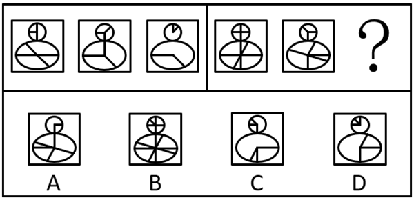

A. A

B. B

C. C

D. D

第 64 题 · 答案与解析

**参考答案（粉笔题库参考内容）**

D

**解析**

元素组成相似，优先考虑样式规律中的加减同异。第一组图中，图1与图2上方圆形外框和下方椭圆形外框均不变，上方圆形内部线条求异，下方椭圆形内部线条求同得到图3，第二组图运用此规律，只有D项符合。

故正确答案为D。

**考点**：样式规律-加减同异

**来源**：2025年上海市公务员录用考试《行测》题（B类）（网友回忆版）第64题

### 第 65 题

下列选项中，符合所给图形变化规律的是：

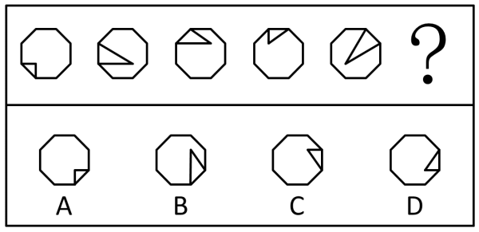

A. A

B. B

C. C

D. D

第 65 题 · 答案与解析

**参考答案（粉笔题库参考内容）**

D

**解析**

元素组成基本相同，优先考虑位置规律。观察发现，题干图形均由一个八边形外框和内部的两条直线组成，如下图所示，内部两条直线的端点依次沿外框顺时针移动1格，内部两条直线的交点依次沿内部正方形路径逆时针移动1格，只有D项符合。

故正确答案为D。

**考点**：位置规律-平移

**来源**：2025年上海市公务员录用考试《行测》题（A类）（网友回忆版）第65题

### 第 66 题

以下是同一个立方体的不同视角，则“？”处的图形是：

A. A

B. B

C. C

D. D

第 66 题 · 答案与解析

**参考答案（粉笔题库参考内容）**

A

**解析**

本题为空间重构题，如下图所示。

根据图1和图3中“T”字的方向可知，图1中“E”字面和“T”字面的公共边平行于“T”字面中“T”字的横线，图3中“T”字面和“X”字面的公共边垂直于“T”字面中“T”字的竖线，故“E”字面与“X”字面为相对面，同理，根据图1和图2中“E”的方向可知，“T”字面和“V”字面也为相对面。由于相对面不可能同时出现，也不可能同时不出现，故？处应为“T”字或“V”字，结合选项可知，？处应为“V”字，排除B、C两项。根据图2可知，“V”字中“V”的开口指向的面不是“X”字，排除D项，只有A项符合。

故正确答案为A。

**考点**：空间类-空间重构-六面体

**来源**：2025年上海市公务员录用考试《行测》题（B类）（网友回忆版）第70题

### 第 67 题

下列选项中，与左图的关系与众不同的是：

A. A

B. B

C. C

D. D

第 67 题 · 答案与解析

**参考答案（粉笔题库参考内容）**

C

**解析**

题干和选项元素组成相同，优先考虑位置规律。对题干和选项按照→→→的顺序画时针，观察发现，题干与A、B、D三项均为顺时针，C项为逆时针，故只有C项与题干的关系不同。

本题为选非题，故正确答案为C。

**考点**：位置规律-旋转

**来源**：2025年上海市公务员录用考试《行测》题（B类）（网友回忆版）第69题

### 第 68 题

下列选项中，符合所给图形变化规律的是：

A. A

B. B

C. C

D. D

第 68 题 · 答案与解析

**参考答案（粉笔题库参考内容）**

C

**解析**

元素组成相似，优先考虑样式规律。观察第一组图形发现，图1与图2叠加后保留相同部分得到图3，第二组图形应用此规律，故？处图形应为图1与图2叠加后保留相同部分得到，只有C项符合。

故正确答案为C。

**考点**：样式规律-加减同异

**来源**：2025年上海市公务员录用考试《行测》题（A类）（网友回忆版）第68题

### 第 69 题

下列选项中，符合所给图形变化规律的是：

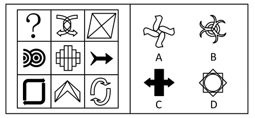

A. A

B. B

C. C

D. D

第 69 题 · 答案与解析

**参考答案（粉笔题库参考内容）**

A

**解析**

元素组成不同，优先考虑属性规律。观察发现，题干图形较规整，且出现等腰元素，优先考虑对称性。横行和竖列单独看没有规律，且中间图形为既轴对称又中心对称图形，可以考虑“米”字型看。第二行均为横轴对称图形，第二列均为竖轴对称图形，“米”字型对角处的三个图形均为仅中心对称图形，则？处也应该选择仅中心对称图形，只有A项符合。

故正确答案为A。

**考点**：属性规律-对称性

**来源**：2025年上海市公务员录用考试《行测》题（B类）（网友回忆版）第66题

### 第 70 题

下列选项中，属于上图的俯视图的是：

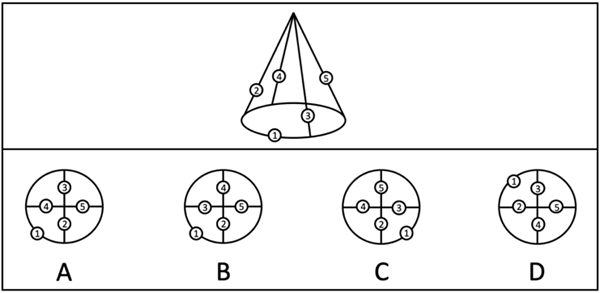

A. A

B. B

C. C

D. D

第 70 题 · 答案与解析

**参考答案（粉笔题库参考内容）**

C

**解析**

本题考查三视图中的俯视图，即从所给图形的正上方向下观察得到的视图。观察上方所给图形发现，从正上方向下观察，数字2-4-5-3为顺时针方向，且1号位应处于2号位和3号位之间，只有C项符合。

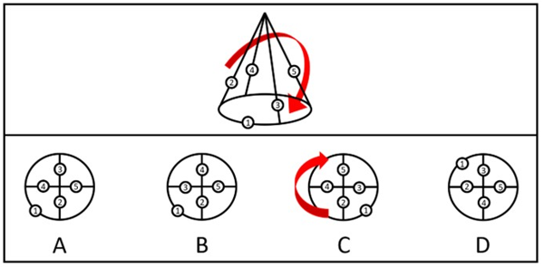

故正确答案为C。

**考点**：空间类-三视图

**来源**：2025年上海市公务员录用考试《行测》题（A类）（网友回忆版）第70题

### 第 71 题

空气炸锅是一种新型的厨房电器，其工作原理是通过电加热元件将空气加热到高温，然后利用内置的风扇将热空气快速循环，使食物表面均匀受热。食物表面的水分在高温下迅速蒸发，形成一层类似油炸后的脆皮。现有甲、乙两种空气炸锅，它们的结构和功率相同，但甲炸锅的风扇转速为2000转/分钟，而乙炸锅的风扇转速为3000转/分钟。在使用过程中，发现甲炸锅炸制的食物表面略显粗糙，而乙炸锅炸制的食物表面较为光滑。

根据空气炸锅的工作原理，以下（ ）种解释最合理。

A. 甲炸锅的风扇转速较低，热空气循环不够快，导致食物表面受热不均匀

B. 乙炸锅的风扇转速较高，热空气循环过快，导致食物表面水分蒸发不完全

C. 风扇转速的差异不会影响食物表面的质地，两种炸锅炸制的食物应该没有区别

D. 乙炸锅的风扇转速较高，热空气对食物表面的冲击力更小，从而使表面更加光滑

第 71 题 · 答案与解析

**参考答案（粉笔题库参考内容）**

A

**解析**

根据题意可知，甲、乙两种空气炸锅的结构和功率相同，所以单位时间内加热元件产生的热量以及热空气在锅内的损耗均相同；当空气炸锅炸制食物时，风扇带动热空气循环，当热空气接触到食物后，因食物表面水分迅速蒸发，吸收大量的热，导致热空气的温度下降，待气体循环至加热元件处温度再次升高，如此循环直至完成食物的加热；由于热空气在通过食物表面时会逐渐降温，就容易导致食物表面各处受热不均匀，引起表面粗糙的现象，加快热空气的循环速度，有利于热空气保持相对恒定的温度，让食物表面趋于光滑。甲、乙两种炸锅相比，甲炸锅风扇的转速较低，热空气循环不够快，所以食物表面略显粗糙，A项正确，B、C、D三项均错误。

故正确答案为A。

**来源**：2025年上海市公务员录用考试《行测》题（A类）（网友回忆版）第71题

### 第 72 题

地球上的山峰由于自身重力因素，导致山峰的高度存在极限。山峰越高，山体的重量就越大，山体的底部所需要承受的压力也就越大，当压力超过了岩石所能承受的极值，山体就会崩塌。假设山体下方是最坚硬的花岗岩，其抗压强度约为2000kg/cm^2。假设将山体等效为一个圆锥体，山体密度约为3g/cm^3，重力加速度g≈10m/s²，则理想情况下地球山峰极限高度约为：

A. 8848m

B. 20000m

C. 50000m

D. 200000m

第 72 题 · 答案与解析

**参考答案（粉笔题库参考内容）**

B

**解析**

根据题干信息可知，山体的密度，花岗岩的抗压强度为。

设圆锥体山体的底面半径为r，高为h，根据圆的面积公式可知，山体的底面积为πr^2，根据圆锥的体积公式可知，山体的体积为1/3πr^2h，根据质量公式m=ρV可知，山体的质量为，则此时花岗岩单位面积上承受的质量为，根据题干信息可知，花岗岩的抗压强度应小于等于，故可得，即，故山峰的极限高度为20000m。

故正确答案为B。

**来源**：2025年上海市公务员录用考试《行测》题（B类）（网友回忆版）第74题

### 第 73 题

膜分离技术是指不同粒径分子的混合物在通过半透膜时，实现选择性分离的技术，膜分离技术在食品加工、海水淡化、纯水、超纯水制备、医药、生物、环保等领域得到了较大规模的开发和应用。下图是关于不同膜分离方法适用分离物质的信息，据此下列选项错误的是：

A. 使用微滤技术可拦截水中的细菌

B. 使用超滤技术可拦截水中的金属离子

C. 使用纳滤技术可拦截水中的病毒

D. 使用反渗透技术可拦截水中的糖

第 73 题 · 答案与解析

**参考答案（粉笔题库参考内容）**

B

**解析**

膜分离技术是指在分子水平上，不同粒径分子的混合物在通过半透膜时，实现选择性分离的技术，半透膜又称分离膜或滤膜，膜壁布满小孔，根据孔径大小可以分为：微滤膜、超滤膜、纳滤膜、反渗透膜等类型，根据半透膜类型形成对应的分离方法。

图中给出一般材料的相对尺寸及分离方法的孔径。其中，埃是一个长度单位，主要用来计量微小长度，1埃等于0.1纳米。如图所示，若分离物质的粒径大于分离方法对应的孔径，那么该物质就会被有效拦截在半透膜上。

A项：细菌的粒径大于微滤技术对应的孔径，可以被拦截，正确；

B项：金属离子的粒径小于超滤技术对应的孔径，不能被拦截，错误；

C项：病毒的粒径大于纳滤技术对应的孔径，可以被拦截，正确；

D项：糖类物质的粒径大于反渗透技术对应的孔径，可以被拦截，正确。

本题为选非题，故正确答案为B。

**来源**：2025年上海市公务员录用考试《行测》题（B类）（网友回忆版）第80题

### 第 74 题

“复兴号”高铁采用了多种减振降噪技术，包括优化车体结构、使用隔振材料、主动控制等。其中，隔振是通过在振动源和受保护对象之间引入弹性元件（如弹簧）和耗能元件（如阻尼器）来减小振动传递的方法。车厢可视为一个质量为M的刚体，通过4个相同的弹簧支撑在两个轮对上，每个弹簧的劲度系数为k，劲度系数k表示弹簧的刚度，k越大，弹簧越难压缩。车厢受到周期性的轨道激励，激励频率为f。为了减小车厢的振动，工程师在弹簧上并联了阻尼器，每个阻尼器的阻尼系数为e，阻尼系数e表示阻尼器对运动的阻碍程度，e越大，振动衰减得越快。

如果不考虑轮轨相互作用和其他因素，下列说法中正确的是：

A. 增大弹簧劲度系数k，可以减小车厢的振动幅度

B. 增大阻尼系数e，会增大车厢的振动幅度

C. 车厢的固有频率只与劲度系数k有关，与质量M无关

D. 当激励频率f接近车厢的固有频率时，会发生共振，车厢振动幅度最大

第 74 题 · 答案与解析

**参考答案（粉笔题库参考内容）**

D

**解析**

A项：由题干信息“弹簧的劲度系数k越大，弹簧越难压缩”可知，高铁在行驶过程中，弹簧需要通过适当的变形来减小车厢的振幅，弹簧的劲度系数k越大，弹簧压缩越困难，形变越困难，即无法通过形变达到为车厢减震的目的，因此“增大弹簧劲度系数k，可以减小车厢的振动幅度”错误；

B项：由题干信息“阻尼系数e越大，振动衰减得越快”可知，增大阻尼系数e时，车厢的振动衰减变快，振动幅度会减小，错误；

C项：车厢的固有频率与车厢本身的材料、结构与质量有关（质量增大，结构的固有频率降低），与弹簧的劲度系数k无关，错误；

D项：共振是指机械所受的激励频率与该系统的固有频率相接近时，系统振幅显著增大的现象，因此当激励频率f接近车厢的固有频率时，会发生共振，车厢振动幅度最大，正确。

故正确答案为D。

**来源**：2025年上海市公务员录用考试《行测》题（B类）（网友回忆版）第72题

### 第 75 题

量子隧穿是量子力学中的一种奇特现象，指粒子可以穿透本应无法逾越的势垒。假设有一个势垒，其高度为V_0，宽度为d，一束能量为E的电子打向这个势垒。根据经典力学，只有当电子能量E大于势垒高度V_0时，电子才能通过势垒。但根据量子力学，即使E＜V_0，电子也有一定概率通过势垒，这就是量子隧穿效应。量子隧穿的概率P与势垒参数有关，近似公式为：。其中，m为电子质量，h为约化普朗克常数。现有甲、乙、丙三个势垒，高度均为V_0，宽度分别为d、2d、4d。如果一束能量为E（E＜V_0）的电子依次打向这三个势垒，电子隧穿概率最大的是：

A. 甲势垒

B. 乙势垒

C. 丙势垒

D. 三个势垒隧穿概率相同

第 75 题 · 答案与解析

**参考答案（粉笔题库参考内容）**

A

**解析**

在公式：中，“α”是一种数学符号，表示与某个量成正比关系，因此的值越大，概率P就越大，函数是减函数，y会随着x的增大而减小。

结合题干可知，m、V_0、E、h均不变，即不变，d越小，的值越大，概率P也就越大，甲、乙、丙三个势垒的宽度分别为d、2d、4d，甲势垒的宽度d最小，因此电子遂穿概率最大的是甲势垒。

故正确答案为A。

**来源**：2025年上海市公务员录用考试《行测》题（B类）（网友回忆版）第73题

### 第 76 题

如图所示，根据科学家们的设想，太空电梯应该是从距离地面3.6万公里的地球同步卫星轨道向地面垂下一条缆绳至地面基站，并沿着这条缆绳修建往返于地球和太空之间的电梯型飞船，往来运输物资。则下列关于太空电梯说法错误的是：

A. 太空电梯的基座应设置在赤道附近最佳

B. 太空电梯会和地球自转同步，且越高的地方速度越快

C. 电梯缆绳的材料是制约我们建造太空电梯的主要困难之一

D. 配重空间站的轨道高于同步空间站轨道的目的是用来抵消缆绳重力

第 76 题 · 答案与解析

**参考答案（粉笔题库参考内容）**

D

**解析**

A项：由于地球同步轨道位于赤道上空，由题干信息可知，缆绳与地球同步卫星轨道垂直，因此地面基站需设置在赤道附近以保证缆绳垂直悬挂并与地球自转同步，正确；

B项：由于太空电梯通过缆绳与地球相连，因此会和地球自转同步，即与地球自转的角速度ω相同，根据线速度与角速度的关系v=ωr可知，半径r越大，线速度v越大，因此越高的地方速度越快，正确；

C项：要建造如此长的太空电梯，需要强度极高、重量极轻、能够承受极大拉力等性能非常优异的材料来制作缆绳，而目前这种材料还很难找到，所以电梯缆绳的材料是制约建造太空电梯的主要困难之一，正确；

D项：由于配重空间站和同步空间站通过缆绳相连，由B项分析可知，配重空间站与同步空间站转动的角速度ω相同。而配重空间站的轨道更高，半径r更大，根据向心力公式可知，配重空间站所需的向心力也更大，但由于配重空间站轨道更高，受到的万有引力更小，不足以提供向心力，导致配重空间站有向外做离心运动的趋势，因此就会通过缆绳为整个太空电梯系统提供向外的拉力，使缆绳处于绷紧状态，维持整套装置的稳定性，这是其主要作用，并非仅仅用来抵消缆绳重力，错误。

本题为选非题，故正确答案为D。

**来源**：2025年上海市公务员录用考试《行测》题（B类）（网友回忆版）第77题

### 第 77 题

根据乙醚、正丁醇、乙二醇、乙醇、乙硫醇的结构简式和分子量，比较不同有机物的沸点。下列推断错误的是：

A. 1和2说明：分子量相同，含有羟基（-OH）的物质的沸点更高

B. 2和4说明：羟基（-OH）的数量相同时，分子量越大，沸点越高

C. 2和3说明：羟基（-OH）的数量越多，沸点越高

D. 4和5说明：羟基（-OH）对沸点的影响小于分子量对沸点的影响

第 77 题 · 答案与解析

**参考答案（粉笔题库参考内容）**

D

**解析**

A项：1是乙醚（分子量74，沸点35°C，不含羟基），2是正丁醇（分子量74，沸点118°C，含1个羟基），二者分子量相同，含有羟基的正丁醇沸点更高，说明分子量相同，含有羟基的物质的沸点更高，正确；

B项：2是正丁醇（分子量74，沸点118°C，含1个羟基），4是乙醇（分子量46，沸点78°C，含1个羟基），二者含有羟基的数量相同，正丁醇的分子量更大，沸点更高，说明羟基的数量相同时，分子量越大，沸点越高，正确；

C项：2是正丁醇（分子量74，沸点118°C，含1个羟基），3是乙二醇（分子量62，沸点197°C，含2个羟基），乙二醇虽分子量更小，但因含有的羟基数量比正丁醇多，沸点更高，说明羟基的数量越多，沸点越高，正确；

D项：4是乙醇（分子量46，沸点78°C，含1个羟基），5是乙硫醇（分子量62，沸点37 °C，不含羟基），乙醇虽分子量更小，但因含羟基，沸点比乙硫醇高，说明羟基对沸点的影响大于分子量对沸点的影响，错误。

本题为选非题，故正确答案为D。

**来源**：2025年上海市公务员录用考试《行测》题（B类）（网友回忆版）第78题

### 第 78 题

某人利用同一充电宝的无线充电与有线充电功能分别给同款手机充电。充电电压视为恒定，记录的充电量与充电时间如下图所示。则下列判断正确的是：

A. 图中曲线和时间轴所围成的面积代表充电电流

B. 图中曲线和时间轴所围成的面积代表充电电流所做的功

C. 从1%充到93%，两者充入的电荷量不同

D. 从1%充到93%，两者充入的电能相同

第 78 题 · 答案与解析

**参考答案（粉笔题库参考内容）**

D

**解析**

由图可知，纵轴的手机电量为充入的电荷量，通常用Q表示，横轴为充电的时间，通常用t表示。

A项：根据电流定义公式I=Q/t可知，纵轴Q与横轴t的比值代表充电电流，即图线的斜率表示充电电流，并非图中曲线和时间轴所围成的面积（Qt），错误；

B项：根据电流定义公式I=Q/t和电流做功的公式W=UIt可知，电流做功的公式可表示为W=UQ，即充电电流所做的功等于充电电压与充入电荷量的乘积，并非图中曲线和时间轴所围成的面积（Qt），错误；

C、D两项：由于手机相同，电池的容量相同，因此从1%充到93%，两者充入的电荷量Q相同，均为92%，又因为充电电压视为恒定，充入的电能也就相同，C项错误，D项正确。

故正确答案为D。

**来源**：2025年上海市公务员录用考试《行测》题（B类）（网友回忆版）第71题

### 第 79 题

疏水是指物质表面或分子与水之间的相互排斥作用，这种作用导致物质表面或分子不易与水接触或溶解。以下是几种基团对疏水性的影响：

烷基（如-CH_3）：由于其非极性特性，烷基通常增加分子的疏水性。

酯基（如-COOCH_3）：虽然酯基含有极性官能团，但整体上它们倾向于减少分子的水溶性，表现出一定的疏水性。

羟基（-OH）：极性基团，容易与水分子形成氢键，表现出亲水性。

现在，考虑一个新的基团：硫醇基（-SH），这种基团含有硫原子和氢原子。

根据上述信息和化学知识，关于硫醇基的疏水性描述正确的是：

A. 含有极性基团，预计与羟基相似，具有亲水性

B. 含有硫原子，预计与烷基相似，具有疏水性

C. 含有氢原子，预计与烷基相似，具有疏水性

D. 硫原子的电负性较低，表现出亲水性

第 79 题 · 答案与解析

**参考答案（粉笔题库参考内容）**

A

**解析**

硫醇基（-SH）与羟基（-OH）的结构相似，且氧元素和硫元素是同一主族的元素，故硫醇基（-SH）和羟基（-OH）的性质有一定的相似性。因为羟基（-OH）是极性基团，具有亲水性，且硫醇基（-SH）也是极性基团，所以预计硫醇基（-SH）具有亲水性，A项正确，B、C、D三项均错误。

故正确答案为A。

**来源**：2025年上海市公务员录用考试《行测》题（A类）（网友回忆版）第79题

### 第 80 题

买衣服的吊牌、买菜的时候标价的标签、外卖单的标签都是热敏纸，热敏纸上面涂有一种材料（结晶紫内酯），在遇热时会发生如下化学反应，从而显现出颜色。该反应是可逆反应，会由于各种原因造成褪色。根据上述信息，下列关于热敏纸小票描述正确的是：

A. 甲在加热时，颜色会从无色变为有色，因此刚打印的小票是热的

B. 乙在光照下，颜色会从有色变为无色，因为重新形成了内酯环

C. 甲在紫外光照下，颜色会从无色变为有色，因此小票可以放在室外暴晒

D. 乙在酸性条件下更稳定，不易褪色，因此可以将小票放在酸性环境中

第 80 题 · 答案与解析

**参考答案（粉笔题库参考内容）**

A

**解析**

结晶紫内酯是一种常用于热敏纸的显色材料，其颜色变化不仅受温度影响，也受到光照、酸碱性的影响。在加热或光照或酸性条件下，结晶紫内酯会发生化学反应，由无色变成紫色。

A项：热敏打印机通过局部加热，使热敏纸中无色的甲物质（结晶紫内酯）变成紫色的乙物质，从而显色，因此刚打印出的小票是热的，正确；

B项：在光照条件下，只会使热敏纸中无色的甲物质变成紫色的乙物质，无法使乙物质变成甲物质，错误；

C、D两项：在紫外线光照条件下或酸性环境下，热敏纸中无色的甲物质会变成紫色的乙物质，因此在室外暴晒或放在酸性环境中，整张小票都会变色，使小票上原本的字迹反而无法辨认，均错误。

故正确答案为A。

**来源**：2025年上海市公务员录用考试《行测》题（B类）（网友回忆版）第76题

### 第 81 题

在某款风靡世界的电子竞技游戏领域里，来自中国的PLG战队与来自韩国的JEN战队被大部分玩家认为是世界上最顶尖的队伍。但这两队从未交手过，不过他们都曾经与欧洲最强G3战队有过交锋。其中PLG战队以3-2和3-1两次战胜G3，而JEN则是两次均以2-3憾负G3。因此许多玩家认为，PLG的实力强于JEN，一定会在比赛中战胜后者。

上述论点的论证方式与合理性和以下（ ）项最为类似。

A. 在UFC赛场上，甲的地面技术强于乙，而丙的地面技术不如乙，因此甲的地面技术强于丙

B. 作为奥数竞赛的常客，小张的竞赛成绩好于小李，而小明的竞赛成绩则不如小李。因此小张很有可能在下一次的奥数竞赛中比小明取得更好的成绩

C. 在亚洲的足球队里，韩国队打越南队的战绩有压倒性优势，而中国队面对越南队则输多赢少，因此中国队应该踢不赢韩国队

D. 人民币升值的同时，日元正在贬值，因此现在中国人去日本旅游比以前更经济实惠

第 81 题 · 答案与解析

**参考答案（粉笔题库参考内容）**

C

**解析**

第一步：分析题干论证结构。

题干根据PLG战队与G3战队的对战中PLG战队的战绩更佳，G3战队与JEN战队的对战中G3战队的战绩更佳，得到结论认为PLG战队能战胜JEN战队。即通过过往对第三方的战绩串联来判断两者未来的对局结果。

第二步：逐一分析选项。

A项：该项根据甲的技术强于乙，乙的技术强于丙，得到结论认为甲的技术强于丙，即通过三人之间的技术强弱比较得出其中两人的技术强弱情况，但不是通过过去判断未来，且“技术强弱”与“战绩”“对局结果”的话题均不一致，与题干论证结构不一致，排除；

B项：该项根据小张的竞赛成绩好于小李，小李的竞赛成绩好于小明，得到结论认为下次小张的竞赛成绩好于小明，虽然是通过过往信息串联来判断未来结果，但“竞赛成绩”不涉及双方对战，与“战绩”“对局结果”的话题均不一致，与题干论证结构不一致，排除；

C项：该项根据韩国队与越南队的对战中韩国队的战绩更佳，越南队与中国队的对战中越南队的战绩更佳，得到结论认为韩国队能赢过中国队，即通过过往战绩串联来判断未来的对局结果，与题干论证结构一致，当选；

D项：该项根据人民币升值和日元贬值，得到结论认为现在中国人去日本旅游比以前更经济实惠，但不是通过过去判断未来，且“货币的升值贬值”与“战绩”“对局结果”的话题均不一致，与题干论证结构不一致，排除。

故正确答案为C。

**考点**：论证结构

**来源**：2025年上海市公务员录用考试《行测》题（B类）（网友回忆版）第81题

### 第 82 题

众所周知，随着年龄的增加，人体会逐渐老化，健康状况也会下降。而关于“年龄”的概念，除了通常的时序年龄之外，还有所谓的“生物学年龄”，生物学年龄是指反映人体组织或器官结构与功能状况的年龄。近期一篇研究计算了英国生物样本库中341159名志愿者的心血管生物学年龄，进而发现随着生物学年龄的增加，他们罹患心血管疾病并因此死亡的风险都会增加，而志愿者的时序年龄却差异很大。因此有不少人认为，生物学年龄比时序年龄总体上更能反映出人体的健康状况。

为了使此论点成立，需要补充的前提是（ ）。

A. 有研究表明部分孕妇的生物学年龄会在生育结束后下降

B. 已有多个研究证实了生物学年龄与人体健康状况的正相关性

C. 没有证据表明时序年龄越大的人生物学年龄一定会越大

D. 研究表明时序年龄大但生物学年龄较小的个体罹患疾病的风险小于同龄个体

第 82 题 · 答案与解析

**参考答案（粉笔题库参考内容）**

D

**解析**

第一步：找出论点和论据。

论点：生物学年龄比时序年龄总体上更能反映出人体的健康状况。

论据：随着生物学年龄的增加，志愿者罹患心血管疾病并因此死亡的风险都会增加，而志愿者的时序年龄却差异很大。

本题论点和论据均在讨论“生物学年龄比时序年龄更能反映健康状况”，论点论据话题一致，加强优先考虑补充论据。

第二步：逐一分析选项。

A项：选项指出部分孕妇的生物学年龄会在生育结束后下降，但未提及这些孕妇的身体健康状况，不明确项，无法加强，排除；

B项：选项指出有研究证实了生物学年龄与人体健康状况的正相关性，说明生物学年龄确实能够反映人体的健康状况，但没有跟时序年龄进行比较，不明确哪一个更能反映人体的健康状况，不明确项，无法加强，排除；

C项：选项指出没有证据表明时序年龄越大的人生物学年龄一定会越大，但不清楚时序年龄与生物学年龄的明确关系，且未提及这些人的身体健康状况，不明确项，无法加强，排除；

D项：选项指出时序年龄大但生物学年龄较小的个体罹患疾病的风险小于同龄个体，说明个体罹患疾病的风险与生物学年龄的关系更紧密，即生物学年龄比时序年龄更能反映出人体的健康状况，补充论据，可以加强，当选。

故正确答案为D。

**考点**：补充论据

**来源**：2025年上海市公务员录用考试《行测》题（A类）（网友回忆版）第82题

### 第 83 题

尽管越来越多的人已经认识到中西医各有优势，未来可更多地走向融合与互相补充，但在中医拥趸者和西医拥趸者之间依然经常发生激烈地辩论想要证明中医优于西医或者西医优于中医。一些中医拥趸者认为，中医是经过数千年实践验证的科学。古代没有西医，中国古人就是靠中医治病的，这是中医有效的历史证明，而且中医不光治标而且治本，能解决西医无法解决的问题。一些西医拥趸者认为，中医的基础理论是经验的、非科学的，中国古代人的平均寿命只有30多岁，正是有了西医之后中国人寿命才大幅提升。

如果西医拥趸者的理由是有效的，则以下除（ ）项外，都是蕴含在其陈述中的逻辑前提。

A. 医疗水平高低是决定寿命长短的最关键因素

B. 中国古代人的平均寿命低是由于中医效果差造成的

C. 科学的医疗在于能够把握疾病的规律

D. 中医治病的效果没有西医好

第 83 题 · 答案与解析

**参考答案（粉笔题库参考内容）**

C

**解析**

第一步：找出论点和论据。

论点：中医的基础理论是经验的、非科学的，中国古代人的平均寿命只有30多岁，正是有了西医之后中国人寿命才大幅提升。

论据：无。

本题只有论点，没有论据，且提问方式为“前提”，加强优先考虑必要条件。

第二步：逐一分析选项。

A项：如果医疗水平高低不是决定寿命长短的最关键因素，则西医拥趸者就无法通过中国古代人的平均寿命低，就得出中医的基础理论是经验的、非科学的，该项是论点成立的必要条件，可以加强，排除；

B项：如果中国古代人的平均寿命低不是由于中医效果差造成的，则西医拥趸者就无法根据中国古代人的平均寿命低来贬低中医的治病效果，该项是论点成立的必要条件，可以加强，排除；

C项：该项指出科学的医疗在于能够把握疾病的规律，而论点讨论的是中医和西医对寿命长短的影响以及中医理论是否科学，话题不一致，当选；

D项：该项说中医治病的效果没有西医好，说明西医更好，补充论据，可以加强，排除。

本题为选非题，故正确答案为C。

**考点**：加强选非题

**来源**：2025年上海市公务员录用考试《行测》题（B类）（网友回忆版）第86题

### 第 84 题

某媒体以《中国科学家算出月球年龄：20.3亿岁！》为题，对中国科学家团队通过对嫦娥五号采集的月球样品的研究作了报道。报道中提到，中国的研究者精确测定了嫦娥五号采集的月壤中的玄武岩样品的年龄是20.3亿年。而科学界普遍认为，月球的实际年龄在40亿年以上，且接近45亿年。

以下（ ）项最能说明中国科学家的研究与科学界关于月球年龄的普遍认识不冲突，该媒体报道有偏差。

A. 嫦娥五号采集的月壤地质年龄太短

B. 月壤年龄和月球年龄不是一回事

C. 中国的研究者对月壤年龄的测定是错误的

D. 科学界关于月球实际年龄的普遍认识是错误的

第 84 题 · 答案与解析

**参考答案（粉笔题库参考内容）**

B

**解析**

第一步：找出题干矛盾。

提问方式为：说明“中国科学家”的研究与“科学界”关于月球年龄的普遍认识不冲突，该媒体报道有偏差。

其中“中国科学家”的研究结论是：精确测定了嫦娥五号采集的月壤中的玄武岩样品的年龄是20.3亿年；

而“科学界”普遍认为：月球的实际年龄在40亿年以上，且接近45亿年。

总结矛盾：中国科学家精确测定了“月壤”的年龄是20.3亿年，科学界普遍认为“月球”的实际年龄在40亿年以上，且接近45亿年，这两者为什么不冲突。

第二步：逐一分析选项。

A项：该项指出嫦娥五号采集的月壤地质年龄太短，但没有说明月壤年龄和月球年龄之间的关系，不能解释题干矛盾，排除；

B项：该项指出月壤年龄和月球年龄不是一回事，说明中国科学家测定的20.3亿年是月壤的年龄，而科学界普遍认为的40亿年以上是月球的实际年龄，两者并不相同，因此中国科学家的研究与科学界的普遍认识之间并不冲突，媒体报道确实存在偏差，可以解释题干矛盾，当选；

C项：该项指出中国研究者对月壤年龄的测定是错误的，那么就无法确定月壤的真实年龄，但无法解释与科学界的普遍认识之间不冲突的原因，不能解释题干矛盾，排除；

D项：该项指出科学界关于月球实际年龄的普遍认识是错误的，那么就无法确定月球的真实年龄，但无法解释与中国研究者对月壤年龄的测定之间不冲突的原因，不能解释题干矛盾，排除。

故正确答案为B。

**考点**：原因解释

**来源**：2025年上海市公务员录用考试《行测》题（B类）（网友回忆版）第87题

### 第 85 题

大约3.75亿年前，长相滑稽的提塔利克鱼利用一种新颖的适应环境的方式冒险上了岸：有裂片的鳍推动它在陆地上“行走”，咽喉的气囊（原始的肺）让它能在空气中“呼吸”。提塔利克鱼实际上也有鳃，而且被认为是已知最早的四足动物的共同祖先，在数亿年的时间里，四足动物衍生出无数物种，包括智人。那么如果人类是从鱼进化而来的，为什么没有鳃呢？其中的一个较弱的解释是因为肺对于陆地生活具有显著优势。

以下（ ）项如果为真，最能支持上述解释。

A. 只有有肺的鱼才能上岸到达陆地，并在陆地上存活下来

B. 人类胚胎有一个生理特征：类似鳃的被称为咽弓的细小褶皱

C. 鳃有很大的表面积和数以千计的微小血管，使氧气很容易进入血液

D. 虽然鳃擅长从水中提取氧气，但它提供的氧气量较少，不适合体型较大的动物

第 85 题 · 答案与解析

**参考答案（粉笔题库参考内容）**

A

**解析**

第一步：找出论点和论据。

论点：人类从鱼进化而来却没有鳃的原因是肺对于陆地生活具有显著优势。

论据：无。

本题只有论点，没有论据，加强优先考虑补充论据。

第二步：逐一分析选项。

A项：该项指出只有有肺的鱼才能上岸到达陆地，并在陆地上存活下来，说明靠鳃无法在陆地存活，突出肺对于陆地生活更有优势，补充论据，可以加强，当选；

B项：该项指出人类胚胎有类似鳃的生理特征，而论点讨论的是人类没有鳃的原因是肺对于陆地生活更有优势，为无关项，无法加强，排除；

C项：该项指出鳃使得氧气很容易进入血液的原理，而论点讨论的是人类没有鳃的原因是肺对于陆地生活更有优势，为无关项，无法加强，排除；

D项：该项指出鳃提供的氧气量较少，不适合体型较大的动物，仅说明鳃的不足，即供氧量不适合大体型动物，没有体现与肺的比较以及肺对于陆地生活是否更具优势，而A项直接说明了肺对于陆地生活的优势，D项加强力度不如A项，排除。

故正确答案为A。

**考点**：补充论据

**来源**：2025年上海市公务员录用考试《行测》题（B类）（网友回忆版）第83题

### 第 86 题

所有经济学专业的学生都必须修读微观经济学课程；所有修读微观经济学课程的学生都参加了期末考试。有些金融学专业的学生也修读了微观经济学课程。所有统计学专业的学生都没有修读微观经济学课程。

如果以上判定为真，以下（ ）项说法一定为假。

A. 一个学生参加了期末考试，但并非是统计学专业的学生

B. 一个统计学专业的学生没有修读微观经济学课程

C. 一个金融学专业的学生参加了期末考试

D. 一个统计学专业的学生修读了微观经济学课程

第 86 题 · 答案与解析

**参考答案（粉笔题库参考内容）**

D

**解析**

第一步：翻译题干。

（1）经济学专业学生→修读微观经济学课程；

（2）修读微观经济学课程→参加期末考试；

（3）有的金融学专业学生→修读微观经济学课程；

（4）统计学专业学生→-修读微观经济学课程。

第二步：逐一分析选项。

A项：将条件（2）等价换位为“有的参加期末考试→修读微观经济学课程”，将条件（4）逆否等价为“修读微观经济学课程→-统计学专业学生”，二者进行串联可得条件（5）：有的参加期末考试→修读微观经济学课程→-统计学专业学生。因此可得一个学生参加了期末考试，但并非是统计学专业的学生，故该项表述为真，排除；

B项：统计学专业学生是对条件（4）的肯前，肯前必肯后，可得该学生没有修读微观经济学课程，故该项表述为真，排除；

C项：将条件（2）和（3）进行串联可得条件（6）：有的金融学专业学生→修读微观经济学课程→参加期末考试。因此可得一个金融学专业的学生参加了期末考试，故该项表述为真，排除；

D项：统计学专业学生是对条件（4）的肯前，肯前必肯后，可得该学生没有修读微观经济学课程，该项表述一定为假，当选。

本题为选非题，故正确答案为D。

**考点**：集合推理

**来源**：2025年上海市公务员录用考试《行测》题（B类）（网友回忆版）第85题

### 第 87 题

假日期间，新能源汽车排队在高速服务区充电的场景冲上了热搜，新能源汽车里程焦虑问题引发人们的热议。一份针对新能源汽车消费的网络调查也显示，有85%的受访者表示存在里程焦虑，主要表现为担心新能源汽车续航里程不够长、充电设施不好找、充电补能速度慢，48%的受访者表示担心新能源汽车的电池安全问题，29%的受访者比较关注充电价格上涨导致的用车成本问题。上述调查表明，里程焦虑已经是新能源汽车使用者面临的最大问题。

以下（ ）项为真，最能质疑论述中的结论。

A. 目前市场上有些新能源汽车的续航里程已经高达1000公里

B. 国家正在大力推进充电桩的建设布局，高速服务区充电桩数量已经能满足充电需求

C. 新能源汽车超压充电技术已经实现了5分钟充电可续航300公里

D. 实际购买新能源汽车的人只占了受访者的3%

第 87 题 · 答案与解析

**参考答案（粉笔题库参考内容）**

D

**解析**

第一步：找出论点和论据。

论点：里程焦虑已经是新能源汽车使用者面临的最大问题。

论据：一份针对新能源汽车消费的网络调查也显示，有85%的受访者表示存在里程焦虑，主要表现为担心新能源汽车续航里程不够长、充电设施不好找、充电补能速度慢，48%的受访者表示担心新能源汽车的电池安全问题，29%的受访者比较关注充电价格上涨导致的用车成本问题。

本题论点和论据都是在讨论“里程焦虑是否是新能源汽车使用者面临的最大问题”，二者话题一致，削弱优先考虑削弱论点，也可以考虑削弱论据。

第二步：逐一判断选项。

A项：该项指出目前市场上有些新能源汽车的续航里程已经高达1000公里，说明新能源汽车中存在较长续航里程的车辆，针对论据中“续航里程不够长”进行削弱，可以削弱，保留；

B项：该项指出国家正在大力推进充电桩的建设布局，高速服务区充电桩数量已经能满足充电需求，说明充电桩的推进可以适当解决里程焦虑一方面的问题，针对于论据中“充电设施不好找”进行削弱，可以削弱，保留；

C项：该项指出新能源汽车超压充电技术已经实现了5分钟充电可续航300公里，说明新能源汽车充电技术有进步，针对于论据中“充电补能速度慢”进行削弱，可以削弱，保留；

D项：该项指出实际购买新能源汽车的人只占受访者的3%，说明调查样本数量不足，不具有代表性，可以削弱，保留。

对比A、B、C、D项，A、B、C项均针对于里程焦虑中的某一个部分进行削弱，D项对于整体调查进行削弱，D项更全面。

故正确答案为D。

**考点**：削弱-实验类、削弱论据

**来源**：2025年上海市公务员录用考试《行测》题（A类）（网友回忆版）第87题

### 第 88 题

为了使孩子能够得到更好的培养，一对年轻的夫妇比较了4个有相同课程设置的培训机构之后得出以下结论：

①甲培训机构的儿童运动课程是最好的，而且儿童思维课程不比丙培训机构差

②乙培训机构的绘画课程比甲培训机构好，而且音乐课程也比甲培训机构好

③丙培训机构的儿童思维课程最差，但音乐课程比乙培训机构好

④丁培训机构的绘画课程比乙培训机构好，而且儿童运动课程也比甲培训机构好

进一步调查后，他们发现以上结论中有一个是假的，则关于四个培训机构，下列说法一定为真的是（ ）项。

A. 甲培训机构的儿童运动课程是最好的

B. 甲培训机构的儿童思维课程不比丙培训机构差

C. 丁培训机构的绘画课程比乙培训机构好

D. 丁培训机构的儿童运动课程比甲培训机构好

第 88 题 · 答案与解析

**参考答案（粉笔题库参考内容）**

B

**解析**

第一步：分析题干条件。

将课程的质量从高到低进行排序：

①儿童运动：甲最好；儿童思维：甲≥丙；

②绘画：乙＞甲；音乐：乙＞甲；

③儿童思维：丙最差；音乐：丙＞乙；

④绘画：丁＞乙；儿童运动：丁＞甲；

⑤4个结论中有1个是假的。

第二步：根据题干条件进行推理。

根据条件⑤可知，①④两个结论不能同时为真（如果儿童运动课程中甲是最好的，那么丁不可能比甲好），即①④两个结论中，有一个为真，一个为假，所以可以推出结论②③均为真。

结合结论②③可将课程的质量从高到低进行排序：

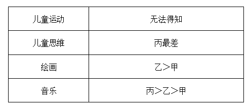

综上，只有B项的说法一定为真。

故正确答案为B。

**考点**：只有一真/一假

**来源**：2025年上海市公务员录用考试《行测》题（B类）（网友回忆版）第88题

## 材料 3

7月26日至30日，小陈、小孙、小梁、小马、小王5人共参加8场比赛。其中3场比赛他们中有2人共同参加，其他5场比赛他们中仅有1人参加，每人参加其中的2至3场。具体场次安排见下表。已知：

（1）小王参加的3场比赛仅安排在上午或者下午；

（2）小陈的比赛均在上午，且不在连续的两天中；

（3）若小孙不与小陈共同参加1场双人比赛，则其比赛均安排在7月26日至28日。

### 第 89 题

若7月30日参加比赛的是小孙，则可以得出（ ）。

A. 小梁至少参加了1场单人比赛

B. 小梁参加了7月27日的比赛

C. 小马参加了7月28日的比赛

D. 小王至少参加了1场单人比赛

第 89 题 · 答案与解析

**参考答案（粉笔题库参考内容）**

D

**解析**

第一步：分析题干条件。

（1）小王参加的3场比赛仅安排在上午或者下午；

（2）小陈的比赛均在上午，且不在连续的两天中；

（3）小孙不与小陈共同参加1场双人比赛→小孙的比赛均安排在7月26日至28日；

（4）小陈、小孙、小梁、小马、小王5人共参加8场比赛，其中3场比赛他们中有2人共同参加，其他5场比赛他们中仅有1人参加，每人参加其中的2至3场；

（5）7月30日参加比赛的是小孙。

第二步：根据题干条件进行推理。

根据条件（5）可知，小孙7月30日参加了比赛，是对条件（3）的否后，否后必否前，则小孙与小陈共同参加1场双人比赛，结合条件（2）可知，小孙与小陈在7月28日上午或7月29日上午参加双人比赛，而无论哪种情况，小陈必然参加上午的1场单人比赛。此时，为满足条件（1），小王必然参加上午剩下的1场单人比赛和1场双人比赛、下午的双人比赛。小马和小梁参加的比赛并不确定。

故正确答案为D。

**来源**：2025年上海市公务员录用考试《行测》题（B类）（网友回忆版）第89题

### 第 90 题

若小马的比赛均安排在上午，则可以得出以下（ ）项一定是错误的。

A. 7月27日上午小陈参加比赛

B. 7月30日晚上小梁参加比赛

C. 7月29日下午小孙参加比赛

D. 7月29日上午小马参加比赛

第 90 题 · 答案与解析

**参考答案（粉笔题库参考内容）**

C

**解析**

第一步：分析题干条件。

（1）小王参加的3场比赛仅安排在上午或者下午；

（2）小陈的比赛均在上午，且不在连续的两天中；

（3）小孙不与小陈共同参加1场双人比赛→小孙的比赛均安排在7月26日至28日；

（4）小陈、小孙、小梁、小马、小王5人共参加8场比赛，其中3场比赛他们中有2人共同参加，其他5场比赛他们中仅有1人参加，每人参加其中的2至3场；

（5）小马的比赛均安排在上午。

第二步：根据题干条件进行推理。

代入A项：7月27日上午小陈参加比赛。结合条件（2）可得小陈参加7月29日上午的比赛。根据条件（4）（5）可得小马上午至少参加2场比赛。小王下午最多参加1场比赛，结合条件（1）可知，小王上午至少参加2场比赛。综合可得上午小陈、小马、小王各自参加2场比赛。则其可能情况如下表所示，可能正确，排除；

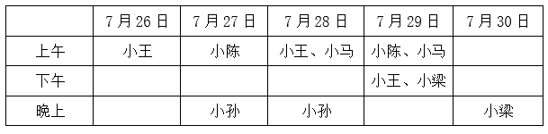

代入B项：7月30日晚上小梁参加比赛。根据A项表格，可能正确，排除；

代入C项：7月29日下午小孙参加比赛。这是对条件（3）的否后，否后必否前，可得小孙与小陈共同参加1场双人比赛，结合条件（2）可得，小孙与小陈参加7月28日或7月29日上午的双人比赛。无论哪种情况，小陈必然参加上午的1场单人比赛。结合条件（4）（5）可得，小马参加上午剩下的2场比赛，此时，小王上午和下午一共最多只能参加2场比赛，与条件（1）矛盾。因此，该项一定错误，当选；

代入D项：7月29日上午小马参加比赛。根据A项表格，可能正确，排除。

本题为选非题，故正确答案为C。

**来源**：2025年上海市公务员录用考试《行测》题（B类）（网友回忆版）第90题

### 第 91 题

在北京工作的小王被单位派遣去法国出差，已知法国（夏令时期间）比北京的时间晚6个小时。若某天公司要在北京时间晚上7时35分开一个线上会议，他从工作地点回到酒店参会要42分钟，若他在当地时间12时30分出发，则他会：

A. 迟到20分钟

B. 迟到23分钟

C. 早到23分钟

D. 早到20分钟

第 91 题 · 答案与解析

**参考答案（粉笔题库参考内容）**

C

**解析**

因为法国（夏令时期间）比北京的时间晚6个小时，所以北京时间晚上7时35分相当于法国时间下午1时35分，即13时35分。根据题意他到达酒店的时间为12时30分+42分=13时12分，故他早到了35-12=23分钟。

故正确答案为C。

**考点**：钟表问题

**来源**：2025年上海市公务员录用考试《行测》题（B类）（网友回忆版）第91题

### 第 92 题

甲、乙、丙三家工厂同时进行改造升级，升级之前三家工厂每小时完成任务数量之比为3：4：5，升级后每小时完成任务数量之比为2：3：4，升级后原来三家合作需要12天完成的生产任务能比之前少用4天完成。则升级后丙的效率提升了：

A. 1/3

B. 2/5

C. 1/2

D. 3/5

第 92 题 · 答案与解析

**参考答案（粉笔题库参考内容）**

D

**解析**

赋值升级之前甲、乙、丙三家工厂每天的效率分别为3、4、5，则生产任务总量=12×（3+4+5）=144。升级后三家工厂每天的效率之和为，则升级后丙每天的效率为，故丙的效率提升了。

故正确答案为D。

**考点**：给效率比例型

**来源**：2025年上海市公务员录用考试《行测》题（A类）（网友回忆版）第92题

### 第 93 题

一位攀岩者在练习攀岩，攀岩墙从下到上放置了若干个等距的标记点。该攀岩者在匀速攀爬了30秒后到第二个和第三个标记点之间，70秒后到了第四个和第五个标记点之间，那么匀速攀爬了120秒后该攀岩者会在（ ）标记点之间。

A. 第五个和第六个

B. 第六个和第七个

C. 第七个和第八个

D. 第八个和第九个

第 93 题 · 答案与解析

**参考答案（粉笔题库参考内容）**

D

**解析**

设起始位置与第一个标记点之间、任意两个标记点之间的距离均为x，此人以v的速度匀速攀岩，根据题意可得：2x<30v<3x······①，4x<70v<5x······②。

方法一：化简①式，可得，化简②式，可得，联立①②两式，可得。匀速攀爬了120秒，则有，即在第八个和第九个标记点之间。

方法二：将①式×4，可得8x<120v<12x，则该攀岩者一定超过了第八个标记点，观察选项，只有D项满足。

故正确答案为D。

备注：本题对于在起点处是否放置标记点的理解有歧义，但是如果起点放置标记点，则根据题意可得：x<30v<2x······①，3x<70v<4x······②。分析可得，即120秒后该攀岩者会在第六个和第八个标记点之间，无法确定答案。

**考点**：普通行程

**来源**：2025年上海市公务员录用考试《行测》题（B类）（网友回忆版）第95题

### 第 94 题

一个长方体铸件长、宽和高之比为5：4：3。表面积正好为1平方米。从该长方体上切下一个尽可能大的三棱柱，切面面积最大可能：

A. 不到0.2平方米

B. 在0.2~0.225平方米之间

C. 在0.225~0.25平方米之间

D. 超过0.25平方米

第 94 题 · 答案与解析

**参考答案（粉笔题库参考内容）**

D

**解析**

设该长方体铸件的长、宽和高分别为5x米、4x米和3x米，根据“表面积正好为1平方米”，可列式：(5x×4x+5x×3x+4x×3x)×2=1，解得。若要切下的三棱柱尽可能大，应沿长方体任意面的对角线切割，此时三棱柱体积为长方体体积的一半，为最大情况。要想得到的三棱柱切面面积尽可能大，如图所示，可沿CD_1方向进行切割，此时切面为，根据勾股定理可得，米，故切面面积平方米，故最大切面面积一定大于0.25平方米，在D项范围内。

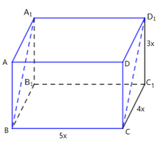

故正确答案为D。

**考点**：几何结论类-三角形相关、几何公式类-立体图形

**来源**：2025年上海市公务员录用考试《行测》题（A类）（网友回忆版）第94题

### 第 95 题

甲参加公司团建，其中一个项目就是做手工风车，要将材料袋中的七个不同卡通头像贴在如图所示的七个圆点处。则做出来的风车一共的可能性有多少种？

A. 7

B. 140

C. 840

D. 5040

第 95 题 · 答案与解析

**参考答案（粉笔题库参考内容）**

C

**解析**

先从七个不同卡通头像贴中任选一个放在风车的中间圆点处，情况数为C_7^1=7种；剩下六个不同卡通头像贴在外圈六个圆点位置进行环形排列，根据n个元素环形排列的情况数为A_{n-1}^{n-1}，则情况数为种。分步用乘法，故所求情况数共7×120=840种。

故正确答案为C。

**考点**：环形排列问题

**来源**：2025年上海市公务员录用考试《行测》题（B类）（网友回忆版）第98题

### 第 96 题

在一个农场里，所有农田都用来种植两种不同的名贵中药材A和B。药材A的成本P（万元）与种植面积a（亩）的关系可以表示为，而药材B的成本Q（万元）与种植面积b（亩）的关系则是Q（b）=2b。若该农场共有种植面积100亩，药材A的种植面积应为（ ）亩时，才能使得总成本最少。

A. 2

B. 12

C. 22

D. 32

第 96 题 · 答案与解析

**参考答案（粉笔题库参考内容）**

A

**解析**

根据题意可知，该农场共有种植面积100亩，即a+b=100，则b=100-a。设总成本为Y，则。

方法一：，令，解得a=2，此时Y取最小值，即总成本最少。

方法二：求解，可将选项依次代入验证。

代入A项：a=2，则万元；

代入B项：a=12，则万元；

代入C项：a=22，则万元；

代入D项：a=32，则万元。

比较可知，当a=2时，Y值（总成本）最少。

故正确答案为A。

**考点**：函数最值问题

**来源**：2025年上海市公务员录用考试《行测》题（A类）（网友回忆版）第96题

### 第 97 题

公园打算修建一个横截面为月牙形（如图所示）的柱体水池养观赏鱼，其中大圆的半径为4米，小圆内部为休息区，其半径为2米，水池深2米，等到水池修建好，需要注入大约（ ）立方米的水。

A. 57

B. 64

C. 76

D. 88

第 97 题 · 答案与解析

**参考答案（粉笔题库参考内容）**

C

**解析**

根据圆形面积公式：，月牙形水池底面积=大圆面积-小圆面积。根据圆柱体体积公式：V=底面积×高，则注入水的体积=12π×2=24π≈24×3.14=75.36立方米，与C项最接近。

故正确答案为C。

**考点**：几何公式类-立体图形

**来源**：2025年上海市公务员录用考试《行测》题（A类）（网友回忆版）第97题

### 第 98 题

小宏准备在市区开一家咖啡店。固定投资：装修费25000元，设备费35000元；每月成本：原料费25000元，宣传费5000元，店面租金8000元，人工8000元，水电网络等杂费1000元。如果固定投资平摊至12个月，期望每月盈利20000元。按每杯咖啡平均售价15元计，每天（一个月以30天计算）要至少卖出（ ）杯咖啡才能够达成期望。

A. 150

B. 160

C. 170

D. 180

第 98 题 · 答案与解析

**参考答案（粉笔题库参考内容）**

B

**解析**

根据题意可知，每月固定投资为元，所以每月总成本为5000+25000+5000+8000+8000+1000=52000元。设每天（一个月以30天计算）要至少卖出x杯咖啡才能够达成期望，根据公式：盈利=售价-成本，则可列式：20000=15×x×30-52000，解得x=160。

故正确答案为B。

**考点**：经济利润问题

**来源**：2025年上海市公务员录用考试《行测》题（B类）（网友回忆版）第92题

### 第 99 题

小李在游乐园娃娃机上抓玩偶玩，目前抓到玩偶的频率是1/16，接下来小李又抓了两次，运气特别好都抓到了，这时小李抓到玩偶的频率提升到了1/10，则小李一共抓了多少次？

A. 30

B. 40

C. 50

D. 60

第 99 题 · 答案与解析

**参考答案（粉笔题库参考内容）**

C

**解析**

方法一：设初始小李抓到玩偶x次，根据“目前抓到玩偶的频率是1/16”，可知初始抓了16x次。根据“接下来小李又抓了两次，运气特别好都抓到了，这时小李抓到玩偶的频率提升到了1/10”，可列等式：，解得x=3。则小李一共抓了16x+2=16×3+2=50次。

方法二：设初始小李抓了x次，根据“接下来小李又抓了两次，运气特别好都抓到了”，可知小李后两次抓到玩偶的频率为1。根据线段法口诀“距离（频率之差）与量（抓的次数）成反比”可得，，解得x=48，则小李一共抓了48+2=50次。

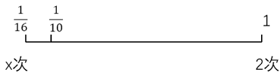

故正确答案为C。

**考点**：概率问题-其他

**来源**：2025年上海市公务员录用考试《行测》题（B类）（网友回忆版）第99题

### 第 100 题

有一个均匀的正二十面体形状的骰子，将π_1，π_2，······，π_n这n个连续的自然数分别标到骰子的各个面上，每个面上只标1个数字，且标有数r_i（i=1，2，······，n，n>1）的面恰有r_i个，那么这个骰子所有面上的数字之和可能为：

A. 55

B. 90

C. 108

D. 139

第 100 题 · 答案与解析

**参考答案（粉笔题库参考内容）**

B

**解析**

由于骰子上标的数为连续自然数，根据“标有数r_i（i=1，2，······，n，n>1）的面恰有r_i个”可知，标有相同数字的面的数量也为连续自然数，即构成公差为1的等差数列。根据公式：S_n\=中位数×项数，可知中位数×项数=20，20的约数有1、2、4、5、10、20。若项数为偶数，如项数=4、中位数=5，则无法得到4个连续的自然数，排除项数为偶数的情况。项数为奇数，且n>1，则项数=5、中位数=4时可符合题干条件，即标记情况为：2个标数字2的面、3个标数字3的面、4个标数字4的面、5个标数字5的面、6个标数字6的面。则这个骰子所有面上的数字之和=2×2+3×3+4×4+5×5+6×6=90。

故正确答案为B。

**考点**：数列问题

**来源**：2025年上海市公务员录用考试《行测》题（B类）（网友回忆版）第100题

## 材料 4

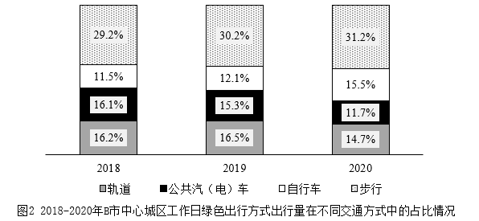

### 第 101 题

2019年，B市中心城区工作日通过小汽车、出租车、其他出行共有（ ）万人次。

A. 950

B. 992

C. 1019

D. 1025

第 101 题 · 答案与解析

**参考答案（粉笔题库参考内容）**

D

**解析**

定位图1可得：2019年B市中心城区工作日通过小汽车出行893万人次，通过出租车出行99万人次，通过其他方式出行33万人次。则2019年，B市中心城区工作日通过小汽车、出租车、其他出行共有893+99+33=1025万人次。

故正确答案为D。

**考点**：统计图、简单加减计算

**来源**：2025年上海市公务员录用考试《行测》题（B类）（网友回忆版）第101题

### 第 102 题

2018-2020年期间，B市中心城区工作日各种交通方式出行中，（ ）方式出行量一直增加。

A. 步行

B. 自行车

C. 出租车

D. 轨道

第 102 题 · 答案与解析

**参考答案（粉笔题库参考内容）**

B

**解析**

定位图1可得2018-2020年，B市中心城区工作日通过步行、自行车、出租车、轨道交通方式出行量的相关数据。观察发现，2018-2020年期间，B市中心城区工作日仅有自行车出行量（2018年453万人次＜2019年477万人次＜2020年560万人次）符合一直增加的趋势。

故正确答案为B。

**考点**：统计图、直接找数

**来源**：2025年上海市公务员录用考试《行测》题（B类）（网友回忆版）第102题

### 第 103 题

2020年，B市中心城区工作日选择自行车出行方式的人在绿色出行人群中的占比约为：

A. 15.75%

B. 16.33%

C. 21.20%

D. 42.68%

第 103 题 · 答案与解析

**参考答案（粉笔题库参考内容）**

C

**解析**

根据题干“2020年······占比约为”，结合材料中给出2020年的相关数据，可判定本题为现期比重问题。定位图2可得：2020年B市中心城区工作日绿色出行方式出行量在不同交通方式的占比分别为：轨道，14.7%；公共汽（电）车，11.7%；自行车，15.5%；步行，31.2%。则2020年B市中心城区工作日绿色出行方式出行量在不同交通方式的占比共计14.7%+11.7%+15.5%+31.2%=73.1%，根据公式：比重，故所求为，只有C项符合。

故正确答案为C。

**考点**：现期比重、统计图

**来源**：2025年上海市公务员录用考试《行测》题（B类）（网友回忆版）第103题

### 第 104 题

2020年B市中心城区工作日不同交通方式出行量中，年降幅率最大的是：

A. 公共汽（电）车

B. 小汽车

C. 轨道

D. 其他

第 104 题 · 答案与解析

**参考答案（粉笔题库参考内容）**

A

**解析**

根据题干“2020年······，年降幅率最大的是”，可判定本题为一般增长率问题。定位图1可得2019年、2020年B市中心城区工作日不同交通方式的出行量。根据公式：增长率，可得2020年选项中各交通方式的年增速分别为：

公共汽（电）车：，即年降幅为30%+；

小汽车：，即年降幅为1%+；

轨道：，即年降幅为20%-；

其他：，即年降幅为20%-。

综上，2020年B市中心城区工作日不同交通方式出行量中，年降幅率最大的是公共汽（电）车。

故正确答案为A。

**考点**：一般增长率、统计图

**来源**：2025年上海市公务员录用考试《行测》题（B类）（网友回忆版）第104题

### 第 105 题

关于2018-2020年期间B市中心城区工作日不同交通出行方式，下列说法错误的是：

A. 出行量先增后减的只有轨道、步行

B. 2018年的绿色出行占比最低

C. 步行在绿色出行中的占比一直上升，所以步行出行量一直在上升

D. 绿色出行的占比的变化为先增后减

第 105 题 · 答案与解析

**参考答案（粉笔题库参考内容）**

C

**解析**

A项：定位图1可知2018-2020年B市中心城区工作日不同交通方式出行量。观察可知，出行量先增后减的只有轨道、步行，正确；

B项：定位图2可知2018-2020年B市中心城区工作日绿色出行方式出行量在不同交通方式中的占比情况。则2018-2020年绿色出行占比分别为：2018年，29.2%+11.5%+16.1%+16.2%=73%；2019年，30.2%+12.1%+15.3%+16.5%=74.1%；2020年，31.2%+15.5%+11.7%+14.7%=73.1%。比较可知，2018年的绿色出行占比（73%）最低，正确；

C项：定位图1可知2018-2020年B市中心城区工作日步行出行量分别为：1145万人次、1195万人次、1128万人次。比较可知，2020年步行出行量下降，并非一直在上升，错误；

D项：定位图2可知2018-2020年B市中心城区工作日绿色出行方式出行量在不同交通方式中的占比情况。则2018-2020年绿色出行占比分别为：2018年，29.2%+11.5%+16.1%+16.2%=73%；2019年，30.2%+12.1%+15.3%+16.5%=74.1%；2020年，31.2%+15.5%+11.7%+14.7%=73.1%。比较可知，绿色出行的占比的变化为先增后减，正确。

本题为选非题，故正确答案为C。

**考点**：综合分析、统计图

**来源**：2025年上海市公务员录用考试《行测》题（B类）（网友回忆版）第105题

## 材料 5

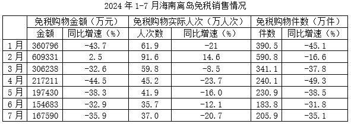

### 第 106 题

2024年7月，海南离岛免税购物金额是上半年月均值的：

A. 不到50%

B. 50%-60%之间

C. 60%-70%之间

D. 超过70%

第 106 题 · 答案与解析

**参考答案（粉笔题库参考内容）**

B

**解析**

根据题干“2024年7月，海南离岛免税购物金额是上半年月均值的”，可判定本题为比值计算问题。定位统计表可知2024年1-7月海南离岛免税购物金额。则2024年上半年海南离岛免税购物金额月均值万元，故题干所求，在B项范围内。

故正确答案为B。

**考点**：比值计算、统计表

**来源**：2025年上海市公务员录用考试《行测》题（A类）（网友回忆版）第106题

### 第 107 题

2023年1-4月中，海南离岛免税购物件数最多的是：

A. 1月

B. 2月

C. 3月

D. 4月

第 107 题 · 答案与解析

**参考答案（粉笔题库参考内容）**

A

**解析**

根据题干“2023年1-4月中······最多的是”，结合材料给出2024年1-4月相关数据，可判定本题为基期比较问题。定位统计表可知2024年1-4月海南离岛免税购物件数及同比增速。根据公式：基期量，则2023年1-4月海南离岛免税购物件数分别为：

1月，万件；

2月，万件；

3月，万件；

4月，万件。

综上，2023年1-4月中，海南离岛免税购物件数最多的是1月。

故正确答案为A。

**考点**：统计表、基期比较

**来源**：2025年上海市公务员录用考试《行测》题（A类）（网友回忆版）第107题

### 第 108 题

2024年1-7月，海南离岛免税销售平均每件商品售价高于上年同期的月份有（ ）个。

A. 2

B. 3

C. 4

D. 5

第 108 题 · 答案与解析

**参考答案（粉笔题库参考内容）**

D

**解析**

根据题干“2024年1-7月······平均每件商品售价高于上年同期的月份······”，可判定本题为两期平均数比较问题。定位统计表可知2024年1-7月各月海南离岛免税购物金额与免税购物件数的同比增速。根据公式：平均每件商品售价，结合两期平均数比较结论“分子增长率>分母增长率，则平均数上升”，观察发现，免税购物金额（分子）同比增速>免税购物件数（分母）同比增速的月份有：1月（-43.7%>-45.1%）、2月（2.5%>-16.6%）、3月（-32.6%>-37.8%）、4月（-44.5%>-49.3%）、5月（-38.3%>-38.5%），即2024年1-7月海南离岛免税销售平均每件商品售价高于上年同期的月份有5个。

故正确答案为D。

**考点**：两期平均数比较、统计表

**来源**：2025年上海市公务员录用考试《行测》题（A类）（网友回忆版）第108题

### 第 109 题

2024年3-6月间，海南离岛免税购物平均每人次购物件数最多的月份是：

A. 3月

B. 4月

C. 5月

D. 6月

第 109 题 · 答案与解析

**参考答案（粉笔题库参考内容）**

A

**解析**

根据题干“2024年3-6月间······平均每人次购物件数最多的月份是”，结合材料给出2024年3-6月的相关数据，可判定本题为现期平均数问题。定位统计表可知2024年3-6月各月海南离岛免税购物实际人次数和免税购物件数。根据公式：平均每人次购物件数，则2024年3-6月各月海南离岛免税购物平均每人次购物件数分别为：3月，件/人次；4月，件/人次；5月，件/人次；6月，件/人次，比较可得，平均每人次购物件数最多的月份是3月。

故正确答案为A。

**考点**：现期平均数、统计表

**来源**：2025年上海市公务员录用考试《行测》题（A类）（网友回忆版）第109题

### 第 110 题

下列柱状图中，最能准确反映2024年1-6月海南离岛免税平均每人次购物金额变化趋势的是（ ）。

A. 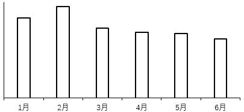

B. 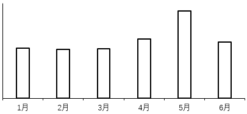

C. 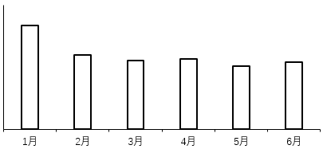

D. 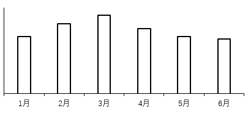

第 110 题 · 答案与解析

**参考答案（粉笔题库参考内容）**

A

**解析**

根据题干“······2024年1-6月······平均每人次购物金额······”，结合材料给出2024年1-6月相关数据，可判定本题为现期平均数问题。定位统计表可知2024年1-6月各月海南离岛免税购物金额和免税购物实际人次。根据公式：平均每人次购物金额，则2024年1月海南离岛免税平均每人次购物金额元/人次，2月海南离岛免税平均每人次购物金额元/人次，3月海南离岛免税平均每人次购物金额元/人次，比较发现2024年1-3月海南离岛免税平均每人次购物金额变化趋势为先增后降，仅A项符合此趋势。

故正确答案为A。

**考点**：现期平均数、统计表

**来源**：2025年上海市公务员录用考试《行测》题（A类）（网友回忆版）第110题

## 材料 6

根据相关数据报告显示，2024年春节档电影总票房达80.16亿元，同比增长18.5%。总观影人次1.63亿，同比增长26.4%。票房、观影人次及场次三项关键数据均创下我国影史新高。

### 第 111 题

2023年春节档电影票房总额约为（ ）亿元。

A. 65.33

B. 67.65

C. 94.99

D. 98.35

第 111 题 · 答案与解析

**参考答案（粉笔题库参考内容）**

B

**解析**

根据题干“2023年······约为（ ）亿元”，结合材料时间为2024年，可判定本题为基期计算问题。定位文字材料可知：2024年春节档电影总票房达80.16亿元，同比增长18.5%。根据公式：基期量，可得2023年春节档电影票房总额为亿元，与B项最接近。

故正确答案为B。

**考点**：综合资料、基期计算

**来源**：2025年上海市公务员录用考试《行测》题（B类）（网友回忆版）第106题

### 第 112 题

2024年春节档的平均票价比2023年春节档的平均票价：

A. 降低了约3元

B. 降低了约1元

C. 上涨了约1元

D. 上涨了约3元

第 112 题 · 答案与解析

**参考答案（粉笔题库参考内容）**

A

**解析**

根据题干“2024年······平均票价比2023年······平均票价”，结合选项为“上涨/降低了+单位”，可判定本题为平均数的增长量问题。定位文字材料可知：2024年春节档电影总票房达80.16亿元（A），同比增长18.5%（a），总观影人次1.63亿（B），同比增长26.4%（b）。根据公式：平均数的增长量，平均票价，可得所求为元，即降低了约3.3元，与A项最接近。

故正确答案为A。

**考点**：平均数的增长量、综合资料

**来源**：2025年上海市公务员录用考试《行测》题（B类）（网友回忆版）第107题

### 第 113 题

电影上映后，正常来说热度会逐渐降低，每一天的票房数量和前一天相比会呈递减的趋势，如果是某部电影当天的票房比前一天高，呈现上升趋势，行业内称之为“逆跌”。春节档的四部电影中，出现“逆跌”次数最多的电影是：

A. 热辣滚烫

B. 飞驰人生2

C. 熊出没

D. 第二十条

第 113 题 · 答案与解析

**参考答案（粉笔题库参考内容）**

D

**解析**

定位表1可得2024年春节档四部电影的全国日票房数据。观察发现：

热辣滚烫，2月14日票房数据（43028万元）>2月13日票房数据（35064万元），出现“逆跌”次数为1次；

飞驰人生2，2月14日票房数据（36375万元）>2月13日票房数据（28124万元），出现“逆跌”次数为1次；

熊出没，2月14日票房数据（17658万元）>2月13日票房数据（16470万元），出现“逆跌”次数为1次；

第二十条，2月12日票房数据（13699万元）>2月11日票房数据（13577万元），2月13日票房数据（14272万元）>2月12日票房数据（13699万元），2月14日票房数据（18566万元）>2月13日票房数据（14272万元），2月16日票房数据（19380万元）>2月15日票房数据（17540万元），出现“逆跌”次数为4次。

综上，春节档的四部电影中，出现“逆跌”次数最多的电影是第二十条。

故正确答案为D。

**考点**：直接找数、综合资料

**来源**：2025年上海市公务员录用考试《行测》题（B类）（网友回忆版）第108题

### 第 114 题

下图是某日春节档四部电影日票房数据的扇形统计图，该日最可能是：

A. 2月10日

B. 2月12日

C. 2月14日

D. 2月16日

第 114 题 · 答案与解析

**参考答案（粉笔题库参考内容）**

B

**解析**

根据题干“下图是某日春节档四部电影日票房数据的扇形统计图······”，结合材料已知各选项对应时间的相关数据，可判定本题为现期比重问题。定位统计表1可得2月10日、2月12日、2月14日、2月16日四部电影日票房数据。观察可知，扇形图中热辣滚烫面积比飞驰人生2的略大，可排除A项（2月10日热辣滚烫票房41773万元<飞驰人生2票房42356万元）；扇形图中熊出没面积比第二十条的大，可排除C项（2月14日熊出没票房17658万元<第二十条票房18566万元）、D项（2月16日熊出没票房14988万元<第二十条票房19380万元）。

故正确答案为B。

**考点**：现期比重、综合资料

**来源**：2025年上海市公务员录用考试《行测》题（B类）（网友回忆版）第109题

### 第 115 题

院线排片中，为能从客户对不同电影的喜好取舍中，更好地把握市场变化，实现利益最大化，采用了当日的“日票房占比÷日排片占比”作为次日排片的考量数据。在全国范围内，2月16日四部电影的“日票房占比÷日排片占比”数据，数值最大的来自于影片：

A. 热辣滚烫

B. 飞驰人生2

C. 熊出没

D. 第二十条

第 115 题 · 答案与解析

**参考答案（粉笔题库参考内容）**

D

**解析**

根据题干“······在全国范围内，2月16日四部电影的‘日票房占比÷日排片占比’数据，数值最大的来自于影片”，可判定本题为比值比较问题。定位表1可得2月16日四部电影日票房数据；定位表2可得2月16日四部电影排片场次数据。根据公式：比重，则某电影的“日票房占比÷日排片占比”，由于“”对于四部电影均一致，故只需比较“”即可，2月16日四部电影的“”分别为：

热辣滚烫：万元/场；

飞驰人生2：万元/场；

熊出没：万元/场；

第二十条：万元/场。

综上，对比2月16日四部电影的“日票房占比÷日排片占比”数据，数值最大的来自于影片第二十条。

故正确答案为D。

**考点**：比值比较、综合资料

**来源**：2025年上海市公务员录用考试《行测》题（B类）（网友回忆版）第110题

## 材料 7

阅读下列材料，回答题目。

材料一：习近平总书记指出：“改革开放以来，历届三中全会研究什么议题，作出什么决定、采取什么举措、释放什么信号，是人们判断新一届中央领导集体施政方针和工作重点的重要依据，对做好未来5年乃至10年工作意义重大。”改革开放以来的三中全会在党史、新中国史、改革开放史、社会主义发展史、中华民族发展史上都具有十分重要的意义。回顾改革开放以来的历届三中全会，可以看清楚过去我们为什么能够成功，弄明白未来我们怎样才能继续成功。

材料二：党的十八大之后，中央即着手考虑十八届三中全会的议题，党的十八大统一提出了全面建成小康社会和全面深化改革开放的目标。强调必须以更大的政治勇气和智慧，不失时机深化重点领域改革，坚决破除一切妨碍科学发展的思想观念和体制机制弊端。构建系统完善、科学规范、运行有效的制度体系，使各方面制度更加成熟、更加定型。我们认为，要完成党的十八大提出的各项战略目标和工作部署，必须抓紧推进全面改革。当前，国内外环境都在发生极为广泛而深刻的变化。我国发展面临一系列突出矛盾和挑战，前进道路上还有不少困难和问题。比如发展中不平衡、不协调、不可持续问题依然突出。科技创新能力不强，产业结构不合理，发展方式依然粗放，城乡区域发展差距和居民收入分配差距依然较大，社会矛盾明显增多，教育、就业、社会保障、医疗、住房、生态环境、食品药品安全、安全生产、社会治安、执法司法等关系群众切身利益的问题较多，部分群众生活困难，形式主义、官僚主义、享乐主义和奢靡之风问题突出，一些领域消极腐败现象易发多发，反腐败斗争形势依然严峻，等等。解决这些问题，关键在于深化改革。

材料三：回顾改革开放历程，党的历次三中全会都重点研究改革问题。二十届三中全会以进一步全面深化改革、推进中国式现代化为主题，是党中央从新征程党和国家事业发展新形势新任务新要求出发，经过通盘考虑、深思熟虑做出的重大决策。《中共中央关于进一步全面深化改革 推进中国式现代化的决定》中，用“三个面对”“六个必然要求”对其重要性、必要性进行全面阐述。习近平总书记对“决定”稿的说明，又用“四个迫切需要”作为高度概括，体现了这次全会主题的战略考量。

### 第 116 题

党的十一届三中全会作出（ ）历史性决策，开启了改革开放和社会主义现代化建设历史新时期，实现了新中国成立以来党的历史上具有深远意义的伟大转折。

A. 突破把计划经济同商品经济对立起来的传统观念

B. 把党和国家工作中心转移到经济建设上来，实行改革开放

C. 为坚持和发展中国特色社会主义，推动社会主义制度自我完善和发展指明方向

D. 重新确立中国特色社会主义的思想路线、政治路线、组织路线

第 116 题 · 答案与解析

**参考答案（粉笔题库参考内容）**

B

**解析**

本题考查政治常识。

B项正确，A、C、D三项错误，党的十一届三中全会作出把党和国家工作中心转移到经济建设上来，实行改革开放的历史性决策，开启了改革开放和社会主义现代化建设历史新时期，实现了新中国成立以来党的历史上具有深远意义的伟大转折。

故正确答案为B。

**考点**：政治建设

**来源**：2025年上海市公务员录用考试《行测》题（B类）（网友回忆版）第116题

### 第 117 题

在新时期，我们党召开的三中全会对社会主义改革进行了总体部署，关于这些总体部署的表述不正确的是：

A. 党的十二届三中全会通过了《中共中央关于经济体制改革的决定》

B. 党的十四届三中全会通过了《中共中央关于建立社会主义市场经济体制若干问题的决定》

C. 党的十六届三中全会通过了《中共中央关于完善社会主义市场经济体制若干问题的决定》

D. 党的十八届三中全会通过了《中共中央关于全面深化党和国家机制改革的决定》

第 117 题 · 答案与解析

**参考答案（粉笔题库参考内容）**

D

**解析**

本题考查政治常识。

A项正确，党的十二届三中全会于1984年召开，全会审议并通过了《中共中央关于经济体制改革的决定》。

B项正确，党的十四届三中全会于1993年召开，全会审议并通过了《中共中央关于建立社会主义市场经济体制若干问题的决定》。

C项正确，党的十六届三中全会于2003年召开，全会审议并通过了《中共中央关于完善社会主义市场经济体制若干问题的决定》。

D项错误，党的十八届三中全会于2013年召开，全会审议并通过了《中共中央关于全面深化改革若干重大问题的决定》。

本题为选非题，故正确答案为D。

**考点**：政治建设

**来源**：2025年上海市公务员录用考试《行测》题（B类）（网友回忆版）第117题

### 第 118 题

二十届三中全会以来，进一步全面深化改革，推进中国式现代化为主题，是党中央从新征程、党和国家事业发展新形势新任务新要求出发，经过通盘考虑，深思熟虑做出的重大决策。习近平总书记对决定稿的说明，又用“四个迫切需要”做出高度概括，体现了这次全会主题的战略考量。下列关于“四个迫切需要”表述正确的是：

A. 凝聚人心、汇聚力量，实现新时代新征程党的中心任务的迫切需要

B. 继续完善和发展中国特色社会主义制度、推进国家治理体系和治理能力现代化的迫切需要

C. 推动高质量发展、更好适应我国社会主要矛盾变化的迫切需要

D. 应对重大风险挑战、推动党和国家事业行稳致远的迫切需要

第 118 题 · 答案与解析

**参考答案（粉笔题库参考内容）**

ABCD

**解析**

本题考查政治常识。

2024年8月15日《求是》杂志发表习近平总书记《关于〈中共中央关于进一步全面深化改革、推进中国式现代化的决定〉的说明》（以下简称《说明》）。

A项正确，《说明》指出：“第一，这是凝聚人心、汇聚力量，实现新时代新征程党的中心任务的迫切需要。实践充分证明，改革开放和社会主义现代化建设新时期，我国大踏步赶上时代，靠的是改革开放······”

B项正确，《说明》指出：“第二，这是完善和发展中国特色社会主义制度、推进国家治理体系和治理能力现代化的迫切需要。党的十八大以来，我们突出制度建设这条主线，通过全面深化改革完善各方面制度，推动中国特色社会主义制度更加成熟更加定型，国家治理体系和治理能力现代化水平明显提高，为全面建成小康社会提供了有力制度保障······”

C项正确，《说明》指出：“第三，这是推动高质量发展、更好适应我国社会主要矛盾变化的迫切需要。当前，推动高质量发展面临的突出问题依然是发展不平衡不充分······”

D项正确，《说明》指出：“第四，这是应对重大风险挑战、推动党和国家事业行稳致远的迫切需要。推进中国式现代化是一项全新的事业，前进道路上必然会遇到各种矛盾和风险挑战······”

故正确答案为ABCD。

**考点**：重要会议讲话

**来源**：2025年上海市公务员录用考试《行测》题（B类）（网友回忆版）第118题

### 第 119 题

江河奔流，不舍昼夜。改革开放事业浩浩荡荡，书写着当代世界的中国奇迹。我们取得的成就如此厚实，能否成为停步休憩的“靠垫”、安睡的“枕头”？习近平总书记指出，改革开放只有进行时，没有完成时。这一论断，既是总结历史的深刻经验，也是针对现实的正确答案，更是着眼未来的坚定宣言。关于这一论断的理解正确的是：

A. 改革开放只有进行时没有完成时，是对人民立场的牢牢坚守

B. 改革就是与时俱进、逐步消除社会主义的社会基本矛盾问题

C. 改革开放只有进行时没有完成时，是对历史经验的深刻总结

D. 改革开放只有进行时没有完成时，是对时代课题的准确把握

第 119 题 · 答案与解析

**参考答案（粉笔题库参考内容）**

ACD

**解析**

本题考查政治常识。

A项正确，改革开放只有进行时没有完成时，是对人民立场的牢牢坚守。我国已进入高质量发展阶段，人民对美好生活的要求不断提高。全面深化改革，要跟得上人民的殷切期待，要与转型期的风险赛跑、与解决问题的时间窗口赛跑，让人民享有更多改革成果，让国家获得更快发展进步。

B项错误，改革就是与时俱进、不断解决发展中的问题。社会主义社会的基本矛盾是生产力和生产关系、经济基础和上层建筑的矛盾。这两对基本矛盾存在于一切社会形态之中，规定社会的性质和基本结构，贯穿于人类社会发展的始终，推动着人类社会由低级向高级发展。改革是为了不断调整生产力与生产关系、经济基础与上层建筑之间不相适应的部分，使社会主义制度不断自我完善和发展。故“消除社会基本矛盾”说法错误。

C项正确，改革开放只有进行时没有完成时，是对历史经验的深刻总结。没有新时代的全面深化改革，就不会有新时代的伟大成就。必须始终围绕发展这个第一要务，不为利益固化藩篱所阻，不受思想观念障碍所惑，全面深化改革开放，为中国式现代化持续注入强劲动力。

D项正确，改革开放只有进行时没有完成时，是对时代课题的准确把握。中国共产党人锚定中华民族伟大复兴，有着“改革不停顿、开放不止步”的历史自觉。面对“两个大局”，时代这个“出卷人”不断把新问题、新挑战摆到我们面前，只有进一步全面深化改革，才能有效应对重大风险挑战，推动党和国家事业行稳致远。

故正确答案为ACD。

**考点**：政治建设

**来源**：2025年上海市公务员录用考试《行测》题（B类）（网友回忆版）第119题

### 第 120 题

党的二十届三中全会审议通过的《决定》，提出300多项重要改革举措，从经济、政治、文化、社会、生态文明、国家安全、国防和军队等方面部署改革。《决定》强调以（ ）为主线，紧紧围绕推进中国式现代化进一步全面深化改革。

A. 体制改革

B. 经济建设

C. 制度建设

D. 机构改革

第 120 题 · 答案与解析

**参考答案（粉笔题库参考内容）**

C

**解析**

本题考查政治常识。

C项正确，A、B、D三项错误，党的二十届三中全会通过的《中共中央关于进一步全面深化改革 推进中国式现代化的决定》在“一、进一步全面深化改革、推进中国式现代化的重大意义和总体要求”中指出：“坚持以制度建设为主线，加强顶层设计、总体谋划，破立并举、先立后破，筑牢根本制度，完善基本制度，创新重要制度。”

故正确答案为C。

**考点**：重要会议讲话

**来源**：2025年上海市公务员录用考试《行测》题（B类）（网友回忆版）第120题

## 材料 8

阅读下列材料，回答题目。

“儿童主任”一词最早出现在2019年，关于《进一步健全农村留守儿童和困境儿童关爱服务体系的意见》的文本中。2021年，国务院未成年人保护工作领导小组印发《关于加强未成年人保护工作的意见》，要求“每个村（社区）至少设立一名儿童主任”，并强调实现专人专岗。《中国儿童发展纲要（2021~2030年）》明确进一步落实儿童主任工作职责、提高儿童主任服务能力，发挥儿童主任的作用。

J省一直将儿童主任队伍建设作为儿童福利与权益保护制度体系的重要支撑。为优化队伍，实现职位配置全覆盖，J省落实专人专岗、选优配强要求，在一村（居）至少设立1名儿童主任的基础上，根据村（社区）儿童数量合理配置，在儿童数量特别是困境儿童较多的村（社区）按照需求增加配置。截止2024年2月，全省共有村（居）21301个，设置儿童督导员2115名，儿童主任29626名，全部实行实名制管理，全员建立档案，翔实记录基本情况、培训情况、从业情况，并纳入全国儿童福利信息系统管理，动态更新信息。

J省民政厅制定了《加强基层未成年人保护工作网络建设的意见》《关于进一步加强村（居）儿童主任队伍建设的意见》，编印儿童主任实务口袋书——《儿童主任实务手册》，拟定《儿童主任职责清单及随访业务规范》，指导儿童主任规范化履行工作职责，切实将儿童权益维护下沉至“最后一米”。

目前，J省已建立儿童主任“一月一访”制度，摸底排查、统计上报农村留守儿童、社会散居孤儿、事实无人抚养儿童等困境儿童信息，在做好资格确认、转介办理、动态更新等工作的同时，根据街镇未保站评估后的困境儿童类别、困境等级，在档案管理、走访频次、风险防控、帮扶干预等方面进行分层分级分色管理，落实政策咨询、精神慰藉、心理疏导、关爱探访、救助帮扶、个案跟踪、危机干预等服务保障措施。

近年来，J省民政厅鼓励各地在设立政府购买社会服务项目的同时。按照每人每月200~300元的标准，设置儿童主任通讯、交通补贴资金，由社工机构制定《儿童主任考核细则》《儿童主任补贴经费发放管理办法》等，定期对儿童主任考核并差额发放工作补贴；开展“儿童主任的一天”专题故事讲述、“最美儿童主任”评选表彰活动，树立一批儿童工作先进典型，进一步调动广大儿童主任的工作热情；将基层儿童工作队伍能力提升行动列入年度全省儿童福利工作要点，按照“分层级、多样化、可操作”的要求，连续4年组织开展全省儿童主任培训。

### 第 121 题

2021年，国务院未成年人保护工作领导小组印发《关于加强未成年人保护工作的意见》。从组织属性来看，国务院未成年人保护工作领导小组属于：

A. 非政府组织

B. 社会组织

C. 任务型组织

D. 事业单位组织

第 121 题 · 答案与解析

**参考答案（粉笔题库参考内容）**

C

**解析**

本题考查管理常识。

A项错误，非政府组织（NGO）是指在地方、国家或国际层面上组织起来的非营利性的、志愿性的公民组织，它们独立于政府，不由政府建立，且通常依靠社会捐赠、会员会费等维持运作。国务院未成年人保护工作领导小组是由国务院设立的，代表政府履行相关职责，并非独立于政府之外的组织，其资金来源也是政府财政等，因此不属于非政府组织。

B项错误，社会组织，包括社会团体、基金会和民办非企业单位，指为了实现特定的管理目标，按照一定的宗旨和系统建立、组合起来，依照各自的章程开展活动的组织。它们不属于政府机构，具有民间性、非营利性等特点。国务院未成年人保护工作领导小组是政府体系内为特定工作任务而设立的机构，并非民间自发成立的组织，因此不属于社会组织。

C项正确，任务型组织是为完成某项特定任务或解决特定问题而组建的临时性组织，任务完成后，该组织可能会根据实际情况进行调整或撤销。国务院未成年人保护工作领导小组是为了加强未成年人保护工作这一特定任务而设立的，具有明确的任务导向，当未成年人保护工作的阶段性目标达成或发生变化时，该领导小组可能会进行相应调整，因此属于任务型组织。

D项错误，事业单位组织是指国家为了社会公益目的，由国家机关举办或其他组织利用国有资产举办的，从事教育、科技、文化、卫生等活动的社会服务组织，通常具有相对稳定的职能和长期存在的性质。国务院未成年人保护工作领导小组并非从事教育、科技等具体社会服务活动，而是专注于未成年人保护工作的协调、指导等行政管理类任务，因此不属于事业单位组织。

故正确答案为C。

**来源**：2025年上海市公务员录用考试《行测》题（B类）（网友回忆版）第121题

### 第 122 题

以下对儿童主任的定位，准确的是：

A. 所在辖区范围内儿童成长的监护人

B. 所在辖区范围内儿童成长的受委托监护人

C. 所在辖区范围内儿童成长的监督人

D. 所在辖区范围内儿童成长的权利人

第 122 题 · 答案与解析

**参考答案（粉笔题库参考内容）**

C

**解析**

本题考查管理常识。

A项错误，监护人在法律上对未成年人的人身、财产及其他合法权益负有全面保护和监督职责，如父母对子女的抚养、教育、保护等核心责任。材料中儿童主任的主要职责是摸底排查、统计上报困境儿童信息，提供政策咨询、关爱探访等服务，并非承担法律意义上监护人的全面责任。儿童的法定监护人通常是其父母或其他依法确定的亲属，儿童主任不具备这种法定监护关系。

B项错误，受委托监护人是基于法定监护人的委托，在一定时期内代为履行部分或全部监护职责的主体。材料中没有任何信息表明儿童主任是受法定监护人委托来履行监护相关工作的。儿童主任的工作是基于政府对未成年人保护工作的整体安排，服务于辖区内全体儿童特别是困境儿童，并非基于个体委托关系。

C项正确，儿童主任执行“一月一访”制度，对农村留守儿童、社会散居孤儿等困境儿童进行摸底排查、统计上报信息，根据困境等级进行分层分级分色管理，并落实各项服务保障措施。这一系列工作表明儿童主任密切关注儿童成长状况，能够及时发现问题并采取相应措施，起到监督儿童成长环境、保障儿童权益的作用。

D项错误，权利人是指依法享有特定权利的主体，如对财产享有所有权、对自身权益享有支配权等。儿童主任的工作重点在于维护儿童的权益，为儿童成长提供支持和保障，并非自身享有与儿童成长相关的权利。他们是推动儿童权益实现的服务者和执行者，而不是权利所有者。

故正确答案为C。

**来源**：2025年上海市公务员录用考试《行测》题（B类）（网友回忆版）第122题

### 第 123 题

根据材料可知，儿童主任的具体职责包括：

A. 日常保护

B. 信息排查

C. 定期随访

D. 及时报告

第 123 题 · 答案与解析

**参考答案（粉笔题库参考内容）**

ABCD

**解析**

本题考查管理常识。

A项正确，材料中提到儿童主任“落实政策咨询、精神慰藉、心理疏导、关爱探访、救助帮扶、个案跟踪、危机干预等服务保障措施”，这些工作都属于为儿童提供日常保护的范畴。

B项正确，材料中提到儿童主任要“摸底排查、统计上报农村留守儿童、社会散居孤儿、事实无人抚养儿童等困境儿童信息”，这表明信息排查是儿童主任的重要职责，通过排查能够全面掌握辖区内困境儿童的相关情况，为后续工作提供依据。

C项正确，材料中提到“J省已建立儿童主任‘一月一访’制度”，可看出儿童主任需要按照规定定期对儿童进行走访，这体现了定期随访是其职责，通过定期随访可以持续关注儿童的成长状况，及时发现并解决问题。

D项正确，材料中提到“摸底排查、统计上报农村留守儿童、社会散居孤儿、事实无人抚养儿童等困境儿童信息”，以及从整个工作流程来看，儿童主任在排查到相关信息后必然需要及时上报，以便上级部门掌握情况并采取相应措施，所以及时报告也属于儿童主任的职责范畴。

故正确答案为ABCD。

**来源**：2025年上海市公务员录用考试《行测》题（B类）（网友回忆版）第123题

### 第 124 题

以下关于儿童主任队伍建设的说法，正确的是：

A. 困境儿童数量是决定儿童主任配置的最重要前置条件

B. 各村（居）儿童主任配置须符合专人专岗的要求

C. 各村（居）必须同时配备儿童主任和儿童督导员

D. 各村（居）的儿童主任通常由从事民政工作的公务员担任

第 124 题 · 答案与解析

**参考答案（粉笔题库参考内容）**

B

**解析**

本题考查管理常识。

A项错误，根据材料，儿童数量特别是困境儿童数量是儿童主任配置的重要参考，但不能说是最重要前置条件，还需综合考虑其他因素，说法过于绝对。

B项正确，材料中明确提到“国务院未成年人保护工作领导小组印发《关于加强未成年人保护工作的意见》，要求‘每个村（社区）至少设立一名儿童主任’，并强调实现专人专岗”，所以各村（居）儿童主任配置须符合专人专岗的要求。

C项错误，材料主要强调了儿童主任的配置情况等内容，对于是否各村（居）必须同时配备儿童主任和儿童督导员并未明确提及。

D项错误，材料中没有提及各村（居）的儿童主任通常由从事民政工作的公务员担任，无中生有。

故正确答案为B。

**来源**：2025年上海市公务员录用考试《行测》题（B类）（网友回忆版）第124题

### 第 125 题

材料最后一段文字，旨在说明J省建构的儿童主任保障机制具有（ ）的特点。

A. 局部化

B. 系统化

C. 立体化

D. 特质化

第 125 题 · 答案与解析

**参考答案（粉笔题库参考内容）**

BC

**解析**

本题考查管理常识。

A项错误，材料中提到的儿童主任保障机制是在J省全省范围内推行，涉及全省21301个村（居），并非只针对局部区域，故不具有局部化的特点。

B项正确，J省从多个方面构建儿童主任保障机制，包括设置补贴资金保障儿童主任的物质待遇，制定考核细则规范工作，开展评选表彰活动进行精神激励，组织培训提升工作能力等。这些措施相互关联、相互配合，共同构成一个完整的体系，故具有系统化的特点。

C项正确，从保障内容来看，既有物质层面的补贴，又有制度层面的考核规范，还有精神层面的激励以及能力提升层面的培训，涵盖多个维度，如同从不同角度构建起一个立体的保障网络，故具有立体化的特点。

D项错误，材料中没有提及与其他地区相比，J省的儿童主任保障机制具有独特性质或特殊之处，也没有提及全省21301个村（居）的儿童主任保障机制的不同，故不具有特质化的特点。

故正确答案为BC。

**来源**：2025年上海市公务员录用考试《行测》题（B类）（网友回忆版）第125题

## 材料 9

阅读下列材料，回答题目

2024年8月21日，中共中央办公厅、国务院办公厅印发的《关于完善市场准入制度的意见》（以下简称《意见》）对外发布。《意见》提出“完善市场准入负面清单管理模式”。所谓负面清单即“非禁即入”，清单以外的行业、领域、业务等，各类经营主体皆可依法平等进入，政府不再审批。各类依法设定的市场准入管理措施，全部列入全国统一的市场准入负面清单，严禁在清单之外违规设立准入许可、违规增设准入条件、自行制定市场准入性质的负面清单。

自2018年起，市场准入负面清单制度在我国全面实施。目前，市场准入负面清单已动态修订3次，市场准入负面清单事项从2018年的151项缩减到现行的117项，禁止许可事项压减约23%。

特别值得一提的是，《意见》明确“加强内外资准入政策调整协同”“有序放宽服务业准入限制”，这是稳步扩大制度型开放的具体举措，也是对社会诉求和企业呼声的回应。

### 第 126 题

关于市场准入改革的意义，下列说法正确的是：

A. 有利于保护地方经济，支持欠发达地区的经济发展

B. 有利于将我国超大规模市场资源加速转变为现实生产力

C. 有利于推动建设更高水平的开放型经济新体制

D. 有利于进一步激发各类经济主体创新活力

第 126 题 · 答案与解析

**参考答案（粉笔题库参考内容）**

BCD

**解析**

本题考查政治常识。

A项错误，市场准入改革旨在打破地方保护主义，减少不合理的市场壁垒，形成全国统一大市场，促进资源的自由流动和公平竞争，而不是单纯保护地方经济。

B项正确，通过完善市场准入制度，各类经营主体能更平等地参与市场，有助于更高效地配置市场资源，从而加速将我国庞大的市场潜力转化为现实生产力。

C项正确，《意见》指出“加强内外资准入政策调整协同”“有序放宽服务业准入限制”，这些举措的目的是稳步扩大制度型开放，从而吸引更多外资和先进技术等，有利于推动建设更高水平的开放型经济新体制。

D项正确，通过大力简化市场准入程序，削减那些不必要的审批环节与限制条件，能够为各类经济主体精心营造一个更为宽松、公正的竞争环境。在这样的环境中，经济主体能够充分释放自身潜力，进而极大地激发其创新活力与蓬勃的发展动力，助力其在市场中实现更好的发展。

故正确答案为BCD。

**考点**：重要会议讲话

**来源**：2025年上海市公务员录用考试《行测》题（A类）（网友回忆版）第126题

### 第 127 题

关于市场准入制度在各地区的适用范围，下列说法正确的是：

A. 香港和澳门作为中华人民共和国的一部分，适用全国统一的市场准入制度

B. 海南自贸港等重点区域可以在法律规定的范围内实行放宽市场准入的特别措施

C. 经济欠发达地区可以根据需要增设准入条件、自行制定市场准入条件

D. 我国企业在海外从事经营活动的，也应当符合我国市场准入制度的要求

第 127 题 · 答案与解析

**参考答案（粉笔题库参考内容）**

B

**解析**

本题考查政治常识。

A项错误，香港、澳门实行“一国两制”，保持原有的资本主义制度长期不变，有独立的法律制度和经济体系等，并不适用全国统一的市场准入制度，它们依据自身的法律和政策体系来管理经济活动等事务。

B项正确，材料中明确指出，有序放宽服务业准入限制，海南自贸港等重点区域为了实现特殊的发展目标和功能定位，在法律规定的范围内可以实行放宽市场准入的特别措施，以吸引投资、促进贸易和经济发展等，推动区域的特殊发展。

C项错误，材料中指出，各类依法设定的市场准入管理措施，全部列入全国统一的市场准入负面清单，严禁在清单之外违规设立准入许可、违规增设准入条件、自行制定市场准入性质的负面清单。因此，经济欠发达地区不能根据自身需要增设准入条件、自行制定市场准入条件。

D项错误，我国市场准入制度主要规范的是在我国境内的市场准入行为，我国企业在海外从事经营活动的，应遵循所在国家或地区的法律法规和市场准入要求，而不是我国的市场准入制度。

故正确答案为B。

**考点**：重要会议讲话

**来源**：2025年上海市公务员录用考试《行测》题（A类）（网友回忆版）第127题

### 第 128 题

《意见》特别强调加强内外资准入政策调整协同，其意义在于：

A. 进一步全面深化改革，提升对外开放水平

B. 为外资打造透明稳定可预期的制度环境，吸引外商投资

C. 为外资提供高于内资的市场保护，维护外资的合法权益

D. 促进市场良性竞争，打造平等开放的市场

第 128 题 · 答案与解析

**参考答案（粉笔题库参考内容）**

ABD

**解析**

本题考查政治常识。

A项正确，加强内外资准入政策调整协同，是全面深化改革的重要方面。通过协同调整，可以使国内政策与国际通行规则更好接轨，进一步优化营商环境，从而提升对外开放水平，推动经济的高质量发展。

B项正确，加强内外资准入政策调整协同，能够使外资企业更清晰地了解政策导向，为外资打造透明稳定可预期的制度环境。这种良好的环境有助于增强外资对中国市场的信心，吸引更多外商投资，促进外资的持续流入和稳定发展。

C项错误，加强内外资准入政策调整协同的目的是营造公平竞争的市场环境，而不是为外资提供高于内资的市场保护。内外资企业应在平等的基础上参与市场竞争，享受公平的待遇。

D项正确，加强内外资准入政策调整协同，消除了不合理的政策差异和壁垒，促进了内外资企业在同一市场环境下公平竞争，有助于打造平等开放的市场，激发市场活力，推动产业升级和创新发展。

故正确答案为ABD。

**考点**：重要会议讲话

**来源**：2025年上海市公务员录用考试《行测》题（A类）（网友回忆版）第128题

### 第 129 题

关于意见强调的“有序放宽服务业准入限制”，下列说法正确的是：

A. 此举有利于促进服务业市场的充分竞争，提升服务行业领域的供给质量

B. 此举有利于促进服务业的深度转型升级

C. 对于涉及国家安全、社会稳定的服务业，仍有必要进行市场准入限制

D. 对于涉及重要民生领域的教育、卫生、体育等行业，应当排除民间资本进入

第 129 题 · 答案与解析

**参考答案（粉笔题库参考内容）**

ABC

**解析**

本题考查政治常识。

A、C两项正确，《意见》在“六、有序放宽服务业准入限制”部分指出：“对不涉及国家安全、社会稳定，可以依靠市场充分竞争提升供给质量的服务业行业领域逐步取消准入限制······”放宽准入条件可以打破行业垄断，增强市场竞争，有助于企业不断推陈出新，提升服务效率和创新能力，形成良性循环。并且根据文件内容反推可知，如果涉及国家安全、社会稳定，则仍有必要进行市场准入限制。

B项正确，《意见》是中央层面首次专门就完善市场准入制度建设出台的政策文件。市场准入是推动创新成果转化为现实生产力的关键条件，要前瞻性部署新业态新领域市场准入体系，更好促进新质生产力发展。进一步清理服务业准入环节的各类准入限制，破除显性或隐性的市场壁垒，适时放宽服务业市场准入，有利于营造“敢投、能投、投得好”的市场准入环境，从而有利于促进产业深度转型升级。

D项错误，《意见》在“六、有序放宽服务业准入限制”部分指出：“······对涉及重要民生领域的教育、卫生、体育等行业，稳妥放宽准入限制，优化养老、托育、助残等行业准入标准······”

故正确答案为ABC。

**考点**：重要会议讲话

**来源**：2025年上海市公务员录用考试《行测》题（A类）（网友回忆版）第129题

### 第 130 题

根据现行的市场准入负面清单，非公有资本不得从事新闻采编播发业务。关于这项规定，下列说法正确的是：

A. 体现了马克思主义新闻观，在我国，新闻担负着反映舆论、引导舆论的重要任务

B. 防止在西方国家出现的新闻为某些利益集团服务的现象

C. 违背了公有制为主体、多种所有制经济共同发展的基本经济制度

D. 根据该规定，非公有资本不得从事任何与新闻相关的业务，包括印刷、发行等与新闻出版有关的经营活动

第 130 题 · 答案与解析

**参考答案（粉笔题库参考内容）**

AB

**解析**

本题考查政治常识。

A、B两项正确，马克思主义新闻观是关于新闻本质、新闻生产及新闻传播规律的科学理论和指导体系。它以辩证唯物主义和历史唯物主义为哲学基础，历经新闻传播实践检验和理论研究发展深化，具有无穷生命力和指导力。新闻事业是党和人民的喉舌，担负着反映舆论、引导舆论的一个重要任务。中国的新闻事业是在马克思主义新闻观指导下的党性和人民性的统一，而西方媒体具有鲜明的阶级性和私有性、逐利性，它服务于资产阶级、服务于利益集团。规定非公有资本不得从事新闻采编播发业务，其要义就在于媒体无论怎样发展，必须符合相关规定，要防止出现非公资本为了牟利的目的恣意干预主流舆论的现象。

C项错误，公有制为主体、多种所有制经济共同发展是我国社会主义初级阶段的基本经济制度。非公有资本不得从事新闻采编播发业务体现了党的领导下的马克思主义新闻观，与社会主义初级阶段的基本经济制度并不违背。

D项错误，根据《市场准入负面清单（2022年版）》，关于非公有资本的禁止或许可准入措施描述有：不得从事新闻采编播发业务；不得投资设立和经营新闻机构，包括但不限于通讯社、报刊出版单位、广播电视播出机构、广播电视站以及互联网新闻信息采编发布服务机构等；不得经营新闻机构的版面、频率、频道、栏目、公众账号等；不得从事涉及政治、经济、军事、外交，重大社会、文化、科技、卫生、教育、体育以及其他关系政治方向、舆论导向和价值取向等活动、事件的实况直播业务；不得引进境外主体发布的新闻；不得举办新闻舆论领域论坛峰会和评奖评选活动。但其中不包括“印刷、发行等与新闻出版有关的经营活动”，故“非公有资本不得从事任何与新闻相关的业务”说法错误。

故正确答案为AB。

**考点**：重要会议讲话

**来源**：2025年上海市公务员录用考试《行测》题（A类）（网友回忆版）第130题

