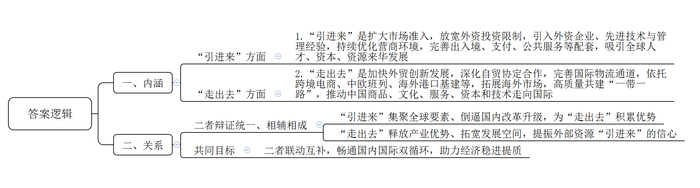
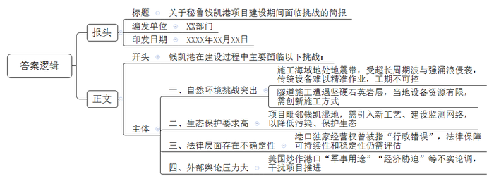
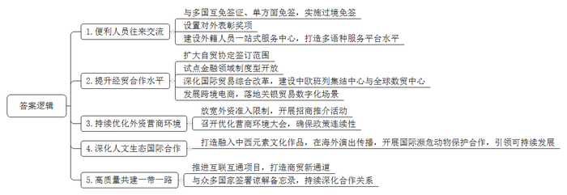
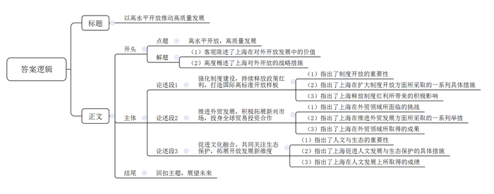

# 2026年上海市公考《申论》题

> 候选采集稿。参考答案及解析来自粉笔页面，不代表官方答案或真实高分答卷；来源使用许可与原卷对应关系仍需人工核实。

## 给定材料

### 材料 material-3ed3a51452fb157e

2024年12月，习近平总书记在中央经济工作会议上提出“统筹做好‘引进来’和‘走出去’，扩大高水平对外开放”。2025年2月，中共中央政治局召开会议强调，“扩大高水平对外开放，建设现代化产业体系，更好统筹发展和安全，实施更加积极有为的宏观政策，扩大国内需求，推动科技创新和产业创新融合发展，稳住楼市股市，防范化解重点领域风险和外部冲击，稳定预期、激发活力，推动经济持续回升向好，不断提高人民生活水平，保持社会和谐稳定，高质量完成‘十四五’规划目标任务，为实现‘十五五’良好开局打牢基础”。

## 题目

### 第 1 题

**习近平总书记在中央经济工作会议上提出****“统筹做好‘引进来’和‘走出去’，扩大高水平对外开放”。请结合给定资料，阐述“引进来”和“走出去”的内涵及两者之间的关系。（15分）**

关联材料：材料 material-3ed3a51452fb157e

作答要求：

要求：阐述规范扼要，表达准确到位，层次要点分明，字数不超过300字。

### 第 2 题

**“从钱凯到上海”的表述，描述了未来的中拉陆海新通道。假如你是本市经济管理部门工作人员，请结合给定资料，就钱凯港建设期间面临的挑战写一份简报。（15分）**

关联材料：材料 material-3ed3a51452fb157e

作答要求：

要求：分析准确，条理清晰，语言精练，字数不超过300字。

### 第 3 题

**结合给定资料，提炼我国所采取的扩大高水平对外开放的举措。（****20分）**

关联材料：材料 material-3ed3a51452fb157e

作答要求：

要求：条理清晰，内容全面，语言精练，字数不超过300字。

### 第 4 题

**聚焦****“经济大省挑大梁”，上海为全国发展大局挑大梁、作贡献，在推进深层次改革和高水平开放上奋勇争先，不仅是上海的光荣使命、责任担当，也是上海自身发展的必然要求。请结合上海市情****，****以****“高水平开放，高质量发展”为主题写一篇文章。（50分）**

关联材料：材料 material-3ed3a51452fb157e

作答要求：

要求：

（1）自选角度，自拟题目；

（2）观点明确，联系实际，分析具体，条理清楚，语言流畅；

（3）总字数800-1000字。

## 答案与解析

第 1 题

**参考答案（粉笔题库参考内容）**

一、内涵：1.“引进来”是扩大市场准入，放宽外资投资限制，引入外资企业、先进技术与管理经验，持续优化营商环境，完善出入境、支付、公共服务等配套，吸引全球人才、资本、资源来华发展。2.“走出去”是加快外贸创新发展，深化自贸协定合作，完善国际物流通道，依托跨境电商、中欧班列、海外港口基建等，拓展海外市场，高质量共建“一带一路”，推动中国商品、文化、服务、资本和技术走向国际。

二、关系：二者辩证统一、相辅相成。“引进来”集聚全球要素、倒逼国内改革升级，为“走出去”积累优势；“走出去”释放产业优势、拓宽发展空间，提振外部资源“引进来”的信心。二者联动互补，畅通国内国际双循环，助力经济稳进提质。

**解析**

**参考答案说明：**本参考答案先从“内涵”“关系”两个方面展开。“内涵”方面，分别从“引进来”“走出去”两个层面阐述含义；“关系”方面，从“二者辩证统一、相辅相成”“共同目标”两个层面展开，其中“二者辩证统一、相辅相成”又分别从“‘引进来’对‘走出去’产生的作用”“‘走出去’对‘引进来’产生的作用”展开。各条答案要点之间在内容上相互并列，没有交叉。

**考点**：考点多要素组合类

**来源**：来源2026年上海市公考《申论》题

粉笔申论页面对本题只提供「解析视频」入口，该入口是会员推广位，页面无视频地址与文字解析。

第 2 题

**参考答案（粉笔题库参考内容）**

关于秘鲁钱凯港项目建设期间面临挑战的简报

XX部门 XXXX年XX月XX日

钱凯港在建设过程中主要面临以下挑战：

一、自然环境挑战突出。施工海域地处地震带，受超长周期波与强涌浪侵袭，传统设备难以精准作业，工期不可控；隧道施工遭遇坚硬石英岩层，当地设备资源有限，需创新施工方式。二、生态保护要求高。项目毗邻钱凯湿地，需引入新工艺、建设监测网络，以降低污染、保护生态。三、法律层面存在不确定性。港口独家经营权曾被指“行政错误”，法律保障可持续性和稳定性仍需评估。四、外部舆论压力大。美国炒作港口“军事用途”“经济胁迫”等不实论调，干扰项目推进。

**解析**

**参考答案说明：**（1）格式方面，本参考答案写到了“报头”“正文”两个部分。（2）正文部分，一方面，从内容上来看，围绕“钱凯港建设期间面临挑战”这一主题，本参考答案的主体部分从“自然环境挑战突出”“生态保护要求高”“法律层面存在不确定性”“外部舆论压力大”四个方面介绍了具体措施。另一方面，形式上，本参考答案做到了分段、分条撰写，整体上条理较为清晰。

**考点**：考点总结类

**来源**：来源2026年上海市公考《申论》题

粉笔申论页面对本题只提供「解析视频」入口，该入口是会员推广位，页面无视频地址与文字解析。

第 3 题

**参考答案（粉笔题库参考内容）**

1.便利人员往来交流。与多国互免签证、单方面免签，实施过境免签；设置对外表彰奖项；建设外籍人员一站式服务中心，打造多语种服务平台。

2.提升经贸合作水平。扩大自贸协定签订范围；试点金融领域制度型开放；深化国际贸易综合改革，建设中欧班列集结中心与全球数贸中心；发展跨境电商，落地关银贸易数字化场景。

3.持续优化外资营商环境。放宽外资准入限制，开展招商推介活动；召开优化营商环境大会，确保政策连续性。

4.深化人文生态国际合作。打造融入中西元素文化作品，在海外演出传播，开展国际濒危动物保护合作，引领可持续发展。

5.高质量共建一带一路。推进互联互通项目，打造商贸新通道；与众多国家签署谅解备忘录，持续深化合作关系。

**解析**

**参考答案说明**：本参考答案从“便利人员往来交流”“提升经贸合作水平”“持续优化外资营商环境”“深化人文生态国际合作”“高质量共建一带一路”五个方面展开，各条答案要点之间在内容上相互并列，没有交叉。

**考点**：考点概括措施类

**来源**：来源2026年上海市公考《申论》题

粉笔申论页面对本题只提供「解析视频」入口，该入口是会员推广位，页面无视频地址与文字解析。

第 4 题

**参考答案（粉笔题库参考内容）**

**以高水平开放推动高质量发展**

作为我国经济大省和改革开放的前沿阵地，上海勇扛“挑大梁、作贡献”的使命担当，将高水平开放作为推动高质量发展的关键引擎。立足国家战略大局与自身发展需求，上海以改革破题、以开放赋能，在制度创新、经贸合作、人文共生中不断探索，树立发展标杆。

**强化制度建设，持续释放政策红利，打造国际高标准开放样板。**制度型开放是高水平开放的必然要求，也是上海增强发展动力的关键举措。中央多次强调要稳步扩大制度型开放，上海先行先试、勇当先锋，奋力建设更高水平开放型经济新体制。依托自贸试验区平台，落地金融领域开放政策，实现与国际高标准无缝对接；推出优化营商环境行动方案，推动制造业外资准入限制全面“清零”；出台144小时过境免签政策，深化上海和世界的链接……上海在更大范围释放制度创新红利，让全球资本、人才、技术放心落地、安心发展，成为国际高标准开放的示范窗口。

**推进外贸发展，积极拓展新兴市场，投身全球贸易投资合作。**面对单边主义、保护主义的外部挑战，上海抢抓共建“一带一路”机遇，加快“引进来”和“走出去”协调发展。在生物医药领域，上海张江药谷出海基地瞄准各类前沿赛道，助力三生国健、和黄医药等登陆国际市场；在人工智能赛道，张江创新小镇聚焦算力与算法等方向，驱动极豆科技、派欧云等加速全球布局；在文化输出前沿，微短剧出海基地集聚枫叶互动、点众科技等头部企业，推动文化出海跑出“加速度”……上海在吸引外资企业集聚发展的同时，厚植本土企业出海“土壤”，通过双向投资协同发力，交出了一份亮眼答卷。

**促进文化融合，共同关注生态保护，拓展开放发展新维度。**高水平开放不仅是经济的联通，更是人文的交融与生态的共建。作为上海的灵魂，海派文化以其海纳百川的开放基因和创新精神塑造了这座城市。在新的历史阶段，上海要继续打造开放的文化环境。法国院士马克先生深耕上海三十载，推动中法医学交流，成为中外文化互通的桥梁；舞剧《朱鹮》走出国门，以艺术为纽带展现中国生态保护成果，成为国际人文交流与生态合作的生动载体……文化的交流与融合不仅改善了居民生活，更形成全球人才磁吸效应，塑造了城市独特的人文魅力。

开放是当代中国的鲜明标识。新征程上，上海将持续以高水平开放推动高质量发展，为开创合作共赢的开放新局面、书写中国式现代化新篇章添砖加瓦。

**解析**

**文章分析**

**以高水平开放推动高质量发展**

【**标题的优点：**标题中含有主题词，使文章主题更突出、清晰。】

（1）作为我国经济大省和改革开放的前沿阵地，上海勇扛“挑大梁、作贡献”的使命担当，将高水平开放作为推动高质量发展的关键引擎。（2）立足国家战略大局与自身发展需求，上海以改革破题、以开放赋能，在制度创新、经贸合作、人文共生中不断探索，树立发展标杆。

【**开头的优点：**★内容方面。范文的开头是紧扣题目给定的“高水平开放，高质量发展”这一主题展开的。一方面，客观陈述了上海在对外开放发展中的价值，引出文章主题；另一方面，高度概述了上海对外开放的战略措施。★文字表达方面。运用了拟人、比喻、排比等修辞方法，让文章的表述生动且深刻。】

**强化制度建设，持续释放政策红利，打造国际高标准开放样板。**（1）制度型开放是高水平开放的必然要求，也是上海增强发展动力的关键举措。（2）中央多次强调要稳步扩大制度型开放，上海先行先试、勇当先锋，奋力建设更高水平开放型经济新体制。依托自贸试验区平台，落地金融领域开放政策，实现与国际高标准无缝对接；推出优化营商环境行动方案，推动制造业外资准入限制全面“清零”；出台144小时过境免签政策，深化上海和世界的链接……（3）上海在更大范围释放制度创新红利，让全球资本、人才、技术放心落地、安心发展，成为国际高标准开放的示范窗口。

【**论述段****1的优点：**★观点句：范文的观点句是紧扣“高水平开放，高质量发展”这一文章主题提出的。形式上，它在段首处直接写出，位置突出，容易发现。内容上，关键词突出，内容要点明确，可以明显看出主要论述从“制度建设”方面入手。★论述内容：（1）指出了制度开放的重要性；（2）指出了上海在扩大制度开放方面所采取的一系列具体措施；（3）指出了上海释放制度红利所带来的积极影响。注意：以上三个方面的内容都是紧扣“强化制度建设，持续释放政策红利，打造国际高标准开放样板”这个观点句进行分析论述的，论述的针对性强，内容层次丰富。在论述方法方面，既有讲道理，也有摆事实，论据充实丰富。】

**推进外贸发展，积极拓展新兴市场，投身全球贸易投资合作。**（1）面对单边主义、保护主义的外部挑战，（2）上海抢抓共建“一带一路”机遇，加快“引进来”和“走出去”协调发展。在生物医药领域，上海张江药谷出海基地瞄准各类前沿赛道，助力三生国健、和黄医药等登陆国际市场；在人工智能赛道，张江创新小镇聚焦算力与算法等方向，驱动极豆科技、派欧云等加速全球布局；在文化输出前沿，微短剧出海基地集聚枫叶互动、点众科技等头部企业，推动文化出海跑出“加速度”……（3）上海在吸引外资企业集聚发展的同时，厚植本土企业出海“土壤”，通过双向投资协同发力，交出了一份亮眼答卷。

【**论述段****2****的优点：**★观点句：范文的观点句是紧扣“高水平开放，高质量发展”这一文章主题提出的。形式上，它在段首处直接写出，位置突出，容易发现。内容上，关键词突出，内容要点明确，可以明显看出主要论述从“推进外贸发展”方面入手。★论述内容：（1）指出了上海在外贸领域所面临的挑战；（2）指出了上海在推进外贸发展方面所采取的一系列举措；（3）指出了上海在外贸领域所取得的成果。注意：以上三个方面的内容都是紧扣“推进外贸发展，积极拓展新兴市场，投身全球贸易投资合作”这个观点句进行分析论述的，论述的针对性强，内容层次丰富。在论述方法方面，既有讲道理，也有摆事实，论据充实丰富。】

**促进文化融合，共同关注生态保护，拓展开放发展新维度。**（1）高水平开放不仅是经济的联通，更是人文的交融与生态的共建。（2）作为上海的灵魂，海派文化以其海纳百川的开放基因和创新精神塑造了这座城市。在新的历史阶段，上海要继续打造开放的文化环境。法国院士马克先生深耕上海三十载，推动中法医学交流，成为中外文化互通的桥梁；舞剧《朱鹮》走出国门，以艺术为纽带展现中国生态保护成果，成为国际人文交流与生态合作的生动载体……（3）文化的交流与融合不仅改善了居民生活，更形成全球人才磁吸效应，塑造了城市独特的人文魅力。

【**论述段****3****的优点：**★观点句：范文的观点句是紧扣“高水平开放，高质量发展”这一文章主题提出的。形式上，它在段首处直接写出，位置突出，容易发现。内容上，关键词突出，内容要点明确，可以明显看出主要论述从“人文发展”方面入手。★论述内容：（1）指出了人文与生态的重要性；（2）指出了上海促进人文发展与生态保护的具体措施；（3）指出了上海在人文发展上所取得的成绩。注意：以上三个方面的内容都是紧扣“促进文化融合，共同关注生态保护，拓展开放发展新维度”这个观点句进行分析论述的，论述的针对性强，内容层次丰富。在论述方法方面，既有讲道理，也有摆事实，论据充实丰富。】

【**论述段****之间的关系****：**三个论述段都围绕着“高水平开放，高质量发展”这一主题展开，首先论述了“强化制度建设”，接着论述了“推进外贸发展”，最后论述了“促进文化融合，共同关注生态保护”，三段呈现出并列关系，论述清晰明了，内容丰富。】

开放是当代中国的鲜明标识。新征程上，上海将持续以高水平开放推动高质量发展，为开创合作共赢的开放新局面、书写中国式现代化新篇章添砖加瓦。

【**结尾的优点：**范文的结尾回扣了“高水平开放，高质量发展”这个主题，并且进行了总结与升华。】

**考点**：考点文章写作题

**来源**：来源2026年上海市公考《申论》题

粉笔申论页面对本题只提供「解析视频」入口，该入口是会员推广位，页面无视频地址与文字解析。

