# 2026年上海市公务员录用考试《行测》题（网友回忆版）

<!-- gwy:overview:start -->
> **上海 · 2026 · 行测 · 统考** ｜ 130 题 · 图片 205 处 · 答案随题折叠

| 题型模块 | 题量 | 题号 |
| --- | ---: | ---: |
| 政治理论 | 30 | 1–30 |
| 言语理解与表达能力 | 25 | 31–55 |
| 判断推理能力 | 25 | 56–80 |
| 科学素养 | 20 | 81–100 |
| 数量关系 | 10 | 101–110 |
| 资料分析 | 20 | 111–130 |
| **合计** | **130** | |

导航：[题型与作答说明](#题型与作答说明) · [题目](#题目) · [材料 1](#材料-1)
<!-- gwy:overview:end -->

> 候选采集稿。参考答案及解析来自粉笔页面，不代表官方答案或真实高分答卷；来源使用许可与原卷对应关系仍需人工核实。

## 题型与作答说明

政治理论

（30题）

从所给的选项中选出最符合题意的一项。

言语理解与表达能力

（25题）

本部分包括表达与理解两方面的内容。请根据题目要求，在四个选项中选出一个最恰当的答案。

判断推理能力

（25题）

本部分包括图形推理、分析推理两种类型的试题。

科学素养

（20题）

本部分均为单项选择题，从所给的选项中选出最符合题意的一项。

数量关系

（10题）

在这部分试题中，每道题呈现一段表述数字关系的文字，要求你迅速、准确地计算出答案。

资料分析

（20题）

所给出的图、表、文字或综合性资料具有若干问题要你回答。你应根据资料提供的信息进行分析、比较、计算和判断处理。

## 题目

### 第 1 题

“两个确立”是党在新时代取得的最重大的政治成果，是推动党和国家事业取得历史性成就、发生历史性变革的决定性因素。党确立习近平同志党中央的核心、全党的核心地位，确立习近平新时代中国特色社会主义思想的指导地位，反映了全党全军全国各族人民共同心愿，对新时代党和国家事业发展、对推进中华民族伟大复兴历史进程具有决定性意义。“两个确立”的决定性意义具体体现在（ ）。

A. 确立了党的执政地位，为党的全面领导提供有力保证

B. 捍卫了中国特色社会主义，成功把中国特色社会主义推向二十一世纪

C. 为中国式现代化提供根本的社会条件和制度保证

D. 把全国各族人民动员起来，为实现中华民族伟大复兴凝聚磅礴力量

第 1 题 · 答案与解析

**参考答案（粉笔题库参考内容）**

D

**解析**

本题考查新思想。

A项错误，习近平总书记指出：“我国宪法确认了中国共产党的领导地位，这是我国宪法最显著的特征，也是我国宪法得到全面贯彻实施的根本保证。”

B项错误，十九届六中全会提出：“党的十三届四中全会以后，以江泽民同志为主要代表的中国共产党人······形成了‘三个代表’重要思想，在国内外形势十分复杂、世界社会主义出现严重曲折的严峻考验面前捍卫了中国特色社会主义，确立了社会主义市场经济体制的改革目标和基本框架，确立了社会主义初级阶段公有制为主体、多种所有制经济共同发展的基本经济制度和按劳分配为主体、多种分配方式并存的分配制度，开创全面改革开放新局面，推进党的建设新的伟大工程，成功把中国特色社会主义推向二十一世纪。”

C项错误，2024年7月24日，光明日报发表的文章《为中国式现代化提供强大动力和制度保障》指出：“新民主主义革命的胜利，人民当家作主，为实现现代化创造了根本社会条件······中国特色社会主义新时代的创新突破，推动党和国家事业取得历史性成就、发生历史性变革，为中国式现代化提供了更为完善的制度保证、更为坚实的物质基础、更为主动的精神力量。”

D项正确，2022年2月23日，人民日报发表的文章《深刻把握“两个确立”坚决做到“两个维护”》指出：“‘两个确立’为实现中华民族伟大复兴凝聚磅礴力量。实现中华民族伟大复兴，是中华民族团结奋斗的最大公约数和最大同心圆······党的十八大以来，我们之所以能够战胜一系列风险挑战，不断夺取伟大斗争新胜利，一个根本原因就在于‘两个确立’把全党全国各族人民紧密团结起来，形成万众一心、无坚不摧的磅礴力量。”

故正确答案为D。

**考点**：其他建设

**来源**：2026年上海市公务员录用考试《行测》题（网友回忆版）第1题

### 第 2 题

习近平时代观是新时代中国特色社会主义思想的重要内容。它凝聚了我们时代的精神精华。它植根于中国特色社会主义伟大实践的沃土。它依据马克思主义基本原理特别是其科学方法论，高度总结了改革开放近四十年的宝贵经验，科学分析了中国特色社会主义进入新时代的主要标志、基本内容和重大意义，创造性地运用和发展了马克思主义的时代观。习近平新时代中国特色社会主义思想蕴含的时代观（ ）。

A. 是中国特色社会主义伟大实践持续发展的深厚根基

B. 深刻审视共产党执政规律、社会主义建设规律、人类社会发展规律

C. 对马克思主义自然观进行了丰富和发展

D. 是对中国古代思想家朴素的时代思想观点的承袭

第 2 题 · 答案与解析

**参考答案（粉笔题库参考内容）**

B

**解析**

本题考查新思想。

A项错误，马克思主义认为，实践是认识的唯一来源。中国特色社会主义伟大实践是习近平新时代中国特色社会主义思想的实践根基，而非反过来由习近平新时代中国特色社会主义思想蕴含的时代观提供深厚根基。

B项正确，2023年12月15日，《党建》杂志发表的《习近平新时代中国特色社会主义思想蕴含的时代观》指出：“习近平新时代中国特色社会主义思想蕴含的时代观，深刻审视共产党执政规律、社会主义建设规律、人类社会发展规律，对现阶段人类所处的大时代作出精准判断，科学分析世界两大制度的新变化，辩证看待时代性质和时代特征，推动中国特色社会主义实现新发展，让科学社会主义在21世纪的中国焕发出新的蓬勃生机。”

C项错误，习近平新时代中国特色社会主义思想蕴含的时代观聚焦人类社会发展的时代规律与历史方位，属于社会历史观范畴，与马克思主义自然观无直接关联。

D项错误，习近平新时代中国特色社会主义思想蕴含的时代观是对马克思主义时代观的创造性发展，同时吸收中华优秀传统文化精华，但并非“承袭”古代朴素时代思想。它以马克思主义为指导，结合新时代实践形成科学理论体系，远超古代朴素思想的范畴。

故正确答案为B。

**考点**：新思想总论

**来源**：2026年上海市公务员录用考试《行测》题（网友回忆版）第2题

### 第 3 题

以下是习近平总书记历年新年贺词的部分内容，道出了总书记心中的“国之大者”。

让几千万农村贫困人口生活好起来，是我心中的牵挂——2016年

把老百姓的安危冷暖时刻放在心上，以造福人民为最大政绩——2018年

千头万绪的事，说到底是千家万户的事——2022年

家事国事天下事，让人民过上幸福生活是头等大事——2025年

下列观点与上述总书记心中的“国之大者”表达最为接近的是（ ）。

A. 让人民过上幸福生活是中国共产党初心和使命的内在要求

B. 改革开放是中国共产党治国理政的出发点和落脚点

C. 中国共产党执政是中国历史和人民的必然选择

D. 新民主主义革命是最为广泛而深刻的社会变革

第 3 题 · 答案与解析

**参考答案（粉笔题库参考内容）**

A

**解析**

本题考查新思想。

A项正确，习近平总书记新年贺词中“国之大者”的核心是让人民过上幸福生活，这与中国共产党“为中国人民谋幸福，为中华民族谋复兴”的初心和使命高度契合。让人民过上幸福生活既是中国共产党初心使命的核心内容，也是其内在要求，二者在价值取向与实践目标上完全一致，是对“国之大者”人民立场的精准呼应。

B项错误，习近平总书记指出：“改革开放是决定当代中国命运的关键一招，也是决定实现‘两个一百年’奋斗目标、实现中华民族伟大复兴的关键一招。”题干并未涉及有关改革开放的表述。

C项错误，习近平总书记指出：“中华民族近代以来180多年的历史、中国共产党成立以来100年的历史、中华人民共和国成立以来70多年的历史都充分证明，没有中国共产党，就没有新中国，就没有中华民族伟大复兴。历史和人民选择了中国共产党。”题干并未涉及有关中国共产党执政的表述。

D项错误，十九届六中全会审议通过的《中共中央关于党的百年奋斗重大成就和历史经验的决议》提出：“从新中国成立到改革开放前夕，党领导人民完成社会主义革命，消灭一切剥削制度，实现了中华民族有史以来最为广泛而深刻的社会变革，实现了一穷二白、人口众多的东方大国大步迈进社会主义社会的伟大飞跃。”故“新民主主义革命”表述错误，应为“社会主义革命”。题干并未涉及新民主主义革命和社会主义革命的相关表述。

故正确答案为A。

**考点**：社会建设

**来源**：2026年上海市公务员录用考试《行测》题（网友回忆版）第3题

### 第 4 题

经济社会发展并不自然而然带来民族团结，并不自然而然带来中华民族共同体意识。如果忽视“管脑子”工作，不恰当地强调特殊性和差异性，形成狭隘甚至极端的民族意识，就可能肚子吃得越饱，离心倾向越强。上述说法最能体现铸牢中华民族共同体意识必须重点把握的“四对关系”中的（ ）。

A. 共同性和差异性的关系

B. 中华民族共同体意识和各民族意识的关系

C. 中华文化和各民族文化的关系

D. 物质和精神的关系

第 4 题 · 答案与解析

**参考答案（粉笔题库参考内容）**

D

**解析**

本题考查新思想。

A项错误，2021年8月，习近平总书记在中央民族工作会议上指出：“要正确把握共同性和差异性的关系，增进共同性、尊重和包容差异性是民族工作的重要原则。”

B项错误，习近平总书记指出：“要正确把握中华民族共同体意识和各民族意识的关系，引导各民族始终把中华民族利益放在首位，本民族意识要服从和服务于中华民族共同体意识，同时要在实现好中华民族共同体整体利益进程中实现好各民族具体利益，大汉族主义和地方民族主义都不利于中华民族共同体建设。”

C项错误，习近平总书记指出：“要正确把握中华文化和各民族文化的关系，各民族优秀传统文化都是中华文化的组成部分，中华文化是主干，各民族文化是枝叶，根深干壮才能枝繁叶茂。”

D项正确，习近平总书记指出：“要正确把握物质和精神的关系，要赋予所有改革发展以彰显中华民族共同体意识的意义，以维护统一、反对分裂的意义，以改善民生、凝聚人心的意义，让中华民族共同体牢不可破。”题干强调，经济社会发展（物质层面）并不自动带来民族团结和共同体意识（精神层面），如果忽视“管脑子”（精神引导），反而可能强化狭隘民族意识、加剧离心倾向。因此，最能体现物质和精神的关系。

故正确答案为D。

**考点**：政治建设

**来源**：2026年上海市公务员录用考试《行测》题（网友回忆版）第4题

### 第 5 题

在二十届中央纪委三次全会上，习近平总书记强调，要始终保持反腐败永远在路上的坚韧执着，保持战略定力和高压态势，一步不停歇、半步不退让，一体推进不敢腐、不能腐、不想腐，坚决打好这场攻坚战、持久战、总体战。实践充分证明，只有强化一体推进“三不腐”的协同性和系统性，才能实现反腐败效应叠加。对此，理解正确的是（ ）。

A. “不敢腐”是根本条件，侧重于教育与监督

B. “不敢腐”是反腐败最终要实现的目标

C. “不能腐”是关键环节，侧重于制约和监督

D. “不想腐”是前提条件，侧重于惩治和震慑

第 5 题 · 答案与解析

**参考答案（粉笔题库参考内容）**

C

**解析**

本题考查新思想。

A项错误，“不敢腐”是前提条件，而非根本条件，核心是通过惩治腐败形成强大震慑，侧重于惩治和震慑，而非教育和监督。

B项错误，反腐败的最终目标是实现“不想腐”，“不敢腐”是通过高压惩治遏制腐败行为，为“不能腐”“不想腐”创造条件，并非最终目标。

C项正确，“不能腐”是关键环节，核心是通过完善制度、健全监督体系，把权力关进制度笼子，形成刚性约束，侧重于制约和监督。

D项错误，“不想腐”是根本目标，而非前提条件，核心是通过思想教育、廉洁文化建设筑牢思想防线，侧重于教育和引导，而非惩治和震慑。

故正确答案为C。

**考点**：其他建设

**来源**：2026年上海市公务员录用考试《行测》题（网友回忆版）第5题

### 第 6 题

习近平总书记指出，全面从严治党是全党的共同责任，必须分层分类建立健全部门责任体系，以明确责任、压实责任推动各级党组织和广大党员、干部知责、担责、履责、尽责。以下表述正确的是（ ）。

A. 明确党委（党组）书记全面从严治党主体责任

B. 明确各级党委的监督责任

C. 明确纪委书记第一责任人责任

D. 明确领导班子成员的管党治党责任

第 6 题 · 答案与解析

**参考答案（粉笔题库参考内容）**

D

**解析**

本题考查新思想。

D项正确，A、B、C三项错误，2024年6月27日，中共中央政治局就健全全面从严治党体系进行第十五次集体学习，习近平总书记发表重要讲话指出：“要健全主体明确、要求清晰的责任体系。必须分层分类建立健全责任体系，推动各级党组织和广大党员、干部知责、担责、履责。明确党委（党组）全面从严治党主体责任，明确各级纪委的监督责任，明确党委（党组）书记第一责任人责任，明确领导班子成员的管党治党责任，明确党员、干部的具体责任。健全精准科学的问责机制，层层传导压力，以责任主体到位、责任要求到位、考核问责到位，推动管党治党责任落实到位。”故A项“明确党委（党组）书记全面从严治党主体责任”说法错误，应是“明确党委（党组）全面从严治党主体责任”；B项“明确各级党委的监督责任”说法错误，应是“明确各级纪委的监督责任”；C项“明确纪委书记第一责任人责任”说法错误，应是“明确党委（党组）书记第一责任人责任”。

故正确答案为D。

**考点**：重要会议讲话、其他建设

**来源**：2026年上海市公务员录用考试《行测》题（网友回忆版）第6题

### 第 7 题

二十届中央纪委四次全会于2025年1月6日至8日在北京举行，全会指出，2024年，以习近平同志为核心的党中央坚持以党的自我革命引领伟大社会革命，团结带领全党全国各族人民凝心聚力、攻坚克难，中国式现代化迈出新的坚实步伐。中央纪委常委会把学习贯彻习近平新时代中国特色社会主义思想特别是（ ）作为贯穿全年的主题主线，带动全系统深学细悟党的创新理论，坚定纪检监察工作正确方向。

A. 习近平总书记关于党的建设的重要思想

B. 习近平总书记关于党的自我革命的重要思想

C. 习近平总书记关于加强党的作风建设的重要论述

D. 习近平总书记关于全面加强党的纪律建设的重要论述

第 7 题 · 答案与解析

**参考答案（粉笔题库参考内容）**

B

**解析**

本题考查新思想。

B项正确，A、C、D三项错误，2025年1月6日至8日，中国共产党第二十届中央纪律检查委员会第四次全体会议在北京召开，习近平总书记发表重要讲话指出：“中央纪委常委会把学习贯彻习近平新时代中国特色社会主义思想特别是习近平总书记关于党的自我革命的重要思想作为贯穿全年的主题主线，带动全系统深学细悟党的创新理论，坚定纪检监察工作正确方向。健全政治监督具体化、精准化、常态化机制，围绕党的二十届三中全会重大部署谋深做实政治监督，推动党中央大政方针落地见效。”

故正确答案为B。

**考点**：重要会议讲话、其他建设

**来源**：2026年上海市公务员录用考试《行测》题（网友回忆版）第7题

### 第 8 题

中共中央政治局2025年6月30日召开会议指出，设立党中央（ ），是健全党中央对重大工作集中统一领导、推动重大任务落实的重要制度安排。要准确把握职责定位，坚持谋大事、议大事、抓大事，对重大工作实施更为有效的统领和协调，做到统筹不代替、到位不越位。

A. 决策议事协调机构

B. 政策研究咨询机构

C. 工作决策监督机构

D. 信息反馈协调机构

第 8 题 · 答案与解析

**参考答案（粉笔题库参考内容）**

A

**解析**

本题考查新思想。

A项正确，B、C、D三项错误，2025年6月30日，中共中央政治局召开会议，审议《党中央决策议事协调机构工作条例》。会议指出：“设立党中央决策议事协调机构，是健全党中央对重大工作集中统一领导、推动重大任务落实的重要制度安排。制定出台《党中央决策议事协调机构工作条例》，进一步规范党中央决策议事协调机构的设立、职责和运行，对于发挥好对重大工作的顶层设计、统筹协调、整体推进、督促落实职能作用，具有重要意义。”

故正确答案为A。

**考点**：重要会议讲话、其他建设

**来源**：2026年上海市公务员录用考试《行测》题（网友回忆版）第8题

### 第 9 题

习近平总书记指出，新的历史条件下，国际国内形势发生了很大变化，我们党面临的执政环境和执政条件发生了很大变化，党面临的“四大考验”“四种危险”是长期的、复杂的、严峻的。下列选项中“四大考验”与其具体内容对应不准确的是（ ）。

A. 长期执政考验——如何在百年变局中保持党的先进性和纯洁性

B. 改革开放考验——如何应对单边主义对全球治理体系的冲击

C. 市场经济考验——如何防止资本无序扩张引发系统性风险

D. 外部环境考验——如何破解公信力下降的“塔西佗陷阱”

第 9 题 · 答案与解析

**参考答案（粉笔题库参考内容）**

D

**解析**

本题考查新思想。

A项正确，长期执政的考验是，我们党在长期执政、执政环境日趋复杂、执政基础有所变化的背景下，如何加强和改进自身建设，以巩固党的执政地位。经受住长期执政考验，要有如履薄冰的谨慎，居安思危的忧患，赶考永远在路上的执着，聚精会神抓好党的建设，使我们党越来越成熟、越来越强大、越来越有战斗力，永葆先进性和纯洁性，永远保持与人民的血肉联系。故“保持党的先进性和纯洁性”属于长期执政考验的内容。

B项正确，改革开放的考验是，如何在全面深化改革开放的同时，坚持和发展中国特色社会主义。经受住改革开放考验，把坚持以人民为中心贯穿到改革开放各个领域，加强改革的顶层设计和统筹协调，牢牢扭住改革开放的目标和任务，协调解决改革开放推进中的矛盾和问题，努力让改革开放的各项举措落地生根，将改革进行到底。故“应对单边主义对全球治理体系的冲击”属于“协调解决改革开放推进中的矛盾和问题”的一方面，属于改革开放的考验。

C项正确，市场经济的考验是，我们党既要经受住市场经济对党负面影响的考验，又要经受住市场经济所引发的意识形态安全的考验。经受住市场经济考验，要防范和化解经济金融风险，不断增强驾驭市场经济的本领，提高经济管理和应对市场经济风险的能力，促进收入分配更合理、更有序，逐步消除贫困，实现共同富裕。故“防止资本无序扩张引发系统性风险”属于“要防范和化解经济金融风险”的一方面，属于市场经济的考验。

D项错误，外部环境的考验是，我们党面临的国际大环境和周边环境日趋复杂严峻，包围、遏制、打压、分化、唱衰中国的行径日趋激烈。经受住外部环境考验，要以更大的决心和勇气抓好党的自身建设，确保党在世界形势深刻变化的历史进程中始终走在时代前列，在应对国内外各种风险和考验的历史进程中始终成为全国人民的主心骨，在发展中国特色社会主义的历史进程中始终成为坚强的领导核心。“塔西佗陷阱”指当政府部门或某一组织失去公信力时，无论说真话还是假话，做好事还是坏事，都会被认为是说假话、做坏事。其本质上是政府与民众之间的关系问题，属于国内政治生态和党群关系的范畴，故不属于外部环境的考验。

本题为选非题，故正确答案为D。

**考点**：其他建设

**来源**：2026年上海市公务员录用考试《行测》题（网友回忆版）第9题

### 第 10 题

守正创新是我们党在新时代治国理政的重要思想方法，守正才能不迷失方向，不犯颠覆性错误，创新才能把握时代、引领时代，以下可以体现守正与创新相统一的是（ ）。

A. 坚持中国特色社会主义道路，坚持人民民主专政等根本的东西绝对不动摇

B. 在马克思主义指导下真正做到古为今用，洋为中用，辩证取舍，推陈出新

C. 发扬“苟日新，日日新，又日新”的精神，不惧新挑战，勇于接受新事物

D. 顺应时代发展要求，着眼于解决重大理论和实践问题，积极识变应变求变

第 10 题 · 答案与解析

**参考答案（粉笔题库参考内容）**

B

**解析**

本题考查新思想。

A项错误，选项强调了“守正”，强调坚持中国特色社会主义道路、人民民主专政等根本制度不动摇。但是选项只体现了“守正”，没有提及“创新”，故不符合守正与创新相统一。

B项正确，“马克思主义指导下真正做到古为今用”即坚守根本、坚守文化主体性，是“守正”的体现；“洋为中用，辩证取舍，推陈出新”即打破封闭，与时俱进，是“创新”的体现。故体现了守正与创新相统一。

C项错误，选项强调了“创新”，“苟日新，日日新，又日新”出自《礼记·大学》，意思是如果能每天除旧更新，就要天天除旧更新，不间断地更新又更新。是“创新”的体现。但是没有提及“守正”，故不符合守正与创新相统一。

D项错误，选项强调了“创新”，顺应时代发展要求“识变、应变、求变”，这是创新的本质要求，即回应时代之问。但是并没有提及“守正”，故不符合守正与创新相统一。

故正确答案为B。

**考点**：新思想总论

**来源**：2026年上海市公务员录用考试《行测》题（网友回忆版）第10题

### 第 11 题

习近平总书记指出：马克思主义政党不是因利益而结成的政党，而是以共同理想信念而组织起来的政党。中国共产党的理想信念是（ ）。

①马克思主义信仰

②共产主义远大理想

③中国特色社会主义共同理想

④全心全意为人民服务

A. ①②④

B. ②③④

C. ①②③

D. ①③④

第 11 题 · 答案与解析

**参考答案（粉笔题库参考内容）**

C

**解析**

本题考查新思想。

①②③正确，④错误，2021年9月1日，习近平总书记在2021年秋季学期中央党校（国家行政学院）中青年干部培训班开班式上的讲话中指出：“中国共产党成立一百年来，始终是有崇高理想和坚定信念的党。这个理想信念，就是马克思主义信仰、共产主义远大理想、中国特色社会主义共同理想。理想信念是中国共产党人的精神支柱和政治灵魂，也是保持党的团结统一的思想基础。”

故①②③表述正确。

故正确答案为C。

**考点**：其他建设

**来源**：2026年上海市公务员录用考试《行测》题（网友回忆版）第11题

### 第 12 题

党的二十届四中全会指出，“十五五”时期我国发展环境面临深刻复杂变化，我国发展处于战略机遇和风险挑战并存、不确定难预料因素增多的时期。关于“十五五”时期我国经济发展环境以及战略机遇的表述不准确的是（ ）。

A. 经济基础稳固、优势多、韧性强、潜能大

B. 长期向好的支撑条件和基本趋势没有变

C. 中国特色社会主义制度优势、超大规模市场优势、完整产业体系优势、丰富人才资源优势更加彰显

D. 我国发展处于战略机遇和风险挑战并存、不确定难预料因素增多的时期，其中最大的不确定性就是内部的风险挑战

第 12 题 · 答案与解析

**参考答案（粉笔题库参考内容）**

D

**解析**

本题考查新思想。

D项错误，A、B、C三项正确，《中共中央关于制定国民经济和社会发展第十五个五年规划的建议》在“一、‘十五五’时期是基本实现社会主义现代化的关键时期”部分指出：“（3）‘十五五’时期我国发展环境面临深刻复杂变化。大国关系牵动国际形势，国际形势演变深刻影响国内发展，我国发展处于战略机遇和风险挑战并存、不确定难预料因素增多的时期。从国际看，世界百年变局加速演进，国际力量对比深刻调整，新一轮科技革命和产业变革加速突破，我国具备主动运筹国际空间、塑造外部环境的诸多有利因素。同时，世界变乱交织、动荡加剧，地缘冲突易发多发；单边主义、保护主义抬头，霸权主义和强权政治威胁上升，国际经济贸易秩序遇到严峻挑战，世界经济增长动能不足；大国博弈更加复杂激烈。从国内看，我国经济基础稳、优势多、韧性强、潜能大，长期向好的支撑条件和基本趋势没有变，中国特色社会主义制度优势、超大规模市场优势、完整产业体系优势、丰富人才资源优势更加彰显。”由此可知，我们要以内部发展的确定性（如高质量发展、科技自立自强、扩大内需）对冲外部环境的不确定性，而非将内部风险误判为最大的不确定性。

本题为选非题，故正确答案为D。

**考点**：经济建设、重要文件

**来源**：2026年上海市公务员录用考试《行测》题（网友回忆版）第12题

### 第 13 题

纪律严明是中国共产党的光荣传统和独特优势。“有纪律”作为“主要武器”，是我们党经受住生死考验、从小到大、由弱到强、克服一个个困难，渡过一个个难关，最终夺取新民主主义革命胜利的根本保障。毛泽东同志在总结新民主主义革命胜利的宝贵经验时指出，我们党有三件“战胜敌人的主要武器”，第一件就是“一个有纪律的，有马克思列宁主义的理论武装的，采取自我批评方法的，联系人民群众的党”。党在革命时期总结的经验对新时代加强党的建设的启示是（ ）。

A. 不断加强党纪学习教育，增强党的凝聚力和战斗力

B. 牢记全面从严治党永远在路上，将阶级斗争进行到底

C. 打铁必须自身硬，要将纪律建设作为管党治党的根基

D. 密切党群关系，紧紧依靠人民群众加强党的作风建设

第 13 题 · 答案与解析

**参考答案（粉笔题库参考内容）**

A

**解析**

本题考查新思想。

A项正确，党的二十届三中全会强调，要结合学习宣传贯彻全会精神，抓好党的创新理论武装，提高全党马克思主义水平和现代化建设能力。要健全全面从严治党体系，切实改进作风，克服形式主义、官僚主义顽疾，持续为基层减负，深入推进党风廉政建设和反腐败斗争，扎实做好巡视工作。要巩固拓展主题教育成果，深化党纪学习教育，维护党的团结统一，不断增强党的创造力、凝聚力、战斗力。

B项错误，新时代我国社会主要矛盾已转化，阶级斗争并非主要任务，“将阶级斗争进行到底”不符合新时代国情与党建方向，违背全面从严治党的科学内涵。

C项错误，党的十九大报告在“十三、坚定不移全面从严治党，不断提高党的执政能力和领导水平”部分指出：“新时代党的建设总要求是：坚持和加强党的全面领导，坚持党要管党、全面从严治党，以加强党的长期执政能力建设、先进性和纯洁性建设为主线，以党的政治建设为统领，以坚定理想信念宗旨为根基，以调动全党积极性、主动性、创造性为着力点······”故“将纪律建设作为管党治党的根基”表述有误，应为“以坚定理想信念宗旨为根基”。

D项错误，题干核心是“纪律”对党建的启示，而该项聚焦党群关系与作风建设，虽为党建重要内容，但偏离了“纪律”这一核心经验。

故正确答案为A。

**考点**：其他建设

**来源**：2026年上海市公务员录用考试《行测》题（网友回忆版）第13题

### 第 14 题

党的十八大以来，习近平总书记围绕建设什么样的长期执政的马克思主义政党、怎样建设长期执政的马克思主义政党的重大时代课题，突出全面从严治党这个主题主线，提出一系列管党治党、兴党强党的新理念新思想新战略。强调新时代党的建设和组织工作要以坚持和加强党中央集中统一领导为最高原则，为推进强国建设、民族复兴伟业提供坚强组织保证。上述要求（ ）。

A. 有利于推动全面深化改革向纵深发展

B. 体现了科学执政是党执政的基本方式

C. 以组织建设为统领，增强党的领导力

D. 为推进新时代组织工作提供根本遵循

第 14 题 · 答案与解析

**参考答案（粉笔题库参考内容）**

D

**解析**

本题考查新思想。

A项错误，加强党的建设、做好组织工作，确实能为全面深化改革提供政治保障和组织支撑，间接推动改革向纵深发展，但题干的核心是阐述“新时代党的建设和组织工作的根本原则、指导思想”，而非强调这些要求带来的“间接影响”。

B项错误，《中共中央关于加强党的执政能力建设的决定》在“五、坚持党的领导、人民当家作主和依法治国的有机统一，不断提高发展社会主义民主政治的能力”部分指出：“（二）贯彻依法治国基本方略，提高依法执政水平。依法执政是新的历史条件下党执政的一个基本方式。党的领导是依法治国的根本保证。”故“科学执政是党执政的基本方式”表述有误，应为“依法执政是新的历史条件下党执政的一个基本方式”。

C项错误，党的十九大报告在“十三、坚定不移全面从严治党，不断提高党的执政能力和领导水平”部分指出：“新时代党的建设总要求是：坚持和加强党的全面领导，坚持党要管党、全面从严治党，以加强党的长期执政能力建设、先进性和纯洁性建设为主线，以党的政治建设为统领，以坚定理想信念宗旨为根基，以调动全党积极性、主动性、创造性为着力点，全面推进党的政治建设、思想建设、组织建设、作风建设、纪律建设，把制度建设贯穿其中，深入推进反腐败斗争，不断提高党的建设质量，把党建设成为始终走在时代前列、人民衷心拥护、勇于自我革命、经得起各种风浪考验、朝气蓬勃的马克思主义执政党。”故“以组织建设为统领”表述有误，应为“以党的政治建设为统领”。

D项正确，习近平总书记关于党的建设的重要思想，博大精深、内涵丰富，以一系列原创性成果极大丰富和发展了马克思主义建党学说，标志着我们党对马克思主义执政党建设规律的认识达到了新高度，为深入推进新时代党的建设新的伟大工程、做好新时代组织工作提供了根本遵循。

故正确答案为D。

**考点**：其他建设

**来源**：2026年上海市公务员录用考试《行测》题（网友回忆版）第14题

### 第 15 题

党的作风就是党的形象，关系人心向背，决定党和国家事业成败。八项规定一子落地，作风建设满盘皆活，党风政风焕然一新，社风民风持续向好，我们党以作风建设新气象赢得了人民群众信任拥护，八项规定成为长期有效的铁规矩、硬杠杠，管党治党的“金色名片”。新时代以来党的作风建设取得历史性成就，根本在于习近平总书记领航掌舵，在于（ ）。

A. 坚持全面从严治党战略方针

B. 以钉钉子精神纠治“四风”

C. 习近平新时代中国特色社会主义思想科学指引

D. 制定和落实中央八项规定开局破题

第 15 题 · 答案与解析

**参考答案（粉笔题库参考内容）**

C

**解析**

本题考查新思想。

C项正确，A、B、D三项错误，2025年8月7日，中央纪委国家监委网站发表的题为《新时代加强党的作风建设方法创新》的文章指出：“作风问题本质上是党性问题。党中央把党的政治属性、政治使命、政治目标、政治追求融入作风建设，以政治建设引领作风建设，为贯彻落实中央八项规定精神奠定深厚的政治根基。新时代作风建设取得显著成效，根本在于有习近平总书记领航掌舵，有习近平新时代中国特色社会主义思想科学指引。”

故正确答案为C。

**考点**：重要会议讲话、其他建设

**来源**：2026年上海市公务员录用考试《行测》题（网友回忆版）第15题

## 材料 1

材料1：

2025年2月17日上午10时，伴着热烈的掌声，习近平总书记走进人民大会堂东大厅，同来自各行各业的民营企业负责人面对面座谈。

2018年11月，也是在这个会场，总书记主持召开民营企业座谈会，针对当时社会上一些否定、怀疑民营经济的言论，重申坚持“两个毫不动摇”，强调“三个没有变”，给广大民营企业吃下“定心丸”，指明进一步发展壮大的方向。

如今，我国民营经济已经形成相当的规模，占有很重的分量，不少新亮点可圈可点：民营企业数量占企业总数92%以上；国家高新技术企业中民营企业有42万多家，占比超92%；在出口强劲的“新三样”中，民营企业贡献超过一半；世界500强中，我国民营企业数量从2018年的28家增加到34家。

当前民营经济发展过程中，面临着一些困难和挑战：有新一轮科技革命和产业变革带来的冲击；有外部环境变化带来的困境；有一些企业存在盲目多元化、自身经营管理不善等问题；也有相关政策措施落实有待加力的问题······

“在困难和挑战中看到前途，看到光明，看到未来，保持发展定力，增强发展信心，保持昂扬奋进的精气神”“新时代新征程民营经济发展前景广阔，大有可为，广大民营企业家大显身手正当其时”，总书记说。

习近平总书记的重要讲话，在民营企业家中间引发热烈反响。奇安信集团董事长齐向东激动地说：“总书记的讲话为我们指明了方向，增添了信心，我们要心无旁骛地创新，踏踏实实地办好企业，为高质量发展贡献更多力量。”

材料2：

现场聆听了习近平总书记的重要讲话。奇安信集团董事长表示：“习近平总书记重申了‘两个毫不动摇’，强调‘党和国家保证各种所有制经济依法平等使用生产要素、公平参与市场竞争、同等受到法律保护’，再次让广大民营企业吃下了‘定心丸’，激励我们撸起袖子，甩开膀子继续加油干。”

“习近平总书记强调党和国家对民营经济发展的基本方针政策‘不能变，也不会变’，表明我们党的这个基本方针政策是一以贯之的，将持续坚持和落实。”国家发展改革委副主任说，“总书记的重要讲话为我们做好民营经济工作指明了前进方向，提供了根本遵循，我们有信心有力有效抓好落实，促进民营经济健康发展，为推进中国式现代化作出更大贡献。”

“总书记充分肯定了民营经济的发展成绩，强调‘民营经济已经形成相当的规模，占有很重的分量，推动民营经济高质量发展具备坚实基础’，进一步坚定了我们发展的信心。”比亚迪股份有限公司董事长表示，“如今，我国正从汽车大国迈向汽车强国。我们坚持做实业、以产业报国，有信心把新能源汽车产业越做越大。”

“中国有14亿多人口的超大规模市场，每年有接近1000万的新生婴儿，60周岁及以上老年人口约3亿，人们需要精准营养配方，这为我们做好全生命周期产品提供了巨大市场机遇。”黑龙江飞鹤乳业有限公司董事长说，“我们将立足实业、做强主业，不断做大做强中国奶粉品牌，以实际行动推动高质量发展。”

### 第 16 题

党和国家对民营经济发展的基本方针政策，已经纳入中国特色社会主义制度体系，将一以贯之坚持和落实，不能变，也不会变。关于民营经济，下列说法正确的是（ ）。

A. 是推进中国式现代化的生力军

B. 是对经济全局有引导与控制能力

C. 是全民所有制经济的基本载体

D. 是高质量发展的重要基础

第 16 题 · 答案与解析

**参考答案（粉笔题库参考内容）**

AD

**解析**

本题考查新思想。

A、D两项正确，2023年7月19日，中共中央 国务院发布的《关于促进民营经济发展壮大的意见》开篇指出：“民营经济是推进中国式现代化的生力军，是高质量发展的重要基础，是推动我国全面建成社会主义现代化强国、实现第二个百年奋斗目标的重要力量。”

B项错误，国有经济控制国民经济命脉，对经济发展起主导作用，其主导作用体现在控制力上。民营经济是社会主义市场经济的重要组成部分，不具备对经济全局的引导与控制功能。

C项错误，全民所有制经济即国有经济，其生产资料归全体人民共同所有。国有企业是国有经济的核心组成部分，承担着实现全民所有制经济功能的重要职责。因此，全民所有制经济的基本载体应是国有企业。民营经济属于非公有制经济范畴，与全民所有制经济性质不同，并非全民所有制经济的基本载体。

故正确答案为AD。

**考点**：经济建设

**来源**：2026年上海市公务员录用考试《行测》题（网友回忆版）第16题

### 第 17 题

企业是经营主体，企业发展内生动力是第一位的。广大民营企业和民营企业家大显身手正当其时，应当（ ），坚定做中国特色社会主义的建设者、中国式现代化的促进者。

A. 满怀创业和报国激情，不断提升理想境界

B. 厚植家国情怀，富而思源、富而思进

C. 加强自主创新，不断拓展生产经营范围

D. 弘扬企业家精神，专心致志做强做优做大企业

第 17 题 · 答案与解析

**参考答案（粉笔题库参考内容）**

ABD

**解析**

本题考查新思想。

A、B、D三项正确，C项错误，2025年2月17日，习近平总书记在京出席民营企业座谈会并发表重要讲话。他强调，企业是经营主体，企业发展内生动力是第一位的。广大民营企业和民营企业家要满怀创业和报国激情，不断提升理想境界，厚植家国情怀，富而思源、富而思进，弘扬企业家精神，专心致志做强做优做大企业，坚定做中国特色社会主义的建设者、中国式现代化的促进者。

故正确答案为ABD。

**考点**：经济建设、重要会议讲话

**来源**：2026年上海市公务员录用考试《行测》题（网友回忆版）第17题

### 第 18 题

材料提到，当前民营经济发展过程中，面临着一些困难和挑战。这些困难和挑战总体上是（ ）。

A. 在改革发展、产业转型升级过程中出现的

B. 是局部的而不是整体的

C. 是暂时的而不是长期的

D. 在逆全球化背景之下是难以克服的

第 18 题 · 答案与解析

**参考答案（粉笔题库参考内容）**

ABC

**解析**

本题考查新思想。

A、B、C三项正确，D项错误，2025年2月17日，习近平总书记在京出席民营企业座谈会并发表重要讲话。他强调，当前民营经济发展面临的一些困难和挑战，总体上是在改革发展、产业转型升级过程中出现的，是局部的而不是整体的，是暂时的而不是长期的，是能够克服的而不是无解的。

故正确答案为ABC。

**考点**：经济建设、重要会议讲话

**来源**：2026年上海市公务员录用考试《行测》题（网友回忆版）第18题

### 第 19 题

新时代新征程民营经济发展前景广阔、大有可为。这是因为（ ）。

A. 我国人才队伍和劳动力资源数量庞大、素质优良

B. 我国产业体系和基础设施体系配套完善

C. 我国14亿多人口的超大规模市场潜力巨大

D. 中国特色社会主义制度具有多方面显著优势

第 19 题 · 答案与解析

**参考答案（粉笔题库参考内容）**

ABCD

**解析**

本题考查新思想。

A、B、C、D四项正确，2025年2月17日，习近平总书记在京出席民营企业座谈会并发表重要讲话。他指出，现在我国民营经济已经形成相当的规模、占有很重的分量，推动民营经济高质量发展具备坚实基础。新时代新征程，我国社会生产力将不断跃升，人民生活水平将稳步提高，改革开放将进一步全面深化，特别是教育科技事业快速发展，人才队伍和劳动力资源数量庞大、素质优良，产业体系和基础设施体系配套完善，14亿多人口的超大规模市场潜力巨大，给民营经济发展带来很多新的机遇、提供更大发展空间。中国特色社会主义制度具有多方面显著优势，社会主义市场经济体制、中国特色社会主义法治体系不断健全和完善，将为民营经济发展提供更为坚强的保障。

故正确答案为ABCD。

**考点**：经济建设、重要会议讲话

**来源**：2026年上海市公务员录用考试《行测》题（网友回忆版）第19题

### 第 20 题

座谈会上，针对当前民营企业反映比较集中的一些问题，习近平总书记作了系统部署，为进一步促进民营经济健康发展、高质量发展指明方向，包括（ ）。

A. 坚决破除依法平等使用生产要素、公平参与市场竞争的各种障碍

B. 持续推进基础设施竞争性领域向各类经营主体公平开放

C. 继续下大气力解决民营企业融资难融资贵问题

D. 认真落实各项纾困政策，提高政策精准度，注重综合施策，对企业一揽子帮扶到位

第 20 题 · 答案与解析

**参考答案（粉笔题库参考内容）**

ABC

**解析**

本题考查新思想。

A、B、C三项正确，D项错误，2025年2月17日，习近平总书记在京出席民营企业座谈会并发表重要讲话。他指出，扎扎实实落实促进民营经济发展的政策措施，是当前促进民营经济发展的工作重点。凡是党中央定了的就要坚决执行，不能打折扣。要坚决破除依法平等使用生产要素、公平参与市场竞争的各种障碍，持续推进基础设施竞争性领域向各类经营主体公平开放，继续下大气力解决民营企业融资难融资贵问题······要认真落实各项纾困政策，提高政策精准度，注重综合施策，对企业一视同仁。要进一步构建亲清政商关系。各级党委和政府要立足实际，统筹抓好促进民营经济发展政策措施的落实。故D项“对企业一揽子帮扶到位”表述错误，应为“对企业一视同仁”。

故正确答案为ABC。

**考点**：经济建设、重要会议讲话

**来源**：2026年上海市公务员录用考试《行测》题（网友回忆版）第20题

## 材料 2

材料1：

中美贸易争端，又称中美贸易战，指2018年以来，美方掀起并不断加剧对华贸易摩擦，并对中国高技术企业及中美科技交往采取的一系列遏制措施。随着贸易战向科技、金融、外交、地缘政治、国际舆论、国际规则等多个领域延伸，美国作为世界第一超级大国，对迅速崛起的中国心存防范与压制。2010年，中国GDP总量达到了5.88万亿美元，首次超越日本成为世界第二大经济体，综合国力和国际影响力不断提升，这引起了美国的不安。美国担心中国产业升级后与其形成直接战略竞争，冲击其在高端领域的领先优势，进而影响其全球霸主地位。

材料2：

2018年3月，美国对进口钢铁加征25%关税，对进口铝产品加征10%关税。2018年9月，美国对2000亿美元中国商品加征10%关税（后升至25%），中国对600亿美元美国商品加征关税。2019年9月，美方对剩余3000亿美元中国商品加征关税。中国则对600亿美元美国商品加征5%-25%不等的关税。2020年8月，美方将华为在全球21个国家的38个子公司列入“实体清单”。2024年5月14日，美方宣布在原有对华301关税基础上，进一步提高对自华进口的电动汽车、锂电池等产品的加征关税。

材料3：

2025年4月9日，美国对中国实施34%的对等关税政策正式落地生效。同日，中国国务院新闻办公室发布《关于中美经贸关系若干问题的中方立场》白皮书。4月10日，白宫宣布，将对中国产品征收的额外关税提高至145%。次日，中国对相关美国商品的加征关税由84%提高至125%。

中美贸易争端导致国际贸易体系和通行贸易规则遭受严重冲击，不仅破坏了全球经济增长预期，冲击了全球供应链，导致国际金融市场震荡；还会导致中美两国企业投资下降，美系车企在中国市场份额下降，中国石油和天然气进口增幅下滑。

### 第 21 题

中美贸易战爆发的深层原因是（ ）。

A. 中美货物贸易存在巨大差额

B. 中国崛起对美国经济霸权的挑战

C. 中国要求美国进行技术转移

D. 美国对中国高新技术产业的战略压制

第 21 题 · 答案与解析

**参考答案（粉笔题库参考内容）**

BD

**解析**

本题考查时事政治。

A项错误，中美货物贸易存在差额是贸易摩擦的表面诱因，而非深层原因。美国并非真正关注贸易差额，而是借差额为由，遏制中国产业升级和经济崛起。

B项正确，材料1指出，“2010年，中国GDP总量达到了5.88万亿美元，首次超越日本成为世界第二大经济体，综合国力和国际影响力不断提升”，冲击了美国的全球霸主地位。从本质上看，中国崛起对美国经济霸权形成挑战，是美国发起贸易战的核心深层动因。

C项错误，材料中并未提及“中国要求美国进行技术转移”的相关内容，且该表述不符合客观事实，不属于贸易战爆发的原因。

D项正确，材料1提到美国“对中国高技术企业及中美科技交往采取的一系列遏制措施”，材料2、材料3也显示美国针对自华进口的电动汽车、锂电池等高端制造业加征关税，都体现了美国对中国高新技术产业的战略压制，这是贸易战的深层原因之一。

故正确答案为BD。

**考点**：重要事件

**来源**：2026年上海市公务员录用考试《行测》题（网友回忆版）第21题

### 第 22 题

下列关于中美贸易战发展历程的表述，正确的有（ ）。

A. 2018年美国逐步对所有中国商品加征关税

B. 2019年中美双方达成了“第一阶段贸易协议”

C. 2020年美国制裁华为，将数十家中国科技企业列入“实体清单”

D. 2025年4月，中国将美国进口商品的加征关税提高至125%

第 22 题 · 答案与解析

**参考答案（粉笔题库参考内容）**

CD

**解析**

本题考查时事政治。

A项错误，材料2中仅提及美国对“2000亿美元中国商品加征10%关税（后升至25%）”“剩余3000亿美元中国商品加征关税”，不能等同于“对所有中国商品加征关税”，表述过于绝对，与材料表述不一致。

B项错误，3则材料中均未涉及“2019年中美双方达成了‘第一阶段贸易协议’”的内容，属于材料外信息，故该项不成立。

C项正确，材料2明确记载“2020年8月，美方将华为在全球21个国家的38个子公司列入‘实体清单’”，与材料表述一致。

D项正确，材料3指出“2025年4月11日，中国对相关美国商品的加征关税由84%提高至125%”，与材料表述一致。

故正确答案为CD。

**考点**：重要事件

**来源**：2026年上海市公务员录用考试《行测》题（网友回忆版）第22题

### 第 23 题

从马克思主义哲学角度看，中美贸易战体现了（ ）。

A. 矛盾的普遍性，中美之间必然存在矛盾

B. 矛盾的特殊性，中美之间的矛盾不同于其他国家的矛盾

C. 矛盾的斗争性，中美之间存在着对立和冲突

D. 矛盾的排他性，中美之间的冲突不可避免

第 23 题 · 答案与解析

**参考答案（粉笔题库参考内容）**

ABC

**解析**

本题考查马克思主义。

A项正确，矛盾的普遍性就是指矛盾无处不在、无时不有，即事事有矛盾、时时有矛盾。中美作为两个主权国家，在经济利益、发展战略等方面必然存在差异和矛盾，符合矛盾普遍性的原理。

B项正确，矛盾的特殊性是指矛盾着的事物及其每一个侧面各有其特点。中美之间的矛盾，源于两国经济体量、发展阶段、国际定位的独特性，与其他国家之间的贸易矛盾（如欧美贸易摩擦）在成因、表现形式上均不同，体现了矛盾的特殊性。

C项正确，矛盾的斗争性是指矛盾双方相互排斥、相互分离的性质和趋势。中美贸易战中，双方互相加征关税、实施制裁措施，是矛盾斗争性的具体体现。

D项错误，马克思主义哲学中不存在“矛盾的排他性”这一概念。中美之间的矛盾是“对立统一”的，既有斗争性，也有合作的可能性，如在全球气候治理、经贸规则协商等领域。因此，不能直接认定中美之间的冲突“不可避免”。

故正确答案为ABC。

**考点**：唯物辩证法

**来源**：2026年上海市公务员录用考试《行测》题（网友回忆版）第23题

### 第 24 题

中美贸易战对全球经济产生了多方面影响，具体包括（ ）。

A. 使得部分依赖全球供应链的跨国企业被迫重新评估并调整生产布局，增加了运营成本

B. 引发部分国家货币汇率出现波动，影响国际资本流动方向

C. 可能导致一些新兴经济体在吸引外资方面面临更大压力，经济增长动力受抑制

D. 促使一些国家采取贸易保护措施，全球贸易自由化进程受阻

第 24 题 · 答案与解析

**参考答案（粉笔题库参考内容）**

ABCD

**解析**

本题考查时事政治。

A项正确，中美是全球供应链的核心环节，贸易战导致关税成本上升，依赖两国产业链的跨国企业（如汽车、电子制造业企业）必须重新调整生产基地、采购渠道，这会直接增加企业的运营和布局成本。

B项正确，材料3提到“中美贸易争端导致国际贸易体系和通行贸易规则遭受严重冲击，不仅破坏了全球经济增长预期，冲击了全球供应链，导致国际金融市场震荡”。因此，中美贸易摩擦会引发市场对全球经济增长的担忧，进而导致国际资本流动方向改变，部分国家货币汇率因资本外流或流入出现波动。

C项正确，中美贸易战下，全球资本避险情绪上升，大量资本可能回流至美、欧等发达经济体，新兴经济体在吸引外资方面的竞争力会下降，从而抑制其经济增长动力。

D项正确，材料3指出“中美贸易争端导致国际贸易体系和通行贸易规则遭受严重冲击”，因此中美贸易战会导致部分国家效仿贸易保护主义做法，通过加征关税、设置贸易壁垒等措施保护本国产业，这会严重阻碍全球贸易自由化和经济全球化的进程。

故正确答案为ABCD。

**考点**：重要事件

**来源**：2026年上海市公务员录用考试《行测》题（网友回忆版）第24题

### 第 25 题

从经济角度分析，中国对美国进口商品加征关税可能会带来的影响有（ ）。

A. 美国相关商品在中国市场价格上升，需求减少

B. 促使中国国内相关产业加大研发投入，提升自身竞争力

C. 导致美国相关产业工人面临失业风险，产业发展受限

D. 导致中国民营企业大量裁员

第 25 题 · 答案与解析

**参考答案（粉笔题库参考内容）**

ABC

**解析**

本题考查经济常识。

A项正确，关税是商品成本的一部分，对美国进口商品加征关税会直接导致其在中国市场的销售价格上升。根据需求定律，价格上升会使消费者对该类商品的需求减少。

B项正确，加征关税后，美国商品在中国市场的竞争力下降，中国国内相关产业（如电动汽车、锂电池产业）面临的外部竞争压力减小。同时也会倒逼国内企业加大研发投入，提升产品质量和技术水平，以抢占市场份额。

C项正确，中国是美国部分商品的重要出口市场，加征关税会导致美国相关产业（如农产品、汽车产业）的出口量下滑，企业利润减少，进而可能引发裁员，导致产业发展受限。

D项错误，中国民营企业的发展受多种因素影响，加征关税不会直接导致“大量裁员”。相反，对部分行业的民营企业而言，关税带来的市场空间扩大，可能会促进其扩大生产、增加就业岗位，该选项表述过于绝对且不符合经济逻辑。

故正确答案为ABC。

**考点**：国际经济及组织

**来源**：2026年上海市公务员录用考试《行测》题（网友回忆版）第25题

## 材料 3

材料1：

“坚持人民城市人民建、人民城市为人民”“城市不仅要有高度，更要有温度”“城市建设，要让居民望得见山、看得见水、记得住乡愁”“我们必须认识、尊重、顺应城市发展规律，端正城市发展指导思想，切实做好城市工作”······党的十八大以来，以习近平同志为核心的党中央深刻认识城市在我国经济社会发展、文化传承、民生改善中的重要作用，不断加强党对城市工作的领导，坚持人民城市理念，走出一条中国特色城市发展道路。2025年7月14日至15日在北京召开的城市工作会议，就推进以人民为中心的新型城镇化、建设人民满意城市作出重大部署。

材料2：

时隔十年，中央城市工作会议于2025年召开，前一次是2015年，再上一次是1978年。这次会议围绕建设现代化人民城市的目标，部署城市工作重点任务。会议强调：坚持因地制宜、分类指导，以建设创新、宜居、美丽、韧性、文明、智慧的现代化人民城市为目标，以“人民性”为灵魂，以“安全性”为底线，以“六位一体”的现代化人民城市为目标，以“城市高质量发展”为主题，以“城市内涵式发展”为主线，以“推进城市更新”为重要抓手，为中国式现代化提供城市体系支撑。

材料3：

2025年8月15日，中共中央、国务院发布《关于推动城市高质量发展的意见》。文件指出，在工作中要做到“五个转变”：转变城市发展理念，更加注重以人为本；转变城市发展方式，更加注重集约高效；转变城市发展动力，更加注重创新驱动；转变城市工作重心，更加注重治理效能；转变城市工作方法，更加注重统筹协调。

文件明确主要目标：到2030年，现代化人民城市建设取得重要进展，适应城市高质量发展的政策制度不断完善，新旧动能加快转换，人居品质明显提升，绿色转型深入推进，安全基础有力夯实，文化魅力充分彰显，治理水平大幅提高；到2035年，人民城市基本建成。

### 第 26 题

根据材料1，习近平总书记关于“人民城市人民建、人民城市为人民”核心内涵包括（ ）。

A. 城市发展要坚持以人民为中心的发展思想

B. 城市建设要注重人文关怀和情感记忆

C. 城市发展要建立在经济规模的基础上

D. 城市工作重心从建设转向治理和更新

第 26 题 · 答案与解析

**参考答案（粉笔题库参考内容）**

AB

**解析**

本题考查时事政治。

A项正确，2025年1月13日，《红旗文稿》发表文章《深入践行人民城市理念》在“一、在‘人民至上’中把握城市建设的核心理念”部分指出：“人民城市理念是‘人民至上’在城市建设中的集中体现，充分彰显了习近平总书记深厚的人民情怀……要把人作为做好城市工作的出发点和落脚点，坚持以人民为中心，确保广大人民群众在城市建设和发展中的主体地位，走以人为核心的中国特色城市发展道路。”“人民城市人民建、人民城市为人民”最核心的价值取向就是以人民为中心，明确城市建设的主体是人民、发展的目的是为了人民。

B项正确，材料1中“让居民望得见山、看得见水、记得住乡愁”“城市不仅要有高度，更要有温度”，“温度”对应人文关怀，“记得住乡愁”对应情感记忆，直接体现了城市建设要注重人文关怀与情感记忆，避免千城一面、冰冷的物质化建设。

C项错误，材料1未提及“经济规模”是城市发展的基础；人民城市理念的核心是人本优先，而非经济规模优先，明确突破“物本导向”，反对以经济规模为唯一目标的发展模式。

D项错误，材料1未涉及“城市工作重心从建设转向治理和更新”的表述；该内容出自后续材料的“城市内涵式发展”“城市更新”部署，不属于题干限定材料1中理念的核心内涵。

故正确答案为AB。

**来源**：2026年上海市公务员录用考试《行测》题（网友回忆版）第26题

### 第 27 题

根据材料2，中央城市工作会议提出坚持因地制宜、分类指导，以建设创新、宜居、美丽、韧性、文明、智慧的现代化人民城市为目标，上海市近年来在城市建设方面做了许多举措，其中与建设目标匹配正确的有（ ）。

A. 推进张江科学城等科技创新策源地建设——“创新”

B. 实施旧住房成套改造和加装电梯工程——“宜居”

C. 在郊区规划建设超大会展中心——“美丽”

D. 推进中心城区里弄拆除工程——“文明”

第 27 题 · 答案与解析

**参考答案（粉笔题库参考内容）**

AB

**解析**

本题考查时事政治。

A项正确，2026年1月6日，上海市人力资源与社会保障局要闻《强化创新策源打造世界级产业集群 陈吉宁在浦东张江调研 要求推进科技创新和产业创新深度融合 更好服务国家战略》指出：“作为上海国际科技创新中心建设的核心承载区，张江科学城正按照《聚焦张江再出发加快建设国际一流科学城行动方案》，全力推进科创布局优化、战略科技力量培育、一流企业培育、科创人才引育和科创生态提升‘五大行动’。”属于“创新”目标的典型举措。

B项正确，旧住房成套改造、加装电梯，直接解决居民居住的痛点，提升居住舒适度与适老化水平，属于“宜居”目标的典型举措。

C项错误，郊区规划建设超大会展中心，核心是完善城市会展功能、带动产业发展，“美丽”目标主要聚焦生态环境、景观风貌、绿色空间打造等。

D项错误，中心城区里弄是城市历史文脉的载体，文明目标强调“文脉赓续、文化传承”，而非拆除里弄，且里弄拆除不符合“记得住乡愁”的文明建设导向。

故正确答案为AB。

**来源**：2026年上海市公务员录用考试《行测》题（网友回忆版）第27题

### 第 28 题

结合材料1和材料2，党的十八大以来，以习近平同志为核心的党中央高度重视城市工作，强调“坚持人民城市人民建、人民城市为人民”“让城市有温度”“推进城市更新”等。下列关于这些要求体现的马克思主义哲学基本原理与方法论，说法正确的是（ ）。

A. 坚持人民城市人民建，体现了历史唯物主义的群众史观

B. 城市发展要重视文化认同与人文关怀，体现了社会存在决定社会意识

C. 提出“推进城市更新”，体现了辩证法中量变与质变相互转化的规律

D. 认识、尊重、顺应城市发展规律，体现了尊重客观规律与发挥主观能动性相结合

第 28 题 · 答案与解析

**参考答案（粉笔题库参考内容）**

ACD

**解析**

本题考查马克思主义。

A项正确，群众史观是马克思主义的重要组成部分，强调人民群众在历史发展中的决定性作用。“坚持人民城市人民建”强调人民群众是城市建设与发展的主体力量，体现了历史唯物主义中“人民群众是历史的创造者”的群众史观。

B项错误，城市发展重视文化认同与人文关怀，文化塑造城市精神、凝聚人心，体现的是社会意识对社会存在的反作用；而“社会存在决定社会意识”强调物质基础决定精神文化，与题干不符。

C项正确，“推进城市更新”不是对城市的全盘否定，而是在原有城市基础上的渐进式、系统性优化，通过局部更新、功能完善等持续的量变积累，最终实现城市品质、宜居性、治理效能的质变飞跃，符合辩证唯物主义量变与质变相互转化的规律。

D项正确，“认识、尊重、顺应城市发展规律”是尊重客观规律；在此基础上“端正指导思想、做好城市工作”是发挥主观能动性。在遵循城市有机生命体规律的基础上，主动作为推动高质量发展，体现了客观规律性与主观能动性的辩证统一。

故正确答案为ACD。

**考点**：总论

**来源**：2026年上海市公务员录用考试《行测》题（网友回忆版）第28题

### 第 29 题

在推动城市高质量发展的背景下，关于长三角一体化与城市高质量发展的表述，正确的是（ ）。

A. 长三角一体化强调城市间协同发展，体现了“注重统筹协调”的工作方法

B. 长三角区域通过共建创新平台、共享公共服务，推动现代化文明城市建设

C. 长三角一体化的发展有助于打破行政壁垒，推动城市间资源要素高效流动，符合“集约高效”的发展方式转变

D. 长三角一体化主要依靠中心城市扩张带动周边城市，体现了“以城市规模扩张”为核心的发展路径

第 29 题 · 答案与解析

**参考答案（粉笔题库参考内容）**

ABC

**解析**

本题考查时事政治。

A项正确，长三角一体化强调上海、江苏、浙江、安徽等城市间的协同联动，长三角一体化的核心是打破行政壁垒、提高政策协同，涵盖产业分工、基础设施互联、公共服务共享、生态联保共治等，直接体现了材料3中“注重统筹协调”的城市工作方法。

B项正确，长三角区域共建长三角国家技术创新中心等创新平台，推动医保异地结算、教育资源互通、一网通办等公共服务共享，是推进现代化文明城市建设的重要举措，契合“创新、宜居、文明”的目标。

C项正确，打破行政壁垒，推动人才、资本、技术等要素高效流动，是“集约高效”的城市发展方式的核心体现，避免了重复建设与资源浪费，符合城市高质量发展要求。

D项错误，长三角一体化的核心是打破行政壁垒、提高政策协同，而非“中心城市扩张带动周边城市”；材料2强调“城市内涵式发展”，反对单纯的规模扩张，该表述与城市高质量发展主线相悖。

故正确答案为ABC。

**来源**：2026年上海市公务员录用考试《行测》题（网友回忆版）第29题

### 第 30 题

近年来，平台经济催生的外卖骑手、网约车司机、直播主播等新就业群体已占城市就业比重显著上升，但其“流动性强、组织性弱、保障性低”的特征为城市治理带来新挑战。下列做法中，（ ）直接体现了材料3“以人为本”“治理嵌入”两个特点要求，有助于把新就业群体纳入城市高质量发展大局。

A. 划定“网约车限时停靠点”并加装电子围栏，加大违停超时停车处罚力度

B. 通过数字化方式把骑手纳入网格管理，开展公益技能培训与职业发展指导

C. 将“骑手驿站”“司机之家”纳入城市更新项目清单，解决休息焦虑、充电难问题

D. 牵头建立行业、平台、社区三方协同机制，鼓励平台为所有骑手、司机购买保险

第 30 题 · 答案与解析

**参考答案（粉笔题库参考内容）**

BCD

**解析**

本题考查时事政治。

A项错误，划定限时停靠点并加大处罚力度，未解决网约车司机停靠难的实际需求，也未让司机融入城市治理体系，体现的是管理而非服务，不符合“以人为本”，更未体现“治理嵌入”的内涵，反而可能加剧群体对立。

B项正确，数字化纳入网格管理和公益技能培训，既通过“治理嵌入”让新就业群体从治理对象转为治理参与者，又通过技能提升服务体现“以人为本”，助力其职业发展。

C项正确，将“骑手驿站”“司机之家”纳入城市更新项目，直接解决新就业群体的休息、充电等急难愁盼问题，是“以人为本”的具象化服务，同时通过城市更新服务使设施与治理体系融合，实现“治理嵌入”。

D项正确，建立三方协同机制并推动平台购买保险，既通过“治理嵌入”构建多元共治格局，又通过完善社会保障解决新就业群体保障性低的痛点，体现“以人为本”的核心要求。

故正确答案为BCD。

**来源**：2026年上海市公务员录用考试《行测》题（网友回忆版）第30题

### 第 31 题

在科技迭代加速的背景下，随着半导体工艺从微米级向纳米级演进，以及人工智能、物联网等颠覆性技术的蓬勃发展，那些凭借独特功能曾经风靡一时的传统电子产品，由于在计算性能、能效比及人机交互模式等方面的局限，如今已是            ，逐渐淡出了主流消费电子市场的视野。

填入画横线处最恰当的一项是：

A. 差强人意

B. 时过境迁

C. 镜花水月

D. 明日黄花

第 31 题 · 答案与解析

**参考答案（粉笔题库参考内容）**

D

**解析**

横线处搭配“传统电子产品”，且根据“曾经风靡一时的传统电子产品······逐渐淡出了主流消费电子市场的视野”可知，横线处应体现出曾经流行的传统电子产品现已是过时物品之意。D项“明日黄花”原指重阳节过后逐渐萎谢的菊花，比喻过时的或已无意义的事物，符合文意，当选。

A项“差强人意”指勉强使人满意，与文意不符，排除；B项“时过境迁”指随着时间的推移，情况发生变化，侧重强调时间与情况的变化过程，而非事物当前“过时”的状态，且语法上不适合单独填入横线处作宾语，排除；C项“镜花水月”原指诗中灵活而不可捉摸的空灵的意境，后比喻虚幻的景象，文段中传统电子产品是真实存在且曾具备实际价值的，与文意不符，排除。

故正确答案为D。

**考点**：词的辨析-搭配对象、对应关系-前后呼应、成语填空、关联关系-因果关系

**来源**：2026年上海市公务员录用考试《行测》题（网友回忆版）第31题

### 第 32 题

宜宾通过发展智能终端和信息技术服务业，逐渐在数字经济领域            ，“智慧城市”已            。宜宾的城市生活悄然发生着变化，技术的加持给生活带来了实实在在的便利与好处。

依次填入画横线部分最恰当的一项是：

A. 崭露头角 初现端倪

B. 呼之欲出 蓄势待发

C. 初试锋芒 脱颖而出

D. 小试牛刀 欲遮还羞

第 32 题 · 答案与解析

**参考答案（粉笔题库参考内容）**

A

**解析**

第一空，根据“宜宾通过发展智能终端和信息技术服务业，逐渐在数字经济领域······”可知，横线处应体现宜宾逐渐在数字经济领域展现出发展实力。A项“崭露头角”指突出显露才能，与文意相符，保留。B项“呼之欲出”原指人物画像逼真传神，现形容文学作品人物描写生动，也可引申指事件即将揭晓的态势，文段中主要体现宜宾已逐渐在数字经济领域展现发展实力，而非事件即将发生，与文意不符，排除；C项“初试锋芒”比喻初次显示才能，D项“小试牛刀”比喻才能卓越者初次施展本领即显露不凡，文段中强调宜宾已逐渐体现出在数字经济领域的发展实力，而非初次施展，均与文意不符，排除。

第二空，代入验证，根据“宜宾的城市生活悄然发生着变化，技术的加持给生活带来了实实在在的便利与好处”可知，横线处应体现宜宾已逐渐呈现出“智慧城市”的形象，A项“初现端倪”指通过已有迹象推测事物全貌或事物初步显露的迹象，与文意相符，当选。

故正确答案为A。

【文段出处】《被新能源改变的“万里长江第一城”，正在改变世界》

**考点**：对应关系-前后呼应、成语填空

**来源**：2026年上海市公务员录用考试《行测》题（网友回忆版）第32题

### 第 33 题

在南北朝、唐、宋等历史时期，排箫在宫廷雅乐中占据了\_\_\_\_\_\_\_\_的地位，它不仅是音乐表演的重要组成部分，更是宫廷礼仪和祭祀活动中\_\_\_\_\_\_\_\_的元素。

依次填入画横线处最恰当的一项是：

A. 缺一不可 至关重要

B. 举足轻重 不可或缺

C. 举重若轻 缺一不可

D. 无足轻重 可有可无

第 33 题 · 答案与解析

**参考答案（粉笔题库参考内容）**

B

**解析**

第一空，根据后文“它不仅是音乐表演的重要组成部分，更是宫廷礼仪和祭祀活动中······的元素”可知，横线处所填成语应体现排箫在宫廷雅乐中很重要。B项“举足轻重”形容身份或地位特殊，一举一动足以影响全局，符合文意，保留。A项“缺一不可”意为少一样也不行，通常用于修饰多个主体的语境，与文段语境不符，且与“地位”搭配不当，排除；C项“举重若轻”比喻能力强且能轻松应对繁难事务或处理复杂问题，与文意不符，排除；D项“无足轻重”指无关紧要，与文意不符，排除。

第二空，代入验证。由前文可知，横线处应体现排箫是宫廷礼仪和祭祀活动中很重要的元素，B项“不可或缺”意为非常重要、不能有丝毫缺失，符合文意，当选。

故正确答案为B。

【文段出处】《从历史到现代：排箫的文化传承与全球影响》

**考点**：词的辨析-搭配对象、对应关系-前后呼应

**来源**：2026年上海市公务员录用考试《行测》题（网友回忆版）第33题

### 第 34 题

在信息爆炸与不确定性共存的时代，批判性思维已成为最稀缺却最关键的能力之一。它不是快速得出结论，而是持续发问，追根究底的过程，是对表象的        、对逻辑的        、对复杂性的        。具备这种能力的人，往往能在模糊中辨清重点，在喧嚣中坚持判断。

依次填入画横线部分最恰当的一项是：

A. 置疑 论证 解构

B. 怀疑 检验 分析

C. 概括 推理 判断

D. 质疑 检视 拆解

第 34 题 · 答案与解析

**参考答案（粉笔题库参考内容）**

D

**解析**

第一空，搭配“表象”，且根据“批判性思维”“持续发问，追根究底的过程”可知，横线处应体现对表象的发问，追根究底的态度，B项“怀疑”指心中存疑，D项“质疑”指提出疑问，均对应前文的“持续发问”，符合文意，保留。A项“置疑”指怀疑，通常用于否定句（如“不容置疑”“毋庸置疑”），多作名词或用于被动语态，与“表象”搭配不当，排除；C项“概括”指总结归纳，与“追根究底”的思维相悖，排除。

第二空，搭配“逻辑”，D项“检视”指检验查看，强调仔细地观察、审视查看的过程，能够对应“持续发问，追根究底的过程”，且与“逻辑”搭配恰当，保留。B项“检验”指检查验证，通常指通过检查来确定事物是否合格、正确或符合标准（如“检验真理”“检验产品质量”），侧重于事后验证，不符合文段中的“批判性思维”这一过程，排除。

第三空，代入验证，搭配“复杂性”，D项“拆解”原指拆卸机器，引申为将复杂的事物分解开来逐一研究，与“复杂性”搭配恰当，且能体现文段中的“批判性思维”的核心特质，当选。

故正确答案为D。

【文段出处】今日头条《一个人有没有批判性思维，看他如何提问就知道了》

**考点**：词的辨析-搭配对象、实词填空、对应关系-前后呼应、对应关系-主题词

**来源**：2026年上海市公务员录用考试《行测》题（网友回忆版）第34题

### 第 35 题

该理论在解释现有现象时展现出了一定的说服力，        将其视为解释一切相关问题的终极真理，    是一种过分简化的做法。

填入画横线处最恰当的一项是：

A. 如果 那么 便

B. 既然 所以 则

C. 虽然 那么 便

D. 尽管 但是 则

第 35 题 · 答案与解析

**参考答案（粉笔题库参考内容）**

D

**解析**

第一、二空，根据“该理论在解释现有现象时展现出了一定的说服力”和“将其视为解释一切相关问题的终极真理······是一种过分简化的做法”可知，两空之间存在转折关系。D项“尽管······但是”是转折关联词，符合文意，保留。A项“如果······那么”表示假设关系，与文段逻辑关系不符，排除；B项“既然”与“所以”搭配不当，且不属于转折关联词，排除；C项“虽然”与“那么”搭配不当，且无法构成转折关系，排除。

第三空，代入验证，根据文意可知，横线处所填内容需承接前文。D项“则”为连词，符合文段逻辑关系，当选。

故正确答案为D。

**考点**：关联关系-转折关系

**来源**：2026年上海市公务员录用考试《行测》题（网友回忆版）第35题

### 第 36 题

下列句子，理解时不会发生歧义的一句是：

A. 他才来，许多人还不认识，欢迎仪式就免了吧。

B. 我在屋顶上发现了他，太危险了。

C. 马路的一边站着一个孩子，正在开心地玩。

D. 老李看到他，很不高兴。

第 36 题 · 答案与解析

**参考答案（粉笔题库参考内容）**

C

**解析**

A项，有两种理解：“他不认识其他人”“其他人不认识他”，存在歧义，排除；

B项，有两种理解：“我在屋顶上”“他在屋顶上”，存在歧义，排除；

C项，表述正确，没有歧义，当选；

D项，有两种理解：“老李不高兴”“他不高兴”，存在歧义，排除。

故正确答案为C。

**来源**：2026年上海市公务员录用考试《行测》题（网友回忆版）第36题

### 第 37 题

下列语句的排列次序最恰当的一项是：

①随着组织中剩余液体的增加，冰晶还会造成进一步损害

②低温保存活体组织的关键在于避免冰晶的形成

③因为冰晶在形成过程中会撕裂细胞中的分子

④甚至破坏血管等较大结构

A. ①②③④

B. ②③④①

C. ①④②③

D. ②①③④

第 37 题 · 答案与解析

**参考答案（粉笔题库参考内容）**

B

**解析**

对比选项，判断首句，首句分别为①②两句，①句阐述随着组织中剩余液体增加，冰晶还会造成进一步损害，句中出现关联词后半部分“还”，不适合做首句，排除A、C两项。②句指出低温保存活体组织的关键是避免冰晶形成，引出冰晶的话题，适合做首句，保留B、D两项。

继续观察发现，③句出现因果关联词“因为”，进行原因解释，强调冰晶在形成过程中会撕裂细胞中的分子。结合选项③句前分别是①②两句，②句强调低温保存活体组织的关键是避免冰晶形成，③句是对②句中“避免冰晶形成”的原因进行解释说明，故②③两句构成捆绑，B项当选。①句论述的是随着组织中剩余液体增加，冰晶还会造成损害，按照逻辑顺序应先引出冰晶会造成进一步损害，再强调冰晶还会进一步造成损害，故①句应在③句之后论述，排除D项。

故正确答案为B。

【文段出处】文汇网《脑切片冷冻复苏临近，逝者能否“死而复生”？》

**考点**：确定首句-非首句特征、确定捆绑

**来源**：2026年上海市公务员录用考试《行测》题（网友回忆版）第37题

### 第 38 题

下列句子中，有语病的一项是：

A. 海洋生态环境治理的战略性和复杂性要求我们必须综合考虑生态效益、经济效益和社会效益，运用系统思维科学确定海洋生态环境治理的各项目标，做好统筹兼顾。

B. 夜幕降临，沙滩边的露天剧场正在举办海岛音乐节，人们在星空下随着音乐舞动，尽情享受海风与音乐的融合。

C. 依托人工智能技术，文旅产业正逐渐打破传统局限，加速向智慧化、个性化、沉浸式方向升级。

D. 作为总导演兼编剧，我内心满溢着激动与感慨，我对这部舞剧的创作而言，意义非凡。

第 38 题 · 答案与解析

**参考答案（粉笔题库参考内容）**

D

**解析**

D项，主客颠倒，语序不当，应改为“作为总导演兼编剧，我内心满溢着激动与感慨，这部舞剧的创作，于我而言意义非凡”，当选。

A、B、C三项，均表述正确，没有语病，排除。

故正确答案为D。

**来源**：2026年上海市公务员录用考试《行测》题（网友回忆版）第38题

### 第 39 题

下列句子中没有使用比喻手法的一项是：

A. 在漫长的军事防御战中，榆树屹立不倒，像巨人一般为士兵提供后盾。

B. 星河是一个美好的意象，在忙碌之余，仰望漫天繁星，内心平静不少；音乐亦然，如星河璀璨，给人以力量。

C. 栈道旁，脚踏打谷机成了热门体验项目，游客们合力踩踏，谷粒金雨般飞溅。

D. 近两天一连下了几次雨，天气虽不完全像南方的那么糟，可是的确不十分畅爽，也未见其清新。

第 39 题 · 答案与解析

**参考答案（粉笔题库参考内容）**

D

**解析**

A项，根据“榆树像巨人一般”可知，该句将“榆树”比作“巨人”，运用了比喻的修辞手法，排除；

B项，根据“音乐亦然，如星河璀璨”可知，该句将“音乐”比作“星河”，运用了比喻的修辞手法，排除；

C项，根据“谷粒金雨般飞溅”可知，该句将“谷粒”比作“金雨”，运用了比喻的修辞手法，排除；

D项，“天气虽不完全像南方的那么糟”的描写运用了对比的手法，将“一连下了几次雨的天气”与“南方的天气”作对比，而非比喻，当选。

本题为选非题，故正确答案为D。

**来源**：2026年上海市公务员录用考试《行测》题（网友回忆版）第39题

### 第 40 题

下列句子中，没有语病的一项是：

A. 承担独特的创意和文化的文创雪糕，本身是弘扬文化的一种创新手段。

B. 开展防电信诈骗进校园，这是保护未成年人合法权益和维护社会秩序的需要。

C. 国家应当借鉴国外科普工作经验，设立国家科普基金，逐步完善科普评价激励机制。

D. 由于这种现象持续近百年之久，造成今人对古籍的阅读使用，生出越来越多的障碍。

第 40 题 · 答案与解析

**参考答案（粉笔题库参考内容）**

C

**解析**

A项，动宾搭配不当，“承担”多搭配“责任、任务”等内容，与“创意和文化”搭配不当，可改为“承载独特的创意和文化的文创雪糕”，排除；

B项，成分残缺，“开展”后面缺少对应的宾语，可改为“开展防电信诈骗进校园活动”，排除；

C项，表述正确，没有语病，当选；

D项，句式杂糅，“由于”和“造成”连用，导致句子缺少主语，可删去“由于”或“造成”，排除。

故正确答案为C。

**来源**：2026年上海市公务员录用考试《行测》题（网友回忆版）第40题

### 第 41 题

“中国式现代化如同脉冲星的特殊频段，既保持着文明传统的独特脉动，又参与着全球现代化的能量交换”，这种将中国实践置于人类文明视野的审视，既避免了狭隘的民族主义，又彰显了文明互鉴的开放胸怀，推动现代化从“西方中心”的单一叙事走向“多元协同”的文明交响。

这句话的核心意思是（ ）。

A. 中国的现代化经验具有独特的本土意义

B. 中国的现代化过程探索通向未来的新路

C. 中国式现代化为人类文明进步提供了新选项

D. 中国式现代化将逐渐被西方文明学习、接纳

第 41 题 · 答案与解析

**参考答案（粉笔题库参考内容）**

C

**解析**

文段开篇用“脉冲星的特殊频段”比喻中国式现代化，指出中国式现代化兼具自身独特性与全球参与性，接着通过“这种将中国实践置于人类文明视野的审视”对前文进行总结，强调中国式现代化的积极意义，即避免了狭隘民族主义、彰显了开放胸怀，并推动现代化叙事从“西方中心”走向“多元协同”这一新路径。故文段重点强调中国式现代化对人类文明进步的推动作用，对应C项。

A项，“本土意义”表述片面，且缺少文段核心话题“人类文明”，排除；

B项，“通向未来的新路”表述不明确，未具体体现对人类文明进步的意义，排除；

D项，“被西方文明学习、接纳”文段未提及，无中生有，排除。

故正确答案为C。

【文段出处】上观新闻《破除“现代化=西方化”的迷思，中国式现代化的意义绝不止于本土》

**考点**：关联词-因果、主题词

**来源**：2026年上海市公务员录用考试《行测》题（网友回忆版）第41题

### 第 42 题

实际上，作为一种平台化的服务型劳动，送外卖既是“力气活”，也是“情感活”。从这个意义上说，外卖劳动与工厂劳动还是有显著区别的。流水线上的制造业劳动是劳动者利用生产工具对劳动对象进行改造的过程。在此过程中，劳动对象是物或物的综合体。在这一生产性的过程中并没有过多的沟通和交流，它对人的情感需求并不高。但对于外卖骑手而言，他们的劳动过程更多是与人打交道，充满了交流和沟通。

文段中提到“从这个意义上说”，此处“意义”的具体内涵是（ ）。

A. 外卖劳动兼具体力消耗与情感互动的双重属性

B. 平台化服务型劳动需要更高水平的人际沟通能力

C. 劳动者与劳动对象之间是否涉及人际互动

D. 服务业对劳动者综合素质的要求高于制造业

第 42 题 · 答案与解析

**参考答案（粉笔题库参考内容）**

A

**解析**

本题为词句理解题，考查代词的含义。“从这个意义上说”位于文段第二句，指代词对应前文内容，文段开篇表明送外卖是“力气活”，同时也是“情感活”，接着通过“从这个意义上说”引出结论，即外卖劳动与工厂劳动有区别，后文具体解释了二者的区别，流水线上的制造业劳动没有过多情感需求，而外卖骑手的劳动过程充满了交流和沟通。故“从这个意义上说”指代前文内容，“意义”的具体内涵是送外卖兼具体力消耗与情感互动的双重属性，对应A项。

B项，文段仅强调外卖劳动也是“情感活”，但并未对人际沟通能力的高低进行比较，“需要更高水平的人际沟通能力”无中生有，排除；

C项，“劳动者与劳动对象之间是否涉及人际互动”是后文区分制造业劳动和外卖劳动的判断标准，而非“意义”的具体内涵，排除；

D项，“综合素质”表述不明确，且“从这个意义上说”之前并未对综合素质的高低进行比较，无中生有，排除。

故正确答案为A。

【文段出处】《过渡劳动：平台经济下的外卖骑手》

**考点**：代词

**来源**：2026年上海市公务员录用考试《行测》题（网友回忆版）第42题

### 第 43 题

传统工业机器人之所以被局限于结构化的生产环境，根本原因在于其感知能力的匮乏，它们在非结构化环境中无异于“盲人摸象”。

根据上句，提升机器人的能力需要（ ）。

A. 构建一套“超级感官”系统

B. 打造大模型为核心的决策系统

C. 塑造强大的物理执行能力

D. 深度开发人机协作机制

第 43 题 · 答案与解析

**参考答案（粉笔题库参考内容）**

A

**解析**

文段指出，传统工业机器人因感知能力不足而受限于结构化的生产环境。因此，要提升其能力，关键在于弥补其感知能力的缺陷。

A项，“构建一套‘超级感官’系统”，“感官”可对应感知能力，通过构建这样的系统能提升机器人的感知能力，符合要求，当选；

B项，“决策系统”与提升感知能力无关，排除；

C项，“塑造强大的物理执行能力”，重点在物理执行方面，并非提升感知能力，排除；

D项，“深度开发人机协作机制”，侧重于人机协作，和提升机器人自身感知能力无关，排除。

故正确答案为A。

【文段出处】大图智库《前沿动态|具身智能的征途，是科技创新的“新长征”》

**考点**：关联词-对策

**来源**：2026年上海市公务员录用考试《行测》题（网友回忆版）第43题

### 第 44 题

新兴青年群体的职业认知是反映其社会心态的重要窗口。从职业感知来看，调查结果表明，新兴青年群体对自身职业发展的满意度有待提升。一部分新兴青年认为当前职业状态在所属区域中处于中等偏下水平，还有一些新兴青年感觉职业发展进程落后于同龄群体。这种职业认知倾向表明，青年群体在横向比较中容易产生职业发展的相对剥夺感。值得注意的是，数据显示青年群体的职业认知与其公平感体验存在显著关联，职业发展的主观评价或成为影响其社会公平认知的关键变量。

下列关于“职业认知与公平感体验”关系的说法，正确的是（ ）。

A. 二者无明显关联，是相互独立的两个变量

B. 职业认知的主观评价可能对社会公平认知产生影响

C. 公平感体验决定职业认知，前者是后者的关键变量

D. 只有职业发展满意度高的青年，才会有公平感体验

第 44 题 · 答案与解析

**参考答案（粉笔题库参考内容）**

B

**解析**

A项，根据“数据显示青年群体的职业认知与其公平感体验存在显著关联”可知，文段明确指出二者存在关联，选项中“二者无明显关联”的表述与原文相悖，排除；

B项，根据“数据显示青年群体的职业认知与其公平感体验存在显著关联，职业发展的主观评价或成为影响其社会公平认知的关键变量”可知，表述正确，当选；

C项，根据“职业发展的主观评价或成为影响其社会公平认知的关键变量”可知，选项中“公平感体验决定职业认知”的表述因果倒置，排除；

D项，根据“职业发展的主观评价或成为影响其社会公平认知的关键变量”可知，文段仅说明职业发展的主观评价可能成为影响青年群体社会公平认知的关键变量，选项中“只有······才······”的表述过于绝对，排除。

故正确答案为B。

【文段出处】人民论坛网《当前我国新兴青年群体的社会心态及特点》

**考点**：细节判断题

**来源**：2026年上海市公务员录用考试《行测》题（网友回忆版）第44题

### 第 45 题

就目前情况而言，我国老年人群总体健康状况持续向好，期望寿命增加，但老年病的防治依然面临许多问题。首先是疾病检出以及诊断率的不足。老年病往往起病隐匿，发展缓慢，目前针对老年病的早期筛查机制尚不完善，许多潜在疾病难以被及时发现。基层医疗机构设备配置率较低。值得注意的是，慢性病在城市和农村的影响呈现出不同的特点，农村地区的慢性病问题尤为突出。在农村地区由于医疗资源匮乏，许多老年人缺乏定期体检的习惯，导致疾病检出率偏低。

根据上述文段内容，下列不属于我国老年病防治面临的主要问题的是（ ）。

A. 老年病起病隐匿，早期筛查机制不完善

B. 基层医疗机构设备配置率较低

C. 农村地区老年人普遍拒绝接受体检

D. 慢性病在城乡的影响存在不同，农村问题更突出

第 45 题 · 答案与解析

**参考答案（粉笔题库参考内容）**

C

**解析**

A项，根据“老年病往往起病隐匿，发展缓慢，目前针对老年病的早期筛查机制尚不完善”可知，表述正确，排除；

B项，根据“基层医疗机构设备配置率较低”可知，表述正确，排除；

C项，根据“在农村地区由于医疗资源匮乏，许多老年人缺乏定期体检的习惯”可知，“普遍拒绝接受体检”无中生有，当选；

D项，根据“慢性病在城市和农村的影响呈现出不同的特点，农村地区的慢性病问题尤为突出”可知，表述正确，排除。

本题为选非题，故正确答案为C。

【文段出处】搜狐新闻《越来越多老年人，要面临这个挑战》

**考点**：细节判断题

**来源**：2026年上海市公务员录用考试《行测》题（网友回忆版）第45题

### 第 46 题

秦岭以北的黄土高原给人苍凉的感觉，但秦岭以南的四川盆地则是“天府之国”的景象，这很大程度上是由于秦岭挡住了北方频频南下的寒流，使得这里气候更加宜人。据气象学家林之光研究：在冬季，每当来自北方的强冷空气把霜冻区一直都推进到位于热带南海之滨的广东时，由于秦岭的屏蔽，远在广东之北800多公里的四川盆地竟可以无霜无冻。因此，秦岭使四川盆地成了一个远离霜冻之害的比南方更南方的大暖盆。如果没有秦岭，黄土高原可能南扩，四川盆地也将是一片黄土景象。

气象学家林之光的研究说明了

A. 冬季广东地区经常受到霜冻影响

B. 强冷空气无法越过秦岭到达南方

C. 四川盆地比广东更靠近北方却更温暖无霜

D. 四川盆地本身属于热带气候区

第 46 题 · 答案与解析

**参考答案（粉笔题库参考内容）**

B

**解析**

文段首先通过转折关联词“但”指出，秦岭挡住了南下的寒流使得四川盆地的气候宜人，接下来以气象学家林之光的研究为例，对广东和四川的冬季是否有霜冻进行对比，然后得出结论，正是秦岭屏蔽了来自北方的强冷空气才使得四川盆地温暖无霜，故文段例举气象学家林之光的研究是为了说明秦岭阻止了北方强冷空气南下，对应B项。

A项，“广东地区”属于例子本身的内容，不是为了论证的观点，排除；

C项，“四川盆地比广东更靠近北方却更温暖无霜”属于例子本身的内容，不是为了论证的观点，排除；

D项，“四川盆地属于热带气候区”说法错误，且缺少文段主题词“秦岭”，排除。

故正确答案为B。

【文段出处】《假如没有秦岭和渭河》

**考点**：分述句特征-举例子、主题词、特殊问法

**来源**：2026年上海市公务员录用考试《行测》题（网友回忆版）第46题

### 第 47 题

表现卓越的谈判者沟通精准且有条理，建设性地阐述诉求，并倾听对方意图而非寻找反驳机会。他们能够管理自己和他人的情绪，将紧张转化为富有成效的动力。研究持续表明，良好调节的情绪和同理心沟通与更高的共同收益和更牢固的关系相关联。

上述文段要表达的主要意思是（ ）。

A. 语言沟通和情绪表达是优秀的谈判者的重要能力

B. 卓越的谈判者并不总是寻找反驳的机会

C. 卓越的谈判者善于管理自己的情绪

D. 富有同理心的沟通对双方的共同利益和巩固关系都有益

第 47 题 · 答案与解析

**参考答案（粉笔题库参考内容）**

A

**解析**

文段首先指出卓越的谈判者沟通精准、有条理，能够建设性地阐述诉求，并注重倾听而非反驳，接着指出他们善于管理自己和他人的情绪，将紧张转化为动力，最后通过研究结论强调良好调节的情绪和同理心沟通可以带来更高的共同收益和更牢固的关系。故整个文段围绕卓越谈判者所具备的核心能力展开，重点强调沟通与情绪管理两方面的重要性，对应A项。

B项，“并不总是寻找反驳的机会”仅为卓越的谈判者沟通能力的一部分特点，并未提及情绪管理的相关内容，表述片面，排除；

C项，“善于管理自己的情绪”只涉及情绪管理这一方面，并未提及沟通能力的相关内容，表述片面，排除；

D项，“富有同理心的沟通对双方的共同利益和巩固关系都有益”只强调同理心沟通的作用，表述片面，且“对双方的共同利益和巩固关系都有益”属于意义的表述，非重点，排除。

故正确答案为A。

【文段出处】哈佛商业评论《优秀的谈判者，是什么造就的？》

**考点**：分述句特征-其他

**来源**：2026年上海市公务员录用考试《行测》题（网友回忆版）第47题

## 材料 4

①常言道：“最美的味道，是地道的家乡风味。”可什么是“地道”？什么是“家乡风味”？

②《饮食之道：餐桌上的文化人类学》的作者们去吃章鱼烧，经行家指点，其源是神户的明石烧，当地老人遥指小店，仅存五个座位，可滋味不过如此。作者认为，世上并无严格意义上的家乡风味——韩国菜的辣椒来自美洲；日本民众曾长期素食，明石烧的历史并不长；墨西哥国民美食是玉米饼，如今卷的是韩式烤肉和美式干酪；元代《饮膳正要》所记的马思答吉汤（即鹰嘴豆炖羊脚），今已成法国菜、伊朗菜、西班牙菜，还是智利“国菜”·······

③既然如此，人类为何仍赞美家乡风味？

④因为几千年来，农业受制于自然，家乡风味代表着先民对周边环境的征服：美洲发展出“三姐妹”（玉米、豆类和南瓜）组合；中东则有小麦、苦野豌豆、牛奶；中国先民开发出稻米、大豆的“黄金配”。农业辛苦，需强制种植，靠巫术、预言、祖先崇拜、土地赞美、感恩仪式等将人们留在原地。

⑤农业改变了人类的组织模式，这是一个人类学过程，却常被误认为文明史过程。每个民族都把自己讲述为“文明”，把别人讲述为“野蛮”。

⑥古希腊人不知宴席有多道菜，一上来就拼命吃；波斯人只尝几口，一边鄙夷地看着古希腊人，一边等下道菜。古波斯帝国占据了富庶的两河流域和埃及，他们在菜中加入大量糖，以示富裕；古希腊土地贫瘠狭小，只能赞美质朴，厌恶古波斯人的奢华。

⑦其实，每个民族的饮食都既奢华又质朴，但污蔑“他们”的食物、赞美“我们”的食物，是最便宜的团结之道。于是，面包、葡萄酒、茶、咖啡等都被打上文化符号，随着现代民族国家出现，追述过去来打造纯粹民族菜，渐成风气。在韩国菜馆，服务员给《饮食之道》的作者们每上一道菜，便加上一段脚注，而大米、大豆、筷子、瓷盘等都是从中国传入的。

⑧文化无最优，味道无最美，从本质论看餐桌，与从多元视角看餐桌，迥然不同。在这个被理性拿捏的世界中，“饮食之道”可还原它的丰富与质感，这正是本书的魅力所在。

### 第 48 题

下列对“家乡风味”的理解，不符合文意的一项是        。

A. 家乡风味本质上是一种文化建构，常被用作民族认同的工具

B. 家乡风味的形成与农业时代人类在特定自然环境中的生存策略密切相关

C. 家乡风味具有绝对纯粹性，其食材和烹饪方式自古就固定不变

D. 家乡风味的“地道”与否，往往取决于人们的主观情感和文化归属感

第 48 题 · 答案与解析

**参考答案（粉笔题库参考内容）**

C

**解析**

A项，根据第⑦段“但污蔑‘他们’的食物、赞美‘我们’的食物，是最便宜的团结之道。于是，面包、葡萄酒、茶、咖啡等都被打上文化符号，随着现代民族国家出现，追述过去来打造纯粹民族菜，渐成风气”可知，家乡风味是人为建构的文化符号，承担着凝聚民族认同的作用，符合文意，排除；

B项，根据第④段“家乡风味代表着先民对周边环境的征服······农业辛苦，需强制种植，靠巫术、预言、祖先崇拜、土地赞美、感恩仪式等将人们留在原地”可知，家乡风味的形成与农业时代人类适应特定自然环境的生存策略密切相关，符合文意，排除；

C项，根据第②段“作者认为，世上并无严格意义上的家乡风味——韩国菜的辣椒来自美洲；日本民众曾长期素食，明石烧的历史并不长；墨西哥国民美食是玉米饼，如今卷的是韩式烤肉和美式干酪；元代《饮膳正要》所记的马思答吉汤（即鹰嘴豆炖羊脚），今已成法国菜、伊朗菜、西班牙菜，还是智利‘国菜’”可知，家乡风味无绝对纯粹性，食材与烹饪方式是不断融合变化的，而非“自古固定不变”，与文意不符，当选；

D项，第③段以设问引出“人类为何仍赞美家乡风味”，第④-⑦段明确其根源：一是承载先民征服自然的生存记忆（主观情感），二是作为民族团结的文化符号（文化归属感）。可见“地道”的判定无客观统一标准，取决于人的主观情感与文化归属感，符合文意，排除。

本题为选非题，故正确答案为C。

**考点**：细节判断题、普通篇章

**来源**：2026年上海市公务员录用考试《行测》题（网友回忆版）第48题

### 第 49 题

文章第二段列举了多个饮食文化的例子，其主要论述作用是        。

A. 运用排比修辞，增强语言气势和感染力

B. 证明家乡风味实际上并不存在严格意义上的纯粹性

C. 说明全球化进程导致各地饮食文化逐渐趋同

D. 批判现代人过度追求所谓“正宗”饮食的复古倾向

第 49 题 · 答案与解析

**参考答案（粉笔题库参考内容）**

B

**解析**

定位第二段。文段开篇指出《饮食之道：餐桌上的文化人类学》的作者们去吃章鱼烧，追溯其源头为明石烧，但发现其味道不过如此，紧接着介绍这本书作者的观点，即世上并无严格意义上的家乡风味，后文通过多个国家的饮食文化变化进行佐证，对应B项。

A项，“增强语言气势和感染力”为写作手法效果，而非例子的论述作用，排除；

C项，“饮食文化逐渐趋同”无中生有，文段并未提及各国饮食趋于一致，排除；

D项，“‘正宗’饮食的复古倾向”无中生有，文段并未提及，排除。

故正确答案为B。

【文段出处】文汇报《吃，远比你想的要复杂》

**考点**：中心理解题、普通篇章

**来源**：2026年上海市公务员录用考试《行测》题（网友回忆版）第49题

### 第 50 题

根据文意，下列说法正确的一项是        。

A. 古希腊人之所以在宴席上拼命吃，是因为其土地贫瘠、食物匮乏

B. 古波斯人在菜中加入大量糖，主要是为了展示其农业技术的先进

C. 污蔑他族饮食、赞美本族饮食，是一种成本低廉却有效的群体团结方式

D. 《饮食之道》作者认为，从本质论视角看餐桌比从多元视角看更科学

第 50 题 · 答案与解析

**参考答案（粉笔题库参考内容）**

C

**解析**

A项，根据第⑥段“古希腊人不知宴席有多道菜，一上来就拼命吃”“古希腊土地贫瘠狭小，只能赞美质朴，厌恶古波斯人的奢华”可知，文段并未在“古希腊人在宴席上拼命吃”与“古希腊土地贫瘠、食物匮乏”之间建立因果联系，强加因果，排除；

B项，根据第⑥段“古波斯帝国占据了富庶的两河流域和埃及，他们在菜中加入大量糖，以示富裕”可知，古波斯人在菜中加入大量糖是为了展示“富裕”而非“农业技术的先进”，表述错误，排除；

C项，根据第⑦段“每个民族的饮食都既奢华又质朴，但污蔑‘他们’的食物、赞美‘我们’的食物，是最便宜的团结之道”可知，表述正确，当选；

D项，根据第⑧段“文化无最优，味道无最美，从本质论看餐桌，与从多元视角看餐桌，迥然不同”可知，文章并未对“本质论视角”与“多元视角”进行谁更科学的对比，无关对比，排除。

故正确答案为C。

【文段出处】西藏青年报《吃，远比你想的要复杂》

**考点**：细节判断题、普通篇章

**来源**：2026年上海市公务员录用考试《行测》题（网友回忆版）第50题

### 第 51 题

下列对文章主旨的概括，最准确的一项是        。

A. 批判现代人具有的盲目崇拜家乡风味的非理性心态

B. 揭示家乡风味概念背后的文化建构性与历史相对性

C. 论证饮食文化的发展必然导致各民族的同质化

D. 呼吁人们放弃对“地道”风味的追求，拥抱全球化饮食

第 51 题 · 答案与解析

**参考答案（粉笔题库参考内容）**

B

**解析**

文章第1段引出话题“地道的家乡风味”，第2段以作者们的经历提出观点：世上并无严格意义上的家乡风味。第3段又提出问题“人类为何仍赞美家乡风味”，第4段从历史的角度回答了问题，指出是因为家乡风味代表着先民对周边环境的征服，农业劳动辛苦，需要靠土地赞美、感恩仪式等将人们留在原地从事农业生产，所以要“赞美家乡风味”。第5-6段指出农业塑造了不同民族，是人类学过程，却被误认为文明史过程，导致每个民族都把自己讲述为“文明”，把别人讲述为“野蛮”，并列举了古希腊和波斯人的例子具体说明。第7段再次从文化建构的角度分析，由于污蔑“他们”的食物、赞美“我们”的食物，是最便宜的团结之道，所以各民族倾向于赞美自己的食物。第8段总结全文，阐明观点，即“文化无最优，味道无最美”。故文段分别从历史和文化的角度分析了人们为什么倾向于“赞美家乡风味”，对应B项。

A项，文段没有明显的“批判”态度，此外，根据文章，“古希腊人”和“波斯人”也有盲目崇拜家乡风味的心态，并非仅存在于“现代人”，排除；

C项，文段没有提出“各民族的同质化”，无中生有，排除；

D项，文段并未“呼吁”人们做什么以及如何去做，无中生有，排除。

【文段出处】上观新闻《吃，远比你想的要复杂》

**考点**：中心理解题、普通篇章

**来源**：2026年上海市公务员录用考试《行测》题（网友回忆版）第51题

## 材料 5

①不同的海洋环境塑造了不同的生态系统，清代人们已经意识到近海（包括近岸滩涂和浅海）和深海的渔业资源差异，并发展出不同渔业生产方式，进而围绕捕捞等海洋资源利权的划分，形成了一系列民间组织和惯例。譬如，生产方式区分投射到渔业社区组织上，出现浅海和深海渔民的身份分类。社区身份概念被用来指称海上供其作业的渔场，海洋渔业经营与地方宗族、社庙等密切结合，充分显示出民间秩序对渔业生产的支撑。

②随着滨海沙田、海坪围垦扩大，近岸水陆演化速度加快，无机环境如海底地貌和洋流发生改变，有机环境海洋生物分布与季节性鱼群洄游路线亦随之改变，渔场发生扩展或转移，海洋捕捞界限迅速向外海推进。近岸沙田、滩涂分布着大量鱼塘、鸭埠、禾虫埠、蚝塘，捕捞和养殖业快速发展，浅海则多定置渔业和礁石附生品采捞作业等。相应于水平或垂直的不同作业空间、不同作业季节和方式，捕捞权利呈现分层和多样化态势。这些多元的海洋资源权益的形成过程亦十分复杂，有的可能依据身份制度，有的可能是祖业优先权，甚至有些是靠直接的暴力手段维系。以乾隆年间伴随珠江三角洲水环境变化而频发的蚶埕、蚝塘等滩涂边界纠纷为例，民间会发展出“打山口”（即以争议处的某个端点为中心，向陆地选取两个90度垂直的目标，以此划定范围）等多种方式来界定权属范围和公用区域。而对于外海渔场的分配，则采取先占先得、轮流抑或抓阄等办法来处理。

③深海（外海）作业多采取敲罟、拖风等大规模协同捕捞方式。大规模深海捕捞都需要采取雇工经营（如一个敲罟单位所需渔工约200人），打造购置大型船只、网具的花费高达数百两。大量投资的内在需求和可观的盈利导致更多资本进入渔业经营，合股等复杂的筹资经营方式普遍出现。

④由于生产技术专业化和资本投入的增加，清代海洋渔业迅速发展。在此背景下，船只与人员流动性加大。越界采捕成为常态，深海捕捞和近岸养殖的雇工经营带来频繁的季节性人口流动，外海岛屿成了渔民季节性活动乃至长期居住之所。

### 第 52 题

下列关于清代近海与深海渔业差异的表述，正确的一项是        。

A. 近海渔业以大规模协同捕捞为主，深海渔业多为定置作业和采捞作业

B. 近海渔业与地方宗族、社庙关联密切，深海渔业则完全脱离民间组织

C. 近海捕捞权利划分复杂，深海渔场分配多采用先占先得等简单方式

D. 近海渔业无需资本投入，深海渔业需要大量投资且普遍采用雇工经营

第 52 题 · 答案与解析

**参考答案（粉笔题库参考内容）**

C

**解析**

A项，根据文章第②段“近岸沙田、滩涂分布着大量鱼塘、鸭埠、禾虫埠、蚝塘，捕捞和养殖业快速发展，浅海则多定置渔业和礁石附生品采捞作业等”与第③段“深海（外海）作业多采取敲罟、拖风等大规模协同捕捞方式”可知，近海渔业多为定置渔业和采捞作业，深海渔业多为大规模协同捕捞方式，偷换概念，排除；

B项，根据文章第①段“不同的海洋环境塑造了不同的生态系统，清代人们已经意识到近海（包括近岸滩涂和浅海）和深海的渔业资源差异，并发展出不同渔业生产方式，进而围绕捕捞等海洋资源利权的划分，形成了一系列民间组织和惯例”可知，不同的渔业生产方式均存在民间组织和惯例，“深海渔业则完全脱离民间组织”与文意相悖，排除；

C项，根据文章第②段“近岸沙田······捕捞权利呈现分层和多样化态势”与“这些多元的海洋资源权益的形成过程亦十分复杂······”及“而对于外海渔场的分配，则采取先占先得、轮流抑或抓阄等办法来处理”可知，表述正确，当选；

D项，根据文章第④段“由于生产技术专业化和资本投入的增加，清代海洋渔业迅速发展”与“越界采捕成为常态，深海捕捞和近岸养殖的雇工经营带来频繁的季节性人口流动······”可知，“资本投入”以及“近岸养殖的雇工经营”证明近海渔业存在资本投入，“近海渔业无需资本投入”与文意相悖，排除。

故正确答案为C。

【文段出处】光明日报《打通民间之俗与王朝之制：海洋渔政视角下的清代海疆治理》

**考点**：细节判断题、普通篇章

**来源**：2026年上海市公务员录用考试《行测》题（网友回忆版）第52题

### 第 53 题

促使清代海洋捕捞界限向外海推进的主要原因是        。

A. 深海渔业盈利可观，吸引渔民主动向远海拓展

B. 滨海围垦导致近岸环境变化，渔场扩展或转移

C. 近岸渔业资源枯竭，渔民被迫转向外海捕捞

D. 民间组织推动渔业生产范围扩大，规范外海作业

第 53 题 · 答案与解析

**参考答案（粉笔题库参考内容）**

B

**解析**

根据第②段“随着滨海沙田、海坪围垦扩大······海洋捕捞界限迅速向外海推进”可知，清代海洋捕捞界限向外海推进的主要原因是滨海沙田、海坪围垦扩大导致近岸环境变化，进而引起渔场扩展或转移，对应B项。

A项“深海渔业盈利可观”对应第③段，D项“民间组织推动”对应第①段，均与海洋捕捞界限向外海推进无关，排除；

C项，“近岸渔业资源枯竭”文章未提及，无中生有，排除。

故正确答案为B。

【文段出处】光明日报《打通民间之俗与王朝之制：海洋渔政视角下的清代海疆治理》

**考点**：细节判断题、普通篇章

**来源**：2026年上海市公务员录用考试《行测》题（网友回忆版）第53题

### 第 54 题

下列对清代海洋资源权益划分方式的理解，不正确的一项是：

A. 近岸滩涂边界纠纷中，民间会通过“打山口”等方式界定权属

B. 外海渔场的分配可能采用先占先得、轮流或抓阄等办法

C. 部分海洋资源权益的形成依赖身份制度或祖业优先权

D. 所有海洋资源权益均通过和平协商或惯例约定形成

第 54 题 · 答案与解析

**参考答案（粉笔题库参考内容）**

D

**解析**

A项，根据第②段“以乾隆年间伴随珠江三角洲水环境变化而频发的蚶埕、蚝塘等滩涂边界纠纷为例，民间会发展出‘打山口’（即以争议处的某个端点为中心，向陆地选取两个90度垂直的目标，以此划定范围）等多种方式来界定权属范围和公用区域”可知，说法正确，排除；

B项，根据第①段“而对于外海渔场的分配，则采取先占先得、轮流抑或抓阄等办法来处理”可知，说法正确，排除；

C项，根据第②段“这些多元的海洋资源权益的形成过程亦十分复杂，有的可能依据身份制度，有的可能是祖业优先权”可知，说法正确，排除；

D项，根据第②段“这些多元的海洋资源权益的形成过程亦十分复杂······甚至有些是靠直接的暴力手段维系”可知，并非所有海洋资源权益均通过和平协商或惯例约定形成，表述绝对，当选。

本题为选非题，故正确答案为D。

【文段出处】光明日报《打通民间之俗与王朝之制：海洋渔政视角下的清代海疆治理》

**考点**：细节判断题、普通篇章

**来源**：2026年上海市公务员录用考试《行测》题（网友回忆版）第54题

### 第 55 题

根据文意，下列推断正确的一项是：

A. 清代浅海与深海渔民的身份分类，完全基于作业方式的差异

B. 深海渔业的雇工经营模式，导致了季节性人口流动的频繁

C. 合股经营方式的出现，是清代渔业技术专业化的直接结果

D. 清代海洋渔业的发展，使得渔民完全脱离了近岸居所

第 55 题 · 答案与解析

**参考答案（粉笔题库参考内容）**

B

**解析**

A项，根据第①段“譬如，生产方式区分投射到渔业社区组织上，出现浅海和深海渔民的身份分类······海洋渔业经营与地方宗族、社庙等密切结合”可知，选项中“完全基于”的表述过于绝对，排除；

B项，根据第④段“越界采捕成为常态，深海捕捞和近岸养殖的雇工经营带来频繁的季节性人口流动······长期居住之所”可知，选项表述正确，当选；

C项，根据第③段“大量投资的内在需求和可观的盈利导致更多资本进入渔业经营，合股等复杂的筹资经营方式普遍出现”可知，合股经营方式的出现是由于大量投资的内在需求和可观的盈利，而非清代渔业技术专业化的直接结果，选项表述有误，排除；

D项，根据第④段“越界采捕成为常态······外海岛屿成了渔民季节性活动乃至长期居住之所”可知，选项中“完全脱离”的表述过于绝对，排除。

故正确答案为B。

【文段出处】光明日报-《打通民间之俗与王朝之制：海洋渔政视角下的清代海疆治理》

**考点**：细节判断题、普通篇章

**来源**：2026年上海市公务员录用考试《行测》题（网友回忆版）第55题

### 第 56 题

下列选项中，符合所给图形变化规律的是（ ）。

A. A

B. B

C. C

D. D

第 56 题 · 答案与解析

**参考答案（粉笔题库参考内容）**

A

**解析**

观察发现，题干每幅图形均是由两条直线组成的“V”和正方形外框构成，元素组成相同，优先考虑位置规律。九宫格优先看横行，第一行图形中“V”的开口方向分别为上、右、下，即每次顺时针旋转；经验证，第二行图形符合此规律；第三行图形应用此规律，只有A项符合。

故正确答案为A。

**考点**：位置规律-旋转

**来源**：2026年上海市公务员录用考试《行测》题（网友回忆版）第56题

### 第 57 题

下列选项中，符合所给图形变化规律的是（ ）。

A. A

B. B

C. C

D. D

第 57 题 · 答案与解析

**参考答案（粉笔题库参考内容）**

C

**解析**

观察发现，题干每幅图形均由3层小黑块组成，其中第二层数量均相同，第一层和第三层数量不同，考虑小黑块的数量。九宫格优先看横行，第一行第一层小黑块的个数分别为1、2、3，第三层小黑块的个数分别为2、3、1，即1、2、3在第一、三层均出现一次；经验证，第二行三幅图形满足此规律；第三行应用此规律，故“？”处图形第一层和第三层小黑块的个数均为2，只有C项符合。

故正确答案为C。

**考点**：样式规律-遍历

**来源**：2026年上海市公务员录用考试《行测》题（网友回忆版）第57题

### 第 58 题

下列选项中，可以由左图给定的同一个六面体展开而成的是（ ）。

A. A

B. B

C. C

D. D

第 58 题 · 答案与解析

**参考答案（粉笔题库参考内容）**

A

**解析**

将题干立体图形能够识别的面标注序号（如下图所示），已知面e、面f和面g两两相邻，那么这三个面中必有一个面与面h为相对面，逐一分析选项。

A项：选项展开图与题干一致，当选；

B项：题干下面的立体图形中，正面内的黑块与面h不相邻，但选项展开图中无论面1还是面2，与正面相同的面内黑块均与面1或面2相邻，即面1和面2都不是面h，选项展开图与题干不一致，排除；

C项：选项展开图中，面1和面2为相对面，二者均不与面e、面f和面g中的任一个构成相对面，因此面1和面2都不是面h，选项展开图与题干不一致，排除；

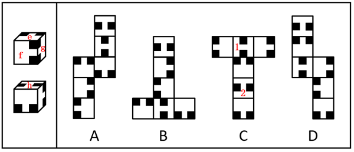

D项：选项展开图中，面1和面2为相对面，二者均不与面e、面f和面g中的任一个构成相对面，因此面1和面2都不是面h，选项展开图与题干不一致，排除。

故正确答案为A。

**考点**：空间类-空间重构-六面体

**来源**：2026年上海市公务员录用考试《行测》题（网友回忆版）第58题

### 第 59 题

下列选项中，符合所给图形变化规律的是（ ）。

A. A

B. B

C. C

D. D

第 59 题 · 答案与解析

**参考答案（粉笔题库参考内容）**

D

**解析**

元素组成相似，优先考虑样式规律。题干图形相同线条重复出现，考虑加减同异。九宫格优先看横行，第一行图1和图2外框和框内直线求同、小圆圈求异得到图3；经验证，第二行满足此规律；第三行应用此规律，故？处应选择由第三行图1和图2外框和框内直线求同、小圆圈求异得到的图形，只有D项符合。

故正确答案为D。

**考点**：样式规律-加减同异

**来源**：2026年上海市公务员录用考试《行测》题（网友回忆版）第59题

### 第 60 题

下列选项中，符合所给图形变化规律的是        。

A. A

B. B

C. C

D. D

第 60 题 · 答案与解析

**参考答案（粉笔题库参考内容）**

D

**解析**

元素组成相似，且相同线条重复出现，优先考虑样式规律中的加减同异。九宫格优先看横行，第一行中，图1和图2上半部分、下半部分的正方形均外框线条求同、内部线条求异，然后图形整体上下翻转得到图3；经验证，第二行满足此规律；第三行应用此规律，只有D项符合。

故正确答案为D。

**考点**：样式规律-加减同异

**来源**：2026年上海市公务员录用考试《行测》题（网友回忆版）第60题

### 第 61 题

下列选项中，符合所给图形变化规律的是        。

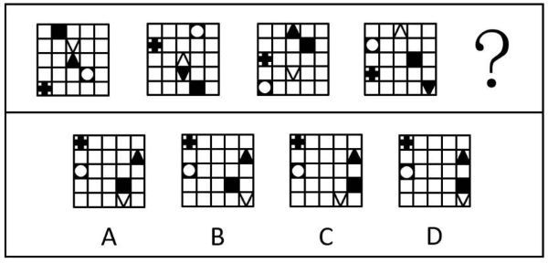

A. A

B. B

C. C

D. D

第 61 题 · 答案与解析

**参考答案（粉笔题库参考内容）**

B

**解析**

元素组成相同，优先考虑位置规律。观察发现，题干图形每次先上下翻转，然后位于第一行和第三行的元素每次向下平移一格，位于第二行和第四行的元素每次向上平移一格，位于第五行的元素每次向右平移两格（到头循环走），故？处图形也应符合此规律，只有B项符合。

故正确答案为B。

**考点**：位置规律-平移、位置规律-翻转

**来源**：2026年上海市公务员录用考试《行测》题（网友回忆版）第61题

### 第 62 题

下列选项中，符合所给图形变化规律的是        。

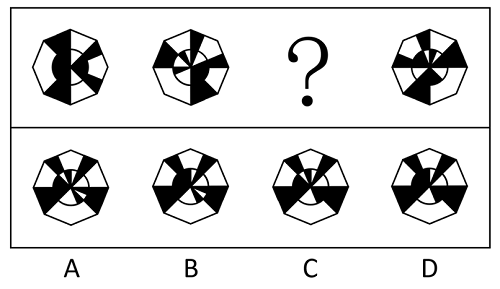

A. A

B. B

C. C

D. D

第 62 题 · 答案与解析

**参考答案（粉笔题库参考内容）**

A

**解析**

元素组成基本相同，优先考虑位置规律。为了方便理解，可先将题干图形的轮廓进行等分，将题干黑块区分为斜杠图形及灰色图形（如下图所示）。观察发现，斜杠图形依次逆时针移动两格，灰色图形依次顺时针移动一格：

再次观察发现，当斜杠图形及灰色图形重合时，重合部分变为白色，如下图所示：

故正确答案为A。

**考点**：位置规律-平移

**来源**：2026年上海市公务员录用考试《行测》题（网友回忆版）第62题

### 第 63 题

下列选项中，符合所给图形变化规律的是（ ）。

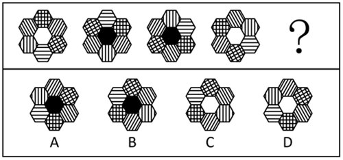

A. A

B. B

C. C

D. D

第 63 题 · 答案与解析

**参考答案（粉笔题库参考内容）**

C

**解析**

元素组成基本相同，优先考虑位置规律。题干图形均由外圈的6个六边形元素和内圈的1个六边形元素组成，且外圈元素组成相同，内圈元素颜色不同，考虑内外分开看。外圈考虑位置规律，给外圈的6个六边形元素的位置依次标为1、2、3、4、5、6，比较图一和图二发现，1号移动至2号位置、2号移动至3号位置、3号移动至6号位置、4号移动至1号位置、5号移动至4号位置、6号移动至5号位置。经验证，图二到图三、图三到图四均符合该规律，故图四到图五也应符合该规律，排除A、D两项；内圈考虑颜色变化，对比题干的内圈颜色后发现，当两个网格状元素（如图一的1和3）之间为斜向相对位置时内圈颜色为白色，当两个网格状元素之间为横向相对位置时内圈颜色为黑色，？处两个网格状元素之间为斜向相对位置，故？处内圈颜色应为白色，只有C项符合。

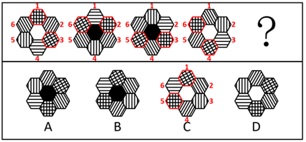

故正确答案为C。

**考点**：位置规律-平移

**来源**：2026年上海市公务员录用考试《行测》题（网友回忆版）第63题

### 第 64 题

下列选项中，可以由左图折叠而成的是（ ）。

A. A

B. B

C. C

D. D

第 64 题 · 答案与解析

**参考答案（粉笔题库参考内容）**

B

**解析**

将题干展开图标上序号，如下图所示，逐一进行分析。

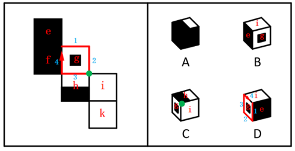

A项：选项由面e、面f和面h构成，题干展开图中，面e和面h为相对面，二者不能同时出现，选项与题干展开图不一致，排除；

B项：选项由面e、面g和面i构成，选项与题干展开图一致，当选；

C项：选项出现面g，而面g和面k为相对面，二者不能同时出现，因此选项由面g、面h和面i构成，题干展开图中，三个面的公共点挨着面h中的白色矩形，而选项中三个面的公共点挨着面h中的黑色矩形，选项与题干展开图不一致，排除；

D项：选项出现面g，而面g和面k为相对面，二者不能同时出现，因此选项顶面为面i，而面i和面f为相对面，二者不能同时出现，故选项由面g、面i和面e构成，在题干展开图和选项中，同时以面e和面g的公共边为起始边顺时针画边，题干展开图中边2对应面i，选项中边4对应面i，选项与题干展开图不一致，排除。

故正确答案为B。

**考点**：空间类-空间重构-六面体

**来源**：2026年上海市公务员录用考试《行测》题（网友回忆版）第64题

### 第 65 题

下列选项中，与其它三项不同的是        。

A. A

B. B

C. C

D. D

第 65 题 · 答案与解析

**参考答案（粉笔题库参考内容）**

D

**解析**

元素组成不同，优先考虑属性规律。观察发现，每幅图均由黑球和白球组成，且黑白球整体分布比较规整，考虑对称性。A、B、C三项均为仅中心对称图形，而D项为轴+中心对称图形，故只有D项与其它三项不同。

本题为选非题，故正确答案为D。

**考点**：属性规律-对称性

**来源**：2026年上海市公务员录用考试《行测》题（网友回忆版）第65题

### 第 66 题

下列选项中，符合所给图形变化规律的是（ ）。

A. A

B. B

C. C

D. D

第 66 题 · 答案与解析

**参考答案（粉笔题库参考内容）**

C

**解析**

元素组成相似，且相似线条重复出现，优先考虑样式规律中的加减同异。九宫格优先看横行，第一行中，将图2顺时针或逆时针旋转后与图1求异，求异后的部分变成黑色得到图3；经验证，第二行中，将图2逆时针旋转后与图1求异，求异后的部分变成黑色得到图3；第三行应用此规律，将图2逆时针旋转后与图1求异，求异的部分变成黑色，只有C项符合。

故正确答案为C。

**考点**：样式规律-加减同异

**来源**：2026年上海市公务员录用考试《行测》题（网友回忆版）第66题

### 第 67 题

下列选项中，符合所给图形变化规律的是（ ）。

A. A

B. B

C. C

D. D

第 67 题 · 答案与解析

**参考答案（粉笔题库参考内容）**

D

**解析**

元素组成相似，但无明显样式规律，且出现多个独立小图形，优先考虑素数量。九宫格优先横向看，观察发现，第一行的图1和图2中，共出现了4次，在图3中其出现在由内向外数的第4层，共出现了3次，在图3中其出现在由内向外数的第3层，共出现了2次，在图3中其出现在由内向外数的第2层，共出现了1次，在图3中其出现在由内向外数的第1层，即规律为：图1和图2中相同元素共出现了几次，在图3中该元素就出现在由内向外数的第几层；经验证，第二行符合此规律；第三行应用此规律，图1和图2中相同元素出现的次数从1-4排序依次为、、、，故？处图形由内向外的分布应依次为、、、，只有D项符合。

故正确答案为D。

**考点**：数量规律-素

**来源**：2026年上海市公务员录用考试《行测》题（网友回忆版）第67题

### 第 68 题

趋势外推法是指以时间为基本参数，通过归纳分析过去和当前某一事物的数据，推断未来该事物的发展趋势或预测将来可能出现的事件的方法。

以下使用了趋势外推法的是\_\_\_\_\_\_。

A. 为了分析新能源汽车在发展初期的市场渗透率，假设新能源汽车与智能手机均为颠覆性技术，参考智能手机曲线，预测新能源汽车的渗透率

B. 为了预测未来全球人工智能市场规模，邀请多位行业专家独立预估市场规模及依据，汇总结果后匿名反馈给专家，重复多轮，直至专家意见趋于一致

C. 为了分析某产品的留存率，将用户信息按照地区进行分组，得出华东地区的用户留存率最高的结论

D. 为了预测某市人口数量，收集过去几年的人口数量，绘制成图表，观察到人口呈现线性增长趋势，计算出未来的人口数量

第 68 题 · 答案与解析

**参考答案（粉笔题库参考内容）**

D

**解析**

第一步：找出定义关键词。

“以时间为基本参数”、“通过归纳分析过去和当前某一事物的数据”、“推断未来该事物的发展趋势或预测将来可能出现的事件”。

第二步：逐一分析选项。

A项：假设新能源汽车与智能手机均为颠覆性技术，通过类比智能手机曲线预测新能源汽车渗透率，并未归纳分析新能源汽车自身过去和当前的数据，不符合“以时间为基本参数”、“通过归纳分析过去和当前某一事物的数据”，不符合定义，排除；

B项：为了预测未来全球人工智能市场规模，邀请多位行业专家独立预估市场规模及依据，汇总专家意见并多轮反馈，依赖主观判断而非历史数据，不符合“以时间为基本参数”、“通过归纳分析过去和当前某一事物的数据”，不符合定义，排除；

C项：为了分析某产品的留存率，将用户信息按照地区进行分组，得出华东地区的用户留存率最高的结论，分析的是当前不同地区的留存率差异，没有以时间为基本参数，也未涉及对未来趋势的推断，不符合“以时间为基本参数”、“推断未来该事物的发展趋势或预测将来可能出现的事件”，不符合定义，排除；

D项：为了预测某市人口数量，收集过去几年的人口数量，绘制成图表，观察到人口呈现线性增长趋势，计算出未来的人口数量，符合“以时间为基本参数”、“通过归纳分析过去和当前某一事物的数据”、“推断未来该事物的发展趋势或预测将来可能出现的事件”，符合定义，当选。

故正确答案为D。

**考点**：方式目的

**来源**：2026年上海市公务员录用考试《行测》题（网友回忆版）第68题

### 第 69 题

沙迦在荒漠地区成功培育出“沙迦1号”创新小麦，蛋白质含量达19.3%。该品种借助高精尖技术优化产品品质并能应对环境波动，其年产量充分满足了当地需求，降低了进口依赖。该品种已广泛用于本地食品加工，并获多项国际认证。因此，“沙迦1号”可以称得上农业创新领域的重大突破。

上述材料在论证其结论时，采用的思路是：

A. 通过构建包含技术创新、产品指标、市场应用的三维论证体系，以“沙迦1号”在各维度的具体数据为支撑，形成相互印证的立体论证结构

B. 采用问题导向型论证，以荒漠种植的先天劣势为逻辑起点，阐述“沙迦1号”培育过程中技术方案与成果指标的递进关系，证明创新突破的必然性

C. 运用多维度交叉验证法，将农业技术创新的理论可行性、实际应用效果、经济效益指标进行交叉比对，强化论点的可信度

D. 建立基于成果导向的论证模型，通过呈现“沙迦1号”在技术突破、产量提升、市场认可等方面的成果，直接支撑论点

第 69 题 · 答案与解析

**参考答案（粉笔题库参考内容）**

D

**解析**

第一步：找出论点和论据，并梳理题干论证思路。

论点：“沙迦1号”可以称得上农业创新领域的重大突破。

论据：“沙迦1号”创新小麦蛋白质含量达19.3%。该品种借助高精尖技术优化产品品质并能应对环境波动，其年产量充分满足了当地需求，降低了进口依赖。该品种已广泛用于本地食品加工，并获多项国际认证。

题干是通过论据中“蛋白质含量达19.3%”“借助高精尖技术优化产品品质并能应对环境波动，其年产量充分满足了当地需求”“广泛用于本地食品加工，并获多项国际认证”等方面的信息来支撑论点成立。

第二步：逐一分析选项。

A项：题干中仅有“蛋白质含量达19.3%”一个具体数据，在技术创新和市场应用方面并没有具体的数据支撑，没有体现各维度相互印证，不是题干采用的论证思路，排除；

B项：题干不是问题导向型论证，没有将荒漠种植的先天劣势作为逻辑起点展开论述，不是题干采用的论证思路，排除；

C项：题干中未提及农业技术创新的理论可行性，不是题干采用的论证思路，排除；

D项：题干通过呈现“沙迦1号”借助高精尖技术优化产品品质（技术突破）、年产量充分满足当地需求（产量提升）、广泛用于本地食品加工，并获多项国际认证（市场认可）等方面的成果，直接支撑“‘沙迦1号’称得上农业创新领域的重大突破”的成立，是题干采用的论证思路，当选。

故正确答案为D。

**来源**：2026年上海市公务员录用考试《行测》题（网友回忆版）第69题

### 第 70 题

上海科技企业在整个2024年共发生融资997起，居全国首位。据披露，总融资金额为966.38亿元，且呈现单笔融资金额连续三年递增。早期融资占比66%，同比提高了14个百分点。同时，生物医药、集成电路、人工智能三大先导产业融资占比超半数，国资参投占比达34.2%并加大早期投资力度。

以下选项里，最能准确归纳2024年上海科技企业投融资生态核心特点的是：

A. 单笔融资额增长，早期融资占比提升，科技赛道突出，国资投入增加

B. 融资数量全国第一，对科技行业的早期投资占比高，国资支撑强

C. 硬科技产业融资高，单笔融资金额及早期融资占比高，国资作用关键

D. 融资规模小且分散，硬科技领域融资占比低，国资成为早期投资主力

第 70 题 · 答案与解析

**参考答案（粉笔题库参考内容）**

A

**解析**

日常结论题，根据题干信息逐一分析选项。

A项：根据题干中“单笔融资金额连续三年递增”可以推出单笔融资额增长，根据“早期融资占比66%，同比提高了14个百分点”可以推出早期融资占比提升，根据“生物医药、集成电路、人工智能三大先导产业融资占比超半数”可以推出科技赛道突出，根据“国资参投占比达34.2%并加大早期投资力度”可以推出国资投入增加，可以推出，当选；

B项：根据题干最后一句“国资参投占比达34.2%并加大早期投资力度”，无法直接推出国资的支撑能力强，无法推出，排除；

C项：根据题干中“单笔融资金额连续三年递增”可以推出单笔融资额增长，无法推出“单笔融资金额占比高”，无法推出，排除；

D项：根据题干内容无法推出“融资规模小且分散”，无法推出，排除。

故正确答案为A。

**考点**：日常结论

**来源**：2026年上海市公务员录用考试《行测》题（网友回忆版）第70题

### 第 71 题

随着云南西双版纳地区生态保护力度加大，亚洲象种群数量从20世纪80年代的180头左右增长至2022年的300余头。为了缓解“人象冲突”，相关保护机构推行亚洲象食物源基地建设，通过种植大象喜食作物提供替代食物，有效降低大象侵扰农田的频率。反对者提出质疑：若大象已形成固定的农田觅食习性，即便存在食物源基地，其仍可能因“路径依赖”持续进入人类区域，因此缓解冲突需结合栖息地连通等长期手段。

若反对者的质疑成立，必须补充的前提是：

A. 大象的觅食行为主要受既往觅食路径影响而非食物可获得性

B. 食物源基地的作物种植规模无法覆盖所有亚洲象活动区域

C. 栖息地连通工程能显著提升亚洲象对自然栖息地的偏好

D. 农田作物与食物源基地作物的营养差异对大象觅食选择无影响

第 71 题 · 答案与解析

**参考答案（粉笔题库参考内容）**

A

**解析**

第一步：找出论点和论据。

论点：若大象已形成固定的农田觅食习性，即便存在食物源基地，其仍可能因“路径依赖”持续进入人类区域，因此缓解冲突需结合栖息地连通等长期手段。

论据：无。

本题只有论点没有论据，且提问方式为“前提”，加强优先考虑必要条件。

第二步：逐一分析选项。

A项：该项说的是大象的觅食行为主要受既往觅食路径影响而非食物可获得性，如果大象觅食不受既往路径主导，那么食物源基地就能够吸引大象，论点就不成立，该项是论点成立的必要条件，当选；

B项：该项说的是食物源基地的作物种植规模，即使种植范围实现全覆盖，只要大象觅食受既往路径主导，就依然会无视食物源基地，继续进入农田觅食，该项不是论点成立的必要条件，排除；

C项：该项说的是栖息地连通工程的作用，而论点讨论的是大象的觅食习性和路径依赖，话题不一致，无法加强，排除；

D项：该项说的是营养差异对大象觅食选择无影响，即使营养差异对大象觅食选择有影响，也没有与“路径依赖”对大象觅食选择的影响进行比较，为不明确项，无法加强，排除。

故正确答案为A。

**考点**：必要条件

**来源**：2026年上海市公务员录用考试《行测》题（网友回忆版）第71题

### 第 72 题

某研究指出，各国数字化转型显著提升了公共服务效率，但政府治理效能提升幅度差异较大，技术应用与公民参与度存在显著相关性。基于此，该研究提出数字化转型治理的“协同增效假说”：数字社会治理效能的提升需通过制度适配和公民积极参与，实现仅依赖技术工具而忽视社会参与，可能导致“数字形式主义”，削弱治理效率。

以下哪项为真，最能支持上述假说？

A. 加拿大近几年投入数亿美元建设智能政务系统，但公民对政府服务的满意度同比下降5%

B. 瑞典通过立法强制要求数字政务平台嵌入公民协商模块，使得政府决策效率提升20%

C. 国际电信联盟数据显示，发展中国家数字政务覆盖率已达75%，但公民投诉处理周期仍长达30天

D. 韩国首尔市推行“数字市民议事厅”项目，允许公民实时参与预算审议，次年政府信任度跃升12%

第 72 题 · 答案与解析

**参考答案（粉笔题库参考内容）**

B

**解析**

第一步：找出论点和论据。

论点：数字社会治理效能的提升需通过制度适配和公民积极参与，实现仅依赖技术工具而忽视社会参与，可能导致“数字形式主义”，削弱治理效率。

论据：某研究指出，各国数字化转型显著提升了公共服务效率，但政府治理效能提升幅度差异较大，技术应用与公民参与度存在显著相关性。

本题论点和论据都在讨论“数字社会治理效能”和“公民参与度”之间的关系，二者话题一致，加强优先考虑补充论据。

第二步：逐一分析选项。

A项：该项指出加拿大建设智能政务系统后，公民的满意度下降，未提及制度、治理效能以及公民参与度之间的关系，话题不一致，无法加强，排除；

B项：该项中“立法强制”体现了制度，“公民协商模块”体现了公民参与度，“政府决策效率提升20%”体现了治理效能，即通过瑞典这个例子证明了数字社会治理效能的提升需通过制度适配和公民积极参与，补充论据，可以加强，当选；

C项：该项指出发展中国家数字政务覆盖率高，但投诉处理周期长，未提及制度对数字社会治理效能的提升的影响，话题不一致，无法加强，排除；

D项：该项指出首尔推行“数字市民议事厅”项目，政府信任度跃升，未提及制度对数字社会治理效能的提升的影响，话题不一致，无法加强，排除。

故正确答案为B。

**考点**：补充论据

**来源**：2026年上海市公务员录用考试《行测》题（网友回忆版）第72题

### 第 73 题

随着人工智能、大数据、量子计算等新兴技术的爆发式发展，哲学研究的底层范式正经历前所未有的结构性变革。当下，科技革命正不断解构传统哲学命题（如自由意志、伦理责任、知识确证），变革技术实践的检验场域，迫使哲学研究者突破概念分析的传统范式，转而与计算机科学、神经科学、认知心理学等展开深度对话。在此背景下，有学者认为，哲学与科技的融合发展不再是边缘性探索，而是哲学研究的重要趋势，哲学范式革新的核心驱动力。

以下        项无法为这一趋势提供支撑。

A. 某高校哲学系与计算机系合作，开展人工智能伦理研究，取得了丰硕成果

B. 传统哲学研究方法在发展过程中，存在一定的局限性和不足

C. 哲学为人工智能的发展提供了伦理指导，推动了科技向善

D. 哲学与科技融合的研究，获得了越来越多的学术资源和政策支持

第 73 题 · 答案与解析

**参考答案（粉笔题库参考内容）**

B

**解析**

第一步：找出论点和论据。

论点：哲学与科技的融合发展不再是边缘性探索，而是哲学研究的重要趋势，哲学范式革新的核心驱动力。

论据：无。

本题只有论点没有论据，加强优先考虑补充论据，且本题为选非题，找出可以加强的选项排除即可。

第二步：逐一分析选项。

A项：该项指出某高校哲学系与计算机系合作取得了丰硕成果，通过举例说明哲学与科技的融合发展是有效的，融合发展是重要趋势，补充论据，可以加强，排除；

B项：该项指出传统哲学研究方法存在一定的局限性和不足，仅说明了传统哲学的局限，与论点讨论的哲学与科技是否融合发展无关，为无关项，无法加强，当选；

C项：该项指出哲学为人工智能的发展提供了伦理指导，说明哲学对科技有积极作用，融合发展是重要趋势，补充论据，可以加强，排除；

D项：该项指出哲学与科技融合的研究获得越来越多的学术资源和政策支持，说明哲学与科技的融合发展受到了多方面的重视，为融合的趋势提供了条件，补充论据，可以加强，排除。

本题为选非题，故正确答案为B。

**考点**：加强选非题

**来源**：2026年上海市公务员录用考试《行测》题（网友回忆版）第73题

### 第 74 题

一项关于自闭症的研究表明，自闭症患者携带的异常基因组中与小胶质细胞功能异常相关的基因多达十余种，而药物分子BMS265246修复小胶质细胞功能异常后，小鼠的自闭症症状有所缓解。因此有不少人认为药物分子BMS265246可能成为治疗人类自闭症的有效药物。

根据上面的陈述，以下        项问题的答案最能对这一结论作出评价。

A. 小胶质细胞功能异常是否一定会导致自闭症？

B. 服用BMS265246药物分子是否会引起其它副症状？

C. BMS265246药物分子对其它原因引起的自闭症是否具有治疗效果？

D. 是否所有自闭症患者都具有小胶质细胞功能异常的情况？

第 74 题 · 答案与解析

**参考答案（粉笔题库参考内容）**

A

**解析**

第一步：找出论点和论据。

论点：药物分子BMS265246可能成为治疗人类自闭症的有效药物。

论据：自闭症患者携带的异常基因组中与小胶质细胞功能异常相关的基因多达十余种，而药物分子BMS265246修复小胶质细胞功能异常后，小鼠的自闭症症状有所缓解。

本题论点讨论的是“药物分子BMS265246”与“人类自闭症”之间的关系，论据讨论的是“药物分子BMS265246”与“小胶质细胞功能异常”之间的关系，二者话题不一致，且提问方式为“最能对这一结论作出评价”，问题对结论成立越关键就越有帮助，可优先考虑搭桥。

第二步：逐一分析选项。

A项：该项讨论的是小胶质细胞功能异常是否一定会导致自闭症，如果小胶质细胞功能异常一定会导致自闭症，说明二者存在必然的因果联系，那么修复该异常的药物就能成为治疗人类自闭症的有效药物，即观点成立，反之观点就不成立，有助于评价结论，当选；

B项：该项讨论的是服用BMS265246药物分子是否会引起其它副症状，关注的是药物的安全性，而论点讨论的是药物的有效性，安全性与有效性无直接关联，话题不一致，无助于评价结论，排除；

C项：该项讨论的是BMS265246药物分子对其它原因引起的自闭症是否具有治疗效果，而论点讨论的是该药物针对小胶质细胞功能异常相关的自闭症的治疗效果，即便药物对其它原因引起的自闭症无效，只要对小胶质细胞功能异常相关的自闭症有效，仍可成为治疗人类自闭症的有效药物，无助于评价结论，排除；

D项：该项讨论的是是否所有自闭症患者都具有小胶质细胞功能异常的情况，即便不是所有患者都存在该异常，只要小胶质细胞功能异常必然导致自闭症，药物分子BMS265246针对这部分患者具备治疗效果，仍可能成为治疗人类自闭症的有效药物，无助于评价结论，排除。

故正确答案为A。

**来源**：2026年上海市公务员录用考试《行测》题（网友回忆版）第74题

### 第 75 题

沉默的螺旋是指与媒介中的主流观点持相反或不同意见的人，由于害怕被排斥和孤立而趋于保持沉默，使得被认为属于“主流”的意见越来越强势，而属于“少数”或“另类”的意见就愈发衰退，形成所谓“螺旋”效果。

以下属于沉默的螺旋的是：

A. 在校园内是否允许电动自行车行驶的问题上，校内师生形成了“安全优先”和“便捷优先”两大阵营，彼此展开激烈的讨论

B. 张教授在课程群里征求对考试形式的意见，最先留言的十多位同学都主张闭卷考，部分想开卷考的同学担心被人说“太菜”，选择不留言

C. 社交媒体用户通过算法推荐，长期接触单一立场的新闻，逐渐强化对自己观点的认同，思想变得极端偏激

D. 某段时间内媒体密集报道“食品安全问题”，如添加剂超标、过期食品等，导致公众对食品安全的担忧大幅上升，甚至产生集体焦虑

第 75 题 · 答案与解析

**参考答案（粉笔题库参考内容）**

B

**解析**

第一步：找出定义关键词。

“与媒介中的主流观点持相反或不同意见的人”、“由于害怕被排斥和孤立而趋于保持沉默”、“使得被认为属于‘主流’的意见越来越强势”。

第二步：逐一分析选项。

A项：校内师生形成了“安全优先”和“便捷优先”两大阵营，彼此展开激烈的讨论，并未体现有人因害怕被排斥和孤立而保持沉默，不符合“由于害怕被排斥和孤立而趋于保持沉默”，不符合定义，排除；

B项：最先留言的十多位同学都主张闭卷考，部分想开卷考的同学属于与主流观点持相反意见的人，符合“与媒介中的主流观点持相反或不同意见的人”，担心被人说“太菜”从而选择不留言，符合“由于害怕被排斥和孤立而趋于保持沉默”、“使得被认为属于‘主流’的意见越来越强势”，符合定义，当选；

C项：社交媒体用户长期接触单一立场的新闻，逐渐强化对自己观点的认同，只体现了用户个人的变化，不符合“与媒介中的主流观点持相反或不同意见的人”、“由于害怕被排斥和孤立而趋于保持沉默”，不符合定义，排除；

D项：媒体密集报道“食品安全问题”，导致公众对食品安全的担忧大幅上升，并未提及持相反意见的人的情况，不符合“与媒介中的主流观点持相反或不同意见的人”、“由于害怕被排斥和孤立而趋于保持沉默”，不符合定义，排除。

故正确答案为B。

**考点**：原因结果

**来源**：2026年上海市公务员录用考试《行测》题（网友回忆版）第75题

### 第 76 题

所有威胁人类生存根基的问题都需全球共同面对。环境问题引发的气候异常、资源枯竭等，正直接破坏人类赖以生存的生态系统，威胁粮食安全与居住环境，因此环境问题是威胁人类生存根基的关键问题。所有需全球共同面对的关键问题中，影响范围最广、紧迫性最强的是首要问题。环境问题的影响已高度跨国界，若不及时应对将引发不可逆后果。由此可推，环境问题是当今世界最需共同面对的首要问题。

以下        项如果为真，最能质疑上述论证。

A. 环境问题的解决需依赖技术突破，而各国技术水平差异较大

B. 经济发展问题对人类生存的威胁是比环境问题更广泛、紧迫性更强的全球问题

C. 和平与发展是比环境问题更受重视的全球性问题

D. 部分国家对环境问题的重视程度远低于经济发展问题

第 76 题 · 答案与解析

**参考答案（粉笔题库参考内容）**

B

**解析**

第一步：找出论点和论据。

论点：环境问题是当今世界最需共同面对的首要问题。

论据：所有威胁人类生存根基的问题都需全球共同面对。环境问题引发的气候异常、资源枯竭等，正直接破坏人类赖以生存的生态系统，威胁粮食安全与居住环境，因此环境问题是威胁人类生存根基的关键问题。所有需全球共同面对的关键问题中，影响范围最广、紧迫性最强的是首要问题。环境问题的影响已高度跨国界，若不及时应对将引发不可逆后果。

本题论点和论据均在讨论环境问题是否为当今世界最需共同面对的首要问题。二者话题一致，削弱优先考虑削弱论点。

第二步：逐一分析选项。

A项：该项指出环境问题的解决依赖技术突破且各国技术水平差异大，讨论的是解决环境问题的难度，与论点“环境问题是否为最需共同面对的首要问题”无关，无法削弱，排除；

B项：该项指出经济发展问题是比环境问题影响更广泛、紧迫性更强的全球问题，直接否定了环境问题是当今世界最需共同面对的首要问题，削弱论点，可以削弱，当选；

C项：该项指出和平与发展比环境问题更受重视，“受重视”与是否是“首要问题”无关，话题不一致，无法削弱，排除；

D项：该项指出部分国家对环境问题的重视程度低于经济发展问题，体现的是部分国家的态度差异，与“环境问题是否为最需共同面对的首要问题”无关，无法削弱，排除。

故正确答案为B。

**考点**：削弱论点

**来源**：2026年上海市公务员录用考试《行测》题（网友回忆版）第76题

### 第 77 题

社区参与是指以居民关注的社区公共事务为焦点，结合社区居民的共同利益，吸引居民参与，通过有目标、有组织的行动过程和投入，解决社区问题，满足社区需要，凝聚社区意识，提升居民生活质量的过程。

以下属于社区参与的是：

A. 某城市老旧小区改造前，社区组织居民代表、物业、街道办召开改造方案听证会，居民就停车位规划、加装电梯、绿化布局等问题提出意见

B. 在“免费午餐”公益计划中，来自全国各地的志愿者通过线上捐款、线下探访等方式支持偏远地区儿童餐饮

C. 某社区开展人大代表补选工作，该社区居民通过无记名投票和等额选举的方式，最终产生一名人大代表

D. 某街道办事处在社区内开展“敲门行动”，组织工作人员走访高龄独居老人、残障人士等特殊群体

第 77 题 · 答案与解析

**参考答案（粉笔题库参考内容）**

A

**解析**

第一步：找出定义关键词。

“以居民关注的社区公共事务为焦点”、“结合社区居民的共同利益，吸引居民参与”、“有目标、有组织的行动过程和投入”、“解决社区问题，满足社区需要，凝聚社区意识，提升居民生活质量”。

第二步：逐一分析选项。

A项：某城市老旧小区改造前，社区组织居民代表、物业、街道办召开改造方案听证会，符合“以居民关注的社区公共事务为焦点”、“有目标、有组织的行动过程和投入”，居民就停车位规划、加装电梯、绿化布局等问题提出意见，符合“结合社区居民的共同利益，吸引居民参与”、“解决社区问题，满足社区需要，凝聚社区意识，提升居民生活质量”，符合定义，当选；

B项：来自全国各地的志愿者通过线上捐款、线下探访等方式支持偏远地区儿童餐饮，说明不是社区居民参与，解决的也不是社区公共事务，不符合“以居民关注的社区公共事务为焦点”、“结合社区居民的共同利益，吸引居民参与”、“解决社区问题，满足社区需要，凝聚社区意识，提升居民生活质量”，不符合定义，排除；

C项：某社区开展人大代表补选工作，是政治选举活动，虽在社区内进行，但不是针对社区具体问题或需求的活动，不符合“解决社区问题，满足社区需要，凝聚社区意识，提升居民生活质量”，不符合定义，排除；

D项：“敲门行动”是组织工作人员走访特殊群体，说明居民是被走访的对象，而非主动参与者，不符合“以居民关注的社区公共事务为焦点”、“结合社区居民的共同利益，吸引居民参与”，不符合定义，排除。

故正确答案为A。

**考点**：方式目的

**来源**：2026年上海市公务员录用考试《行测》题（网友回忆版）第77题

### 第 78 题

在2025年荷兰北约峰会上，上任北约秘书长延斯·斯托尔滕贝格在发言时，将美国总统称为“美国爸爸”（America Daddy），此举引发广泛争议。许多媒体和观察者据此认为，“爸爸策略”已从美国对非北约盟国延伸至北约核心圈，他们进一步推论称，欧洲在对美关系中根本无法实现自主，只能继续追随美国决策，毫无改善前景。

如果以下选项都为真，        ，最能削弱上述推论。

A. 延斯·斯托尔滕贝格在会后接受采访时澄清“爸爸”一词只是幽默用语，未表达任何政治意涵

B. 法国、德国等欧洲大国呼吁重建以欧洲利益为核心的防务机制，加速推进欧盟武器系统开发项目

C. 美国在峰会期间要求欧洲国家增加军费，并威胁对未达标国家施加贸易限制，引发部分国家反弹

D. 历史上也曾多次出现美欧在防务议题上的分歧，但最终仍通过妥协实现合作

第 78 题 · 答案与解析

**参考答案（粉笔题库参考内容）**

B

**解析**

第一步：找出论点和论据。

论点：欧洲在对美关系中根本无法实现自主，只能继续追随美国决策，毫无改善前景。

论据：在2025年荷兰北约峰会上，北约秘书长延斯·斯托尔滕贝格在发言时，将美国总统称为“美国爸爸”（America Daddy），此举引发广泛争议。许多媒体和观察者据此认为，“爸爸策略”已从美国对非北约盟国延伸至北约核心圈。

本题的论点和论据均在讨论欧洲在对美关系中无法实现自主，只能继续追随美国的决策，二者话题一致，削弱优先考虑削弱论点。

第二步：逐一分析选项。

A项：该项讨论的是延斯·斯托尔滕贝格澄清了“爸爸”一词仅是幽默用语，和政治无关，并未提及欧洲是否在对美关系中能够实现自主，话题不一致，为无关项，无法削弱，排除；

B项：该项指出法国、德国等欧洲大国呼吁重建以欧洲利益为核心的防务机制，并且加速推进欧盟武器系统开发项目，说明这些欧洲大国正在计划重建以欧洲利益为核心的防务机制来实现自主，并正在努力改善追随美国决策的状况，削弱论点，可以削弱，当选；

C项：该项讨论的是美国在峰会期间对欧洲国家的要求和威胁引发了部分国家反弹，未提及这些反弹的国家是否可以让欧洲掌握在对美关系中的自主权，也未提及这些国家反弹的行为是否可以改善欧洲追随美国决策的状况，为不明确项，无法削弱，排除；

D项：该项讨论的是历史上也曾出现过美欧在防务议题上的分歧，但最终仍通过妥协实现合作，说明欧洲以往在对美关系中确实缺乏自主权，但未提及欧洲能否拿回自主权并改善追随美国决策的状况，为无关项，无法削弱，排除。

故正确答案为B。

**考点**：削弱论点

**来源**：2026年上海市公务员录用考试《行测》题（网友回忆版）第78题

## 材料 6

毕业自哲学、物理和历史3个专业的大学生甲、乙、丙、丁4人被某单位录用分配至信息处、研发处和办公室3个部门，每个部门至少1人。已知：

（1）若乙、丁中至少有1人被分配至研发处，则哲学专业的和物理专业的均被分配至办公室；

（2）若物理、历史专业的至少有1人被分配至办公室，则哲学专业的乙被分配至研发处。

### 第 79 题

根据以上信息，可以得出以下        。

A. 只有哲学专业的被分配至办公室

B. 只有物理专业的被分配至研发处

C. 只有哲学专业的被分配至研发处

D. 只有物理专业的被分配至信息处

第 79 题 · 答案与解析

**参考答案（粉笔题库参考内容）**

A

**解析**

第一步：分析题干条件。

（1）乙 或 丁被分配至研发处哲学专业的 且 物理专业的被分配至办公室；

（2）物理专业的 或 历史专业的被分配至办公室哲学专业的乙被分配至研发处；

（3）毕业自哲学、物理和历史3个专业的大学生甲、乙、丙、丁4人被某单位录用分配至信息处、研发处和办公室3个部门，每个部门至少1人。

第二步：根据题干条件进行推理。

题干中条件（1）（2）均涉及乙是否被分配至研发处，故以此进行假设。

假设乙被分配至研发处。这是对条件（1）的肯前，肯前必肯后，可得“哲学专业的 且 物理专业的被分配至办公室”，这是对条件（2）的肯前，肯前必肯后，可得“哲学专业的乙被分配至研发处”，自相矛盾，故该假设不成立。

根据上述推理可得乙没被分配至研发处。这是对条件（2）的否后，否后必否前，可得“物理专业的 且 历史专业的没被分配至办公室”，结合条件（3）可得“只有哲学专业的被分配至办公室”，对应A项。

故正确答案为A。

**来源**：2026年上海市公务员录用考试《行测》题（网友回忆版）第79题

### 第 80 题

粉笔暂未收录本题（来源缺题，题位保留）

第 80 题 · 答案与解析

**答案状态：unknown（来源未提供）**

**解析状态：unknown（来源未提供）**

### 第 81 题

2025年是《巴黎协定》达成10周年，也是提交新一轮国家自主贡献的重要节点，全球气候治理进入关键阶段，国家主席习近平宣布中国新一轮国家自主贡献，其中包括（ ）。

A. 新能源汽车成为新销售车辆主流，全国碳排放权交易市场覆盖所有行业

B. 中国力争2030年前实现碳中和，努力争取2060年二氧化碳排放达到峰值

C. 化石能源消费占能源消费总量的比重达30%以上

D. 到2035年，中国全经济范围温室气体净排放量比峰值下降7%-10%

第 81 题 · 答案与解析

**参考答案（粉笔题库参考内容）**

D

**解析**

本题考查新思想。

A、C两项错误，D项正确，2025年9月24日，习近平总书记在联合国气候变化峰会上的致辞中宣布中国新一轮国家自主贡献：到2035年，中国全经济范围温室气体净排放量比峰值下降7%-10%，力争做得更好。非化石能源消费占能源消费总量的比重达到30%以上，风电和太阳能发电总装机容量达到2020年的6倍以上、力争达到36亿千瓦，森林蓄积量达到240亿立方米以上，新能源汽车成为新销售车辆的主流，全国碳排放权交易市场覆盖主要高排放行业，气候适应型社会基本建成。故A项“所有行业”表述错误，应为“主要高排放行业”，C项“化石能源”表述错误，应为“非化石能源”。

B项错误，中国的“双碳”目标是力争2030年前二氧化碳排放达到峰值，努力争取2060年前实现碳中和。

故正确答案为D。

**考点**：重要会议讲话、生态文明建设

**来源**：2026年上海市公务员录用考试《行测》题（网友回忆版）第81题

### 第 82 题

2025年3月，中国科学院脑科科学与智能技术卓越创新中心联合复旦大学附属华山医院与相关企业开展了侵入式脑机接口的前瞻性临床实验，受试者可以借助脑机接口系统下象棋、玩赛车游戏，达到了跟普通人控制电脑触摸板相近的水平，这标志着我国在侵入式脑机接口技术上成为继美国之后，全球第二个进入临床实验阶段的国家。在下列选项中，属于脑机接口技术关键环节的是（ ）。

A. 实时在线解码

B. 脑功能成像技术

C. 高精度导航系统

D. 语言合成系统

第 82 题 · 答案与解析

**参考答案（粉笔题库参考内容）**

A

**解析**

本题考查科技常识。

脑机接口的核心是实现大脑神经信号与外部设备的双向/单向转换，核心链路为：神经信号采集信号处理与解码外部设备控制/反馈。关键环节必须直接服务于“大脑信号与设备的交互”。

A项正确，神经信号采集后是混杂的电生理数据，实时在线解码是将这些原始数据快速转化为可被外部设备识别的控制指令（如下棋的落子指令、赛车的转向指令）的核心步骤。没有该环节，采集的信号无法转化为有效操作，是脑机接口技术的关键环节。

B项错误，脑功能成像（如fMRI、PET等）多用于脑功能区域定位的基础研究，其成像速度慢、设备体积大，无法满足脑机接口实时控制的需求，并非脑机接口技术的关键环节。

C项错误，高精度导航多用于外科手术定位（如植入式电极的精准植入），属于手术辅助技术，而非脑机接口技术的关键环节。

D项错误，语言合成系统是外部反馈/输出设备的一种（如将神经信号转化为语音），仅用于特定场景的结果呈现，并非脑机接口技术的关键环节。

故正确答案为A。

**考点**：科技理论与成就

**来源**：2026年上海市公务员录用考试《行测》题（网友回忆版）第82题

### 第 83 题

烈日炎炎的夏天，除了空调是解暑利器外，无叶片电风扇也成为不少家庭的选择，风力大、噪音小又安全。无叶片电风扇通过底座吸入空气，并从圆环缝隙高速喷出，形成气流。下列关于该风扇工作原理的物理描述，错误的是（ ）。

A. 空气从圆环缝隙喷出时，流速增大导致压强减小，周围空气被“吸入”形成气流

B. 底座电机驱动空气流动时，电能主要转化为空气的动能

C. 风扇运行时圆环边缘无叶片，因此不存在空气摩擦产生的热量

D. 喷出的气流与周围空气混合，导致整体气流速度逐渐减小

第 83 题 · 答案与解析

**参考答案（粉笔题库参考内容）**

C

**解析**

无叶片电风扇利用的是喷气式飞机引擎及汽车涡轮增压中的技术，其工作原理是利用基座中的电力马达将空气通过吸风孔吸入基座内部，经由气旋加速器加速后，高速气流通过底部环形喷嘴的缝隙喷出。由于康达效应（气流在流经弯曲表面时，会倾向于跟随这个表面的形状流动，而不是继续直线前进），喷出的高速气流在环形表面的引导下，贴着圆环内侧表面快速流动，最终从圆环缝隙中高速喷出，由于其流速大于周边空气，因此根据伯努利原理，其压强比周围空气小，在压强差的驱动下，周围流速慢的空气被压向圆环区域后与高速气流一起运动，使气流量变大（风量变大），最终通过出风口吹出。

A项：由上述分析可知，空气从圆环缝隙喷出时流速快、压强小，而圆环缝隙周围的空气流速慢、压强大，会产生一个指向圆环缝隙的压强差，从而导致周围的空气被“吸入”形成气流，正确；

B项：由上述分析可知，底座电机（电力马达）驱动空气流动的目的是使空气的流速变大，因此电能主要转化为空气的动能，正确；

C项：在高速气流中，由于流体内部不同速度层之间存在相对运动，会产生粘性力，即摩擦力。由上述分析可知，喷出的高速气流与周围空气的流速不一致，且高速气流带动周围空气一起运动，因此二者之间存在摩擦力，由于摩擦会产生热量，故存在空气摩擦产生的热量，错误；

D项：由C项分析可知，喷出的高速气流与周围空气混合后，由于二者之间流速不一致，存在摩擦力，导致气体的动能减小，故整体气流速度逐渐减小，正确。

本题为选非题，故正确答案为C。

**来源**：2026年上海市公务员录用考试《行测》题（网友回忆版）第83题

### 第 84 题

小明打算去体验滑雪，要购买滑雪手套。由于现在都是用触屏手机，手机屏幕分布着微弱电场，他在购买手套时选购了一款“智能触屏手套”，可在佩戴时流畅操作手机。该手套的指尖通常使用金属纤维制成，作为媒介连接手指和手机屏幕，下列关于触屏手机和触屏手套说法正确的是（ ）。

A. 手套指尖部分被雪水浸湿，不会影响触屏性能

B. 低温的环境会降低手套的触屏效率

C. 手和屏幕之间组成微小的变压器

D. 手在触屏时会干扰其表面电场分布

第 84 题 · 答案与解析

**参考答案（粉笔题库参考内容）**

D

**解析**

电容屏手机的工作原理为：屏幕表面的导电层会形成均匀的静电场，每个触控点对应一个微小的电容（储存电荷的单元），手指未触碰屏幕时，整个屏幕处于电容平衡的状态。手指触摸屏幕时，原本的静电场被破坏，触摸点的电容值发生改变，屏幕芯片检测出电容变化的区域，从而精准定位触控位置，进而响应操作（如点击、滑动等）。

“智能触屏手套”的指尖由金属纤维制成，金属纤维是导体，手指也是导体，故金属纤维能够起到代替手指的作用。

A项：雪水是导体，当它浸湿手套指尖的金属纤维后，金属纤维的导电性能可能发生改变，还可能引入多余的电荷对静电场造成干扰，从而影响触屏性能，错误；

B项：结合题意可知，佩戴“智能触屏手套”时可流畅操作手机，该手套在滑雪场使用，而滑雪场的温度相对较低，因此低温的环境不会降低手套的触屏效率，错误；

C项：手和屏幕之间组成微小的电容器，并非变压器，错误；

D项：电容屏手机的工作原理就是“手（导体）接触屏幕时干扰屏幕表面的静电场分布”，正确。

故正确答案为D。

**来源**：2026年上海市公务员录用考试《行测》题（网友回忆版）第84题

### 第 85 题

近期流行“撕拉照片”晒图热潮，这类照片（如宝丽来相纸）使用多层复合胶片材料制成，其中有感光层和显影层，拍摄时光线照射在胶片上，激发感光颗粒（如卤化银）发生化学反应，记录图像。随后胶片从相机中被拉出，同时胶片中隐藏的显影液被挤出，与潜影发生显影反应，最终成像。该类胶片通常在多层涂布结构中加入染料、保护层等材料，成像过程可能伴随热量变化，照片撕开时，还需克服层间分子间作用力。在这一系列过程中，下列关于其原理的说法，错误的是（ ）。

A. 胶片曝光时，光信号使卤化银颗粒发生光化学反应，体现光的能量性

B. 拉出胶片时，显影液扩散过程中，由于分子热运动强会主动吸收热量并导致环境降温

C. 成像过程中，胶片温度升高可能是化学反应的放热导致

D. 可见光透过胶片时发生折射，使图像呈现不同色彩

第 85 题 · 答案与解析

**参考答案（粉笔题库参考内容）**

B

**解析**

A项：胶片曝光时，卤化银在光照条件下发生分解反应，该反应需要光能作为能量来源，因此光信号使卤化银颗粒发生光化学反应，体现光的能量性，正确；

B项：分子热运动的剧烈程度反映物体温度的高低，若物体的分子热运动强，说明其温度高，则更有可能对外释放能量，让周围环境升温，错误；

C项：成像过程中显影液与潜影发生显影反应，显影反应是化学反应，可能放热，因此胶片温度升高可能是该化学反应的放热导致的，正确；

D项：当光从一种介质斜射入另一种介质时，光就会发生折射，胶片属于透明介质，可见光斜射入胶片时会发生折射。由于可见光是复色光，由红、橙、黄、绿、蓝、靛、紫七种颜色的光组成，不同颜色光在介质中的折射率不同，因此当可见光透过胶片时发生折射时，不同颜色光的偏折程度会不同，使图像呈现不同色彩，正确。

本题为选非题，故正确答案为B。

**来源**：2026年上海市公务员录用考试《行测》题（网友回忆版）第85题

### 第 86 题

在新能源汽车技术展中，一家厂商展示了其新型锂电池，宣称能在15分钟内充入80%的电量。研究人员在实验中对该电池的快速充电过程进行了分析，发现以下现象：快充时电池温度升高幅度较小，说明能量损耗不大；扫描电子显微镜观察表示，锂离子在电解溶液中的分布较均匀；改变充电电流密度后，锂离子在电解液中的运动速度变化显著，充电时间也随之改变，基于以上实验观察，可以合理推断该电池快速充电性能的核心优势最可能得益于下列物理因素（ ）。

A. 电池外壳具有优异的热绝缘性能，有效抑制能量损耗

B. 锂离子能在电解液中迅速迁移，提高电荷传输效率

C. 正负极材料颜色不变，显示其稳定性良好

D. 电池结构可有效屏蔽电磁辐射，避免外部干扰

第 86 题 · 答案与解析

**参考答案（粉笔题库参考内容）**

B

**解析**

A项：题干仅说明快充时电池温度升高幅度小是因为能量损耗小，但未提及电池外壳的热绝缘性能相关内容，无法作为推断依据，错误；

B项：根据题干信息“改变充电电流密度后，锂离子在电解液中的运动速度变化显著，充电时间也随之改变”可知，锂离子在电解液中的迁移速度会决定电荷传输效率，迁移越快，充电完成得就越快，正确；

C项：题干中未提及正负极材料颜色相关内容，属于无关信息，无法作为推断依据，错误；

D项：题干中未提及电池结构和屏蔽电磁辐射、避免外部干扰的相关内容，属于无关信息，无法作为推断依据，错误。

故正确答案为B。

**来源**：2026年上海市公务员录用考试《行测》题（网友回忆版）第86题

### 第 87 题

聚丙烯（PP）是制造医用外科口罩的核心材料，为了实现最佳防护效果和佩戴体验，口罩通常由多层不同功能的改性PP材料复合而成，以下是三种经过特殊改性的聚丙烯无纺布材料：

材料A：添加了广谱抗菌剂，能持续抑制微生物增殖，经特殊处理，对液态水有较强排斥性

材料B：由超细纤维（直径约1-5微米）构成疏松网状结构，对微米、亚微米级颗粒具有极高拦截效率

材料C：混入柔性聚合物，显著提升拉伸回弹性，对水蒸气有良好透过性

现在需要将这些材料组合起来，制造一种高性能口罩，从外到内的正确组合方式是（ ）。

A. 材料C材料A材料B

B. 材料A材料B材料C

C. 材料B材料C材料A

D. 材料B材料A材料C

第 87 题 · 答案与解析

**参考答案（粉笔题库参考内容）**

B

**解析**

医用外科口罩是医务人员的基本防护用品，可以阻隔血液、体液、飞溅物以及大部分细菌和病毒，能防止医务人员被感染，同时也可以防止医务人员呼气中携带的微生物直接排出。

因此口罩最外层为阻隔血液、飞沫等液体物质的感染，应选择具有抗菌性能，且对液态水具有较强排斥性的材料A；中间层要同时阻隔外界微生物的进入和呼出气体中微生物的直接排出，应选择具有极高拦截效率的材料B；最内层要与面部皮肤贴合且保持呼吸的通畅，应选择拉伸回弹性能良好且水蒸气透过性良好的材料C。

综上所述，从外到内的正确组合方式是：材料A材料B材料C。

故正确答案为B。

**来源**：2026年上海市公务员录用考试《行测》题（网友回忆版）第87题

### 第 88 题

某化工厂储存并加工金属粉末，曾发生过一次粉尘爆炸事故。为了预防再次发生事故，技术人员对车间环境进行了检测，检测结果显示车间空气中主要为铝粉，平均浓度为，平均粒径为，相对湿度为25%。

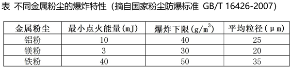

已知条件：

①生产设备外壳与地面绝缘，操作中测得静电电压可达5kV。设备接地可有效消除静电积聚，使静电能量降低至1mJ以下。

②湿度每增加10%，可使金属粉尘的最小点火能量提高约20%。

③粉尘粒径越小，表面积越大，越易被点燃，且爆炸强度可能更高。

根据检测结果，结合上表和已知条件信息制定了改进措施，其中最合理的是        。

A. 将相对湿度提高到55%以上，并增加接地导线消除静电积聚

B. 将平均粒径调整到

C. 增加通风换气，使空气中铝粉浓度降低到左右

D. 车间下一段时间安排加工铁粉

第 88 题 · 答案与解析

**参考答案（粉笔题库参考内容）**

A

**解析**

A项：将相对湿度从25%提高到55%以上，相对湿度提高了30个百分点以上，根据已知条件②可知，可使金属粉尘的最小点火能量提高60%以上，根据表格内容可知，铝粉的最小点火能量为10mJ，那么相对湿度提升后，铝粉的最小点火能量不低于16mJ。根据已知条件①可知，设备接地后可有效消除静电积聚，使静电能量降低至1mJ以下，此时静电能量远小于铝粉的最小点火能量，可以有效防止爆炸事故发生，正确；

B项：将平均粒径从调整到，根据已知条件③可知，铝粉更难被点燃，且爆炸强度可能更低，但是此时铝粉的平均浓度为，高于铝粉的爆炸下限，且静电积聚未消除，仍有爆炸的可能，因此无法有效防止爆炸事故发生，错误；

C项：铝粉的爆炸下限为，将铝粉的浓度从降低到左右，铝粉的浓度仍在爆炸下限附近，且静电积聚未消除，仍有爆炸的可能，因此无法有效防止爆炸事故发生，错误；

D项：车间下一时段安排加工铁粉，可以避免空气中铝粉浓度的进一步增加，但是原有的铝粉仍然存在，相关的静电积聚等引爆因素也仍然存在，未解决原铝粉加工的爆炸风险问题，错误。

故正确答案为A。

**来源**：2026年上海市公务员录用考试《行测》题（网友回忆版）第88题

### 第 89 题

点击化学获取2022年诺贝尔化学奖，点击化学以高效、精准的分子拼接为核心特点，其典型反应通常具有这些特征：无需苛刻的高温高压；多数无需金属催化剂或仅需简单催化剂；产物结构专一，副产物少且无害，反应过程中不会产生无关气体干扰体系。下列描述案例中，不符合点击化学反应特征的是（ ）。

A. 在细胞成像研究中，将相关原料放在水/乙醇混合液中，加入/抗坏血酸体系后，可专一生成用于体外成像的探针

B. 给活细胞表面标记时，直接将相关原料混合，无需金属催化，且反应不产生气体，能顺利完成标记

C. 在小鼠的体内预靶向成像中，探针可快速捕获抗体，该反应无需金属参与，且常释放，可用于体内快速配对

D. 材料化学中相关原材料通过反应偶联，高效生成环，用于材料表面功能化

第 89 题 · 答案与解析

**参考答案（粉笔题库参考内容）**

C

**解析**

由题干可知，点击化学以高效、精准的分子拼接为核心特点，具有无需苛刻的高温高压；多数无需金属催化或仅需简单催化剂；产物结构专一，副产物少且无害，反应过程中不会产生无关气体干扰体系等特征。

A项：“相关原料在水/乙醇混合液中反应”“加入/抗坏血酸体系”“专一生成用于体外成像的探针”分别符合点击化学“无需苛刻的高温高压”“仅需简单催化剂”“产物结构专一”的特征，正确；

B项：“直接将相关原料混合”“无需金属催化”“反应不产生气体”分别符合点击化学“无需苛刻的高温高压”“无需金属催化”“反应过程中不会产生无关气体干扰体系”的特征，正确；

C项：“反应无需金属参与”符合点击化学“无需金属催化”的特征，但“常释放”（反应时释放，可能产生气泡干扰成像，导致成像失败等）与点击化学“反应过程中不会产生无关气体干扰体系”的特征不符，错误；

D项：“相关原材料通过反应偶联，高效生成环，用于材料表面功能化”符合点击化学“高效、精准的分子拼接为核心特点”的特征，正确。

本题为选非题，故正确答案为C。

**来源**：2026年上海市公务员录用考试《行测》题（网友回忆版）第89题

### 第 90 题

某研究团队致力于开发新一代显示技术。他们发现，一些半导体纳米晶体（又称“量子点”）在特定条件下可以发光。其颜色与晶体尺寸有关。这一现象可类比于乐器，弦越短，发出的音调越高（频率高，波长短）。在量子点中，晶体尺寸越小，电子活动受限越强，发光能量越高。该团队用两种在元素周期表中位于同主族的元素X和Y，分别与元素Z化合，制备了两种化学成分不同，但结构相似的量子点（ZX和ZY），并测量了他们在不同尺寸下的发光颜色。部分数据如下表：

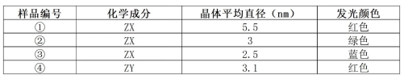

基于以上信息，下列为实现“精确显示黄光”这一目标的最合理的技术路径        。

A. 选择化学成分为ZX的量子点，将其晶体尺寸控制在3.0-5.5nm之间

B. 选择化学成分为ZY的量子点，将其晶体尺寸增大至5.0nm

C. 将样品②和样品①的粉末均匀混合使用

D. 改用与X，Y相同主族且原子序数更小的元素W来合成量子点ZW

第 90 题 · 答案与解析

**参考答案（粉笔题库参考内容）**

A

**解析**

A项：根据表格内容可知，化学成分为ZX的量子点，晶体尺寸为5.5nm时，发红光，晶体尺寸为3nm时，发绿光。根据题意，在量子点中，晶体尺寸越小，发光能量越高，又因为七色光的频率和能量从低到高顺序为红、橙、黄、绿、蓝、靛、紫，所以ZX量子点的晶体尺寸从5.5nm减小到3nm的过程中，发光颜色会从红色变为橙色，再变为黄色，最终变为绿色。因此将ZX量子点的晶体尺寸控制在3.0-5.5nm之间合适的值，就可以精准获得黄光，正确；

B项：根据表格内容可知，化学成分为ZY的量子点，晶体尺寸为3.1nm时，发红光。由于晶体尺寸越大，发光能量越低，即光的频率越低，而黄光的频率比红光高，因此ZY量子点的晶体尺寸增大至5.0nm无法让其发出黄光，错误；

C项：将样品①和样品②的粉末均匀混合使用，两种粉末会分别发出绿光和红光，此时显示的光为绿光和红光组成的复色光，虽然通过红绿光混合比例的调整，在人眼视觉上该光的颜色可以接近黄光，但是该光本质上并不是黄光，因此无法实现精确显示黄光，错误；

D项：改用原子序数更小的元素W合成的量子点ZW，由于晶体尺寸未知，发光的颜色无法确定，因此无法保证精确显示黄光，错误。

故正确答案为A。

**来源**：2026年上海市公务员录用考试《行测》题（网友回忆版）第90题

### 第 91 题

红外热像仪是军事储备与反侦察的关键设备。它利用所有物体均会发射红外线（黑体辐射）这一特性，通过探测物体自身辐射的红外线实现成像为夜间作战和复杂环境下的侦察提供了巨大便利，成为战场上的“黑夜之眼”，然而，随着红外热像仪的广泛应用，反侦察手段也层出不穷，以下关于红外热像仪与反侦察手段的物理原理，错误的是（ ）。

A. 红外热像仪的成像原理，基于所有物体均会发射红外线（黑体辐射）

B. 人体体温稳定，因此，其发射的红外线，强度始终不变

C. 利用高温物体（如燃烧的火堆）干扰红外探测，是因为其红外线辐射强于人体

D. 穿着特殊材料（如铝箔）制成的伪装服，可通过其反射红外线，降低自身辐射强度

第 91 题 · 答案与解析

**参考答案（粉笔题库参考内容）**

B

**解析**

A项：所有温度高于绝对零度（）的物体都会持续向外辐射红外线，温度越高，辐射的红外线强度越强，红外热像仪通过探测这些红外线来生成图像，正确；

B项：人体正常体温一般为~，并且体温受年龄、活动、昼夜节律等因素影响，不是一个固定的值，并且物体自身辐射强度不仅与温度有关，还与‌辐射电磁波的波长（或频率）、物体表面颜色和结构等因素都相关，因此所辐射出的红外线强度并非始终不变，错误；

C项：火堆温度远高于人体，其红外线辐射强度远强于人体，强辐射信号可掩盖人体较弱的信号，从而干扰红外探测，正确；

D项：红外热像仪依赖目标与背景在红外波段的辐射差异成像。人体一般比周围环境温度更高，释放的红外线更强，所以在画面上更亮、更显眼，容易被识别，而铝箔表面光滑、对红外线具有高反射率的特性，使得铝箔制成的伪装服能够阻挡人体向外的红外线辐射，使人体与背景的辐射差异显著降低，图像对比度下降，从而实现红外伪装，正确。

本题为选非题，故正确答案为B。

**来源**：2026年上海市公务员录用考试《行测》题（网友回忆版）第91题

### 第 92 题

在藏族庆典活动里，藏民常用手工打造的铜碗盛水，敲击盛水铜碗，会发出独特的声响，铜碗中的水流晃动时，声音又会发生奇妙的变化。这一现象背后蕴藏着丰富的声学知识，以下原理解释正确的是（ ）。

A. 声音的变化是因为水晃动改变了铜碗的材料密度

B. 水的存在增大了铜碗振动系统的质量导致振动频率降低，音调变低

C. 声音的变化，是由于水的晃动产生次声波干扰听觉

D. 铜碗表面的雕花纹路改变了声音在空气中的传播速度

第 92 题 · 答案与解析

**参考答案（粉笔题库参考内容）**

B

**解析**

A项：密度是物质的固有属性，铜碗以铜为主要制作材料，铜碗的密度不会因为水的晃动而发生改变，错误；

B项：音调由振动频率决定，振动频率越低，音调越低。敲击空碗时，只有铜碗振动发声，敲击盛水铜碗时，是铜碗和水一起振动发声，此时整体的质量变大，导致振动变慢，即振动频率变低，音调变低，正确；

C项：人耳只能听到振动频率在20Hz~20000Hz之间的声音（称为可闻声波），振动频率低于20Hz的声波称为次声波，水晃动产生的是可闻声波，并非次声波，并且即使产生了次声波，由于人耳无法感知，也不会干扰听觉，错误；

D项：声音的传播速度与介质的种类和温度有关，与铜碗表面的雕花纹路无关，常温下（通常指时）声音在空气中的传播速度为340m/s，错误。

故正确答案为B。

**来源**：2026年上海市公务员录用考试《行测》题（网友回忆版）第92题

### 第 93 题

在一场元宇宙技术展示中，参观者戴上某公司研发的新型VR手套后，便能感受物体“虚拟模块”的重量和移动时的阻力感。技术人员解释，该手套使用了“量子力反馈”系统，其中关键组件之一为高灵敏度电磁模块，实验观察还发现：当使用者试图迅速移动虚拟重物时，手套施加的反向力明显增强；拆除电磁模块后，用户几乎感受不到阻力和重量变化；不同虚拟物体设置下，阻力感随“虚拟质量”变化同步调整。基于以上现象和反馈机制，以下        项推论最合理地解释该VR手套实现“虚拟重量”模拟的原理。

A. 电磁模块通过控制手套温度，改变皮肤感知以模拟重量感

B. 电磁系统动态调整阻力，对抗手部运动以模拟物理负载

C. 系统通过颜色刺激诱导大脑产生触觉错觉

D. 高频电流直接作用于神经系统以传递真实的重量信号

第 93 题 · 答案与解析

**参考答案（粉笔题库参考内容）**

B

**解析**

A项：题干未提及“温度”相关的实验条件或现象，重量、阻力的模拟与温度变化无逻辑关联，错误；

B项：根据题干信息“拆除电磁模块后，用户几乎感受不到阻力和重量变化”可知，电磁模块是模拟虚拟重量的核心组件，系统会根据虚拟物体“质量”、手部运动速度动态调整反向阻力，从而对抗手部动作，以此模拟出真实搬东西时的物理负载感，正确；

C项：VR手套模拟的是摸东西时的重量感和阻力感，属于触觉体验。题干全程未提及“颜色”相关的实验条件或现象，重量、阻力的模拟与颜色刺激并无逻辑关联，错误；

D项：题干明确指出核心组件是高灵敏度电磁模块，作用机制是通过“反向力”实现阻力模拟，而非“高频电流直接作用于神经系统”，且“传递真实的重量信号”表述错误，虚拟重量并非真实物理信号，错误。

故正确答案为B。

**来源**：2026年上海市公务员录用考试《行测》题（网友回忆版）第93题

### 第 94 题

小张和小李两人使用同一台生物电阻抗(BIA)体脂秤测量身体成分。已知人体水分主要以含无机盐的溶液形式存在，而脂肪组织含水极少，电阻率低，BIA技术原理是通过测量人体总电阻来反推脂肪比例。某日，小张刚结束1小时高强度运动并补充了足量水分，测得体脂率22%。已知两人实际体脂率接近（约18%）。结合所学知识，以下对测量结果差异的解释最合理的是            。

A. 小张补充水分后，体内作为导体的电解质溶液总量增加，总电阻降低

B. 小李因脱水，体液中电解质浓度显著升高，故导电能力增强，电阻降低

C. 小李因脱水，破坏了脂肪的脂键结构，释放出离子

D. 测量时微电流能量较高，破坏了脂肪的脂键结构，释放出离子

第 94 题 · 答案与解析

**参考答案（粉笔题库参考内容）**

A

**解析**

生物电阻抗法（BIA）是利用人体组织对电流的阻抗差异进行体成分检测的技术。人体内的水分主要以电解质溶液形式存在，电解质溶液是良好的导体，因此人体内电解质溶液总量越多，人体的电阻率越低，而脂肪组织含水极少，电解质溶液含量也极低，因此脂肪组织的电阻率高。体脂秤就是通过测量人体总电阻来推算体脂率，人体的总电阻越高，体脂秤推测出的体脂率越高，人体的总电阻越低，体脂秤推测出的体脂率越低。

小张在高强度运动后补充了足量水分，这导致体内导电性良好的电解质溶液总量增加，因此体内的总电阻会降低。由于小张的总电阻降低，理想情况下，通过体脂秤测量小张的体脂率会偏低，但题干中小张测得体脂率反而偏高，应为体脂秤算法或测量模型带来的误差。

A项：小张补充水分后，体内导电性良好的电解质溶液总量增加，因此体内的总电阻会降低，正确；

B项：小李脱水时，体内电解质浓度会升高，但是电解质溶液总量减少，体内导电能力仍会减弱，即总电阻升高，错误；

C项：脱水只是人体水分丢失，不会破坏脂肪的化学键，更不会释放离子，错误；

D项：体脂秤使用的是微弱安全电流，能量极低，无法破坏脂肪的化学键，错误。

综上，只有A项表述无误，B、C、D三项皆存在错误。

故正确答案为A。

**来源**：2026年上海市公务员录用考试《行测》题（网友回忆版）第94题

### 第 95 题

人类自古就有对理想社会的向往，下列思想家与他们对理想社会的构想匹配正确的是（ ）。

A. 孔子：小国寡民

B. 墨子：天下有道

C. 柏拉图：新和谐公社

D. 莫尔：乌托邦

第 95 题 · 答案与解析

**参考答案（粉笔题库参考内容）**

D

**解析**

本题考查人文常识。

A项错误，孔子提出了“天下大同”的社会理想，这一构想在《礼记·礼运》中系统阐述，核心是“大道之行也，天下为公”，强调选贤与能、讲信修睦，实现社会和谐、人人各得其所。“小国寡民”是老子在《道德经》中提出的理想社会形态，核心是国家规模小、人口少，人们自给自足、安居乐业，无需复杂的制度和交流。

B项错误，墨子的理想社会核心是“兼爱”“非攻”“尚贤”“尚同”，主张人人平等相爱、反对战争、任用贤能、上下思想统一。“天下有道”出自《论语·季氏篇》，是孔子提出的政治理念，主张以周天子为核心的礼制秩序。

C项错误，柏拉图的理想社会构想是“理想国”，主张由“哲学王”统治，社会分为统治者、护卫者、生产者三个阶层，各安其位、各司其职。“新和谐公社”是19世纪空想社会主义者欧文建立的理想社会实验社区，试图通过集体劳动、共享成果实现平等和谐。

D项正确，托马斯·莫尔是文艺复兴时期的空想社会主义者，他在著作《乌托邦》中描绘了一个没有私有制、人人劳动、按需分配的理想社会，“乌托邦”也成为了理想社会的代名词。

故正确答案为D。

**考点**：文化常识

**来源**：2026年上海市公务员录用考试《行测》题（网友回忆版）第95题

### 第 96 题

上海市以“一网通办、一网统管”为统领，建设全市统一的政务云、政务网、政务平台，联通近900个市、区、街道三级业务系统，实现“平台互联互通，数据共用共享”的“办事环节最简、材料最少、时限最短、费用最小、便利度最优、满意度最高”的“六最”营商环境。此举对政府治理的积极意义是（ ）。

①彰显了政府治理的精确度

②打通地域与流程壁垒，推动政务服务提质升级

③推动政务数据开放共享，实现了决策科学化

④强化政府市场监管职能，扩大行政处罚权限

⑤构建数字化服务体系，提升政务服务效率

A. ①②③⑤

B. ②④⑤

C. ②③④⑤

D. ①②⑤

第 96 题 · 答案与解析

**参考答案（粉笔题库参考内容）**

A

**解析**

本题考查管理常识。

①正确，“一网通办、一网统管”通过统一的政务云、政务平台和数据共享，能够精准匹配企业和群众的办事需求，减少冗余环节，让政府治理从“粗放式”转向“精细化”，彰显治理精确度。

②正确，联通市、区、街道三级近900个业务系统，打破了层级、地域和部门之间的信息孤岛，原本跨区域、跨部门的复杂事项可以线上协同办理，直接推动政务服务的质量和效率升级。

③正确，政务数据的共用共享能够为政府提供全面、实时的民生和经济运行数据，帮助政府更准确地研判问题、制定政策，避免决策的盲目性，实现决策科学化。

④错误，题干核心是政务服务的数字化、便民化改革，聚焦“一网通办”的营商环境优化，并未涉及市场监管职能强化，更没有“扩大行政处罚权限”的内容。行政处罚权限由法律法规明确规定，政府改革不能随意扩大。

⑤正确，统一的政务平台和数据共享机制，构建起了数字化的政务服务体系，实现“办事环节最简、时限最短”等目标，直接提升了政务服务的效率，降低了企业和群众的办事成本。

综上，①②③⑤表述正确。

故正确答案为A。

**来源**：2026年上海市公务员录用考试《行测》题（网友回忆版）第96题

### 第 97 题

近年来，在我国现代化产业体系建设与经济高质量发展过程中，“内卷式”竞争已经成为一个值得关注的问题。2024年中央政治局召开会议，分析研究经济形势和经济工作，首次提出“要强化行业自律，防止‘内卷式’恶性竞争”。2024年12月，中央经济工作会议进一步指出，要“综合整治‘内卷式’竞争，规范地方政府和企业行为”。这种“内卷式”竞争加剧了行业内部的资源消耗，成为当前经济发展中的一大痛点。这表明（ ）。

A. “内卷”是市场经济的必然结果，行业竞争必然阻碍经济发展

B. 推动高质量发展需要强化政府配置资源，加强对经济的宏观调控

C. 行业竞争不利于企业创新，国民经济发展无需关注行业竞争状况

D. 行业竞争存在自发性等弊端，经济发展需要转变发展方式

第 97 题 · 答案与解析

**参考答案（粉笔题库参考内容）**

D

**解析**

本题考查经济常识。

A项错误，“内卷式”竞争并非市场经济的必然结果，正常的市场竞争能够激发企业活力、推动技术进步，会促进经济发展；只有无序、低效的“内卷式”竞争才会加剧资源消耗，成为经济发展痛点。

B项错误，社会主义市场经济体制强调市场在资源配置中起决定性作用，更好发挥政府作用。题干中“综合整治‘内卷式’竞争”是政府履行宏观调控职能的体现，但并非“强化政府配置资源”，这一表述违背了市场经济的核心原则。

C项错误，合理的行业竞争是企业创新的重要动力，能够倒逼企业提升技术水平和产品质量。“国民经济发展无需关注行业竞争状况”的说法完全错误，经济发展恰恰需要规范竞争秩序，引导竞争走向良性轨道。

D项正确，“内卷式”竞争的出现，本质上反映了市场竞争存在自发性弊端，部分市场主体为了短期利益盲目同质化竞争、过度消耗资源，而非通过创新实现差异化发展。题干强调整治这类竞争，正是为了推动经济发展方式从粗放式、同质化向高质量、差异化转变。

故正确答案为D。

**考点**：市场经济

**来源**：2026年上海市公务员录用考试《行测》题（网友回忆版）第97题

### 第 98 题

古人说：“法非从天下，非从地出，发于人间，合乎人心而已。”“法不察民之情而立之，则不成。”马克思说：“只有当法律是人民意志的自觉表现，因而是同人民的意志一起产生并由人民的意志所创立的时候，才会有确实的把握。”这说明（ ）。

A. 宪法的作用在于维护广大人民群众的根本利益

B. 宪法的生命在于实施，宪法的权威也在于实施

C. 宪法的根基在于人民发自内心的拥护

D. 宪法的宣传教育在于落实普法责任制

第 98 题 · 答案与解析

**参考答案（粉笔题库参考内容）**

C

**解析**

本题考查法律常识。

“法非从天下，非从地出，发于人间，合乎人心而已”出自战国时期法家代表人物慎到所著的《慎子・逸文》，意为法并非源于天或地的自然生成，而是产生于人类社会，且必须符合民众的意愿与利益。“法不察民之情而立之，则不成”出自战国时期商鞅及其后学所著的《商君书・壹言》，意为法律若不体察民众的实际情况与意愿就贸然制定，必然难以施行并取得成效。马克思的论述进一步指出，法律是人民意志的自觉表现。因此，题干三句话共同强调法律源于人民意志、合乎人民需求，法律的制定与实施必须立足民心、反映民意，核心即法律的生命力必须根植于人民的认同与拥护。

A项错误，强调宪法的作用，并非题干强调的宪法（法律）的本源和民意基础。

B项错误，侧重于宪法实施的重要性，并非题干强调的法与人民的联系。

C项正确，强调宪法的根基在于人民发自内心的拥护，人民的内心拥护是宪法得以存在、实施的根本根基，与题干强调的“民意是法律之本”的核心一致。

D项错误，强调宪法的宣传教育是落实普法责任制的手段，与题干无关。

故正确答案为C。

**考点**：宪法

**来源**：2026年上海市公务员录用考试《行测》题（网友回忆版）第98题

### 第 99 题

近年来，青海海南州在荒漠化土地上发展清洁能源，建设大量光伏板利用太阳能资源，同时创新发展“板下经济”，在光伏板下发展畜牧业，探索出“牧光互补”模式，为青海高原乃至世界同类地区提供了可持续发展的有益借鉴。上述材料启示我们（ ）。

A. 自然界的存在和发展是客观的，具有物质性

B. 要把握事物的固有联系，建立新的联系

C. 科技进步使物质世界变化依赖于人的意识

D. 人们能够在一定程度上改变并利用自然规律

第 99 题 · 答案与解析

**参考答案（粉笔题库参考内容）**

B

**解析**

本题考查马克思主义。

A项错误，物质是不依赖于人类的意识而存在，并能为人类的意识所反映的客观实在。自然界具有物质性，其存在发展是客观的。题干重点不是强调自然界本身的客观性，而是强调人如何利用客观条件建立新联系，故该选项与题干启示不符。

B项正确，联系是指事物之间以及事物内部诸要素之间的相互影响、相互作用和相互制约。联系的客观性是指事物之间的相互联系是事物本身所固有的，是不以人的意志为转移的，不能用主观臆造的联系代替客观的、真实的联系。但人可以把握事物的固有联系，根据事物的固有属性建立新的具体联系。海南州抓住荒漠化土地、太阳能、畜牧业的固有条件，创新“牧光互补”模式，正是这一原理的典型应用。

C项错误，物质决定意识，意识是客观存在在人脑中的映象。科技进步只是人认识和改造世界的手段，不会使物质世界的变化依赖于人的意识，故该选项违背唯物主义基本原理。

D项错误，规律具有客观性，规律是运动着的事物本身所固有的，是不以任何人的意志为转移的。人们不能任意地创造或消灭规律，也不能任意地改变规律，故该选项“改变自然规律”的表述错误。

故正确答案为B。

**考点**：唯物辩证法

**来源**：2026年上海市公务员录用考试《行测》题（网友回忆版）第99题

### 第 100 题

“十四五”期间，我国算力产业发展迅速，基础设施规模和水平位居全球前列，智能算力规模达788EFLOPS（每秒百亿亿次浮点运算，FP16半精度），千兆400G端口数量增至14060个，存力总规模超过1680EB。2025年智能算力规模增速预计超40%，半导体算力芯片进入国家体系，AI大模型、自动驾驶等领域应用依托算力发展迅速落地，半导体算力芯片成为核心热点主题，产业生态不断完善，吸引大量资本投入与企业布局。这表明（ ）。

①创新能推动产业结构优化，助力经济高质量发展

②科技创新是引领发展的第一动力

③国家通过产业政策促进产业结构优化升级

④新产业的发展能够带动上下游产业及相关产业的发展

A. ①②③

B. ①②④

C. ①③④

D. ②③④

第 100 题 · 答案与解析

**参考答案（粉笔题库参考内容）**

B

**解析**

本题考查新思想。

①正确，题干中提到“算力产业发展迅速”“智能算力规模达788EFLOPS”“AI大模型、自动驾驶等领域应用依托算力发展迅速落地”。算力是技术创新的产物，它的应用落地直接推动了AI、自动驾驶等新兴产业的发展，这些产业属于高端产业结构。因此，这体现了创新（算力技术）推动了产业结构优化和高质量发展。

②正确，题干的核心主题是“算力”这一高科技领域的发展。算力是“数字经济的核心要素”，其快速发展（特别是半导体算力芯片、大模型）带动了整个产业链。这充分说明了科技创新在当前经济发展中的核心驱动作用。

③错误，题干仅呈现产业发展成果和市场反应，无任何国家产业政策干预的相关表述，该观点在题干中无依据。

④正确，题干指出“算力产业生态不断完善，吸引大量资本投入与企业布局”。算力作为“新产业”，其发展直接带动了上游的芯片、服务器制造，以及下游的AI应用、自动驾驶等领域的繁荣，形成了完整的产业链生态，带动了上下游企业及相关产业的发展。

故①②④表述正确。

故正确答案为B。

**考点**：经济建设

**来源**：2026年上海市公务员录用考试《行测》题（网友回忆版）第100题

### 第 101 题

假设太阳系中的行星表面温度与它到太阳距离的平方根成反比，已知火星与太阳之间的距离大约为地球与太阳之间距离的1.5倍，若地球表面温度约为，则火星表面温度约为        。

A. 9

B. 12

C. 18

D. 21

第 101 题 · 答案与解析

**参考答案（粉笔题库参考内容）**

B

**解析**

根据“太阳系中的行星表面温度与它到太阳距离的平方根成反比，火星与太阳之间的距离大约为地球与太阳之间距离的1.5倍”，则地球的表面温度大约为火星表面温度的倍。根据“地球表面温度约为”，则火星表面温度约为。

故正确答案为B。

**来源**：2026年上海市公务员录用考试《行测》题（网友回忆版）第101题

### 第 102 题

某人骑行健身，他的骑行时间与路程的关系如图所示，则他骑行过程中的最快速度为每小时        公里。

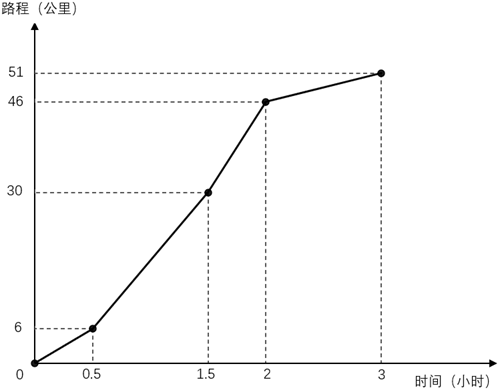

A. 16

B. 24

C. 32

D. 36

第 102 题 · 答案与解析

**参考答案（粉笔题库参考内容）**

C

**解析**

根据题意，骑行的过程可分为四个阶段，每个阶段速度可根据求解，具体如下：

第一阶段，公里/小时；

第二阶段，公里/小时；

第三阶段，公里/小时；

第四阶段，公里/小时。

综上，第三阶段速度最快，为每小时32公里。

故正确答案为C。

**考点**：普通行程

**来源**：2026年上海市公务员录用考试《行测》题（网友回忆版）第102题

### 第 103 题

某科研院所50%的研究人员精通人工智能，70%的研究人员能用英语演讲，10%的研究人员既不精通人工智能也不能用英语演讲。现从精通人工智能的研究人员中随机选择1人，其能用英语演讲的概率为        。

A. 0.2

B. 0.4

C. 0.6

D. 0.8

第 103 题 · 答案与解析

**参考答案（粉笔题库参考内容）**

C

**解析**

根据两集合容斥原理公式：，可得：，解得，即该科研院所有30%的研究人员既精通人工智能又能用英语演讲。根据公式：概率，则题干所求概率。

故正确答案为C。

**考点**：两集合、给情况求概率

**来源**：2026年上海市公务员录用考试《行测》题（网友回忆版）第103题

### 第 104 题

文件柜有一个抽屉，其底面为长方形，该长方形的长比宽多12厘米，且抽屉内部四周无凸起，底面平整。小李准备裁剪一张刚好完全覆盖抽屉底面的防潮纸，他按测量的尺寸裁剪防潮纸后，发现这张防潮纸的面积恰好是448平方厘米。该文件柜抽屉的宽是        厘米。

A. 14

B. 16

C. 18

D. 20

第 104 题 · 答案与解析

**参考答案（粉笔题库参考内容）**

B

**解析**

设该文件柜抽屉的宽为x厘米，长为（x+12）厘米。根据题意，这张防潮纸刚好完全覆盖抽屉底面，则防潮纸的面积即为抽屉底面的面积，由此可列式为：(x+12)×x=448，解得x=16或-28，已知x应为正数，故该文件柜抽屉的宽是16厘米。

故正确答案为B。

**考点**：几何公式类-平面图形

**来源**：2026年上海市公务员录用考试《行测》题（网友回忆版）第104题

### 第 105 题

甲、乙两个果园计划将所产苹果全部销售到阳光超市，以占据该超市的苹果市场份额的。实际销售中，甲果园售出了其苹果产量的，乙果园售出了其苹果产量的，甲、乙两个果园售出的苹果仅占超市苹果全部份额的，则甲果园苹果产量与乙果园苹果产量之比为        。

A. 1：2

B. 2：3

C. 2：1

D. 3：2

第 105 题 · 答案与解析

**参考答案（粉笔题库参考内容）**

C

**解析**

设甲、乙果园的苹果产量分别为x、y，则阳光超市苹果的全部市场份额为，甲、乙果园实际售出的苹果分别为、。根据题意可列方程：，解得x：y=2：1。

故正确答案为C。

**考点**：和差倍比问题

**来源**：2026年上海市公务员录用考试《行测》题（网友回忆版）第105题

### 第 106 题

身高1.6米的甲站在路灯边，影子的长度是1.6米，她向路灯的方向走了1米，影子的长度变成了1.2米，则路灯的高度是        米。

A. 4

B. 5.6

C. 6

D. 8.4

第 106 题 · 答案与解析

**参考答案（粉笔题库参考内容）**

B

**解析**

如图所示：

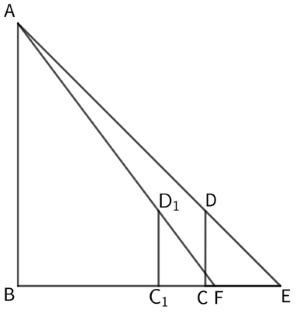

根据题意，路灯为AB，甲为CD，CE=1.6米，米，米。由于，则，故AB=BE。设路灯AB的高度为x米，则BE为x米，米。由于，则，可列式：，解得x=5.6，故路灯的高度是5.6米。

故正确答案为B。

**考点**：几何结论类-相似图形

**来源**：2026年上海市公务员录用考试《行测》题（网友回忆版）第106题

### 第 107 题

某足球业余比赛规定：每支球队获胜一场得3分，平一场得1分，输一场不得分。球队A在单循环小组赛（小组中的每两支球队之间都进行一场比赛）中得12分。若该小组一共有6支球队，那么下列判断正确的是        。

A. 球队A一定是小组第一

B. 球队A在小组中至少排名第二（可以并列）

C. 球队A可能在小组中排名第三

D. 球队A不可能进入前三

第 107 题 · 答案与解析

**参考答案（粉笔题库参考内容）**

B

**解析**

小组有6支球队，则单循环赛制中每支球队需与其余5支球队各赛一场，因此每支球队的比赛场数均为5场。球队A得12分，则只有4胜（3分×4）1负（0分）一种情况。设球队A负1场是输给球队B，则球队B最多可能5场比赛均获胜，得分不高于3×5=15分。其他4支球队至少输给球队A一场，最多可能胜4场，得分不高于3×4=12分。因此球队A12分在小组中的排名必然在前二。

故正确答案为B。

**考点**：比赛问题

**来源**：2026年上海市公务员录用考试《行测》题（网友回忆版）第107题

### 第 108 题

某市政务服务中心推出一款便民APP，上线第一个月注册用户数为1600人，在第二个月注册用户数比第一个月增长了        ，在第三个月注册用户仅比在第二个月注册用户多了100人，使得前三个月的总注册用户数为5300人。

A. 12%

B. 12.5%

C. 13%

D. 13.5%

第 108 题 · 答案与解析

**参考答案（粉笔题库参考内容）**

B

**解析**

设在第二个月注册用户数为x人，则在第三个月注册用户数为（x+100）人，根据题意可列式：1600+x+（x+100）=5300，解得x=1800人。则在第二个月注册用户数比第一个月增长了。

故正确答案为B。

**考点**：和差倍比问题

**来源**：2026年上海市公务员录用考试《行测》题（网友回忆版）第108题

### 第 109 题

某工厂对10位员工进行技能测试，测试总分为150分，下面数据记录了员工测试成绩。其中有两名员工的成绩不小心被污渍盖住了，但人力资源总监记得测试成绩的均分为116.2分，且第25百分位数为106，第75百分位数为120，则中位数为        。

A. 118

B. 119

C. 120

D. 121

第 109 题 · 答案与解析

**参考答案（粉笔题库参考内容）**

B

**解析**

设被污渍盖住的两个成绩分别为a、b（a<b）。10位员工测试成绩的第25百分位数为106，其对应的位置为10×25%=2.5，向上取整为3，即成绩从小到大排列的第3个数为106，未被污渍盖住的8个数中只有102小于106，说明①。同理，第75百分位数为120，则10×75%=7.5，向上取整为8，即成绩从小到大排列的第8个数为120，未被污渍盖住的8个数中有130、128共2个数大于120，说明②。根据测试成绩的均分为116.2分，可列式：102+106+a+112+118+130+120+120+128+b=116.2×10，解得：a+b=226。若b=120，a=226-120=106；若b<120，，与①矛盾。则满足题意的10位员工测试成绩只有一种情况，按从小到大排序依次为：102、106、106、112、118、120、120、120、128、130。故题干所求中位数，即第5和第6个数的平均数。

故正确答案为B。

注：百分位数是一种统计学术语，用于描述一组数据中特定百分比位置的值。一组n个观测值按数值从小到大排列，处于p%位置的值称第p百分位数。计算百分位数的位置i的公式为：i=n×p%，若i非整数，将i向上取整，对应数为第p百分位数；若i是整数，则第i项与第i+1项数据的平均数为第p百分位数。

**考点**：和差倍比问题、平均数问题

**来源**：2026年上海市公务员录用考试《行测》题（网友回忆版）第109题

### 第 110 题

某正三角形的太阳能板阵列ABC，边长为2公里，需要无人机进行巡检，已知无人机从AB边的中点M出发，飞至BC边任何一处后再返回控制中心A，则无人机的最短航程为（ ）公里（飞行轨迹视为平面）。

A. 2

B. 

C. 

D. 

第 110 题 · 答案与解析

**参考答案（粉笔题库参考内容）**

D

**解析**

如图所示，作M点关于BC的对称点M'，连接M'A，与BC的交点为E，所求最短航程即ME+EA=M'E+EA=M'A。作于点F，。在直角中，AB=2，，则公里，公里。，因M为AB中点，则公里，公里，故公里。在直角中，根据勾股定理，有，则公里，即无人机的最短航程为公里。

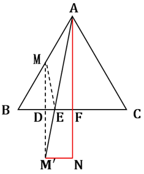

故正确答案为D。

**考点**：几何结论类-三角形相关、几何结论类-几何小题型、非典型最值问题

**来源**：2026年上海市公务员录用考试《行测》题（网友回忆版）第110题

## 材料 7

上海博物馆“金字塔之巅：古埃及文明大展”持续13个月，汇集788件古埃及不同时期的珍贵文物；在该展340多个开放日当中，接待观众277.8万人次，其中，近七成来自外省市。展期最后一周推出“7×24小时”观展，深夜场每场提供3000个名额，其中8月16日24小时开放中，接待观众23149人次。展览总营收超7.6亿元，其中门票收入超3.2亿元，文创店商品及周边衍生产品收入超4.4亿元。有关分析报告显示，该展拉动城市消费比例达1：48，即每1元展览营收带动48元综合消费。

### 第 111 题

上海“金字塔之巅：古埃及文明大展”的月均观展人次约为        万人次。

A. 21

B. 22

C. 23

D. 24

第 111 题 · 答案与解析

**参考答案（粉笔题库参考内容）**

A

**解析**

根据题干“······月均······”，可判定本题为现期平均数问题。定位文字材料可得：上海博物馆“金字塔之巅：古埃及文明大展”持续13个月，接待观众277.8万人次。根据公式：平均数，则所求月均观展人次为万人次，与A项最接近。

故正确答案为A。

**考点**：文字资料、现期平均数

**来源**：2026年上海市公务员录用考试《行测》题（网友回忆版）第111题

### 第 112 题

下列图形中，        图的阴影部分能反映该展的文创活动及周边衍生产品收入在总营收中的占比。

A. 

B. 

C. 

D. 

第 112 题 · 答案与解析

**参考答案（粉笔题库参考内容）**

C

**解析**

根据题干“······阴影部分能反映······的占比”，可判定本题为现期比重问题。定位文字材料可得：展览总营收超7.6亿元，其中门票收入超3.2亿元，文创店商品及周边衍生产品收入超4.4亿元。根据公式：比重，则该展的文创活动及周边衍生产品收入在总营收中的占比，接近60%，则阴影部分所占比例应约为饼图的一半（50%）+一半的（10%），观察图像，仅C项符合要求。

故正确答案为C。

**考点**：文字资料、现期比重

**来源**：2026年上海市公务员录用考试《行测》题（网友回忆版）第112题

### 第 113 题

假设该展某日开放时间为8小时，接待观众1万人次，则该日平均每小时人流量与8月16日相比        。

A. 低25%以上

B. 高25%以上

C. 高25%以下

D. 与8月16日基本相等

第 113 题 · 答案与解析

**参考答案（粉笔题库参考内容）**

B

**解析**

根据题干“······该日平均每······与8月16日相比”，结合选项为“高/低+百分数”，可判定本题为平均数的增长率问题。定位文字材料可得：8月16日24小时开放中，接待观众23149人次。根据公式：平均每小时人流量，则题干假设当日平均每小时人流量为人次，8月16日平均每小时人流量为人次。根据公式：增长率，则题干所求为，即该日平均每小时人流量与8月16日相比高25%以上。

故正确答案为B。

**考点**：文字资料、平均数的增长率

**来源**：2026年上海市公务员录用考试《行测》题（网友回忆版）第113题

### 第 114 题

根据所给资料，该展览带动的城市综合消费额可能为        亿元。

A. 330

B. 340

C. 360

D. 380

第 114 题 · 答案与解析

**参考答案（粉笔题库参考内容）**

D

**解析**

根据题干“······城市综合消费额可能为        亿元”，结合材料给出该展拉动城市消费比例达1：48，可判定本题为比值计算问题。定位文字材料可得：展览总营收超7.6亿元，该展拉动城市消费比例达1：48，即每1元展览营收带动48元综合消费。则该展览带动的城市综合消费额超过7.6×48=364.8亿元，仅D项符合。

故正确答案为D。

备注：题干所求为“······城市综合消费额可能为······”，“可能”的取值应考虑符合取值范围。因此虽然C项与计算结果更接近，但满足超过364.8亿元的只有D项，因此本题答案应为D项。

**考点**：比值计算、文字资料

**来源**：2026年上海市公务员录用考试《行测》题（网友回忆版）第114题

### 第 115 题

根据所给资料，以下说法不正确的是        。

A. 该展的门票收入约占总营收的42%

B. 来自外省市的观展人次超过200万人次

C. 该展的开放日平均每天接待观众超过7500人次

D. 该展在展期的最后一周深夜场观展人数超过12000人次

第 115 题 · 答案与解析

**参考答案（粉笔题库参考内容）**

B

**解析**

A项：定位文字材料可得：展览总营收超7.6亿元，其中门票收入超3.2亿元。根据公式：比重，则该展的门票收入占总营收的比重，正确；

B项：定位文字材料可得：接待观众277.8万人次，其中，近七成来自外省市。根据公式：部分=整体×比重，则来自外省市的观展人次为万人次<200万人次，错误；

C项：定位文字材料可得：在该展340多个开放日当中，接待观众277.8万人次。根据公式：平均数，则该展的开放日平均每天接待观众人次>7500人次，正确；

D项：定位文字材料可得：展期最后一周推出“7×24小时”观展，深夜场每场提供3000个名额。则该展在展期的最后一周深夜场观展人数为3000×7=21000人次>12000人次，正确。

本题为选非题，故正确答案为B。

备注：材料未明确深夜场每场3000个名额均已报满，因此D项对观展人数的计算不甚严谨。但B项数值与所给范围明显不符，两者相较B项表述错误更严重，因此本题答案倾向于B项。

**考点**：文字资料、综合分析

**来源**：2026年上海市公务员录用考试《行测》题（网友回忆版）第115题

## 材料 8

随着服务消费需求的快速增长，我国洗涤行业延续发展态势。综合调研行业企业的经营情况，2023年我国生活衣物洗染服务的年营业收入达到637.6亿元，同比增长10.0%，占全行业年营业收入的49.4%；公纺洗涤服务的年营业收入达到653.0亿元，同比增长30.7%，占全行业年营业收入的50.6%。

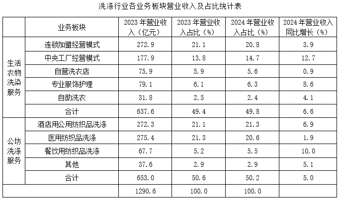

洗涤设备以隧道式连续洗衣机组（俗称“洗衣龙”）为代表，近8年我国在运行“洗衣龙”数量的趋势变化如图所示。

### 第 116 题

2024年公纺洗涤服务的年营业收入约为        亿元。

A. 643

B. 648

C. 680

D. 686

第 116 题 · 答案与解析

**参考答案（粉笔题库参考内容）**

D

**解析**

根据题干“2024年······营业收入约为······”，结合材料时间为2024年，可判定本题为现期计算问题。定位统计表可得：2023年公纺洗涤服务的年营业收入为653.0亿元，2024年营业收入同比增长5.0%，根据公式：现期量=基期量×（1+r），则2024年公纺洗涤服务的年营业收入为亿元。

故正确答案为D。

**考点**：现期计算、综合资料

**来源**：2026年上海市公务员录用考试《行测》题（网友回忆版）第116题

### 第 117 题

根据资料，生活衣物洗染服务和公纺洗涤服务这两大领域，其2022年的年营业收入在全行业年营业收入中占比较大的是\_\_\_\_\_\_。

A. 生活衣物洗染服务

B. 公纺洗涤服务

C. 两类服务占比一样大

D. 条件不足，无法判断

第 117 题 · 答案与解析

**参考答案（粉笔题库参考内容）**

A

**解析**

根据题干“······2022年······占比较大的是”，结合材料时间2023年，可判定本题为基期比重问题。根据公式：比重，当整体相同时，可用部分量代替比重进行比较，故本题本质为基期比较问题。定位文字材料可得：2023年我国生活衣物洗染服务的年营业收入达到637.6亿元，同比增长10.0%；公纺洗涤服务的年营业收入达到653.0亿元，同比增长30.7%。根据公式：基期量，可得2022年生活衣物洗染服务的年营业收入为亿元；公纺洗涤服务的年营业收入为亿元。则占比较大的是生活衣物洗染服务。

故正确答案为A。

**考点**：基期比重、综合资料

**来源**：2026年上海市公务员录用考试《行测》题（网友回忆版）第117题

### 第 118 题

2017-2024年，我国在运行“洗衣龙”数量增长率最大的年份是        。

A. 2018

B. 2019

C. 2023

D. 2024

第 118 题 · 答案与解析

**参考答案（粉笔题库参考内容）**

B

**解析**

根据题干“2017-2024年······增长率最大的年份是”，可判定本题为一般增长率问题。定位统计图可得2017-2024年我国在运行“洗衣龙”数量及其同比增量。根据公式：增长率，可得选项各年份我国在运行“洗衣龙”数量同比增长率分别为：

A项，2018年；

B项，2019年；

C项，2023年；

D项，2024年。

比较可知，2019年同比增长率最大。

故正确答案为B。

**考点**：一般增长率、综合资料

**来源**：2026年上海市公务员录用考试《行测》题（网友回忆版）第118题

### 第 119 题

根据资料，以下说法正确的是        。

A. 洗涤行业9个业务板块中，2024年营业收入同比增长最快的是餐饮用纺织品洗涤

B. 与2023年相比，洗涤行业9个业务板块中2024年营业收入占比下降的有5个

C. 从2018年到2024年“洗衣龙”国产化率逐年增加

D. 从2018年到2024年“洗衣龙”国产化率提升最大的年份是2018年

第 119 题 · 答案与解析

**参考答案（粉笔题库参考内容）**

D

**解析**

A项：定位统计表可得，洗涤行业9个业务板块中，2024年营业收入同比增长最快的是中央工厂经营模式（12.7%），错误；

B项：定位统计表可得2023-2024年洗涤行业9个业务板块营业收入占比。观察可得，与2023年相比，洗涤行业9个业务板块中2024年营业收入占比下降的有连锁加盟经营模式（20.8%<21.1%）、自营洗衣店（5.6%<5.9%）、自助洗衣（2.4%<2.5%）、医用纺织品洗涤（20.6%<21.3%），共4个，错误；

C项：定位统计图可得，2021年我国在运行“洗衣龙”国产化率（83.9%）低于2020年（84.2%），并非逐年增加，错误；

D项：定位统计图可得2017-2024年我国在运行“洗衣龙”国产化率。根据公式：增长量=现期量-基期量，则2018-2024年我国在运行“洗衣龙”国产化率同比增量分别为：2018年，80.0%-72.0%=8%；2019年，82.3%-80.0%<8%；2020年，84.2%-82.3%<8%；2021年，83.9%-84.2%<0；2022年，84.0%-83.9%<8%；2023年，86.1%-84.0%<8%；2024年，86.6%-86.1%<8%。故从2018年到2024年“洗衣龙”国产化率提升最大的年份是2018年，正确。

故正确答案为D。

**考点**：综合分析、综合资料

**来源**：2026年上海市公务员录用考试《行测》题（网友回忆版）第119题

### 第 120 题

为研究在运行“洗衣龙”数量随时间的拟合方程，其中t=1表示2017年，t=2表示2018年，t=3表示2019年······，表示第t年在运行“洗衣龙”数量的预测值。要预测2025年在运行“洗衣龙”数量较上一年实际值的增量约为        。

A. 117

B. 231

C. 2104

D. 2335

第 120 题 · 答案与解析

**参考答案（粉笔题库参考内容）**

A

**解析**

根据题干“······预测2025年······较上一年实际值的增量约为”，可判定本题为增长量计算问题。定位统计图可得：2024年，我国在运行“洗衣龙”数量为1987台。根据题干方程：，t=1表示2017年，则2025年t表示数字=2025-2017+1=9，代入公式预测2025年在运行“洗衣龙”数量台，较上一年实际值的增量=2104-1987=117台。

故正确答案为A。

**考点**：增长量计算、综合资料

**来源**：2026年上海市公务员录用考试《行测》题（网友回忆版）第120题

## 材料 9

低空经济依托低空空域，以通用航空和民用无人驾驶航空为主体，涵盖载人飞行、货运配送和专业作业等活动。产业链包括研发制造、运营服务、空域管理和基础设施等环节。近年来，在政策推动和应用需求增长的作用下，我国低空经济呈现快速发展态势。

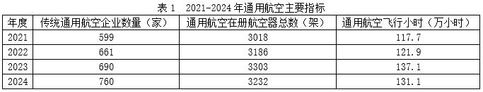

### 第 121 题

2021-2024年期间，下列各项指标中，年均增长速度最快的是        。

A. 传统通用航空企业数量

B. 通用航空在册航空器总数

C. 无人机运营企业数量

D. 全行业注册无人机总数

第 121 题 · 答案与解析

**参考答案（粉笔题库参考内容）**

D

**解析**

根据题干“2021-2024年期间······年均增长速度最快的是”，可判定本题为年均增长率问题。定位表1和表2可知选项各指标2021年和2024年数据。根据年均增长率公式：，当年份差n相同时，直接比较即可。传统通用航空企业数量：；通用航空在册航空器总数：；无人机运营企业数量：；全行业注册无人机总数：。比较可知，2021-2024年期间，选项各指标年均增长速度最快的是全行业注册无人机总数。

故正确答案为D。

**考点**：年均增长率、综合资料

**来源**：2026年上海市公务员录用考试《行测》题（网友回忆版）第121题

### 第 122 题

在2021-2024年期间，通用航空在册航空器总数的变化趋势与全行业注册无人机总数的变化趋势相比，以下判断正确的是        。

A. 两者都在逐年上升

B. 通用航空先增后降，无人机持续上升

C. 通用航空持续下降，无人机先增后降

D. 通用航空先降后增，无人机持续上升

第 122 题 · 答案与解析

**参考答案（粉笔题库参考内容）**

B

**解析**

定位表1和表2可得：2021-2024年通用航空在册航空器总数分别为3018架、3186架、3303架、3232架；2021-2024年全行业注册无人机总数分别为83.2万架、95.8万架、126.7万架、217.7万架。前者变化趋势为先增后降，后者变化趋势为持续上升。

故正确答案为B。

**考点**：直接找数、综合资料

**来源**：2026年上海市公务员录用考试《行测》题（网友回忆版）第122题

### 第 123 题

2024年，无人机累计飞行小时约占低空经济（包括通用航空和民用无人机驾驶航空）飞行小时总量的        。

A. 80%

B. 90%

C. 95%

D. 98%

第 123 题 · 答案与解析

**参考答案（粉笔题库参考内容）**

C

**解析**

根据题干“2024年······约占······总量的”，结合材料时间为2024年，可判定本题为现期比重问题。定位表1和表2可得：2024年通用航空飞行小时为131.1万小时；2024年无人机飞行小时为2666.7万小时。根据公式：比重，则所求，与C项最接近。

故正确答案为C。

**考点**：现期比重、综合资料

**来源**：2026年上海市公务员录用考试《行测》题（网友回忆版）第123题

### 第 124 题

根据资料，2021-2024年每架无人机平均累计飞行小时呈下降趋势，下列        年度下降幅度最大。

A. 2022

B. 2023

C. 2024

D. 每年的下降幅度相同

第 124 题 · 答案与解析

**参考答案（粉笔题库参考内容）**

C

**解析**

根据题干“······下列······年度下降幅度最大”，可判定本题为一般增长率问题。定位表2可知2021-2024年全行业注册无人机总数和无人机飞行小时。根据公式：平均每架无人机飞行小时，则2021-2024年平均每架无人机飞行小时分别为：

2021年，小时；

2022年，小时；

2023年，小时；

2024年，小时。

根据公式：增长率，则2022-2024年平均每架无人机飞行小时同比增速分别为：

2022年，；

2023年，；

2024年，。

综上，2024年下降幅度最大。

故正确答案为C。

**考点**：一般增长率、综合资料

**来源**：2026年上海市公务员录用考试《行测》题（网友回忆版）第124题

### 第 125 题

如果2025年注册无人机总数较2024年的增加量约为2021-2024年平均年增长量的两倍，则预计2025年注册无人机总数最接近        万。

A. 300

B. 310

C. 320

D. 330

第 125 题 · 答案与解析

**参考答案（粉笔题库参考内容）**

B

**解析**

根据题干“如果······则预计2025年注册无人机总数最接近······”，结合材料时间为2021-2024年，可判定本题为现期计算问题。定位表2可得：2021年和2024年注册无人机总数分别为83.2万架、217.7万架。根据公式：年均增长量，则2021-2024年注册无人机总数年均增长量万架。根据公式：现期量=基期量+增长量，则所求=217.7+45×2=307.7万架，与B项最接近。

故正确答案为B。

**考点**：现期计算、综合资料

**来源**：2026年上海市公务员录用考试《行测》题（网友回忆版）第125题

## 材料 10

2025年7月22日，上海市统计局发布上半年上海国民经济运行数据，至此，长三角三省一市已全部公布上半年经济运行情况。

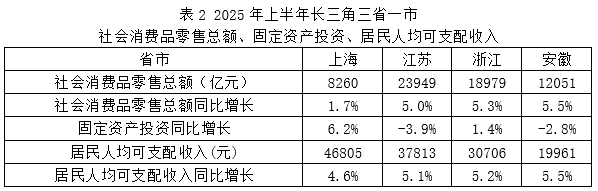

上半年，上海的三大先导产业制造业产值同比增长9.1%，增速快于全市规模以上工业总产值3.5个百分点。其中，人工智能制造业增长12.3%，集成电路制造业增长11.7%，生物医药制造业增长4.4%。上半年，工业战略性新兴产业制造业总产值同比增长6.7%。其中，新一代信息技术产业增长13.9%，新能源产业增长12.5%，高端装备产业增长10.7%。上半年，智能手机产量同比增长1.3倍，微型计算机设备、电子元件、笔记本计算机、工业机器人和半导体存储盘产量分别增长14.7%、13.4%、13.1%、11.9%和8.9%。江苏上半年装备制造业增加值同比增长10.2%，对全部规模以上工业增长的贡献率为73.5%，比一季度提升2.2个百分点；其中，计算机、通信和其他电子设备制造业增长14.3%，汽车制造业增长11.1%，铁路、船舶、航空航天和其他运输设备制造业增长15.0%。浙江上半年的工业机器人、锂离子电池、笔记本计算机、新能源汽车等产品产量分别增长85.7%、65.2%、47.3%、43.3%。上半年安徽的主要工业产品中，新能源汽车产量增长17.3%，集成电路增长9.9%，工业机器人增长93.3%。

### 第 126 题

2025年上半年，长三角三省一市工业机器人产量同比增速最快的是\_\_\_\_\_\_。

A. 上海

B. 浙江

C. 安徽

D. 条件不足，无法判断

第 126 题 · 答案与解析

**参考答案（粉笔题库参考内容）**

D

**解析**

定位文字材料第二段可知：2025年上半年长三角三省一市中，上海工业机器人产量同比增长11.9%，浙江工业机器人产量增长85.7%，安徽工业机器人产量增长93.3%，但未给出江苏工业机器人产量同比增速，故条件不足，无法判断。

故正确答案为D。

**考点**：直接找数、综合资料

**来源**：2026年上海市公务员录用考试《行测》题（网友回忆版）第126题

### 第 127 题

可以用“社会消费品零售总额”占“经济总量”的百分比来近似表示经济增长对内部最终消费的依赖程度。2025年上半年，长三角省市中，经济增长对内部最终消费的依赖程度最高的省市是        。

A. 上海市

B. 江苏省

C. 浙江省

D. 安徽省

第 127 题 · 答案与解析

**参考答案（粉笔题库参考内容）**

D

**解析**

根据题干“······占······的百分比来近似表示经济增长对内部最终消费的依赖程度。2025年上半年······经济增长对内部最终消费的依赖程度最高的省市是······”，结合材料时间为2025年上半年，可判定本题为现期比重问题。定位表1可得：2025年上半年上海市、江苏省、浙江省、安徽省的经济总量分别为26222亿元、66968亿元、45004亿元、25732亿元；定位表2可得：2025年上半年上海市、江苏省、浙江省、安徽省的社会消费品零售总额分别为8260亿元、23949亿元、18979亿元、12051亿元。根据题干“可以用‘社会消费品零售总额’占‘经济总量’的百分比来近似表示经济增长对内部最终消费的依赖程度”，则越高，说明经济增长对内部最终消费的依赖程度越高。则2025年上半年，上海市、江苏省、浙江省、安徽省的分别为：，，，。2025年上半年，安徽省的最高，故2025年上半年，长三角省市中，安徽省经济增长对内部最终消费的依赖程度最高。

故正确答案为D。

**考点**：现期比重、综合资料

**来源**：2026年上海市公务员录用考试《行测》题（网友回忆版）第127题

### 第 128 题

根据材料所给数据，图形图示的是        。

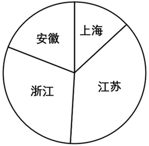

A. 长三角三省一市2025年上半年经济总量

B. 长三角三省一市2025年上半年规模以上工业总产值同比增长率

C. 长三角三省一市2025年上半年社会消费品零售总额

D. 长三角三省一市2025年上半年居民人均可支配收入

第 128 题 · 答案与解析

**参考答案（粉笔题库参考内容）**

C

**解析**

定位表1和表2可知2025年上半年长三角三省一市的相关经济数据，各选项依次代入验证如下：

A项：2025年上半年上海、江苏、浙江、安徽的经济总量分别为26222亿元、66968亿元、45004亿元、25732亿元，可知安徽的经济总量最小，而饼图中上海最小，错误；

B项：2025年上半年上海、江苏、浙江、安徽的规模以上工业总产值同比增长率分别为5.6%、7.4%、7.6%、8.4%，可知安徽的同比增长率最大，而饼图中江苏最大，错误；

C项：2025年上半年上海、江苏、浙江、安徽的社会消费品零售总额分别为8260亿元、23949亿元、18979亿元、12051亿元，与饼图完全符合，正确；

D项：2025年上半年上海、江苏、浙江、安徽的居民人均可支配收入分别为46805元、37813元、30706元、19961元，可知上海的居民人均可支配收入最大，而饼图中上海最小，错误。

故正确答案为C。

**考点**：直接找数、综合资料

**来源**：2026年上海市公务员录用考试《行测》题（网友回忆版）第128题

### 第 129 题

2025年上半年，江苏省“装备制造业”规模在全部规模以上工业中的占比为        。

A. 40%

B. 50%

C. 60%

D. 70%

第 129 题 · 答案与解析

**参考答案（粉笔题库参考内容）**

B

**解析**

根据题干“2025年上半年······占比为”，结合材料给出2025年上半年相关数据，可判定本题为现期比重问题。定位统计表1可得：2025年上半年江苏省规模以上工业总产值同比增长7.4%；定位文字材料第二段可得：2025年上半年江苏装备制造业增加值同比增长10.2%，对全部规模以上工业增长的贡献率为73.5%。设2025年上半年江苏省装备制造业增加值为A亿元，规模以上工业总产值为B亿元，根据公式：增长量，增长贡献率，代入数据可得：，则所求比重，与B项最接近。

故正确答案为B。

**考点**：现期比重、综合资料

**来源**：2026年上海市公务员录用考试《行测》题（网友回忆版）第129题

### 第 130 题

根据材料所给数据，在上海的三大先导产业制造业中，2025年上半年产值占比最大的是        。

A. 人工智能制造业

B. 集成电路制造业

C. 生物医药制造业

D. 条件不足，无法判断

第 130 题 · 答案与解析

**参考答案（粉笔题库参考内容）**

D

**解析**

根据题干“······2025年上半年产值占比······”，结合材料所给时间为2025年上半年，可判定本题为现期比重问题。定位文字材料第二段可知上海人工智能制造业、集成电路制造业、生物医药制造业产值的同比增长率，但并未给出具体产值，故无法求出上海的三大先导产业制造业中，各产业制造业2025年上半年产值的占比，即条件不足，无法判断。

故正确答案为D。

**考点**：现期比重、综合资料

**来源**：2026年上海市公务员录用考试《行测》题（网友回忆版）第130题

## 未自动迁移的旧版答案

旧版完整内容保留在本地候选目录中的 legacy-original.md。因题目身份未唯一确认，这些答案没有按旧题号附加到新题目。
