# 2008年云南省公务员录用考试《行测》题

<!-- gwy:overview:start -->
> **云南 · 2008 · 行测 · 统考** ｜ 130 题 · 图片 15 处 · 答案随题折叠

| 题型模块 | 题量 | 题号 |
| --- | ---: | ---: |
| 数量关系 | 20 | 1–20 |
| 言语理解与表达 | 30 | 21–50 |
| 判断推理 | 40 | 51–90 |
| 常识部分 | 20 | 91–110 |
| 资料分析 | 20 | 111–130 |
| **合计** | **130** | |

导航：[题型与作答说明](#题型与作答说明) · [题目](#题目) · [材料 1](#材料-1)
<!-- gwy:overview:end -->

> 候选采集稿。参考答案及解析来自粉笔页面，不代表官方答案或真实高分答卷；来源使用许可与原卷对应关系仍需人工核实。

## 题型与作答说明

数量关系

（20题）

本部分包括数字推理与数学运算两种类型的试题。

言语理解与表达

（30题）

本部分着重考查考生对语言文字理解和驾驭能力。这种能力包括：对词和句子一般意思和特定意义的理解；对比较复杂的概念和观点的准确理解；对句子隐含信息的合理推断；根据上下文，恰当选用词语；准确地辨明句义、筛选信息。

判断推理

（40题）

本部分包括图形推理、定义判断与形式逻辑三种类型的试题。

常识部分

（20题）

根据题目要求，在四个选项中选出一个正确答案。

资料分析

（20题）

本部分题目提供几组资料，或者是文字资料或者是图表。针对每一段文字或每一个图表，后面有几个问题需要你回答。你应根据资料提供的信息进行分析、比较、计算和判断处理，然后选出你认为最合适的答案。

## 题目

### 第 1 题

\-4，2，18，22，( )，830。

A. 280

B. 346

C. 380

D. 456

第 1 题 · 答案与解析

**参考答案（粉笔题库参考内容）**

B

**解析**

从第三项开始，每一项都等于前一项加上更前一项的平方，则未知项为18^2 + 22 = 346。

故正确答案为B。

**来源**：2008年云南省公务员录用考试《行测》题第1题

### 第 2 题

\-3，-16，-27，0，125，432，( )。

A. 345

B. 546

C. 890

D. 1029

第 2 题 · 答案与解析

**参考答案（粉笔题库参考内容）**

D

**解析**

原数列各项做因数分解：−3 = −3 × 1，-16 = -2 × 8，-27=-1×27，0=0×64，125=1×125，432 = 2×216。其中左子列-3、-2、-1、0、1、2为等差数列，右子列1、8、27、64、125、216为立方数列。故原数列下一项为3×343 = 1029。

故正确答案为D。

**来源**：2008年云南省公务员录用考试《行测》题第2题

### 第 3 题

0.2，6.8，-0.8，5.8，-1.8，4.8，( )，3.8。

A. －2.8

B. 3.8

C. －4.8

D. 5.8

第 3 题 · 答案与解析

**参考答案（粉笔题库参考内容）**

A

**解析**

原数列为交叉数列。

奇数项：0.2、－0.8、－1.8、(－2.8)，成等差数列；

偶数项：6.8、5.8、4.8、3.8，成等差数列。

故正确答案为A。

**来源**：2008年云南省公务员录用考试《行测》题第3题

### 第 4 题

5，3，7，9，15，23，( )。

A. 27

B. 31

C. 35

D. 37

第 4 题 · 答案与解析

**参考答案（粉笔题库参考内容）**

D

**解析**

简单递推数列，前两项之和减1等于第三项，15+23-1=37。

故正确答案为D。

**来源**：2008年云南省公务员录用考试《行测》题第4题

### 第 5 题

0，2，2，5，4，7，( )。

A. 6

B. 5

C. 4

D. 3

第 5 题 · 答案与解析

**参考答案（粉笔题库参考内容）**

A

**解析**

奇数项：0、2、4、(6)为等差数列；

偶数项：2、5、7为简单递推数列。

第三项等于前两项之和。

故正确答案为A。

**来源**：2008年云南省公务员录用考试《行测》题第5题

### 第 6 题

1~200这200个自然数中，能被4或能被6整除的数有多少个：

A. 65

B. 66

C. 67

D. 68

第 6 题 · 答案与解析

**参考答案（粉笔题库参考内容）**

C

**解析**

1—200中，能被4整除的数：200÷4=50，即有50个；

能被6整除的数：200 ÷ 6 = 33余2，即有33个；

既能被4也能被6整除的数：200 ÷ 12 = 16余8，即有16个；

根据二集合容斥原理可知，能被4或6整除的数有50+33-16=67个。

故正确答案为C。

**考点**：两集合

**来源**：2008年云南省公务员录用考试《行测》题第6题

### 第 7 题

有7个不同的质数，它们的和是58，其中最小的质数是多少：

A. 2

B. 3

C. 5

D. 7

第 7 题 · 答案与解析

**参考答案（粉笔题库参考内容）**

A

**解析**

根据奇偶数特征：奇数+偶数=奇数，奇数+奇数=偶数，又因质数只有2为偶数，则7个不同的质数和为偶数，必然有2的存在。

故正确答案为A。

**考点**：和差倍比问题

**来源**：2008年云南省公务员录用考试《行测》题第7题

### 第 8 题

边长为1米的正方体525个，堆成了一个实心的长方体，它的高是5米，长、宽都大于高，则长方体的长与宽的和是多少米：

A. 21米

B. 22米

C. 23米

D. 24米

第 8 题 · 答案与解析

**参考答案（粉笔题库参考内容）**

B

**解析**

实心长方体体积为525立方米，高为5米，则长 × 宽 = 525 ÷ 5 = 105 = 3 × 5 × 7，又长、宽均大于高，则长、宽应为15、7米，15+7=22米。

故正确答案为B。

**考点**：公倍数与公约数问题、几何公式类-立体图形

**来源**：2008年云南省公务员录用考试《行测》题第8题

### 第 9 题

有一个电子钟，每走8分钟亮一次灯，每到整点响一次铃。中午12点整，电子钟响铃又亮灯。下一次既响铃又亮灯是几点钟：

A. 1

B. 2

C. 3

D. 4

第 9 题 · 答案与解析

**参考答案（粉笔题库参考内容）**

B

**解析**

亮灯的周期为8分钟，响铃的周期为60分钟，两者的最小公倍数为120分钟，即2小时。因此从中午12点整开始，下一次既响铃又亮灯出现在2小时之后，即2点整。

故正确答案为B。

**考点**：周期相遇问题

**来源**：2008年云南省公务员录用考试《行测》题第9题

### 第 10 题

小明在商店买了若干块5分钱的糖果和1角3分钱的糖果，如果他恰好用了1块钱，问他买了多少块5分钱的糖果：

A. 6

B. 7

C. 8

D. 9

第 10 题 · 答案与解析

**参考答案（粉笔题库参考内容）**

B

**解析**

假定小明买了5分糖果m个，1角3分糖果n个，单位换算后，根据题意列出式子：5m+13n=100，题目即是求m、n的整数解。因为13n&lt;100，则n≤7，可以把符合条件的数代入验证，可得：m=7，n=5。

故正确答案为B。

**来源**：2008年云南省公务员录用考试《行测》题第10题

### 第 11 题

某班有50个学生，在数学考试中，成绩是在前10名的学生的平均分比全班平均分高12分，那么其余同学的平均分比全班平均分低了多少分：

A. 3

B. 4

C. 5

D. 6

第 11 题 · 答案与解析

**参考答案（粉笔题库参考内容）**

A

**解析**

可直接赋值，设前10名学生平均分为100，则全班平均分为88分，故可得后40名学生的平均分为(88 × 50 − 1000) ÷ 40 = 85分，88-85=3分。

故正确答案为A。

**来源**：2008年云南省公务员录用考试《行测》题第11题

### 第 12 题

甲、乙两个桶，原来水一样多。如果从乙桶中倒12千克水到甲桶，这时甲桶里的水是乙桶里的3倍。甲桶里原有水多少千克：

A. 22

B. 24

C. 26

D. 28

第 12 题 · 答案与解析

**参考答案（粉笔题库参考内容）**

B

**解析**

方法一：设甲桶原有水x千克，根据题意可得：x+12=3(x-12)，解得x=24。
方法二：根据题意可得，甲桶原有水量加12后为3的整数倍，则根据倍数特性，甲桶原有水量也为3的整数倍，只有B项满足。

故正确答案为B。

**考点**：和差倍比问题

**来源**：2008年云南省公务员录用考试《行测》题第12题

### 第 13 题

有个班的同学去划船，他们算了一下：如果增加一条船，正好可以坐8人，如果减少一条船，正好可以坐12人，问这个班共有多少同学：

A. 44

B. 45

C. 48

D. 50

第 13 题 · 答案与解析

**参考答案（粉笔题库参考内容）**

C

**解析**

方法一：设原有x只船，根据题意可得：8(x+1)=12(x-1)，解得x=5，则共有同学12×(5-1)=48名。

方法二：根据倍数特性可知，这个班的同学数既为8的整数倍，又为12的整数倍，只有C项满足。

故正确答案为C。

**考点**：和差倍比问题

**来源**：2008年云南省公务员录用考试《行测》题第13题

### 第 14 题

祖父今年65岁，3个孙子的年龄分别是15岁、13岁与9岁，问多少年后3个孙子的年龄之和等于祖父的年龄：

A. 23

B. 14

C. 25

D. 16

第 14 题 · 答案与解析

**参考答案（粉笔题库参考内容）**

B

**解析**

方法一：设在x年后3个孙子的年龄之和等于祖父的年龄，根据题意可列方程为65+x=15+x+13+x+9+x，解得x=14。

方法二：年龄问题，考虑代入排除法。

代入A项：15+13+9+23×3=106≠65+23，不满足题意，排除；

代入B项：15+13+9+14×3=79=65+14，满足题意，当选；

B项满足题干所有条件，因此无需继续验证。

故正确答案为B。

**考点**：年龄问题

**来源**：2008年云南省公务员录用考试《行测》题第14题

### 第 15 题

有一瓶水，将它倒出1/3，然后倒入同样多的酒精，再将此溶液倒出1/4后又倒进同样多的酒精，第三次倒出此溶液的1/5后又倒进同样多的酒精，问此时的酒精浓度是多少：

A. 60%

B. 65%

C. 70%

D. 75%

第 15 题 · 答案与解析

**参考答案（粉笔题库参考内容）**

A

**解析**

根据题意可得，三次加入酒精后水的浓度变为(1 - 1/3) × (1 - 1/4) × (1 - 1/5)= 2/5 = 40%，则酒精浓度为1-40%=60%。

故正确答案为A。

**来源**：2008年云南省公务员录用考试《行测》题第15题

### 第 16 题

在时针的表面上，12时30分的时针与分针的夹角是多少度：

A. 165度

B. 155度

C. 150度

D. 145度

第 16 题 · 答案与解析

**参考答案（粉笔题库参考内容）**

A

**解析**

在12时的时候时针与分针重合，从12时到12时30分，时针顺时针转了15°，分针顺时针转了180°，则12时30分的时针与分针的夹角为180°−15°=165°。

故正确答案为A。

**来源**：2008年云南省公务员录用考试《行测》题第16题

### 第 17 题

环形跑道周长400米，甲乙两个运动员同时从起跑线出发，甲每分钟跑375米，乙每分钟跑365米，多少时间后甲乙再次相遇：

A. 34分钟

B. 36分钟

C. 38分钟

D. 40分钟

第 17 题 · 答案与解析

**参考答案（粉笔题库参考内容）**

D

**解析**

根据公式S追及=v差×t可得，t=S追及/(v甲-v乙)= 400/(375-365) = 40分钟，即40分钟后甲比乙多跑了一圈，二人再次相遇。

故正确答案为D。

**考点**：相遇追及

**来源**：2008年云南省公务员录用考试《行测》题第17题

### 第 18 题

甲乙两个运输队向地震灾区运送一批救灾物资，甲队每天运送100吨，甲队比乙队每天多运40%，如果甲乙两队同时运送，当甲队运了全部救灾物资的一半时，比乙队多运了190吨。这些救灾物资一共多少吨：

A. 900吨

B. 950吨

C. 1000吨

D. 1330吨

第 18 题 · 答案与解析

**参考答案（粉笔题库参考内容）**

D

**解析**

由题意可知，甲=1.4乙，时间相同时，总量与效率成正比，则两队同时运输时，甲与乙运输总量之比为1.4:1=7:5。甲运完一半总量时，甲比乙多运了190吨，则运输总量的一半为190/(7-5)×7=665吨，总量为665×2=1330吨。

故正确答案为D。

**考点**：给具体单位型

**来源**：2008年云南省公务员录用考试《行测》题第18题

### 第 19 题

电视台向100人调查昨天收看电视情况，有73人看过二频道，25人看过八频道，23人两个频道都看过。问两个频道都没有看过的有多少人：

A. 22

B. 23

C. 24

D. 25

第 19 题 · 答案与解析

**参考答案（粉笔题库参考内容）**

D

**解析**

设两个频道都没有看过的有x人，根据两集合容斥原理公式：A+B-A∩B=总数-都不，可得：73+25-23=100-x，解得x=25。

故正确答案为D。

**考点**：两集合

**来源**：2008年云南省公务员录用考试《行测》题第19题

### 第 20 题

某单位计划在不相交的两条路的两旁栽上树，现在运回一批树苗，已经知道一条路的长度是另一条路长度的两倍还多6000米。若每隔4米栽一棵，则少1864棵；若每隔5米栽一棵，则多406棵，问共有树苗多少棵？

A. 9200

B. 9490

C. 9600

D. 9780

第 20 题 · 答案与解析

**参考答案（粉笔题库参考内容）**

B

**解析**

设棵数为m棵，两条路长分别为a米、b米，由题意可知为双边植树问题，单边植树问题公式为棵数= 总长/间隔 + 1。已知要在路两旁种树，若每隔4米栽一棵，则少1864棵；若每隔5米栽一棵，则多406棵，故可得(a/4 + 1) × 2 + (b/4 + 1) × 2 = m + 1864，(a/5 + 1) × 2 + (b/5 + 1) × 2 = m − 406，整理可得a+b=2m+3720，a+b=2.5m-1025，联立两式，解得m=9490。

故正确答案为B。

**来源**：2008年云南省公务员录用考试《行测》题第20题

### 第 21 题

在工业企业中，职工培训工作是十分重要的，从发展的观点来看，它还将变得越来越重要。科学技术在迅速发展，生产和制造方法正经历着急剧的变革，企业里的职工都面临着提高个人素质以适应这种变化的问题。

这段话强调的是：

A. 目前企业对员工的培训不十分重视

B. 科学技术迅猛发展推动生产和制造技术不断改进和革新

C. 职工培训工作是十分重要的，必须一直抓下去

D. 随着科学技术的发展，企业职工的素质在不断提高

第 21 题 · 答案与解析

**参考答案（粉笔题库参考内容）**

C

**解析**

由提问“强调”一词可以判断本题为中心理解题。

阅读可知，材料为“提出观点—解释原因”的总—分结构。题干首句提出观点“职工培训工作十分重要，并且将变得越来越重要”，第二句是解释其原因，即由于科技发展，生产和制造方法经历着急剧变革，对职工提高个人素质提出了要求。因此，材料的核心意思应该是所提出的观点。

因此，结合选项应该选择C。

材料并未涉及目前企业对员工培训的现状，A项表述不当。B项只是重视员工培训的原因，不是材料主旨。D项表述无法从材料中推出。

故正确答案为C。

**考点**：关联词-对策

**来源**：2008年云南省公务员录用考试《行测》题第21题

### 第 22 题

在大气、土壤、水域、生物受到严重污染的城市，工矿区以及河流与沿海地带多为各种环境性疾病的发病区。当代城市的“三废”污染与支气管炎、肺气肿、肺癌、食道癌、肠癌、胃癌和心血管疾病的发病率有着密切的关系。

这段话主要支持了这样一种观点，是：

A. 沿海地带多为环境性疾病的发病区

B. 环境污染严重地威胁着人类的健康

C. 支气管炎是由“三废”污染引起的

D. 大气污染与食道癌、肠癌和心血管疾病的发病率有着密切的关系

第 22 题 · 答案与解析

**参考答案（粉笔题库参考内容）**

B

**解析**

文段开篇指出环境受到严重污染的城市多为各种环境性疾病的发病区，接着指出当代城市的“三废”污染与很多人类疾病的发病率有着密切关系，故文段重点强调环境污染会威胁人类健康，对应B项。

A项“沿海地带”、C项“支气管炎”、D项“大气污染”“食道癌、肠癌和心血管”均表述片面，排除。

故正确答案为B。

**考点**：特殊问法

**来源**：2008年云南省公务员录用考试《行测》题第22题

### 第 23 题

目前人造关节所用原材料不外乎于金属和塑料两大类，由于人体内钾、钠、氯等化学物质有可能使金属材料腐蚀生锈，塑料老化，所以选用的金属和塑料的化学物质必须高度稳定。

这段话主要支持这样一种观点，即：

A. 人造关节必须用金属制造

B. 塑料人造关节容易老化

C. 人体内钾、钠、氯等化学物质很活跃，有腐蚀作用

D. 制造人造关节必须选用化学性质高度稳定的金属和塑料

第 23 题 · 答案与解析

**参考答案（粉笔题库参考内容）**

D

**解析**

根据提问“支持……观点”可判定本题为中心理解题。

由题干中的总结关系词“所以”可知，整个材料的语意重点应该是“所以”之后的内容，即制造人造关节所选用的金属和塑料的化学物质必须高度稳定。

因此，结合选项应该选择D。

A、B项表述过于片面，与文意不符，排除；C项不是文段论述的重点，排除。

故正确答案为D。

**考点**：关联词-因果

**来源**：2008年云南省公务员录用考试《行测》题第23题

### 第 24 题

在下列选项中，选出没有语病的一句：

A. 没有石油工业，交通运输等各种工业的发展都是不可想象的。

B. 这样重复的课程当然增加了同学们很大的负担，对于青年的健康问题是个极大的矛盾。

C. 就在这时，机器忽然发生故障，锅炉不得不熄火了。

D. 老干部和新干部要搞好团结。

第 24 题 · 答案与解析

**参考答案（粉笔题库参考内容）**

C

**解析**

考查辨析病句的能力。

A项中行业分类有误，交通运输业属于服务业，而非工业的范畴；B项逻辑搭配不当，“重复的课程”是“矛盾”，搭配不当；D项有歧义，老干部和新干部是指从年纪上来区分还是从资历上来区分不能确定。

故正确答案为C。

**来源**：2008年云南省公务员录用考试《行测》题第24题

### 第 25 题

一份文件的主题词是用来表达文件的主旨、概括文件内容特征的，因此它的词义必须明确清晰，使用的概念必须准确。我们审核时首先要斟酌选用的主题词有无歧义，能否概括文件的主旨；其次要考虑所选用的主题词是否合乎《国务院公文主题词表》的规范，对主题词注意不够的现象必须纠正。

上述陈述中，主要支持的观点是：

A. 怎样审核主题词

B. 怎样修改主题词

C. 怎样写主题词

D. 主题词的重要性

第 25 题 · 答案与解析

**参考答案（粉笔题库参考内容）**

A

**解析**

由提问方式“支持……观点”可判定本题为中心理解题。

根据题干中“我们审核时首先……”可知，作者是站在“审核者”的立场上来阐述观点的，也就是如何来审核主题词。

因此，结合选项应该选择A。

B、C、D三项的表述均与材料语意不合。

故正确答案为A。

**考点**：主题词

**来源**：2008年云南省公务员录用考试《行测》题第25题

### 第 26 题

国家行政机关按照管理权限，对国家公务员的德、能、勤、绩，进行全面考察，注重考核工作实绩。考核是公务员管理的基础，是培训、奖惩、任免、工资增减的依据；考核具有激励功能，是提高管理行政效率的重要途径；考核还具有导向功能；同时考核有利于对公务员实行监督，防止各级公务员滋长“当官做老爷”，脱离群众搞特殊化，甚至以权谋私，违法乱纪的倾向。

这段话主要支持了这样一个论点，即：

A. 国家要求对公务员进行全面考核

B. 考核是公务员管理的基础

C. 对公务员进行考核是国家的要求并且此举意义重大

D. 对公务员实行考核制度的原因在于其在公务员管理活动中的重大意义

第 26 题 · 答案与解析

**参考答案（粉笔题库参考内容）**

C

**解析**

根据提问可知本题属于中心理解题。

材料主要谈及两个方面的内容：首先，国家行政机关按照管理权限考核公务员，这是国家的要求；然后，材料详细阐述了考核的意义。

因此，结合选项应该选择C。

A、D项表述不够全面；B项只是考核的作用之一，予以排除。

故正确答案为C。

**考点**：关联词-并列

**来源**：2008年云南省公务员录用考试《行测》题第26题

## 材料 1

阅读短文，完成以下各题。

        金属历来都是通过采矿、冶金制取的，可是80年代初期，科学家发现在聚乙炔中加入强氧化剂或还原剂后，它的导电性能大大提高。因为这种塑料具有金属的一般特性，所以人们称它为“人造金属”。近年来，它的发展极为神速，人们又先后研制成功了聚苯乙炔、聚苯硫醚和聚双炔类等。这种人造金属不仅具有金属光泽，还能导电传热，其用途十分引人瞩目。

        “人造金属”最奇特的功能是它的导电性。与普通塑料不同的是，“人造金属”塑料具有一种独特的线型结构，许多同样的分子能奇妙地结合起来，并带有较多的“自由”电子，这就使原来的塑料改变了物理性能，能够导电。它的导电率比铜、银还要高。普通金属的导电性，随着温度的降低而增大，在接近绝对零度时成为超导，但这种低温度很难得到。而人造金属却相反，随着温度升高，外围“自由”电子释放越来越多，因此导电性增大，在常温下呈现出超导电性能。实现超导由低温变成常温，这是人造金属创造的一大奇迹，是科学家梦寐以求的目标。用超导体制造的发电机，它的效率可以从30%提高到98%，超导电线将使远距离无损耗输电的设想成为可能，使火车悬浮在轨道上高速运行，也将使有控热核聚变反应成为现实，最终解决能源问题。人造金属的另一突出贡献是，用它制成的新型电池代替笨重、硕大的铅蓄电池，可以使人们长期用蓄电池作为汽车动力有了（        ）①的可能。人造金属电池可提供相当于常规电池10倍的电力，不需要维修，充电次数可达1000次以上，使用寿命比铅蓄电池长4～5倍，而且不会污染环境。

        人造金属在外压和光的作用下，能产生电磁效应，把它装在扩音器上，能将声音放大；把它放在红外摄像机上，在红外热能作用下，也能产生工作电流进行录像。此外，人造金属弹性大、易加工、重量轻、耐磨蚀性能好、强度高、成本低。

### 第 27 题

在文中的①里填一个最适当的词语：

A. 希望

B. 实现

C. 成功

D. 盼望

第 27 题 · 答案与解析

**参考答案（粉笔题库参考内容）**

B

**解析**

此题考查实词填空。

定位原文，“人造金属的另一突出贡献······可以使人们长期用蓄电池作为汽车动力有了（  ）①的可能”，括号内的词语应与前面“人们长期使用蓄电池作为汽车动力”这个设想相对应。

B项正确，“实现”是指使……成为现实，“实现设想”符合语境。

A、C、D搭配不当。

故正确答案为B。

**来源**：2008年云南省公务员录用考试《行测》题第27题

### 第 28 题

下列判断正确的一项是：

A. “人造金属”和普通金属的制作方法不同，但原料相同

B. 强氧化剂是制取“人造金属”的重要材料之一

C. “人造金属”能够导电传热，因此具有金属光泽

D. “人造金属”具有金属的一切性质

第 28 题 · 答案与解析

**参考答案（粉笔题库参考内容）**

B

**解析**

此题考查细节判断。

由“科学家发现在聚乙炔中加入强氧化剂或还原剂后，它的导电性能大大提高”可推出强氧化剂是制取“人造金属”的重要材料之一。

因此，结合选项应该选择B。

A项错误，“人造金属”实际上是塑料，和普通金属原料完全不同；C项错误，“人造金属”的导电传热性和金属光泽都是其特性之一，二者之间不存在因果联系；D项错误，原文说“人造金属”只是具有金属的一般特性，而不具有金属的一切性质。

故正确答案为B。

**来源**：2008年云南省公务员录用考试《行测》题第28题

### 第 29 题

下列对“人造金属”的用途判断正确的是：

A. 用“人造金属”制成的发电机，效率可以从30%提高到98%

B. “人造金属”的超导功能实现了有控热核聚变反应

C. “人造金属”电池充电一次，就可提供相当于常规电池的10倍的电力

D. “人造金属”可以直接成为红外摄像机的工作电源

第 29 题 · 答案与解析

**参考答案（粉笔题库参考内容）**

C

**解析**

此题考查细节判断。

材料第二段最后一句话“人造金属电池可提供相当于常规电池10倍的电力······”。

因此，结合选项应该选择C。

A项错误，原文说的是“用<u>超导体</u>制造的发电机，它的效率可以从30%提高到98%”，而不是用“人造金属”制成的发电机，排除A；

B项错误，原文说的是“<u>将使</u>有控热核聚变反应成为现实”，而不是已经实现了有控热核聚变反应，排除B；

D项错误，由原文“把它放在红外摄像机上，在红外热能作用下，也能产生工作电流进行录像”可知，“人造金属”不能直接成为红外摄像机的工作电源，排除D。

故正确答案为C。

**来源**：2008年云南省公务员录用考试《行测》题第29题

### 第 30 题

下列对“人造金属”导电性判断正确的一项是：

A. “自由电子”改变了塑料的物理性能，因而能够导电

B. 在接近绝对零度的相同条件下，“人造金属”仍比普通金属导电率高

C. 温度越高，导电性越强

D. “人造金属”实现超导的尝试要求是常温以下

第 30 题 · 答案与解析

**参考答案（粉笔题库参考内容）**

A

**解析**

此题考查细节判断。

材料第二段中提到“与普通塑料不同的是，‘人造金属’塑料……带有较多的‘自由’电子，这就使原来的塑料改变了物理性能，能够导电”。

因此，结合选项应该选择A，A项表述符合文意。

B项错误，原文只提到普通金属导电性随着温度的降低而增大，人造金属却随着温度升高导电性增大，而未将二者在接近绝对零度的情况做比较，排除B；

C项表述片面，温度升高，外围“自由”电子释放越来越多，导电性增大，但如果温度升高到外围“自由”电子释放并不再越来越多时，导电性就不再增大了，排除C；

D项偷换概念，原文提及超导尝试要求是“常温下”，而不是“常温以下”，排除D。

故正确答案为A。

**来源**：2008年云南省公务员录用考试《行测》题第30题

### 第 31 题

下列判断正确的一项是：

A. “人造金属”完全可以取代普通金属

B. “人造金属”的制取带来了金属制造业的革命

C. “人造金属”的主要经济效益是导电性强

D. “人造金属”可以创造新能源

第 31 题 · 答案与解析

**参考答案（粉笔题库参考内容）**

C

**解析**

此题考查细节判断。

材料第二段提到“人造金属”最奇特的功能是它的导电性，然后详细阐述了人造金属的用途。人造金属的主要经济效益的生成，在于它具有奇特的导电性。

因此，结合选项应该选择C。

A项错误，由“人造金属具有金属的一般特性”可知人造金属不能完全取代普通金属；B项错误，原文谈及的主要是人造金属的导电导热性，而未提及带来了金属制造业的革命，予以排除；D项内容无法从原文中推断得出，因此排除。

故正确答案为C。

**来源**：2008年云南省公务员录用考试《行测》题第31题

## 材料 2

阅读短文，完成以下各题。

        喜马拉雅山是目前地球上最高的山脉。其顶峰珠穆朗玛峰高达8848米，堪称世界之最。

        近半个世纪以来，地质学家对喜马拉雅山进行了研究，特别是近20年来世界各国学者纷纷对青藏高原进行实地勘测，弄清了喜马拉雅山脉的来龙去脉。科学家们从喜马拉雅山的远古海底沉积层中找到了鱼龙、三叶虫、珊瑚、海藻等古海洋生物的化石标本，从而证明：早在4000～5000万年前，喜马拉雅山脉所处地区是一片湛蓝的大海。

        众所周知，地球最上层约不到100公里的厚度是一层带有弹性的坚硬岩石，叫做岩石层，岩石层可以发生脆性断裂，形成为数不多的板块，板块之间可以作相对运动。根据板块大地构造假说，科学家们将全球岩石分为6个大板块，即欧亚板块、美洲板块、非洲板块、太平洋板块、印澳板块和南极板块。喜马拉雅山脉的形成就是由于欧亚板块和印澳板块的互相碰撞，使得沉积在海中的巨厚沉积岩褶曲隆起所致。这样古海便渐渐消失，代之以高耸入云的山脉。

        科学家们经过测量，发现印澳板块至今仍在向北漂移，致使喜马拉雅山脉继续不断升高。近万年来，喜马拉雅山脉升高了500米，即以每年5厘米的速度在上升。一些地质学家认为，地球上的山脉是不会超过万米的。他们曾用生活中的一个例子作解释。()①我们用雪白细嫩的豆腐来“叠罗汉”，()①不需叠上几层，最底层的豆腐必将由于承受不了其上的压力而最终“垮台”。这个例子同样适用于山脉的升高。因为山脉的升高也像是“叠罗汉”，只不过是用泥土、岩石在不断堆积而已。在山体不断抬升之际，山底所承受的压力也是相应增大，一旦达到极限，偌大的山体就会像豆腐那样散架崩塌。经过推算，科学家们认为这个极限负荷是当山脉上升到10000米时的负荷。这一假说同样证明了地球上至今没有万米高山的原因。然而，喜马拉雅山脉还在不断上升，()②上升速度仍保持每年5厘米不变，()②不用25000年，高度将超过万米。到那时，喜马拉雅山脉是散架崩塌，还是继续高耸地球上，可以说至今还是一个谜。

### 第 32 题

对第二段两句话之间的关系判断正确的一项是：

A. 因果

B. 条件

C. 转折

D. 解释说明

第 32 题 · 答案与解析

**参考答案（粉笔题库参考内容）**

D

**解析**

此题考查语句理解。

材料第二段首句是说，地质学家对喜马拉雅山脉进行了研究，第二句话是对其研究发现的描述。两者之间是解释说明的关系，而非因果、条件或转折。

故正确答案为D。

**来源**：2008年云南省公务员录用考试《行测》题第32题

## 材料 3

位于中国和尼泊尔边境上的喜马拉雅山是目前地球上最高的山脉。它的顶峰珠穆朗玛峰高达8848米，堪称世界之最。

　　近半个世纪以来，地质学家对喜马拉雅山进行了研究，特别是近20年来世界各国学者纷纷对青藏高原进行实地勘测，弄清了喜马拉雅山脉的来龙去脉。科学家们从喜马拉雅山的远古海底沉积层中找到了鱼龙、三叶虫、珊瑚、海藻等古海洋生物的化石标本，从而证明：早在4000～5000万年前，喜马拉雅山脉所处的地区就是一片湛蓝的大海。

　　众所周知，地球最上层约不到100公里的厚度是一层带有弹性的坚硬岩石，叫做岩石层，岩石层可以发生脆性断裂，形成为数不多的板块，板块之间可以作相对运动。根据板块大地构造的假说，喜马拉雅山脉的形成就是由于亚欧板块和印澳板块的互相碰撞，使得沉积在海中的巨厚沉积岩褶曲隆起所致。这样古海便渐渐消失，代之以高耸入云的山脉。

　　科学家们经过测量，发现印澳板块至今仍在向北漂移，致使喜马拉雅山脉继续不断升高。近万年来，喜马拉雅山脉升高了500米，即以每年5厘米的速度在上升。

　　一些地质学家认为，地球上的山脉是不会超过万米的。他们曾用生活中的一个例子作解释，\_\_\_\_\_\_\_\_\_\_①我们用雪白细嫩的豆腐来“叠罗汉”，\_\_\_\_\_\_\_\_\_\_①不需叠上几层，最底层的豆腐必将由于承受不了其上的压力而最终“垮台”。这个例子同样适用于山脉的升高。因为山脉的升高也像是“叠罗汉”，只不过是用泥土、岩石在不断堆积而已。在山体不断抬升之际，山底所承受的压力也相应增大，一旦达到极限，偌大的山体就会像豆腐那样散架崩塌。

　　经过推算，科学家们认为这个极限负荷是当山脉上升至10000米时的负荷。这一假说同样证明了地球上至今没有万米高山的原因。

　　然而，喜马拉雅山脉还在不断上升，\_\_\_\_\_\_\_\_\_\_②上升速度仍保持每年5厘米不变，\_\_\_\_\_\_\_\_\_\_②不用25000年，高度将超过万米。到那时，喜马拉雅山脉是散架崩塌，还是继续高耸在地球上，可以说至今还是一个谜。

### 第 33 题

对第三段的大意有几种说法，正确的一项是：

A. 说明了地球表层的情况

B. 说明了地球的构造

C. 说明了喜马拉雅山是如何形成的

D. 说明了板块大地构造假说是如何形成的

关联材料：材料 2

第 33 题 · 答案与解析

**参考答案（粉笔题库参考内容）**

C

**解析**

本题为表面主旨题。

由关键词“根据”将材料分前后两部分，前半部分为板块运动的知识介绍，为背景说明；后半部分为主旨内容，即“喜马拉雅山脉的形成就是由于亚欧板块和印澳板块的互相碰撞，使得沉积在海中的巨厚沉积岩褶曲隆起所致”。

因此，结合选项应该选择C。

A、D选项未抓住重点；B选项材料中并未提及，均不选。

故正确答案为C。

**来源**：2008年云南省公务员录用考试《行测》题第33题

### 第 34 题

关于科学家推算，理解正确的一项是：

A. 科学家推算，山脉的高度不会超过万米，但喜马拉雅山能否超过万米还是个谜

B. 科学家推算，山脉的高度不会超过万米，但喜马拉雅山有可能超过万米

C. 科学家推算，山脉的高度不会超过万米，喜马拉雅山也不例外

D. 科学家推算，山脉的高度不会超过万米，喜马拉雅山最高只能达到万米

第 34 题 · 答案与解析

**参考答案（粉笔题库参考内容）**

A

**解析**

此题考查细节判断。

科学家只是推算，山脉的高度不会超过万米，但是喜马拉雅山仍在以每年5厘米的速度上升，那么25000年以后，喜马拉雅山才会突破万米，那时喜马拉雅山是否存在是任何人现在都不能确定的。

因此，结合选项应该选择A，A项表述正确。

材料最后一句话已经点明“喜马拉雅山脉是散架崩塌，还是继续高耸在地球上，可以说至今还是一个谜”，B、C、D三项内容与材料相违背。

故正确答案为A。

**来源**：2008年云南省公务员录用考试《行测》题第34题

### 第 35 题

下列说法，符合文意的一项是：

A. 地球上层约100公里的厚度是一层带有弹性的坚硬岩石

B. 喜马拉雅山脉是由沉积在海中的巨厚沉积岩互相碰撞褶曲隆起所致

C. 一些地质学家认为，地球上的山脉高度可达万米

D. 喜马拉雅山如果每年上升5厘米，再有25000年，高度将超过万米

第 35 题 · 答案与解析

**参考答案（粉笔题库参考内容）**

C

**解析**

此题考查细节判断。

C项正确，由最后一句“到那时，喜马拉雅山脉是散架崩塌，还是继续高耸地球上，可以说至今还是一个谜”可知，一些科学家认为，喜马拉雅山可能高达万米。

A项错误，定位原文第三段“地球最上层约不到100公里的厚度……”，A项中“约100”有两种理解：一是不到100，二是超过100，表述不当，予以排除；B项错误，因为原文第三段提到“喜马拉雅山脉的形成就是由于欧亚板块和印澳板块的互相碰撞……”，而非沉积岩互相碰撞，B项偷换概念；D项错误，缺少限定词，前面应加上“一些科学家认为”，故排除。

故正确答案为C。

**来源**：2008年云南省公务员录用考试《行测》题第35题

### 第 36 题

文中①～②处少了两对关联词，应填入的关联词是：

A. 只要……就/如果……那么

B. 如果……那么/如果……就

C. 只有……才/因为……所以

D. 如果……那么/如果……那么

第 36 题 · 答案与解析

**参考答案（粉笔题库参考内容）**

D

**解析**

考查关联词的辨析与填空。

根据上下文可知，空格所处的句子为表示假设关系的复句，选项中只有“如果……那么”为表假设关系的关联词。

因此，结合选项应该选择D。

“只要……就”、“如果……就”表示条件关系，“因为……所以”表示因果关系，不符合语意，因此A、B、C三项错误。

故正确答案为D。

**来源**：2008年云南省公务员录用考试《行测》题第36题

## 材料 4

阅读下面一段文字，完成各题。

        当前，海洋的污染正在日趋加剧，其中海洋的石油污染尤为严重。这是由于石油在工业化中的重要作用，以及全球石油分布的严重不均衡性，使石油的运输显得格外重要。由于大型油轮的营运成本较低，而经济效益却很高。因此，在现代技术所能达到的范围内，建造的油轮吨位越来越大，往往在20万吨以上。目前，世界所需石油的2/3经海路运输，经常运行在航道上的油轮大约有7000艘之多。大型油轮失事以后，其中的原油部分或全部流入海洋中，从而造成严重的海洋石油污染。此外，近海采油平台及输油管的石油泄漏事故，也是造成海洋石油污染的重要原因。这些海洋石油污染给海洋生态带来严重危害。石油溢出后，使污染区内的甲壳类和鱼类迅速死亡，海鸟也难以幸免。因为原油能损害羽毛的功能，使海鸟体温降低，其游泳和飞翔能力降低，最后冻饿而死。据统计，每年死于石油污染的海鸟多达数十万只，而甲壳类和鱼类根本无法统计。不透明的油膜降低了光的通透性，使受污染海域藻类的光合作用受到严重影响，其结果一方面使海洋产氧量减少；另一方面，藻类生长不良也影响和制约了海洋动物的生长和繁殖，从而对整个海洋生态系统产生影响。

        海面浮油内的一些有毒物质会进入海洋生物的食物链，据分析，污染海域的鱼虾及甲壳类致癌物浓度明显增高。

        海面浮油还可萃取分散于海水中的氯烃，如DDT、毒杀芬等农药和聚氯联苯等，并把这些毒物浓集到海水表层，对浮游生物、甲壳类动物和晚上浮上海面活动的鱼苗产生有害影响，甚至直接触杀。石油一旦泄漏而流入海洋后应及时采取的措施，目前主要仍是采用围栏将海洋表面的泄油围住，以避免再进一步大面积的扩展，然后要尽快地用清污船将石油收集起来。

        进入海洋的石油，一部分可直接挥发而进入空气；一部分受紫外线作用可发生极慢地化学分解，而绝大部分石油污染都要依靠微生物的降解作用来净化。能降解石油的微生物种类很多，目前已经知道细菌、放线菌、真菌中有70个属，约200多个种能氧化降解石油。在近海、海湾等处，因海水中含有丰富的N、P等营养物质，石油降解菌的数量较多，石油流入此海域后，较容易被氧化分解掉。然而，由于外洋海水中N、P等营养物质的缺乏，石油降解菌的增殖受到制约，那里的石油降解菌很少，一旦污染，很不容易很快消除。

### 第 37 题

下列对造成海洋石油污染的原因的理解，正确的一项是：

A. 石油在工业化中具有重要作用

B. 全球石油分布严重不均衡

C. 大型油轮营运成本较低，经济效益高

D. 近海采油平台及输油管的石油泄漏事故

第 37 题 · 答案与解析

**参考答案（粉笔题库参考内容）**

D

**解析**

此题考查细节判断的原因分析。

材料第一段有“近海采油平台及输油管的石油泄漏事故，也是造成海洋石油污染的重要原因”这一句话。

因此，结合选项应该选择D。

A、B项是石油的运输显得格外重要的原因；C项是广泛使用大型油轮运输石油的原因，与题干要求不合，予以排除。

故正确答案为D。

**来源**：2008年云南省公务员录用考试《行测》题第37题

### 第 38 题

下列对“这些海洋石油污染给海洋生态带来严重危害”这句话的理解，错误的一项是：

A. 石油溢出后，使污染区内的甲壳类、鱼类及海鸟遭遇灭顶之灾

B. 不透明的油膜使受污染海域藻类的光合作用受到严重影响

C. 海面浮油导致污染海域的鱼虾及甲壳类致癌物浓度明显增高

D. 海面浮油中的氯烃，对许多海洋生物产生有害影响，甚至直接触杀

第 38 题 · 答案与解析

**参考答案（粉笔题库参考内容）**

D

**解析**

此题考查语句理解。

定位材料第三段，由“海面浮油还可萃取分散于海水中的氯烃”可知氯烃并不在海面浮油中，D项表述不当。

A、B、C三项都为海洋石油污染带来的危害。

本题为选非题，故正确答案为D。

**来源**：2008年云南省公务员录用考试《行测》题第38题

### 第 39 题

下列对海洋石油污染净化的表述，不正确的一项是：

A. 将海洋表面的泄油围住，用清污船将石油收集起来是目前主要的净化方法

B. 进入海洋的石油，一小部分可以通过挥发和化学分解得到净化

C. 在近海、海湾等处，因石油降解菌的数量较多，石油污染很容易被氧化分解掉

D. 由于外洋海水中石油降解菌很少，一旦污染，很不容易很快消除

第 39 题 · 答案与解析

**参考答案（粉笔题库参考内容）**

C

**解析**

此题考查细节判断。

定位原文最后一段，原文说的是“石油流入此海域后，<u>较容易</u>被氧化分解掉”，而不是“<u>很容易被</u>氧化分解掉”，C项偷换概念，表述不当。

A、B项都是目前海洋石油污染的净化方式；D项内容符合材料最后一句话的表述。

本题为选非题，故正确答案为C。

**来源**：2008年云南省公务员录用考试《行测》题第39题

### 第 40 题

根据原文所提供的信息，以下推断不正确的一项是：

A. 防止石油的运输过程中大型油轮失事的石油泄漏、近海采油平台及输油管的石油泄漏，是目前防治海洋石油污染的重要方法

B. 海面浮油内的一些有毒物质会进入海洋生物的食物链，其结果一方面对海洋生物有毒害作用，另一方面可通过食物链最终对人类健康造成严重危害

C. 在近海、海湾等处，因海水中含有丰富的N、P等营养物质，石油降解菌的数量较多，微生物的降解作用是海洋石油污染的主要净化方法

D. 当前海洋的石油污染严重，而无论是人工治理还是依靠自然净化都很困难，如何从各个方面努力防治、消除它，至今仍是一个世界性的难题

第 40 题 · 答案与解析

**参考答案（粉笔题库参考内容）**

C

**解析**

此题属于细节判断题。

根据材料第三段“石油一旦泄漏而流入海洋后应及时采取的措施，目前主要仍是采用围栏将海洋表面的泄油围住”可知海洋石油污染的主要净化方法并不是微生物的降解，选项中与原文不符的只有C项。

A、B、D三项都可根据原文推断得出。

本题为选非题，故正确答案为C。

**来源**：2008年云南省公务员录用考试《行测》题第40题

## 材料 5

阅读下面短文，完成各题。

        科学家曾这样想象：如果由带正电的电子与带负电的原子核组成原子，那么就是反原子，反原子则可构成反物质。倘若反物质与物质相遇就会爆炸成光辐射。这一“反物质假说”，在21世纪将逐步变成现实。2002年9月欧洲核子研究中心宣布，世界各地9个研究所的39位科学家通力合作，在受控条件下成功制造了约5万个反氢原子。科学家也在研究过程中发现了正电子，这使他们更相信所有粒子都有其反粒子，从而更有信心揭开反物质之谜。

        世界公认的宇宙诞生理论大爆炸学说认为，宇宙是从140亿年前一个“极小的点”爆炸而来的，在那个点之外，“没有时间、没有空间、没有能量、没有物质”，大爆炸产生了大量的正能量和负能量，而总能量仍然为零。能量与物质是可以相互转化的，那么，大量的能量亦应转化为正物质和反物质。这是反物质理论研究的基础。但要想在反物质乃至宇宙诞生理论研究上取得突破，还需要在研究实践中寻求更新的科学思想作指导。

        140亿年前宇宙诞生时产生了大体相等的物质与反物质。这些反物质在哪里？宇宙存在着由反物质组成的星系，是一种解释；宇宙诞生产生的物质多于反物质，二者相互湮灭后，剩余的物质构成了现在的宇宙，是另一种解释。科学家没有放弃在自然界中寻找反物质的努力，并且成功地在实验室中制造出反物质，以便更直接地研究反物质现象。科学家认为，先进的探测手段在反物质理论研究中不可或缺。

        根据伽玛射线探测卫星提供的有关资料，有的科学家认为在银河系上方3500光年处可能存在不断喷射反物质的源头。航天飞机携带的阿尔法磁谱仪升空探测虽未发现反物质，但它最近几年在太空采集的大量数据，对反物质理论研究的突破性进展会有巨大帮助。在自然界寻找反物质的难度甚大，而利用加速器将负离子流射向氙原子核已能制造反氢原子，因此科学家更注重在实验室中进行的反物质研究。

        目前在实验室制造反基本粒子并不困难，但将正电子与负原子核结合并能证实它们已成为反原子的工作极为复杂。欧洲核子研究中心耗资1150万美元研制的加速器利用磁场将高能反质子减速为光速1/10的反质子，制造出约5万个低能量状态的反氢原子。跨过这个里程碑再前进，还需要科学家研制功能更强大的“工具”。

        “反物质假说”认为：反物质与物质相遇会释放所有的能量。科学家预测该释放率远远高于氢弹爆炸。航天专家已经对反物质燃料的价值表示神往。科学发现的应用价值是人所关心的。当年一位贵妇人问电的发现者法拉第：“电有什么用呢？”法拉第反问了一句：“新生的婴儿有什么用呢？”关于反物质的应用价值，目前只能作些模糊预测。

### 第 41 题

下列对“反物质假说”内容的叙述，正确的一项是：

A. 宇宙中存在的反物质是由带正电的电子与带负电的原子核结合形成的

B. “反物质假说”不是科学幻想，正电子的发现证实了宇宙中存在反物质

C. 如果有反原子构成的反物质存在，它一旦与物质相遇，会释放所有的能量

D. 科学家根据宇宙诞生理论想象，宇宙存在由带负电的反原子构成的反物质

第 41 题 · 答案与解析

**参考答案（粉笔题库参考内容）**

C

**解析**

此题属于细节判断题。

材料第一段中提到反原子可以构成反物质，最后一段话中说“反物质与物质相遇会释放所有的能量”。

因此，结合选项应该选择C。

A项错误，因为材料中科学家是想象“如果由带正电的电子与带负电的原子核组成原子……可构成反物质”，A项为肯定表述，而非假说，予以排除；B项错误，由第一段中“发现了正电子，这使他们……更有信心揭开反物质之谜”，可知正电子的发现并没有“证实”宇宙中存在反物质，予以排除；D项错误，因为材料第一句话说明反原子是由带正电的电子与带负电的原子核组成的，是不带电的，“带负电的反原子”表述不当，予以排除。

故正确答案为C。

**来源**：2008年云南省公务员录用考试《行测》题第41题

### 第 42 题

下列有关“反物质理论研究”的描述，不符合文意的一项是：

A. 宇宙大爆炸时产生的大量正、负两种能量，其总量为零；这两种能量应转化为物质和反物质

B. 为科学界公认的宇宙大爆炸学说体现了最新的科学理念，推进了“反物质理论研究”的进展和突破

C. 今之宇宙是由物质构成的，而在“大爆炸”时产生的反物质已与同时产生的物质中的一部分相互湮灭

D. 借助先进科技手段进行太空探测采集大量相关数据，是深入进行“反物质理论研究”的重要条件

第 42 题 · 答案与解析

**参考答案（粉笔题库参考内容）**

B

**解析**

本题属于细节判断题。

第二段话中提到宇宙大爆炸学说只是反物质理论研究的基础，“要想在反物质乃至宇宙诞生理论研究上取得突破，还需要在研究实践中寻求更新的科学思想作指导”。

由此可知，宇宙大爆炸学说并不能体现最新的科学理念，B项表述不当。因此，结合选项应该选择B。

A项表述正确，由第二段中“大爆炸产生了大量的正能量和负能量，而总能量仍然为零……大量的能量亦应转化为正物质和反物质”可以推断得出；C项表述正确，由第三段中“宇宙诞生产生的物质多于反物质，二者相互湮灭后，剩余的物质构成了现在之宇宙”可以推知；D项表述正确，根据第三段最后一句话“科学家认为，先进的探测手段在反物质理论研究中不可或缺”可以得出该推论。

本题为选非题，故正确答案为B。

**来源**：2008年云南省公务员录用考试《行测》题第42题

### 第 43 题

依据文中的信息进行推断，不正确的一项是：

A. 低能量状态的反原子是在受控条件下制造的，制造高能量状态的反原子必须解除受控条件

B. 140亿年前爆炸的那个“极小的点”，可能有能量和物质存在，并且具有时间性和空间性

C. 人类能够得用高科技手段在实验室制造反原子，并不意味宇宙中一定有自然状态的反物质

D. 如何将反物质与物质相遇引发的爆炸辐射纳入可控制系统，是研制反物质燃料必须解决的难题

第 43 题 · 答案与解析

**参考答案（粉笔题库参考内容）**

A

**解析**

本题属于细节判断题。

文章只是提到“在受控条件下成功制造了约5万个低能量状态的反氢原子”，并不能就此推断“制造高能量状态的反原子必须解除受控条件”。事实上，制造高能量状态的反原子，更需要在受控条件下进行。

A选项表述不当。因此，结合选项应该选择A。

B项表述正确，由文章第二段“宇宙是从140亿年前一个‘极小的点’爆炸而来的，在那个点之外，‘没有时间、没有空间、没有能量、没有物质’”可以推断得出；C项表述正确，由第三段“科学家没有放弃在自然界中寻找反物质的努力，并且成功地在实验室中制造出反物质”可知，宇宙中不一定有自然状态的反物质；D项表述正确，文章最后一段提到反物质与物质相遇会释放所有的能量，科学家预测该释放率远远高于氢弹爆炸，由此可以推断出要研究反物质燃料的话必须将这种爆炸辐射纳入可控制系统。

本题为选非题，故正确答案为A。

**来源**：2008年云南省公务员录用考试《行测》题第43题

### 第 44 题

准确揭示作者引述贵妇人与法拉第对话的用意的一项是：

A. 形象地反映了法拉第的价值观：科学发现的价值远远高于应用价值

B. 主张人们关注科学发现的应用，但科学家不能助长世俗者急功近利

C. 说明科学发现之于应用是一个过程，其应用价值是难以确切预测的

D. 表明法拉第无意戏谑贵妇人，而是以科学态度审视自己的重大发现

第 44 题 · 答案与解析

**参考答案（粉笔题库参考内容）**

C

**解析**

本题属于语句理解题。

定位原文末段倒数第三句话，可知作者引述对话的目的在于强调在科学发现的初始阶段，其应用价值难以确切预测，就像新生婴儿，他们的价值也是在以后的成长过程中显示出来的。

因此，结合选项应该选择C。

故正确答案为C。

**来源**：2008年云南省公务员录用考试《行测》题第44题

## 材料 6

阅读下面短文，完成各题。

        按中国的传统计九不计十的算法，赵朴初先生今年适逢90华诞。但他还要争取多活，为人民大众多做一些贡献。他提到几年前，前苏联有个和平代表团访问北京，65岁的团长跟赵老聊天时说，准备活到150岁。当时已逾85岁的赵老马上表示乐于奉陪。

        朴老是在大学念书时，受到一位信佛的老师的教导，开始研习佛法，治求佛道的。当时他只有20多岁，一吃素就是70年。始终从事着佛教方面的工作。

        朴老觉得对生活中的人的思想品行，重要的还在于身教和言教。一个人的自私的思想减少一分，自由就会多一分。人往往是被自己捆住的。无论在家庭还是在社会生活中，一切都是相互依存的关系：<u>“此有固彼有，此无固彼无，此生固彼生，此灭固彼灭。</u>”一棵树，除了要有种、有根、有枝、有叶外，还得有土壤、阳光、雨露和人工的栽培等条件，它才能生存。没有这些条件，也就没有了生命。在家庭，一个以自我为中心的成员，会破坏家庭的和睦与安宁。在社会里，一个什么都以自己为中心的人，就会对旁人构成损害，自身迟早也会受到损害。

        朴老晚年生活安排得很有规律，晨起在庭院里散步，自我按摩保健；诵佛经，在书房读书，磨墨展纸，挥毫作诗，无欲无求。他说自己虽然90岁了，还总想不断提高自己。

        朴老今年初大病一场，家里人都难过得落泪，以为没救了。朴老却以豁达的生命境界和顽强的生命力度过了生死关。他在养病期间还做了好几首诗，并兴致颇高地在宣纸上给我题了一首诗：好花日日来/光彩照吾室/幽赏未及已/未有新好至。

### 第 45 题

“身教”的意思是什么：

A. 身体教学

B. 用身体动作教人

C. 用自己的行动作榜样

D. 身体教学比言语教学重要

第 45 题 · 答案与解析

**参考答案（粉笔题库参考内容）**

C

**解析**

本题属于词句理解题。

定位文章第三段，“朴老觉得对生活中的人的思想品行，重要的还在于身教和言教”，结合上下文语境，可知此处的“身教”是指在行动上以身作则，而非字面上的用身体动作教人或用身体教学。

故正确答案为C。

**来源**：2008年云南省公务员录用考试《行测》题第45题

### 第 46 题

朴老认为一个人最应该重视的是：

A. 身教、言教

B. 崇“善”唯“美”

C. 减少一分自私

D. 增加一分自由

第 46 题 · 答案与解析

**参考答案（粉笔题库参考内容）**

A

**解析**

本题属于细节判断题。

根据“朴老觉得对生活中的人的思想品行，重要的还在于身教和言教”可知，朴老认为一个人最应该重视的是身教和言教。

B、C、D三项表述过于片面，均是身教和言教的体现。

故正确答案为A。

**来源**：2008年云南省公务员录用考试《行测》题第46题

### 第 47 题

文中加线部分要表明的是：

A. 有与无、生与灭

B. 一种哲理

C. 有生与无灭

D. 轮回关系

第 47 题 · 答案与解析

**参考答案（粉笔题库参考内容）**

B

**解析**

在汉语中，冒号用于需要解说的话语之后，表示下文是解说。由此可以判断，划线部分是对“一切都是相互依存的关系”这句话的解释。此外，根据“此XX固彼XX”的句子结构可知，这句话强调的是“此”与“彼”之间的相互依存关系，意在告诉我们一种事物相互依存的哲学道理。

因此，结合选项应该选择B。

A、C两项表述过于片面；划线部分强调的是依存关系，而非轮回关系，因此D项错误。

故正确答案为B。

**来源**：2008年云南省公务员录用考试《行测》题第47题

### 第 48 题

“度过了生死关”在文中是指：

A. 度过了生死关头

B. 度过了生死

C. 战胜了死亡

D. 战胜了生死

第 48 题 · 答案与解析

**参考答案（粉笔题库参考内容）**

C

**解析**

此题属于语句理解题。

通览材料可知，文章赞扬了朴老先生豁达的人生态度。材料末段提到朴老先生虽然年初大病一场，面临死亡的威胁，最终却度过了这个生死关头，从“死神手中挣脱了出来”。

选项C中“战胜了死亡”更好地突出了朴老先生的“豁达的生命境界和顽强的生命力”，符合语境。

选项A为干扰项，它表述的只是“度过了生死关”的字面意义；选项B、D表述不当，生死是不能“度过”或“战胜”的。

故正确答案为C。

**来源**：2008年云南省公务员录用考试《行测》题第48题

## 材料 7

阅读下文，完成各题。

        随着人们对信息需求的日益增长，许多国家都在大力开发可视图文信息系统。这种系统把用户终端(计算机和电话机)通过现有的公用电信网与图文信息中心计算机的数据库连接起来，进行数据通信，向公众开放信息服务，使信息资源在最大范围内实现共享，这个系统亦称为可视数据系统。用户在家中只要通过操纵终端设备，就可以方便地向图文信息中心检索所需要的各种可视图文信息。

        各个用户可在电视机屏幕前分别与图文信息中心的计算机“对话”，而不只是被动地接收信息。这种可以进行人机对话的信息系统又称为交互(交互就是有问题有答案)可视信息系统。它是信息社会中一种比较理想的通信手段。这种可视信息系统自从1979年问世以来，至今已普及到几十个国家和地区，我国也已开通了可视图文通信业务。

        在可视图文系统中，用户与电视节目中心数据库或图像库直接通信，成为声音、图像综合以及娱乐、教育、信息一体化的通信手段。它也是实现办公自动化和家庭自动化的重要工具。交互电视信息系统使有线电视可供选择的频道增加到一二百个，而且各家庭(个人)同发射台可以进行双向通信联络，用户不仅可以点播节目，还可以参与电视节目的制作。可视图文系统已经使人们的生活发生了一系列的改变。

        它给教学活动、生产管理等带来极大的方便。可视图文系统最有效的领域要算是购物和预约订货了。顾客不出家门就可通过可视图文终端进行购物和款项的支付结算。

### 第 49 题

可视图文信息系统是指：

A. 可视数据系统

B. 计算机和电话机的组合

C. 电视节目中心数据库或图像库

D. 人机对话系统

第 49 题 · 答案与解析

**参考答案（粉笔题库参考内容）**

A

**解析**

此题属于词语理解题。

由文章第一段“许多国家都在大力开发可视图文信息系统。这种系统……亦称为可视数据系统”可知。

故正确答案为A。

**来源**：2008年云南省公务员录用考试《行测》题第49题

### 第 50 题

这篇文章主要介绍的是：

A. 可视图文信息系统

B. 数据通信

C. 办公自动化和家庭自动化

D. 购物和预约订货

第 50 题 · 答案与解析

**参考答案（粉笔题库参考内容）**

A

**解析**

本题为主旨题。

文章首先指出许多国家都在大力开发可视图文信息系统，接下来对该系统的特点和用途进行了介绍。通篇文章都是围绕着“可视图文信息系统”来展开的，由此可知文章主要介绍的就是“可视图文信息系统”。

因此，结合选项应该选择A。

其他三项说的都是该系统的用途，因此不选。

故正确答案为A。

**来源**：2008年云南省公务员录用考试《行测》题第50题

### 第 51 题

从所给四个选项中，选择最合适的一个填入问号处，使之呈现一定的规律性：

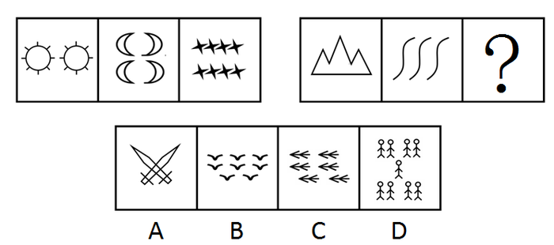

A. A

B. B

C. C

D. D

第 51 题 · 答案与解析

**参考答案（粉笔题库参考内容）**

D

**解析**

元素数量。

第一组图形数列分别为2、4、8，构成等比数列。第二组已知图形构成数量为1、3，形成以3为公比的等比数列，后一个图形构成数量应为9。

故正确答案为D。

**考点**：数量规律-素

**来源**：2008年云南省公务员录用考试《行测》题第51题

### 第 52 题

从所给四个选项中，选择最合适的一个填入问号处，使之呈现一定的规律性：

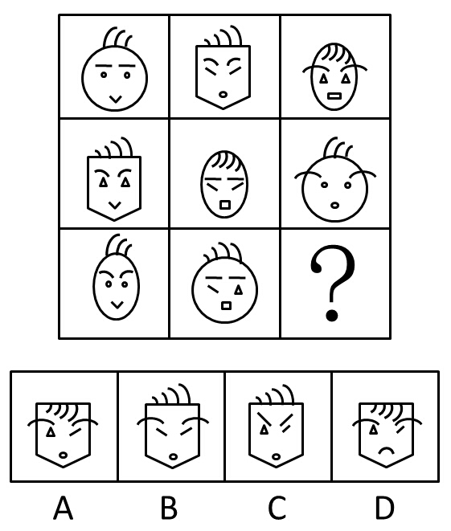

A. A

B. B

C. C

D. D

第 52 题 · 答案与解析

**参考答案（粉笔题库参考内容）**

A

**解析**

考查图形的周遍规律。

横向看，每组图形有圆形、椭圆、五边形，嘴巴有V形、圆形、方形，头发有三根向上、四根向上、四根向下。最后一格图形的轮廓应该是五边形，四根头发向下，嘴巴为圆形。与此相符的只有A项。

故正确答案为A。

**考点**：样式规律-遍历

**来源**：2008年云南省公务员录用考试《行测》题第52题

### 第 53 题

从所给四个选项中，选择最合适的一个，使之呈现一定的规律性：

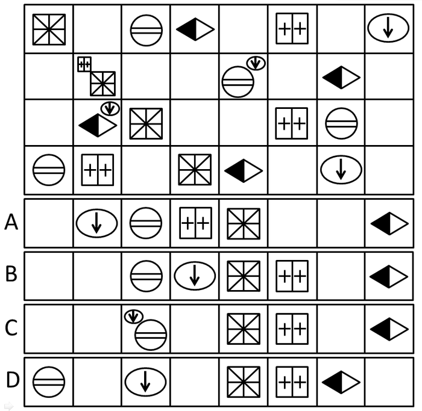

A. A

B. B

C. C

D. D

第 53 题 · 答案与解析

**参考答案（粉笔题库参考内容）**

B

**解析**

元素组成相同，考查位置规律。

由题干观察可知，“米”字图形每行向右移一格，“圆形”图形每行向右移两格，“菱形”每行向右移三格，“双+”图形每行向右移四格，圈中带箭头图形每行向右移五格。

故正确答案为B。

**考点**：位置规律-平移

**来源**：2008年云南省公务员录用考试《行测》题第53题

### 第 54 题

从所给四个选项中，选择最合适的一个，使之呈现一定的规律性：

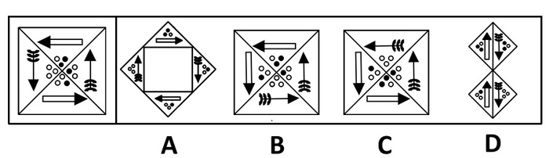

A. A

B. B

C. C

D. D

第 54 题 · 答案与解析

**参考答案（粉笔题库参考内容）**

B

**解析**

平面拼图，原元素只能旋转，不能翻转。

已知题干图形箭头指向为逆时针，且细箭头相对应的黑点分别为0和1，而粗箭头对应的黑点分别为1和2。重新排列之后，仔细观察箭头指向与箭头旁边圆点的对应情况。

A项和D项箭头指向不对；

C项箭头指向与箭头旁边圆点不对应。

故正确答案为B。

**考点**：特殊规律-功能元素

**来源**：2008年云南省公务员录用考试《行测》题第54题

### 第 55 题

从所给四个选项中，选择最合适的一个填入问号处，使之呈现一定的规律性：

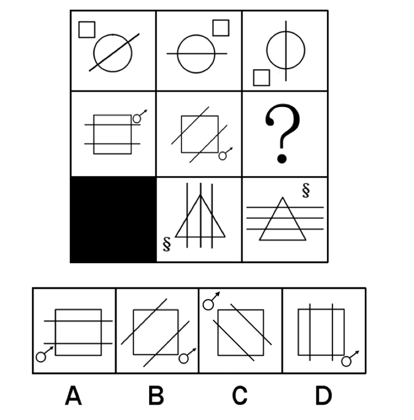

A. A

B. B

C. C

D. D

第 55 题 · 答案与解析

**参考答案（粉笔题库参考内容）**

C

**解析**

元素组成相同，优先考虑位置规律。

观察发现，第一行中，图一中的直线分别顺时针旋转45°和90°，小方形分别顺时针旋转90°和180°得到图二和图三。第三行中，图一中的直线分别顺时针旋转45°和90°，符号“§”分别顺时针旋转90°和180°得到图二和图三。第二行中，图一中的两条直线分别逆时针旋转45°和90°，带箭头的小圆分别顺时针旋转90°和180°得到第二图和第三图。

故正确答案为C。

**考点**：位置规律-旋转

**来源**：2008年云南省公务员录用考试《行测》题第55题

### 第 56 题

从所给四个选项中，选择最合适的一个，使之呈现一定的规律性：

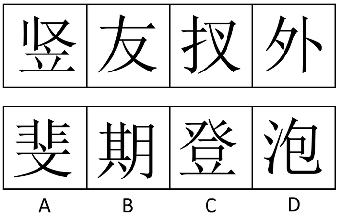

A. A

B. B

C. C

D. D

第 56 题 · 答案与解析

**参考答案（粉笔题库参考内容）**

C

**解析**

部分元素的周遍，考查图形中出现的公共元素。已知图形都含有横撇“フ”。

故正确答案为C。

**考点**：数量规律-素、文字/字母/数字类、样式规律-遍历

**来源**：2008年云南省公务员录用考试《行测》题第56题

### 第 57 题

从所给四个选项中，选择最合适的一个，使之呈现一定的规律性：

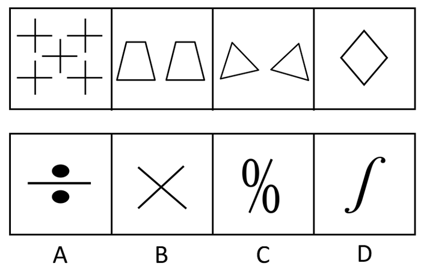

A. A

B. B

C. C

D. D

第 57 题 · 答案与解析

**参考答案（粉笔题库参考内容）**

B

**解析**

题干图中出现多边形，选项出现单一直线，优先考虑数直线数。题干中图形的直线数依次为10，8，6，4，所以下一个图形的直线数应该为2。只有B项符合。

故正确答案为B。

**考点**：数量规律-线

**来源**：2008年云南省公务员录用考试《行测》题第57题

### 第 58 题

左边给定的是纸盒外表面的展开图，右边哪一项能由它折叠而成？请把它找出来。

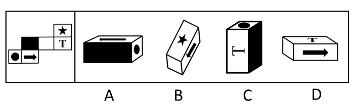

A. A

B. B

C. C

D. D

第 58 题 · 答案与解析

**参考答案（粉笔题库参考内容）**

A

**解析**

五角星与箭头、“T”字与黑色阴影不邻面，由此可排除B、C项。箭头的底部应该与黑圆面相邻，但是D选项箭头底部与空白面相邻，由此可排除D项。

故正确答案为A。

**考点**：空间类-空间重构-六面体

**来源**：2008年云南省公务员录用考试《行测》题第58题

### 第 59 题

从所给的四个选项中，选择最合适的一个填入问号处，使之呈现一定的规律性

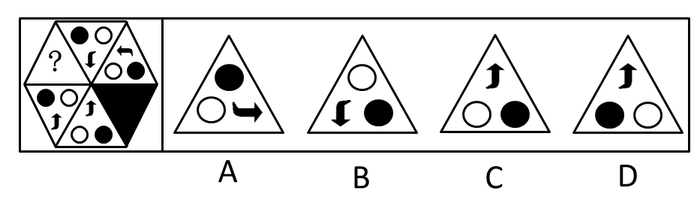

A. A

B. B

C. C

D. D

第 59 题 · 答案与解析

**参考答案（粉笔题库参考内容）**

C

**解析**

元素组成相同，考查位置规律。正六边形分割的每个三角形内的元素先按逆时针方向在三个顶角处依次平移，之后三角形按逆时针方向旋转60°。

故正确答案为C。

**考点**：位置规律-综合

**来源**：2008年云南省公务员录用考试《行测》题第59题

### 第 60 题

从所给四个选项中，选择最合适的一个填入问号处，使之呈现一定的规律性：

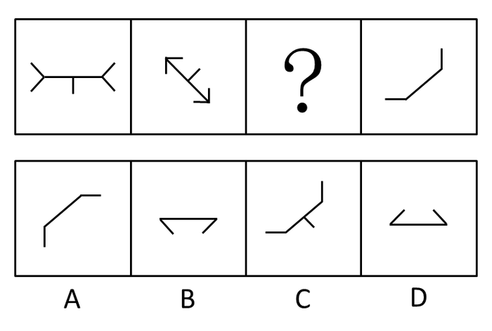

A. A

B. B

C. C

D. D

第 60 题 · 答案与解析

**参考答案（粉笔题库参考内容）**

B

**解析**

前两个图形的两端和中间元素趋势相反，两端开放变为两端封闭，中间的短竖线由向下变为向上。由此可以推断第三、四图的构图趋势也会是相反的。

故正确答案为B。

**来源**：2008年云南省公务员录用考试《行测》题第60题

### 第 61 题

平反，是对处理错误的案件进行纠正。

以下哪项最为确切地说明了上述定义的不严格：

A. 对平反的客体应该具体分析。平反了，不等于没错误

B. 对原来重罪轻判的案件进行纠正不应该称为平反

C. 对案件是否处理错误，应该有明确的标准

D. 应该说明平反的主体及其权威性

第 61 题 · 答案与解析

**参考答案（粉笔题库参考内容）**

B

**解析**

第一步：抓住定义中关键词。

定义的关键词有“错误的案件”。

第二步：逐一判断选项。

处理错误的案件包括重罪轻判、轻罪重判和无罪而判，后两种可称平反，第一种不能叫平反，本题犯了定义过宽的逻辑错误。

故正确答案为B。

**考点**：单定义-其他句式

**来源**：2008年云南省公务员录用考试《行测》题第61题

### 第 62 题

一切物质都是可塑的，树木是可塑的。所以树木是物质。

试分析以下哪个选项的结构与上述最为相近：

A. 一切真理都是经过实践检验的，进化论是真理，所以进化论是经过实践检验的

B. 一切恒星都是自身发光的，金星不是恒星，所以金星自身不发光

C. 一切公民都必须遵守法律，我们是公民，所以我们必须遵守法律

D. 所有的坏人都攻击我，你攻击我，所以你是坏人

第 62 题 · 答案与解析

**参考答案（粉笔题库参考内容）**

D

**解析**

第一步：翻译题干。

一切物质⇒都是可塑的，树木⇒可塑的，结论：树木⇒物质。

题干结构可抽象为：P⇒M，S⇒M，结论S⇒P。

第二步：翻译选项并逐一判断选项。

A项结构可抽象为：P⇒M，S⇒P，结论S⇒M，不符合题干逻辑；

B项结构可抽象为：P⇒M，S⇒-P，结论S⇒-M，不符合题干逻辑；

C项结构可抽象为：P⇒M，S⇒P，结论S⇒M，不符合题干逻辑；

D项结构可抽象为：P⇒M，S⇒M，结论S⇒P，符合题干逻辑。

故正确答案为D。

**考点**：推理形式

**来源**：2008年云南省公务员录用考试《行测》题第62题

### 第 63 题

演绎作品，又称派生作品，指在已有作品的基础上，经过改编、翻译、注释、整理等创造性劳动而产生的作品。改编，是指改变作品，创作出具有独创性的新作品；翻译，是指将作品从一种语言文字转换成为另一种语言文字；注释，是指对文字作品中的字、词、句进行解释；整理，是指对内容零散、层次不清的已有文字作品或材料进行条理化、系统化的加工。

根据上述定义，以下不属于演绎作品的是：

A. 《（红楼梦）经典诗句评析》

B. 《罪与罚》中文版

C. 《简·爱》电影剧本

D. 《（左传）难点词汇释义》

第 63 题 · 答案与解析

**参考答案（粉笔题库参考内容）**

A

**解析**

第一步：抓住定义中关键词。

定义的关键词有“经过改编、翻译、注释、整理等创造性劳动而产生的作品”。

第二步：逐一判断选项。

A项中对诗句的评析不同于“注释”，注释只是对作品中的字、词、句进行解释，而评析是加入了作者主观化、创造性的理解；

B项《罪与罚》中文版属于“翻译”；

C项《简·爱》电影剧本属于“改编”；

D项《（左传）难点词汇释义》属于“注释”。

本题为选非题，故正确答案为A。

**考点**：方式目的

**来源**：2008年云南省公务员录用考试《行测》题第63题

### 第 64 题

指定代理是指代理人根据人民法院或者指定机关的指定而进行的代理。

根据上述定义，下列属于指定代理的是：

A. 甲企业授予采购员王某与乙公司签订电视机买卖合同的代理权

B. 合伙人甲、乙、丙依约相互授予代理权，每一个合伙人均有权代理其他合伙人签订或履行合同

C. 甲代为自己10岁的儿子向乙提起侵权诉讼

D. 未成年人甲居住地的村民委员会指定乙为甲的民事侵权诉讼代理人

第 64 题 · 答案与解析

**参考答案（粉笔题库参考内容）**

D

**解析**

第一步：抓住定义中关键词。

定义的关键词有“根据人民法院或者指定机关的指定”。

第二步：逐一判断选项。

A、B、C项不符合“人民法院或者指定机关的指定”关键词，可排除。

故正确答案为D。

**考点**：主客体

**来源**：2008年云南省公务员录用考试《行测》题第64题

### 第 65 题

服务证券是指以一定的服务或文体、艺术欣赏为内容的证券。

根据上述定义，下列不属于服务证券的是：

A. 粮油票

B. 电影票

C. 球票

D. 飞机票

第 65 题 · 答案与解析

**参考答案（粉笔题库参考内容）**

A

**解析**

第一步：抓住定义中关键词。

定义的关键词有“以一定的服务或文体、艺术欣赏为内容”。

第二步：逐一判断选项。

A项“粮油票”是用来交换粮食和食用油的物品证券，不符合“以一定的服务或文体、艺术欣赏为内容”；

B项“电影票”是为了看电影，体现了“以艺术欣赏为内容”；

C项“球票”是为了看球赛，体现了“以文体欣赏为内容”；

D项“飞机票”体现了“以一定的服务为内容”。

B、C、D三项均符合题干服务证券的定义。

本题为选非题，故正确答案为A。

**考点**：单定义-其他句式

**来源**：2008年云南省公务员录用考试《行测》题第65题

### 第 66 题

两个以上的物品环绕一个中心组合在一起。两边平衡，重量或吸引力（包括形状、色彩等方面的吸引力）都有同等的分量，使人产生一种宁静的感觉，这就叫做均衡。

根据定义，下列不属于均衡的是：

A. 在儿童公园中，有一种跷跷板，跷跷板两头坐着两个一样重的小孩，两人坐的位置与中心距离相等

B. 人体中线两边各有一只眼睛，一只耳朵，一个鼻孔，一边脸，一手一脚

C. 某模特身上穿着银灰色的套装，脚上穿着一双米黄色的皮鞋，肩上背着绿色的休闲包

D. 达·芬奇的名画《最后的晚餐》，画面是一个长方形，以耶稣为中心，门徒在他两边，人数相等，两边的人与耶稣的距离也相等，两边墙上的背景也相同

第 66 题 · 答案与解析

**参考答案（粉笔题库参考内容）**

C

**解析**

第一步：抓住定义中关键词。

“两个以上的物品环绕一个中心组合在一起”、“重量或吸引力（包括形状、色彩等方面的吸引力）都有同等的分量”。

第二步：逐一判断选项。

A项：跷跷板两头坐着两个一样重的小孩，两人坐的位置与中心距离相等，说明跷跷板以中心支点为核心，两头坐着重量相同的小孩，且到中心的距离相等，符合“两个以上的物品环绕一个中心组合在一起”、“重量或吸引力（包括形状、色彩等方面的吸引力）都有同等的分量”，符合定义，排除；

B项：人体中线两边各有一只眼睛，一只耳朵，一个鼻孔，一边脸，一手一脚，说明人体以中线为中心，两侧器官在形状、数量上完全对等，符合“两个以上的物品环绕一个中心组合在一起”、“重量或吸引力（包括形状、色彩等方面的吸引力）都有同等的分量”，符合定义，排除；

C项：模特身上的银灰色套装、米黄色皮鞋、绿色休闲包，三者没有环绕一个中心组合，不符合“两个以上的物品环绕一个中心组合在一起”，且色彩上银灰、米黄、绿不存在同等分量的平衡感，不符合“重量或吸引力（包括形状、色彩等方面的吸引力）都有同等的分量”，不符合定义，当选；

D项：《最后的晚餐》以耶稣为中心，门徒在两侧人数相等，与耶稣距离相等，背景也相同，符合“两个以上的物品环绕一个中心组合在一起”、“重量或吸引力（包括形状、色彩等方面的吸引力）都有同等的分量”，符合定义，排除。

本题为选非题，故正确答案为C。

**考点**：拆词

**来源**：2008年云南省公务员录用考试《行测》题第66题

### 第 67 题

辩论是指双方都用一定的理由或证据指出对方见解的矛盾或错误，并论证自己对事物或问题的看法的正确。

根据上述定义，下列选项中，符合辩论构成要件的是：

A. 辩论双方的目的是指出对方见解的错误

B. 辩论的结果是双方的观点都正确

C. 双方都必须发表自己的见解

D. 双方的见解必须存在错误

第 67 题 · 答案与解析

**参考答案（粉笔题库参考内容）**

C

**解析**

第一步：抓住定义中关键词。

定义的关键词有“一定的理由或证据”、“指出对方见解的矛盾或错误”、“论证自己对事物或问题的看法的正确”。

第二步：逐一判断选项。

A项不符合题干定义，题干强调手段是“用一定的理由或证据指出对方见解的矛盾或错误”，目的是“论证自己对事物或问题的看法的正确”；

如果B项“双方的观点都正确”或者D项“双方的见解必须存在错误”为真，无法“指出对方见解的矛盾或错误”、更不可能“论证自己对事物或问题的看法的正确”；

C项“双方都必须发表自己的见解”说明双方都要发表自己见解，论证自己的看法正确，符合“论证自己对事物或问题的看法的正确”。

故正确答案为C。

**考点**：单定义-其他句式

**来源**：2008年云南省公务员录用考试《行测》题第67题

### 第 68 题

诋毁商誉行为是指经营者通过捏造、散布虚假事实等不正当手段，损害竞争对手的商业信誉和商品声誉，削弱对手竞争能力的行为。

根据上述定义，下列选项中不属于诋毁商誉行为构成要件的是：

A. 散布具有故意诋毁性质的言论

B. 竞争对手受到了削弱

C. 客体是同业竞争者的商业信誉和商品声誉

D. 经营者采用了捏造、散布虚假事实的手段

第 68 题 · 答案与解析

**参考答案（粉笔题库参考内容）**

B

**解析**

第一步：抓住定义中关键词。

定义的关键词有“捏造、散布虚假事实等不正当手段”、“损害竞争对手的商业信誉和商品声誉”、“削弱对手竞争能力”。

第二步：逐一判断选项。

A、C项分别符合第一个、第二个定义要件；

B项“竞争对手受到了削弱”与第三个定义要件表述上虽然相似，但实际含义不同；

D符合第一个定义要件。

本题为选非题，故正确答案为B。

**考点**：单定义-其他句式

**来源**：2008年云南省公务员录用考试《行测》题第68题

### 第 69 题

政治表达是指公民在行使政治权利的过程中，通过宪法手段和适当的机会来表示自己的政治态度，从而影响政府决策。

根据上述定义，下列不属于政治表达的是：

A. 政治言论

B. 在家里看新闻联播，然后高谈阔论

C. 示威游行

D. 民众代表为了维护民众的选举权利而上访

第 69 题 · 答案与解析

**参考答案（粉笔题库参考内容）**

B

**解析**

第一步：抓住定义中关键词。

定义的关键词有“通过宪法手段和适当的机会”、“表示自己的政治态度”、“影响政府决策”。

第二步：逐一判断选项。

B项“看新闻联播”、“高谈阔论”不属于“通过宪法手段和适当的机会”，不会“影响政府决策”；

A项“政治言论”、C项“示威游行”、D项“上访”均符合题干“通过宪法手段和适当的机会”、“表示自己的政治态度”、“影响政府决策”。

本题为选非题，故正确答案为B。

**考点**：方式目的

**来源**：2008年云南省公务员录用考试《行测》题第69题

### 第 70 题

人身关系，是与人身不可分离，以人身利益为内容，不直接体现财产利益的社会关系。人身关系包括人格关系和身份关系两类。人格关系是基于人格利益而发生的社会关系；身份关系是以特定的身份利益为内容的社会关系。

根据上述定义，下列属于身份关系的是：

A. 赵某因创作而对《雾霜凝美集锦》享有的署名权

B. 沈某基于朋友义气，无偿借给梁某一万元人民币

C. 李某将电视机赠与张某而形成的赠与关系

D. 王某因收养宫某而形成的父子关系

第 70 题 · 答案与解析

**参考答案（粉笔题库参考内容）**

D

**解析**

第一步：抓住定义中关键词。

人身关系强调有“与人身不可分离，以人身利益为内容”、“不直接体现财产利益”，人格关系强调“基于人格利益而发生”，身份关系强调“以特定的身份利益为内容”。

第二步：逐一判断选项。

A项署名权是权利主体对智力成果享有的支配权，体现了“基于人格利益而发生”，属于人格关系；

B项“无偿借给梁某一万元人民币”，属于财产关系；

C项“赠与关系”直接体现财产利益；

D项因“收养而形成的父子关系”符合“以特定的身份利益为内容”，属于身份关系。

故正确答案为D。

**考点**：常规问法

**来源**：2008年云南省公务员录用考试《行测》题第70题

### 第 71 题

橘：黄

A. 麝：香

B. 花：红

C. 苹果：紫

D. 草：绿

第 71 题 · 答案与解析

**参考答案（粉笔题库参考内容）**

D

**解析**

第一步：判断题干词语间逻辑关系。

事物和颜色的一一对应关系，橘子是黄色的。

第二步：判断选项词语间逻辑关系。

A项：麝和香不是事物和颜色的对应关系，不符合题干；

B项：花和红是事物和颜色的对应关系，但不是一一对应，花还有其它的颜色；

C项：苹果显然不是紫色的；

D项：草是绿色的，二者是事物和颜色的一一对应关系。

故正确答案为D。

**考点**：逻辑关系-对应关系

**来源**：2008年云南省公务员录用考试《行测》题第71题

### 第 72 题

画圣：吴道子

A. 酒圣：杜康

B. 茶圣：陆游

C. 武圣：张飞

D. 医圣：华佗

第 72 题 · 答案与解析

**参考答案（粉笔题库参考内容）**

A

**解析**

第一步：判断题干词语之间逻辑关系。

题干两词是对应关系，后人对第二个的尊称为第一个。

第二步：判断选项词语之间逻辑关系。

B项茶圣是陆羽；

C项武圣是关羽；

D项医圣是张仲景。

故正确答案为A。

**考点**：逻辑关系-对应关系

**来源**：2008年云南省公务员录用考试《行测》题第72题

### 第 73 题

地球：宇宙

A. 白云：大气

B. 桌椅：教室

C. 树木：树枝

D. 铅笔：钢笔

第 73 题 · 答案与解析

**参考答案（粉笔题库参考内容）**

B

**解析**

第一步：判断题干词语之间逻辑关系。

题干两词是包容关系，且是包容关系中的组成关系，前者为后者的一部分。

第二步：判断选项词语之间逻辑关系。

A项白云和大气以及D项铅笔和钢笔之间的逻辑不是组成关系，C项树木不是树枝的一部分，应为树枝是树木的一部分。

B项桌椅是教室的一部分。

故正确答案为B。

**考点**：逻辑关系-包容关系

**来源**：2008年云南省公务员录用考试《行测》题第73题

### 第 74 题

玫瑰：情人

A. 花朵：蝴蝶

B. 器官：血液

C. 白色：纯洁

D. 风雪：晴朗

第 74 题 · 答案与解析

**参考答案（粉笔题库参考内容）**

C

**解析**

第一步：判断题干词语之间逻辑关系。

题干两词是对应关系，前者的寓意代表后者，玫瑰代表爱情，在情人之间传递爱的信息。

第二步：判断选项词语之间逻辑关系。

A项花朵的象征不是蝴蝶；

B项器官的寓意不是血液；

C项白色象征纯洁；

D项风雪和晴朗是一对反义词。

故正确答案为C。

**考点**：语义关系-比喻象征义

**来源**：2008年云南省公务员录用考试《行测》题第74题

### 第 75 题

羡慕：追求

A. 伤心：失败

B. 痛恨：打击

C. 快乐：哭泣

D. 喜欢：愉快

第 75 题 · 答案与解析

**参考答案（粉笔题库参考内容）**

B

**解析**

第一步：判断题干词语之间逻辑关系。

题干两词是因果关系，因为前者而产生后者的行为。

第二步：判断选项词语之间逻辑关系。

A项失败的原因不是伤心；

B项因痛恨而打击符合题干逻辑；

C项和D项构不成因果关系。

故正确答案为B。

**考点**：逻辑关系-对应关系

**来源**：2008年云南省公务员录用考试《行测》题第75题

### 第 76 题

在某次税务检查后，四个工商管理人员有如下结论：

甲：所有个体户都没纳税。

乙：服装个体户陈老板没有纳税。

丙：个体户并非都没有纳税。

丁：有的个体户没纳税。

如果四个人中只有一人断定属实，那么以下哪项是真的：

A. 丁断定属实，陈老板未纳税

B. 丁断定属实，但陈老板纳了税

C. 丙断定属实，陈老板纳了税

D. 丙断定属实，陈老板没有纳税

第 76 题 · 答案与解析

**参考答案（粉笔题库参考内容）**

C

**解析**

第一步：找突破口。

本题突破口为甲和丙的结论互相矛盾，必有一真一假。

第二步：看其他信息。

由四个人中只有一人断定属实可知，乙和丁的结论都是假的，即服装个体户陈老板纳了税，所有个体户都纳税了。

第三步：判断突破口中两人结论的真假。

由“所有个体户都纳税了”可知，甲的结论“所有个体户都没纳税”为假，丙的结论“个体户并非都没有纳税”为真。综上所述，丙为真，服装个体户陈老板纳了税。

故正确答案为C。

**考点**：只有一真/一假

**来源**：2008年云南省公务员录用考试《行测》题第76题

### 第 77 题

某地有两个奇怪的村庄，杨庄的人在星期一、三、五说谎，王村的人在二、四、六说谎。在其他日子两个村庄的人都说实话。一天，从未来过这里的外地人刘某见到两个人，分别向他们提出关于日期的问题。两个人都说：“前天是我说谎的日子。”

如果被问的两个人分别来自杨庄和王村，则以下哪项判断最可能为真：

A. 这一天是星期四或星期五

B. 这一天是星期二或星期四

C. 这一天是星期五或星期日

D. 这一天是星期一或星期三

第 77 题 · 答案与解析

**参考答案（粉笔题库参考内容）**

D

**解析**

分析题干，如下图所示，考虑代入排除法。

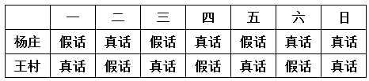

|  | 一 | 二 | 三 | 四 | 五 | 六 | 日 |
| --- | --- | --- | --- | --- | --- | --- | --- |
| 杨庄 | 假话 | 真话 | 假话 | 真话 | 假话 | 真话 | 真话 |
| 王村 | 真话 | 假话 | 真话 | 假话 | 真话 | 假话 | 真话 |

①假设今天是星期二，那么前天则是星期日，杨庄和王村的人说的都是真话，与题干冲突，则今天不可能是星期二；

②假设今天是星期四，那么杨庄的人说的是真话，而前天则是星期二，杨庄的人说的还是真话，与题干冲突，则今天不可能是星期四；

③假设今天是星期五，那么王村的人说的是真话，而前天则是星期三，王村的人说的还是真话，与题干冲突，则今天不可能是星期五；

④假设今天是星期日，那么杨庄和王村的人都说的是真话，而前天则是星期五，王村的人说的还是真话，与题干冲突，故今天不可能是星期日；

综上，可以排除A、B、C项。

故正确答案为D。

**考点**：假设

**来源**：2008年云南省公务员录用考试《行测》题第77题

### 第 78 题

最近一段时期，有关要发生地震的传言很多。一天傍晚，小芳问在院里乘凉的姥姥：“姥姥，他们都说明天要地震了。”姥姥说：“根据我的观察，明天不必然地震。”小芳说：“那您的意思是明天肯定不会地震了。”姥姥说：“不对。”小芳陷入了迷惑。

以下哪句话与姥姥的意思最为接近：

A. 明天可能不地震

B. 明天可能地震

C. 明天不可能不地震

D. 明天不可能地震

第 78 题 · 答案与解析

**参考答案（粉笔题库参考内容）**

A

**解析**

第一步：翻译题干。

不必然等价于可能非。因此断定不必然地震，等于断定可能不地震。

第二步：逐一判断选项。

由对话可知，姥姥的意思是对肯定会地震的否定，即不一定会地震，

A项可能不地震，符合姥姥的意思；

B项是干扰项，题干强调姥姥的意思是对不会地震的否定，意思是可能不地震，所以B排除；

C项不可能不地震和D项不可能地震都是肯定的说法，不符合推断；

故正确答案为A。

**来源**：2008年云南省公务员录用考试《行测》题第78题

### 第 79 题

有9张纸牌，分别为1至9。甲、乙、丙、丁四人取牌，每人取2张。现已知甲取的两张牌之和是10；乙取的两张牌之差是1；丙取的两张牌之积是24；丁取的两张牌之商是3。

请说出剩下的一张是什么牌：

A. 6

B. 3

C. 7

D. 4

第 79 题 · 答案与解析

**参考答案（粉笔题库参考内容）**

C

**解析**

第一步：找突破口。

本题突破口是丙，丙取的两张牌之积是24，丙拿的为3、8或4、6。

第二步：看其他条件并判断选项。

假设丙拿的为3、8，要使丁取的两张牌之商是3，丁拿的必为6、2。和为10的只有1、9，那么甲拿的两张牌是1和9；差为1的只有4、5，乙拿的为4、5。剩下的那张牌是7。假设丙拿的为4、6，要使丁取的两张牌之商是3，那么丁可能取到3、1或3、9。假设丁取到3、1，那么甲拿的两张牌是2和8，而剩下的5、7、9中没有差为1的；若丁拿的是3、9，那么甲拿的两张牌是2和8，那么剩下的1、5、7中没有差为1的。因此丙拿的必须为3、8，甲拿的两张牌是1和9，乙拿的为4、5，丁拿的必为6、2，剩下7。

故正确答案为C。

**考点**：假设

**来源**：2008年云南省公务员录用考试《行测》题第79题

### 第 80 题

今年夏天，老李家的三个孩子分别参加了在杭州、昆明和哈尔滨举行的三项体育竞赛，即男子体操、撑杆跳高和马拉松长跑。已知的情况是：老大没到哈尔滨去参加马拉松比赛；老三没有参加在杭州举行的比赛项目；在体操比赛中获得全国冠军称号的那个孩子没有到昆明去；马拉松冠军并非他家老三。

你能猜出老李的哪个孩子是男子体操全国冠军吗：

A. 老大

B. 老二

C. 老三

D. 无法判断

第 80 题 · 答案与解析

**参考答案（粉笔题库参考内容）**

A

**解析**

题干本身不严谨。

“马拉松冠军并非他家老三”应理解为老大或老二获得马拉松冠军，则由“老大没有到哈尔滨去参加马拉松比赛”可知，老大去了杭州或昆明，马拉松比赛在哈尔滨举行；马拉松冠军不是老三，则一定是老二去哈尔滨参加了马拉松比赛；根据“老三没有参加在杭州举行的比赛项目”可知，老三去了昆明，所以老大去了杭州；“在体操比赛中获得全国冠军称号的那个孩子没有到昆明去”说明体操比赛不是在昆明举行的，而是在杭州举行的。所以，老大在体操比赛中获得了全国冠军称号。

故正确答案为A。

**考点**：从确定信息开始推

**来源**：2008年云南省公务员录用考试《行测》题第80题

### 第 81 题

一家人共有兄弟姐妹七人，但只知道甲、乙、丙、丁、戊、己、庚七个人中如下情况：(1)甲有三个妹妹；(2)乙有一个哥哥；(3)丙是女的，她有两个妹妹；(4)丁有两个弟弟；(5)戊有两个姐姐；(6)己也是女的，但她和庚没有妹妹。

请问，这七个人中谁是男性谁是女性：

A. 乙、丁、戊、庚为男性，甲、丙、己为女性

B. 甲、乙、丙、庚为男性，丁、戊、己为女性

C. 甲、乙、戊、丙为男性，丁、庚、己为女性

D. 甲、乙、戊、庚为男性，丁、丙、己为女性

第 81 题 · 答案与解析

**参考答案（粉笔题库参考内容）**

D

**解析**

第一步：找突破口。

本题突破口为丙，丙是女性，她有两个妹妹，说明他们是三个女性，

第二步：看题干其他信息并分析选项。

选项中都是四男三女，根据（1）（5）可知，甲是男性，戊是男性。排除AB；

由（3）可知丙为女性，排除C。

故正确答案为D。

**考点**：排除法

**来源**：2008年云南省公务员录用考试《行测》题第81题

### 第 82 题

近十年来，新飞冰箱厂通过不断引进先进设备和技术，使得劳动生产率大为提高。即在单位时间里，较少的工人生产了较多的产品。

请问以下哪项如果为真，就一定能支持上述结论：

Ⅰ和1997年相比，2007年新飞冰箱厂的年利润增加了一倍，工人增加了10%。

Ⅱ和1997年相比，2007年新飞冰箱厂的年产量增加了一倍，工人增加了100人。

Ⅲ和1997年相比，2007年新飞冰箱厂的年产量增加了一倍，工人增加了10%。

A. 只有Ⅰ

B. 只有Ⅱ

C. 只有Ⅲ

D. 只有Ⅰ和Ⅱ

第 82 题 · 答案与解析

**参考答案（粉笔题库参考内容）**

C

**解析**

第一步：找到论点和论据。

论点是新飞冰箱厂通过不断引进先进设备和技术，使得劳动生产率大为提高。没有明显论据。

第二步：判断加强方式。

只有论点，所以需要加强论点。

第三步：逐一判断选项。

由题干Ⅰ可知，新飞冰箱厂年利润增加一倍，但利润率与生产率无关，利润率提高也可能是由于其他原因引起的，利润率增加并不能说明劳动生产率提高，故Ⅰ不能支持论点；由Ⅱ可知，年产量虽然增加了一倍，但原新飞冰箱厂工人人数未提及，新增加了100人与年产量增加了一倍无法比较，不能加强论点；由Ⅲ可知，产量增加一倍，而工人增加了10%，说明单位时间里工人生产了较多的产品，劳动生产率提高了，加强了论点。

故正确答案为C。

**考点**：补充论据

**来源**：2008年云南省公务员录用考试《行测》题第82题

### 第 83 题

一种外表类似苹果的水果被培育出来，我们称为它皮果。皮果皮里面会包含少量杀虫剂的残余物。然而，专家建议我们吃皮果之前不应该剥皮，因为这种皮果的果皮里面含有一种特殊的维生素，这种维生素在其他水果里面含量很少，对人体健康很有益处，弃之可惜。

以下哪项，如果为真，最能对专家的上述建议构成质疑：

A. 吸收皮果皮上的杀虫剂残余物对人体的危害超过了吸收皮果皮中的维生素对人体的益处

B. 皮果皮上杀虫剂残余物的数量太少，不会对人体带来危害

C. 皮果皮上的杀虫剂残余物不能被洗掉

D. 皮果皮中的那种维生素不能被人体充分消化吸收

第 83 题 · 答案与解析

**参考答案（粉笔题库参考内容）**

A

**解析**

第一步：找到论点和论据。

论点：吃皮果之前不应该剥皮。

论据：这种皮果的果皮里面含有一种特殊的维生素，这种维生素在其他水果里面含量很少，对人体健康很有益处，弃之可惜。

本题论点说的是吃皮果不应该剥皮，论据说的是这种皮果的果皮含有对人体健康有益处的维生素，根据论据可以合理推出论点，二者话题一致，削弱优先考虑削弱论点。

第二步：逐一分析选项。

A项：选项指出吸收皮果皮上的杀虫剂残余物对人体的危害超过了吸收皮果皮中的维生素对人体的益处，说明食用的危害大于益处，应该剥皮之后再食用，削弱论点，保留；

B项：选项指出皮果皮上的杀虫剂残余物不会对人体带来危害，但未提及其他因素的影响，不清楚是否需要剥皮，无法削弱，排除；

C项：选项指出杀虫剂残余物不能被洗掉，但无法确定这些残余物是否对人体有害，即使有害也无法判断害处有多大，无法削弱，排除；

D项：选项指出皮果皮中对人体有益的维生素不能被人体充分消化吸收，削弱论据，保留。

比较A、D两项，A项削弱论点的削弱力度大于D项削弱论据。

故正确答案为A。

**考点**：削弱论点

**来源**：2008年云南省公务员录用考试《行测》题第83题

### 第 84 题

旺堆山温泉中含有丰富的活性乳钙，这种活性乳钙被全国十分之九的医院用于治疗牛皮癣。

如果以上断定是真的，则以下哪项也一定是真的：

Ⅰ全国有十分之九的医院使用旺堆山温泉治疗牛皮癣。

Ⅱ全国至少有十分之一的医院不治疗牛皮癣。

Ⅲ全国只有十分之一的医院不在旺堆山温泉设立牛皮癣治疗点。

A. 只有Ⅰ

B. Ⅰ、Ⅱ和Ⅲ都不必然是真的

C. 只有Ⅲ

D. Ⅰ、Ⅱ和Ⅲ

第 84 题 · 答案与解析

**参考答案（粉笔题库参考内容）**

B

**解析**

第一步：抓住题干对象及关系。

题干强调对治疗牛皮癣有用的只是活性乳钙，而旺堆山温泉中含有丰富的活性乳钙。

第二步：根据题干信息逐一分析选项。

医院用活性乳钙治疗牛皮癣，而活性乳钙并非只是旺堆山温泉所独有，可能其他地方也有。因此Ⅰ、Ⅱ、Ⅲ均不一定能由题干推出。

故正确答案为B。

**考点**：日常结论

**来源**：2008年云南省公务员录用考试《行测》题第84题

### 第 85 题

尽管对于备办酒宴机构的卫生检查程序要比普通餐厅的检查程序严格得多，在报到市卫生主管部门的食品中毒案件中，还是来自酒宴服务的比来自普通餐厅的多。

以下哪个选项为真，最能够解释题干中表面上的矛盾现象：

A. 人们不大可能在吃一顿饭和随之而来的疾病之间建立关联，除非该疾病影响到一个相互联系的群体

B. 备办酒宴的机构清楚地知道他们将为多少人服务，因此比普通餐厅更不可能有剩余食物，后者是食品中毒的一个主要来源

C. 许多餐厅在提供备办酒宴服务的同时，也提供个人餐饮服务

D. 上报的在酒宴中发生食品中毒案件的数目，与备办酒宴者和顾客常去场所的服务无关

第 85 题 · 答案与解析

**参考答案（粉笔题库参考内容）**

A

**解析**

第一步：找出需要解释的矛盾。

酒宴机构比普通餐厅的卫生检查程序要严格，但是食品中毒案件里面酒宴服务却比普通餐厅多。

第二步：逐一分析选项。

A项：人们不大可能在吃一顿饭和随之而来的疾病之间建立联系，即说明卫生检查程序再严，没涉及到群体，只涉及到单个人，人们是不会上报的，因此酒宴是群体，有中毒事件大家立马上报，而普通餐厅是个人用餐较多，即使中毒也不会上报，能够解释，当选；

B项中剩余食物，C项中中餐厅也供个人餐饮服务均与上报的食品中毒案件无直接关系，不能解释，排除；

D项：食品中毒案件的数目与服务场所的性质无关，但是未涉及到人们上报案件的问题，不能解释，排除。

故正确答案为A。

**考点**：原因解释

**来源**：2008年云南省公务员录用考试《行测》题第85题

### 第 86 题

某市发生一起凶杀案，事后有群众向警方举报，说看到案犯躲藏在本市某家三星级饭店中。警方立即搜查市内所有的三星级饭店，但没有发现犯罪嫌疑人的踪迹。

请问如果上述断定为真，则在下面四个断定中，可确定为假的是：

Ⅰ没有三星级饭店被搜查过。

Ⅱ有的三星级饭店被搜查过了。

Ⅲ有的三星级饭店没有被搜查过。

Ⅳ犯罪嫌疑人藏的三星级饭店已被搜查过。

A. 仅Ⅰ和Ⅱ

B. 仅Ⅰ和Ⅲ

C. 仅Ⅱ和Ⅲ

D. 仅Ⅰ、Ⅲ和Ⅳ

第 86 题 · 答案与解析

**参考答案（粉笔题库参考内容）**

B

**解析**

第一步：翻译题干信息。

警方立即搜查市内所有的三星级饭店，注意“所有”。

第二步：逐一判断四个断定。

如果警方立即搜查市内所有的三星级饭店为真，那么Ⅰ没有三星级饭店被搜查过为假；Ⅱ有的三星级饭店被搜查过为真；Ⅲ有的三星级饭店没有被搜查过为假。至于犯罪嫌疑人躲藏的三星级饭店已被搜查过无法确定真假，事实上，如果犯罪嫌疑人确实躲藏在某个三星级饭店，则该命题是真的，否则该命题就是假的。

故正确答案为B。

**考点**：真假推理-其他

**来源**：2008年云南省公务员录用考试《行测》题第86题

### 第 87 题

某电脑公司技术科有三只资料橱，每只橱子各有两把钥匙，科里三个工程师随时都需要打开这三个橱子。请问，在不增加钥匙的情况下，怎样才能方便每人随时都可以打开这三个橱子的任何一个：

Ⅰ一号橱放一把三号橱的钥匙。

Ⅱ二号橱放一把一号橱的钥匙。

Ⅲ三号橱放一把二号橱的钥匙。

Ⅳ其余的钥匙每人一把。

A. Ⅰ、Ⅱ、Ⅲ和Ⅳ

B. 仅Ⅰ和Ⅱ

C. 仅Ⅰ、Ⅲ和Ⅳ

D. 仅Ⅰ和Ⅲ

第 87 题 · 答案与解析

**参考答案（粉笔题库参考内容）**

A

**解析**

第一步：抓住题干对象及其关系。

本题突破口为钥匙有二套六把，如果三个工程师都必须随时能打开所有的资料橱，那么其中一套钥匙就必须给三个工程师。

第二步：判断整体关系。

每个橱子里不重复的放入一把其他橱子的钥匙，只要是持有其中一个橱子的钥匙就能顺利打开其他各橱，那么题干给出的四个条件都是必须的。

第三步：逐一判断选项。

根据第二步分析可知，四个条件都是必须的。A项符合推断。

故正确答案为A。

**考点**：组合排列-单题-其他

**来源**：2008年云南省公务员录用考试《行测》题第87题

### 第 88 题

四位青年工人分别买了一样家用电器。现在知道：小钟是锻工，钳工买了一台西门子牌洗衣机，车工住在小李的右边，小李住在小钟的右面，小高买了台海尔电冰箱，小王住在电焊工的左面，买海尔电冰箱的青工住在买长虹牌电视机青工的右面。

请你分析一下，谁买了德生牌录音机：

A. 小高

B. 小李

C. 小王

D. 小钟

第 88 题 · 答案与解析

**参考答案（粉笔题库参考内容）**

D

**解析**

第一步：找突破口。

本题突破口是工种：由条件小钟是锻工，钳工买了洗衣机，小高买了冰箱，可知小高只能是车工或电焊工，小李只能是钳工或电焊工，小王只能是车工或钳工。

第二步：根据突破口继续往下推导。

假设小高是车工，则小王是钳工，小李是电焊工，将这一关系代入题干，会得出车工小高和小钟都住在小李的右面的情况，因此这一假设是不正确的。那么假设小高是电焊工，则小王是车工，小李是钳工，将这一关系代入题干，会得出以下结论：小钟—小李—小王—小高（按住房从左到右的顺序排列），并由此可得出小李买了洗衣机，小高买了冰箱，小王买了电视机，因此购买录音机的只能是小钟。

故正确答案为D。

**考点**：假设

**来源**：2008年云南省公务员录用考试《行测》题第88题

### 第 89 题

三位采购员定期去某商店，甲每隔9天去一次，乙每隔11天去一次，丙每隔7天去一次，三人星期二第一次在商店相会。

请问他们下次相会是星期几：

A. 星期二

B. 星期四

C. 星期一

D. 星期三

第 89 题 · 答案与解析

**参考答案（粉笔题库参考内容）**

D

**解析**

第一步：抓住题干主要信息。

本题是一道数理逻辑题，此题实际上就是求最小公倍数，但由于题干中提到“每隔××天去一次”，所以三个数值应该加1，也就是求10、12、8的最小公倍数。

第二步：判断整体关系。

10，12，8的最小公倍数为5×6×4＝120，而120÷7＝17余1，说明下一次相会就应该是在星期三。

第三步：逐一判断选项。

根据第二步分析可知，他们下次相会是星期三。

故正确答案为D。

**考点**：组合排列-单题-其他

**来源**：2008年云南省公务员录用考试《行测》题第89题

### 第 90 题

一段时间以来，国产手机在国内市场的占有率逐渐减小。研究发现，国外手机公司的手机广告比国内的广告更吸引人。因此，国产手机生产商需要加大广告投入，以增加市场占有率。

以下哪项如果为真，将严重地弱化上述的论证：

A. 一些国外手机产品的广告是由国内广告公司制作并由国内媒体传播的

B. 广告只能引起人们对某种商品的注意，质量才能使人们产生对商品的喜爱

C. 国产手机生产商的广告费现在只有国外厂商的一半

D. 尽管国外手机产品销售额增加，国产手机的销售额同样在增加

第 90 题 · 答案与解析

**参考答案（粉笔题库参考内容）**

B

**解析**

第一步：找到论点和论据。

本题论点国产手机生产商需要加大广告投入，以增加市场占有率。论据是国外手机公司的手机广告比国内的广告更吸引人。

第二步：判断削弱方式。

论据和论点之间存在因果关系，需要削弱论点。

第三步：逐一判断选项的作用。

A项说国外手机产品的广告的制作和传播，而题干说国外手机广告更吸引人，A是无关项；

B项说质量才能使人们产生对商品的喜爱，是质量的原因而不是广告的原因造成市场占有率降低，因此要增加市场占有率的办法应该把重点放在提高质量上，B否定了论点；

C项说国产手机广告投入不足，加强了论点；

D项中“销售额情况”在题干中并未涉及，D是无关项。

故正确答案为B。

**考点**：削弱论点

**来源**：2008年云南省公务员录用考试《行测》题第90题

### 第 91 题

依法治国方略的目标是：

A. 建设富强、民主、文明的社会主义国家

B. 建设人民民主专政的法制国家

C. 建设社会主义法治国家

D. 建设社会主义文明进步的国家

第 91 题 · 答案与解析

**参考答案（粉笔题库参考内容）**

C

**解析**

胡锦涛在十七大报告中提出，“全面落实依法治国基本方略，加快建设社会主义法治国家”。

故正确答案为C。

答题时，如果不知道十七大报告中的相关论述，也可从题干中的“依法治国”中的“法”字，推测该方略的目标也是与“法”有关，排除A、D两项。法制是法律制度的简称，属于制度的范畴；而法治是法律统治的简称，是一种治国原则和方法。“依法治国”指的是一种治国方法，排除B项，选C。

**来源**：2008年云南省公务员录用考试《行测》题第91题

### 第 92 题

我国的地方各级人民政府实行什么负责制：

A. 行政首长

B. 政府全体会议

C. 政府常务会议与行政首长

D. 委员会

第 92 题 · 答案与解析

**参考答案（粉笔题库参考内容）**

A

**解析**

《宪法》规定，国务院“即中央人民政府，是最高国家权力机关的执行机关，是最高国家行政机关。”“国务院实行总理负责制。各部、各委员会实行部长、主任负责制。”“地方各级人民政府是地方各级国家权力机关的执行机关，是地方各级国家行政机关。”“地方各级人民政府实行省长、市长、县长、区长、乡长、镇长负责制。”由此可知，地方各级人民政府实行行政首长负责制。

故正确答案为A。

**考点**：宪法

**来源**：2008年云南省公务员录用考试《行测》题第92题

### 第 93 题

国家征收教育附加费的行为属于：

A. 行政许可

B. 行政征收

C. 行政奖励

D. 行政处罚

第 93 题 · 答案与解析

**参考答案（粉笔题库参考内容）**

B

**解析**

行政征收是指行政机关或者法定授权的组织根据法律、法规的规定，向公民、法人或者其他组织无偿收取一定财物的行政行为。国家征收教育附加费，是一种行政行为，且被征收人没有从征收的教育附加费中获得报酬，符合行政征收的定义。

故正确答案为B。

解答本题时，观察四个选项，发现只有B项能跟题干的关键字眼“征收”对应上，可判断出选项B应为正确答案。

**本题相关知识点：**

行政许可指的是在法律一般禁止的情况下，行政主体根据行政相对方的申请，经依法审查，通过颁发许可证、执照等形式，赋予或确认行政相对方从事某种活动的法律资格或法律权利的一种具体行政行为。

行政奖励是指行政主体为了表彰先进、激励后进，充分调动和激发人们的积极性和创造性，依照法定条件和程序，对为国家、人民和社会作出突出贡献或者模范地遵纪守法的行政相对人，给予物质的或精神的奖励的具体行政行为。

行政处罚是指行政机关依法对违反行政管理秩序的公民、法人或者其他组织，以减损权益或者增加义务的方式予以惩戒的行为。

**考点**：行政法

**来源**：2008年云南省公务员录用考试《行测》题第93题

### 第 94 题

用高压锅煮饭菜比用普通锅煮饭菜熟得快，是因为：

A. 高压锅单位时间提供的热量大

B. 水的沸点与传热物有关

C. 水的沸点与压强有关

D. 高压锅是金属物品，传热快

第 94 题 · 答案与解析

**参考答案（粉笔题库参考内容）**

C

**解析**

因为水的沸点受压强影响，压强越高，沸点越高。煮饭菜时，高压锅里的水加热被烧开后产生蒸汽，再继续加热，蒸汽的压力会逐渐升高，根据气压和水的沸点成正比的原理，锅内的水的沸点不断被提高，那么锅内的温度也随之上升，可以超过100度，而温度越高，饭菜越快熟，所以用高压锅煮饭菜比用普通锅煮饭菜熟得快。

故正确答案为C。

**考点**：生活常识

**来源**：2008年云南省公务员录用考试《行测》题第94题

### 第 95 题

“忽如一夜春风来，千树万树梨花开”这两句所采用的修辞手法是：

A. 借代、比拟

B. 比喻、夸张

C. 比拟、夸张

D. 比喻、借代

第 95 题 · 答案与解析

**参考答案（粉笔题库参考内容）**

B

**解析**

诗句中，诗人以“梨花”比喻漫天的雪花；把漫天的飞雪说成是千树万树的梨花，运用的是夸张的修辞手法。

故正确答案为B。

**本题相关知识点：**

比拟就是把一个事物当作另外一个事物来描述、说明。 比拟的辞格是将人比作物、将物比作人，或将甲物化为乙物。

**考点**：文学常识

**来源**：2008年云南省公务员录用考试《行测》题第95题

### 第 96 题

感冒时吃东西没有滋味主要是因为：

A. 鼻黏膜充血肿胀，嗅觉细胞接触不到气味刺激

B. 味觉不敏感

C. 鼻腔堵塞

D. 空气通过鼻腔的量少

第 96 题 · 答案与解析

**参考答案（粉笔题库参考内容）**

A

**解析**

人在吃东西的时候，能够尝出不同味道，靠的不光是舌头的味觉，还要靠鼻子的嗅觉。因为舌头上的神经只能分出甜酸辣咸等味道，其他味道需要靠鼻子来闻。食物的各种气味吸到鼻子里，由闻味的神经传给大脑，于是就能知道食物是什么滋味了。感冒时，鼻子黏膜充血肿胀，嗅觉细胞接触不到气味刺激，所以吃东西也就没滋味了。

故正确答案为A。

**考点**：生活常识

**来源**：2008年云南省公务员录用考试《行测》题第96题

### 第 97 题

“民为贵，社稷次之，君为轻”这一思想的提出者是：

A. 荀子

B. 墨子

C. 孔子

D. 孟子

第 97 题 · 答案与解析

**参考答案（粉笔题库参考内容）**

D

**解析**

“民为贵，社稷次之，君为轻。”是孟子提出的一个重要思想，意思是说，人民放在第一位，国家其次，君在最后。这是因为，有了人民，才需要建立国家；有了国家，才需要有个“君”。这句话引自《孟子·尽心下》。

故正确答案为D。

**本题相关知识点：**

荀子最为人所知的作品当属《劝学》，许多脍炙人口的句子都出自该文。如“青，取之于蓝，而青于蓝；冰，水为之，而寒于水。”“积土成山，风雨兴焉。积水成渊，蛟龙生焉。”“故不积跬步，无以至千里；不积小流，无以成江海。骐骥一跃，不能十步；驽马十驾，功在不舍。锲而舍之，朽木不折；锲而不舍，金石可镂。”

**考点**：文学常识

**来源**：2008年云南省公务员录用考试《行测》题第97题

### 第 98 题

运用试管香蕉技术来推广优良香蕉品种，这种技术属于：

A. 基因工程

B. 酶工程

C. 细胞工程

D. 发酵工程

第 98 题 · 答案与解析

**参考答案（粉笔题库参考内容）**

C

**解析**

试管香蕉是应用植物组培技术，利用香蕉生长点的组织进行组织培养。虽然每株香蕉只有一个生长点，但从原理上来说，生长点的每一个细胞都能培养成一株香蕉苗。一株香蕉的生长点有千千万万个细胞，因此一株香蕉就可以培养出千千万万棵香蕉苗。由此可见，运用试管香蕉技术来推广优良香蕉品种，属于细胞工程。

故正确答案为C。

**本题相关知识点：**

基因工程又称基因拼接技术和DNA重组技术，它是在分子水平上对基因进行操作的复杂技术。

酶工程是将酶或者微生物细胞、动植物细胞、细胞器等在一定的生物反应装置中，利用酶所具有的生物催化功能，借助工程手段将相应的原料转化成有用物质并应用于社会生活的一门科学技术。日常生活中常见的加酶洗衣粉、多酶片都属于酶工程。

发酵工程指对微生物进行生物工程改造的技术，包括基因工程技术、转基因生物技术、合成生物学技术等，以及工业化应用微生物发酵生产的工程等。抗生素、维生素、重组乙肝疫苗、啤酒、食醋、生物农药等都是发酵工程的具体应用。

**考点**：生物常识

**来源**：2012年河北省公务员录用考试《行测》题第107题

### 第 99 题

激励措施属于：

A. 计划职能

B. 组织职能

C. 领导职能

D. 控制职能

第 99 题 · 答案与解析

**参考答案（粉笔题库参考内容）**

C

**解析**

担任领导职务的人员，为有效完成组织目标，对下属采取各种激励和影响的过程属于领导职能。

故正确答案为C。

**本题相关知识点：**

广义的计划职能是指管理者制定计划、执行计划和检查计划执行情况的全过程；狭义的计划职能是指管理者事先对未来应采取的行动所作的谋划和安排。

控制职能是与计划职能紧密相关的，它包括制定各种控制标准；检查工作是否按计划进行，是否符合既定的标准；若工作发生偏差要及时发出信号,然后分析偏差产生的原因，纠正偏差或制定新的计划，以确保实现组织目标。

组织职能是指按计划对企业的活动及其生产要素进行的分派和组合。

**来源**：2008年云南省公务员录用考试《行测》题第99题

### 第 100 题

衡量干部的德和才，应该主要看：

A. 贯彻执行党的基本路线的实绩

B. 个人综合素质

C. 与人民群众的关系

D. 工作的业绩

第 100 题 · 答案与解析

**参考答案（粉笔题库参考内容）**

A

**解析**

本题容易误选B选项，但实际上，干部的德和才，往往是体现在他的工作实绩上。通过实绩来衡量干部的德和才，是辩证唯物主义在干部工作中的具体运用，是实事求是精神的具体体现。

A选项正确，在建设有中国特色社会主义的事业中，干部的德才如何，主要看其在执行党的基本路线的实践中取得的成绩。

故正确答案为A。

**来源**：2008年云南省公务员录用考试《行测》题第100题

### 第 101 题

台湾和大陆和平统一后，台湾特别行政区可享受比香港、澳门特别行政区更高的自治权利，主要体现在：

A. 拥有行政管理权

B. 可以保留自己的军队

C. 拥有立法权、独立的司法权和终审权

D. 可以实行单独的财政预算

第 101 题 · 答案与解析

**参考答案（粉笔题库参考内容）**

B

**解析**

台湾特别行政区是邓小平在1983年6月26日提出的，是邓小平理论中的一部分。针对未来中国大陆和台湾统一以后的政治构想，以特别行政区的方式管理台湾，但比香港和澳门更具有自治权，如军队、司法、政治制度等。

故正确答案为B。

**来源**：2008年云南省公务员录用考试《行测》题第101题

### 第 102 题

实施西部大开发战略要统筹规划，突出重点。其哲学依据是：

A. 同一矛盾的双方，其地位、作用是不平衡的

B. 在复杂事物发展过程中，不同矛盾的地位、作用是不平衡的

C. 矛盾普遍存在，必须一分为二地看问题

D. 一切事物都在发展，必须用发展的眼光看问题

第 102 题 · 答案与解析

**参考答案（粉笔题库参考内容）**

B

**解析**

“要统筹规划，突出重点”就是说在多个矛盾中，要抓住主要矛盾，体现了不同矛盾的地位、作用是不平衡的。

A选项错误，“同一矛盾的双方”与“统筹规划”不对应，排除；

C选项和D选项错误，表述跟“统筹规划、突出重点”不搭边。

故正确答案为B。

**考点**：唯物辩证法

**来源**：2008年云南省公务员录用考试《行测》题第102题

### 第 103 题

山东、山西的“山”是指：

A. 祁连

B. 五台山

C. 武夷

D. 太行山

第 103 题 · 答案与解析

**参考答案（粉笔题库参考内容）**

D

**解析**

本题考查自然地理常识。山东、山西中的“山”指的是太行山。补充：河南、河北的省名，是出自以黄河为界；湖南、湖北是以洞庭湖界分南北。

故正确答案为D。

**本题相关知识点：**

祁连山脉位于中国青海省东北部与甘肃省西部边境，由多条西北—东南走向的平行山脉和宽谷组成。因位于河西走廊南侧，又名南山。

五台山位于中国山西省东北部，与四川峨嵋山、安徽九华山、浙江普陀山共称“中国佛教四大名山”。是中国佛教及旅游胜地，位列中国十大避暑名山之首。2009年被联合国教科文组织以文化景观列入《世界遗产名录》。

武夷山地处中国福建省的西北部，毗邻江西省，位于福建与江西的交界处。武夷山是一处被保存了12个多世纪的景观，也是首批国家级重点风景名胜区之一，于1999年12月被联合国教科文组织列入《世界遗产名录》,荣膺“世界自然与文化双重遗产”，成为全人类共同的财富。

**考点**：中国地理

**来源**：2008年云南省公务员录用考试《行测》题第103题

### 第 104 题

古埃及文明的一大遗憾是没有留下：

A. 史书

B. 文字

C. 历法

D. 艺术

第 104 题 · 答案与解析

**参考答案（粉笔题库参考内容）**

A

**解析**

本题考查人文历史。

A项错误，古埃及没有史书，一方面是没有书写介质，没有保存的载体；另一方面是战争的原因，没有保存下来。

B项正确，古埃及文字是古埃及文化的集中体现，也是她的载体，今人对这一文化宝库的开启，是通过破译她的象形文字实现的。古埃及文字分为：圣书体、僧侣体、世俗体。

C项正确，古埃及的历法包括太阴历和准太阴历等，大体上将每年分为3个季节：泛滥季、长出五谷季、收割季。同时以365天为1年，1年12个月，每月30天，年终另外再加5天作为节日。比现行的阳历只少1/4天。古罗马的儒略历就是在此基础上修订的。

D项正确，古代埃及艺术反映了一种文化的宗教信仰：与永恒的来生相比，现世的生命只不过是一个短暂的插曲。在这种艺术理念指导下有了金字塔这样的艺术作品。

本题为选非题，故正确答案为A。

**来源**：2008年云南省公务员录用考试《行测》题第104题

### 第 105 题

“改革开放实践的不断深入发展，引起了我国人民思想上的巨大解放和观念上的不断更新，封闭、保守、狭隘的小生产观念正在被打破，逐渐被开放、进取、开拓、创新等观念所代替。”这一事实说明：

A. 开放、进取、开拓、创新的观念推动了社会的发展

B. 人们的认识决定人们的实践

C. 社会存在的变化决定了社会意识的变化

D. 先进的、科学的社会意识对社会存在的发展起着促进作用

第 105 题 · 答案与解析

**参考答案（粉笔题库参考内容）**

C

**解析**

“改革开放实践的不断深入发展”指的是社会存在的变化，“思想和观念的解放和更新”指的是社会意识的变化。

故正确答案为C。

**考点**：认识论

**来源**：2008年云南省公务员录用考试《行测》题第105题

### 第 106 题

下列属于国家行政机关的是：

A. 全国人大常委会

B. 市教育局

C. 省政协

D. 县人民检察院

第 106 题 · 答案与解析

**参考答案（粉笔题库参考内容）**

B

**解析**

全国人大常委会是权力机关的常设机关，人民检察院属于法律监督机关，政协是一个各党派集体协商的组织，以上三者均不属于国家行政机关。

故正确答案为B。

**考点**：行政法

**来源**：2008年云南省公务员录用考试《行测》题第106题

### 第 107 题

在行政决策组织体系中被称为“神经系统”的是：

A. 信息系统

B. 中枢系统

C. 研究咨询系统

D. 控制系统

第 107 题 · 答案与解析

**参考答案（粉笔题库参考内容）**

A

**解析**

行政决策体制是指行政决策机构和人员所形成的组织体系以及制定决策的有关制度。行政决策组织体系包括四个部分，信息系统、中枢系统、研究咨询系统和控制系统。

A选项正确，信息系统是为行政决策中枢系统收集、加工整理并传输全面、及时、准确、实用信息的服务机构，也被成为“神经系统”；

B选项错误，中枢系统是领导和组织整个决策活动，并从事最后方案选择的领导集团，也称“行政决策中心”、“政府首脑机关”；

C选项错误，研究咨询系统在国外被称为“智囊团”、“思想库”、“脑库”等。

故正确答案为A。

**来源**：2008年云南省公务员录用考试《行测》题第107题

### 第 108 题

计算机的运算采用：

A. 六十进位制

B. 十进位制

C. 八进位制

D. 二进位制

第 108 题 · 答案与解析

**参考答案（粉笔题库参考内容）**

D

**解析**

计算机是机器，它的运算是由电信号来完成的，电只有两种状态——通和断，所以计算机内部的运算是采用二进制完成的。

故正确答案为D。

**本题相关知识点：**

六十进制是以60为基数的进位制，源于公元前3世纪的古闪族，在一般运算和逻辑中并不常用，主要用于计算角度、地理坐标和时间。比如，一小时相当于60分钟，农历中六十甲子的概念。

八进制（基数为8）表示法在早期的计算机系统中很常见，适用于12位和36位计算机系统（或者其他位数为3的倍数的计算机系统）。

**考点**：物理常识

**来源**：2008年云南省公务员录用考试《行测》题第108题

### 第 109 题

下列作家属于“文学研究会”成员的是：

A. 闻一多

B. 郭沫若

C. 沈雁冰

D. 郁达夫

第 109 题 · 答案与解析

**参考答案（粉笔题库参考内容）**

C

**解析**

“文学研究会”是中国新文学运动中最早出现的大型文学团体。1921年1月4日成立于北京中央公园来今雨轩，30年代初自动解散。发起人有周作人、朱希祖、耿济之、郑振铎、瞿世英、王统照、沈雁冰、蒋百里、叶绍钧、郭绍虞、孙伏园、许地山等12人。

故正确答案为C。

**本题相关知识点：**

闻一多原名闻家骅，他是中国现代伟大的爱国主义者，坚定的民主战士，中国民主同盟早期领导人，中国共产党的挚友，诗人，学者，民主战士。新月派代表诗人，作品主要收录在《闻一多全集》中。

沈雁冰原名沈德鸿，笔名茅盾，他是中国现代著名作家、文学评论家、文化活动家以及社会活动家，五四新文化运动先驱者之一，我国革命文艺奠基人之一。代表作有《子夜》、《蚀》三部曲（《幻灭》、《动摇》和《追求》）等。

郁达夫，原名郁文，幼名荫生，字达夫，幼名阿凤，浙江富阳人，中国现代著名小说家、散文家、诗人。代表作有《沉沦》《故都的秋》《春风沉醉的晚上》《过去》《迟桂花》等。

**考点**：文学常识

**来源**：2008年云南省公务员录用考试《行测》题第109题

### 第 110 题

行政处罚法规定，除非法律有特别规定，当事人逾期不履行行政处罚决定的，处罚机关可以：

A. 向上级行政机关申请复议

B. 申请人民法院强制执行

C. 自己执行，但应当由上级机关批准

D. 自己执行

第 110 题 · 答案与解析

**参考答案（粉笔题库参考内容）**

B

**解析**

《行政处罚法》第七十二条第一款规定，当事人逾期不履行行政处罚决定的，作出行政处罚决定的行政机关可以采取下列措施：（一）到期不缴纳罚款的，每日按罚款数额的百分之三加处罚款，加处罚款的数额不得超出罚款的数额；（二）根据法律规定，将查封、扣押的财物拍卖、依法处理或者将冻结的存款、汇款划拨抵缴罚款；（三）根据法律规定，采取其他行政强制执行方式；（四）依照《中华人民共和国行政强制法》的规定申请人民法院强制执行。

故正确答案为B。

**考点**：行政法

**来源**：2008年云南省公务员录用考试《行测》题第110题

## 材料 8

(一)根据所给文字资料完成以下各题：

        截至2006年12月31日，我国各系统、各行业、各种所有制形式的公司和企业(不含港澳台地区)共有符合第五次全国体育场地普查要求的各类体育场地850080个，占地面积为22.5亿平方米，建筑面积为7527.2万平方米，场地面积为13.3亿平方米。历年累计投入体育场地建设资金中包括财政拨款为667.7亿元，其余为单位自筹资金。以2003年底全国总人口129227万人(不含港澳台地区)计算，平均每万人拥有体育场地6.58个，人均体育场地面积为1.03平方米，人均投入体育场地建设资金为148.15元。同第四次全国体育场地普查(截至1995年12月31日)数据相比，全国体育场地占地面积共增加了11.8亿平方米，场地面积共增加了5.5亿平方米，人均体育场地面积增加了0.38平方米，人均投入体育场地建设资金增加了117.09元，每万人拥有体育场地数增加了1.58个。

        现有的850080个体育场地中，标准体育场地有547178个，非标准体育场地302902个。标准体育场地占地面积15.3亿平方米，建筑面积6416.3万平方米，场地面积11.1亿平方米，历年累计投入标准体育场地的建设资金为1642.8亿元。

### 第 111 题

我国标准体育场的建筑面积占全国各类体育场建筑面积的：

A. 85.2%

B. 83.4%

C. 64.4%

D. 55.3%

第 111 题 · 答案与解析

**参考答案（粉笔题库参考内容）**

A

**解析**

根据题干“······占······”，可判定本题为现期比重问题。定位文字材料第一段可得，全国各类体育场地建筑面积为7527.2万平方米；定位文字材料第二段可得，标准体育场地建筑面积6416.3万平方米。根据公式比重 = 部分量/总体量，我国标准体育场的建筑面积占全国各类体育场建筑面积的比重= 6416.3/7527.2 ≈ 6416.3/7530 ≈ 85.2%。

故正确答案为A。

**考点**：文字资料、现期比重

**来源**：2008年云南省公务员录用考试《行测》题第111题

### 第 112 题

2003年我国各类体育场地投资总额为多少亿元：

A. 667.7

B. 1365.3

C. 1914.5

D. 2569.2

第 112 题 · 答案与解析

**参考答案（粉笔题库参考内容）**

C

**解析**

根据题干“2003年我国各类体育场地投资总额为多少亿元”，结合材料给出2003年总人口数及人均投入体育场地建设资金，可判定本题为现期平均数问题。定位文字材料第一段可得，2003年全国总人口129227万人，人均投入体育场地建设资金为148.15元。则2003年我国各类体育场地投资总额为129227万人×148.15元/人≈13亿人×150元/人=1950亿元，与C项最接近。

故正确答案为C。

备注：本题出题人表述不严谨，根据材料表述，“人均投入体育场地建设资金为148.15元”是由2006年12月31日第五次全国体育场地普查的各类体育场地投资总额÷2003年底全国总人口计算而来，因此根据解析实际求出的是2006年我国各类体育场地投资总额；若按照出题人表述求2003年我国各类体育场地投资总额，则无相关数据，无法求出。

**考点**：文字资料、现期平均数

**来源**：2008年云南省公务员录用考试《行测》题第112题

### 第 113 题

第五次全国体育场地普查同第四次(截至1995年12月31日)数据相比，全国体育场地占地面积、场地面积、每万人拥有体育场地数各增长了：

A. 52.4%、41.4%、24.0%

B. 110.3%、70.5%、31.6%

C. 45.3%、23.8%、12.3%

D. 34.4%、29.3%、19.4%

第 113 题 · 答案与解析

**参考答案（粉笔题库参考内容）**

B

**解析**

根据题干“······增长了”，结合选项均为百分数，可判定本题为一般增长率计算问题。定位文字材料第一段可得，全国各类体育场地占地面积为22.5亿平方米，增加了11.8亿平方米，场地面积为13.3亿平方米，增加了5.5亿平方米，平均每万人拥有体育场地6.58个，增加了1.58个。根据公式增长率=增长量/(现期量−增长量)可得：全国体育场占地面积增长率=11.8/(22.5−11.8)=11.8/10.7≈110.3%，场地面积增长率= 5.5/(13.3-5.5) = 5.5/7.8 ≈ 70.5%，每万人拥有体育场地数增长率= 1.58/(6.58−1.58) = 1.58/5 = 31.6%。

故正确答案为B。

**考点**：一般增长率、文字资料

**来源**：2008年云南省公务员录用考试《行测》题第113题

### 第 114 题

历年累计投入标准体育场地建设资金占全国体育场地2003年建设总投入的百分比相对投入非标准体育场高：

A. 53.6%

B. 71.6%

C. 77.6%

D. 81.6%

第 114 题 · 答案与解析

**参考答案（粉笔题库参考内容）**

B

**解析**

根据题干“······占······”，可判定本题为现期比重问题。根据本篇材料第二题可得，2003年我国各类体育场地投资总额为1914.5亿元；定位文字材料第二段可得，历年累计投入标准体育场地的建设资金为1642.8亿元。根据公式比重 = 部分量/总体量，可知历年累计投入标准体育场地建设资金占全国体育场地2003年建设总投入的百分比为1642.8/1914.5，非标准体育场的百分比为1−1642.8/1914.5，则所求比重差=1642.8/1914.5−(1−1642.8/1914.5)≈ 1642.8/1910 × 2 - 1≈ 86% × 2 − 1 = 72%，与B项最接近。

故正确答案为B。

备注：本题出题人表述不严谨，根据材料表述，实际题干应为“历年累计投入标准体育场地建设资金占全国体育场地2006年建设总投入的百分比相对投入非标准体育场高”，因为材料给出的人均投入体育场地建设资金为2006年12月31日第五次全国体育场地普查的各类体育场地建设总投入÷2003年底全国总人口计算而来，因此实际求出的投资总额为2006年我国各类体育场地建设总投入；若按照出题人表述求2003年我国各类体育场地建设总投入，则无相关数据，无法求出。

**考点**：文字资料、现期比重

**来源**：2008年云南省公务员录用考试《行测》题第114题

### 第 115 题

根据上述文字资料，下列说法正确的是：

A. 单位自筹资金约占历年累计投入体育场地建设资金总额的46.1%

B. 标准体育场在我国体育场地中的作用远高于非标准体育场

C. 第五次普查的人均投入体育场地建设资金大约是第四次普查数据的4.8倍

D. 人均体育场地面积年平均增长率为5.92%

第 115 题 · 答案与解析

**参考答案（粉笔题库参考内容）**

C

**解析**

A项：根据本篇材料第二题可得，我国各类体育场地投资总额为1914.5亿元，定位文字材料第一段可得，历年累计投入体育场地建设资金中包括财政拨款为667.7亿元，其余为单位自筹资金。则单位自筹资金约占历年累计投入体育场建设资金总额的比重= (1914.5 - 667.7)/1914.5 = 1246.8/1914.5 ＞ 50%，错误；

B项：定位文字材料第二段可得，标准体育场地有547178个，非标准体育场地302902个，前者高于后者，但并不能说明其作用更大，错误；

C项：定位文字材料第一段可得，第五次普查的人均投入体育场地建设资金为148.15元，与第四次普查相比增加了117.09元，则第五次普查的人均投入体育场的建设基金为第四次普查结果的148.15/(148.15−117.09) = 148.15/31.06≈148.15/31≈4.8倍，正确；

D项：定位文字材料第一段可得，截至2006年12月31日，我国人均体育场地面积为1.03平方米，较1995年12月31日增加了0.38平方米，根据年均增长率公式(1+r)^n = 现期量/基期量，可得：(1+r)^11 = 1.03/(1.03-0.38) =1.03/0.65 ≈ 1.58 ＞ 1+11r，则r＜5.3%，错误。

故正确答案为C。

**考点**：综合分析

**来源**：2008年云南省公务员录用考试《行测》题第115题

## 材料 9

根据下表提供的信息完成以下各题。

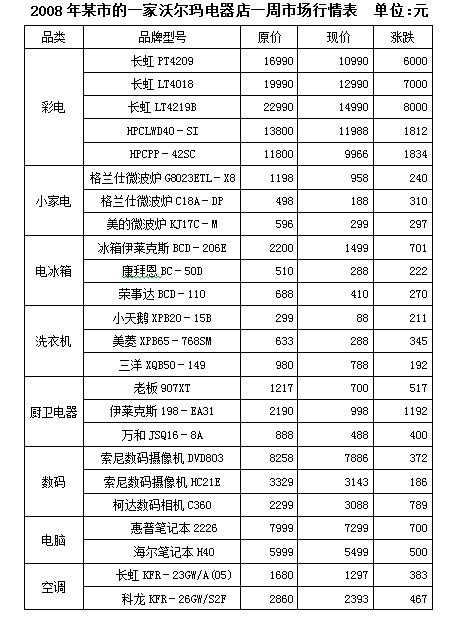

| 品类 | 品牌型号 | 原价 | 现价 | 涨跌 |
| --- | --- | ---: | ---: | ---: |
| 彩电 | 长虹 PT4209 | 16990 | 10990 | 6000 |
| 彩电 | 长虹 LT4018 | 19990 | 12990 | 7000 |
| 彩电 | 长虹 LT4219B | 22990 | 14990 | 8000 |
| 彩电 | HPCLWD40-SI | 13800 | 11988 | 1812 |
| 彩电 | HPCPP-42SC | 11800 | 9966 | 1834 |
| 小家电 | 格兰仕微波炉 G8023ETL-X8 | 1198 | 958 | 240 |
| 小家电 | 格兰仕微波炉 C18A-DP | 498 | 188 | 310 |
| 小家电 | 美的微波炉 KJ17C-M | 596 | 299 | 297 |
| 电冰箱 | 冰箱伊莱克斯 BCD-206E | 2200 | 1499 | 701 |
| 电冰箱 | 康拜恩 BC-50D | 510 | 288 | 222 |
| 电冰箱 | 荣事达 BCD-110 | 688 | 410 | 270 |
| 洗衣机 | 小天鹅 XPB20-15B | 299 | 88 | 211 |
| 洗衣机 | 美菱 XPB65-768SM | 633 | 288 | 345 |
| 洗衣机 | 三洋 XQB50-149 | 980 | 788 | 192 |
| 厨卫电器 | 老板 907XT | 1217 | 700 | 517 |
| 厨卫电器 | 伊莱克斯 198-EA31 | 2190 | 998 | 1192 |
| 厨卫电器 | 万和 JSQ16-8A | 888 | 488 | 400 |
| 数码 | 索尼数码摄像机 DVD803 | 8258 | 7886 | 372 |
| 数码 | 索尼数码摄像机 HC21E | 3329 | 3143 | 186 |
| 数码 | 柯达数码相机 C360 | 2299 | 3088 | 789 |
| 电脑 | 惠普笔记本 2226 | 7999 | 7299 | 700 |
| 电脑 | 海尔笔记本 H40 | 5999 | 5499 | 500 |
| 空调 | 长虹 KFR-23GW/A(05) | 1680 | 1297 | 383 |
| 空调 | 科龙 KFR-26GW/S2F | 2860 | 2393 | 467 |

### 第 116 题

该周沃尔玛商店中涨跌变化率最低的电器为：

A. 长虹 LT4219B

B. HPCPP－42SC

C. 伊莱克斯 198－EA31

D. 美的微波炉 KJ17C－M

第 116 题 · 答案与解析

**参考答案（粉笔题库参考内容）**

B

**解析**

根据“该周······涨跌变化率”，可判定本题为一般增长率问题。根据公式，增长率= 增长量/基期。定位统计表，长虹 LT4219B、HPCPP－42SC、伊莱克斯 198－EA31、美的微波炉 KJ17C－M这四种电器的涨跌变化率依次为：8000/22990 ＞ 30%、1834/11800 ＜ 20%、1192/2190 ＞ 50%、297/596＞30%，HPCPP－42SC的涨跌变化率最低。

故正确答案为B。

**考点**：一般增长率、统计表

**来源**：2008年云南省公务员录用考试《行测》题第116题

### 第 117 题

该店中原价超过5000元的电器有多少种？

A. 5

B. 6

C. 7

D. 8

第 117 题 · 答案与解析

**参考答案（粉笔题库参考内容）**

D

**解析**

定位统计表，原价超过5000元的有彩电类5种、索尼数码摄像机 DVD803、惠普笔记本 2226和海尔笔记本 H40，共8种。

故正确答案为D。

**考点**：直接找数、统计表

**来源**：2008年云南省公务员录用考试《行测》题第117题

### 第 118 题

平均价最低的电器为：

A. 洗衣机

B. 电冰箱

C. 小家电

D. 厨卫电器

第 118 题 · 答案与解析

**参考答案（粉笔题库参考内容）**

A

**解析**

根据“平均价”可判定本题为现期平均数问题。定位统计表，分别计算平均价如下：

洗衣机：(88+288+788)/3 = 1164/3；

小家电：(958+188+299)/3 = 1445/3；

电冰箱：(1499+288+410)/3=2197/3；

厨卫电器：(700+998+488)/3=2186/3。

四者分母一致，则分子小的分数小，即洗衣机平均价最低。

故正确答案为A。

**考点**：现期平均数、统计表

**来源**：2008年云南省公务员录用考试《行测》题第118题

### 第 119 题

现价排名前3名电器的原价之和高出现价排名后6名电器原价之和的多少倍？

A. 6.01

B. 16.72

C. 9.41

D. 18.91

第 119 题 · 答案与解析

**参考答案（粉笔题库参考内容）**

B

**解析**

根据“高出······多少倍”，可判定本题为现期倍数问题。定位统计表，现价排名前3名的电器分别为：长虹 LT4219B、长虹 LT4018、HPCLWD40－SI，现价排名后6名的电器分别为：小天鹅 XPB20－15B、格兰仕微波炉 C18A－DP、康拜恩 BC－50D、美菱 XPB65－768SM、美的微波炉 KJ17C－M、荣事达 BCD－110，他们原价之和之比为：(22990+19990+13800)/(299+498+510+633+596+688)≈ (23000 + 20000 + 14000)/(300 + 500 + 500 + 600 + 600 + 700)= 57000/3200 ≈ 17.8，即高出17.8-1=16.8倍，与B项最为接近。

故正确答案为B。

**考点**：现期倍数、统计表

**来源**：2008年云南省公务员录用考试《行测》题第119题

### 第 120 题

根据上表，下列说法正确的是：

A. 彩电价格的涨跌率高于其他品类电器

B. 洗衣机的涨跌率均低于小家电的涨跌率

C. 数码的现价高于空调的原价

D. 涨跌额越高的电器，销售量越高

第 120 题 · 答案与解析

**参考答案（粉笔题库参考内容）**

C

**解析**

A项：涨跌率即为增长率，根据公式，增长率= 增长量/基期=涨跌/原价。

定位统计表，彩电价格的涨跌率为(6000 + 7000 + 8000 + 1812 + 1834)/(16990 + 19990 + 22990 + 13800 + 11800)≈(6000+7000+8000+1800+1800)/(17000+20000+23000+14000+12000)=24600/86000≈0.286；电冰箱价格的涨跌率为(701 + 222 + 270)/(2200 + 510 + 688)≈ (700+200+300)/(2200+500+700)=1200/3400=0.35^+大于彩电价格的涨跌率，错误；

B项：定位统计表，洗衣机价格的涨跌率分别为211/299 ≈ 0.7，345/633=0.5+，192/980 ≈ 0.2；小家电价格的涨跌率分别为240/1198 ≈ 0.2，310/498 = 0.6^+，297/596 ≈ 0.5，因此可知洗衣机价格的涨跌率不是均低于小家电的涨跌率，错误；

C项：定位统计表，数码的现价分别为：7886元、3143元、3088元，空调的原价分别为：1680元、2860元，因此数码的现价高于空调的原价，正确；

D项：定位统计表，表中并无销量数据，所以涨跌额和销量的关系无法推出，错误。

故正确答案为C。

**考点**：统计表、综合分析

**来源**：2008年云南省公务员录用考试《行测》题第120题

## 材料 10

根据下表提供的信息完成以下各题。

某展览馆某日四个入口自动计数器的统计如下：

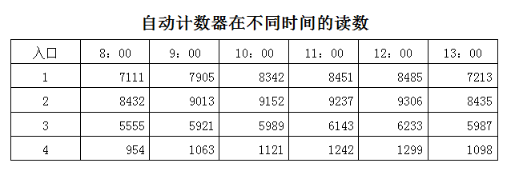

| 入口 | 8：00 | 9：00 | 10：00 | 11：00 | 12：00 | 13：00 |
| --- | ---: | ---: | ---: | ---: | ---: | ---: |
| 1 | 7111 | 7905 | 8342 | 8451 | 8485 | 7213 |
| 2 | 8432 | 9013 | 9152 | 9237 | 9306 | 8435 |
| 3 | 5555 | 5921 | 5989 | 6143 | 6233 | 5987 |
| 4 | 954 | 1063 | 1121 | 1242 | 1299 | 1098 |

### 第 121 题

从早上9：00到11：00通过入口2进入博物馆的参观人数是：

A. 224

B. 27402

C. 9237

D. 9152

第 121 题 · 答案与解析

**参考答案（粉笔题库参考内容）**

A

**解析**

定位表格材料可得，早上9：00、早上11：00通过入口2进入博物馆的累计参观人数分别是9013人、9237人。计数器中的数值是累计的，故从9：00至11：00通过入口2进入博物馆参观的总人数为9237-9013=224人。

（注意：可用尾数法快速锁定答案。）

故正确答案为A。

**考点**：简单加减计算、统计表

**来源**：2008年云南省公务员录用考试《行测》题第121题

### 第 122 题

上午10：00到12：00之间，通过人数最多的入口是：

A. 1

B. 2

C. 3

D. 4

第 122 题 · 答案与解析

**参考答案（粉笔题库参考内容）**

C

**解析**

定位表格材料可得，早上10：00、12：00通过各个入口进入博物馆的累计参观人数。故从早上10:00至12:00通过各个入口进入博物馆参观的人数分别是：入口1为8485-8342=143人；入口2为9306-9152=154人；入口3为6233-5989=244人；入口4为1299-1121=178人，则通过人数最多的是入口3。

故正确答案为C。

**考点**：简单加减计算、统计图

**来源**：2008年云南省公务员录用考试《行测》题第122题

### 第 123 题

在11：00到12：00之间，通过4个入口的总人数是：

A. 57

B. 250

C. 396

D. 271

第 123 题 · 答案与解析

**参考答案（粉笔题库参考内容）**

B

**解析**

定位表格材料可得，早上11：00、早上12：00通过各个入口进入博物馆的累计参观人数。故从早上11:00至12:00通过四个入口的总人数为：(8485-8451)+(9306-9237)+(6233-6143)+(1299-1242)=250人。

（注意：选项尾数各不相同，可用尾数法快速锁定答案。）

故正确答案为B。

**考点**：简单加减计算、统计表

**来源**：2008年云南省公务员录用考试《行测》题第123题

### 第 124 题

在9：00到10：00之间，通过人数最少的入口是：

A. 1

B. 2

C. 3

D. 4

第 124 题 · 答案与解析

**参考答案（粉笔题库参考内容）**

D

**解析**

定位表格材料可得，早上9：00、早上10：00通过各个入口进入博物馆的累计参观人数。故从早上9:00至10:00通过各个入口进入博物馆参观的总人数分别是：入口1为8342-7905=437人；入口2为9152-9013=139人；入口3为5989-5921=68人；入口4为1121-1063=58人，则通过人数最少的是入口4。

故正确答案为D。

**考点**：简单加减计算、统计表

**来源**：2008年云南省公务员录用考试《行测》题第124题

### 第 125 题

在13：00时刻，人数减少比例最大的入口是：

A. 1

B. 2

C. 3

D. 4

第 125 题 · 答案与解析

**参考答案（粉笔题库参考内容）**

D

**解析**

根据题干“在13：00时刻，人数减少比例最大的”，可判定本题为一般增长率比较问题。定位表格材料可得，12：00、13：00通过各个入口进入博物馆的累计参观人数。根据公式增长率 = (现期量 - 基期量)/基期量可得，各入口在13：00时刻计数人数的增长率分别为：入口1= (7213−8485)/8485 = −1272/8485 ≈ −15.0%、入口2= (8435 − 9306)/9306 = −871/9306 ≈ −9.4% 、入口3=(5987-6233)/6233=(-246)/6233≈-3.9%、入口4= (1098 − 1299)/1299 = −201/1299 ≈ −15.5%，入口4的增长率为负且最小，则减少比例最大的是入口4。

故正确答案为D。

**考点**：一般增长率、统计表

**来源**：2008年云南省公务员录用考试《行测》题第125题

## 材料 11

根据下图提供的信息完成以下各题。

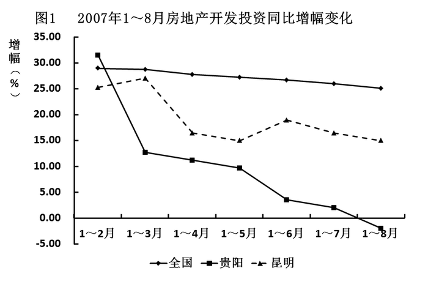

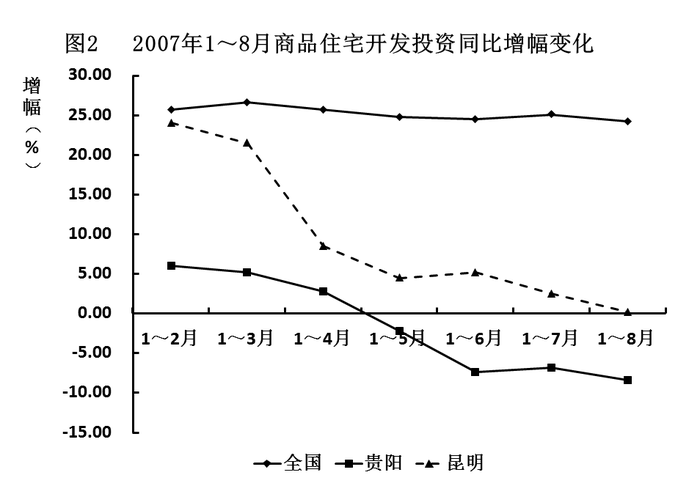

### 第 126 题

2007年1~8月，全国房地产开发投资增幅与1~4月投资增幅相比：

A. 上升约6个百分点

B. 下降约5个百分点

C. 上升约3个百分点

D. 下降约3个百分点

第 126 题 · 答案与解析

**参考答案（粉笔题库参考内容）**

D

**解析**

定位图1可得，2007年1～4月、1～8月全国房地产开发投资增幅分别约为28%、25%，则所求为25%-28%=-3%，即下降约3个百分点。

故正确答案为D。

**考点**：简单加减计算、统计图

**来源**：2008年云南省公务员录用考试《行测》题第126题

### 第 127 题

2007年1~4月，贵阳房地产开发投资增幅比2007年1~8月增幅高：

A. 约8.9%

B. 约8.9个百分点

C. 约23%

D. 约13个百分点

第 127 题 · 答案与解析

**参考答案（粉笔题库参考内容）**

D

**解析**

定位图1可得，2007年1～4月、1～8月贵阳房地产开发投资增幅分别约为11%、-2%，则所求为11%-(-2%)=13%，即提高约13个百分点。

故正确答案为D。

**考点**：简单加减计算、统计图

**来源**：2008年云南省公务员录用考试《行测》题第127题

### 第 128 题

下列说法正确的是：

A. 2007年1～8月，全国房地产开发投资比较平稳，涨幅最高为8个百分点

B. 2007年1～8月，贵阳的房地产开放投资额呈每月递减趋势

C. 2007年1～8月，昆明的商品住宅开发投资同比增幅变化大于贵阳

D. 2007年8月份，贵阳商品住宅开发投资额高于同期昆明商品住宅开发投资额

第 128 题 · 答案与解析

**参考答案（粉笔题库参考内容）**

C

**解析**

A项：定位图1可得，2007年1～8月，全国房地产开发投资比较平稳，涨幅最高约为29%，错误；

B项：定位图1可得，2007年1～8月，贵阳房地产开发投资额同比增速，即与上年比较，未给出环比增速，无法比较每月投资额，错误；

C项：定位图2可得，2007年1～8月，昆明的商品住宅开发投资同比增幅均大于贵阳，且昆明、贵阳的商品住宅开发投资同比增幅变化幅度分别约为25%-0%=25%、5%-(-10%)=15%，昆明的变化幅度更大，正确；

D项：材料未给出2007年8月份商品住宅开发投资额的相关数据，错误。

故正确答案为C。

**考点**：统计图、综合分析

**来源**：2008年云南省公务员录用考试《行测》题第128题

### 第 129 题

若2007年1~6月份，全国房地产开发投资额总计8920.1亿元，则2006年同期房地产开发投资额约为：

A. 11007亿元

B. 9027亿元

C. 7079亿元

D. 5278亿元

第 129 题 · 答案与解析

**参考答案（粉笔题库参考内容）**

C

**解析**

根据题干“2006年同期房地产开发投资额约为”，结合材料时间为2007年，可判定本题为基期计算问题。定位图1可得，2007年1-6月全国房地产开发投资增幅约为27%。根据公式基期量=现期量/(1+增长率)可得：2006年同期房地产开发投资额约为8920.1/(1+27%) ≈ 8920.1/1.3 ≈ 6900亿元，与C项最接近。

故正确答案为C。

**考点**：基期计算、统计图

**来源**：2008年云南省公务员录用考试《行测》题第129题

### 第 130 题

通过以上两图，可以得出的正确结论是：

A. 2007年全国房地产进入低迷期

B. 2007年宏观调控对房地产市场起到非常显著的作用

C. 2007年房地产开发量的激增是造成房地产价格持续走低的主要原因

D. 2007年1～8月份商品住宅新开工面积较2006年同期多

第 130 题 · 答案与解析

**参考答案（粉笔题库参考内容）**

D

**解析**

A项：定位图1可得，2007年1-8月，全国房地产开发投资额增长率均为正，且增幅较为稳定，并非进入低迷期，错误；

B项：定位图1可得，2007年1-8月，全国房地产开发投资额增长率均为正，且增幅较为稳定，未出现显著提升或下降，未体现宏观调控的作用，错误；

C项：材料未给出房价相关数据，无法判断，错误；

D项：定位图2可得，2007年1-8月全国商品住宅开发投资同比增幅稳定，均为正增长且增速在25%左右，可推知，商品住宅新开工面积较2006年同期多，正确。

故正确答案为D。

**考点**：统计图、综合分析

**来源**：2008年云南省公务员录用考试《行测》题第130题

