# 2009年云南省公务员录用考试《行测》题

<!-- gwy:overview:start -->
> **云南 · 2009 · 行测 · 统考** ｜ 130 题 · 图片 74 处 · 答案随题折叠

| 题型模块 | 题量 | 题号 |
| --- | ---: | ---: |
| 数量关系 | 20 | 1–20 |
| 言语理解与表达 | 25 | 21–45 |
| 判断推理 | 40 | 46–85 |
| 常识部分 | 25 | 86–110 |
| 资料分析 | 20 | 111–130 |
| **合计** | **130** | |

导航：[题型与作答说明](#题型与作答说明) · [题目](#题目) · [材料 1](#材料-1)
<!-- gwy:overview:end -->

> 候选采集稿。参考答案及解析来自粉笔页面，不代表官方答案或真实高分答卷；来源使用许可与原卷对应关系仍需人工核实。

## 题型与作答说明

数量关系

（20题）

本部分包括数字推理与数学运算两种类型的试题。

言语理解与表达

（25题）

本部分着重考查考生对语言文字的理解和驾驭能力。这种能力包括：对词和句子一般意思和特定意义的理解；对比较复杂的概念和观点的准确理解；对句子隐含信息的合理判断；根据上下文，恰当选用词语；准确地辨明句义，筛选信息。

判断推理

（40题）

本部分包括图形推理、定义判断、类比推理与逻辑判断四种类型的试题，均为单项选择题。

常识部分

（25题）

根据题目要求，在四个选项中，选出一个正确答案。

资料分析

（20题）

本部分题目提供几组资料，或者是文字资料或者是图表。针对每一段文字或每一个图表，后面有几个问题需要你回答。你应根据资料提供的信息进行分析、比较、计算和判断，然后选出你认为最合适的答案。

## 题目

### 第 1 题

\-1，1，5，11，19，29，( )。

A. 30

B. 31

C. 32

D. 41

第 1 题 · 答案与解析

**参考答案（粉笔题库参考内容）**

D

**解析**

观察数列呈递增趋势，变化平缓，无明显倍数关系，优先考虑作差。原数列中后项-前项依次为：2、4、6、8、10、(    )，得到公差为2的等差数列，则下一项为12，所求项为：12+29=41。

故正确答案为D。

**来源**：2009年云南省公务员录用考试《行测》题第1题

### 第 2 题

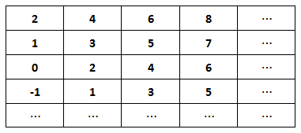

上起第14行，左起第16列的数是：

A. 16

B. 17

C. 18

D. 19

第 2 题 · 答案与解析

**参考答案（粉笔题库参考内容）**

D

**解析**

观察表格，表格中各行与各列数列变化平缓，考虑作差，各行两两作差后差值相同，是公差为2的等差数列；各列是公差为-1的等差数列，则第14行第1列的数为：2-(14-1)=-11 ；第14行第16列的数为：。

故正确答案为D。

**来源**：2009年云南省公务员录用考试《行测》题第2题

### 第 3 题

数11应排在上起第10行，左起第几列：

A. 第9列

B. 第12列

C. 第11列

D. 第10列

第 3 题 · 答案与解析

**参考答案（粉笔题库参考内容）**

D

**解析**

观察表格，表格中各行与各列数列变化平缓，考虑作差，各行两两作差后差值相同，是公差为2的等差数列；各列是公差为-1的等差数列，则第10行第1列的数为：2-(10-1)=-7；因此11在第列。

故正确答案为D。

**来源**：2009年云南省公务员录用考试《行测》题第3题

### 第 4 题

2，3，8，27，32，( )，128。

A. 64

B. 243

C. 275

D. 48

第 4 题 · 答案与解析

**参考答案（粉笔题库参考内容）**

B

**解析**

观察数列，发现数列项数较多，考虑多重数列，优先交叉看。奇数项：2、8、32、128，是公比为4的等比数列；偶数项：3、27、(    )，是公比为9的等比数列。故所求项为：。

故正确答案为B。

**来源**：2009年云南省公务员录用考试《行测》题第4题

### 第 5 题

1，2，3/2，8/5，5/3，12/7，( )。

A. 10/7

B. 11/7

C. 14/8

D. 13/8

第 5 题 · 答案与解析

**参考答案（粉笔题库参考内容）**

C

**解析**

观察数列，发现数列项数较多，考虑多重数列，优先交叉看。原数列可化为1/1、6/3、3/2、8/5、5/3、12/7、(    )。奇数项数列：1/1、3/2、5/3、（    ），观察发现，分子是公差为2的等差数列，分母是公差为1的等差数列；偶数项数列：6/3、8/5、12/7，观察发现，分子是二级等差数列，分母是公差为2的等差数列。因此原数列所求项为(5+2)/(3+1)=7/4=14/8。

故正确答案为C。

**来源**：2009年云南省公务员录用考试《行测》题第5题

### 第 6 题

某单位有员工540人，如果男员工增加30人就是女员工人数的2倍，那么原来男员工比女员工多几人：

A. 13

B. 31

C. 160

D. 27

第 6 题 · 答案与解析

**参考答案（粉笔题库参考内容）**

C

**解析**

设男员工有x人，女员工有y人；根据题意可列方程组：x+y=540，x+30=2y，解得x=350，y=190，故男员工比女员工多350-190=160人。

故正确答案为C。

**考点**：和差倍比问题

**来源**：2009年云南省公务员录用考试《行测》题第6题

### 第 7 题

41个学生要坐船过河，渡口处只有一只能载4人的小船（无船工），他们要全部渡过河去，至少要使用这只小船渡河多少次：

A. 23

B. 24

C. 27

D. 26

第 7 题 · 答案与解析

**参考答案（粉笔题库参考内容）**

C

**解析**

因船上并无船工，可将其中1个学生固定为船工，每次往返可运送3个学生过河。，最后一次过河时不需要返回，则共需渡河次。

故正确答案为C。

**来源**：2009年云南省公务员录用考试《行测》题第7题

### 第 8 题

蜘蛛有8条腿，蜻蜓有6条腿和2对翅膀，蝉有6条腿和1对翅膀，现在这三种小虫共18只，有118条腿和18对翅膀，蜘蛛，蜻蜓，蝉各几只：

A. 5、5、8

B. 5、5、7

C. 6、7、5

D. 7、5、6

第 8 题 · 答案与解析

**参考答案（粉笔题库参考内容）**

A

**解析**

方法一：设蜘蛛有x只，蜻蜓有y只，蝉有z只。根据题意可列方程组：x＋y＋z＝18；8x＋6y＋6z＝118；2y＋z＝18；解得x＝5、y＝5、z＝8，即有蜘蛛5只，蜻蜓5只，蝉8只。

方法二：假设三种小虫都是6条腿，可得蜘蛛的数量为只，排除C、D两项。根据共18只虫，而B项总数为17，排除B项。

方法三：共18对翅膀，依次代入。A项：对，满足题意；B、C、D三项均不满足。

故正确答案为A。

**考点**：和差倍比问题

**来源**：2009年云南省公务员录用考试《行测》题第8题

### 第 9 题

某种茶叶原价30元一包，为了促销，降低了价格，销量增加了二倍，收入增加了五分之三，则一包茶叶降价多少元：

A. 12

B. 14

C. 13

D. 11

第 9 题 · 答案与解析

**参考答案（粉笔题库参考内容）**

B

**解析**

解析1：设原来茶叶的销量为1，那么现在销量为3，原来收入为30元，现在收入为元，每包茶叶为元，降价30-16=14元。

解析2：若不降价，销量增加2倍，变为原来的3倍后，收入也变为原来的3倍，现降价后，收入增加3/5，变为原来的8/5，则现价是原价的，则降价元。

故正确答案为B。

**考点**：经济利润问题

**来源**：2009年云南省公务员录用考试《行测》题第9题

### 第 10 题

小张从家到单位有两条一样长的路，一条是平路，另一条是一半上坡路，一半下坡路，小张上班走这两条路所用的时间一样多。已知下坡的速度是平路的1.5倍，那么上坡速度是平路的多少倍：

A. 3/5

B. 2/5

C. 1/4

D. 3/4

第 10 题 · 答案与解析

**参考答案（粉笔题库参考内容）**

D

**解析**

方法一：根据题意，因路程和时间均相同，可设路程为2，时间为2，则平路的速度为2/2=1，由题干可知，上坡路和下坡路各一半，则上坡和下坡的路程均为1，则下坡速度为1.5，下坡时间为1/1.5=2/3，则上坡时间为，上坡速度为(1)/(4/3)=3/4，为平路速度的3/4倍。

方法二：由题意可知，小张在两条一样长的路上所用时间相同，则小张在两条路上的平均速度相同。赋值小张在平路上的速度为1，则在下坡路上的速度为1.5，上坡路与下坡路的平均速度为1。设小张在上坡路的速度为v，根据等距离平均速度公式：，可得，解得v=0.75。

故正确答案为D。

**考点**：平均速度

**来源**：2009年云南省公务员录用考试《行测》题第10题

### 第 11 题

如图，它是由15个同样大小的正方形组成。如果这个图形的面积是375平方厘米，那么它的周长是：

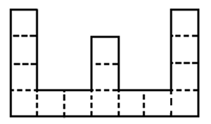

A. 150

B. 155

C. 160

D. 165

第 11 题 · 答案与解析

**参考答案（粉笔题库参考内容）**

C

**解析**

每个正方形的面积为平方厘米，则边长为5厘米，这个图形由32个长度为正方形边长的线构成，故周长为厘米。

故正确答案为C。

**考点**：几何公式类-平面图形

**来源**：2009年云南省公务员录用考试《行测》题第11题

### 第 12 题

要把A、B、C、D四包不同的商品放到货架上，但是，A不能放在第一层，B不能放在第二层，C不能放在第三层，D不能放在第四层，那么，不同的放法共有多少种：

A. 6

B. 7

C. 8

D. 9

第 12 题 · 答案与解析

**参考答案（粉笔题库参考内容）**

D

**解析**

根据题意：“A不能放在第一层，B不能放在第二层，C不能放在第三层，D不能放在第四层”可知，本题为排列组合问题中的错位排列。根据错位排列结论，元素个数为1-5的错位排列数分别为D_1=0、D_2=1、D_3=2、D_4=9、D_5=44······题干中为4包商品不放在原处，故共有9种排列方法。

故正确答案为D。

**考点**：错位排列

**来源**：2009年云南省公务员录用考试《行测》题第12题

### 第 13 题

在400米环形跑道上，A、B两点最近相距100米（如图）。甲乙两位运动员从A、B两点同时出发，按逆时针方向跑步，甲每秒跑9米，乙每秒7米，他们每跑100米都停5秒，那么追上乙要多少秒？

A. 70

B. 65

C. 75

D. 80

第 13 题 · 答案与解析

**参考答案（粉笔题库参考内容）**

D

**解析**

甲每跑100米休息5秒，所以甲每跑100米共用时间为秒；乙每跑100米休息5秒，乙每跑100米共用时间为秒。比较分析，结合选项，考虑出发后75秒时甲的情况：次，则甲休息了四次，跑了米；乙的情况：次······17 1/7秒，则乙在跑300米共休息了3次后又跑了17 1/7秒，又因为秒＜17 1/7秒，则乙跑了400米。此时甲比乙多跑了95米，小于他们的初始距离，即此时甲还没有追上乙。所以甲追上乙的时间应大于75秒，仅有D项符合。

故正确答案为D。

**考点**：相遇追及

**来源**：2009年云南省公务员录用考试《行测》题第13题

### 第 14 题

兄弟俩今年的年龄之和是35岁，当哥哥像弟弟现在这样大时，弟弟的年龄恰好是哥哥年龄的一半，则哥哥今年年龄为多少岁：

A. 20

B. 21

C. 23

D. 22

第 14 题 · 答案与解析

**参考答案（粉笔题库参考内容）**

B

**解析**

设哥哥今年的年龄为x岁，则弟弟今年(35－x)岁。当哥哥(35－x)岁时，弟弟年龄为(70－3x)岁。根据题意：“哥哥像弟弟现在这样大时，弟弟的年龄恰好是哥哥年龄的一半”，可列方程：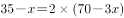，解得x＝21，即哥哥今年21岁。

故正确答案为B。

**考点**：年龄问题

**来源**：2009年云南省公务员录用考试《行测》题第14题

### 第 15 题

小张和小王两人比赛珠算，共有1200题，小张每分钟算出20题，小王每算出80题比小张算同样多的题少用2秒。问：小王做完1200题时，小张还有多少题没做：

A. 10

B. 15

C. 20

D. 5

第 15 题 · 答案与解析

**参考答案（粉笔题库参考内容）**

A

**解析**

小王每算出80题比小张算同样多的题少用2秒，那么小王算1200道题时，小张还需秒，即还差半分钟算完1200道题，因此小张还有10道题没做。

故正确答案为A。

**考点**：和差倍比问题

**来源**：2009年云南省公务员录用考试《行测》题第15题

### 第 16 题

15克盐放入135克水中，放置一段时间后，盐水重量变为100克，这时盐水的浓度是多少？浓度比原来提高了百分之几：

A. 75%，12.5%

B. 25%，12.5%

C. 15%，50%

D. 50%，62.5%

第 16 题 · 答案与解析

**参考答案（粉笔题库参考内容）**

C

**解析**

只有水挥发，而盐（溶质）的重量不变，根据题干“盐水重量变为100克”可知：盐水浓度为，只有C项符合。

故正确答案为C。

**来源**：2009年云南省公务员录用考试《行测》题第16题

### 第 17 题

某校二年级全部共3个班的学生排队，每排4人、5人或6人，最后一排都只有2人，这个学校二年级有多少名学生：

A. 120

B. 122

C. 121

D. 123

第 17 题 · 答案与解析

**参考答案（粉笔题库参考内容）**

B

**解析**

方法一：由题意可知，学生数除以4、5、6均余2，直接代入，只有B项满足条件。

方法二：每排4、5、6人，最后一排都只有2人，利用余数口诀，总人数可表示为60n＋2人（60为4、5、6的最小公倍数），故总人数减2是60的倍数，只有B项满足条件。

故正确答案为B。

注：同余问题口诀：余同取余，即被除数的表达式为几个除数的最小公倍数×n+余数。

**来源**：2009年云南省公务员录用考试《行测》题第17题

### 第 18 题

小王工作一年酬金是1800元和一台全自动洗衣机。他干了7个月，得到560元和一台洗衣机，问这台洗衣机价钱为多少元：

A. 1176

B. 1144

C. 1200

D. 1154

第 18 题 · 答案与解析

**参考答案（粉笔题库参考内容）**

A

**解析**

方法一：设洗衣机的价钱为x元，根据每月酬金相等，可列方程：，解得x＝1176，即洗衣机的价钱为1176元。

方法二：小王工作5个月的酬金=1年酬金－7个月酬金=1800＋洗衣机－（560＋洗衣机）＝1240元，那么每个月的酬金为元，则1年的酬金为元，那么洗衣机的价钱为2976－1800＝1176元。

故正确答案为A。

**考点**：和差倍比问题

**来源**：2009年云南省公务员录用考试《行测》题第18题

### 第 19 题

小王8点整出门，步行到12千米远的同学家，他步行速度是每小时3千米，但他每走50分钟就要休息10分钟。则他几点到达：

A. 12：30

B. 12：35

C. 12：20

D. 12：40

第 19 题 · 答案与解析

**参考答案（粉笔题库参考内容）**

D

**解析**

若小王中途不休息，则实际步行时间为12/3=4小时=240分钟；，则小王一共休息了4次，共分钟；所以小王12：40到达目的地。

故正确答案为D。

**考点**：普通行程

**来源**：2009年云南省公务员录用考试《行测》题第19题

### 第 20 题

计算

A. 20/30

B. 21/31

C. 22/31

D. 23/31

第 20 题 · 答案与解析

**参考答案（粉笔题库参考内容）**

B

**解析**

。

故正确答案为B。

**来源**：2009年云南省公务员录用考试《行测》题第20题

### 第 21 题

对下列各组词语划线字解释完全正确的一项是：

A. 协（合）力同心，英勇绝伦（同类），鼓足干劲（精神），置若罔（没有）闻

B. 引以为荣（荣誉），运筹（谋划）帷幄，同仇敌忾（愤慨），通（通晓）权达变

C. 尾大不掉（摆动），电闪（避开）雷鸣，步履蹒跚（从容），远见卓（高超）识

D. 屡见不鲜（极少），休戚（忧愁）与共，于心不忍（残忍），惹（招引）人注目

第 21 题 · 答案与解析

**参考答案（粉笔题库参考内容）**

A

**解析**

本题考查词语辨析。

A项各词解释都正确。

B项“引以为荣”中“荣”字意为光荣；C项“电闪雷鸣”中“闪”字意为突然显现；“步履蹒跚”的“蹒跚”为连绵词，形容跛行、行而不进的样子，单一“跚”字无意；D项“屡见不鲜”的“鲜”是新奇、新鲜的意思，“于心不忍”的“忍”指忍心。

故正确答案为A。

**来源**：2009年云南省公务员录用考试《行测》题第21题

### 第 22 题

下列各句中没有语病的一句是：

A. 文章对经济领域中的若干重要问题，从理论上和政策上作了详细的规定和深刻的说明。

B. 大家一定要学会用正确的立场、方法、观点去解决问题、分析问题、提出问题。

C. 我国宪法规定，公民享有宪法和法律规定的权利，同时必须履行宪法和法律规定的义务。

D. 为了防止不再发生类似故事，领导制定了一系列切实加强安全保卫工作的措施。

第 22 题 · 答案与解析

**参考答案（粉笔题库参考内容）**

C

**解析**

本题为病句辨析题。

A项搭配不当，“理论”应对应“说明”，“政策”应对应“规定”；B项语序不当，正确语序应该是：提出问题、分析问题、解决问题；D项否定不当，“防止”和“不”双重否定表示肯定，与原句要表达的意思不符。

故正确答案为C。

**来源**：2009年云南省公务员录用考试《行测》题第22题

### 第 23 题

依次填入下列各句划线处的词语，最恰当的一组是：

①我和他虽然都生活在昆明，但也只是　　　见见面。

②她　　　考虑什么问题，总是把集体利益放在第一位。

③40年过去了，来到自己少年时代生活的地方，　　　想起往事。

④在法律面前人人平等，这个“人人”，　　　包括所有的人，任何人也不例外。

A. 偶然 不管 无论 当然

B. 偶尔 不论 难免 诚然

C. 偶然 无论 不免 诚然

D. 偶尔 不管 不免 当然

第 23 题 · 答案与解析

**参考答案（粉笔题库参考内容）**

D

**解析**

本题考查近义虚词的语境搭配。

第一空，“偶然”强调意外，与“必然”相对，“偶尔”没有这个意思，仅说明频率少。根据句①要表达的意思，应填“偶尔”。

第三空，“难免”有惋惜义，后一般跟负面信息，有客观色彩。“不免”表示不禁、免不了，后面可以跟中性信息，有主观色彩。根据句义这里应该填“不免”。

第四空，“当然”，表示肯定，不容反驳。而“诚然”语气没有那么强烈，有“固然”之意，一般表示让步意味。④横线处表示肯定，不容反驳，语气比较强烈，应填“当然”。

故正确答案为D。

**来源**：2009年云南省公务员录用考试《行测》题第23题

### 第 24 题

下面纪年的方法与其他三项不一致的是：

A. 周公之被逮，在丁卯三月之望。

B. 永元中，举孝廉不行。

C. 顺治二年乙酉四月，江都围急。

D. 永和九年，岁在癸丑。暮春之初，会于会稽山阴之兰亭。

第 24 题 · 答案与解析

**参考答案（粉笔题库参考内容）**

A

**解析**

根据提问可知此题属于常识题。

A项的“丁卯”是中国传统纪年农历的干支纪年法，即以甲、乙、丙、丁、戊、己、庚、辛、壬、癸为十干，子、丑、寅、卯、辰、巳、午、未、申、酉、戌、亥为十二支，把干、支顺序配合。

其他三项均使用当朝皇帝的年号纪年。

本题为选非题，故正确答案为A。

**考点**：文化常识

**来源**：2009年云南省公务员录用考试《行测》题第24题

### 第 25 题

对苏轼《江城子·密州出猎》词理解不当的一项是：

老夫聊发少年狂，左牵黄（犬），右擎苍（苍鹰）。锦帽貂裘，千骑卷平冈。为报倾城随太守，亲射虎，看孙郎（孙权曾骑马射虎）。

酒酣胸胆尚开张，鬓微霜，又何妨？持节云中，何日遣冯唐（人名，其渴望得到重用）？会挽雕弓如满月，西北望，射天狼（星名，代表贪残掠夺）。

A. 本词上阕描写打猎的壮阔场面，下阕抒发由打猎激发起来的胸怀抱负，境界开阔，具有一种粗犷的豪迈风格。

B. 首句的“狂”点出“老夫”酒后出猎无所顾忌的疯劲。

C. “千骑卷平冈”的“卷”字，突出地表现了武士骑马飞驰。

D. 下阕最后三句，突出“老夫”关心边防。

第 25 题 · 答案与解析

**参考答案（粉笔题库参考内容）**

B

**解析**

根据提问知本题为细节判断题。

这首词通篇纵情放笔，气概豪迈，一个“狂”字更是贯穿全篇，表现了词人威武豪迈的气概，而并非“无所顾忌的疯劲”。

因此A、C、D项理解正确，B项理解偏颇。

本题为选非题，故正确答案为B。

**考点**：细节判断题

**来源**：2009年云南省公务员录用考试《行测》题第25题

## 材料 1

第一步就是明确爱是一种艺术，正如生活是一种艺术一样。①        我们想知道如何爱，②        必须遵循我们学习其他任何艺术的同样方法，诸如学习音乐、绘画、木工或医学技艺及工程艺术的方法。

        在学习任何一种艺术时，必要的步骤是什么呢？

        学习任何一种艺术的过程都能够适当地分为两个方面：一方面精通那门艺术的理论，另一方面熟悉那门艺术的实践。如果我想学习医学技艺，我必须首先了解人体结构和各种疾病，但当我具备了这一方面的全部理论知识时，根本不意味着我在医学技艺上是合格的。只有在大量实践的基础上，把我们的理论知识成果和我们的实践成果融为一体，即变为我的直觉——这是任何一门艺术的要素——之后，我在技艺上才变得精湛起来。当然除学习那门艺术的理论和实践外，为驾驭任何一门艺术，第三点也是必要的要素，即要使艺术精湛必须极其关心这一问题，在我的心中必须是：没有什么比此艺术更重要的事情。

        这适用于音乐、医学、木工和爱的艺术。这里有着为什么在当代的文明中，人们很少尝试探究爱这门艺术的答案，尽管他们明显地失败，尽管他们对爱如饥似渴，但却又认为几乎每一件事都比爱重要：成就、名望、金钱、权利——几乎人们的所有精力都被用来研究如何实现这些目标，难怪乎没有谁来学习爱的艺术。

### 第 26 题

第一段中，在划线处①和②填入的关联词，最恰当的一组是：

A. 虽然  但是

B. 如果  就

C. 因为  所以

D. 也许  还

第 26 题 · 答案与解析

**参考答案（粉笔题库参考内容）**

B

**解析**

本题考查虚词的语境搭配。

句中关联词所连接的两部分为假设关系。

故正确答案为B。

**来源**：2009年云南省公务员录用考试《行测》题第26题

### 第 27 题

根据本文作者的观点，下列叙述不正确的是：

A. 对任何一门艺术的学习都可以分为理论和实践两个部分

B. 掌握一门艺术的理论知识是十分重要的，但还不是必要的

C. 通过实践，“我”可以将理论成果与实践成果融会为一体

D. 只有将理论成果与实践成果转化为“我”的直觉，才意味着“我”的技艺是精湛的

第 27 题 · 答案与解析

**参考答案（粉笔题库参考内容）**

B

**解析**

本题属于细节判断题。

文中提到“在学习任何一种艺术时，必要的步骤是什么呢？——学习任何一种艺术的过程都能够适当地分为两个方面：一方面精通那门艺术的理论，另一方面熟悉那门艺术的实践”。

因此，B项说“掌握一门艺术理论知识还不是必要的”说法是错误的。

其他各选项在文中均有提及。

本题为选非题，故正确答案为B。

**来源**：2009年云南省公务员录用考试《行测》题第27题

### 第 28 题

作者认为，驾驭一门艺术的中心问题是：

A. “我”所追求的艺术是重要的，没有什么可以代替它的事物

B. 将理论与实践完美结合在一起，并转化为一种直觉

C. 通过自己的努力，使所掌握的艺术变得精湛

D. 如何把握住掌握一门艺术的一般性法则

第 28 题 · 答案与解析

**参考答案（粉笔题库参考内容）**

A

**解析**

本题考查细节判断。

文章前半部分提到学习艺术的两个必要步骤——“理论+实践”是“技”，而后半部分讨论的“艺术在心中的地位”是“道”。题干中提到的驾驭一门艺术的中心问题，固然是“道”的问题。最后一段对现在人们不重视爱的艺术，因而无法学习这一艺术的论述可以为证。

因此，结合选项应该选择A。

B、C、D项均不是作者认为的中心问题。

故正确答案为A。

**来源**：2009年云南省公务员录用考试《行测》题第28题

### 第 29 题

对本文最后一段话，理解最不恰当的是：

A. 当代文明中，人们在“爱”这个问题上的失败是普遍的

B. 人们不关注爱的学习，是因为没有把爱视为生命中最重要的东西

C. 相对于金钱、名望、权利等因素，爱对当代人而言似乎并不重要

D. 爱其实对于每个人都是重要的，而且是不学而成的

第 29 题 · 答案与解析

**参考答案（粉笔题库参考内容）**

D

**解析**

本题为细节判断题。

文中第一段就明确表述了“爱是一种需要学习的艺术”这一观点，最后一段表达的恰恰是提出“人们忽略了对于爱的学习”这一观点，因而D项说“爱是不学而成的”最不恰当。

本题为选非题，故正确答案为D。

**来源**：2009年云南省公务员录用考试《行测》题第29题

### 第 30 题

如果给这篇短文冠以标题，最恰当的是：

A. 艺术学习

B. 爱的艺术

C. 艺术学习的方法

D. 学习艺术的一般性法则

第 30 题 · 答案与解析

**参考答案（粉笔题库参考内容）**

B

**解析**

本题为标题选择题。

文章开头说“明确爱是一种艺术”，结尾又说“难怪乎没有谁来学习爱的艺术”，首尾呼应，整篇文章都在讨论爱的艺术。只有B具体到“爱”这一关键词。

故正确答案为B。

**来源**：2009年云南省公务员录用考试《行测》题第30题

## 材料 2

矛盾普遍存在于客观世界中，模糊性亦寓于万物运动之中。

        鸡蛋可以孵鸡，当小鸡未啄出蛋壳时，总不能说它仍是蛋，亦不可称之为鸡，突变的事物会呈现短暂的模糊性，而另一些事物放到漫长的时间里考察也会使模糊性突出显现。铅块上放一比较大的金属球，短时间内它们均呈现出固体的属性，但经过长时间观察，又会发现金属球慢慢陷入铅块之中。若将上述两个过程用快镜头加以重映，则过去被看成是固体的物质就出现了类似液体的属性。这里，固体与液体的界限变得模糊不清了。

        处于昼夜之间的黎明或黄昏，门捷列夫周期表中介于金属与非金属之间的过渡元素，中医的脏腑辨证和脉象的浮沉迟数，都说明了客观世界的模糊性。科学的发展，也许会使这些模糊现象在某个层次上变得清晰起来，而在更深的层次上仍是混沌不清。

客观世界的模糊性反映在人脑中，便产生了概念上的模糊性；人又巧妙地利用自己建立的模糊概念进行判断、推理和控制，完成那些现代先进设备所不能完成的工作：人们几乎可以同样地辨认胖子和瘦子、美丽和丑陋；人们无须测量车速便可明智地躲过川流不息的车队；一行草书虽然大异于整齐的印刷字体，却照样可以被人看懂。

        现实生活给模糊理论提出了无数研究课题，模糊理论力图用较为精确的数学语言和概念来描述现实中的模糊现象以及人脑中的模糊概念，如果说前人利用仿生学研究飞鸟而发明了飞机，那么当我们今天研制和应用计算机的时候，却不可忘记最优秀的仿生标本——人、人的思维、判断是那样巧妙，人的经验是那样丰富，人类如何将自己的智慧教给计算机，将自己的思维方法传授给计算机，甚至用自己的艺术修养及审美观念去“陶冶”计算机，使计算机具有更多的“人性”，这成为模糊理论工作者肩负的历史使命。

### 第 31 题

划线句子“若将上述两个过程用快镜头加以重映”所强调的意思是：

A. 铅块和金属球的属性能用快慢镜头加以重映

B. 铅块和金属球的模糊性不容易被观察到

C. 突变事物的模糊性反映了两个运动过程

D. 模糊性有时表现在较长的运动过程中

第 31 题 · 答案与解析

**参考答案（粉笔题库参考内容）**

D

**解析**

本题为词句理解题。

题干问的是“所强调的是”，也即这句话的意图是什么，在第一段，文中提到“另一些事物放到漫长的时间里考察也会使模糊性突出显现”，为了说明这句话，举出铅块和金属球融合的例子。因此这句话所强调的就是模糊性有时表现在较长的运动过程中。

故正确答案为D。

**来源**：2009年云南省公务员录用考试《行测》题第31题

### 第 32 题

作者在说明“客观世界模糊性”的一项是：

A. 小鸡刚刚啄出蛋壳而出世的时候

B. 金属球经过漫长的量变而显现出短暂的质变

C. 人们可以看懂书法家的草书作品

D. 中医的脏腑辨证和脉象上的浮沉迟数

第 32 题 · 答案与解析

**参考答案（粉笔题库参考内容）**

D

**解析**

本题为细节判断题。

文中第三段主要说明“客观世界模糊性”，且举了几个例子，其中就有“中医的脏腑辨证和脉象上的浮沉迟数”。A、B选项强调的是事物出现模糊性的时间短长；C是说人脑中概念的模糊性而非客观世界的模糊性。

故正确答案为D。

**来源**：2009年云南省公务员录用考试《行测》题第32题

### 第 33 题

作者用来说明“人巧妙地利用自己建立的模糊概念”进行判断、推理和采取行动的事实是：

A. 人们发现突变的事物会呈现短暂的模糊性

B. 人发现了介于金属和非金属之间的过渡元素

C. 人过马路可以明智地躲过川流不息的车辆

D. 人们利用仿生学研究飞鸟而发明了飞机

第 33 题 · 答案与解析

**参考答案（粉笔题库参考内容）**

C

**解析**

本题为细节判断题。

根据题干“人巧妙地利用模糊概念”，定位到文中第三段，只有C选项的例子出现在第三自然段。

A项说的是人们对客观事物模糊性的认识，而非对其利用；B项只是例证“客观世界的模糊性”，没有提到人们如何利用它；D项偷换概念，举的是以前人们利用模糊理论的例子，而非利用自己建立的模糊概念，因而与题干不符。

故正确答案为C。

**来源**：2009年云南省公务员录用考试《行测》题第33题

### 第 34 题

下面对本文的理解，符合文意的一项是：

A. 模糊性寓于万物运动中，客观世界是在模糊与清晰的矛盾之中发展的

B. 模糊理论研究的是客观世界的模糊性，所以它要用模糊的语言进行描述

C. 将人类灵活巧妙的思维判断赋予计算机，有赖于模糊理论在更高水平上的应用

D. “人”能成为计算机的仿生标本，是因为人脑的模糊性大于客观的模糊性

第 34 题 · 答案与解析

**参考答案（粉笔题库参考内容）**

C

**解析**

本题为细节判断题。

C项文中最后一段说到“这已成为模糊理论工作者肩负的历史使命”，所以把人类的思维判断赋予计算机，还有赖于模糊理论在更高水平上的应用，故符合文意。

A项客观世界的发展与模糊和清晰的矛盾并无因果关系，只不过是并列关系；B项中的“模糊的语言”是无中生有； D项中“人脑的模糊性大于客观的模糊性”文中并没有做这个比较，只是说“客观世界的模糊性反映在人脑中，便产生了概念上的模糊性”。

故正确答案为C。

**来源**：2009年云南省公务员录用考试《行测》题第34题

### 第 35 题

作者认为模糊理论工作者肩负的历史使命是：

A. 用较为精确的数学语言和概念来描述现实中的模糊现象以及人脑中的模糊概念

B. 利用自己建立的模糊概念进行判断、推理和控制、完成那些现代先进设备所不能完成的工作

C. 人类如何将自己的智慧教给计算机的研究

D. 使计算机具有更多的“人性”

第 35 题 · 答案与解析

**参考答案（粉笔题库参考内容）**

D

**解析**

本题为细节判断题。

原文最后一句：使计算机具有更多的“人性”，这成为模糊理论工作者肩负的历史使命。

故正确答案为D。

**来源**：2009年云南省公务员录用考试《行测》题第35题

## 材料 3

我和我在基础物理学界的同事们是爱因斯坦的理性的后继者，乐于自认为我们是在探求美。有些物理方程丑得让人不愿多看一眼，更不用说把它们写下来了。毫无疑问，终极设计者只会用美的方程来设计这个宇宙！我们宣称，如果有两个都可用来描述自然的方程，我们总要选择能激起我们的审美感受的那一个。“让我们先来关心美吧，真用不着我们操心！”这就是基础物理学家们的呼声。

        读者也许会把物理看成一个具有精确预言性而不适于审美沉思的科学。其实，审美事实上已经成了当代物理学的驱动力。物理学家已经发现了某些奇妙的东西：大自然在最基础的水平上是按美来设计的。我希望与你们分享的正是这种奇妙的感受。

        “美”一词被赋予了一定的内涵。在日常生活中，我们对美的感受是依赖于心理、文化、社会甚至常常是生理等因素的。物理学显然不会关心这一类的美。

        自然在她的定律中向物理学家展示的美是一种设计美。因强调几何对称，这种美在一定程度上使我们想到了古典建筑。物理学家在审视自然时所用的美学体系也是从这种朴素的几何确定性中吸取精髓的。请在纸上画出一个圆、一个正方形和一个矩形。快，哪一个图形更能使你愉悦？按古希腊人的观点，多数人大概会选择圆。当然，正方形甚至矩形也不会没有热忱的崇拜者。但存在一个客观的判据，它按圆形、正方形、矩形的次序来排定三种图形的名次，按此次序：圆具有更高的对称性。

        或许我不该问哪一个图形更美，而该问哪一个图形的对称性更高。但是，按古希腊人对球形以及它们所构成的天体的完美性的雄辩论述，我还是要继续将对称等同于美。

        对称性的精确数学定义涉及到不变性的概念。如果一个几何图形在某些操作下保持不变，就说这个图形在这些操作之下具有不变性。例如，圆在绕它的中心旋转时是不变的。作为一个抽象实体，不管我们把它转17度还是转其它角度，这个圆都不会变。而正方形就不一样，只有绕它的中心转90°、180°、270°和360°时（考虑对几何图形的影响时，转360°和转0°或不转是等价的）才保持不变。矩形的对称性比正方形的还要低，只有绕它的中心转180°和360°时才保持不变。

### 第 36 题

基础物理学家选择探求的美是：

A. 日常生活中依赖心理和文化的直觉认识

B. 物理学家在审视自然时所用的美学体系是古希腊人的古典建筑美

C. 图形的对称性

D. 激起审美感受的描述自然的方程

第 36 题 · 答案与解析

**参考答案（粉笔题库参考内容）**

D

**解析**

本题为细节判断题。

文中提到“我们宣称，如果有两个都可用来描述自然的方程，我们总要选择能激起我们的审美感受的那一个······这就是基础物理学家们的呼声”，由此可见，基础物理学家选择探求的美是激起审美感受的描述自然的方程。

故正确答案为D。

**来源**：2009年云南省公务员录用考试《行测》题第36题

### 第 37 题

对“让我们先来关心美吧，真用不着我们操心！”的解释不符合原文意思的一项是：

A. 基础物理学的研究者认为只要把握“美”的内涵，会用美的方程设计这个宇宙就获得了开启当代物理学的金钥匙

B. 审美事实上已经成了当代物理学的驱动力

C. 终极设计者只会用美的方程来设计这个宇宙

D. 自然在她的定律中向物理学家展示的美是一种设计美

第 37 题 · 答案与解析

**参考答案（粉笔题库参考内容）**

A

**解析**

本题考查语句理解。

根据文段意思，设计宇宙的只能是“终极设计者”，即自然，人类是无法设计宇宙的，A项解释不符合原文。

从第二段中的“其实，审美事实上已经成了当代物理学的驱动力”可知B项正确；从“物理学家已经发现了某些奇妙的东西：大自然在最基础的水平上是按美来设计的”可知自然在设计这个宇宙的时候还是以“美”为出发点的，故C正确；D项为第四段第一句的原话，正确。

本题为选非题，故正确答案为A。

**来源**：2009年云南省公务员录用考试《行测》题第37题

### 第 38 题

作者没有肯定的观点是：

A. 物理学家已经发现了某些奇妙的东西

B. 物理学家研究自然定律中展示的一种设计美

C. 物理学家审视自然时所用的美学体系是从朴素的几何确定性中吸取精髓的

D. 物理学是具有精确的预言性，而不适于审美沉思的科学

第 38 题 · 答案与解析

**参考答案（粉笔题库参考内容）**

D

**解析**

本题考查态度理解。

文中第二段提到“读者也许会把物理看成一个具有精确预言性而不适于审美沉思的科学。其实，审美事实上已经成了当代物理学的驱动力”否定了D选项的说法。

A项从第二段中“物理学家已经发现了某些奇妙的东西：大自然在最基础的水平上是按美来设计的”可以得出是正确的；B项从第四段第一句可以得出是正确的；C项为第四段原文“物理学家在审视自然时所用的美学体系也是从这种朴素的几何确定性中吸取精髓的”，为作者肯定的观点。

本题为选非题，故正确答案为D。

**来源**：2009年云南省公务员录用考试《行测》题第38题

### 第 39 题

按原文的意思，作者将对称等同于美是因为：

A. 圆在绕它的中心旋转时是不变的

B. 圆具有更高的对称性

C. 按古希腊人对球形以及它们所构成的天体的完美性的雄辩论述

D. 对称性图形更能让人愉悦

第 39 题 · 答案与解析

**参考答案（粉笔题库参考内容）**

C

**解析**

本题为细节判断题。

从第五段中“按古希腊人对球形以及它们所构成的天体的完美性的雄辩论述，我还是要继续将对称等同于美”这一句可知C项正确。

A、B项的主体词都为“圆”，A项解释圆为什么是对称图形，B项解释为什么圆会被认为最美，均不是本题“对称等同于美”的解释；D项主观性太强，且在文中未得到体现，所以排除。

故正确答案为C。

**来源**：2009年云南省公务员录用考试《行测》题第39题

### 第 40 题

下列推断与作者本意相悖的是：

A. 对称性的精确数学定义涉及到不变性的概念

B. 几何图形在某些操作下保持不变性，这个几何图形就具有对称性

C. 正方形的对称性比圆的高

D. 矩形的对称性比正方形的还要低

第 40 题 · 答案与解析

**参考答案（粉笔题库参考内容）**

C

**解析**

本题考查细节判断。

文中提到“圆在绕它的中心旋转时是不变的，作为一个抽象实体，不管我们把它转17度还是转其他角度，这个圆都不会变。而正方形就不一样，只有绕它的中心转90度、180度、270度和360度时才保持不变”，由此可知，正方形对称性的保持要比圆的要求苛刻，故圆比正方形对称性高，C项与作者本意相悖。

A项为最后一段第一句，正确；文中提到“如果一个几何图形在某些操作下保持不变，就说这个图形在这些操作之下具有不变性”，而“对称性涉及到不变性”，故“几何图形在某些操作下保持不变性，这个几何图形就具有对称性”，B项正确；D项从最后一段末句可得出。

故正确答案为C。

**来源**：2009年云南省公务员录用考试《行测》题第40题

## 材料 4

关于“韦编三绝”

        “韦编三绝”是说孔子读《易》次数之多，竟把编联简册的编绳翻断了多次。此语最早见于《史记·孔子世家》。

        对“韦编”的“韦”如何理解？新版《辞海》的解释是：“韦，熟牛皮。古代用竹简写书，用皮绳编缀，故曰韦编。”这种说法其实是错误的。其一，现代的形声字古代常常写作假借字，汉代文献中此例不胜枚举。汉代许慎《说文》有“经，织从丝也”。许慎所用的“从”，即今之形声字“纵”字的假借字。我们既知“纵”字在汉代实写作“从”，那么我们把汉人（司马迁）写的“韦编”读作“纬编”是合乎汉人用字常理的。纬编即编联简册的纬绳。因为古人常把纵横称作经纬，所以《说文》又称“纬，织横丝也”。简书的竹简是纵向排列的，犹如织布帛的经线，编联简册的组绳则是横向编联的，犹如织布帛的纬线。据此，把横向编联简册的组绳称作“纬绳”、“编纬”是理所当然的。其二，古代简书并不一定是用皮绳编缀的。陈梦家在《汉简缀述》中写道：“所用以编简札为册者，多为丝纶。有时写作‘编’。”荀勖《穆天子传》记“燕郡魏冢所出‘皆竹简素丝编’，《南齐书·文惠太子传》记襄阳古冢所出《考工记》‘竹简书，青丝编······’居延出土汉简册，则用麻绳。”毫无疑问，所谓“素丝编”“青丝编”都是指的丝绳。出土简册，则木简仅见用麻绳。除了“韦编三绝”的“韦”被译为皮绳外，尚不见任何关于用皮绳编联简册的记载和实物。

### 第 41 题

作者认为《辞海》对“韦编三绝”的“韦”字解释有误，不能支持这一观点的依据是：

A. 孔子读《易》，竟然多次翻断了简册的编绳

B. 把横向编联简册的组绳称作“纬绳”、“纬编”是理所当然的

C. 既然“纵”字在汉代实写作“从”，那么把“韦编”写作“纬编”是合理的

D. 因为古人常把纵横称作经纬，所以纬（韦）编即编联简册的纬绳

第 41 题 · 答案与解析

**参考答案（粉笔题库参考内容）**

A

**解析**

此题考查细节判断。

A项是作者对成语“韦编三绝”所做的解释，出现在文章的第一段，且出现在提出“韦”字解释错误后下文的解释中，故不能构成依据。其他选项的内容均可在第二段中找到，第二段主要在为“韦”字的错误解释找依据，所以均正确。

本题为选非题，故正确答案为A。

**来源**：2009年云南省公务员录用考试《行测》题第41题

### 第 42 题

下列对文中画横线的句子理解正确的一项是：

A. 目前尚未见到关于用皮绳编联简册的记载和实物，因此“韦编三绝”的“韦”被译为皮绳可能是错误的

B. 只有“韦编三绝”的“韦”是皮做的绳子，其余编联简册用的“韦”都是“素丝编”和“青丝编”

C. 历史上未见到任何关于用皮绳编联简册的记载和实物，因此“韦编三绝”的“韦”被译为皮绳是错误的

D. “韦编三绝”的“韦”被译为皮绳，只见于史书的记载，而尚未见过用皮绳编联简册的实物

第 42 题 · 答案与解析

**参考答案（粉笔题库参考内容）**

C

**解析**

本题考查语句理解。

全文着力论证了《辞海》将“韦编三绝”中的“韦”字解释为“皮绳”是错误的，最后一句“除了‘韦编三绝’的‘韦’被释为皮绳外，尚不见任何关于用皮绳编联简册的记载和实物”，这一事实也侧面论证作者观点，C选项“历史上未见到任何关于用皮绳编联简册的记载和实物，因此‘韦编三绝’的‘韦’被译为皮绳是错误的”理解正确。

因此，结合选项应该选择C。

A项“可能错误”不符合文章意思，作者对其解释是错误的观点很肯定；B项理解错误，该句主要是为了论证“韦”字解释的错误，而非指出“韦编三绝”中“韦”的特殊性；D项错在“韦编三绝”的“韦”被译为皮绳，只是《辞海》的解释，并没有其他史书的记载。

故正确答案为C。

**来源**：2009年云南省公务员录用考试《行测》题第42题

### 第 43 题

下列说法不符合原文意思的一项是：

A. 作者认为“韦”不作“熟牛皮”讲的一个原因是“韦”应是“经纬”的“纬”的假借字

B. 作者除了援引陈梦家在《汉简缀述》中的论述外，还考证了我国古代有关编联简册的记载和实物

C. 我国已出土的古代的竹简都是用“素丝编”或“青丝编”编联的，而编联简册则用麻绳

D. 简书的竹简是横排的，像织布的经线，编联简册的绳子是纵向的，像织布的纬线，所以把它称作“纬绳”或“纬编”

第 43 题 · 答案与解析

**参考答案（粉笔题库参考内容）**

D

**解析**

此题考查细节判断。

对照原文“简书的竹简是纵向排列的，犹如织布帛的经线，编联简册的组绳则是横向编联的，犹如织布帛的纬线”，可见D选项的说法正好与原文中的说法相反。

因此应该选择D。

A项可以从“我们既知‘纵’字在汉代实写作‘从’，那么我们把汉人（司马迁）写的‘韦编’读作‘纬编’是合乎汉人用字常理的”推断出来：“韦”应是“经纬”的“纬”的假借字；B项正确，除了陈梦家《汉简缀述》，还有荀勖《穆天子传》，《南齐书·文惠太子传》和《考工记》；C项从古代有关编联简册的记载可以得出为正确的。

本题为选非题，故正确答案为D。

**来源**：2009年云南省公务员录用考试《行测》题第43题

### 第 44 题

根据原文所给的信息，以下判断不正确的一项是：

A. “孔子读《易》次数之多，竟把编联简册的编绳翻断了多次。”《易》，指的是《周易》，春秋时期即已传世

B. “我们把汉人写的‘韦编’读作‘纬编’是合乎汉人的用字常理的”句中的“汉人”指的是汉族人，因为当时少数民族还没有使用简册

C. 本文作者对“韦”字做出了新的解释，但这并没有改变成语“韦编三绝”的含义

D. 汉字是一种表意文字。人们借助于汉字表意的特性，在文献考证中，常能有新的发现

第 44 题 · 答案与解析

**参考答案（粉笔题库参考内容）**

B

**解析**

本题为细节判断题。

文中汉人后边用括号注明是“司马迁”，可见根据上下文，这里的汉人应当解释为汉代人，所以B选项错误，其他选项均能从原文推断出来。

本题为选非题，故正确答案为B。

**来源**：2009年云南省公务员录用考试《行测》题第44题

### 第 45 题

根据原文所给的信息，关于这篇短文，作者的意图主要是：

A. 考证“韦编三绝”的真实性

B. 作者撰写这篇文章的目的是为了说明“韦”是汉代“纬”的假借字

C. 对如何理解“韦编”的“韦”，新版《辞海》的解释是错误的

D. 考证我国古代的竹简都是用“素丝编”或“青丝编”编联的，而编联木简则用麻绳

第 45 题 · 答案与解析

**参考答案（粉笔题库参考内容）**

C

**解析**

此题为隐含主旨题。

文章第二段为“总分”结构，先提出作者的观点，然后进行解释。作者的观点即为作者的意图，C项正确。

A项中作者只是怀疑“韦”字的解释，从未怀疑“韦编三绝”的真实性；B项太过片面，“韦”是汉代“纬”的假借字只是论据而非文章的目的，故排除；D项不是文章的主要内容，提它只是为了侧面论证C项。

故正确答案为C。

**来源**：2009年云南省公务员录用考试《行测》题第45题

### 第 46 题

从所给四个选项中，选择最合适的一个填入问号处，使之呈现一定的规律性：

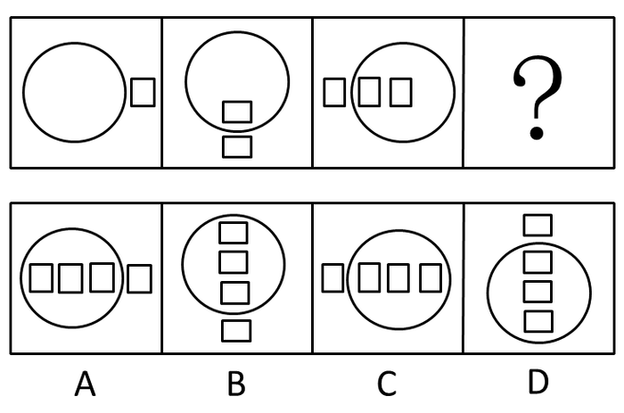

A. A

B. B

C. C

D. D

第 46 题 · 答案与解析

**参考答案（粉笔题库参考内容）**

D

**解析**

元素组成相似，综合考查位置和数量规律。

上一个图形顺时针旋转90°，并在圆内增加一个小方块得到下一个图形，D项符合题意。

故正确答案为D。

**考点**：数量规律-复合

**来源**：2009年云南省公务员录用考试《行测》题第46题

### 第 47 题

从所给四个选项中，选择最合适的一个填入问号处，使之呈现一定的规律性：

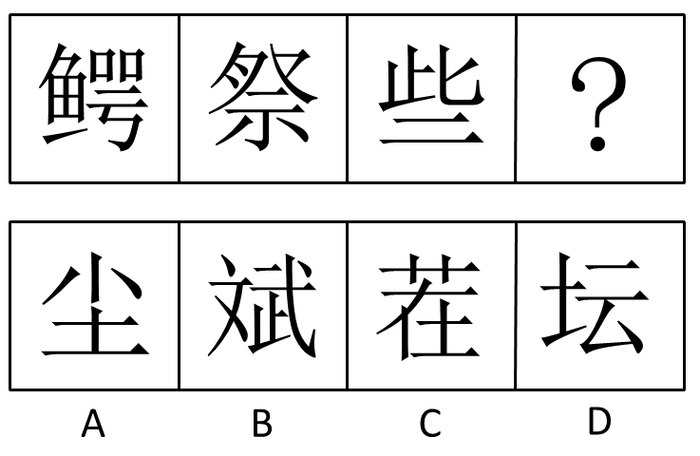

A. A

B. B

C. C

D. D

第 47 题 · 答案与解析

**参考答案（粉笔题库参考内容）**

D

**解析**

部分元素遍历，题干图形均有元素“二”，选项中只有D符合。

故正确答案为D。

**考点**：文字/字母/数字类、样式规律-遍历

**来源**：2009年云南省公务员录用考试《行测》题第47题

### 第 48 题

从所给四个选项中，选择最合适的一个填入问号处，使之呈现一定的规律性：

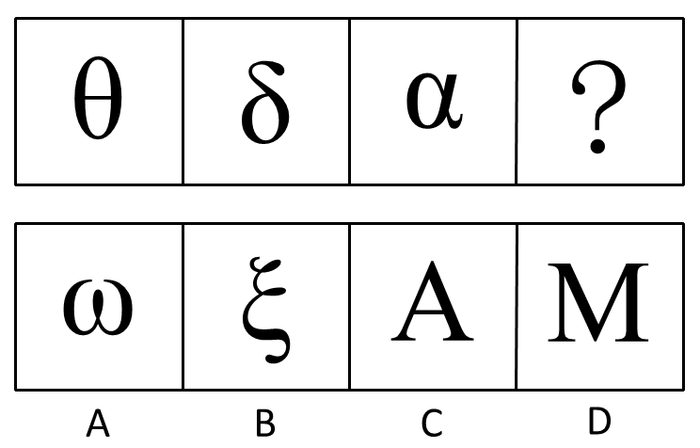

A. A

B. B

C. C

D. D

第 48 题 · 答案与解析

**参考答案（粉笔题库参考内容）**

C

**解析**

图中都有封闭区域，C项符合题意。

故正确答案为C。

**考点**：属性规律-开闭性

**来源**：2009年云南省公务员录用考试《行测》题第48题

### 第 49 题

下左图可以折叠成右边哪个图形：

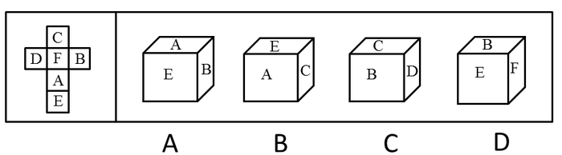

A. A

B. B

C. C

D. D

第 49 题 · 答案与解析

**参考答案（粉笔题库参考内容）**

A

**解析**

由左边的图形可知，A面和C面、B面和D面、E面和F面分别是相对的，不可能相邻，注意此题目已经不再考虑字母的方向，只代表面本身。只能选择A。

故正确答案为A。

**考点**：空间类-空间重构-六面体

**来源**：2009年云南省公务员录用考试《行测》题第49题

### 第 50 题

从所给的四个选项中，选择最合适的一个填入问号处，使之呈现一定的规律性：

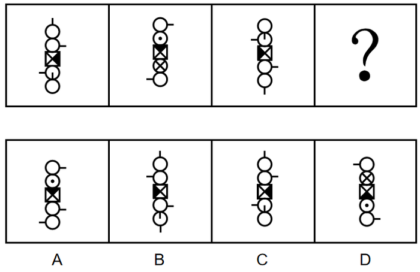

A. A

B. B

C. C

D. D

第 50 题 · 答案与解析

**参考答案（粉笔题库参考内容）**

D

**解析**

元素组成相同，考查位置规律。

每个图形中第一个图形元素依次在平面上顺时针旋转90°；第二、四个图形元素在立体上旋转90°；第三、五个图形元素依次在平面上逆时针旋转90°。按此规律，D项符合题意。

故正确答案为D。

**考点**：位置规律-旋转

**来源**：2009年云南省公务员录用考试《行测》题第50题

### 第 51 题

娱乐体育是指人们在余暇时间进行的一种娱乐性极强的身体活动，它既是一种娱乐手段，又是一种身体锻炼的手段。

根据上述定义，下列不属于娱乐体育的一项是：

A. 几年来，某地每年举办国际风筝节，每次都举行放风筝比赛

B. 为了吸引更多的游客，某新建公园举办了一次大型钓鱼比赛

C. 北京奥运会前夕，不少单位组织员工进行了拔河比赛

D. 为了促进中国篮球事业发展，中国篮协每年都举办CBA比赛

第 51 题 · 答案与解析

**参考答案（粉笔题库参考内容）**

D

**解析**

第一步：抓住定义中的关键词。

关键词包括“在余暇时间进行的”、“娱乐性极强的身体活动”、“娱乐手段”、“身体锻炼的手段”。

第二步：逐一判断选项。

D项“CBA比赛”是职业比赛，而不是一种在余暇时间进行的身体活动，因此不属于娱乐体育；

A项“放风筝比赛”、B项“大型钓鱼比赛”、C项“拔河比赛”三项都符合定义。

本题为选非题，故正确答案为D。

**考点**：拆词

**来源**：2009年云南省公务员录用考试《行测》题第51题

### 第 52 题

拟制血亲关系指当事人之间本无血缘关系，经过法定程序确认其为亲戚关系。在我国拟制血亲关系仅指《婚姻法》、《收养法》明确规定的情形。

根据上述定义，下列属于拟制血亲关系的一项是：

A. 在同一个户口簿上的养父与养子

B. 孤儿院的保育员与孤儿

C. 义父与义子

D. 丈夫的私生子与妻子

第 52 题 · 答案与解析

**参考答案（粉笔题库参考内容）**

A

**解析**

第一步：抓住定义中的关键词。

关键词包括“本无血缘关系”、“经过法定程序”、“确认其为亲戚关系”。

第二步：逐一判断选项。

B、D两项中的两者都没有确认为亲戚关系，C项中两者没有经过法定程序。

只有A项经过法定程序确认其为亲戚关系。

故正确答案为A。

**考点**：单定义-其他句式

**来源**：2009年云南省公务员录用考试《行测》题第52题

### 第 53 题

融资指一个企业资金筹集的行为与过程，可分为直接融资和间接融资。直接融资是不经过金融机构这一媒介，由政府、企事业单位及个人直接以最后借款人的身份与最后贷款人进行的融资活动。

根据上述定义，下列不属于直接融资的一项是：

A. 某上市公司公开发行股票

B. 某企业向银行贷款筹集资金新建生产线

C. 政府发放国债投资建设高速铁路

D. 某公司所有股东对其公司追加投资

第 53 题 · 答案与解析

**参考答案（粉笔题库参考内容）**

B

**解析**

第一步：抓住定义中的关键词。

直接融资的关键词包括“资金筹集的行为与过程”、“不经过金融机构这一媒介”、“以最后借款人的身份与最后贷款人进行的”。

第二步：逐一判断选项。

B项中银行属于金融机构，而企业向银行贷款不符合“不经过金融机构这一媒介”，应属于间接融资；

A项“某上市公司公开发行股票”、C项“政府发放国债”、D项“股东对其公司追加投资”都符合“不经过金融机构这一媒介”以及“以最后借款人的身份与最后贷款人进行的”，A、C、D三项均属于直接融资。

本题为选非题，故正确答案为B。

**考点**：常规问法

**来源**：2009年云南省公务员录用考试《行测》题第53题

### 第 54 题

法律援助是指国家对经济困难、无力支付诉讼费用和律师费用的公民予以救助，准予缓交或者免交法律诉讼费用和律师费用，以保障其合法权益的一种法律保障制度。

根据上述定义，下列属于法律援助的一项是：

A. 某业主准备起诉房产开发商，律师事务所向其推荐了一名熟悉房地产领域的律师

B. 法院法官在节假日走入社区为市民做义务法律咨询

C. 聋哑人刘某因涉嫌盗窃被起诉，他无亲人，检察院委派一名律师担任其辩护人

D. 张律师数年来一直深入工地对民工进行普法教育

第 54 题 · 答案与解析

**参考答案（粉笔题库参考内容）**

C

**解析**

第一步：抓住定义中的关键词。

该定义中的关键词为“经济困难、无力支付诉讼费用”、“准予缓交或者免交”。

第二步：逐一判断选项。

C项“聋哑人刘某”符合“经济困难、无力支付诉讼费用”，“检察院委派一名律师担任其辩护人”体现了“准予缓交或者免交”法律诉讼费用；

A项“某业主准备起诉房产开发商”的行为不符合“经济困难、无力支付诉讼费用”；

B项“义务法律咨询”与D项“普法教育”均与法律诉讼费用和律师费用无关，且B项市民和D项民工并不一定“经济困难、无力支付诉讼费用”。

故正确答案为C。

**考点**：主客体

**来源**：2009年云南省公务员录用考试《行测》题第54题

### 第 55 题

新经济是指在经济全球化和信息技术革命的带动下的一种新的经济发展模式和增长方式，其基本特征是以信息和新技术为基础的高新科技产业。

根据上述定义，下列属于新经济的一项是：

A. 纺织业

B. 太阳能利用产业

C. 钢铁制造业

D. 汽车制造业

第 55 题 · 答案与解析

**参考答案（粉笔题库参考内容）**

B

**解析**

第一步：抓住定义中的关键词。

关键词包括“新的经济发展模式和增长方式”、“以信息和新技术为基础”、“高新科技产业”。

第二步：逐一判断选项。

B项太阳能利用产业是高新科技产业，所以是新经济，而纺织业、钢铁制造业和汽车制造业都是传统行业。

故正确答案为B。

**考点**：单定义-其他句式

**来源**：2009年云南省公务员录用考试《行测》题第55题

### 第 56 题

外汇是指以外国货币表示的用于国际结算的支付手段。一切存在外国银行的外币存款，在国外能得到偿付的外币、外币票据、外币支付凭证、股票和债券以及可以用于清偿国际间债务的其他外币资产，统称外汇。

根据上述定义，下列不属于外汇范畴的是：

A. 美国政府发行的国债

B. 将1000万日元兑换人民币后取得的存款凭证

C. 瑞士银行的存款凭证

D. 1000万欧元

第 56 题 · 答案与解析

**参考答案（粉笔题库参考内容）**

B

**解析**

第一步：抓住定义中的关键词。

关键词包括“以外国货币表示”、“用于国际结算”。

第二步：逐一判断选项。

题干强调外汇是以外国货币表示的，而B项以人民币表示，因此不属于外汇；

A、C、D三项都是以外国货币表示的，属于外汇。

本题为选非题，故正确答案为B。

**考点**：单定义-其他句式

**来源**：2009年云南省公务员录用考试《行测》题第56题

### 第 57 题

供认是指在司法人员进行讯问时，罪犯或嫌疑人承认自己犯了罪，并供述有关犯罪的事实真相。

根据上述定义，下列属于供认的是（    ）。

A. 这个狡猾的犯人只承认了自己作案，但对其他同案犯的情况避而不谈

B. 在司法人员列举他的犯罪事实时，他只是大喊冤枉

C. 他受收买，承认自己是凶手，但证据表明凶手另有其人

D. 审讯人员尚未开口，案犯已交代了全部犯罪事实

第 57 题 · 答案与解析

**参考答案（粉笔题库参考内容）**

D

**解析**

第一步：判断题干中的关键词。

“承认自己犯了罪”、“供述有关犯罪的事实真相”。

第二步：逐一分析选项。

A项：该项中犯人对其他同案犯的情况避而不谈，不符合“供述有关犯罪的事实真相”，不符合定义，排除；

B项：该项中罪犯大喊冤枉，不承认自己犯了罪，不符合“承认自己犯了罪”，不符合定义，排除；

C项：该项中罪犯承认自己是凶手，但证据表明凶手另有其人，不符合“供述有关犯罪的事实真相”，不符合定义，排除；

D项：该项中案犯已交代了全部犯罪事实，符合“承认自己犯了罪”、“供述有关犯罪的事实真相”，符合定义，当选。

故正确答案为D。

**考点**：方式目的

**来源**：2009年云南省公务员录用考试《行测》题第57题

### 第 58 题

暗示是指用含蓄的、间接的方式，对别人的心理和行为产生影响。其作用往往会使别人不自觉地按照一定的方式行动，或者不加判断地接受某种意见或信念。

根据上述定义，下列属于暗示的是：

A. 在评选先进工作者之前，领导多次在职工大会上提到小王最近取得的成绩

B. 小刘告诉小张，希望他不要参加篮球赛

C. 小李让人带信给小赵，请小赵在厂长选举时投自己一票

D. 领导在会议上提倡大家节约用水

第 58 题 · 答案与解析

**参考答案（粉笔题库参考内容）**

A

**解析**

第一步：抓住定义中的关键词。

关键词包括“用含蓄的、间接的方式”、“对别人的心理和行为产生影响”、“不自觉地按照”、“不加判断地接受”。

第二步：逐一判断选项。

B、C、D三项都是以直接的方式进行，不符合题干中“用含蓄的、间接的方式”；

A项中领导多次提到小王最近取得的成绩，是采用了含蓄的方式表明小王应该被评为先进工作者，因此属于暗示。

故正确答案为A。

**考点**：拆词

**来源**：2009年云南省公务员录用考试《行测》题第58题

### 第 59 题

妄想是指一种病态的信念，尽管不符合事实，但仍坚信不移。

根据上述定义，下列属于妄想的是：

A. 尽管实验失败了5次，但他想：要是实验条件再做些改变也许就能成功

B. 尽管许多医院的专家都诊断他无病，但他还是认为自己患了不治之症，反复就医，并认为那些医生不负责任，有意害自己

C. 尽管他的妻子已去世多年，但他眼前还经常浮现出妻子的音容笑貌

D. 他想如果自己学习再认真点就可以取得更好的成绩

第 59 题 · 答案与解析

**参考答案（粉笔题库参考内容）**

B

**解析**

第一步：抓住定义中的关键词。

关键词有“不符合事实”、“仍坚信不移”。

第二步：逐一判断选项。

B项“专家诊断他无病，而他还是认为自己患了不治之症”体现了“不符合事实”，而“反复就医”也说明了他“仍坚信不移”；

A项“实验失败了5次”符合事实；

选项C只是对妻子的怀念，并不是“坚信不移”；D项“学习再认真点就可以取得更好的成绩”与题干定义没有明显的关系。

故正确答案为B。

**考点**：拆词

**来源**：2009年云南省公务员录用考试《行测》题第59题

### 第 60 题

监护人是对无民事行为能力和限制民事行为能力的人（如未成年人或精神病人）的人身、财产和其他合法权益负有监督和保护责任的人。某幼儿园组织小朋友看电视，途中教师甲因取东西暂时离开，小孩乙将一硬物掷向电视机，致使电视机爆炸，溅起的碎片同时将另几名小孩划伤，造成电视机损失3000元，受伤小孩治疗费用8000元。

根据上述定义，该损失应由谁赔偿：

A. 甲与幼儿园承担连带赔偿责任

B. 甲与乙的监护人共同承担赔偿责任

C. 乙的监护人承担赔偿责任

D. 由乙的监护人承担赔偿责任，同时责令幼儿园适当赔偿

第 60 题 · 答案与解析

**参考答案（粉笔题库参考内容）**

D

**解析**

第一步：抓住定义中的关键词。

关键词包括“无民事行为能力和限制民事行为能力的人”、“人身、财产和其他合法权益”、“负有监督和保护责任”。

第二步：逐一判断选项。

小孩乙为无民事行为能力人，他的行为造成对他人的损害，应由其监护人承担赔偿责任。同时，由于幼儿园的教师有过错（途中教师甲因取东西暂时离开），没有起到照顾好小孩的作用，根据法律，应当由幼儿园承担适当赔偿责任。

故正确答案为D。

**考点**：单定义-其他句式

**来源**：2009年云南省公务员录用考试《行测》题第60题

### 第 61 题

歌曲：作词：作曲

A. 钢琴曲：钢琴：钢琴家

B. 香烟：烟农：收获

C. 城市：街道：商铺

D. 诉讼：原告：被告

第 61 题 · 答案与解析

**参考答案（粉笔题库参考内容）**

D

**解析**

第一步：判断题干词语间逻辑关系。

歌曲需要作词和作曲，第一词与第二词、第三词之间为对应关系；第二词与第三词之间为并列关系。

第二步：判断选项词语间逻辑关系。

A项：钢琴和钢琴家不是并列关系，与题干逻辑关系不一致，排除；

B项：烟农和收获不是并列关系，与题干逻辑关系不一致，排除；

C项：街道和商铺不是并列关系，与题干逻辑关系不一致，排除；

D项：诉讼需要原告和被告，第一词与第二词、第三词之间为对应关系；第二词与第三词之间为并列关系。

故正确答案为D。

**考点**：逻辑关系-对应关系、逻辑关系-并列关系

**来源**：2009年云南省公务员录用考试《行测》题第61题

### 第 62 题

义务劳动：植树节

A. 体育活动：解放军

B. 学生：校园

C. 爱心大使：无偿献血

D. 志愿者：护林员

第 62 题 · 答案与解析

**参考答案（粉笔题库参考内容）**

A

**解析**

第一步：判断题干词语间逻辑关系。

题干两个词“义务劳动”与“植树节”从语法构成看，两个词都是名词，且构成方式均为偏正式，植树为动词。

第二步：判断选项词语间逻辑关系。

A项，两个词都是名词，构成方式也均为偏正式，解放为动词，符合题意。

B项，两个词都是名词，并且都是一个语素，与题干不符。

C项，爱心大使为名词，偏正式构成，无偿献血为动词，与题干不符。

D项，两者均为名词，志愿者为一个语素，与题干不符。

第三步：再次标注答案。

故正确答案为A。

**考点**：拆分思维、语法关系

**来源**：2009年云南省公务员录用考试《行测》题第62题

### 第 63 题

颓废：奋发

A. 厌恨：发怒

B. 爱戴：憎恨

C. 恋爱：分手

D. 隐藏：发现

第 63 题 · 答案与解析

**参考答案（粉笔题库参考内容）**

B

**解析**

第一步：判断题干词语间逻辑关系。

题干两词为反义词。颓废和奋发是反义词。

第二步：判断选项词语间逻辑关系。

A项厌恨和发怒词意相近，不符合题干逻辑；

B项爱戴和憎恨是一对反义词；

C项恋爱和分手不是反义词关系，分手的反义词应是和好；

D项隐藏的反义词应该是暴露而不是发现。

故正确答案为B。

**考点**：语义关系-反义关系

**来源**：2018年重庆市选调优秀大学生到基层工作考试《行测》题第82题

### 第 64 题

“天门中断楚江开，碧水东流至此回。”：长江

A. “万古齐州烟九点，五更沧海日三竿。”：泰山

B. “姑苏城外寒山寺，夜半钟声到客船。”：南京

C. “劝君更进一杯酒，西出阳关无故人。”：山海关

D. “两岸猿声啼不住，轻舟已过万重山。”：黄河

第 64 题 · 答案与解析

**参考答案（粉笔题库参考内容）**

A

**解析**

第一步：判断题干词语间逻辑关系。

题干两词是对应关系，前者是诗句，后者是诗句所描写的地点或景物。题干诗句出自李白的《望天门山》，描写的是长江。

第二步：判断选项词语间逻辑关系。

A项诗句出自元朝张养浩的《登泰山》，描写的是泰山；

B项诗句出自唐朝张继的《枫桥夜泊》，寒山寺位于苏州而不是南京；

C项诗句出自王维的《送元二使安西》，阳关位于敦煌而不是指山海关；

D项诗句出自李白的《早发白帝城》，描写的是长江三峡而不是黄河。

故正确答案为A。

**考点**：逻辑关系-对应关系

**来源**：2009年云南省公务员录用考试《行测》题第64题

### 第 65 题

摄影：婚纱照

A. 镜头：闪光灯

B. 三角架：配重袋

C. 广告：户外展示

D. 新闻记者：采访市长

第 65 题 · 答案与解析

**参考答案（粉笔题库参考内容）**

C

**解析**

第一步：判断题干词语间逻辑关系。

题干两词是包容关系，后者是前者的一种。婚纱照是摄影的一种。

第二步：判断选项词语间逻辑关系。

C项户外展示是广告的一种，符合题干逻辑；

A项、B项都是并列关系；D项新闻记者和采访市长构不成包容关系。

故正确答案为C。

**考点**：逻辑关系-包容关系

**来源**：2009年云南省公务员录用考试《行测》题第65题

### 第 66 题

烟斗：烟叶

A. 酒柜：茅台

B. 窗户：采光

C. 酒杯：啤酒

D. 烟雾：吸烟

第 66 题 · 答案与解析

**参考答案（粉笔题库参考内容）**

C

**解析**

第一步：判断题干词语间逻辑关系。

题干词语是对应关系，烟斗里装烟叶，前者的主要功能是盛放后者。

第二步：判断选项词语间逻辑关系。

A项，酒柜里装茅台，与题干逻辑关系一致，保留；

B项，窗户有采光的作用，与题干逻辑关系不一致，排除；

C项，酒杯里装啤酒，与题干逻辑关系一致，保留；

D项，吸烟会产生烟雾，与题干逻辑关系不一致，排除。

继续分析题干，烟叶和啤酒都是泛指一类事物，而茅台是特指一种品牌的白酒，排除A项。

故正确答案为C。

**考点**：逻辑关系-对应关系

**来源**：2009年云南省公务员录用考试《行测》题第66题

### 第 67 题

南辕北辙：声东击西

A. 短斤少两：指桑骂槐

B. 缺衣少食：东拼西凑

C. 穷途末路：指鹿为马

D. 朝发夕至：欺上瞒下

第 67 题 · 答案与解析

**参考答案（粉笔题库参考内容）**

D

**解析**

第一步：判断题干词语间逻辑关系。

题干两成语是并列关系，且“南”和“北”、“东”和“西”相对。

第二步：判断选项词语间逻辑关系。

A、B、C项均不符合题干逻辑，其中A项“短”和“少”、B项“缺”和“少”、C项“穷”和“末”均不相对。而D项构成并列结构，且“朝”和“夕”、“上”和“下”相对。

故正确答案为D。

**考点**：拆分思维、逻辑关系-并列关系

**来源**：2009年云南省公务员录用考试《行测》题第67题

### 第 68 题

迪斯尼：乐园

A. 钓鱼岛：海洋

B. 蓬莱阁：仙境

C. 小桥：流水

D. 性格：急躁

第 68 题 · 答案与解析

**参考答案（粉笔题库参考内容）**

B

**解析**

第一步：判断题干词语间逻辑关系。

题干两词是包容关系，且是包容关系中的种属关系，前者是后者的一种。迪斯尼有“乐园”之名，迪斯尼是众多“乐园”之一。

第二步：判断选项词语间逻辑关系。

A、C、D项均构不成包容关系中的种属关系；

B项蓬莱阁有“仙境”之称，蓬莱阁是众多“仙境”之一。

故正确答案为B。

**考点**：逻辑关系-包容关系

**来源**：2009年云南省公务员录用考试《行测》题第68题

### 第 69 题

《红楼梦》：《清史稿》

A. 《六国论》：《左传》

B. 《三国演义》：《三国志》

C. 《西厢记》：《资治通鉴》

D. 《鸿门宴》：《史记》

第 69 题 · 答案与解析

**参考答案（粉笔题库参考内容）**

B

**解析**

第一步：判断题干词语间逻辑关系。

题干两词构成并列关系。前者为小说，后者为史书。

第二步：判断选项词语间逻辑关系。

A项《六国论》不属于小说，而《左传》是史书；

B项《三国演义》是小说，《三国志》是史书；

C项《西厢记》是戏剧，《资治通鉴》是史书；

D项《鸿门宴》是《史记》中的一篇；因此符合题干逻辑关系的只有B项。

故正确答案为B。

**考点**：逻辑关系-并列关系

**来源**：2009年云南省公务员录用考试《行测》题第69题

### 第 70 题

白色污染：生物降解

A. 工业用电：太阳能

B. 生活用水：中水回收

C. 中药方剂：医学研究

D. 工业废气：余热发电

第 70 题 · 答案与解析

**参考答案（粉笔题库参考内容）**

D

**解析**

第一步：判断题干词语间逻辑关系。

题干两词是对应关系，前者是环境污染的来源之一，而后者是针对前者的有效措施，有利于环保。白色污染是造成环境污染的来源之一，生物降解是解决白色污染的有效措施，有利于环保。

第二步：判断选项词语间逻辑关系。

A项工业用电和太阳能没有直接关系；

B项“生活用水”不会直接造成环境污染；

C项“中药方剂”和“医学研究”之间没有明显的逻辑关系；

D项工业废气是造成环境污染的来源之一，余热发电可以有效解决工业废气产业的污染，有利于环保，符合题干逻辑。

故正确答案为D。

**考点**：逻辑关系-对应关系

**来源**：2009年云南省公务员录用考试《行测》题第70题

### 第 71 题

高中生：大学生：研究生

A. 青年：中年：老年

B. 晨曦：骄阳：夕阳

C. 高原：深山：沟壑

D. 月相：月满：月亏

第 71 题 · 答案与解析

**参考答案（粉笔题库参考内容）**

A

**解析**

第一步：判断题干词语间逻辑关系。

题干词语之间是并列关系，且按时间顺序排列。高中生、大学生和研究生是并列关系，且按时间先后排列。

第二步：判断选项词语间逻辑关系。

A项青年、中年和老年是并列关系，且按时间顺序排列，符合题干逻辑；

B项中的骄阳形容酷热的阳光，而不是专指某个时间段的阳光，且晨曦和骄阳都指阳光，而夕阳指的是太阳；

C项高原、深山、沟壑不是并列关系；

D项月满和月亏分别是月相的一种状态，且前者和后两者均不是并列关系。

故正确答案为A。

**考点**：逻辑关系-并列关系

**来源**：2009年云南省公务员录用考试《行测》题第71题

### 第 72 题

子=鼠：丑=牛

A. 农历=阴历：天干=地支

B. 公历=阴历：午=马

C. 上元节=元宵：春节=过年

D. 满月=十五：重阳=中秋

第 72 题 · 答案与解析

**参考答案（粉笔题库参考内容）**

C

**解析**

第一步：判断题干词语间逻辑关系。

题干两词是对应关系，且是十二地支与十二生肖的对应关系，等号两边是对应的两个词。

第二步：判断选项词语间逻辑关系。

A项中天干和地支不是对应关系，两者按固定的顺序互相配合，组成了干支纪法；

B项中公历和阴历不是对应关系；

C项等号两边也是对应的两个词，符合题干逻辑；

D项中重阳和中秋不是对应关系，重阳指的是农历九月初九，而中秋指的是农历八月十五。

故正确答案为C。

**考点**：逻辑关系-对应关系

**来源**：2009年云南省公务员录用考试《行测》题第72题

### 第 73 题

瓷器：青花瓷

A. 古董：官窑

B. 京剧：花脸

C. 书法：落款

D. 茶具：龙井茶

第 73 题 · 答案与解析

**参考答案（粉笔题库参考内容）**

A

**解析**

第一步：判断题干词语间逻辑关系。

题干两词是包容关系，且是包容关系中的种属关系。青花瓷属于瓷器。

第二步：判断选项词语间逻辑关系。

A项官窑指古代的贡器，属于古董，符合题干逻辑；

B、C、D项均不是种属关系，B项花脸不一定是关于京剧的，C项落款不一定是关于书法的，D项龙井茶和茶具之间逻辑关系也和题干不一致。

故正确答案为A。

**考点**：逻辑关系-包容关系

**来源**：2009年云南省公务员录用考试《行测》题第73题

### 第 74 题

油画：松节油

A. 肖像：胶片

B. 书法：装裱

C. 毛笔：墨汁

D. 牙雕：象牙

第 74 题 · 答案与解析

**参考答案（粉笔题库参考内容）**

D

**解析**

第一步：判断题干词语间逻辑关系。

题干两词是原材料的对应关系。油画的原材料之一是松节油。

第二步：判断选项词语间逻辑关系。

D项牙雕的原材料之一是象牙，符合题干逻辑；

A、B、C三项词语之间均不是原材料的对应关系。

故正确答案为D。

**考点**：逻辑关系-对应关系

**来源**：2009年云南省公务员录用考试《行测》题第74题

### 第 75 题

出版：发行

A. 结婚：恋爱

B. 旅游：观光

C. 出生：暮年

D. 编辑：勘校

第 75 题 · 答案与解析

**参考答案（粉笔题库参考内容）**

D

**解析**

第一步：判断题干词语间逻辑关系。

题干两词是对应关系，且前者的最后一个步骤是后者。出版的最后一个步骤是发行。

第二步：判断选项词语间逻辑关系。

D项编辑的最后一个步骤是勘校；

A、B项逻辑关系与题干不一致，排除AB；

C项无明显逻辑关系。

故正确答案为D。

**考点**：逻辑关系-对应关系

**来源**：2009年云南省公务员录用考试《行测》题第75题

### 第 76 题

商业伦理调查员：大仓号古董交易所一直误导它的客户说，它的一些古董很稀有，实际上那些古董是比较常见而且很容易得到的。

大仓号古董交易所：这太可笑了。大仓号古董交易所是世界上最大的几个古董交易所之一。我们经销古董是经过一家国际认证的公司鉴定的，并且有古董经销的执照。

大仓号古董交易所的回答显得没有说服力，因为它……

以下哪项作为上文的后继最为恰当：

A. 故意夸大了商业伦理调查员的论述，使其显得不可信

B. 指责商业伦理调查员有偏见，但不能提供足够的证据来证实他的指责

C. 没能证实其他古董交易所也不能鉴定他们所卖的古董

D. 列出了大仓号古董交易所的优势，但没有对商业伦理调查员的问题做出回答

第 76 题 · 答案与解析

**参考答案（粉笔题库参考内容）**

D

**解析**

第一步：抓住题干主要信息。

第一句强调商业伦理调查员的观点，即大仓号古董交易所夸大宣传，实际上一些古董是比较常见而且很容易得到的。第二句说明大仓号古董交易所的回答只列出了自己的优势，而没有对商业伦理调查员进行反驳。

第二步：分析题干信息，并结合选项得出答案。

D项“列出了大仓号古董交易所的优势，但没有对商业伦理调查员的问题做出回答”恰当地说明大仓号古董交易所的回答。

A项“故意夸大了商业伦理调查员的论述”不符合题干中论述；B项和C项并没有在题干中体现；A、B、C三项均属于答非所问。

故正确答案为D。

**考点**：日常结论

**来源**：2009年云南省公务员录用考试《行测》题第76题

### 第 77 题

张、王、李三位老师分别在小学教劳动、数学、自然、手工、语文、思想品德，且每位老师教两门课。自然老师和劳动老师住同一个宿舍，张老师最年轻，劳动老师和李老师爱打篮球，数学老师比手工老师岁数大，比王老师岁数小，三人中最大的老师住得比其他两位老师远。

由此则可以推断出：

A. 张老师教：语文、劳动；王老师教：手工、思想品德；李老师教：数学、自然

B. 张老师教：手工、自然；王老师教：语文、思想品德；李老师教：数学、劳动

C. 张老师教：手工、劳动；王老师教：语文、思想品德；李老师教：数学、自然

D. 张老师教：手工、思想品德；王老师教：语文、劳动；李老师教：数学、自然

第 77 题 · 答案与解析

**参考答案（粉笔题库参考内容）**

C

**解析**

第一步：找突破口。

突破口为李老师，由“劳动老师和李老师爱打篮球”可知，李老师不教劳动。

第二步：将题干信息列表分析。

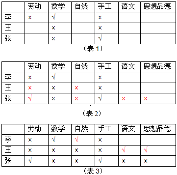

由“数学老师比手工老师岁数大，比王老师岁数小”可知，王老师的年龄最大，其次是数学老师，年龄最小的是手工老师。又“张老师最年轻”，所以张老师教手工，李老师教数学。如表（1）所示。

再由“三人中最大的老师住得比其他两位老师远”和“自然老师和劳动老师住同一个宿舍”可知，王老师不教自然和劳动，由第一步分析可知李老师不教劳动，那么张老师必然教劳动，又知张老师教手工，那么张老师不教自然、语文、品德，如表（2）所示。

由张、王都不教自然，那么只有李老师教自然，而李老师又教数学，那么剩下的语文和品德只能由王老师教。如表（3）所示。

故正确答案为C。

**考点**：排除法

**来源**：2009年云南省公务员录用考试《行测》题第77题

### 第 78 题

抗体保健中心进行了为期20周的减肥实验。结果显示，参加者平均减肥10千克。其中，男性参加者平均减肥14千克，女性参加者平均减肥8千克。

如果以上陈述是真的，并且其中统计数据是精确的，则以下哪项也一定是真的：

A. 所有参加者体重均下降

B. 男性参加者和女性参加者一样多

C. 女性参加者比男性参加者多

D. 男性参加者比女性参加者多

第 78 题 · 答案与解析

**参考答案（粉笔题库参考内容）**

C

**解析**

日常结论题，根据题干信息逐一分析选项。

A项：根据题干信息可知参加者“平均”减肥10千克，无法推出“所有”参加者体重均下降，无法推出，排除；

B项：题干中未提及男性参加者和女性参加者的具体人数，无中生有，无法推出，排除；

C项：根据题干信息可知参加者平均减肥10千克，男性参加者平均减肥14千克，女性参加者平均减肥8千克，设男性参加者为x人，女性参加者为y人，根据题意可知14x+8y＝10（x+y），解得y＝2x，可以推出女性参加者比男性参加者多，可以推出，当选；

D项：根据C项解析，该项无法推出，排除。

故正确答案为C。

**考点**：日常结论

**来源**：2009年云南省公务员录用考试《行测》题第78题

### 第 79 题

人们通常认为可以通过动物的异常行为来预测海啸。这种看法是基于主观类比，不一定能揭示客观联系。一只猫在海啸前24小时行为异常，给它的主人留下深刻印象，但事实上，这个世界上的任何一刻，都有猫行为异常。

为了评论上述论证，回答以下哪个问题最不重要：

A. 被认为是海啸前兆的动物异常行为，在平时是否也出现过？

B. 两种不同类型的动物，在海啸前的异常行为是否类似？

C. 海啸前有异常行为的动物在整个动物中所占的比例是多少？

D. 在海啸前有异常行为的动物中，这种异常行为未被注意的比例是多少？

第 79 题 · 答案与解析

**参考答案（粉笔题库参考内容）**

B

**解析**

第一步：找到论点和论据。

论点：人们通常认为通过动物的异常行为来预测海啸是没有根据的。

论据：这个世界上的任何一刻都有猫行为异常。

第二步：逐一判断选项的作用。

A项的回答可以说明动物的异常行为是否与海啸有关，有助于评价论证。

对C项的回答可以说明有异常行为的动物是否占多数，如果是，说明预测是有一定根据的，所以对C项的回答也有助于评价论证。

如果大部分异常行为没被注意，则说明即使有异常行为，用其来预测海啸也是很难的，对D项的回答也有助于评价论证。

而B项说两种不同类型的动物，在海啸前的异常行为是否类似？题干强调是动物是否有异常行为，而不是异常行为是否类似。

本题为选非题，故正确答案为B。

**来源**：2009年云南省公务员录用考试《行测》题第79题

### 第 80 题

博物馆的办展费在过去几年中上涨得很厉害，并且还有继续上涨的趋势。其实，博物馆是有办法扭转这一趋势的，这些博物馆在海内外经常得到大笔捐赠，这些捐赠完全可以用来改善博物馆的经济状况。

以下哪项如果为真，将严重削弱上述结论：

A. 博物馆筹集经费措施已日臻完善，其中包括承办一些商业博览会等

B. 越来越多的观众喜欢在节假日到博物馆浏览、参观

C. 海内外对博物馆的捐赠，主要集中在国内几个大型博物馆

D. 博物展览基金的捐款人通常对捐赠款项的使用有严格的限制

第 80 题 · 答案与解析

**参考答案（粉笔题库参考内容）**

D

**解析**

第一步：找到论点和论据。

论点：博物馆可以通过海内外的捐赠来改善经济状况，以扭转办展费上涨的趋势。

论据：无。

本题只有论点，没有论据，考虑削弱论点。

第二步：逐一分析选项。

A项：指出博物馆筹集经费措施已日臻完善，但不确定是否包括捐赠的方式，无法削弱，排除；

B项：说的是观众喜欢参观博物馆，与论点无关，属于无关项，排除；

C项：说明这种方法对一些大型博物馆是可行的，有一定的加强作用，也无法确定其他博物馆是否有捐款，无法削弱，排除；

D项：说明博物展览基金的捐款人对捐赠款项的使用是有严格限制的，该限制可能使捐款无法用于改善经济状况，具有削弱论点的作用，当选。

故正确答案为D。

**考点**：削弱论点

**来源**：2009年云南省公务员录用考试《行测》题第80题

### 第 81 题

“医院里的医生和护士，包括我在内，总共是16名，下面讲到的人员情况，无论是否把我计算在内，都不会有任何变化。在这些医护人员中，（1）护士多于医生；（2）男医生多于男护士；（3）男护士多于女护士；（4）至少有一位女医生。”

请问这位说话者是什么性别和职务：

A. 男医生

B. 女护士

C. 男护士

D. 女医生

第 81 题 · 答案与解析

**参考答案（粉笔题库参考内容）**

B

**解析**

第一步：抓住题干对象及其关系。

由题干信息可知，假设男护士、女护士、男医生、女医生人数分别是a、b、c、d，那么（1）a＋b＞c＋d；（2）c＞a；（3）a＞b；（4）d≥1；（5）a＋b＋c＋d=15。

第二步：判断整体关系。

根据第一步信息可知，c≥a＋1，a≥b＋1，那么a＋b≥2b＋1，c＋d≥a＋2≥b＋3，那么a＋b＋c＋d=15≥2b＋1＋b＋3=3b＋4，即3b≤11，b≤3。由（1）（5）可知，c＋d≤7，a＋b≥8，那么a≥5，c≥6，d≤1。又知（4），故d=1，a=5，b=3，c=6。

第三步：逐一判断选项。

若B项为真，那么男护士、女护士、男医生、女医生人数分别5、4、6、1。符合题干逻辑。若医生人数增加，那么a＋b=c＋d，不符合条件（1），因此排除AD项。若C项为真，那么男护士人数为6人，与男医生人数相等，不符合条件（2），排除C。

故正确答案为B。

**考点**：原因解释

**来源**：2009年云南省公务员录用考试《行测》题第81题

### 第 82 题

有三户人家，每家有一孩子，他们的名字是：小梅（女）、小媚（女）、小明（男）；孩子的爸爸是老王、老张和老陈；妈妈是刘蓉、李玲和方丽。对于这三家人，已知：（1）老王家和李玲家的孩子都参加了少女舞蹈队；（2）老张的女儿不是小媚；（3）老陈和方丽不是一家人。

根据以上条件，可以确定以下哪项是正确的：

A. 老王、刘蓉和小梅是一家

B. 老张、李玲和小媚是一家

C. 老王、方丽和小媚是一家

D. 老陈、方丽和小明是一家

第 82 题 · 答案与解析

**参考答案（粉笔题库参考内容）**

C

**解析**

第一步：找突破口。

本题突破口较多，可用排除法逐一排除。

由（2）可知，老张的女儿不是小媚，排除B项；

由（3）可知，老陈和方丽不是一家人，排除D项。

第二步：结合其他信息判断选项。

由（1）、（2）可知，老王家孩子是女儿，而老张的女儿不是小媚，说明老王家女儿是小媚，排除A。

故正确答案为C。

**考点**：排除法

**来源**：2009年云南省公务员录用考试《行测》题第82题

### 第 83 题

小华、小玲、小芳、小丽同住一个宿舍。按规定，晚上最迟回宿舍的同学，应该关掉室外的路灯。有一天晚上，室外的路灯没有关掉，第二天，宿舍管理员过来查询哪一个同学最迟返回宿舍。小玲说：“我回来的时候，小丽已经睡了，我也就睡下了。”小华说：“我回来的时候，小芳还没有睡。”小芳说：“我进门的时候，小玲还没有睡。”小丽说：“我上床就睡着了，什么都不知道。”

这四位同学说的都是事实，请判断以下哪项为真：

A. 小华最迟返回宿舍

B. 小玲最迟返回宿舍

C. 小芳最迟返回宿舍

D. 小丽最迟返回宿舍

第 83 题 · 答案与解析

**参考答案（粉笔题库参考内容）**

A

**解析**

第一步：分析题干每句话。

由小玲的话可知，小玲在小丽之后回宿舍。

由小华的话可知，小华在小芳之后回宿舍。

再由小芳的话可知，小芳在小玲之后回宿舍。

第二步：分析整体排序。

四人回宿舍的顺序是∶小丽、小玲、小芳、小华。

最迟返回宿舍的是小华。

故正确答案为A。

**考点**：排除法

**来源**：2009年云南省公务员录用考试《行测》题第83题

### 第 84 题

有以下几个条件成立：（1）如果小王是工人，那么小张不是医生；（2）或者小李是工人，或者小王是工人；（3）如果小张不是医生，那么小赵不是学生；（4）或者小赵是学生，或者小周不是经理。

以下哪项如果为真，可得出“小李是工人”的结论：

A. 小周不是经理

B. 小王是工人

C. 小赵不是学生

D. 小周是经理

第 84 题 · 答案与解析

**参考答案（粉笔题库参考内容）**

D

**解析**

第一步：翻译题干。

（1）小王是工人→—小张是医生；

（2）小李是工人/小王是工人；

（3）-小张是医生→—小赵是学生；

（4）小赵是学生/小周不是经理。

根据逆否规则可知：小赵是学生→小张是医生→—小王是工人。如果小李是工人，根据（2）是相容选言命题可知，只有否定一个选言才能肯定另一个选言，要求小王不是工人，因此排除B。

第二步：结合其他信息判断选项。

根据第一步逆否规则可知小王不是工人，要求小张是医生。同理小张是医生，就要求小赵是学生，由（4）是相容选言命题可知，小周是经理。D项符合推断，A、C不符合推断。

故正确答案为D。

**考点**：常规翻译

**来源**：2009年云南省公务员录用考试《行测》题第84题

### 第 85 题

乒乓球单打决赛在甲、乙、丙、丁四位选手中进行，赛前，有些人预测比赛的结果，A说：甲第4。B说：乙不是第2，也不是第4。C说：丙的名次在乙的前面。D说：丁将得第1。比赛结果表明，四个人中只有一个人预测错了。

那么，甲、乙、丙、丁四位选手的名次分别为：

A. 2、3、4、1

B. 1、2、4、3

C. 1、3、4、2

D. 4、3、1、2

第 85 题 · 答案与解析

**参考答案（粉笔题库参考内容）**

D

**解析**

第一步：找突破口。

本题突破口较多，可用排除法逐一验证。

第二步：结合其他信息判断选项。

由题干可知，四个人中只有一个人预测错了。

假设A的话预测错误，则由B的话可知，乙不是第1就是第3；再由C的话可知，乙是第3；结合D的话可知，丁是第1，丙是第2，则甲是第4，则A项的预测错误，不符合题意。

假设B的话预测错误，则乙是第2或第4；由A的话可知，甲第4，乙第2；又由C的话可知，丙第1，则B项的预测也错误，不符合题意。

假设C的话预测错误，则由A和D的话可知，甲第4，丁第1；再由B的话可知，乙第3，所以丙第2，与C的预测错误矛盾。

假设D的话预测错误，则甲第4，丁不是第1，乙是第1或第3；且丙在乙之前，所以乙第3，丁第2，丙第1，符合题意。

故正确答案为D。

**考点**：假设

**来源**：2009年云南省公务员录用考试《行测》题第85题

### 第 86 题

唯物辩证法认为，发展的实质是：

A. 事物根本性质的改变

B. 事物数量的急剧增加

C. 新事物的产生和旧事物的灭亡

D. 事物的一切变化

第 86 题 · 答案与解析

**参考答案（粉笔题库参考内容）**

C

**解析**

唯物辩证法认为，物质是运动的物质，运动是物质的根本属性。而向前的、上升的、进步的运动即是发展。发展的本质是新事物的产生和旧事物的灭亡，即新事物代替旧事物。

故正确答案为C。

**考点**：唯物辩证法

**来源**：2009年云南省公务员录用考试《行测》题第86题

### 第 87 题

时间和空间是：

A. 物质运动的根本原因

B. 物质运动的存在方式

C. 物质的唯一特性

D. 物质的根本属性

第 87 题 · 答案与解析

**参考答案（粉笔题库参考内容）**

B

**解析**

马克思主义哲学对时间、空间本质的正确揭示，是辩证唯物主义时空观的基本内容。

任何物质具体形态的存在和运动，都必然经历一定的时间和占据一定的空间，时间和空间是运动着的物质存在的基本形式。

而矛盾是事物运动发展的根本动力，是物质运动的根本原因。客观实在性是物质的唯一特性。运动是物质的根本属性。

故正确答案为B。

**考点**：唯物论

**来源**：2009年云南省公务员录用考试《行测》题第87题

### 第 88 题

我国自改革开放以来，在对市场经济认识上的重大突破是：

A. 市场经济不属于社会基本制度范畴

B. 市场经济是法制经济

C. 市场机制对资源配置起基础性作用

D. 市场经济是有国家干预的经济

第 88 题 · 答案与解析

**参考答案（粉笔题库参考内容）**

A

**解析**

改革开放以来，对市场经济认识上的重大突破就是市场经济不属于社会基本制度范畴。以前我们认为市场经济是资本主义，计划经济是社会主义，现在认识到资本主义也有计划，社会主义也有市场，计划与市场都是资源配置的手段，和社会基本制度没有内在的联系，这就是改革开放以来我国对市场经济的认识的重大突破。B项错误，这是市场经济的特点。C项错误，十八届三中全会之前，市场在资源配置中起基础性作用，十八届三中全会之后，市场在资源配置中起决定性作用。D项错误，这并非是认识上的重大突破。

故正确答案为A。

**考点**：市场经济

**来源**：2009年云南省公务员录用考试《行测》题第88题

### 第 89 题

大气污染是指大气中的污染物或由它转化成的二次污染物的浓度达到了有害程度的现象。造成大气污染的主要物质是：

A. 一氧化碳

B. 二氧化碳

C. 二氧化硫

D. 氢氧化物

第 89 题 · 答案与解析

**参考答案（粉笔题库参考内容）**

C

**解析**

A选项错误，一氧化碳和二氧化硫皆是有害气体，但一氧化碳并不广泛存在；

B选项错误，二氧化碳是温室气体，并非有害污染气体；

C选项正确，二氧化硫是无色有刺激性臭味的气体，易溶于水，在工业生产中广泛存在，在催化剂作用下，易被氧化为三氧化硫，遇水即可变成硫酸，是一种分布广、危害大的主要大气污染物；

D选项错误，氢氧化物主要是指水，无害。

故正确答案为C。

**考点**：其他

**来源**：2009年云南省公务员录用考试《行测》题第89题

### 第 90 题

初唐四杰指的是以下哪四个人：

A. 王之涣、杨炯、卢照邻、李贺

B. 王之涣、李贺、孟浩然、王维

C. 王勃、杨炯、卢照邻、骆宾王

D. 王勃、李贺、高适、岑参

第 90 题 · 答案与解析

**参考答案（粉笔题库参考内容）**

C

**解析**

《旧唐书·杨炯传》说：“杨炯与王勃、卢照邻、骆宾王以文诗齐名，海内称为王杨卢骆，亦号为‘四杰’。”四杰活动于唐朝高宗、武后时期。他们在内容、风格等方面对宫体诗有较大突破，并将五言律诗发展成熟。

故正确答案为C。

**本题相关知识点：**

王之涣是盛唐时期诗人，代表作有《登鹳鹊楼》。孟浩然是盛唐著名诗人，与王维齐名，并称“王孟”。高适和岑参为边塞诗人，并称“高岑”。

**考点**：文学常识

**来源**：2009年云南省公务员录用考试《行测》题第90题

### 第 91 题

与地幔软流层活动无关的是：

A. 潮汐现象

B. 地震和火山

C. 矿藏的形成

D. 大陆板块运动

第 91 题 · 答案与解析

**参考答案（粉笔题库参考内容）**

A

**解析**

地震和火山、矿藏的形成、大陆板块运动都与地幔软流层活动密切相关，而潮汐现象是指海水在天体（主要是月球和太阳）引潮力作用下所产生的周期性运动。

本题为选非题，故正确答案为A。

**考点**：自然地理

**来源**：2009年云南省公务员录用考试《行测》题第91题

### 第 92 题

生命中最主要的物质基础是：

A. 水和蛋白质

B. 核酸和蛋白质

C. 糖类和蛋白质

D. 脂类和蛋白质

第 92 题 · 答案与解析

**参考答案（粉笔题库参考内容）**

B

**解析**

核酸和蛋白质是构成生命中最主要的物质基础，蛋白质是一种复杂的有机物，搭建生命体的基础单位，而核酸是遗传物质的载体，对物种延续和遗传有着决定作用。糖类和脂肪属于能量来源，并非构建生命的物质基础。

故正确答案为B。

**考点**：生物常识

**来源**：2009年云南省公务员录用考试《行测》题第92题

### 第 93 题

光纤通讯为人类提供了难以想象的巨大通信容量和超高速率。被称为“光纤之父”的是：

A. 贝尔

B. 朱棣文

C. 茨沃里金

D. 高锟

第 93 题 · 答案与解析

**参考答案（粉笔题库参考内容）**

D

**解析**

高锟发明了石英玻璃，制造出世界上第一根光导纤维，因此被冠以“光纤之父”的称号。2009年，获诺贝尔物理学奖授予其一半奖项，以表扬他“在纤维中传送光以达成光学通讯的开拓成就”。

故正确答案为D。

**本题相关知识点：**

亚历山大·贝尔是电话发明者，朱棣文从事激光致冷捕捉技术研究，1997年诺贝尔物理学奖获得者，后担任美国能源部部长。茨沃里金也译为兹沃里金，为贮存式摄像管、红外图像管和电子显微镜的发展做了贡献。

**考点**：物理常识

**来源**：2009年云南省公务员录用考试《行测》题第93题

### 第 94 题

我国“神舟一号”试验飞船成功发射的时间是：

A. 1999年

B. 2001年

C. 2003年

D. 2006年

第 94 题 · 答案与解析

**参考答案（粉笔题库参考内容）**

A

**解析**

神舟一号是中华人民共和国载人航天计划中发射的第一艘无人试验飞船，于1999年11月20日凌晨6点在酒泉航天发射场发射升空。

故正确答案为A。

**考点**：科技理论与成就

**来源**：2009年云南省公务员录用考试《行测》题第94题

### 第 95 题

领导干部具有崇高威望和巨大的感召力、凝聚力的重要条件是：

A. 丰富的知识和高情商

B. 优秀的品德和人格

C. 做事果断、有决策力

D. 讲政治、群众基础好

第 95 题 · 答案与解析

**参考答案（粉笔题库参考内容）**

B

**解析**

领导干部是社会各项事业的组织者、领导者，他们的道德素养和人格品质，具有十分重要的示范导向作用。

故正确答案为B。

**考点**：其他

**来源**：2009年云南省公务员录用考试《行测》题第95题

### 第 96 题

长江水系中流域面积最大的支流是：

A. 渭河

B. 淮河

C. 嘉陵江

D. 汉江

第 96 题 · 答案与解析

**参考答案（粉笔题库参考内容）**

C

**解析**

嘉陵江古称阆水、渝水，是长江水系中流域面积最大的支流，因流经陕西省凤县东北嘉陵谷而得名。上源为白龙江和西汉水，直至陕西略阳县两河口以下始称嘉陵江，全长为1119公里，流域面积16万平方公里。汉江是长江第一长支流，长1532公里，流域面积15万平方公里。渭河是黄河支流，淮河为中国东部主要河流。

故正确答案为C。

**考点**：中国地理

**来源**：2009年云南省公务员录用考试《行测》题第96题

### 第 97 题

2008年3月根据国务院机构改革方案，改革后，包括国务院办公厅在内，国务院组成部门设置为多少个：

A. 28

B. 27

C. 26

D. 25

第 97 题 · 答案与解析

**参考答案（粉笔题库参考内容）**

A

**解析**

2008年3月11日下午在人民大会堂举行的十一届全国人大一次会议第四次全体会议，听取了国务委员兼国务院秘书长华建敏关于国务院机构改革方案的说明。根据国务院机构改革方案，这次改革涉及调整变动的机构15个，正部级机构减少4个。改革后，除国务院办公厅外，国务院组成部门设置27个。若包括国务院办公厅在内，则为28个。

故正确答案为A。

**来源**：2009年云南省公务员录用考试《行测》题第97题

### 第 98 题

如图为四种植物（甲、乙、丙、丁）在不同光照强度下光合作用速率的曲线，其中最适于在荫蔽条件下生长的植物是：

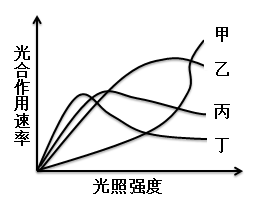

A. 甲

B. 乙

C. 丙

D. 丁

第 98 题 · 答案与解析

**参考答案（粉笔题库参考内容）**

D

**解析**

图表显示，植物丁随着光照强度的增加，光合作用速率不增反减，最先降低，因此最适宜在荫蔽条件下生长。而植物甲则恰恰相反，最适合阳光充足的条件下生长。

故正确答案为D。

**考点**：自然地理

**来源**：2009年云南省公务员录用考试《行测》题第98题

### 第 99 题

邓某经某村同意在该村地界建房作经营场地，后该区土地管理局、乡政府等有关人员在现场指出，此建筑未办理土地使用手续和建房许可证，属违章建筑，应予以拆除。市城管监察大队某区中队未向邓某下达任何处理决定即带民工10余人将房屋拆除。

邓某欲起诉，应以何行政主体为被告：

A. 某市城管监察大队

B. 某市城管监察大队某区中队

C. 某区土地管理局

D. 某乡政府

第 99 题 · 答案与解析

**参考答案（粉笔题库参考内容）**

A

**解析**

根据《行政诉讼法》第二十六条规定：“公民、法人或者其他组织直接向人民法院提起诉讼的，作出行政行为的行政机关是被告。”区土地管理局和乡政府虽指出邓某建筑是违章建筑，但并未付诸具体行政行为。市城管监察大队是行政机关的委托组织，而某区中队仅为其内部机构，因此作为被告应是有行政主体资格的市城管监察大队。

故正确答案为A。

**考点**：行政法

**来源**：2009年云南省公务员录用考试《行测》题第99题

### 第 100 题

2009年4月30日，甲以手机短信形式向乙发出购买一台笔记本电脑的要约，乙于当日回短信同意要约。但由于“五一”期间短信系统繁忙，甲于5月3日才收到乙的短信并因个人原因于5月8日才阅读乙的短信，后于9日回复乙“短信收到”。

甲乙之间买卖合同的成立时间是：

A. 2009年5月9日

B. 2009年5月8日

C. 2009年5月3日

D. 2009年4月30日

第 100 题 · 答案与解析

**参考答案（粉笔题库参考内容）**

C

**解析**

本题考查法律常识，主要涉及合同的成立。《中华人民共和国民法典》第四百八十三条规定：“承诺生效时合同成立。”《合同法》第二十六条规定：“承诺通知到达要约人时生效。承诺不需要通知的，根据交易习惯或者要约的要求作出承诺的行为时生效。采用数据电文形式订立合同的，承诺到达的时间适用本法第十六条第二款的规定。”《合同法》第十六条第二款规定：“采用数据电文形式订立合同，收件人指定特定系统接收数据电文的，该数据电文进入该特定系统的时间，视为到达时间；未指定特定系统的，该数据电文进入收件人的任何系统的首次时间，视为到达时间。”本题中，甲于5月3日收到乙的承诺短信，此时即合同成立。

故正确答案为C。

**考点**：民法典

**来源**：2009年云南省公务员录用考试《行测》题第100题

### 第 101 题

我国现阶段，不同国有企业的职工付出同样的劳动获得的劳动报酬会有所差别。

这是因为：

A. 贯彻按劳分配会使一部分企业先富起来

B. 按劳分配和按资分配是结合在一起的

C. 按劳分配要贯彻效率优先、兼顾公平的原则

D. 按劳分配的实现程度与国有企业的经营成果联系在一起

第 101 题 · 答案与解析

**参考答案（粉笔题库参考内容）**

D

**解析**

本题考查新思想。

不同国有企业之所以会出现同工不同酬的现象，其原因在于不同的企业，其经营成果也不一样，生产经营好的劳动者所得就高。可见按劳分配的实现程度与国有企业的经营成果是联系在一起的。

故正确答案为D。

**考点**：经济建设

**来源**：2009年云南省公务员录用考试《行测》题第101题

### 第 102 题

社会意识相对独立性的最突出的表现是：

A. 社会意识的历史继承性

B. 各种社会意识之间的相互影响

C. 社会意识对社会存在的反作用

D. 社会意识具有超前性、滞后性

第 102 题 · 答案与解析

**参考答案（粉笔题库参考内容）**

C

**解析**

社会意识具有相对独立性。社会意识能够积极地反作用于社会存在，精神力量可以变成物质力量，这是社会意识相对独立性的最突出的表现。

故正确答案为C。

**考点**：唯物论

**来源**：2009年云南省公务员录用考试《行测》题第102题

### 第 103 题

和谐社会可以理解为：

A. 西方社会的“福利社会”

B. 社会主义的治国思想

C. 我国古代社会描写的“田园牧歌”

D. “大同”社会

第 103 题 · 答案与解析

**参考答案（粉笔题库参考内容）**

B

**解析**

人类社会是一个不断从低级向高级发展的历史过程。实现社会和谐，建设美好社会，始终是人类孜孜以求的一个社会理想，也是包括中国共产党在内的马克思主义政党不懈追求的一个社会理想。对于中国共产党人来说，构建社会主义和谐社会，既是一种治国理想，又是一种治国方略、治国机制，也是一种治国结果，是目标与过程的统一，符合人类历史发展的规律。

故正确答案为B。

**来源**：2009年云南省公务员录用考试《行测》题第103题

### 第 104 题

以下标题哪一个符合通报的撰写要求：

A. 《国务院关于部分地区违反国家购销政策的通报》

B. 《国务院关于进行第三次全国人口普查的通报》

C. 《国务院关于打击假冒伪劣商品的通报》

D. 《关于打击盗掘和走私文物活动的通报》

第 104 题 · 答案与解析

**参考答案（粉笔题库参考内容）**

A

**解析**

公文标题一般由发文机关、事由（主要内容或发文目的）、文种三部分构成，选项D错误。通报按内容可分为表彰性通报、事故通报、批评错误典型的通报，选项B、C的事由不正确。

故正确答案为A。

**来源**：2009年云南省公务员录用考试《行测》题第104题

### 第 105 题

新文化运动的主要内容是提倡：

A. 文学革命

B. 思想解放

C. 民主和自由

D. 民主和科学

第 105 题 · 答案与解析

**参考答案（粉笔题库参考内容）**

D

**解析**

科学和民主是新文化运动的两大主题，以陈独秀、胡适等人为首的知识分子依靠《新青年》等刊物针对封建陋习和政治上的复古风气等现象，在知识界和青年学人间打出“德先生”、“赛先生”的旗帜，普及科学与民主常识。

故正确答案为D。

**考点**：中国历史

**来源**：2009年云南省公务员录用考试《行测》题第105题

### 第 106 题

社会学实践表明，两个人以团队的方式相互协作、优势互补，其工作绩效明显优于两个人单干时的总和。

团队精神的核心是：

A. 协同合作

B. 奉献精神

C. 目标一致

D. 团结一致

第 106 题 · 答案与解析

**参考答案（粉笔题库参考内容）**

A

**解析**

所谓团队精神，简单来说就是大局意识、协作精神和服务精神的集中体现。团队精神的核心团结协作、优势互补。团队精神强调的不仅仅是一般意义上的合作与齐心协力，因为这最多带来“1+1=2”的效果，要发挥团队的优势，其核心在于大家在工作上加强沟通，利用个性和能力差异，在团结协作中实现优势互补，发挥积极协同效应，带来“1+1>2”的绩效。团队精神的基础是尊重个人的兴趣和成就，最高境界是全体成员的向心力、凝聚力。

故正确答案为A。

**考点**：其他

**来源**：2009年云南省公务员录用考试《行测》题第106题

### 第 107 题

对于能挑150斤的人，领导者既不是只让他挑100斤，也不是硬要他挑200斤，体现了：

A. 扬长避短，各尽所能

B. 量才用人，职能相称

C. 用人不疑，疑人不用

D. 爱护人才，关心帮助

第 107 题 · 答案与解析

**参考答案（粉笔题库参考内容）**

B

**解析**

领导者使用人才的基本原则包括：

（1）量才用人，职能相称的原则；

（2）扬长避短，各尽所能的原则；

（3）用人不疑，疑人不用的原则；

（4）合理搭配，整体效能的原则；

（5）五湖四海，宽以容才的原则；

（6）合理流动，适才适所的原则；

（7）爱护人才，关心帮助的原则；

（8）重视培养，用养结合的原则。

其中量才用人，职能相称原则的基本要求是：根据人才能力的大小，给予适当的职位。

故正确答案为B。

**考点**：其他

**来源**：2009年云南省公务员录用考试《行测》题第107题

### 第 108 题

在月球上可能发生的现象是：

A. 放风筝

B. 月球车不需要进行防锈处理

C. 用电风扇乘凉

D. 听到雷声

第 108 题 · 答案与解析

**参考答案（粉笔题库参考内容）**

B

**解析**

月球上没有空气，凡是与大气相关的问题在月球上都不可能发生，放风筝不可能、电风扇不可能，雷声需要空气作为介质传播，遂也不可能听到雷声。但金属的氧化作用也会因此失效，因为月球上几乎没有氧气。

故正确答案为B。

**考点**：自然地理

**来源**：2009年云南省公务员录用考试《行测》题第108题

### 第 109 题

在下列关于中外合资经营企业与中外合作经营企业共同特点的表述中，符合外商投资企业法律制度规定的是：

A. 二者的注册资本均为在工商行政管理机关登记的中外投资各方认缴的出资额之和

B. 二者的中外投资者均以其投资额为限对企业的债务承担有限责任

C. 二者的中外投资者均可以是公司、企业、其他经济组织或者个人

D. 二者分别都只对己方负责，不承担对方的法律责任

第 109 题 · 答案与解析

**参考答案（粉笔题库参考内容）**

A

**解析**

本题考查中外合资经营企业和中外合作经营企业的区别。

B选项错误，承担责任形式上，合作企业以其投资或者提供的“合作条件”为限承担有限责任；

C选项错误，根据规定，合营企业和合作企业的“外国投资者”可以是个人，“中方投资者”必须是公司、企业或者其他组织；

D选项错误，中外合资经营企业是有限责任公司，合营各方遵照平等互利原则，共同出资、共同经营、按各方注册资本比例分享利润、分担风险和亏损。

故正确答案为A。

**考点**：劳动法和经济法

**来源**：2009年云南省公务员录用考试《行测》题第109题

### 第 110 题

下列关于法律责任的陈述，正确的是：

A. 法律责任都是过错责任

B. 惩罚是法律责任最主要的功能

C. 法律责任是法律制裁的前提

D. 法律责任必然导致法律制裁

第 110 题 · 答案与解析

**参考答案（粉笔题库参考内容）**

C

**解析**

法律责任是指由违法行为、违约行为或者由于法律规定而应承受的某种不利的法律后果。法律制裁是指由特定国家机关对违法者依其法律责任而实施的强制性惩罚措施，法律责任是法律制裁的前提。但法律责任并不必然导致法律制裁，如刑诉定罪免责。法律责任都是过错责任，就民诉来看显然错误。惩罚是法律责任的最主要功能则不恰当，如民事责任基本上是补偿性的。

故正确答案为C。

**考点**：法理学

**来源**：2009年云南省公务员录用考试《行测》题第110题

## 材料 5

据某房地产公司统计资料分析，2008年云南省昆明市二手房均价为3906.21元/平方米，同比涨幅为4.5%，2008年政府实施了一系列调控房价的措施，这些措施使得二手房价格涨幅趋势，相比2007年6.8%的涨幅已经出现一定的回落，宏观调控的效力得到明显体现。

        另据统计显示，2008年昆明市城四区的二手房均价为4686元/平方米，相比去年上涨6.5%，呈贡、东川、安宁和宜良四个郊县的二手房均价为3199.2元/平方米，相比去年上涨3.2%，2008年昆明市商品房住宅期房的价格达到了5520元/平方米，相比去年同期上涨15%，其上涨幅度明显高于二手房价格的涨幅。

        统计还显示，昆明市现有住宅存量面积约有3000万平方米，其中，已购公房的存量房面积接近1950万平方米，二手商品住宅的存量面积接近1050万平方米，截至去年2007年9月，昆明市空置一年以上的商品住宅面积为36万平方米。

### 第 111 题

2006年昆明市二手房的交易价格为：

A. 3500元/平方米

B. 3738元/平方米

C. 3943元/平方米

D. 4100元/平方米

第 111 题 · 答案与解析

**参考答案（粉笔题库参考内容）**

A

**解析**

根据题干“2006年昆明市二手房的交易价格”结合材料时间为2008年，可判定本题为间隔基期问题。定位文字材料第一段：“2008年云南省昆明市二手房均价为3906.21元/平方米，同比涨幅为4.5%，2007年涨幅为6.8%”。根据公式：间隔增长率，可计算间隔增长率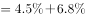=11.6%。根据公式：基期量，可得2006年昆明市二手房的交易价格为：=3487.5，与A项最接近。

故正确答案为A。

**考点**：文字资料、间隔基期

**来源**：2009年云南省公务员录用考试《行测》题第111题

### 第 112 题

2007年昆明市城四区二手房的交易价格为：

A. 3800元/平方米

B. 4250元/平方米

C. 4400元/平方米

D. 4560元/平方米

第 112 题 · 答案与解析

**参考答案（粉笔题库参考内容）**

C

**解析**

根据题干“2007年昆明市城四区二手房的交易价格”，结合材料时间为2008年，可判定本题为基期计算问题。定位文字材料第二段，“2008年昆明市城四区的二手房均价为4686元/平方米，相比去年上涨6.5%”。根据公式：基期量，代入数据可得2007年昆明市城四区二手房的交易价格为≈4400元/平方米。

故正确答案为C。

**考点**：基期计算、文字资料

**来源**：2009年云南省公务员录用考试《行测》题第112题

### 第 113 题

昆明市呈贡、东川、安宁和宜良四个郊县2007年二手房的交易价格为：

A. 2785元/平方米

B. 2900元/平方米

C. 3000元/平方米

D. 3100元/平方米

第 113 题 · 答案与解析

**参考答案（粉笔题库参考内容）**

D

**解析**

根据题干“······2007年二手房的交易价格”，结合材料时间2008年，可判定本题为基期计算问题。定位文字材料第二段：“2008年，呈贡、东川、安宁和宜良四个郊县的二手房均价为3199.2元/平方米，相比去年上涨3.2%”。 根据公式：，代入数据可得昆明市呈贡、东川、安宁和宜良四个郊县2007年二手房的交易价格为：

元/平方米，与D项最接近。

故正确答案为D。

**考点**：基期计算、文字资料

**来源**：2009年云南省公务员录用考试《行测》题第113题

### 第 114 题

2007年昆明市期房的均价与二手房的交易均价的差价为：

A. 998元/平方米

B. 1062元/平方米

C. 1136元/平方米

D. 1186元/平方米

第 114 题 · 答案与解析

**参考答案（粉笔题库参考内容）**

B

**解析**

根据题干“2007年昆明市期房的均价与二手房的交易均价的差价”，结合材料时间2008年，可判定本题为基期和差问题。定位文字材料第一、二段，“2008年昆明市二手房均价为3906.21元/平方米，同比涨幅为4.5%，期房5520元/平方米，上涨15%”。根据公式： ，可计算2007年昆明市期房的均价与二手房的交易均价的差价为 元/平方米，与B项最接近。

故正确答案为B。

**考点**：基期和差、文字资料

**来源**：2009年云南省公务员录用考试《行测》题第114题

### 第 115 题

根据上述文字材料，下列说法正确的是：

A. 已购公房的存量房面积约占现有住宅存量面积的75%

B. 二手房的交易数量下降是昆明市二手房价格涨幅趋缓的主要原因

C. 2006-2008年昆明市二手房交易价格的年增长率为5.6%

D. 昆明市空置一年以上的商品房住宅面积约占现有住宅存量面积的1.4%

第 115 题 · 答案与解析

**参考答案（粉笔题库参考内容）**

C

**解析**

A项：定位文字材料第三段可得：统计还显示，昆明市现有住宅存量面积约有3000万平方米，其中，已购公房的存量房面积接近1950万平方米。已购公房的存量房面积占现有住宅存量面积比重为，错误；

B项：定位文字材料第一段可得：2008年政府实施了一系列调控房价的措施，这些措施使得二手平房价格涨幅趋缓。二手房价格涨幅趋缓并非由于二手房的交易数量下降，错误；

C项：定位文字材料第一段可得：2008年云南省昆明市二手房均价为3906.21元/平方米。结合本材料第一题结果：2006年昆明市二手房均价为3500元/平方米。根据年均增长率公式：，代入数据，若r=5.6%，则=3892，接近于3906.21元/平方米，正确；

D项：定位文字材料第三段可得：统计还显示，昆明市现有住宅存量面积约有3000万平方米······昆明市空置一年以上的商品住宅面积为36万平方米。昆明市空置一年以上的商品房住宅面积占现有住宅存量面积的比重为，错误。

故正确答案为C。

**考点**：文字资料、综合分析

**来源**：2009年云南省公务员录用考试《行测》题第115题

## 材料 6

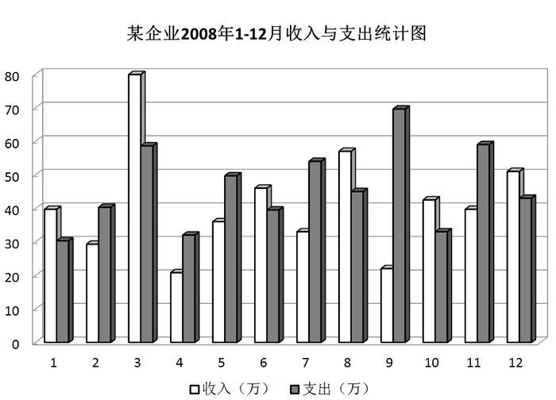

### 第 116 题

从图中可看出，该企业收入最多的月份是：

A. 3月

B. 8月

C. 9月

D. 12月

第 116 题 · 答案与解析

**参考答案（粉笔题库参考内容）**

A

**解析**

定位统计图，白色柱形图代表收入，观察可知，3月份的企业收入最多。

故正确答案为A。

**考点**：直接找数、统计图

**来源**：2009年云南省公务员录用考试《行测》题第116题

### 第 117 题

从图中可看出，该企业支出大于收入最多的一个月是：

A. 2月

B. 7月

C. 9月

D. 11月

第 117 题 · 答案与解析

**参考答案（粉笔题库参考内容）**

C

**解析**

定位柱形图，黑色柱形图代表支出，白色柱形图代表收入，则企业支出大于收入最多的月份，即为两个柱子高度差最大的月份。观察2、7、9、11月，高度差最大的是9月。

故正确答案为C。

**考点**：简单加减计算、统计图

**来源**：2009年云南省公务员录用考试《行测》题第117题

### 第 118 题

从图中可看出，该企业收入小于支出的共几个月：

A. 2

B. 3

C. 4

D. 6

第 118 题 · 答案与解析

**参考答案（粉笔题库参考内容）**

D

**解析**

定位柱形图，白色柱形图代表收入，黑色柱形图代表支出，企业收入小于支出，即白色柱形图高度小于黑色柱形图。观察可知，满足的月份有2、4、5、7、9、11月，一共有6个月。

故正确答案为D。

**考点**：直接找数、统计图

**来源**：2009年云南省公务员录用考试《行测》题第118题

### 第 119 题

从图中可看出，该企业收入大于50万的月份有几个月：

A. 1

B. 2

C. 3

D. 4

第 119 题 · 答案与解析

**参考答案（粉笔题库参考内容）**

B

**解析**

定位柱形图，白色柱形图代表收入，企业收入大于50万，即白色柱形图高于纵标50的刻度线。观察可知，满足的月份有3月、8月，一共有2个月。

故正确答案为B。

**考点**：直接找数、统计图

**来源**：2009年云南省公务员录用考试《行测》题第119题

### 第 120 题

该企业收入与支出相比差距大于30万的有几个月：

A. 1

B. 2

C. 3

D. 4

第 120 题 · 答案与解析

**参考答案（粉笔题库参考内容）**

A

**解析**

定位柱形图，白色柱形图代表收入，黑色柱形图代表支出，企业收入与支出差距大于30万，即两个柱子的高度差大于纵标3个格子。观察可知，满足的只有9月一个月份。

故正确答案为A。

**考点**：简单加减计算、统计图

**来源**：2009年云南省公务员录用考试《行测》题第120题

## 材料 7

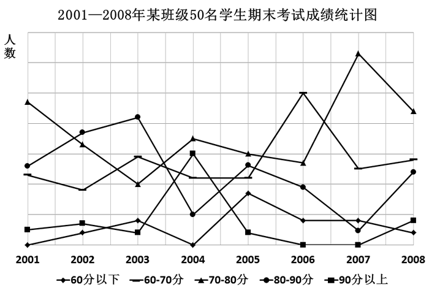

### 第 121 题

该班级90分以上人数最多的年份是：

A. 2002年

B. 2003年

C. 2004年

D. 2008年

第 121 题 · 答案与解析

**参考答案（粉笔题库参考内容）**

C

**解析**

观察带小正方形的折线，最大值出现在2004年。

故正确答案为C。

**考点**：直接找数、统计图

**来源**：2009年云南省公务员录用考试《行测》题第121题

### 第 122 题

该班级70分以下人数最多的年份是：

A. 2001年

B. 2002年

C. 2006年

D. 2007年

第 122 题 · 答案与解析

**参考答案（粉笔题库参考内容）**

C

**解析**

观察带小菱形与小长方形的折线，对应的数值之和最大出现在2006年。

故正确答案为C。

**考点**：直接找数、统计图

**来源**：2009年云南省公务员录用考试《行测》题第122题

### 第 123 题

该班级60分以下人数最多的年份是：

A. 2003年

B. 2005年

C. 2006年

D. 2007年

第 123 题 · 答案与解析

**参考答案（粉笔题库参考内容）**

B

**解析**

观察带菱形的折线，最大值出现在2005年。

故正确答案为B。

**考点**：直接找数、统计图

**来源**：2009年云南省公务员录用考试《行测》题第123题

### 第 124 题

该班级80~90分分数段学生人数最多的年份是：

A. 2001年

B. 2002年

C. 2003年

D. 2008年

第 124 题 · 答案与解析

**参考答案（粉笔题库参考内容）**

C

**解析**

观察带小圆形的折线，最大值出现在2003年。

故正确答案为C。

**考点**：直接找数、统计图

**来源**：2009年云南省公务员录用考试《行测》题第124题

### 第 125 题

该班级没有90分以上成绩的年份有几个：

A. 1

B. 2

C. 3

D. 4

第 125 题 · 答案与解析

**参考答案（粉笔题库参考内容）**

B

**解析**

定位带小正方形的折线，没有90分以上的成绩，即折线图在最下面。观察可知，有2006、2007两个年份。

故正确答案为B。

**考点**：直接找数、统计图

**来源**：2009年云南省公务员录用考试《行测》题第125题

## 材料 8

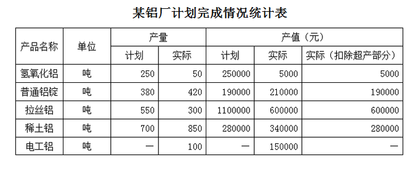

### 第 126 题

实际产量最大的是哪种产品：

A. 氢氧化铝

B. 普通铝锭

C. 拉丝铝

D. 稀土铝

第 126 题 · 答案与解析

**参考答案（粉笔题库参考内容）**

D

**解析**

观察第4列，稀土铝实际产量最大。

故正确答案为D。

**考点**：排序类、统计表

**来源**：2009年云南省公务员录用考试《行测》题第126题

### 第 127 题

计划产量与实际产量差异最大的是哪种产品：

A. 氢氧化铝

B. 稀土铝

C. 电工铝

D. 拉丝铝

第 127 题 · 答案与解析

**参考答案（粉笔题库参考内容）**

D

**解析**

定位表格第三、四列，各个产品的计划产量与实际产量差异分别为：

氢氧化铝：250-50=200吨；

稀土铝：700-850=-150吨；

电工铝：无数据支持，无法计算；

拉丝铝：550-300=250吨。

比较可知，计划产量与实际产量差异最大的是拉丝铝。

故正确答案为D。

**考点**：简单加减计算、统计表

**来源**：2009年云南省公务员录用考试《行测》题第127题

### 第 128 题

计划产值与实际产值差异最大的是哪种产品：

A. 稀土铝

B. 拉丝铝

C. 普通铝锭

D. 氢氧化铝

第 128 题 · 答案与解析

**参考答案（粉笔题库参考内容）**

B

**解析**

定位表格第五、六列，各产品的计划产值与实际产值差异分别为：

稀土铝：280000-340000=-60000元、

拉丝铝：1100000-600000=500000元、

普通铝锭：190000-210000=-20000元、

氢氧化铝：250000-5000=245000元，

比较可知，计划产值与实际产值差异最大的是拉丝铝。

故正确答案为B。

**考点**：简单加减计算、统计表

**来源**：2009年云南省公务员录用考试《行测》题第128题

### 第 129 题

稀土铝的实际产值比计划产值增加了：

A. 19.43%

B. 21%

C. 21.43%

D. 22%

第 129 题 · 答案与解析

**参考答案（粉笔题库参考内容）**

C

**解析**

根据题干“稀土铝的实际产值比计划产值增加了”，结合选项带“%”，可判定本题为一般增长率计算问题。定位表格第五、六列，稀土铝的计划产值与实际产值分别为280000元、340000元。实际产值比计划产值增加了。

故正确答案为C。

**考点**：一般增长率、统计表

**来源**：2009年云南省公务员录用考试《行测》题第129题

### 第 130 题

下列哪种说法不正确：

A. 普通铝锭的产量增加了，产值也增加了

B. 拉丝铝的产量增加了，产值也增加了

C. 电工铝的产量增加了，产值也增加了

D. 氢氧化铝产量降低了，产值也减少了

第 130 题 · 答案与解析

**参考答案（粉笔题库参考内容）**

B

**解析**

A项：定位表格材料可得：普通铝锭实际产量（420吨）＞计划产量（380吨），实际产值（210000元）＞计划产值（190000元），因此普通铝锭的产量和产值都增加了，正确；

B项：定位表格材料可得：拉丝铝实际产量（300吨）＜计划产量（550吨），实际产值（600000元）＜计划产值（1100000元），因此拉丝铝的产量和产值都减少了，错误；

C项：定位表格材料，没有电工铝计划产量和计划产值的数据，无法推出电工铝的产量和产值情况；

D项：定位表格材料可得：氢氧化铝实际产量（50吨）＜计划产量（250吨），实际产值（5000元）＜计划产值（250000元），因此氢氧化铝的产量和产值都减少了，正确。

本题为选非题，故正确答案为B。

**考点**：统计表、综合分析

**来源**：2009年云南省公务员录用考试《行测》题第130题

