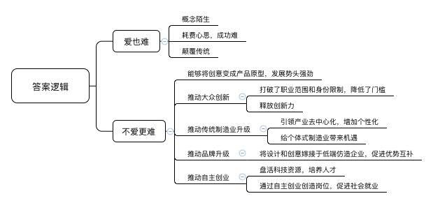
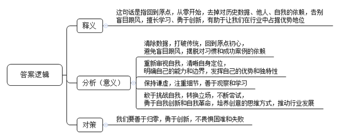
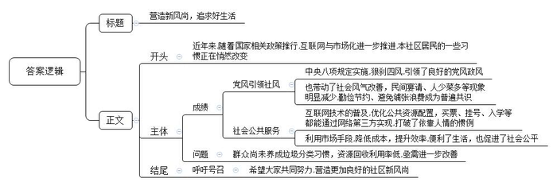
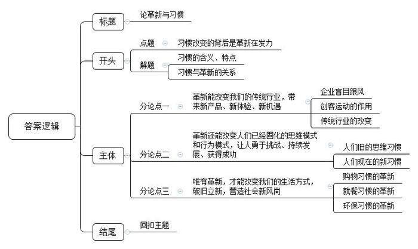

# 2015年公务员多省联考《申论》题（云南卷）

<!-- gwy:overview:start -->
> **云南 · 2015 · 申论 · 统考** ｜ 4 题 · 图片 4 处 · 答案随题折叠

导航：[题目](#题目) · [材料 1](#材料-1)
<!-- gwy:overview:end -->

> 候选采集稿。参考答案及解析来自粉笔页面，不代表官方答案或真实高分答卷；来源使用许可与原卷对应关系仍需人工核实。

## 给定材料

### 材料 1

创客是指利用开源硬件和互联网将各种创意变为实际产品的人，他们将制造业搬到了自己桌面上，电子服装、健康手环、智能手表、导电墨水、食物烹饪器等等，用户能想象到的产品都有可能在创客手中实现。创客在带有加工车间和工作室功能的软硬件开放实验室（创客空间）将创意变成产品原型，实现从0到1。

对很多中国人而言，“创客”还是个较为陌生的概念，但凭借蓬勃生命力和强劲发展势头，创客正在悄然影响着传统制造业。许多创客空间在产品设计和原型创造基础上，还延伸了兼具产品孵化和企业孵化的功能，在这里不仅可以实现从0到1再到100，即从创意到产品原型再到小批量产品，还能给创客提供创业场地、管理咨询、投融资、渠道销售等服务。在用户体验和互联网推动下，创客产品成为热门的个性化定制商品；也有小部分创客产品经过市场检验获得大众需求的认可，成为工业化生产的大众商品。无论哪种形式，都完成了从创意向创业的转化过程，这种转化也正是创客文化繁荣发展的本质。

创客运动在中国的兴起时间虽短却发展迅猛，国内强大的制造业生态体系、丰富的人力资源、雄厚的资本和艺术积淀是创客扎根成长的肥沃土地，它所迸发出的潜力是未来工业体系和经济发展的重要机遇。深圳是国内创客产业链最完整的城市，被誉为创客天堂。创客在这里可以找到齐全的电子元器件，各类加工厂和技术工程人员，快速完成从创意到产品原型再到小批量生产的全过程；与深圳的务实高效相比，上海的创客显得气定神闲、回归本质，具有国外兴趣使然的创新氛围；北京创客则更具跨界协同创新及创业精神，因为北京是顶尖技术人才、文艺人才和资本机构云集的城市。

创客群体没有职业范围和身份限制，任何有创意且有激情将创意变为现实的人都能成为创客。在创客空间，既看不到高精端的大型仪器设备，也看不到众多发明专利和成果，创客空间里有的是热爱创造的人，他们以兴趣为导向，以创意为起点，以体验为动力，通过自我满足的创业方式将大众群体中蕴藏的巨大创新力挖掘和释放出来。

传统制造业以满足大众基本需求为目标，规模化生产出利润丰厚的热门产品。但随着热门产品的同质化发展和激烈竞争，大众需求会逐渐向个性化需求分解，这是经济发展给消费者选择产品带来的必然趋势。创客在这种趋势利导下产生，引领制造业从中心化和大规模形态朝着个体式和去中心化的方向发展，根据个性化需求来生产小众商品，给个体式制造业带来机遇。

2013年11月，英国《经济学家》杂志刊发的一篇题为《中国制造》的文章让“中国创客”成为焦点。该文章指出，中国创客的力量不可小觑，其潜在优势就是他们与所谓的山寨制造体系密切联系。企业之所以山寨是因为没有设计和创意，依靠模仿他人产品来生产制造，而创客恰恰是设计和创意的源泉和载体。在互联网时代，软件开源和硬件开源给中国企业提供了难得的平等创新机会，若能将创客的设计和创意嫁接于低端仿造企业，让创客的巨大创造性和制造需求与山寨企业完备的供应链资源和制造能力优势互补，或许能迸发出惊人的能量，这未必不是山寨企业转型的一条出路。

2013年11月4日，清华大学启动创客驻校园计划，计划每年聘请国内外知名创客进驻学校创客空间，鼓励学生主动参与创新实践，提升跨学科的技术与创意交流。此外，多所大学甚至一部分中学和职业院校也积极推动创客教育，各具特色、充满活力的教育创客空间盘活了院校科技资源，加强了教学与实践、教育与产业之间联动，培养出具有创新创业精神的一流人才。国内每年毕业的几百万大学生是创客运动的最佳人选，他们能将学业中萌发的创意思想和积累的研究成果衍变为创客项目，用自主创业的方式实现就业。这些创客项目转化为创业公司以后，会吸引更多不同层次的社会人才加入其中。麦肯锡2013年研究报告指出，由于机器人和网络技术的突飞猛进，过去10年大型制造企业的雇佣人数持续减少，因为规模制造对自动化生产系统的紧密依赖逐步取代了人工参与。而创客运动引领的个体式制造业根据用户个性化需求来定制生产商品，对技术、工程、艺术等各行各业人工劳动力的需求巨大，必然创造出大量新的就业岗位。

有人感叹：创客啊，耗费了多少脑汁和心思，颠覆了多少司空见惯，收获了多少意外惊喜，蕴藏了多少期待和愿景？真让人“爱也难，不爱更难！”

### 材料 2

以下是根据一位资深广告人在某会议上的发言录音整理的部分内容：

现在是一个大数据的时代，我们被逼跟着数据在走。我们在继续往前走的时候，要倒退到原点回顾一下你当初为什么要做这件事情，这是世界各地尤其是国内比较欠缺的东西。很多中国的企业都在扮演“我跟随”的角色，别的行业有这个东西，我也就要做。

我们都在寻找我们能做什么，其实我们都忽略了很重要的一点，我们更要知道你不能做什么，你不要做什么。我们常常看到很多广告和传播说你要做你自己，这是废话，你除了做你自己还做谁呀，你不能做周杰伦，周杰伦给周杰伦做了，刘德华也不行，你只有做你自己，但你要做得比周杰伦和刘德华还好。

这几年我称自己是一个下岗的广告民工，我反而看到很多当时我身在广告业中看不到的东西，因为越来越平民化，越来越农民化，我看到的东西都是很小的东西，但这些东西都很可能举足轻重，能够改变很多东西。广告中，一些数据会引导我们，我们会本着数据做很多东西，但千万不要把数据变成一个依据，你要在数据中找到有什么东西可以挑战，而不是变成一个护身符，数据说这样，我们就这样，在这个时代，创意的思维方式可能超过以往任何时候。

做任何事情，大到做人、做行业，小到你要做的事情、要找的东西，都应该考虑，到底有没有挑战？不能因为别的企业做了这样的东西，你就也要去做。你要想一想，你做的东西有没有挑战你的企业，会不会挑战你的员工，最主要有没有挑战你本身？尤其现今社会，人类基本上没有自信心。因为我们没有狼牙虎爪，我们连乌龟壳也没有，所以，我们需要包装，我们需要洋房、汽车、美容，再不行把面孔也改了，手机的美化软件就是应此而生。现在的手机我真的试过45度拍，脸真的尖了，现在的手机还可以让你美白，眼睛变大，大家可能也看过那种手机美女和真人对比，把你吓死。

国外一个电视台访问过很多最近新兴的小企业家，你会发现他们有一个共同点，他们都在新的尝试中找到挑战，基本上他做的不是他原来做的东西。所以，一定希望在你做的东西中找出你的挑战......不然的话，你如果只是想，尤其在中国大陆只是想明天过得比今天好一点，那太没有意思了。我估计在场每个人的学历和资历都会比我高，但我能有今天就是因为我读书少，在下只有中学的学历，现在再把我送去高考，我还是会考不上，但我有自知之明，我读书少，我不会的东西多，从第一天开始，我到现在仍然有这个习惯，从零开始。在座各位可能觉得这个理论大家常听说，这个东西可能是任何行业最难做的东西——从零开始，人性的习惯会使你习惯于从你前一个案例，尤其是成功的案例去借鉴，你希望做得更好，但是，以我冷眼旁观，这里面有很多问题。最近我被邀请回新加坡，我现在被收录到新加坡档案局里，是以一个非典型而被记录，因为以我的背景我不可能有这一天，但是因为这个“零”有很多的意义，因为我什么都不懂，什么都不会，结果这变成我最擅长的一个行业。

所以，各位如果有机会的话，能否像我一样，我每天都逼着让自己客户归零，归零后一般人想出来的东西都和立场不一样。

我常常鼓励学生，我也会鼓励任何人不要怕犯错误，错误是一个很大的动力，当你不怕错误的时候，你差不多什么都敢做。我的能量来自什么？我学历不够，我甚至没有修过广告学。不要怕失败，我们常说失败是成功之母。所以，敢于去犯错，我们有很多成语故事教过我们这样做，但我们是否真的从中学到过任何东西呢？

### 材料 3

自从开展党的群众路线教育实践活动，贯彻执行中央“八项规定”，狠刹“四风”以来，各地公款消费现象得到有效遏制，以致一些酒店、歌厅的生意也大不如前，甚至门庭冷落，让经营者感到很纠结。

张某开了一家中等规模的海鲜饭店，生意一直都还不错。他最倚重的是每逢周末、节假日，各种同学聚会、生日宴请、结婚喜宴、活动庆典等等，虽然让他忙得不可开交，但也乐在其中，用他的话说，这是饭店的“经济支柱”。然而，这两年的情形有点不大对，这类生意量急剧下降。2014年夏天，高考成绩公布，张某以为一波接一波的“谢师宴”将会像往年一样闪亮登场，早早备好了每桌1888元到5888元不同档次的菜单，准备赚一笔。可奇怪的是，今年一桌也没有预订出去。一打听，不是学生和家长不请了，而是老师们都纷纷谢绝了。张某有点费解：“这谢师宴又不是公款消费，学生和家长掏自个儿的腰包感谢老师的培养，这种人之常情难道也有错儿？”

即使跟公款消费毫无关系的顾客自掏腰包的消费，也比过去有了很大改观。人少菜多、浪费严重的现象越来越少，饭后“打包”、“光盘”行动日益普遍。“这个嘛……唉！我的钱还怎么赚哪？”张某摇着头，心情颇为复杂。

### 材料 4

互联网的日益普及和开发利用，不断为人们的工作和生活提供方便，网上购物、网上预约、网上咨询等等风靡中国。尤其对年轻人来说，他们更习惯于依靠网络解决各种困难，24岁的小茜对此深有体会。以前逢年过节要回家探亲，买火车票是最让她头疼的事。裹着大衣在寒冷的夜里排队购票、托关系找人购票、买“黄牛党”高价票等等，这些都曾亲身经历过。现在有了网络购票，别提多方便省事了。前不久小茜跟母亲通电话，听说母亲想到当地一家医院看“专家门诊”，可是排队很长时间还不一定能挂上号。小茜立刻到网上替母亲挂上了专家号。

李先生一直为儿子小学毕业上哪所初中犯愁。同事给他支招，赶紧找人托关系打招呼，该花钱就花钱。李先生知道，这是多年来老百姓为孩子上学求人的“惯例”。即使心里一万个不乐意，可是为了孩子，求人花钱，也是正常。谁知今年区里实行了“新政”，学区内八成小学生通过电脑派位的形式进入学区初中学习。学生可填报两次志愿，第一批次可填报不少于4所学校，第二批次可填报不少于5所学校。第一批次志愿面对全区所有学生，不设身份限制，全区所有优质资源品牌学校将拿出15%的比例用于第一批次派位。第二批次志愿学生只可填报自己所在学区内的中学，电脑根据志愿随机分配。结果，李先生的儿子顺利进入一所理想的中学。

小林买了一套装修好的二手房，准备利用国庆假期搬家。他的父母特地从老家赶来，还带了舅舅、表哥等三四个人来帮忙。谁知小林早已请好了搬家公司，总共花了800元，半天时间东西全部搬上楼安置妥当。小林在楼下饭店请父母舅舅们吃饭，舅舅说：“没帮上忙，还害你花钱请吃饭。早知这样我们就不来了。”表哥说：“你们长辈的老习惯今后可以改改了。找亲友帮忙搬家，人累得够呛不说，钱也不少花，光是一顿饭加上烟酒钱，就够付人家搬家费了。”父亲说：“搬新家是喜事，找人帮忙是老习惯，请人吃饭感谢感谢，也是人之常情嘛。不过，要是光算经济账，看来还真不如请搬家公司。”

小辉父母家里的一台老式电视机坏了，要买台新的。早已养成办事“找关系”习惯的小辉父亲，有个经常一起钓鱼的好朋友，儿子在家电商场工作。小辉父亲不知打哪儿听说商场职工买东西可以打九折，就打算请这位朋友吃顿饭，请他的儿子帮忙，能便宜一二百块钱。小辉听说后连忙阻止了父亲。他上网一查，同样一款电视机，网上价格比商场便宜300多块。他从网上订购了一台，第三天电视机就送到家里，父母非常高兴。小辉跟父亲说：“现在不比从前了，像电视机这样的东西，市场供应那么充足，还用得着找关系吗？”

### 材料 5

南方某城市环保志愿者小黄觉得自己每天都生活在苦恼中。他和其他志愿者每个月都会上门向小区居民发放垃圾袋并现场进行分类投放指导。“有督导的时候，分类效果明显就好，但往往过一段时间，乱丢混丢的又多起来。”

厨余垃圾处理是一道中国特色的垃圾难题。小黄说，中国菜中汤汤水水的厨余垃圾占垃圾总量的2/3，其中的有机物会使其变臭，而且会污染垃圾中的可回收物。为分出厨余垃圾，要鼓励居民家庭把垃圾分干湿两类。可是即便只分出湿垃圾，准确投放率也不到30%。小黄看过一则简报，其中提到呼和浩特年降雨量400毫米，年蒸发量却可达2000毫米，湿垃圾没等处理就干了。“唉，可惜我们市不是呼和浩特啊！”

小黄的母亲从老家来暂住，她把小黄家里阳台上一半的空间都堆放了废纸箱和空瓶子。“前段时间攒了一箱矿泉水瓶才卖1块多钱，卖废品现在也不划算，价格低还占地儿！”

据估算，目前我国每年再生资源回收量有1.6亿吨，其中约8000万吨来源于生活垃圾，而我国每年产生的生活垃圾有2.5亿吨，生活垃圾的资源回收率达到30%以上。作为垃圾分类的重要环节，废品回收却一直没有被重视。

小黄认为，居民把家中可回收利用的物品卖掉，是良好的生活习惯。但目前可回收物的价格较低，而又常常不能马上处理，居民无处存放，这影响了他们的积极性。由于干湿分类没有做好，被弃置的垃圾当中有很多可利用的资源被湿垃圾污染了，若再进行人工分类分拣，成本很高。

邻居张大妈刚刚把垃圾分类丢好，就看到收垃圾的环卫工人将“可回收”与“不可回收”两箱垃圾混倒进运输车。“分好了又被混运，还不如不分。”她对小黄说。

目前，多数地方对垃圾分类的投入很少，就连投入相对多的北京、上海、广州、杭州等地也难以满足需求。小黄以广州为例算了一笔账，“如果这样持续3至4年，仅垃圾袋就需14亿元，以200人配1名指导员计算，广州市1800万人，每年需花费40亿元。这样的投入显然不可持续。”小黄感叹，“唉，中国的垃圾分类到底有没有出路啊？”

## 题目

### 第 1 题

**阅读“给定资料**1**”，请分析划线部分所指的创客令人“爱也难，不爱更难”的主要原因。（15分）**

关联材料：材料 1

作答要求：

要求：结合材料，全面、深刻、准确。不超过200字。

第 1 题 · 答案与解析

**参考答案（粉笔题库参考内容）**

“爱也难”：概念陌生；耗费心思，成功难；颠覆传统。

“不爱更难”：1.能够将创意变成产品原型，发展势头强劲。2.推动大众创新。打破了职业范围和身份限制，降低了门槛，释放创新力。3.推动传统制造业升级。引领产业去中心化，增加个性化，给个体式制造业带来机遇。4.推动品牌升级。将设计和创意嫁接于低端仿造企业，促进优势互补。5.推动自主创业。盘活科技资源，培养人才，通过自主创业创造岗位，促进社会就业。

**参考答案说明：**答案从“爱也难”“不爱更难”两方面的原因进行了分类撰写。“不爱更难”方面又分为“将创意变成产品原型”“推动大众创新”“推动传统制造业升级”“推动品牌升级”“推动自主创业”五小条。各条要点之间在内容上是并列的且没有交叉。

**解析状态：unknown（来源未提供）**

### 第 2 题

**阅读“给定资料**2**”谈谈你对其中划线部分“这个‘零’有很多的意义，因为我什么都不懂，什么都不会，结果这变成我最擅长的一个行业”的理解。（20分）**

关联材料：材料 2

作答要求：

要求：全面、准确，解读充分，条理清楚。不超过300字。

第 2 题 · 答案与解析

**参考答案（粉笔题库参考内容）**

这句话是指回到原点，从零开始，去掉对历史数据、他人、自我的依赖，告别盲目跟风，擅长学习、勇于创新，有助于让我们在行业中占据优势地位。

保持“归零”心态有利于：一、清除数据，打破传统，回到原点初心，避免盲目跟风，摆脱对习惯和成功案例的依赖。二、重新审视自我，清晰自身定位，明确自己的能力和边界，发挥自己的优势和独特性。三、保持谦虚，注重细节，善于观察和学习。四、敢于挑战自我，转换立场，不断尝试，勇于自我创新和自我革命，培养创意的思维方式，推动行业发展。

因此，我们要善于归零，勇于创新，不畏惧困难和失败。

**参考答案说明**：思路方面，本参考答案按照词句解释题“释义+分析相关要素+总结评价”的一般答题思路展开。内容方面，本参考答案先对题干中句子的含义进行了解释；分析相关要素部分分析了“归零”对于“清除数据，打破传统”“重新审视自我”“保持谦虚”“敢于挑战自我”四个方面的积极作用；最后进行了总结评价。词句表达方面，本答案加上了“因此”等连接词承接上下文。

**解析状态：unknown（来源未提供）**

### 第 3 题

**根据“给定资料**3**~**5**”，假设你是一名社区工作者，资料中反映的事例都发生在你所工作的XX社区内，请你以“社区新风尚”为主题，给社区网站写一篇新闻稿。（20分）**

关联材料：材料 3、材料 4、材料 5

作答要求：

要求：内容生动、全面，语言流畅，不超过300字。

第 3 题 · 答案与解析

**参考答案（粉笔题库参考内容）**

营造新风尚，追求好生活

本网讯近年来，随着国家相关政策推行，互联网与市场化进一步推进，本社区居民的一些习惯正在悄然改变。

中央八项规定实施，狠刹四风，引领了良好的党风政风，也带动了社会风气改善，民间宴请、人少菜多等现象明显减少，勤俭节约、避免铺张浪费成为普遍共识。与此同时，互联网技术的普及，优化公共资源配置，买票、挂号、入学等都能通过网络第三方实现，打破了依靠人情的惯例，利用市场手段，降低成本，提升效率，便利了生活，也促进了社会公平。但一些问题仍然严峻，群众尚未养成垃圾分类习惯，资源回收利用率低，亟需进一步改善。

希望大家共同努力，营造更加良好的社区新风尚。

**参考答案说明：**（1）格式方面，本参考答案写到了“标题”“正文”。（2）正文部分，一方面从内容来看，围绕着“社区新风尚”这一主题，本参考答案的开头部分简单叙述社区居民习惯发生变化的背景；主体部分首先从“党风引领社风”“社会公共服务”两个方面介绍了社区风尚转变取得的成绩，其次介绍了社区风尚转变过程中面临的问题；结尾部分号召居民参与到建设社区新风尚的行动中来。另一方面，形式上，本参考答案做到了分段、分条撰写，整体上条理较为清晰。（3）本参考答案在语言表达上做到了简洁、流畅、通俗易懂，符合“新闻稿”这一文种的语言风格。

**解析状态：unknown（来源未提供）**

### 第 4 题

**从“给定资料”可以看出，随着社会发展进步，很多“习惯”发生了改变，请你以“习惯与革新之间的关系”为主题，自拟题目，写一篇文章。（45分）**

关联材料：材料 1、材料 2、材料 3、材料 4、材料 5

作答要求：

要求：结合给定资料，立意明确，观点正确，内容充实，思路清晰，语言流畅。1000字左右。

第 4 题 · 答案与解析

**参考答案（粉笔题库参考内容）**

**论革新与习惯**

习惯是一种积久养成的生活方式，小到你我晨间的一杯温水、午后的一段小憩，大到地方风俗、社会习俗。而习惯有好有坏，好的习惯可以使人受益终身，成就无限可能；坏的习惯会使人堕落无为，错失一切良机。习惯由坏到好的转变背后必然是革新在发力，革新就是革除旧有习惯，创造新习惯、新模式、新风气的过程。世界上，变才是唯一不变的真理。

**革新能改变我们的传统行业，带来新产品、新体验、新机遇。**说到革新或创新，我们首先就会想到企业的创新或行业的革新。只是长久以来，各类企业都经常孜孜不倦地观察、总结别人的做法，然后盲目跟风。这种过分跟随别人经验和惯例的做法其实是非常懒惰、怯懦和不自信的表现。而在当前“大众创业、万众创新”的时代背景下，创客运动在祖国大地蓬勃发展，实现了创意的从0到1，让人们看到了革新带来的创意和产品，让消费者有了优于以往的消费体验，更让传统行业特别是传统制造业看到了转型的机遇和发展的希望。革新对于传统行业的冲击和改变，也让我们真正认识到了革新精神才是创新和发展的根本动力。

**革新还能改变人们已经固化的思维模式和行为模式，让人勇于挑战、持续发展、获得成功。**准确地说，改变传统是一种革新，从零开始更是一种难得的革新。而以前人们往往沉迷于过去的辉煌，习惯安于现状，很少有人能将自己所重视、在乎的东西从心里彻底清空，这会导致他们固步自封、停滞不前。而现在总有一些勇于挑战、敢于抱有“归零”心态、敢于将大胆想法付诸实践的人，他们在自己的人生中以平静、客观的态度，处处谦虚谨慎、时时努力学习，最终收获人生的大幸运、大满足。这就如同计算器只有清零，才能重新计算；一杯水只有倒掉，才能重新装满……

**也唯有革新，才能改变我们的生活方式，破旧立新，营造社会新风尚。**比如，网络这一典型的“革新”产物，早已为我们带来了网络购物、网上预约等“新习惯”，让我们享受到了便利和公平。又如，过去不受监督的公款消费增加了百姓负担，败坏了党风政风；民间“谢师宴”等各种宴请消费中，人少菜多、浪费现象严重……但从贯彻落实中央“八项规定”以来，这类不良习惯得到及时有效的遏制，既改变了民众的生活方式，也营造了社会新的风尚。当然，改变旧习惯往往不是一蹴而就的，例如我国城市居民乱扔混丢生活垃圾的老习惯长期存在，政策落实不尽如人意。因此，在革新社会风尚、培育形成好习惯方面，政府仍然大有可为。

所以，我们应该在保留良好习惯的基础上敢于革新、勇于归零。我们既可以利用民间智慧，用创意去引领发展；也可以利用先进技术，用科技去改变生活；还可以发挥政府职能，营造良好风气。

习总书记说过：惟改革者进，惟创新者强，惟改革创新者胜。我们有理由相信，只要我们勇于归零，敢于创新，不断革新旧习惯，紧随创业创新的浪潮，紧握科技创新的利剑，就一定能成就新作为，激荡新气象，奏响新时代的乐章，为实现中国梦添砖加瓦！

**文章分析**

**论革新与习惯**

【**标题的优点：**首先，范文的标题“论革新与习惯”突出了“习惯与革新之间的关系”这一主题。其次，形式上，文字简洁明快。】

（1）习惯是一种积久养成的生活方式，小到你我晨间的一杯温水、午后的一段小憩，大到地方风俗、社会习俗。而（2）习惯有好有坏，好的习惯可以使人受益终身，成就无限可能；坏的习惯会使人堕落无为，错失一切良机。（3）习惯由坏到好的转变背后必然是革新在发力，革新就是革除旧有习惯，创造新习惯、新模式、新风气的过程。世界上，变才是唯一不变的真理。

【**开头的优点：**★内容方面：范文的开头是紧扣题目给定的“习惯与革新之间的关系”这一主题展开的。首先，开头第一句话点出主题，做到了主题明确。其次，对“习惯与革新之间的关系”这一主题进行了分析阐述，指出了（1）“习惯”的含义。（2）“习惯”的特点。（3）“习惯与革新”的关系。注意以上三个方面的阐述在逻辑上有先后顺序：先写“含义”，再写“特点”，最后写“关系”。★文字表达方面：使用了“而……”这一关联词，使语言表达有逻辑性，并且使用了对比这一修辞手法，使文字表达更加有力、观点更加明确。】

**革新能改变****我们的****传统行业****，带来新产品、新体验、新机遇。**说到（1）革新或创新，我们首先就会想到企业的创新或行业的革新。（2）只是长久以来，各类企业都经常孜孜不倦地观察、总结别人的做法，然后盲目跟风。这种过分跟随别人经验和惯例的做法其实是非常懒惰、怯懦和不自信的表现。而在（3）当前“大众创业、万众创新”的时代背景下，（4）创客运动在祖国大地蓬勃发展，实现了创意的从0到1，让人们看到了革新带来的创意和产品，让消费者有了优于以往的消费体验，更让传统行业特别是传统制造业看到了转型的机遇和发展的希望。革新对于传统行业的冲击和改变，也让我们真正认识到了革新精神才是创新和发展的根本动力。

【**论述段****1****的优点：**★观点句：范文的观点句是紧扣“习惯与革新之间的关系”这一文章主题提出的。形式上，它在段首处直接写出，位置突出，容易发现。内容上，关键词突出，内容要点明确，可以明显看出它是从“传统行业的产品、体验、机遇等”入手，指出了“革新能改变我们的传统行业”。★论述内容：（1）介绍了企业、行业的革新；（2）介绍了企业以往的习惯；（3）介绍了新时代的背景；（4）介绍了传统行业革新的意义。注意：以上四个方面的内容都是紧扣“革新能改变我们的传统行业，带来新产品、新体验、新机遇”这个观点句进行分析论述的，论述的针对性强，内容层次丰富。最后，在论述方法和论据的选取上，本段主要采取了讲道理的方式进行论证，在论述的时候做到了层次多样，内容丰富。】

**革新****还****能改变****人们已经****固化的思维模式和行为模式****，让人勇于挑战、持续发展、获得成功。**准确地说，（1）改变传统是一种革新，从零开始更是一种难得的革新。而（2）以前人们往往沉迷于过去的辉煌，习惯安于现状，很少有人能将自己所重视、在乎的东西从心里彻底清空，这会导致他们固步自封、停滞不前。而（3）现在总有一些勇于挑战、敢于抱有“归零”心态、敢于将大胆想法付诸实践的人，他们在自己的人生中以平静、客观的态度，处处谦虚谨慎、时时努力学习，最终收获人生的大幸运、大满足。这就如同计算器只有清零，才能重新计算；一杯水只有倒掉，才能重新装满……

【**论述段****2****的优点：**★观点句：范文的观点句是紧扣“习惯与革新之间的关系”这一文章主题提出的。形式上，它在段首处直接写出，位置突出，容易发现。内容上，关键词突出，内容要点明确，可以明显看出它是从“人们的思维、行为模式”入手，指出了“革新能改变人们已经固化的思维模式和行为模式”。★论述内容：（1）介绍了革新传统；（2）介绍了人们以往的思维和行为模式；（3）介绍了人们的思维和行为模式发生的改变。注意：以上三个方面的内容都是紧扣“革新还能改变人们已经固化的思维模式和行为模式，让人勇于挑战、持续发展、获得成功”这个观点句进行分析论述的，论述的针对性强，内容层次丰富。最后，在论述方法和论据的选取上做到了讲道理、打比方相结合，做到了丰富多样。】

**也唯有****革新****，才能****改变****我们的****生活方式****，破旧立新，营造社会新风尚。**比如，（1）网络这一典型的“革新”产物，早已为我们带来了网络购物、网上预约等“新习惯”，让我们享受到了便利和公平。又如，（2）过去不受监督的公款消费增加了百姓负担，败坏了党风政风；民间“谢师宴”等各种宴请消费中，人少菜多、浪费现象严重……但从贯彻落实中央“八项规定”以来，这类（3）不良习惯得到及时有效的遏制，既改变了民众的生活方式，也营造了社会新的风尚。当然，（4）改变旧习惯往往不是一蹴而就的，例如我国城市居民乱扔混丢生活垃圾的老习惯长期存在，政策落实不尽如人意。因此，在革新社会风尚、培育形成好习惯方面，政府仍然大有可为。

所以，我们应该在保留良好习惯的基础上敢于革新、勇于归零。我们既可以利用民间智慧，用创意去引领发展；也可以利用先进技术，用科技去改变生活；还可以发挥政府职能，营造良好风气。

【**论述段****3****的优点：**★观点句：范文的观点句是紧扣“习惯与革新之间的关系”这一文章主题提出的。形式上，它在段首处直接写出，位置突出，容易发现。内容上，关键词突出，内容要点明确，可以明显看出它是从“人们购物、消费等生活内容”入手，指出了“革新能改变我们的生活方式”。★论述内容：（1）介绍了人们购物习惯发生的改变；（2）介绍了人们消费习惯发生的改变；（3）介绍了改变不良习惯的意义；（4）介绍了改变不良习惯的对策。注意：以上四个方面的内容都是紧扣“也唯有革新，才能改变我们的生活方式，破旧立新，营造社会新风尚”这个观点句进行分析论述的，论述的针对性强，内容层次丰富。最后，在论述方法和论据的选取上做到了讲道理、举例子相结合，做到了丰富多样。】

【**论述段之间的关系**：★内容的内在逻辑：范文的论述段之间是依照“并列”的逻辑展开的。论述段1先写了“革新能改变我们的传统行业，带来新产品、新体验、新机遇”，论述段2再写了“革新还能改变人们已经固化的思维模式和行为模式，让人勇于挑战、持续发展、获得成功”，论述段3接着写了“也唯有革新，才能改变我们的生活方式，破旧立新，营造社会新风尚”。★段与段的外在衔接：论述段2的段首处的过渡句“革新还能改变人们已经固化的思维模式和行为模式……”，起到了承接论述段1、引出了论述段2的作用。论述段3的段首处的过渡句“也唯有革新，才能改变我们的生活方式……”，起到了承接论述段2、引出了论述段3的作用。】

习总书记说过：惟改革者进，惟创新者强，惟改革创新者胜。我们有理由相信，（1）只要我们勇于归零，敢于创新，不断革新旧习惯，紧随创业创新的浪潮，紧握科技创新的利剑，（2）就一定能成就新作为，激荡新气象，奏响新时代的乐章，为实现中国梦添砖加瓦！

【**结尾的优点**：范文的结尾回扣了“习惯与革新之间的关系”这一主题（1）再次提到了“习惯与革新之间的关系”。（2）阐述了深远意义，发出了展望。】

**解析状态：unknown（来源未提供）**

