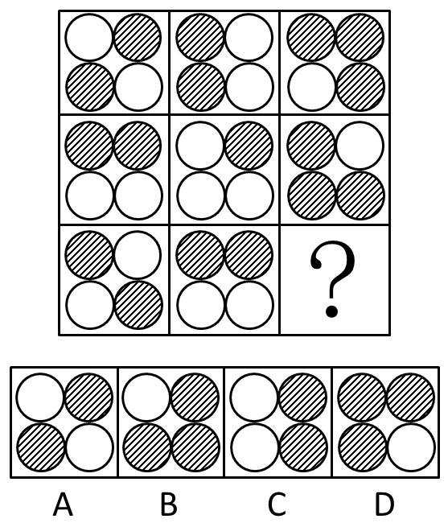
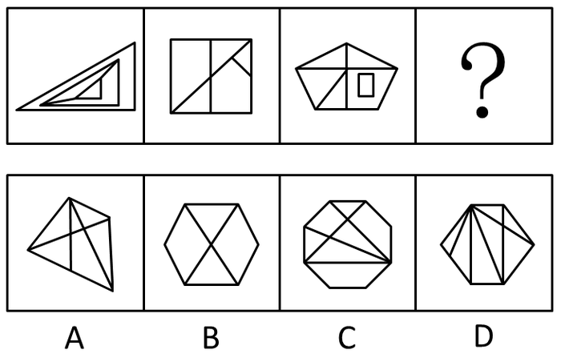
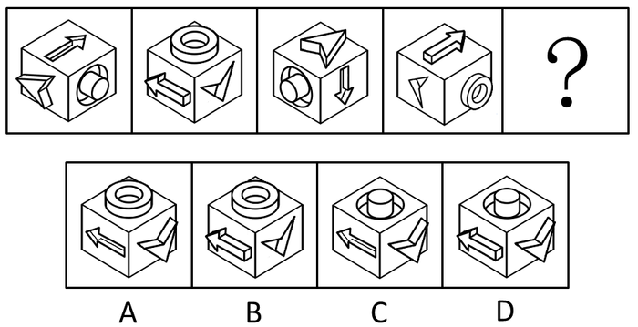
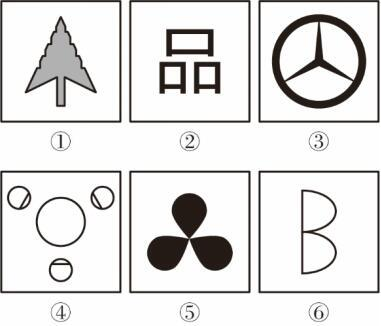
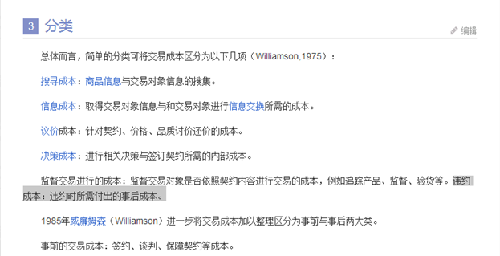
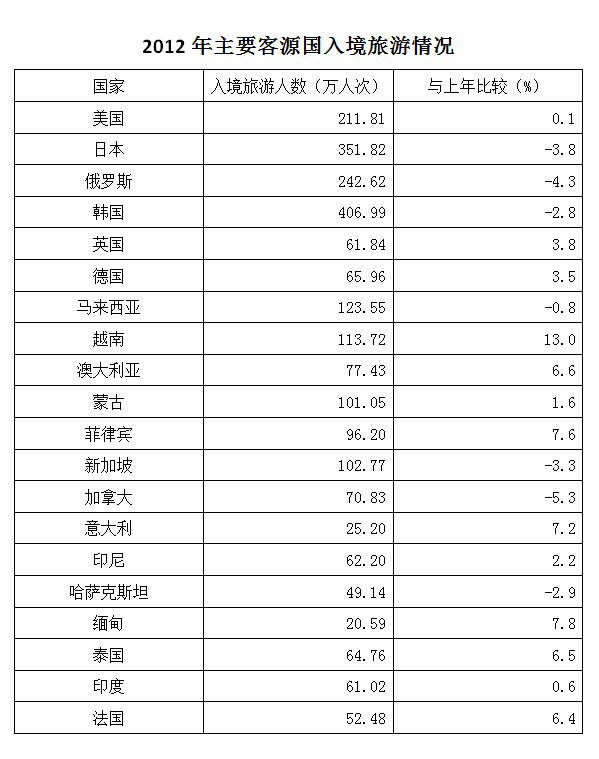

# 2015年云南省公务员录用考试《行测》题

<!-- gwy:overview:start -->
> **云南 · 2015 · 行测 · 统考** ｜ 120 题 · 图片 11 处 · 答案随题折叠

| 题型模块 | 题量 | 题号 |
| --- | ---: | ---: |
| 常识判断 | 20 | 1–20 |
| 言语理解 | 40 | 21–60 |
| 数量关系 | 10 | 61–70 |
| 判断推理 | 35 | 71–105 |
| 资料分析 | 15 | 106–120 |
| **合计** | **120** | |

导航：[题型与作答说明](#题型与作答说明) · [题目](#题目) · [材料 1](#材料-1)
<!-- gwy:overview:end -->

> 候选采集稿。参考答案及解析来自粉笔页面，不代表官方答案或真实高分答卷；来源使用许可与原卷对应关系仍需人工核实。

## 题型与作答说明

常识判断

（20题）

根据题目要求，在四个选项中选出一个最恰当的答案。

言语理解

（40题）

本部分包括表达与理解两方面的内容。请根据题目要求，在四个选项中选出一个最恰当的答案。

数量关系

（10题）

在这部分试题中，每道题呈现一段表述数字关系的文字，要求你迅速、准确地计算出答案。

判断推理

（35题）

本部分包括图形推理、定义判断、类比推理与逻辑判断四种类型的试题。

资料分析

（15题）

所给出的图、表、文字或综合性资料均有若干个问题要你回答。你应根据资料提供的信息进行分析、比较、计算和判断处理。

## 题目

### 第 1 题

党的十八届三中全会审议通过了《中共中央关于全面深化改革若干重大问题的决定》（以下简称《决定》），对全面深化改革作出了总体部署。在未来一个阶段，《决定》对普通公民的生活可能带来的改变有：

1、如果你要考大学，那么可能不必文理分科

2、如果你是“单独家庭”，那么可以生育第二胎

3、如果你是农村户口，那么宅基地可以私有

4、如果你是劳动者，那么可能可以延迟退休

A. 123

B. 234

C. 124

D. 1234

第 1 题 · 答案与解析

**参考答案（粉笔题库参考内容）**

C

**解析**

第1项正确，《决定》第十二项“推进社会事业改革创新”中指出：“探索全国统考减少科目、不分文理科、外语等科目社会化考试一年多考。”

第2项正确，《决定》第十二项“推进社会事业改革创新”中指出：“坚持计划生育的基本国策，启动实施一方是独生子女的夫妇可生育两个孩子的政策，逐步调整完善生育政策，促进人口长期均衡发展。”

第3项错误，《宪法》第十条规定：“农村和城市郊区的土地，除由法律规定属于国家所有的以外，属于集体所有；宅基地和自留地、自留山，也属于集体所有。”所以宅基地不论什么情况下都不可以私有。

第4项正确，《决定》第十二项“推进社会事业改革创新”中指出：“研究制定渐进式延迟退休年龄政策。”

故正确答案为C。

**考点**：社会建设、重要文件

**来源**：2015年425联考《行测》题（贵州卷）第18题

### 第 2 题

目前我国正大力推进文化制度改革，特别是对国内的动漫产业和影视剧通过内部管理的方式促进其发展，下列不属于行政手段的是：

A. 规定各级电视台每日播出境外各类影视节目时间

B. 设立专项经费用于鼓励本土作家创作优秀剧本

C. 国家出台“限娱令”规范娱乐节目播出类型

D. 每年引进的境外动漫作品同类题材数量设置上限

第 2 题 · 答案与解析

**参考答案（粉笔题库参考内容）**

B

**解析**

行政手段，是国家通过行政机构，采取带强制性的行政命令、指示、规定等措施，来调节和管理国家各项事务的手段。A、C、D三项均符合行政手段的定义，排除。B项属于运用经济手段，而非强制性手段，不属于行政手段，当选。

本题为选非题，故正确答案为B。

**来源**：2015年425联考《行测》题（贵州卷）第20题

### 第 3 题

中国古代小说塑造了很多莽汉形象，他们外表威猛阳刚，性格天真似儿童，深受读者的喜爱。下列小说中莽汉的时代顺序排列正确的是：

1、张飞 2、程咬金 3、李逵 4、牛皋

A. 2134

B. 2143

C. 4213

D. 1234

第 3 题 · 答案与解析

**参考答案（粉笔题库参考内容）**

D

**解析**

1、张飞是三国时期人物，2、程咬金是隋唐时期人物，3、李逵为水浒传人物（北宋），4、牛皋是南宋抗金名将岳飞的部下，则排列顺序为1234。

故正确答案为D。

**考点**：中国历史

**来源**：2015年425联考《行测》题（贵州卷）第3题

### 第 4 题

呼吸作用是生物体细胞把有机物氧化分解并产生能量的过程，没有氧气参与的呼吸称为无氧呼吸，无氧呼吸是指细胞在缺氧的条件下，通过酶的催化作用把葡萄糖等有机物分解为尚未彻底氧化的产物。下列现象与无氧呼吸有关的是：

A. 人剧烈运动后肌肉酸痛

B. 用糯米和酒曲酿造米酒

C. 农作物受涝时短时间内不会死亡

D. 把生水果和熟苹果放在密闭的缸里催熟

第 4 题 · 答案与解析

**参考答案（粉笔题库参考内容）**

A

**解析**

呼吸作用是指有机物在细胞内经过一系列的氧化分解，生成二氧化碳或其他产物，并释放出能量、生成ATP的过程。有氧呼吸是指细胞在氧的参与下，通过多种酶的催化作用，把葡萄糖等有机物彻底氧化分解，产生二氧化碳和水，释放能量，生成大量ATP的过程；无氧呼吸是指在没有氧气参与的情况下，葡萄糖等有机物经过不完全分解，产生少量能量的过程。

A项正确，人在剧烈运动时，氧气供应不足，导致一部分葡萄糖进行无氧分解，产生乳酸，乳酸是酸性的，会对肌肉产生刺激，造成肌肉酸痛。该过程与无氧呼吸有关。

B项错误，用糯米和酒曲（含酵母菌）酿造米酒属于发酵过程。有机物在微生物的作用下发生分解的过程叫发酵。酒曲酿酒的过程首先需要酵母菌进行有氧呼吸，大量繁殖，之后进行无氧呼吸，产生酒精。这一过程既有有氧呼吸，也有无氧呼吸。相对而言，A项更符合题意。

C项错误，农作物受涝之所以会死亡，是因为洪涝使土壤中溶解氧浓度降低，植物根细胞在缺氧条件下进行无氧呼吸产生酒精，酒精对根细胞会产生毒害作用，导致农作物根系受损甚至坏死。短时间内未死亡，是因为农作物利用残存的氧气进行有氧呼吸，此时不涉及无氧呼吸。

D项错误，生水果被熟苹果催熟，是因为熟苹果会释放出一种叫做“乙烯”的气体，这种气体会加快果实的成熟，与无氧呼吸无关。

故正确答案为A。

**考点**：生物常识

**来源**：2015年425联考《行测》题（贵州卷）第13题

### 第 5 题

在计算机网络通信领域中，防火墙是一项协助确保信息安全的设备。它会依据特定的规则，允许或是限制传输的数据通过。小张在自己电脑上安装了防火墙软件，下列论述正确的是（    ）。

A. 防火墙软件有可能导致小张的电脑不能访问特定的Web网站

B. 防火墙软件有可能导致小张无法访问自己电脑硬盘上存储的文档

C. 防火墙软件使得小张在网络购物时，不容易被虚假广告所欺骗

D. 防火墙软件使得小张在和陌生网友聊天时，可以伪装自己的性别和姓名

第 5 题 · 答案与解析

**参考答案（粉笔题库参考内容）**

A

**解析**

防火墙是在内部网和外部网之间、专用网与公共网之间的界面上构造的保护屏障，是一种获取安全性方法的形象说法，它是一种计算机硬件和软件的结合，是建立起的一个安全网关，因而有可能导致电脑不能访问特定的Web网站。A项正确，当选。B项读取硬盘数据无需网络数据，排除。C项是否被骗取决于个人的主观判断力，防火墙无法判断广告内容是否虚假，排除。D项的内容无需通过防火墙软件实现，排除。

故正确答案为A。

**考点**：科技理论与成就

**来源**：2015年425联考《行测》题（贵州卷）第15题

### 第 6 题

下列不属于心理学效应的是：

A. 晕轮效应

B. 马太效应

C. 破窗效应

D. 配位效应

第 6 题 · 答案与解析

**参考答案（粉笔题库参考内容）**

D

**解析**

A项正确，晕轮效应，又称“光环效应”，属于心理学范畴，是指一个人的某种品质，或一个物品的某种特性，给人以非常好的印象；在这种印象的影响下，人们对这个人的其他品质，或对这个物品的其它特性，也会给予较好的评价。“爱屋及乌”“一俊遮百丑”都是光环效应在社会生活中的具体体现。

B项正确，马太效应，是指强者愈强、弱者愈弱的现象，广泛应用于社会心理学、教育、金融以及科学领域。其名字来自圣经《新约·马太福音》一则寓言：“凡有的，还要加倍给他叫他多余；没有的，连他所有的也要夺过来。”

C项正确，破窗效应，是指一个房子如果窗户破了，没有人去修补，隔不久，其他的窗户也会莫名其妙地被人打破，被运用于心理学、经济学等领域。

D项错误，配位效应是化学效应，是指当溶液中存在能与沉淀的构晶离子形成配合物的配位剂时，则沉淀的溶解度增大。

本题为选非题，故正确答案为D。

**考点**：文化常识

**来源**：2015年425联考《行测》题（贵州卷）第5题

### 第 7 题

所谓硬水是指水中存在较多的矿物质成分，水的硬度指的是水中钙、镁离子的总和。下列关于硬水的说法错误的是（    ）。

A. 加入石灰能降低水的硬度

B. 可以用肥皂水鉴别软硬水

C. 将水煮沸可以降低水的硬度

D. 可以长期饮用硬度较高的水

第 7 题 · 答案与解析

**参考答案（粉笔题库参考内容）**

D

**解析**

本题主要考查硬水相关的常识。

A项正确，生石灰中的氧化钙与水反应生成氢氧化钙，水中所溶解的碳酸氢钙和碳酸氢镁，在煮沸的过程中会变成难溶于水的碳酸钙和氢氧化镁，这样就形成了水垢。水中的钙、镁离子含量低了，水的硬度也就降低了。

B项正确，水的硬度是指水中钙镁离子的含量。钙镁离子的含量越高，水的硬度就越高，即硬水；钙镁离子的含量越低，水的硬度就越低，即软水。肥皂的主要成分为硬脂酸钠，硬脂酸钠溶于水会产生硬脂酸根离子和钠离子。硬脂酸根离子会与硬水中大量的钙离子和镁离子结合生成硬脂酸镁和硬脂酸钙，二者都是不溶于水的白色沉淀。而软水中不含或者只含微量的的钙镁离子，因此将肥皂放入软水中不会产生或只会产生极少量沉淀。

C项正确，硬度指在水中的钙、镁等离子，想要降低水的硬度，最简单的方法就是煮沸。水中所溶解的碳酸氢钙和碳酸氢镁，在煮沸的过程中会变成难溶于水的的碳酸钙和氢氧化镁，这样就形成了水垢。水中的钙、镁离子含量低了，水的硬度也就降低了。

D项错误，钙、镁离子是人体每天必需的营养素，如果水有一定硬度，通过饮水可以补充一定量的钙镁离子。但水的硬度太高和太低都不好。如果水硬度较高，不利于血液流通。在水硬度较高地区，人群心血管疾病发病率较低，但肾结石发病率却随水的硬度升高而升高。因此长期饮用硬度较高的水对人体健康有利也有弊，不可一概而论。

本题为选非题，故正确答案为D。

**考点**：化学常识

**来源**：2015年425联考《行测》题（贵州卷）第6题

### 第 8 题

下列雕塑作品表现唐太宗李世民生平战功的是：

A. 马踏匈奴

B. 击鼓说唱俑

C. 昭陵六骏

D. 乾陵石雕

第 8 题 · 答案与解析

**参考答案（粉笔题库参考内容）**

C

**解析**

C项昭陵六骏是指陕西醴泉（今礼泉县）唐太宗李世民陵墓昭陵北面祭坛东西两侧的六块骏马青石浮雕石刻，六骏是李世民在唐朝建立前先后骑过的战马，分别名为“拳毛騧”“什伐赤”“白蹄乌”“特勒骠”“青骓”“飒露紫”。

A项马踏匈奴是表现霍去病战功的；B项击鼓说唱俑是表现汉代说唱艺术的；D项乾陵石雕是唐高宗李治与武则天（690–705年在位）的合葬墓。

故正确答案为C。

**考点**：中国历史

**来源**：2015年河南省从大学生村干部中考录乡镇机关公务员、省选调生考试《行政职业能力测验》试卷（精选）第86题

### 第 9 题

下列关于水生动物的说法错误的是：

A. 鲨鱼用鳃呼吸，鲨鱼属于鱼类

B. 黄鳝的鳃严重退化无法用鳃呼吸，黄鳝不属于鱼类

C. 蓝鲸没有鳃，用肺进行呼吸，蓝鲸属于哺乳动物

D. 海龟没有鳃，用肺进行呼吸，海龟不属于哺乳动物

第 9 题 · 答案与解析

**参考答案（粉笔题库参考内容）**

B

**解析**

黄鳝的鳃已经退化，不能独立完成水中呼吸，所以口腔及咽腔壁膜帮助呼吸，常将头伸露水面外进行呼吸。水枯竭时，尚能退到低湿处或钻入淤泥内较长时间而不致死亡。但黄鳝仍属于鱼类。A、C、D三项均正确。

本题为选非题，故正确答案为B。

**考点**：生物常识

**来源**：2015年425联考《行测》题（贵州卷）第10题

### 第 10 题

下列诗句背景与科举制实行无关的是：

A. 慈恩塔下题名处，十七人中最少年

B. 太宗皇帝真长策，赚得英雄尽白头

C. 黑发不知勤学早，白首方悔读书迟

D. 春风得意马蹄疾，一日看尽长安花

第 10 题 · 答案与解析

**参考答案（粉笔题库参考内容）**

C

**解析**

A项，“慈恩塔下题名处，十七人中最少年”，是白居易27岁时参加科举，考中之后与其他同僚一起到西安的慈恩塔下游玩，所写的诗。表现了作者当时少年得志，意气风发的心情。因此与科举制度有关。B项，“太宗皇帝真长策，赚得英雄尽白头”，“长策”意为长远的政策，在这里指“科举制度”。C项，“黑发不知勤学早，白首方悔读书迟”语出颜真卿《劝学》，意为年轻时不知道勤奋学习，年老时读书就晚了。与科举制度无关。D项，“春风得意马蹄疾，一日看尽长安花”，出自唐朝诗人孟郊的《登科后》，这两句诗也成为千古名句。“春风得意”原指读书人考中后的得意心情，现在一般形容事情办成功，达到目的后那种得意洋洋的情态。与科举制度有关。

本题为选非题，故正确答案为C。

**考点**：文化常识

**来源**：2015年425联考《行测》题（贵州卷）第19题

### 第 11 题

结合化学知识和生活经验，下列做法不能减少环境污染的是：

A. 将废弃的塑料袋、一次性塑料餐具等塑料制品集中堆放焚烧

B. 将汽车发动机产生的尾气通过放有氧化钯催化剂的排气管后排放

C. 在燃烧前对煤进行净化，去除原煤中的硫成分和灰成分

D. 城市公交车和出租车采用液化天然气（LNG）代替普通汽油

第 11 题 · 答案与解析

**参考答案（粉笔题库参考内容）**

A

**解析**

A项错误，将废弃塑料集中焚烧，会造成各种有毒气体，造成更严重的大气污染。

B项正确，放有氧化钯催化剂的排气管可以将发动机排出的一氧化碳、碳氢化合物和氮氧化物等废气转化为二氧化碳、氮气和水。

C项正确，含硫的煤燃烧生成的二氧化硫会污染空气，原煤脱硫的目的是减少二氧化硫的生成；灰分是原煤中的有害杂质，可燃成分相对降低，发热量减小，且影响煤的着火与燃烧，使燃烧效率下降，并且会随烟气排入大气，造成对环境的污染，原煤脱灰可以减少环境污染。

D项正确，液化天然气（简称LNG），主要成分是甲烷，被公认是地球上最干净的化石能源。以LNG取代燃油后可以减少90%的二氧化硫排放和80%的氮氧化物排放，环境效益十分明显，是汽车的优质代用燃料｡

本题为选非题，故正确答案为A。

**考点**：化学常识

**来源**：2015年425联考《行测》题（贵州卷）第9题

### 第 12 题

现代中医借助西医的物理检验手段，提高传统的“望→闻→问→切→处”的诊断准确性。这样的优化属于（    ）。

A. 工期优化

B. 技术优化

C. 成本优化

D. 流程优化

第 12 题 · 答案与解析

**参考答案（粉笔题库参考内容）**

B

**解析**

本题主要考查管理知识。

A项，工期优化也称时间优化，就是当初始网络计划的计算工期大于要求工期时，通过压缩关键线路上工作的持续时间或调整工作关系，以满足工期要求的过程。题干并没有体现对时间进行优化，该项应排除。

B项，技术优化是指对一个现存的技术进行改进或升级，使其趋于完善的过程叫做技术优化。中医是现存技术，通过借助西医物理检验手段，使中医的诊断准确性有了提高，对其进行了完善，属于技术优化，该项应选。

C项，成本优化是指在保证质量的前提下，寻求质量成本总额最小。题干并没有体现对成本进行优化，该项应排除。

D项，流程优化是指面对新的环境，通过对业务流程进行重整，彻底重新设计业务流程，力求取得突破性的改变。题干并没有体现对流程进行优化，中医诊断仍是望闻问切的流程，该项应排除。

故正确答案为B。

**来源**：2015年425联考《行测》题（贵州卷）第17题

### 第 13 题

人工智能是指由人工制造的系统所表现出来的智能。人工智能的核心包括推理、知识、规划、学习、交流、感知、移动和操作物体的能力等。下列论述中所描述的各项技术突破，无关人工智能的是：

A. 科学家利用数学定理证明程序，证明了“数学原理”一书第二章的38个定理

B. 中国象棋程序在人机对弈时，能够根据以往的棋局，学习到新的战术，从而避免因为类似的错误而失败

C. 小张家里新买的最新款电视机，能够根据电视机周围的环境光线强弱，自动地调整屏幕的亮度

D. 有种名为siri的手机软件，采用自然语言处理技术，使用户能用自然的对话与手机进行互动

第 13 题 · 答案与解析

**参考答案（粉笔题库参考内容）**

A

**解析**

A项错误，利用设定好的证明程序，证明了已经存在的定理，只能说明该程序设计正确，并不能体现人工智能的特点，其他如B项中的学习、C项中的感知、D项中的交流等直接体现了题干中人工智能的特点。

本题为选非题，故正确答案为A。

**考点**：科技理论与成就

**来源**：2015年425联考《行测》题（贵州卷）第11题

### 第 14 题

通过云计算技术可以实现共享软硬件资源和信息。下列直接使用到云计算技术的是（    ）。

A. 将ADSL升级为光纤线路

B. 设计并制作Web网站页面

C. 向ISP申请注册网站域名

D. 使用Google App Engine服务，部署个人网站

第 14 题 · 答案与解析

**参考答案（粉笔题库参考内容）**

D

**解析**

本题考查科技常识。云计算是一种基于互联网的计算方式，通过这种方式，共享的软硬件资源和信息可以按需求提供给计算机各种终端和其它设备。

A项，ADSL是利用电话线加载宽带信号传送到用户家中，通过分离器将语音和数字分开的宽带接入方式。光纤是以光脉冲的形式来传输信号，以玻璃或有机玻璃等为网络传输介质。将ADSL升级为光纤线路，是一种传输介质的改变升级，没有直接使用到云计算技术。该项应排除。

B项，网页设计是指使用HTML/JavaScript/CSS语言，通过一系列设计、建模和执行的过程，没有使用云计算技术。该项应排除。

C项，向ISP申请注册网站域名是需要通过线下申请而注册网站域名的，没有使用云计算技术。该项应排除。

D项，Google App Engine 是一种可以在Google的基础架构上运行的网络应用程序。Google App Engine，不再需要维护服务器，只需上传应用程序，便可立即为用户提供服务，直接使用到云计算技术。该项应选。

故正确答案为D。

**考点**：科技理论与成就

**来源**：2015年云南省公务员录用考试《行测》题第14题

### 第 15 题

下列情形符合法律规定的是：

A. 甲、乙二人自由恋爱，因两人均年满20周岁，经双方父母同意，两人可以结婚

B. 丙12岁，玩火酿成火灾造成重大财产损失，但丙不承担失火罪的刑事责任

C. 丁6岁，春节收到红包若干，其母认为丁尚年幼，红包里的钱应归监护人所有

D. 19岁的大学生戊，认为父母有义务支付他的教育费及生活费至其独立工作为止

第 15 题 · 答案与解析

**参考答案（粉笔题库参考内容）**

B

**解析**

A项错误，根据《中华人民共和国民法典》第一千零四十七条规定，结婚年龄，男不得早于二十二周岁，女不得早于二十周岁。晚婚晚育应予鼓励。该项中男方未达法定婚龄，故不可以结婚。

B项正确，根据《刑法》第十七条规定：“已满十六周岁的人犯罪，应当负刑事责任。已满十四周岁不满十六周岁的人，犯故意杀人、故意伤害致人重伤或者死亡、强奸、抢劫、贩卖毒品、放火、爆炸、投放危险物质罪的，应当负刑事责任。已满十二周岁不满十四周岁的人，犯故意杀人、故意伤害罪，致人死亡或者以特别残忍手段致人重伤造成严重残疾，情节恶劣，经最高人民检察院核准追诉的，应当负刑事责任。对依照前三款规定追究刑事责任的不满十八周岁的人，应当从轻或者减轻处罚。因不满十六周岁不予刑事处罚的，责令其父母或者其他监护人加以管教；在必要的时候，依法进行专门矫治教育。”丙未满14周岁，并无故意杀人、故意伤害的行为，因此不追究刑事责任。

C项错误，根据《中华人民共和国民法典》第三十五条规定：“监护人应当按照最有利于被监护人的原则履行监护职责。监护人除为维护被监护人利益外，不得处分被监护人的财产。”孩子对压岁钱享有所有权，压岁钱是孩子的个人财产。父母对孩子的财产具有保管义务，除非为维护孩子的利益外，不得处分孩子的财产。故监护人不得将被监护人的财产据为己有。

D项错误，根据《中华人民共和国民法典》第一千零六十七条第一款规定：“父母不履行抚养义务的，未成年子女或者不能独立生活的成年子女，有要求父母给付抚养费的权利。”该项中，戊已经是19岁的大学生，不符合“未成年”和“不能独立生活”的条件，故其父母没有义务支付他的教育费及生活费至其独立工作为止。

故正确答案为B。

**考点**：刑法

**来源**：2015年425联考《行测》题（贵州卷）第1题

### 第 16 题

地球自转一圈的时间是一天，地球半径为6371千米。毛泽东诗词“坐地日行八万里”是有科学依据的，人可以随着地球的自转运动，那么与诗句最吻合的可能是哪个国家的人：

A. 阿富汗

B. 南非

C. 新加坡

D. 挪威

第 16 题 · 答案与解析

**参考答案（粉笔题库参考内容）**

C

**解析**

据圆周计算公式（2πr），赤道处地球周长约为40000千米，符合“八万里”的说法，但是随着纬度的递增，纬线的周长递减。四个选项中新加坡的纬度最低，最靠近赤道，该点位置自转一周最为接近地球半径对应的周长。

故正确答案为C。

**考点**：世界地理

**来源**：2015年425联考《行测》题（贵州卷）第7题

### 第 17 题

社会上普遍存在着当市场上充斥着大量差（假）产品而不能为消费者识别时，好的产品最终也将退出市场的现象。下列属于这一现象的是：

A. 南郭滥竽充数

B. 民间借贷危机

C. 三聚氰胺事件

D. 行人集结闯红灯

第 17 题 · 答案与解析

**参考答案（粉笔题库参考内容）**

C

**解析**

题干反映了“劣币驱逐良币”现象，反映了市场上好的优质产品被挤出市场，反而是那些残次品充斥市场。

A项错误，“滥竽充数”的典故是齐国人南郭处士本身不会吹竽，但是混在几百人的吹竽团队里，不会被发现，等要他个人独奏时，南郭处士就逃跑了。南郭先生一个人不符合题干“充斥着大量差（假）产品”的表述，故与题干无关，删除。

B项错误，民间借贷危机发生在民间借贷这类非正规借贷当中，资金流一旦出现意外，会出现中小企业无法偿还民间借贷而导致资金链断裂的“借贷危机”。首先“民间借贷”并非“差（假）产品”；其次未将正规借贷即“商业银行借贷”给挤出市场（事实是因为许多中小企业无法从正规途径贷到款，才有民间借贷），故与题干无关，删除。

C项正确，三聚氰胺事件指的是由三鹿奶粉中被查含有严重超标的三聚氰胺而引发了对于全国奶粉市场大整顿，在整顿过程发现中国奶粉企业在生产中掺杂三聚氰胺并不是个别现象，而是一个行业乱象。中国奶粉市场的乱象恰恰反映了题干，一开始掺杂三聚氰胺的奶粉并不能被民众识别，好的奶粉企业由于诚信经营而导致成本比三聚氰胺奶粉高，好的奶粉不占优势，慢慢被挤出市场，从而导致了添加三聚氰胺成为了中国奶粉市场的“黑暗规则”，此项符合题意，当选。

D项错误，三人集结过马路的“中国式过马路”现象反映了部分人的道德素质不高，道路安全常识缺乏现象，故与题干无关，错误。

故正确答案为C。

本题有人认为选B，明显是概念性错误，其一，题干反映的是“劣币驱逐良币”，民间借贷危机指的是民间借贷存在无法还本付息的危险性，与题干无关，其二，民间借贷的存在不会动摇银行等金融机构的正规借贷地位，不可能鸠占鹊巢。之所以选C是因为，好的奶粉企业由于诚信经营而导致成本比三聚氰胺奶粉高，好的奶粉不占优势，慢慢被挤出市场，从而导致了添加三聚氰胺成为了中国奶粉市场的“黑暗规则”，此现象反映了题干。

**考点**：微观经济

**来源**：2015年425联考《行测》题（贵州卷）第16题

### 第 18 题

马航MH370航班失踪之后，国际海事卫星组织试图利用多普勒原理计算出失踪航班的下落。多普勒原理，源于这样的一种物理现象（多普勒效应）：随着飞机高速接近（或远离）接受微波信号的卫星，卫星所侦测到的微波频率都会越来越高（或越来越低）。下列描述的现象中，哪一种也体现了同样的多普勒效应：

A. 站在铁轨附近的人，听到鸣笛的火车由远及近高速驶来时，汽笛的音调逐渐变得尖锐

B. 一束自然光射入三棱镜，射出时，被分解为不同的颜色

C. 向平静的湖面投入一颗小石子，激起涟漪呈圆形逐渐向周围扩散

D. 在日环食的过程中，观测到太阳黑子的存在

第 18 题 · 答案与解析

**参考答案（粉笔题库参考内容）**

A

**解析**

多普勒效应主要内容是当波源与观察者的相对位置发生变化时，观察者接收到的波的频率与波源发出的频率不同的现象。A项满足定义描述。B项的原理为色散，因为同一种介质对各种单色光的折射率不同，所以通过三棱镜时，各单色光的偏折角不同。因此，白色光通过三棱镜会将各单色光分开，形成红、橙、黄、绿、蓝、靛、紫七种色光。C项的原理为波的传导的一种表现，即机械振动的传递构成的机械波。D项太阳黑子是一种太阳活动，是出现在光球层（太阳大气层的最内层）上的黑斑点。太阳黑子区域温度比周围低，因此颜色看上去深一些，与题干无关。

故正确答案为A。

**考点**：物理常识

**来源**：2015年425联考《行测》题（贵州卷）第12题

### 第 19 题

下列生活中保存食物的方法，理解错误的是：

A. 盐腌制食品是因为盐可以形成高渗环境，抑制了微生物的生理活动

B. 真空保存食物可以破坏需氧菌类的生存环境

C. 冷藏保存食物是因为低温可以将细菌冻死

D. 充入氮气保存食品是为了隔绝食品和氧气的接触

第 19 题 · 答案与解析

**参考答案（粉笔题库参考内容）**

C

**解析**

食物放在冰箱中可以保存较长时间，原因是低温可以抑制细菌生长繁殖，并不是低温将细菌冻死。A、B、D三项保存食物的方法都正确。

本题为选非题，故正确答案为C。

**考点**：生物常识

**来源**：2015年425联考《行测》题（贵州卷）第14题

### 第 20 题

2014年是“和平共处五项原则”发表60周年，下列与其发表时间相同的历史事件是：

A. 东西两德统一

B. 古巴导弹危机

C. 联合国军完全撤出朝鲜

D. 越南抗美战争彻底结束

第 20 题 · 答案与解析

**参考答案（粉笔题库参考内容）**

C

**解析**

A项错误，两德统一指的是原德意志民主共和国（即东德）于1990年10月3日通过并入德意志联邦共和国（即西德）的方式完成的德国统一。

B项错误，古巴导弹危机（英语：Cuban Missile Crisis）又称加勒比海导弹危机，加勒比海危机，是1962年冷战时期在美国、前苏联与古巴之间爆发的一场极其严重的政治、军事危机。事件爆发的直接原因是前苏联在古巴部署导弹。

C项正确，1954年8月12日（农历七月十四），联合国军完全撤出北朝鲜。

D项错误，1975年4月，越南军民发起了具有历史意义的春季攻势——“胡志明战役”，势如破竹地直捣美国扶植的西贡伪政权的最后巢穴。4月30日，越南军民把胜利的旗帜插上西贡美伪政权的“总统府”。这一时刻，标志着越南军民赢得了抗美救国战争的彻底胜利。

故正确答案为C。

**来源**：2015年河南省从大学生村干部中考录乡镇机关公务员、省选调生考试《行政职业能力测验》试卷（精选）第104题

### 第 21 题

今年的“双十一购物节”让外界＿＿＿＿中国热闹异常的电子商务产业。美国媒体感叹中国的“双十一”一天的销售规模已经赶超美国两大网上购物日，预计电子商务将＿＿＿＿中国在2015年成为全球最大的零售市场。

依次填入画横线部分最恰当的一项是：

A. 惊诧 力推

B. 关注 助推

C. 热议 襄助

D. 聚焦 助力

第 21 题 · 答案与解析

**参考答案（粉笔题库参考内容）**

D

**解析**

第一空，由“热闹异常”与“美国媒体感叹”说明“双十一购物节”引起外界的注意，C项“热议”、D项“聚焦”均符合文意，且在语义程度上与“热闹异常”对应恰当，保留。A项“惊诧”意为感到惊讶诧异，多用作“惊诧于某事”或“某事令人惊诧”，填入横线处与文段语句搭配不当，排除。B项“关注”一词程度比较轻，无法体现“热闹异常”的程度，排除。

第二空，电子商务是使得“中国在2015年成为全球最大的零售市场”助推剂中的一部分。C项“襄助”意为辅助，过于书面化，与文段风格不符，排除。D项“助力”意为提供帮助、出力，能体现出电子商务在中国成为最大零售市场中起到了很大作用的特点，当选。

故正确答案为D。

【出处】IT时代周刊：《“双十一”电商购物节呼唤理性》

**考点**：实词填空、词的辨析-程度轻重、词的辨析-词义侧重

**来源**：2015年河南省从大学生村干部中考录乡镇机关公务员、省选调生考试《行政职业能力测验》试卷（精选）第9题

### 第 22 题

2013年5月，微博上\_\_\_\_\_\_\_\_着一份百字令微情书。“不尽红笺相思意”，一时感动无数网友争相效仿。整篇文字呈菱形排列，词句婉约，文笔\_\_\_\_\_\_\_\_，从中可以看到作者表达爱情的\_\_\_\_\_\_\_\_。

依次填入画横线部分最恰当的一项是：

A. 热传 精美 独出心裁

B. 盛传 优美 独辟蹊径

C. 疯传 精妙 别具匠心

D. 风传 巧妙 别具一格

第 22 题 · 答案与解析

**参考答案（粉笔题库参考内容）**

C

**解析**

第一空，根据后文“一时感动无数网友争相效仿”“词句婉约”的表述，可知文段感情色彩偏积极，A、B、C三项均符合文意。而D项“风传”意为辗转流传，也指传闻、道听途说，感情色彩偏消极，排除。

第二空，搭配“文笔”，B项“优美”、C项“精妙”均搭配恰当，保留；A项“精美”多搭配具体事物，与“文笔”搭配不当，排除；

第三空，根据文意可知，文段强调“百字令微情书”这种文学形式很新颖，C项“别具匠心”指文学艺术方面创造性的构思，侧重强调文学艺术品，符合文意，当选；B项“独辟蹊径”比喻独创出新风格或新方法，侧重解决问题的方式方法是独特的，搭配“情书”不恰当，排除。

故正确答案为C。

【出处】《创意诗句表白从“长发及腰体”到微情书种种》

**考点**：混搭填空、词的辨析-感情色彩、词的辨析-搭配对象

**来源**：2015年425联考《行测》题（贵州卷）第39题

### 第 23 题

求学者如果孜孜于衣食居住的安适，一定谈不上好学。同样，好学的目的也不是为了＿＿＿＿＿＿，心灵之养甚于居养之安。学习的目的是成为“有道”之人，名闻利养并非先务。这不是＿＿＿＿物质，而是强调学习就是学习，不要附带上物质目的。

依次填入画横线部分最恰当的一项是：

A. 养尊处优 否定

B. 丰衣足食 摈斥

C. 锦衣玉食 排斥

D. 肥马轻裘 抵触

第 23 题 · 答案与解析

**参考答案（粉笔题库参考内容）**

C

**解析**

第一空，“如果孜孜于衣食居住的安适，一定谈不上好学”之后出现“同样”一词，根据语境的对应可知，后面一句话的意思为：好学的目的也不是为了衣食的安适，即想生活得更好，与“衣”“食”含义相关。C项“锦衣玉食”指精美的衣食，形容豪华奢侈的生活，最符合语境，保留。A项“养尊处优”是指生活在富贵优裕的环境中，一般作形容词用，可排除；B项“丰衣足食”的程度没有“锦衣玉食”重，不能反映出生活得更好的意思，可排除；D项“肥马轻裘”是指骑肥壮的骏马，穿轻暖的皮衣，形容生活豪奢，强调的是生活方式的阔绰，而非生活水平的富足，不符合语境，且“同样”这个词在文段中表并列，前文谈到“求学者孜孜于衣食居住的安适”所以横线处用肥马轻裘和前文相比语义过重，形成不了并列，可排除。

第二空，代入验证，这里文中想要强调的是不要将学习功利化的意思。故C项“排斥”一词准确、恰当。

故正确答案为C。

【出处】广州日报：刘伟见《孔子的好学观（上）》

**考点**：对应关系-前后呼应、混搭填空、词的辨析-程度轻重

**来源**：2015年425联考《行测》题（贵州卷）第22题

### 第 24 题

从“抢盐风波”到“各地发生地震”，网络造谣滋生的“网络炸弹”影响甚远。虽然很多情况下，我们可以凭借自身的常识去分析，但每个人都有自己的知识盲点，不可能完全应付得了，一不留神，便可能成为受害者。因此，必须打击网络谣言，才能＿＿＿＿舆论的正义，＿＿＿＿社会正常的理性和诚信。

依次填入画横线部分最恰当的一项是：

A. 庇护 修复

B. 维护 恢复

C. 保卫 重建

D. 护卫 匡复

第 24 题 · 答案与解析

**参考答案（粉笔题库参考内容）**

B

**解析**

第一空，搭配“正义”，B项“维护”指维持保护，使免于遭受破坏，与“正义”搭配恰当，保留。A项“庇护”指包庇袒护，与“正义”搭配不当，排除；C项“保卫”指护卫使不受侵犯，与“正义”搭配不当，排除；D项“护卫”指保护、防卫，侧重防卫之意，与“正义”搭配不当，排除。

第二空，代入验证。搭配“理性与诚信”，B项“恢复”指使变成原来的样子，与“理性和诚信”搭配恰当，且符合文意，当选。

故正确答案为B。

**考点**：实词填空、词的辨析-搭配对象、词的辨析-词义侧重

**来源**：2015年河南省从大学生村干部中考录乡镇机关公务员、省选调生考试《行政职业能力测验》试卷（精选）第2题

### 第 25 题

英国车，汽车工艺的代表，处处＿＿＿＿出高贵、优雅、灵动、恒久的艺术气质。而这一切，源自于英国人一直＿＿＿＿的传统造车技艺——始终以手工进行装嵌。

依次填入划横线部分最恰当的一项是：

A. 彰显 迷恋

B. 展示 擅长

C. 流露 秉承

D. 体现 坚守

第 25 题 · 答案与解析

**参考答案（粉笔题库参考内容）**

C

**解析**

第一空考查词语搭配。与“气质”一词搭配，选项中的四个动词均可，保留。

第二空考查词语含义。文中“一直”“传统”“始终”均体现出英国人对于自古流传的手工装嵌技术的使用时间之久，一代一代传下来的意思，并搭配“技艺”，C项”秉承”指承受、接受，用于接过前人好的东西，继续发扬光大，与文意相符，当选；A项“迷恋”一词明显与文意不符，排除；B项“擅长”，文段并不是侧重于强调长短处，排除；D项“坚守”指坚定守卫、坚定遵守，侧重强调的是守住，但是文段强调的是不仅要守住，还要传下去，与文意不符，排除。

故正确答案为C。

【出处】马剑《英国汽车：保留“根”的归属》

**考点**：实词填空、对应关系-前后呼应、词的辨析-搭配对象

**来源**：2015年河南省从大学生村干部中考录乡镇机关公务员、省选调生考试《行政职业能力测验》试卷（精选）第4题

### 第 26 题

在漫长的历史\_\_\_\_\_\_中，公民社会作为关于人类社会认知的一个范畴，可以说一直走在时代的前面。如同引领人类思想和社会进步的一把火炬，它从希腊城邦激辩的淬火中走出，经历了罗马深厚的法律文明、中世纪城市文明、宗教革命与政治变革的\_\_\_\_\_\_，经历了资产阶级革命与民主共和的政治\_\_\_\_\_\_，见证了东西方文明冲突和演变。

依次填入画横线部分最恰当的一项是：

A. 进程 冲击 磨炼

B. 演进 洗礼 历练

C. 演变 影响 磨砺

D. 发展 交替 锤炼

第 26 题 · 答案与解析

**参考答案（粉笔题库参考内容）**

B

**解析**

第一空，与“漫长”搭配，漫长形容一段时间、过程，D项“发展”搭配不当，可以用“快”“慢”形容发展，发展得慢，但不能说发展“漫长”，故排除；A项“进程”意为事物发展变化的过程；B项“演进”与C项“演变”的区别在于，前者重在强调进化，一般为逐渐向好的一种变化，而后者仅强调变化。此三词对于第一空而言均可搭配使用。

第二空，与“经历”搭配，且由“公民社会一直走在时代的前面，如同引领······”可知，横线处所填词语的感情色彩应为积极的，B项“洗礼”比喻经历了重大的考验或锻炼，搭配恰当，且感情色彩较为积极，符合文意，保留。C项“影响”搭配不当，排除。A项“冲击”感情色彩偏消极，排除。

第三空，代入验证，“经历政治历练”搭配得当，B项当选。

故正确答案为B。

【出处】《多重视角透析公民社会》

**考点**：实词填空、词的辨析-感情色彩、词的辨析-搭配对象

**来源**：2015年425联考《行测》题（贵州卷）第37题

### 第 27 题

社会性的焦虑特属于某些社会或时代，它是一种\_\_\_\_\_的心神不安和精神不定，是一种弥漫于社会不同阶层的焦虑，它不会轻易消退，不容易通过心理的调适而化解，人们所焦虑的对象或有不同，但在其性质和内容上又存在着一些共性，就如贫困者忧虑自己生存缺乏保障，而富有者也可能忧虑自己财产缺乏保障，两者虽然不可\_\_\_\_\_，而忧虑则同。

依次填入划横线部分最恰当的一项是：

A. 特有 混为一谈

B. 广泛 等量齐观

C. 普遍 相提并论

D. 固有 同日而语

第 27 题 · 答案与解析

**参考答案（粉笔题库参考内容）**

B

**解析**

第一空考查语义对应。空格处与前文中的“社会性”、后文中的“弥漫于社会不同阶层”对应，可排除A、D两项。“广泛”是表达某事物所涉及的层面比较多，“普遍”是指在某个层面内比较全面的意思，均可形成有效对应。

第二空考查成语的含义。根据“贫困者忧虑自己生存缺乏保障，而富有者也可能忧虑自己财产缺乏保障”可知，文段侧重强调“贫困者”和“富有者”有着不同的忧虑。C项“相提并论”是指把不同的人或不同的事放在一起谈论或看待，多用否定句式侧重强调差距大，而文段只是说“贫困者”和“富有者”有不同的忧虑，并不强调两种不同忧虑的差距大，不符合文意，排除；B项“等量齐观”指对有差别的事物同等看待，置于否定句中表达两者不一样，符合文意，当选。

故正确答案为B。

【出处】人民论坛杂志（总第398期）：唐钧《“全民焦虑”内在肌理解剖》

**考点**：对应关系-前后呼应、混搭填空

**来源**：2015年425联考《行测》题（贵州卷）第35题

### 第 28 题

与形象相比，声音更是一种让人甚感扑朔迷离的东西。记得几年前一次上课，我突然感觉好像被自己营造的诗意场景带入了云端。那一瞬间，我忘掉了自己，教室里的同学似乎也变得\_\_\_\_\_。华光普照的水光潋滟之间，似乎只有声音的涟漪在教室上空\_\_\_\_\_，其他一切不见。这是一种袅袅上升的声音，是一种与一切物质现象相剥离的明朗或华美。

依次填入划横线部分最恰当的一项是：

A. 虚置 飘荡

B. 空幻 飘舞

C. 虚无 飘荡

D. 虚幻 缥缈

第 28 题 · 答案与解析

**参考答案（粉笔题库参考内容）**

C

**解析**

第一空考查词语辨析。“虚置”为专业名词，意为白白搁置，与文意完全不符，故排除A项。

第二空考查近义词辨析及搭配。“缥缈”是指隐隐约约，若有若无的样子，形容空虚渺茫。而此处其他景象不见，只剩声音涟漪，排除D项。“飘荡”为在空中随风飘动或飞扬的动作。“飘舞”意为飘动、舞动。文段是说声音的涟漪，涟漪能发出的动作，明显“飘荡”更适合，排除B项。

故正确答案为C。

【出处】中国艺术报：刘成纪《陌生的声音》

**考点**：实词填空、词的辨析-搭配对象、词的辨析-词义侧重

**来源**：2015年河南省从大学生村干部中考录乡镇机关公务员、省选调生考试《行政职业能力测验》试卷（精选）第12题

### 第 29 题

中国改革已进入攻坚期和深水区，需要解决的问题格外艰巨，都是难啃的硬骨头。这个时候就要一鼓作气，＿＿＿＿＿＿、畏葸不前不仅不能前进，而且可能＿＿＿＿＿＿。

依次填入画横线部分最恰当的一项是：

A. 优柔寡断 半途而废

B. 三心二意 功败垂成

C. 迟疑不决 功亏一篑

D. 瞻前顾后 前功尽弃

第 29 题 · 答案与解析

**参考答案（粉笔题库参考内容）**

D

**解析**

本题从第二空入手，横线处通过“不仅······而且”与前文构成递进结构，语义与“不仅不能前进”相同，程度加深。B项“功败垂成”与C项“功亏一篑”均比喻一件事情只差一点而没有成功，与前文“不能前进”无法对应，均排除；A项“半途而废”指中途停止，形容做事有始无终，不能坚持到底,与前文“不能前进”语义相同，无法形成递进关系，排除；D项“前功尽弃”指以前的功劳、成绩完全丢失或以前的努力完全白费，与“不能前进”语义相近且程度更重，当选。

第一空代入验证，“瞻前顾后”原形容做事谨慎，考虑周密，现也形容顾虑太多，犹豫不决。与“畏葸不前”构成并列结构。

故正确答案为D。

【文段出处】中国网：《习近平一年印象：是反腐硬汉也是吃包子的习大大》

**考点**：关联关系-并列关系、成语填空、词的辨析-程度轻重

**来源**：2015年425联考《行测》题（贵州卷）第26题

### 第 30 题

我国著名语言学家罗常培说过：语言文字是一个民族文化的结晶。这个民族过去的文化靠着它来流传，未来的文化也仗着它来＿＿＿＿。我们可以从诸多文字现象中，如汉字的造字、构词，汉字词义的形成和＿＿＿＿中找寻中国文化形成与发展的理据。

依次填入划横线部分最恰当的一项是：

A. 推动 变革

B. 提升 演进

C. 弘扬 变迁

D. 推进 演变

第 30 题 · 答案与解析

**参考答案（粉笔题库参考内容）**

D

**解析**

第一空，根据文段“过去的文化靠着它来流传，未来的文化也仗着它来······”可知，为相同句式表并列，故横线处应与“流传”语义相近，强调随着时间一代代地传下去。B项“提升”指向较高的水平发展，与“流传”无法对应，排除。

第二空，填入的词语应与前文的“词义”搭配。A项“变革”指改变事物的本质，多用于形容社会制度等宏观事物，与“词义”搭配不当，排除。C项“变迁”指事物的变化转移，如社会变迁、时代变迁，多用于宏观的变化，与“词义”搭配不当，排除。D项“演变”指变化发展，与“词义”搭配恰当，当选。

故正确答案为D。

【出处】光明日报：每个汉字背后都是一部历史——访《中国汉字听写大会》解说专家郦波

**考点**：关联关系-并列关系、实词填空、词的辨析-搭配对象

**来源**：2015年河南省从大学生村干部中考录乡镇机关公务员、省选调生考试《行政职业能力测验》试卷（精选）第8题

### 第 31 题

哈佛大学的一位校长曾提出这样的思考：我们培养出来的青年人该用什么样的方式来回报这所学校？是选择自己更好的生活，还是更好地为公众服务？150年过去了，这个问题仍然可以＿＿＿＿当下。这位校长希望有朝一日能够在学校的纪念碑上，＿＿＿＿选择后者的毕业生的名字。今天，在中国，已经有越来越多的青年人作出了这样的人生抉择。

依次填入划横线部分最恰当的一项是：

A. 叩问 雕刻

B. 质问 铭刻

C. 拷问 镌刻

D. 追问 铭记

第 31 题 · 答案与解析

**参考答案（粉笔题库参考内容）**

C

**解析**

第一空考查词语含义。A项“叩问”是指打听、询问，语义较轻，不符合语境；B项“质问”是指根据事实提出的疑问，多直接搭配质问的对象，与文段中“当下”一词搭配不当，故排除A、B两项。C项“拷问”原指拷打审问，现多将此词用于较为抽象的搭配，文段中将“问题”拟人化，表示对当下社会的警醒思考，符合题意；D项“追问”是指追根究底地查问，与文意亦可搭配。

第二空考查词语的搭配。C项“镌刻”指雕刻、雕凿，D项“铭记”指牢牢地记住，文段中与前文“纪念碑”搭配，显然“镌刻”更为合适。

故正确答案为C。

【出处】人民日报：左妍冰《青年人小追求见大格局》

**考点**：实词填空、词的辨析-搭配对象、词的辨析-词义侧重

**来源**：2015年425联考《行测》题（贵州卷）第23题

### 第 32 题

本土的东西要想传承，一定要拥有充分的文化自信，要善于理解并\_\_\_\_\_多元的文化门类，从自己的世界走到更加丰富多彩的世界中去。毕竟，世界上没有一种文化是因为封闭和自锁而实现持久传扬的，不勇于迎接挑战，不在挑战的磕碰中\_\_\_\_\_、革新、发展，就难像浴火的凤凰一样，实现自身的\_\_\_\_\_。

依次填入划横线部分最恰当的一项是：

A. 吸收 反省 升华

B. 包容 自省 涅槃

C. 吸纳 醒悟 突破

D. 兼容 觉醒 重生

第 32 题 · 答案与解析

**参考答案（粉笔题库参考内容）**

B

**解析**

本题突破口为第三空。横线前以“浴火的凤凰”做比喻，而“凤凰涅槃”为最常见的搭配，D项中的“重生”意思也可，但不如“涅槃”更符合语境。所以， 先排除A、C两项。

再以前两空做验证。第二空考查语境词义搭配。填入的词和“革新、发展”是层层递进关系，在“革新”之前我们需要的是“自我反思”即“自省”。D项中的“觉醒”含义不符，且放在此处程度过重，排除。第一空填入“包容”符合文意，B项当选。

故正确答案为B。

【文段出处】云南日报：刘薇薇《原生态文化交融与突围》

**考点**：实词填空、对应关系-前后呼应、对应关系-形象表达、词的辨析-程度轻重

**来源**：2015年425联考《行测》题（贵州卷）第24题

### 第 33 题

冰川，顾名思义，冰之河流也。不同的是，河流动如脱兔，冰川＿＿＿＿＿＿，河流一泻千里，冰川却只能往前蠕动。当然，二者也有相似之处：河流可以载舟也可以覆舟，冰川也是一样。河流或哗哗流淌，像在低吟；或翻腾咆哮，像在高歌。冰川有时会劈啪作响，像在＿＿＿＿＿＿；有时会震天怒吼，像在＿＿＿＿＿＿。

依次填入划横线部分最恰当的一项是：

A. 镇定自如 鼓掌欢呼 愤怒焦虑

B. 静若处子 自言自语 大声疾呼

C. 幼稚调皮 嬉戏玩耍 激愤抗议

D. 纯洁剔透 出声思考 激动欢呼

第 33 题 · 答案与解析

**参考答案（粉笔题库参考内容）**

B

**解析**

第一空，横线处对应前文“河流动如脱兔”，对应固定搭配的B项“静若处子”，初步锁定正确答案为B项。

第二空，代入验证，“自言自语”对应冰川“劈啪作响”，搭配恰当；

第三空，代入验证，“大声疾呼”对应“震天怒吼”，符合文意。

故正确答案为B。

**考点**：对应关系-前后呼应、对应关系-形象表达、成语填空

**来源**：2015年河南省从大学生村干部中考录乡镇机关公务员、省选调生考试《行政职业能力测验》试卷（精选）第18题

### 第 34 题

火星上是否有生物存在？长期以来，科学家们争论不休，也曾引起＿＿＿＿。美国和前苏联自20世纪60年代以来进行长期探测，美国先后向火星发射了一系列探测器，前苏联也发射过相应的探测器。他们对火星上有巨石人面像、金字塔等类似城市遗迹先是＿＿＿＿＿＿，20世纪80年代后期才逐渐向公众披露。

依次填入画横线部分最恰当的一项是：

A. 轰动 秘而不宣

B. 争议 不置可否

C. 质疑 各执一端

D. 反响 视而不见

第 34 题 · 答案与解析

**参考答案（粉笔题库参考内容）**

A

**解析**

本题从第二空入手，根据文段“先是······后期才······”可知，横线处与“披露”语义相反，“披露”指发表、公布，A项“秘而不宣”指保守秘密，不肯宣布，符合文意，锁定。

B项“不置可否”指不表示赞同，也不表示反对；C项“各执一端”指每个人都有自己的看法；D项“视而不见”指不注意，不重视，睁着眼却没看见，均与“披露”语义不相反，排除。

第一空，代入验证，引起“轰动”，搭配恰当，A项符合文意，当选。

故正确答案为A。

【文段出处】无

**考点**：关联关系-并列关系、混搭填空

**来源**：2015年425联考《行测》题（贵州卷）第33题

### 第 35 题

造谣传谣行为不但构成违法犯罪，更不断侵蚀社会诚信，＿＿＿＿社会道德基础。打击网络“大谣”，净化网络环境，刻不容缓。现实中，互联网的监督涉及部门众多。要及时迅速地＿＿＿＿网络谣言，打击“大谣”，需要进一步提高“虚拟社会”的服务和监督水平。

依次填入划横线部分最恰当的一项是：

A. 侵入 鉴别

B. 侵袭 认清

C. 瓦解 甄别

D. 渗透 破除

第 35 题 · 答案与解析

**参考答案（粉笔题库参考内容）**

C

**解析**

第一空，与前文中“侵蚀社会诚信”中的“侵蚀”一词做并列对应，并与“基础”做搭配。“侵蚀”意为逐渐侵害使其变坏，故空格处所填词语也需表达对“社会道德基础”的破坏之意，感情色彩偏消极，C项“瓦解”意思是使崩溃解体，感情色彩相符，且“瓦解基础”搭配恰当，当选。A项“侵入”、B项“侵袭”均与“基础”一词搭配不当，排除，D项“渗透”指渗入、透过，体现不出“破坏”之意，且感情色彩与文意不符，排除。

第二空，代入验证，“甄别”指审查辨别（优劣、真伪），与“网络谣言”搭配恰当，符合文意，当选。

故正确答案为C。

【出处】《“虚拟社会”甄别谣言网络呼唤创新管理》

**考点**：关联关系-并列关系、实词填空、词的辨析-搭配对象

**来源**：2015年425联考《行测》题（贵州卷）第28题

### 第 36 题

如今，改革进入深水区，无论简政放权还是调节收入，仍有部门、地方的利益＿＿＿＿，仍有保守、畏难的观念＿＿＿＿，方此之时，不能进一步解放思想、实事求是，就难以看清各种利益固化的症结，难以找准突破的方向和着力点。

依次填入画横线部分最恰当的一项是：

A. 阻挠 藩篱

B. 诉求 限制

C. 掣肘 樊篱

D. 牵制 束缚

第 36 题 · 答案与解析

**参考答案（粉笔题库参考内容）**

C

**解析**

第一空，根据“改革进入深水区”“保守、畏难的观念”“难以看清各种利益固化的症结”可知，横线处应体现改革受到利益制约之意，C项“掣肘”指拉着胳膊，比喻有人从旁牵制，工作受干扰，符合文意，保留。A项“阻挠”指阻碍、扰乱，使不能顺利进行，往往与人或行为搭配，与“利益”搭配不当，排除；B项“诉求”指诉说理由并提出请求，与文意不符，排除；D项“牵制”指拖住对方，使其行动受到限制，多用于战争或政治博弈的语境，与文段“改革”语境不符，排除。

将第二空代入验证，横线处搭配“观念”，且应体现思想层面存在障碍之意。C项“樊篱”指篱笆，现多比喻对事物的限制，符合文意且搭配恰当，当选。

故正确答案为C。

**考点**：实词填空、对应关系-前后呼应、词的辨析-搭配对象

**来源**：2015年河南省从大学生村干部中考录乡镇机关公务员、省选调生考试《行政职业能力测验》试卷（精选）第14题

### 第 37 题

近年来，男护士在医院中的比例越来越高，他们帮助女护士＿＿＿＿了不少繁重的工作，也为患者家属减轻了不少＿＿＿＿。现在医院的男护士在普通病房工作的比较少，一般都是在手术室和重症监护室＿＿＿＿比较耗费体力的工作。

依次填入划横线部分最恰当的一项是：

A. 担负 分担 负担

B. 担负 负担 分担

C. 分担 担负 负担

D. 分担 负担 担负

第 37 题 · 答案与解析

**参考答案（粉笔题库参考内容）**

D

**解析**

本题考查的是词语固定搭配。通过观察选项可知，选项设计形式为“担负”“分担”“负担”三个词以不同的先后顺序排列形成四个不同的选项，此种题型难度不高。

第一空，语境强调“帮助女护士······”可见此处填入的词语应表示“代别人担负一部分工作之意”，“分担”搭配更为恰当。“担负”仅指“承担”，并无帮别人之意。故排除A、B两项。

第二空，与“减轻”搭配，需要填入名词；第三空需要填入动词。“负担”为名词，“担负”为动词，故排除C项

故正确答案为D。

【文段出处】广州日报：《女人话：咪靠我撑起成片天》

**考点**：实词填空、词的辨析-搭配对象、词的辨析-词义侧重

**来源**：2015年河南省从大学生村干部中考录乡镇机关公务员、省选调生考试《行政职业能力测验》试卷（精选）第19题

### 第 38 题

关于演员认证，大家最为熟悉的莫过于“一级演员”这个称谓，而“一级演员”的评选，有一个主要考量标准是，“为繁荣中国的文化事业做出了突出贡献”，这样的考量标准本身也是含糊的。另据相关资料显示，把“一级演员”称为“国家一级演员”只是习惯使然，在职称前面冠以“国家”二字，更多是出于对荣耀的显示。也可以这么理解，一个演员的知名度和受欢迎程度，主要来自他的作品，和他的职称并无关系。

这段文字主要强调：

A. 评价演员的标准应明确、可行

B. 演员认证不是衡量能力的标尺

C. 评价演员应看重作品而非职称

D. 当前演员认证存在的现实问题

第 38 题 · 答案与解析

**参考答案（粉笔题库参考内容）**

C

**解析**

文段属于“分—总”结构，先以“另”为衔接提到了关于“演员认证”存在的两个方面问题，一是考量标准含糊，二是名称使用不规范，是习惯使然，更多的只是对荣耀的显示。尾句“也可以这么理解”进一步清晰地做出总结，点明了文段主旨，即演员的知名度和受欢迎程度主要来自他的作品，与职称并无关系，C项当选。

A、B两项：A项“应明确、可行”、B项“不是衡量能力的标尺”相较于C项均没有明确地说明评价演员的标准具体应该是什么，文段点明了应该是作品，排除；

D项：“现实问题”为问题表述，非文段重点，排除。

故正确答案为C。

**考点**：关联词-因果

**来源**：2015年425联考《行测》题（贵州卷）第48题

### 第 39 题

黏土看上去似乎是一种肥沃度差、由多种矿物质组成的混合物，但却可能是地球生命的起源地。在模拟古代的海水中，黏土会形成水凝胶——由大量可吸收液体的微小空间构成（像海绵一样）。过去几十亿年里，被禁锢在这些空间里的化学物质可能发生了复杂的反应，从而形成了蛋白质、脱氧核糖核酸以及最终生成活细胞的各种系统。黏土形成的水凝胶可能对上述化学过程起到了禁锢和保护的作用，直至发育出将活细胞包裹住的细胞膜为止。

这段文字意在说明：

A. 黏土富含生命需要的营养物质

B. 水凝胶对生化反应的保护作用

C. 黏土在地球生命起源中的作用

D. 地球生命也许最初发源于黏土

第 39 题 · 答案与解析

**参考答案（粉笔题库参考内容）**

D

**解析**

文段为“观点+解释说明”的总分结构，首句通过转折词“但”引出重点：“黏土可能是地球生命的起源地”，后文对中心句进行具体的说明和分析，即黏土中形成的水凝胶对形成蛋白质、脱氧核糖核酸以及最终生成活细胞的各种系统的化学反应过程起到了禁锢和保护的作用，最终形成细胞膜。可见这段文字意在说明地球生命也许最初发源于黏土。

A项：对应转折前的内容但表述错误，排除；

B项：与文段主题词不一致，文段主题词为“黏土”，而非“水凝胶”，排除；

C项：表述不明确，只说“作用”，没有提到是“最初起源”，排除；

D项：与文段中心句表述一致，当选。

故正确答案为D。

【文段出处】《地球生命或起源于黏土》

**考点**：主题词、关联词-转折

**来源**：2015年425联考《行测》题（贵州卷）第41题

### 第 40 题

高油价时代，如何节油成为车主们关注的焦点，于是各种节能产品\_\_\_\_\_，汽油清净剂、节油贴、节油丸、省油精等等\_\_\_\_\_。

依次填入划横线部分最恰当的一项是：

A. 应运而生 层出不穷

B. 供不应求 五花八门

C. 应接不暇 举不胜举

D. 琳琅满目 屡见不鲜

第 40 题 · 答案与解析

**参考答案（粉笔题库参考内容）**

A

**解析**

本题考查成语辨析，都是常见常考的成语。A项“应运而生”是指顺应时机而产生，符合文中提到的“节油成为关注的焦点”这一个时机，保留；B项“供不应求”即供应不能满足需求，文中没有表明供求之间的关系，可排除；C项“应接不暇”是形容来人或事情太多，应付不过来，放在此处搭配不当，可排除；D项“琳琅满目”形容美好的事物很多，不符合语境，排除。故基本确定正确答案为A项。

以第二空做验证，“层出不穷”体现出不断出现的动态发展过程，符合文意。

故正确答案为A。

【出处】东方网：《汽车稳压节油器：是高科技还是大忽悠？》

**考点**：对应关系-前后呼应、成语填空

**来源**：2015年425联考《行测》题（贵州卷）第27题

### 第 41 题

空间探测器拍摄的大量照片和探测仪器的取样分析，揭开了被测行星的大气环境和表面景观的\_\_\_\_\_，让人看到了它们的真实面目。1997年美国“探路者号”探测器及“索杰纳号”火星车拍摄的大量照片和检测结果显示，如今一片荒凉的火星曾经是一个温暖、潮湿的地方，而且可能曾是一个\_\_\_\_\_和维持过生命的星球。

依次填入画横线部分最恰当的一项是：

A. 面纱 孕育

B. 伪装 诞生

C. 谜底 萌发

D. 帷幕 繁衍

第 41 题 · 答案与解析

**参考答案（粉笔题库参考内容）**

A

**解析**

第一空，横线处所填词语应与“揭开”搭配，且根据后文“让人看到了它们的真实面目”可知，探测器探测到了原来未知的情况。A项“面纱”、C项“谜底"均符合文意，保留。根据“揭开了被测行星的大气环境和表面景观”可知，文段描述生动形象，并无消极色彩，B项“伪装”语义过于消极，且文段并无探测器曾受过误导的提示，与文意不符，排除；D项“帷幕”与“揭开"搭配，意指刚刚开始，与文意不符，排除。

第二空，横线处所填词语与“维持”构成递进关系，均与“生命”搭配。A项“孕育”符合文意，且搭配恰当，当选。C项“萌发”与“生命”搭配不当，排除。

故正确答案为A。

**考点**：实词填空、词的辨析-搭配对象

**来源**：2015年河南省从大学生村干部中考录乡镇机关公务员、省选调生考试《行政职业能力测验》试卷（精选）第17题

### 第 42 题

目前，各城市的城管机构设置不尽相同，一般分为城建监察大队、城市管理局、城市管理行政执法局、城市管理委员会四种。由于城管工作实际是各自为政，没有一部专门的全国性法律来指导，各地方政府根据立法权限制定了一些地方性条例，但差异很大，难以系统化，并由此导致近年来各地不断出现一些“城管暴力执法”事件，影响到社会安定。

这段文字意在说明：

A. 当前我国城市多头管理之“乱”

B. 城管执法问题是社会关注的焦点

C. 城管纳入法制轨道是当务之急

D. 有必要制定全国性的城管法规

第 42 题 · 答案与解析

**参考答案（粉笔题库参考内容）**

D

**解析**

文段介绍了目前城市管理工作所面临的问题：各自为政，地方性条例差异很大，难以系统化，并由此导致了一系列不良事件，影响社会安定。由此可以看出，要解决目前城市管理工作所面临的问题，首要措施是消除地方性条例的差异，统一管理，对应D 项。

A 项：强调当下多头管理之“乱”，是问题表述，非文段重点，重点应是如何“治乱”，排除；

B 项：“社会关注的焦点”无中生有，排除；

C 项：“纳入法制轨道”与文意不符，文段强调当下城市管理并非无“法”，而是“法”太多、太乱，并非不在“法制轨道”之内，排除。

故正确答案为D。

**考点**：关联词-对策

**来源**：2015年425联考《行测》题（贵州卷）第52题

### 第 43 题

在不同的时期，约有7000种植物和几百种动物被人类当作食物。物种的丧失将使食物的多样性减少，使人类仅仅依赖个别几种主要的食物，从而打破人们均衡的饮食结构。此外，随着森林、田野中物种的丧失可能导致某些病原体的增加，而这些病原体是有机体感染疾病的元凶。一些最有可能灭绝的动物、植物和微生物，实际上是传染病传播的“缓冲区”，它们在人类受到感染之前，代人类承担了很多疾病的侵袭。

下列说法与原文不符的是：

A. 特有物种能够缓冲传染病的传播

B. 生物多样性的丧失影响人类健康

C. 物种的丧失危及人类食品的安全

D. 物种多样性与疾病感染关系微妙

第 43 题 · 答案与解析

**参考答案（粉笔题库参考内容）**

C

**解析**

A项，根据文段“一些最有可能灭绝的动物、植物和微生物，实际上是传染病传播的‘缓冲区’”可知，表述正确，排除；

B项，根据文段“物种的丧失将使食物的多样性减少，······，从而打破人们均衡的饮食结构”及“随着森林、田野中物种的丧失可能导致某些病原体的增加，而这些病原体是有机体感染疾病的元凶”可知，“影响人类健康”表述正确，排除；

C项，根据文段“物种的丧失将使食物的多样性减少，使人类仅仅依赖个别几种主要的食物，从而打破人们均衡的饮食结构”可知，“危及人类食品的安全”无中生有，当选；

D项，根据文段“随着森林、田野中物种的丧失可能导致某些病原体的增加，而这些病原体是有机体感染疾病的元凶”以及“一些最有可能灭绝的动物、植物和微生物，实际上是传染病传播的‘缓冲区’”可知，表述正确，排除。

本题为选非题，故正确答案为C。

【文段出处】科技日报《中国自然保护区6年零增长 多种特有生物待保护》

**考点**：细节判断题

**来源**：2015年425联考《行测》题（贵州卷）第40题

### 第 44 题

自然界的各种物种之间，都有着\_\_\_\_\_的联系，共同编织着错综复杂的生物链条。每一根链条的断裂，都会或多或少地影响到整个生态系统的平衡，进而可能招致一些未知的灾难。生活在这个\_\_\_\_\_的世界，每一个物种都有着它独有的\_\_\_\_\_，不要等到它成了稀有物种才想着去保护。

依次填入划横线部分最恰当的一项是：

A. 千头万绪 休戚与共 意义

B. 千丝万缕 互利共荣 价值

C. 唇齿相依 互惠共赢 属性

D. 密不可分 弱肉强食 贡献

第 44 题 · 答案与解析

**参考答案（粉笔题库参考内容）**

B

**解析**

第一空，横线处搭配“自然界各种物种之间的联系”。B项“千丝万缕”多形容相互之间种种密切而复杂的联系，C项“唇齿相依”比喻关系极为密切，相互依靠，D项“密不可分”形容关系紧密，不可分割，均符合文意，保留。A项“千头万绪”比喻事情的开端、头绪非常多。也形容事情复杂纷乱，与“联系”搭配不当，排除。

第二空，对应前文物种之间有着紧密联系，横线处应表达出联系紧密之意。B项“互利共荣”指互相对对方都有利,双方都可以取得成功和荣誉， C项“互惠共赢”指互惠互利，共赢发展，均符合文意，保留。D项“弱肉强食”比喻弱的被强的吞并，与文意不符，排除。

第三空，根据后文“保护”可知，横线处应该体现出保护的价值、意义。C项“属性”指本质特性，与文意不符，排除。

故正确答案为B。

**考点**：对应关系-前后呼应、混搭填空、词的辨析-搭配对象

**来源**：2015年425联考《行测》题（贵州卷）第32题

### 第 45 题

当我们在承受某些心理痛苦——比如孤独、社会孤立、自我怀疑、负面情绪、觉得人生无意义时，怀旧可以起到应对机制的作用。这些烦恼使大脑开始筛选自己的记忆库，总结出一些有特定叙事特色的片段。我们通过怀旧，让过去的成功经历和亲密的人际关系重新浮出水面，那些时候我们的生活有安全感也有秩序。心理学家解释道：“你在向自己重申‘我做过很棒的事情’，也希望这句话能预测未来的发展。‘虽然我现在不甚确定，但看看我的过去，就知道我是个可爱的人。我命中注定要成就大事。’”

下列说法与原文不符的是：

A. 怀旧会让我们逃避现实

B. 怀旧是我们前进的动力

C. 怀旧有情感缓冲的作用

D. 怀旧能使我们变得乐观

第 45 题 · 答案与解析

**参考答案（粉笔题库参考内容）**

A

**解析**

文段主要介绍怀旧能够对某些心理痛苦起到应对机制的作用，让人的情感得到缓冲，产生积极的心理暗示。可见作者对于“怀旧”持有积极态度，重点阐述怀旧对于心理调适的重要作用。B项“前进的动力”、C项“情感缓冲”、D项“变得乐观”都表意积极，只有A项中的“让我们逃避现实”的感情色彩偏消极，与文段不一致。

本题为选非题，故正确答案为A。

【文段来源】《80后，我们怀旧怀的是什么？》

**考点**：细节判断题

**来源**：2015年425联考《行测》题（贵州卷）第50题

### 第 46 题

“商业信誉”无疑指向的就是“信用”和“名誉”。它是指社会公众对具体商业主体的经济能力、信用状况等所给予的社会评价。在刑法上，并不是所有“损害”商业信誉的行为都将构成犯罪。如该商业主体自身存在问题，经媒体曝光后信誉大跌、名誉扫地，这种损害实则是由主体自身的问题所带来的。而媒体行使舆论监督权并无违法，反而应该得到法律的保护。

这段文字意在强调：

A. 媒体曝光商家不守信誉的行为不违法

B. 商家自身问题造成信誉损害不受法律保护

C. 法律对损害商业信誉行为的认定十分审慎

D. 应出台法律保护媒体对商家进行舆论监督

第 46 题 · 答案与解析

**参考答案（粉笔题库参考内容）**

A

**解析**

文段首句介绍了“商业信誉”的含义，随后提出“在刑法上，并不是所有‘损害’商业信誉的行为都将构成犯罪”这一情况，后文进一步具体论述到媒体曝光“因商家自身存在的问题而导致的不良行为”，并不构成犯罪，故文段重在说明这一现象是受到法律保护的，对应A项。

B项，缺少文段核心话题“媒体”，且表述与文段不符，文段强调的是由于商家自身行为存在问题，媒体行使监督权的做法是受法律保护的，并未指出商家是否受法律保护的问题，排除；

C项，文段并未探讨法律对侵犯商业信誉行为认定的态度问题，无中生有，排除；

D项，现今已有法律保护媒体，故不需要再出台法律，表述有误，排除。
故正确答案为A。
【出处】《冷静看待涉嫌损害商业信誉》

**考点**：关联词-对策

**来源**：2015年425联考《行测》题（贵州卷）第38题

### 第 47 题

唐卡是极富藏族文化特色的一种绘画形式，自吐蕃王朝兴起至今已有1300多年的历史，是雪域高原的文化瑰宝。它的题材除了宗教外，还有很多历史和民俗内容，因此又被称为了解西藏的“百科全书”。所以，要想了解西藏的历史，除了正襟危坐地阅读严谨但略显呆板的大部头史书外，你还可以选择一种惬意和愉悦的方式——欣赏唐卡，与众多的古人对话，想象曾经的历史事件，体味藏人丰富的精神世界，了解独特的藏地民俗，这是一个让历史变得立体可感的过程。

这段文字意在说明：

A. 唐卡可以给大家提供一种惬意轻松的了解西藏的方式

B. 唐卡中记录了独特的藏族民俗和曾经的历史事件

C. 唐卡是了解西藏文化和历史的“百科全书”式的绘画形式

D. 唐卡是极富藏族文化特色且历史悠久的一种绘画形式

第 47 题 · 答案与解析

**参考答案（粉笔题库参考内容）**

A

**解析**

文段首先介绍了唐卡的价值和题材，通过总结词“因此”对前两句进行总结，强调它为了解西藏的“百科全书”，随后通过第二个总结词“所以”对前文进行总结，引出文段重点，即“要想了解西藏的历史······你还可以选择一种惬意和愉悦的方式——欣赏唐卡”，后文“与众多的古人对话······可感的过程”则是对“所以”后的内容进行解释说明，故文段强调唐卡是一种惬意、愉悦的了解西藏的方法。A项是对文段主旨句的同义替换，当选。

B、C、D三项：均对应总结词“所以”之前的内容，非重点，排除。

故正确答案为A。

**考点**：关联词-因果

**来源**：2015年425联考《行测》题（贵州卷）第34题

### 第 48 题

科学家最近成功破译白鳍豚全基因组图谱。科学家的努力当然是可贵的，30多年前中国科学家就开始了对白鳍豚的研究，其成果当然不止一张“全基因组图谱”。但其对于保护这些可怜的物种究竟起了多大的作用，恐怕还不敢断言，而且我们更多的是从白鳍豚身上找到可以“利用”的特点。如果科学家的研究不能成为保护这些生命的力量，如果有朝一日我们只能对着一个个浸泡在福尔马林里的标本来谈论它的习性，用基因图谱来证明它们的存在，这不是科学的善意，而是人类的罪恶。

这段文字意在强调：

A. 白鳍豚全基因组图谱得以成功地破译

B. 白鳍豚全基因组图谱解开生命的密码

C. 科学研究应对保护物种负起应有的责任

D. 应该反思人类活动对动物犯下的罪恶

第 48 题 · 答案与解析

**参考答案（粉笔题库参考内容）**

C

**解析**

作者介绍了科学家成功破译白鳍豚全基因组图谱这一事实，并以此为引子提出自己的观点：这些科学研究对于物种的保护作用有多大还不敢断言，而更多的是从白鳍豚身上找到可以“利用”的特点。尾句强调如果科学研究不能为物种提供保护，那么这是人类的罪恶。可见作者意在强调科学研究应以保护为前提，应负起保护物种的应有责任。C项表述正确，当选。

A、B两项围绕白鳍豚这个引子设计选项，并非文段重点，排除；

D项“犯下罪恶”出现在反面论证当中的结果部分，并且文段的前提是“如果对着标本来谈论习性”才会导致人类犯下罪恶，故该结果并没有真正发生，属于假设变现实，排除。

故正确答案为C。

【文段来源】《白鳍豚全基因组图被破译似哀伤的“祭文”》

**考点**：关联词-对策

**来源**：2015年425联考《行测》题（贵州卷）第51题

### 第 49 题

研究表明，进入雷云的宇宙射线，使得雷云中的空气产生电离，进而便在周围产生许多悬浮的自由电子。已在云层中的电场，则使自由电子带有更高的能量。当空气中的现有电子和水分子碰撞时，释放出更多的电子，研究者将其称为高能量微粒的雪暴，最终产生一次“逃逸崩溃”，这种放电过程就是人们所认为的闪电。

下列说法与原文不符的是：

A. 闪电因宇宙射线而产生

B. 雪暴放电过程产生闪电

C. 闪电因云朵碰撞而产生

D. 电子与水分子碰撞引起闪电

第 49 题 · 答案与解析

**参考答案（粉笔题库参考内容）**

C

**解析**

由文段可知，闪电由宇宙射线引起，是因“电子和水分子的碰撞”而产生，C项偷换概念成“云朵”，故与原文不符，当选。A项，由“进入雷云的宇宙射线，使得······，进而······自由电子”可知，该项表述符合文意，排除；B、D两项表述与原文相符，根据“当空气中现有的电子和水分子碰撞时，会释放出更多的电子，研究者将其称之为高能量微粒的雪暴······这种放电过程就是人们所认为的闪电”可知，均排除。

本题为选非题，故正确答案为C。

【出处】《更多证据表明闪电由宇宙射线引起而非云层碰撞》

**考点**：细节判断题

**来源**：2015年425联考《行测》题（贵州卷）第54题

### 第 50 题

WiFi依赖看不见的无线电波传输，设备功率越来越大，局部电磁辐射必增强；无线信号穿墙而过，网络信息不安全。这些安全隐患，在LiFi中“一扫而光”。光谱比无线电频谱大10000倍，意味着更大的宽带和更高的速度，网络设置又几乎不需要任何新的基础设施。LiFi技术本身也有其局限性，若灯光被阻挡，网络信号将被切断。目前的一系列关键技术产品都有研究人员“动手做”，还没有商用的芯片组，要像WiFi那样走进千家万户，还有很长的路要走。

下列说法与原文不符的是：

A. LiFi技术致力于借助灯光传输信号

B. WiFi技术在信息安全方面存在隐患

C. WiFi目前已经得到大规模的普遍应用

D. LiFi完成网络设置无需任何基础设施

第 50 题 · 答案与解析

**参考答案（粉笔题库参考内容）**

D

**解析**

第一步：给出解题思路。

本题属于细节判断题。可将选项带回原文进行一一对应。

第二步：分析选项。

A项，对应原文“LiFi技术本身也有其局限性，若灯光被阻挡，网络信号将被切断”，可知LiFi是借助灯光来传输信号的，表述正确，排除。

B项，对应原文“WiFi依赖看不见的无线电波传输······，无线信号穿墙而过，网络信息不安全”，可知WiFi技术存在安全隐患，表述正确，排除。

C项，对应原文“像WiFi那样走进千家万户”，可知WiFi的应用范围较广，表述正确，排除。

D项，对应原文“网络设置又几乎不需要任何新的基础设施”，原文强调的是无需“新的”基础设施，而不是选项中所表述的“任何”基础设施，范围扩大，表述错误，当选。

本题为选非题，故正确答案为D。

**考点**：细节判断题

**来源**：2015年425联考《行测》题（贵州卷）第46题

### 第 51 题

红色文化渗透着对中国特色社会主义共同理想的向往、对民族精神的传承、对时代精神的创造和对社会主义荣辱观的践行，是社会主义核心价值体系的内在组成部分。红色文化资源内容生动、感染力强，在价值观教育方面有极好的说服力。红色文化资源分布广泛，易于开发，具有广泛的适应性和针对性，是社会主义核心价值体系建设的文化基础、文化资源和文化素材。挖掘红色文化的内在价值，大力传承与弘扬红色文化，\_\_\_\_\_\_\_\_\_\_\_\_\_\_\_\_\_\_\_\_\_\_\_\_。

填入划横线部分最恰当的一句是：

A. 构建社会主义核心价值观教育的全新模式

B. 对培育社会主义核心价值观具有重要意义

C. 把社会主义核心价值体系融入国民教育中

D. 引领国民认同并践行社会主义核心价值观

第 51 题 · 答案与解析

**参考答案（粉笔题库参考内容）**

B

**解析**

横线在文段尾句，应总结上文内容。前文指出红色文化是社会主义核心价值体系的内在组成部分，红色文化资源是社会主义核心价值体系建设的文化基础、资源和素材。故前文论述了红色文化与社会主义核心价值体系的关系，并强调了红色文化对社会主义核心价值观的重要意义，对应B项。

故正确答案为B。

【文段来源】《红色文化：推进核心价值观教育的有效载体》

**考点**：横线在结尾

**来源**：2015年河南省从大学生村干部中考录乡镇机关公务员、省选调生考试《行政职业能力测验》试卷（精选）第36题

### 第 52 题

①因为我与他人的关系通过对话，不是特点消失的合金式的“融合”，而是一种“面对面”的关系。

②对话的目的主要不是说服对方，同化别人，统一思想，而是要在不同思想的碰撞中产生出新的思想，这就是“生成性对话”。

③多元文化共处最核心的问题是世界不同文化之间的对话与沟通。

④事实上，也正是因为有这样一种面对面的相异性，一种文化才有可能对他种文化产生吸引力。

⑤对话最忌讳的就是“人云亦云”，“我打你通”。

将以上5个句子重新排序，语序正确的是：

A. ③④②⑤①

B. ②③⑤①④

C. ③②⑤①④

D. ⑤①②④③

第 52 题 · 答案与解析

**参考答案（粉笔题库参考内容）**

C

**解析**

对比选项，确定首句。②句介绍了对话的目的，③句通过“最核心”的问题引出对话与沟通的话题，⑤句介绍了对话中忌讳的因素，对比可知，应先引出对话与沟通的话题，再介绍对话的目的以及忌讳因素，③句更适合做首句，A、C两项保留，B、D两项排除。

继续观察选项，对比尾句。④句出现指代词“这样一种面对面的相异性”，①句介绍了“面对面”的关系，可知①句在④句之前，A项排除，C项当选。

故正确答案为C。

【文段出处】《中国文化要与世界多元共生》

**考点**：确定捆绑、确定首句-首句特征

**来源**：2015年425联考《行测》题（贵州卷）第47题

### 第 53 题

专家认为，家庭氛围不和谐、缺少父母关爱是导致青少年出现心理精神问题，继而迷上网游的原因之一。家庭是孩子体验情感，发展情商的关键场所。如果家庭中不能给孩子提供需要的安全感、尊重、亲密与爱，孩子很有可能在网游中逃避恐惧和孤独，寻求安慰。忙于工作的父亲和爱批评唠叨的母亲往往“善于”制造这样的情感生态。如果一个充满冒险精神追求刺激的男孩过着单调和一成不变的生活时，网游世界自然显得精彩无限。

这段文字的主要观点是：

A. 应尽可能地保证孩子的情感供给

B. 情感缺位容易使孩子沉迷于网游

C. 亲子关系和谐可使孩子冷落网游

D. 应创造满足孩子个性的情感生态

第 53 题 · 答案与解析

**参考答案（粉笔题库参考内容）**

B

**解析**

文段为“观点+解释说明”的“总—分”结构，首句专家观点为中心句，后文对其做进一步解释说明。专家观点为家庭氛围不和谐、缺少父母关爱导致青少年“迷上网游”，故根据“网游”这一主题词排除A、D两项。

B项：“情感缺位”对应专家观点中“家庭氛围不和谐、缺少父母关爱”，“孩子沉迷于网游”对应“青少年出现心理精神问题、继而迷上网游”，是对中心句的同义替换，且“容易”一词使用较为温和，当选。

C项：文段一直在论述家庭氛围不和谐、缺少父母关爱的情况，故此项表意没有B项明确，且“可使”表意绝对，排除。

故正确答案为B。

【文段出处】《专家指导：亲子关系糟糕让孩子沉迷网络》

**考点**：分述句特征-其他

**来源**：2015年河南省从大学生村干部中考录乡镇机关公务员、省选调生考试《行政职业能力测验》试卷（精选）第21题

### 第 54 题

随着计算机技术向着千万亿次乃至更高的级别迈进，处理器速度已经超越了传输速度，这就在应用领域产生了一个技术瓶颈，阻碍了应用的进一步发展，任何尝试过拨号上网看流媒体视频的人都有所体会，再快的处理器也不能提高文件加载速度。而在大数据和云计算的当今，在服务器之间有大量的信息进行交互。一种激光器件——垂直腔面发射激光器，可以用来在光纤网络中高速传输数据。其相比传统电缆系统可以以更快的速度传输更大的数据量。

下列说法与原文不符的是：

A. 计算机处理器与数据传输速度不成正比

B. 计算机处理器速度已不能满足应用需求

C. 数据高速传输技术长期未取得实质突破

D. 科学家在激光通讯技术上取得重要进展

第 54 题 · 答案与解析

**参考答案（粉笔题库参考内容）**

B

**解析**

A项，根据“处理器速度已经超越了传输速度”可知，二者的速度不成正比，表述正确，排除；

B项，根据“处理器速度已经超越了传输速度”及“再快的处理器也不能提高文件加载速度”可知，计算机处理速度能满足应用需求，而数据传输速度不能满足应用需求，选项将“数据传输技术”偷换成“计算机处理器速度”，与文意不相符，当选；

C项，根据“处理器速度已经超越了传输速度，这就在应用领域产生了一个技术瓶颈”可知，数据高速传输技术在一段时期内确实未有实质性突破，表述正确，排除；

D项，根据“一种激光器件——垂直腔面发射激光器，可以用来在光纤网络高速传输数据。其相比传统电缆系统可以以更快的速度传输更大的数据量”可知，表述正确，排除。

本题为选非题，故正确答案为B。

【文段来源】激光制造网：《我国将实现每秒40G高速网络传输速度》

**考点**：细节判断题

**来源**：2015年河南省从大学生村干部中考录乡镇机关公务员、省选调生考试《行政职业能力测验》试卷（精选）第22题

### 第 55 题

所谓“环境资源商品化”就是赋予自然以经济价值，并将环境纳入市场经济体系中，将环境转化成像其他商品那样也可以进行分析的产品。只要在经济决策中赋予环境适当的价值，环境就能得到更好的保护。这种观点认为，各种生态环境问题的出现，正是由于资源环境没有被视为“商品”，没有拿到市场上进行交易造成的。

这段文字意在说明：

A. 自然和环境应被赋予经济的价值

B. 环境是当今市场经济中的重要元素

C. 环境资源商品化可以更好地对环境进行保护

D. 生态问题的出现与资源环境未被视为与“商品”有关

第 55 题 · 答案与解析

**参考答案（粉笔题库参考内容）**

C

**解析**

文段首句介绍了“环境资源商品化”的内涵，随后强调赋予环境适当的价值，环境就能得到更好的保护，接着进一步解释说明，故文段的重点在于强调环境资源商品化对于环境的作用，对应C项。

A项没有文段的主题词“环境资源商品化”，脱离文段核心，排除；B项表述为无中生有，排除；D项属于原因的论述，本身非重点，排除。

故正确答案为C。

【出处】《人与自然的矛盾及其化解》

**来源**：2015年425联考《行测》题（贵州卷）第43题

### 第 56 题

古文明一般形成于中纬度大河沿岸的内陆地区，适宜的气候、肥沃的土壤条件较适宜于人类活动。而随着科学技术的发展，这些要素逐渐被弱化，人类活动已经从内陆转向沿海，出现了现代沿海向内陆的经济梯度。对比古文明与现代沿海文明的环境差异，其中最核心的是交通和可接近性对相关环境要求的改变。但高速公路和铁路等陆上交通的发展，又使内陆地区发展进入新机遇。

根据文段，可以得出的结论是：

A. 不同时期文明对环境要素的要求不同

B. 环境要素是某一时期文明形成至关重要的要素

C. 科学技术的发展能改变某一时期文明对环境要素的要求

D. 交通能够在不同时期给某一区域的发展带来新机遇

第 56 题 · 答案与解析

**参考答案（粉笔题库参考内容）**

D

**解析**

文段第一句话讲述古文明形成受到环境要素的影响。接下来阐述随着科学技术的发展，这些要素逐渐被弱化，且人类活动转向了沿海，形成这种差异最核心的要素之一是交通。尾句通过转折词“但”引出“高速公路和铁路等陆上交通的发展，又使内陆地区发展进入新机遇”，由沿海和内陆这两个部分的对比可以看出，曾经交通这一因素让内陆的发展渐渐落后于沿海地区，而当今内陆交通的发展又为其提供了新的机遇，故文段意在强调交通十分重要，给人们带来新的机遇，对应D项。

A、B两项，“环境要素”对应“但”转折之前的内容，非重点，排除；

C项，对应文段第二句话，即“科学技术的发展弱化环境要素”，非重点，文段重在强调“交通”这一要素，排除。

故正确答案为D。

【文段出处】《黄河沿岸人地关系与发展》

**考点**：主题词

**来源**：2015年425联考《行测》题（贵州卷）第53题

### 第 57 题

相对于影响范围较小、较方便找到污染源头的水污染、噪音污染，大气污染的成因复杂，往往是跨地域的工业污染、汽车排放乃至烹饪油烟等等，再加上特定的天气因素共同造成了雾霾等灾害性天气。这就很难将某天的雾霾归因于具体的哪个、哪几个企业的污染，那么受大气污染损害的公民该向谁索赔？又如何抗辩自身罹患的疾病等是由大气污染造成，而不是其他原因造成的？如果公民真的起诉一长串的可能的污染企业，那么结果就是众多污染企业摊薄了赔偿款，不能起到震慑污染企业的作用。

作者接下来最有可能讲述的是：

A. 介绍大气污染索赔的成功案例

B. 如何规制企业的大气污染行为

C. 进行大气污染索赔的法律依据

D. 进行大气污染索赔的现实困境

第 57 题 · 答案与解析

**参考答案（粉笔题库参考内容）**

A

**解析**

文段主要介绍了目前进行大气污染索赔的现实困境，这些困境使此类索赔案件无法起诉或成功率低，那么下文最有可能介绍的就是如何破解这一困境的策略。而参考以往的成功案例是找到解决问题方法的重要环节。A项与文段衔接最为紧密，当选。B项没有提到“大气污染索赔”，与文段主题不一致，且“规制企业的行为”也并不能对企业起到震慑作用，排除。C项与原文衔接不够紧密，从原文可知现实困难并不在于法律依据，而在于具体实施过程，排除。D项为文段已经提到的内容，不是下文介绍的重点，排除。

故正确答案为A。

【出处】《公民大气污染索赔权如何落实》

**考点**：接语选择题

**来源**：2015年425联考《行测》题（贵州卷）第45题

### 第 58 题

近年来我国中小学音乐课程在许多地区还是没有受到足够的重视，教材内容不能与时俱进，一些音乐教师只注重技能培养而忽略了音乐教育的主旨首先应当是“树德立志”。在教授学生一部音乐作品之前，教师首先应该理解其中所表现的道德思想，然后以多样化的形式对学生的身心进行正面教育。作为音乐教师当以此为己任，使孩子们真正热爱音乐，在他们的心灵中种下一颗真、善、美的健康种子。

这段文字意在强调：

A. 音乐教育应注重作品的道德教化

B. 教师应以培养孩子真善美为己任

C. 音乐教育以强调树德立志为主旨

D. 音乐教育的内容、主旨都需转变

第 58 题 · 答案与解析

**参考答案（粉笔题库参考内容）**

A

**解析**

文段首句从“不重视”“内容不能与时俱进”“忽略‘树德立志’”这几个方面提出目前我国音乐教育存在的不足之处。后文阐述如何应对这一问题，即重视道德思想，对学生进行正面教育，对应A项。

B项，“教师”范围扩大，文段强调的是“音乐教师”，排除；

C项，仅说明音乐教育的主旨是什么，非重点，且非文段的对策转述，排除；

D项，音乐教育的主旨不需要改变，文段表述为忽略了树德立志的主旨，重视即可，排除。

故正确答案为A。

【文段出处】《传播正能量，严肃音乐义不容辞》

**考点**：关联词-对策

**来源**：2015年425联考《行测》题（贵州卷）第49题

### 第 59 题

分布于不同地方的语言使用者，在长期的发展过程中，积累了生产生活的共同或独特的经验，这些经验或知识体系都凝聚在语言之中。而各个语言群体对自然界的认识分别在不同的方面达到了不同的深度，形成了认识结构的互补分布，共同构成了人类广博精深的知识体系。

这段文字意在说明：

A. 语言促进了各个群体知识体系的分化

B. 人类群体通过语言将经验和知识加以发扬和运用

C. 人类知识体系通过不同群体以语言的方式保存和建构

D. 人类各群体的经验和知识体系在深度和广度上各不相同

第 59 题 · 答案与解析

**参考答案（粉笔题库参考内容）**

C

**解析**

文段为并列结构，首句介绍了不同地方的语言使用者积累的经验或知识体系凝聚在语言中，“而”表并列，紧接着介绍了各个语言群体对自然界的认识分别在不同的方面达到了不同的深度，最终形成了知识体系，对两部分进行概括，即不同语言在不同的方面达到了不同的深度，由此构成了人类广博精深的知识体系，对应C 项。

A 项：“语言促进······分化”与文意相悖，文段中说的是“互补分布”，排除；

B 项：与文段主体不一致，文段主体为“人类知识体系”，而非“人类群体”，且“发扬和运用”在文段中未提及，属于无中生有，排除；

D 项：对应并列的一个方面，表述片面，排除。

故正确答案为C。

**考点**：分述句特征-引入铺垫

**来源**：2015年河南省从大学生村干部中考录乡镇机关公务员、省选调生考试《行政职业能力测验》试卷（精选）第38题

### 第 60 题

上世纪90年代以来，随着科学技术的发展，地震预测研究开拓了新领域。一些国家应用现有卫星信息开展各方面研究，并初步显示出地震活动与区域性和地方性异常相关联。上世纪后期，一系列全球重大地球科学计划的实施取得了许多重要进展，为人类探索地球、了解其内部结构提供了大量科学资料，并为地震预测研究提供了新的基础。

对这段文字概括最恰当的是：

A. 科学技术的发展为地震预测的发展带来了更多可能性

B. 目前的地震预测准确度已经达到了一个较高的程度

C. 区域性和地方性异常能较为准确地预测地震的发生

D. 目前的地震预测能力尚处于初级阶段，与社会需求相距甚远

第 60 题 · 答案与解析

**参考答案（粉笔题库参考内容）**

A

**解析**

文段为“观点+解释说明”的结构。首句提出科学技术的发展为地震预测研究开拓了新领域，随后通过地震活动的区域性关联这一研究结果，以及一系列全球重大地球科学计划取得的进展，对首句观点展开具体解释说明。故首句为中心句，同义替换为A项。

B、D两项：B项“准确度已经达到了一个较高的程度”以及D项“与社会需求相距甚远”在文段中均未提及，无中生有，排除；

C项：“区域性和地方性异常”对应文段解释说明的一个方面，表述片面且非重点，排除。

故正确答案为A。

**考点**：分述句特征-举例子

**来源**：2015年425联考《行测》题（贵州卷）第29题

### 第 61 题

设有编号为1到10的10张背面向上的纸牌，现有10名游戏者，第1名游戏者将所有编号是1的倍数的纸牌翻成另一面向上的状态，接着第2名游戏者将所有编号是2的倍数的纸牌翻成另一面向上的状态，……，第n名（n≤10）游戏者，将所有编号是n的倍数的纸牌翻成另一面向上的状态，如此下去，当第10名游戏者翻完纸牌后，那些纸牌正面向上的最大编号与最小编号的差是：

A. 2

B. 4

C. 6

D. 8

第 61 题 · 答案与解析

**参考答案（粉笔题库参考内容）**

D

**解析**

第1张纸牌，只能是1的倍数，所以只被第1名游戏者翻转1次，并且保持到最后一直是正面向上，正面向上最小编号纸牌可以确定是1。第10张纸牌是1、2、5、10的倍数，所以会被第1、2、5、10名游戏者翻转4次，最后是背面向上，不符合题目要求；第9张纸牌是1、3、9的倍数，所以会被第1、3、9名游戏者翻转3次，最后是正面向上，所以正面向上最大编号纸牌是9，正面向上的最大编号与最小编号差是9–1=8。

故正确答案为D。

**考点**：公倍数与公约数问题

**来源**：2015年河南省从大学生村干部中考录乡镇机关公务员、省选调生考试《行政职业能力测验》试卷（精选）第41题

### 第 62 题

为了国防需要，A基地要运载1480吨的战备物资到1100千米外的B基地。现在A基地只有一架“运9”大型运输机和一列“货运列车”，“运9”速度550千米每小时，载重能力为20吨，“货运列车”速度100千米每小时，运输能力为600吨，那么这批战备物资到达B基地的最短时间为：

A. 53小时

B. 54小时

C. 55小时

D. 56小时

第 62 题 · 答案与解析

**参考答案（粉笔题库参考内容）**

B

**解析**

由题意可知，运输机运输一次往返需要2×(1100÷550)=4小时，单位时间运输5吨；列车运输一次往返需要2×(1100÷100)=22小时，单位时间运输20+吨。要求运输时间最短，那么必然要让单位时间运输量大的列车尽可能多地运输。货运列车运输能力为600吨，运输总量为1480吨，因此可推知货运列车共运输两次，即2 × 600 = 1200吨。还剩1480-1200=280吨，需要运输机运输280÷20=14次，且第14次不用计算返回所用的时间，则最短时间为13 × 4 + 2 = 54小时。

故正确答案为B。

**考点**：统筹规划问题

**来源**：2015年425联考《行测》题（贵州卷）第60题

### 第 63 题

在一次航海模型展示活动中，甲乙两款模型在长100米的水池两边同时开始相向匀速航行，甲款模型航行100米要72秒，乙款模型航行100米要60秒，若调头转身时间略去不计，在12分钟内甲乙两款模型相遇次数是：

A. 9

B. 10

C. 11

D. 12

第 63 题 · 答案与解析

**参考答案（粉笔题库参考内容）**

C

**解析**

两端相向出发，12分钟内，甲模型走了100×(12×60)/72 = 1000米，乙模型走了100×12=1200米，甲、乙的路程和=1200+1000=2200米，是22个水池长度。

根据相向而行相遇问题公式Sn = (2n − 1)S（n代表相遇的次数），2200=(2n-1)×100，解得n=11.5，即可以迎面相遇11次。

备注：在相向而行相遇问题当中，不计追及相遇的次数，题目特别说明除外。

故正确答案为C。

**考点**：相遇追及

**来源**：2015年425联考《行测》题（贵州卷）第59题

### 第 64 题

随着台湾自由行的开放，农村农民生活质量的提高，某一农村的农民自发组织若干同村农民到台湾旅行，其旅行费用包括：个人办理赴台手续费，在台旅行的车费平均每人503元，飞机票平均每人1998元，其它费用平均每人1199元。已知这次旅行的总费用是92000元，总的平均费用是4600元。问赴台的总人数和个人办理赴台手续费分别是多少?

A. 20人，700元

B. 21人，650元

C. 20人，900元

D. 22人，850元

第 64 题 · 答案与解析

**参考答案（粉笔题库参考内容）**

C

**解析**

赴台总人数=总费用 ÷ 平均费用 = 92000÷4600 = 20人；个人办理赴台手续费=总平均费用－车费－飞机票－其他费用＝4600－503－1998－1199＝900元。

故正确答案为C。

**考点**：经济利润问题

**来源**：2015年425联考《行测》题（贵州卷）第61题

### 第 65 题

某单位共有四个科室，第一科室20人，第二科室21人，第三科室25人，第四科室34人，随机抽取一人到外地考察学习，抽到第一科室的概率是多少:

A. 0.3

B. 0.25

C. 0.2

D. 0.15

第 65 题 · 答案与解析

**参考答案（粉笔题库参考内容）**

C

**解析**

第一步：分析问题。

概率=目标情况÷总体情况×100%。

目标情况：抽到第一科室即从第一科室中随机抽一个人考察学习，总体的情况：从四个科室中随机抽一个人考察学习。四个科室共20+21+25+34=100人。

第二步：计算过程。

目标情况为C_20^1\=20，总体情况是C_100^1\=100，抽到第一科室的概率是：20÷100×100%=20%=0.2。

第三步：再次标注答案。

故正确答案为C。

**考点**：给情况求概率

**来源**：2015年河南省从大学生村干部中考录乡镇机关公务员、省选调生考试《行政职业能力测验》试卷（精选）第45题

### 第 66 题

掷两个骰子，掷出的点数之和为奇数的概率为P_1，掷出的点数之和为偶数的概率为P_2，问P_1和P_2的大小关系？

A. P_1\=P_2

B. P_1\>P_2

C. P_1&lt;P_2

D. 无法确定

第 66 题 · 答案与解析

**参考答案（粉笔题库参考内容）**

A

**解析**

掷出点数之和为偶数的情况共两种：（奇数+奇数）或（偶数+偶数）。（奇数+奇数）的概率=3/6×3/6=1/4；（偶数+偶数）的概率=3/6×3/6=1/4。则掷出点数之和为偶数的总概率P2 = 1/4 + 1/4 = 1/2。那么掷出点数之和为奇数的概率P_1 = 1 - 1/2 = 1/2。

故正确答案为A。

**考点**：给情况求概率

**来源**：2015年425联考《行测》题（贵州卷）第56题

### 第 67 题

每年三月某单位都要组织员工去A、B两地参加植树活动，已知去A地每人往返车费20元，人均植树5棵，去B地每人往返车费30元，人均植树3棵，设到A地有员工x人，A、B两地共植树y棵，y与x之间满足y=8x－15，若往返车费总和不超过3000元时，那么，最多可植树多少棵？

A. 498

B. 400

C. 489

D. 500

第 67 题 · 答案与解析

**参考答案（粉笔题库参考内容）**

C

**解析**

方法一：已知去A地员工人数为x，则在A地植树5x棵，共植树y=(8x-15)棵，则在B地植树8x-15-5x=(3x-15)棵，去B地人数= (3x − 15) ÷ 3 = (x − 5)人，总费用=20x+30×(x-5)=50x-150≤3000，x≤63，植树y = 8x − 15 ≤ 8 × 63 − 15 = 489棵，故最多可植树489棵。

方法二：因植树棵数y=8x-15，根据奇偶特性，可以推出植树的棵数y一定为奇数，查看选项，只有C项符合。

故正确答案为C。

**考点**：非典型最值问题

**来源**：2015年425联考《行测》题（贵州卷）第64题

### 第 68 题

一只挂钟的秒针长30厘米，分针长20厘米，当秒针的顶点走过的弧长约为9.42米时，分针的顶点走过的弧长约为多少厘米？

A. 6.98

B. 10.47

C. 15.70

D. 23.55

第 68 题 · 答案与解析

**参考答案（粉笔题库参考内容）**

B

**解析**

分针一分钟走1个单位，秒针则一分钟走60个单位。假设分针走过的角度为n分，秒针走过的角度为n秒，则n_分/n_秒=1/60，根据弧长公式l=nπr/180°（l为弧长，r为半径，n为圆心角度数）可得l_分/l_秒 = n_分 r_分/n_秒 r_秒 = 1×20/(60×30) = 1/90，则l分 = l秒/90 = 942/90 ≈ 10.47厘米。

故正确答案为B。

**考点**：几何公式类-平面图形

**来源**：2015年425联考《行测》题（贵州卷）第57题

### 第 69 题

有135人参加某单位的招聘，31人有英语证书和普通话证书，37人有英语证书和计算机证书，16人有普通话证书和计算机证书，其中一部分人有三种证书，而一部分人则只有一种证书。该单位要求必须至少有两种上述证书的应聘者才有资格参加面试。问至少有多少人不能参加面试？

A. 50

B. 51

C. 52

D. 53

第 69 题 · 答案与解析

**参考答案（粉笔题库参考内容）**

D

**解析**

方法一：设有三种证书的人数为x，只有一种证书或者没有证书的人数（不能参加面试）为y，则只有两种证书的人数为m，根据容斥原理公式得到y+m+x=135，且m=31+37+16–3x。化简可得y=51+2x。若要y最小，则要x取值尽可能小。因有一部分人有三种证书，则x最小可取1，当x取1时，y=53。

方法二：不能参加面试的人数=总人数–能够参加面试的人数。若要求不能参加面试的人数尽可能少，则应让能够参加面试的人数尽可能多。当31、37、16均为只有两种证书的人数时，能够参加面试的人数最多，则不能参加面试的人数=135–31–37–16=51。但此时有一部分人有三种证书，人数至少为1，则只有两种证书的人数至多有30+36+15=81人，有三种证书的人数为1，故不能参加面试的人数=135–81–1=53。

故正确答案为D。

**考点**：三集合、非典型最值问题

**来源**：2015年425联考《行测》题（青海卷）第69题

### 第 70 题

有A和B两个公司想承包某项工程，A公司需要300天才能完工，费用为1.5万元/天，B公司需要200天就能完工，费用为3万元/天，综合考虑时间和费用问题，在A公司开工50天后，B公司才加入工程，按以上方案，该项工程的费用为多少？

A. 475万元

B. 500万元

C. 525万元

D. 615万元

第 70 题 · 答案与解析

**参考答案（粉笔题库参考内容）**

C

**解析**

根据A公司300天和B公司200天可单独完成工程，设工程总量为600，则A公司效率为2，B公司效率为3。A公司先开工50天，完成了2×50=100的工作量。剩下工程A、B公司合作，共需要(600-100)/(2+3) = 100天，所以工程的总费用＝1.5×50＋（1.5＋3）×100＝525万元。

故正确答案为C。

**考点**：给完工时间型

**来源**：2015年425联考《行测》题（贵州卷）第65题

### 第 71 题

从所给四个选项中，选择最合适的一个填入问号处，使之呈现一定的规律性：

A. A

B. B

C. C

D. D

第 71 题 · 答案与解析

**参考答案（粉笔题库参考内容）**

B

**解析**

图形元素组成相似，优先考虑样式规律。图形中出现黑白块，且黑块数量不同，因此考虑黑白运算。九宫格优先横着看，观察第一行图形可知，阴影（看作黑）与空白的叠加规律为：黑+白=黑，白+黑=黑，黑+黑=白，白+白=黑。第二行图形验证此规律成立。第三行图形应用此规律，故问号处图形右下角应满足黑+白=黑，排除A、D两项。左下角应满足白+白=黑，排除C项。

故正确答案为B。

**考点**：样式规律-黑白运算

**来源**：2015年425联考《行测》题（贵州卷）第67题

### 第 72 题

从所给四个选项中，选择最合适的一个填入问号处，使之呈现一定的规律性：

A. A

B. B

C. C

D. D

第 72 题 · 答案与解析

**参考答案（粉笔题库参考内容）**

D

**解析**

图形元素组成不同，且属性无明显规律，因此考虑数量规律。图形封闭面特征明显，因此优先数面。各图面的数量分别为4、5、6，需要选择7个面的选项。A项是6个面，B项是4个面，因此排除A、B两项，C、D两项都是7个面，继续观察题干图形，发现题干图形的外边框的边数分别为3、4、5，问号处应选外边框为6边形的图形，因此排除C项。

故正确答案为D。

**考点**：数量规律-线、数量规律-面

**来源**：2015年425联考《行测》题（贵州卷）第66题

### 第 73 题

从所给四个选项中，选择最合适的一个填入问号处，使之呈现一定的规律性：

A. A

B. B

C. C

D. D

第 73 题 · 答案与解析

**参考答案（粉笔题库参考内容）**

C

**解析**

观察题干给出的四幅图形，每相隔两幅图形所构成的立体图形元素相同，即①③相同，②④相同。且在①③中“→”为凹进去的图形，在②④中“→”为凸出来的图形。第五幅图形应与①③保持一致，选择“→”为凹进去的图形，排除B、D两项。继续观察，另一侧应为圆柱形而非圆筒形，只有C项符合。

验证选项，彼此之间的位置关系吻合。

故正确答案为C。

**来源**：2015年425联考《行测》题（贵州卷）第69题

### 第 74 题

将下面的六个图形分成两类，使每一类图形都有各自的共同特征或规律，分类正确的一项是：

A. ①②⑥；③④⑤

B. ①④⑤；②③⑥

C. ①②⑤；③④⑥

D. ①②③；④⑤⑥

第 74 题 · 答案与解析

**参考答案（粉笔题库参考内容）**

A

**解析**

各个图形拟物化，考虑图形的共有特性。观察可知，所有的图形均为轴对称图形，且图①②⑥只有一条对称轴，图③④⑤有三条对称轴。

故正确答案为A。

**考点**：属性规律-对称性

**来源**：2015年425联考《行测》题（贵州卷）第68题

### 第 75 题

左边给定的是纸盒的外表面，下列哪一项能由它折叠而成：

A. A

B. B

C. C

D. D

第 75 题 · 答案与解析

**参考答案（粉笔题库参考内容）**

D

**解析**

A项：如下图所示，若“田”字面为原图面1，其与圆面的公共边为全白，但A项为半黑半白，错误。若“田”字面为原图面2，其与面3的公共边为半黑半白，但A项为全白，错误。故A项排除。

B项：如下图所示，原图中五角星面和面3之间的公共边与面3中上面的黑色三角形挨着，B项中五角星面和面3的公共边与面3中下面的黑色三角形挨着，因此和题干不符，排除。

C项：画边法，如下图所示，从三角形顶点边开始在三角形面上顺时针画边，原图三角形面与圆形面的公共边为边4，而C项三角形面与圆形面的公共边为边2，与题干不符，排除。

故正确答案为D。

**考点**：空间类-空间重构-六面体

**来源**：2015年425联考《行测》题（贵州卷）第70题

### 第 76 题

反社会人格犯罪是行为人基于反社会型变态人格而实施的犯罪行为。行为人的特点是：①智力和精神上并无明显缺陷，没有妄想或其他思维障碍；②多数有劣迹前科，有多次、多类型的违纪、违法、犯罪行为；③行为冲动、缺乏深思熟虑和明确的动机；④没有悔过和自责的心理，在接受服刑以后仍然照旧违法犯罪，难以自控。

下列选项中行为人精神智力正常，其中最符合反社会人格犯罪特征的是：

A. 陈某经常怀疑有人跟踪自己，某天下班后将走在自己后面的李某刺伤

B. 林某多次上班迟到被领导当众呵斥，林某感觉受辱，将领导打成重伤

C. 吴某有偷盗前科，某天下班遭遇抢劫，与劫匪搏斗中将劫匪打成残疾

D. 王某街上闲逛，突然将陌生人郭某连刺两刀，随后将停在路边的汽车砸毁

第 76 题 · 答案与解析

**参考答案（粉笔题库参考内容）**

D

**解析**

第一步：找出定义关键词。

“行为人基于反社会型变态人格而实施的犯罪行为”“①智力和精神上并无明显缺陷，没有妄想或其他思维障碍；②多数有劣迹前科，有多次、多类型的违纪、违法、犯罪行为；③行为冲动、缺乏深思熟虑和明确的动机；④没有悔过和自责的心理，在接受服刑以后仍然照旧违法犯罪，难以自控”。

第二步：逐一分析选项。

由前提条件“下列选项中行为人精神智力正常”可知各选项均满足关键词①。

A项：未涉及关键词②和④，“怀疑有人跟踪自己将李某刺伤”，属于有明确动机的行为，不满足关键词③，不符合定义，排除；

B项：未涉及关键词②和④，“多次被领导当众呵斥将领导打伤”，属于有明确动机的行为，不满足关键词③，不符合定义，排除；

C项：未涉及关键词④，满足关键词②，“因被抢劫将对方打成残疾”，属于有明确动机的行为，不满足关键词③，不符合定义，排除；

D项：未涉及关键词②和④，“突然将陌生人连刺两刀”，无明确动机，符合关键词③，符合定义，当选。

故正确答案为D。

**考点**：单定义-其他句式

**来源**：2015年425联考《行测》题（贵州卷）第72题

### 第 77 题

符号是人们共同约定来指称一定对象的标志物，它可以包括以任何形式通过感觉来显示意义的全部现象，在这些现象中某种可以感觉的东西就是对象及其意义的体现者。

根据上述定义，下列选项属于符号的是（    ）。

A. 中医诊断时所观察的舌苔

B. 野外行路时人所使用的指南针

C. 十字路口指示用的红绿灯

D. 搜救犬救人时所闻的人体气味

第 77 题 · 答案与解析

**参考答案（粉笔题库参考内容）**

C

**解析**

第一步：判断题干中的关键词。

关键词：人们共同约定来指称一定对象的标志物；可以包括以任何形式通过感觉来显示意义的全部现象。

第二步：逐一分析选项。

A项，“舌苔”是对象本身，不是共同约定的标志物，不符合定义，排除。

B项，“指南针”是对象本身，不是共同约定的标志物，不符合定义，排除。

C项，“红绿灯”是共同约定的标志，而且通过视觉来显示意义，符合定义，当选。

D项，“人体气味”是对象本身，不是共同约定的标志物，不符合定义，排除。

故正确答案为C。

**考点**：主客体

**来源**：2015年425联考《行测》题（贵州卷）第79题

### 第 78 题

行政不作为是行政机关对于公民、法人和其他组织的符合条件的申请依法应该实施某种行为或履行某种法定职责却无正当理由拒绝履行或拖延履行的行政违法行为。

根据上述定义，下列选项中行政机关行为不属于行政不作为的是：

A. 王某要求所在地交通局告知有关汽车养路费标准，三个月未答复

B. 陈某在某市建设局工作多年，符合职称评定申请，申请职称评定被拒绝

C. 林某投诉某医药公司贩卖假药，该市药监局以不属于主管范围而拒绝

D. 何某因制止违章建筑施工被打伤，公安机关以对违章建筑无权处理不理睬

第 78 题 · 答案与解析

**参考答案（粉笔题库参考内容）**

B

**解析**

第一步：找出定义关键词。

“行政机关”“对于公民、法人和其他组织的符合条件的申请依法应该实施某种行为或履行某种法定职责”“无正当理由拒绝履行或拖延履行”“行政违法行为”。

第二步：逐一分析选项。

A项：王某提出汽车养路费标准的告知申请，符合定义中公民的申请，交通局三个月未答复，交通局符合行政机关，且体现交通局本应依法履行却无正当理由拒绝或拖延履行，符合定义，排除；

B项：陈某提出职称评定申请，符合定义中公民的申请，虽然职称评定被拒绝，但申请职称评定不属于该建设局“依法应该实施的行为”，也不属于“某种法定职责”，并且该行为是在行政机关及其内部职工之间发生的，不符合“行政违法行为”，因此不符合定义，当选；

C项：林某向药监局投诉某医药公司贩卖假药，符合定义中公民的申请，药监局符合行政机关，最终以不属于主管范围而拒绝，体现药监局本应依法履行却无正当理由拒绝履行，符合定义，排除；

D项：何某因制止违章建筑施工被打伤，公安机关以对违章建筑无权处理不理睬，由“不理睬”可以看出何某有诉求，体现公民的申请，公安机关属于行政机关，且体现出公安机关本应依法履行却无正当理由拒绝履行，符合定义，排除。

本题为选非题，故正确答案为B。

**考点**：方式目的

**来源**：2015年河南省从大学生村干部中考录乡镇机关公务员、省选调生考试《行政职业能力测验》试卷（精选）第57题

### 第 79 题

碳信用又称碳权，指在经过联合国或联合国认可的减排组织认证的条件下，国家或企业以增加能源使用效率，减少污染或减少开发等方式减少碳排放，因此得到可以进入碳交易市场的碳排放计量单位，一个碳信用相当于一吨二氧化碳排放量。某燃煤发电厂去年碳排放额超标，根据上述定义，该电厂对应做法不包括（    ）。

A. 将该厂从城市郊区迁到海边

B. 减少该厂全年的发电总产量

C. 改进设备提高热源转化效率

D. 购买碳信用来实现排放达标

第 79 题 · 答案与解析

**参考答案（粉笔题库参考内容）**

A

**解析**

第一步：判断题干中的关键词。

方式：“增加能源使用效率、减少污染或开发。”

目的：“减少碳排放。”

第二步：逐一分析选项。

A项，该做法没有减少污染，也没有减少碳排放，不符合题意，当选。

B项，该做法可以减少碳排放，符合题意，排除。

C项，该做法可以增加能源使用率，从而减少碳排放，符合题意，排除。

D项，碳信用可以进入市场交易，所以可以通过购买排放权实现排放达标，符合题意，排除。

本题是选非题，故正确答案为A。

**考点**：方式目的

**来源**：2015年425联考《行测》题（贵州卷）第71题

### 第 80 题

环境标志也称绿色标志、生态标志，是指由政府部门或公共团体依据一定的环境标准向有关厂家颁布证书，证明其产品的生产、使用及处置过程全部符合环保要求，对环境无害或危害极少，同时有利于资源的再生和回收利用的一种特定标志。中国的环境标志唯一认证机构是中国环境产品认证委员会及其秘书处。

根据上述定义，下列选项不符合环境标志要求的是：

A. 甲公司产品不在中国环境标志产品认证范围内，但其仍有权向认证机构填报环境标志产品种类建议表

B. 乙公司的污染物排放不符合国家排放标准，但只要其生产的节能荧光灯符合认证条件，其产品仍可获得环境标志认证

C. 丙公司生产的运动鞋2012年获得了环境标志认证，根据环境标志的时效性，该标志3年后仍需要重新申请环境标志认证

D. 丁公司有权在其获得环境标志认证的产品及其包装上使用认证的环境标志图形，也可在认证产品广告宣传中使用该图形

第 80 题 · 答案与解析

**参考答案（粉笔题库参考内容）**

B

**解析**

定义关键词：①主体：政府部门或公共团体；②方式：依据一定的环境标准向有关厂家颁布证书；③目的：证明其产品的生产、使用及处置过程全部符合环保要求，有利于资源的再生和回收利用。

B项“污染物排放不符合国家排放标准”不符合“其产品的生产、使用及处置过程全部符合环保要求”这一定义关键词；A、C、D三项均无明显的违背定义之处，符合环境标志要求。

本题为选非题，故正确答案为B。

**考点**：方式目的

**来源**：2015年河南省从大学生村干部中考录乡镇机关公务员、省选调生考试《行政职业能力测验》试卷（精选）第61题

### 第 81 题

隐性课程是指学校课程计划中未明确规定的、非正式和无意识的学校学习经验。

根据上述定义，下列不属于隐性课程范畴的是：

A. 高校组织学生参加两天军训，以培养和锻炼学生的意志力

B. 儿童在学习数学课程的时候，培养了学习数学的兴趣

C. 某高校设立校园文化节，让学生认识了该校的校训、学风

D. 教师和学生一起参加课程活动，建立平等融洽的师生关系

第 81 题 · 答案与解析

**参考答案（粉笔题库参考内容）**

A

**解析**

第一步：找出定义关键词。

“未明确规定的”、“非正式和无意识的学校学习经验”。

第二步：逐一分析选项。

A项：根据《中华人民共和国国防教育法》规定，除大学、高中生外，还有中小学生也应接受军训，所以军训是有预期的课程安排，在学校课程计划中明确规定了有学分要求的课程，希望通过军训培养学生纪律性等，故军训是有明确规定的学习经验，不符合“未明确规定的”，不符合定义，当选；

B项：数学课程虽然是学校计划中的必修课，但学习期间培养的对于数学的兴趣是非正式且无意识的，符合“非正式和无意识的学校学习经验”，符合定义，排除；

C项：文化节不属于学校课程计划中明确规定的学校学习经验，符合“未明确规定的”，符合定义，排除；

D项：课程活动不属于学校课程计划中明确规定的学校学习经验，符合“未明确规定的”，符合定义，排除。

本题为选非题，故正确答案为A。

隐性课程指学生在学校情景中无意识地获得经验、价值观、理想等意识形态内容和文化影响。也可以说是学校情境中以间接的内隐的方式呈现的课程。具有非预期性、潜在性、多样性、不易觉察性。《教育大辞典》对其下的定义是：学校政策及课程计划中未明确规定的、非正式和无意识的学校学习经验，与“显性课程”相对。而军训是有预期的课程安排，在学校课程计划中明确规定了有学分要求的课程，希望通过军训培养学生纪律性等，显然是显性课程。

**考点**：单定义-其他句式

**来源**：2015年425联考《行测》题（贵州卷）第74题

### 第 82 题

贫困的要素不仅包括物质和收入水平指标，还包括能力指标，即人类基本能力和权利的剥夺。权利贫困就是缺乏政治、经济、文化和社会基本人权的一种贫困状态。权利贫困是贫困的核心，物质贫困是贫困的具体表现，权利贫困是造成物质贫困的根本原因。

根据上述定义，下列选项不属于权利贫困的是：

A. 张某大学毕业在京成为“蚁族”一员，收入低下，蜗居城乡结合部多年

B. 王某好心救人却被讹诈，因无证据证明无辜，被判承担全部医疗费用

C. 李某在深圳私企打工多年，因工伤丧失劳动能力，却得不到任何赔偿

D. 辛某房屋被强拆，致使一家人居无定所，其申诉上访过程中多次被拘留

第 82 题 · 答案与解析

**参考答案（粉笔题库参考内容）**

B

**解析**

第一步：找出定义关键词。

缺乏政治、经济、文化和社会基本人权的一种贫困状态。

第二步：逐一分析选项。

A项：张某收入低下说明张某物质贫困，张某成为“蚁族”，蜗居城乡结合部说明张某的住房权没有得到保障，是社会基本人权的一种贫困状态，符合定义，排除；

B项：王某好心却被讹诈确实受到了冤枉，但法院依照法律规定进行判决，王某的权利并未被侵犯或者被剥夺，如果王某认为判决有误可行使申诉权利继续上诉，因此王某的遭遇不属于权利贫困，当选；

C项：李某因工受伤却无法获得工伤赔偿，李某的合法权利受到了侵犯和剥夺，符合定义，排除；

D项：辛某房屋被强拆，上访过程被拘留说明辛某的合法权利受到了侵犯和剥夺，符合定义，排除。

本题为选非题，故正确答案为B。

注：本题为争议题，A项张某蜗居的情况属于住房权利没有得到保障，住房权是指公民有权获得可负担得起的适宜于人类居住的，有良好的物质设备和基础服务设施的，具有安全、健康和尊严，并不受歧视的住房权利。我国的住房政策是要做到“低端有保障，中端有支持，高端有市场。”因此，对于张某这类“蚁族”群体来说，也应该享有住房权，享有被保障的权利。政府应通过加大经济适用住房建设力度，加快建设公共租赁住房等方式，积极帮助他们解决住房困难。而B项中法院没有侵犯王某的权利，而是公开公正按照法律规定进行了审理，法院也没有剥夺王某的解释权、申诉权等。因此，比较择优，本题为选非题，粉笔倾向B选项。

**考点**：常规问法

**来源**：2015年425联考《行测》题（贵州卷）第76题

### 第 83 题

交易成本，是指在协商、谈判和履行协议等交易性活动中，为达成合作所需要支付的各种资源的总和。只要存在交易活动就存在交易成本，它已经成为人类社会中不可分割的组成部分。

下列选项不属于交易成本的是：

A. 某公司为了搜索交易信息消耗了两天时间

B. 某工厂为了开拓生产花费五十万元购买专利

C. 老王在购房中为契约向中介支付了五千元

D. 某企业因违反合同而支付五百万元的违约金

第 83 题 · 答案与解析

**参考答案（粉笔题库参考内容）**

B

**解析**

第一步：找出定义关键词。

“在协商、谈判和履行协议等交易性活动中”、“为达成合作所需要支付的各种资源的总和”。

第二步：逐一分析选项。

A项：公司搜索交易信息，是为交易活动做的前期准备，属于交易期间。而消耗的两天时间，是为了达成交易活动而支付的成本，符合定义，排除；

B项：为开拓生产花费的五十万元，目的是为了扩大生产，并不是为了达成交易活动而支付的成本，不符合定义，当选；

C项：购房是一项交易活动，支付中介费是为了达成交易活动而支付的成本，符合定义，排除；

D项：某企业因违反合同而支付违约金，说明之前签订了相关合同，有合同存在肯定有交易，在履行合同的过程中，不按合同办事而支付违约金，符合履行协议等交易性活动，而支付五百万元的违约金是在支付金钱这一资源成本，符合定义，排除。

本题为选非题，故正确答案为B。

附：百度百科说明

**考点**：方式目的

**来源**：2015年425联考《行测》题（贵州卷）第77题

### 第 84 题

近因原则是保险人对于承保范围的保险事故作为直接的、最接近的原因引起的损失承担保险责任，而对于承保范围以外的原因造成的损失不负赔偿责任。按照该原则，承担责任并不取决于时间上或空间上的接近，而是取决于导致保险标的损失的风险事故是否在承保范围内，如果存在多个原因导致损失，其中最直接、最有效、起决定作用的原因，以及不可避免会产生事故作用的原因就是近因。

根据上述定义，下列原因不属于近因的是：

A. 张某夜间打猎不慎摔伤，在等待救援时受凉感冒引发肺炎导致死亡，其死亡原因是摔伤

B. 王某的保险车辆遇暴雨浸泡汽缸进水，他强行启动车辆时发动机受损，受损原因是暴雨

C. 暴雨致电线杆倒塌，电线短路引发火花引燃仓库，库存商品燃烧殆尽，损失原因是暴风雨

D. 船舶进水，所载皮革进水腐烂，糜烂恶臭致邻舱的烟草变质，烟草受损原因是船舶进水

第 84 题 · 答案与解析

**参考答案（粉笔题库参考内容）**

B

**解析**

第一步：找到题干定义关键词。

定义关键词：“最直接、最有效、起决定作用的原因，以及不可避免会产生事故作用的原因就是近因”。

第二步：逐一分析选项。

A项：张某打猎摔伤，等待救援时感冒受凉引发肺炎，肺炎是摔伤引发的必然性结果，也就是说没有摔下来的话也就不会引发肺炎，因此摔伤属于决定性的原因，即近因，符合定义，排除；

B项：驾驶员启动汽车时没有检查汽车进气管有无进水，而是强行启动发动机，导致发动机受损，因此强行启动发动机才是事故的近因，不符合定义，当选；

C项：仓库火灾起决定性因素的是暴风雨，暴风雨属于近因，符合定义，排除；

D项：烟草受损起决定性因素为船舶进水，船舶进水属于近因，符合定义，排除。

本题为选非题，故正确答案为B。

**考点**：单定义-其他句式

**来源**：2015年425联考《行测》题（贵州卷）第75题

### 第 85 题

沉锚效应，指的是人们在对某事做出判断时，易受第一印象或第一信息支配，就像沉入海底的锚一样把人们的思想固定在某处。第一印象和先入为主是其在社会生活中的表现形式。

根据上述定义，下列选项没有应用到沉锚效应的是：

A. 一家粥店服务员为客人盛粥后总问：“加一个鸡蛋还是两个？”另一家服务员总问：“加不加鸡蛋？”头一家店日销售额总高于后一家

B. 男孩邀请心仪女生说：“出去玩好吗？”女孩觉得拒绝好像很自然，答应显得太主动，所以就说：“下次吧。”男孩认为女孩无意与他交往

C. 邻居偷走华盛顿的马被发现拒不承认，华盛顿捂住马的双眼问邻居：“马哪只眼瞎的？”邻居说“右眼”，事实上，马的两只眼睛都没毛病

D. 你去商场闲逛，导购小姐诱导说：“反正今天是出来买鞋的，甲或者乙都很适合你的气质，请选一双吧。”然后你就挑选了其中一双

第 85 题 · 答案与解析

**参考答案（粉笔题库参考内容）**

B

**解析**

定义关键词：人们在对某事做出判断时，易受第一印象或第一信息支配。

A项，加一个鸡蛋还是两个鸡蛋给人传递的信息是加鸡蛋，只是加多加少的问题，因此销售额高，符合定义；

B项，女孩并没有受到第一印象或第一信息的支配，不符合定义；

C项，华盛顿传递出来的第一信息是马有一只眼睛是瞎的，邻居的回答受其影响了，因此，符合定义；

D项，导购小姐传递的信息为今天是来买鞋的，不是来闲逛的，顾客受到信息影响从中选了一双，因此，符合定义。

本题为选非题，故正确答案为B。

**考点**：单定义-其他句式

**来源**：2015年425联考《行测》题（贵州卷）第80题

### 第 86 题

三顾茅庐∶刘备

A. 负荆请罪：蔺相如

B. 请君入瓮：周兴

C. 雪中送炭：宋太宗

D. 程门立雪：程颐

第 86 题 · 答案与解析

**参考答案（粉笔题库参考内容）**

C

**解析**

第一步：判断题干词语间逻辑关系。

在三顾茅庐的典故中，刘备为典故的主体，诸葛亮为典故的客体。

第二步，判断选项词语间逻辑关系。

A项，蔺相如为负荆请罪的客体，主体为廉颇，排除；B项，周兴为请君入瓮的客体，主体为来俊臣，排除；C项，雪中送炭的主体为宋太宗，与题干逻辑关系相符，当选；D项，程颐为程门立雪的客体，主体为杨时，排除。

故正确答案为C。

**考点**：逻辑关系-对应关系

**来源**：2015年云南省公务员录用考试《行测》题第86题

### 第 87 题

港湾：停泊

A. 基因：遗传

B. 法庭：诉讼

C. 电缆：发电

D. 公路：运输

第 87 题 · 答案与解析

**参考答案（粉笔题库参考内容）**

D

**解析**

第一步：判断题干词语间逻辑关系。

港湾是船只停泊的地点，二者为地点对应关系。

第二步：判断选项词语间的逻辑关系。

A项：基因是具有遗传效应的DNA片段，二者为对应关系，与题干逻辑关系不一致，排除；

B项：法庭是法院审理诉讼案件的地点，二者为地点对应关系，与题干逻辑关系一致，保留；

C项：电缆一般用于电力输送，电缆不是发电的地点，与题干逻辑关系不一致，排除；

D项：公路是车辆运输的通道，二者为地点对应关系，与题干逻辑关系一致，保留。

对比B、D两项，题干中“港湾”和D项中的“公路”都属于交通基础设施，而B项中的“法庭”属于法院内部的审判场所或派出机构，因此D项与题干的逻辑关系更为一致。

故正确答案为D。

**考点**：逻辑关系-对应关系

**来源**：2015年425联考《行测》题（贵州卷）第81题

### 第 88 题

谎言：欺骗（    ）

A. 谣言：抱怨

B. 谗言：无知

C. 佯言：委婉

D. 诤言：劝诫

第 88 题 · 答案与解析

**参考答案（粉笔题库参考内容）**

D

**解析**

第一步：判断题干词语间逻辑关系。

“谎言”的目的是“欺骗”，二者是目的对应关系。

第二步：判断选项词语间逻辑关系。

A项，“谣言”是指没有事实基础的言论，目的是蛊惑而不是“抱怨”，与题干逻辑关系不一致，排除；

B项，“谗言”是指毁谤的话、挑拨离间的话，目的不是“无知”，与题干逻辑关系不一致，排除；

C项，“佯言”是指诈言，说假话，目的不是“委婉”，与题干逻辑关系不一致，排除；

D项，“诤言”是指直率地规劝人改正过错的话，目的是“劝诫”，与题干逻辑关系一致，当选。

故正确答案为D。

**考点**：逻辑关系-对应关系

**来源**：2015年425联考《行测》题（贵州卷）第82题

### 第 89 题

爆胎：事故：保险（    ）

A. 旱灾：减产：补贴

B. 前卫：时尚：流行

C. 能源：电力：生产

D. 论坛：交流：学术

第 89 题 · 答案与解析

**参考答案（粉笔题库参考内容）**

A

**解析**

第一步：判断题干词语间逻辑关系。

题干三个词是因果关系，爆胎导致事故发生，从而需要保险理赔。

第二步：判断选项词语间逻辑关系。

A项，旱灾导致农民减产，从而需要政府补贴，三者是因果关系，符合题意；

B项，前卫、时尚与流行是近义词，排除；

C项，电力是能源的一种，两者是包容关系下的种属关系，排除；

D项，论坛可以用作学术交流，三者是对应关系，排除。

故正确答案为A。

**考点**：逻辑关系-对应关系

**来源**：2015年425联考《行测》题（贵州卷）第85题

### 第 90 题

海马 对于 （  ）相当于（  ） 对于 珊瑚

A. 海龙：海葵

B. 河马：礁石

C. 木马：海螺

D. 贝壳：海带

第 90 题 · 答案与解析

**参考答案（粉笔题库参考内容）**

A

**解析**

逐一代入选项。

A项：“海马”和“海龙”都属于海龙科，二者是并列关系；“海葵”和“珊瑚”都属于珊瑚纲，二者也是并列关系，前后逻辑关系一致，当选；

B项：“海马”与“河马”都是动物，二者属于并列关系中的反对关系；“珊瑚”生长在水深100-200米平静而清澈区域内的“礁石”中，二者属于场所对应关系，前后逻辑关系不一致，排除；

C项：“海马”和“木马”之间无明显逻辑关系；“海螺”和“珊瑚”都是海洋动物，二者属于并列关系中的反对关系，前后逻辑关系不一致，排除；

D项：“贝壳”是软体动物的外壳，与“海马”无明显逻辑关系；“海带”是植物，而“珊瑚”是动物，二者无明显逻辑关系，排除。

故正确答案为A。

**考点**：逻辑关系-并列关系

**来源**：2015年425联考《行测》题（贵州卷）第89题

### 第 91 题

树根：根雕：工艺品

A. 纸张：风筝：春天

B. 粘土：唐三彩：古董

C. 消费：借贷：信用

D. 泥沙：混凝土：建筑

第 91 题 · 答案与解析

**参考答案（粉笔题库参考内容）**

B

**解析**

第一步：判断题干词语间逻辑关系。

根雕是一种工艺品，是由树根制作而成，其中第一项为第二项的制作原材料。

第二步：判断选项词语间逻辑关系。

A项，风筝与春天并非题干的种属关系，与题干不符，排除；B项，唐三彩是一种古董，是由粘土制作而成，与题干的逻辑关系对应，当选；C项，借贷与信用之间并非种属关系，与题干不符，排除；D项，混凝土与建筑并非种属关系，混凝土应属于建筑材料的一种，与题干不符，排除。

故正确答案为B。

**考点**：逻辑关系-包容关系、逻辑关系-对应关系

**来源**：2015年425联考《行测》题（贵州卷）第87题

### 第 92 题

著作：书：丛书

A. 成语：词语：词汇

B. 树：树林：森林

C. 裙子：衣服：服装

D. 人：人群：人民

第 92 题 · 答案与解析

**参考答案（粉笔题库参考内容）**

A

**解析**

第一步：判断题干词语间逻辑关系。

著作是书的一种，丛书是指由很多书汇编成集的一套书，且书是构成丛书的唯一要素。前两者为种属关系，后两者为组成关系。

第二步：判断选项词语间逻辑关系。

A项，成语是词语的一种，二者为种属关系；词汇是指特定范围下的一类词语的总和，二者为组成关系，且词语是构成词汇的唯一要素，与题干逻辑关系一致，当选；

B项，树与树林非种属关系，二者为组成关系，与题干逻辑关系不一致，排除；

C项，服装与衣服是种属关系，但服装的构成，还包括帽子、领带等装饰物件，衣服不是唯一要素，与题干逻辑关系不一致，排除；

D项，人与人群非种属关系，而为组成关系，与题干逻辑关系不一致，排除。

注：此题考点有争议，关于“著作和书”的关系，如果去深究“著作”的定义，是指著作的成品，这个成品并不一定是书，所以“著作和书”也可以看成交叉关系；

A项的“成语和词语”，如果是16字的成语，例如“智者千虑必有一失，愚者千虑必有一得”，就不能说这句话是词语了，故也可以看成交叉关系。

综上所述，类比两词之间的关系确实不唯一，会存在争议，出题人具体想考啥，还需要具体题目具体分析，哪个考点有答案优先选哪个。

故正确答案为A。

**考点**：逻辑关系-包容关系

**来源**：2015年河南省从大学生村干部中考录乡镇机关公务员、省选调生考试《行政职业能力测验》试卷（精选）第72题

### 第 93 题

赛事 对于（  ）相当于（  ）对于 编辑

A. 裁判；书稿

B. 运动；校对

C. 哨子；文字

D. 进取；精确

第 93 题 · 答案与解析

**参考答案（粉笔题库参考内容）**

A

**解析**

逐一代入选项。

A项：“裁判”判决“赛事”，“编辑”整理“书稿”，前后均为主宾关系，前后逻辑关系一致，当选。

B项：“运动”与“赛事”无明显逻辑关系；“校对”与“编辑”都是书刊初版工作中的工序，二者属于并列关系。前后逻辑关系不一致，排除。

C项：“哨子”是“赛事”使用的工具，二者属于对应关系；“编辑”“文字”是动宾关系。前后逻辑关系不一致，排除。

D项：“赛事”与“进取”无明显逻辑关系，“精确”与“编辑”无明显逻辑关系，排除。

故正确答案为A。

**考点**：逻辑关系-对应关系

**来源**：2015年425联考《行测》题（贵州卷）第90题

### 第 94 题

沧桑：白发

A. 清纯：酒窝

B. 稚嫩：乳牙

C. 鲁莽：健壮

D. 博学：眼镜

第 94 题 · 答案与解析

**参考答案（粉笔题库参考内容）**

B

**解析**

第一步：判断题干词语间逻辑关系。

白发象征着沧桑，后者为前者的象征物。

第二步：判断选项词语间逻辑关系。

A项，酒窝不能象征清纯，排除；B项，乳牙象征着稚嫩，符合题干逻辑关系，当选；C项，健壮象征着健康，并不能代表鲁莽，排除；D项，眼镜可以改善视力、保护眼睛或者作装饰品，并不能代表博学，排除。

故正确答案为B。

**考点**：语义关系-比喻象征义

**来源**：2015年425联考《行测》题（贵州卷）第84题

### 第 95 题

竞争：淘汰（    ）

A. 惊吓：失色

B. 疏忽：失算

C. 亏损：失信

D. 判断：失误

第 95 题 · 答案与解析

**参考答案（粉笔题库参考内容）**

D

**解析**

第一步：判断题干词语间逻辑关系。

“竞争”可能会导致“淘汰”，二者为因果的对应关系，且“竞争”会导致好的和不好的两种结果，“淘汰”是其中一种不好的结果。

第二步：判断选项词语间逻辑关系。

A项：“惊吓”可能会导致“失色”，二者为因果的对应关系，但“惊吓”只会导致不好的结果，与题干逻辑关系不一致，排除；

B项：“疏忽”可能会导致“失算”，二者为因果的对应关系，但“疏忽”只会导致不好的结果，与题干逻辑关系不一致，排除；

C项：“亏损”和“失信”不是因果的对应关系，与题干逻辑关系不一致，排除；

D项：“判断”可能会导致“失误”，二者为因果的对应关系，且“判断”会导致好的和不好的两种结果，“失误”是其中一种不好的结果，与题干逻辑关系一致，当选。

故正确答案为D。

**考点**：逻辑关系-对应关系

**来源**：2015年425联考《行测》题（贵州卷）第83题

### 第 96 题

研究发现，大西洋、太平洋海面水温的微小变化与南美洲亚马逊热带雨林地区火灾的面积具有密切联系，将这种联系建立数学模型，可以用来预测亚马逊热带雨林地区来年的火灾情况。

以下哪项如果为真，最能支持上述观点：

A. 大西洋海水温度升高0.2°C，亚马逊雨林次年火灾发生面积增加11%

B. 海水温度增高会引起水分蒸发，导致降水减少，发生干旱或致火灾

C. 海水温度变化虽然微小，但可能对热带雨林生态系统造成重要影响

D. 北冰洋等海面水温可预测其附近的西伯利亚雨林火灾发生率和面积

第 96 题 · 答案与解析

**参考答案（粉笔题库参考内容）**

A

**解析**

第一步：找论点论据。

论据：研究发现，大西洋、太平洋海面水温的微小变化与南美洲亚马逊热带雨林地区火灾的面积具有密切联系。

论点：将这种联系建立数学模型，可以用来预测亚马逊热带雨林地区来年的火灾情况。

第二步：逐一分析选项。

A项：举例说明海水温度的变化与亚马逊雨林火灾之间的关系，加强论证，当选；

B项：海水温度增高导致干旱或火灾，只能用来证明海水温度的变化和火灾之间可能有联系，但不必然一定有关系，因此，属于可能性的加强，排除；

C项：温度变化能够对热带雨林生态系统造成影响，但是与火灾情况无关，不能支持，排除；

D项：北冰洋海面海水温度与“温度变化”并非同一范畴，另外，此选项试图以类比的形式来加强，类比论证是较弱的支持形式，也没有A项直接，排除。

故正确答案为A。

**考点**：补充论据

**来源**：2015年425联考《行测》题（贵州卷）第92题

### 第 97 题

美国一项新研究发现，人体生理反应的节奏跟昼夜交替一致，一旦这个节奏被破坏，人们免疫系统的抗病能力就会降低。

如果以下各项为真，最能削弱上述观点的是：

A. 坐飞机到不同时区易产生头疼反胃等时差综合症

B. 熬夜易使胃酸分泌过多而诱发胃溃疡病症

C. 长跑运动后立即大量饮水容易破坏体内代谢平衡而致病

D. 免疫系统先天缺陷的病人，即使正常饮食患病概率也很高

第 97 题 · 答案与解析

**参考答案（粉笔题库参考内容）**

D

**解析**

第一步：找出论点和论据。

论点：人体的生理反应一旦被破坏，免疫力就会下降。论据：人体生理反应的节奏与昼夜交替一致。

第二步：逐一分析选项。

A项，坐飞机到不同时区易产生头疼反胃等时差综合症。到不同时区会导致昼夜变化，继而引发人体生理反应发生变化，导致免疫力下降产生综合症，说明不遵守昼夜交替节奏，就会引发病症，加强了题干论证，排除；B项，说明人体生理反应与昼夜交替的节奏一致，若不遵守交替节奏，便会引发病症，加强了题干论证，排除；C项，说明在特殊条件下“运动后”，运动对“代谢平衡”的影响，与人体新陈代谢无关，排除；D项，免疫系统先天缺陷病人并非没有遵守昼夜交替节奏，即没有打乱人体的生理反应。说明人体的生理反应没被破坏，免疫力也下降了，削弱了题干论证，当选。

故正确答案为D。

**考点**：削弱-实验类、削弱论点

**来源**：2015年425联考《行测》题（贵州卷）第91题

### 第 98 题

研究者发现细菌就像人类的简化版本，它们有自我意识，有自己的语言，群居，既交友也树敌，喜欢偷窥邻居家的隐私，还能以讹传讹，甚至杀害手足。各种细菌在自己的地盘上各司其职，相互配合，促进社会的稳定。

如果以下各项为真，最能质疑上述论断的是：

A. 通过释放某种物质，细菌可召集群体成员执行各种任务

B. 新型研制的阻断细菌交流的药物可以代替普通的抗菌素

C. 细菌的生活极其单调，不是在单独进食，就是在自我繁殖

D. 霍乱、肺炎和食物中毒，实际就是各种细菌聚集的后果

第 98 题 · 答案与解析

**参考答案（粉笔题库参考内容）**

C

**解析**

第一步：找到论点论据。

论点：各种细菌在自己的地盘上各司其职，相互配合，促进社会的稳定。

本题无论据。

第二步：逐一分析选项。

A项，说明细菌可以群体活动，互相配合，加强结论，排除；B项，阻断交流可以抗菌，说明交流确实是存在的，加强结论，排除；C项，说明细菌生活单调，各自行动，削弱论点，当选；D项，讨论细菌聚集的危害，也在印证前文“群居”的说法，不能削弱，排除。

故正确答案为C。

**考点**：削弱论点

**来源**：2015年425联考《行测》题（贵州卷）第94题

### 第 99 题

英国肯特大学的研究人员让两组志愿者分别玩益智游戏和观看关于跑车的纪录片，然后再让他们进行室内自行车耐力测试。结果，自认为筋疲力尽的第一组成员比第二组更容易放弃。然而，研究者却发现，两组志愿者的血压、耗氧量及心排血量之间并没有差异。

由此可以推出：

A. 玩益智游戏与看电视消耗的体能相同

B. 两组志愿者之间的体能素质十分相近

C. 脑力活动影响体力只是一种感觉偏差

D. 体力劳动可以激发脑力劳动者的潜能

第 99 题 · 答案与解析

**参考答案（粉笔题库参考内容）**

C

**解析**

A项：玩益智游戏与看电视消耗的体能具体是多少，二者是否相同，题干中并没有提到，无法得知，排除。

B项：两组志愿者体能是否相近，题干中也没有提到，无法得知，排除。

C项：由“自认为筋疲力尽的第一组成员比第二组更容易放弃。然而，研究者却发现，两组志愿者的血压、耗氧量及心排血量之间并没有差异”可知，自认为筋疲力尽的第一组实际消耗和第二组是相同的，由此可知，脑力活动影响体力只是一种感觉上的偏差，可以推出，当选。

D项：题干中未提到激发潜能，无法推知，排除。

故正确答案为C。

**考点**：日常结论

**来源**：2015年425联考《行测》题（贵州卷）第96题

### 第 100 题

科学就是不断接近真理的过程，我们深信不疑的事情中很大部分是会过期的，所以理解这一点的人都明白在发展过程中不断更新知识才是科学进步的正道。然而这个过程有时会令人困惑和不安。

如果以下各项为真，最能质疑上述论断的是：

A. 婴儿该仰睡还是趴着睡，孕妇抽烟喝酒是否安全，答案一代和一代不同

B. 医学院的老师会告诉学生，五年内他们所学的知识里有一半都不会适用

C. 我一直以为“雷龙”这个名字正确无误，但后来才发现根本没有雷龙

D. 吸烟有害健康被大量科学研究和事实所证实，这一结论至今难以改变

第 100 题 · 答案与解析

**参考答案（粉笔题库参考内容）**

D

**解析**

第一步：找出论点和论据。

论点：科学就是不断接近真理的过程，我们深信不疑的事情中很大部分是会过期的；在发展过程中不断更新知识才是科学进步的正道。

论据：无。

第二步：逐一分析选项。

A项：举例说明对婴儿应该如何睡觉和孕妇抽烟喝酒是否安全的认识是在不断变化的，所以很多深信不疑的事情是会过期的，可以支持，排除；

B项：举例说明医学院的学生学习的知识是在逐渐过期的，可以支持很多深信不疑的事情是会过期的，可以支持，排除；

C项：是个人的认知出现了错误，因为根本没有雷龙这个名字，而不是深信不疑的事情过期了，无关选项，排除；

D项：吸烟有害健康这一事实一直没有发生改变，举例说明我们深信不疑的事情是没有过期，可以削弱，当选。

故正确答案为D。

**考点**：削弱论据

**来源**：2015年425联考《行测》题（贵州卷）第95题

### 第 101 题

研究人员将人体标本低温冰冻后，用工业铣床逐层铣切、逐层照相，输入计算机获取人体连续横断面图像，然后进行人体结构的三维重建。通过计算机技术将采集的数据编辑成可解剖的数字人体，其断面与可解剖的整体人相结合，并且所有结构可以单独显示和旋转，实现了可视化虚拟人体解剖。有了这项技术，各国医学院学生再也不需要去做人体解剖实验了。

以下哪项如果为真，最能质疑上述论断?

A. 该技术涵盖了绝大部分人体的解剖结构

B. 虚拟人体解剖对计算机操作的要求很高

C. 可视虚拟人体解剖实验系统的售价很高

D. 所有的解剖学专业术语都只有英文提示

第 101 题 · 答案与解析

**参考答案（粉笔题库参考内容）**

D

**解析**

本题是一道争议题，命题不严谨，主要以梳理思路为主。

第一步：分析题干的论点论据。

论点：有了这项技术，各国医学院学生再也不需要去做人体解剖实验了。

论据：通过计算机技术将采集的数据编辑成可解剖的数字人体，其断面与可解剖的整体人相结合，并且所有结构可以单独显示和旋转，实现了可视化虚拟人体解剖。

第二步：逐一分析选项。

A选项，该技术涵盖了绝大部分人体的解剖结构。如果理解该项表示还有很少一部分结构没有涵盖，涵盖面不全，那么就是对于论点的直接反驳。

之所以说命题不严谨，在于这个表达脱离了正常的表达习惯。比如有人说：市面上绝大部分的产品我们店里都有。这个时候，大家认为此人是想夸自己的店呢，还是想说自己店产品不全呢？显然一定是前者。在绝大部分的论证题目当中，如果想要说明不全，一般会用“有些”“一部分”“极少数”这样的词汇来表达。所以，A项是脱离了正常语境而命题，偏离了论证题的考查初衷。

比较B、C、D三项，分别对使用虚拟化技术设置了三个不同的困难：

B项，对计算机操作的要求很高强调的是一个困难性；

C项，售价很高也是一个困难性；

D项，所有专业术语都只有英文提示，也是一个困难性；

这三个困难性对于不同经历、不同背景的人来说，可能会给出不同的难度排序，有的人比较关注经济因素，可能就会觉得C项的价格更困难；有的人英文差但是不差钱，可能就会觉得D项更困难。因此肯定不能从每个人的自身角度出发去判别，而要从题干出发，看哪个选项更接近题干设置。

本题的论点强调的是各国医学院的学生，操作和价格都跟“各国”无关，而英文这个语言是跟国家有相关性的，所以在这道题目当中，D项就比B、C两项更强。

如果我们改下论点，变成：各种经济实力的医学院学生都不再需要人体解剖实验了，那么C项的售价就跟论点联系更紧密了。

通过这个争议题的分析，笔者想要说明：如果A项改成该技术只涵盖部分人体的解剖结构，那么A项就是直接否定论点，B、C、D三项都是可能性的否定论点，此时正确答案一定是A项。

而B、C、D三个选项，在本题论点表述下，D项最贴近题干，D项最强。

**考点**：削弱论点

**来源**：2015年河南省从大学生村干部中考录乡镇机关公务员、省选调生考试《行政职业能力测验》试卷（精选）第81题

### 第 102 题

矿产勘探人员观察发现，不同颜色和形状的矿物结晶体虽然有各自不同的名称和表象，但可能是化学组成相同的物质在不同的物理化学条件下结晶成不同结构的晶体，而且一般都有着不同的物理特征。所以说，不同的矿物种类可以有相同的化学成分。

以下选项最能支持上述论断的是：

A. 二氧化碳和干冰名称不同而且表象也不同

B. 不同颜色的矿物晶体暴露在空气中会变色

C. 分析仪器能快速判断矿物晶体的化学成分

D. 二氧化硅可以有12种不同的矿物结晶体

第 102 题 · 答案与解析

**参考答案（粉笔题库参考内容）**

D

**解析**

第一步：找到论点论据。

论点：不同的矿物种类可以有相同的化学成分。

论据：不同颜色和形状的矿物结晶体虽然有各自不同的名称和表象，但可能是化学组成相同的物质在不同的物理化学条件下结晶成不同结构的晶体，而且一般都有着不同的物理特征。

第二步：逐一分析选项。

A项，二氧化碳并非矿物，与题干无关，无法支持，排除；B项，晶体是否变色与题干无关，无法支持，排除；C项，分析仪器判断晶体化学成分，与题干无关，无法支持，排除；D项，说明有12种不同矿物的结晶体成分都是二氧化硅，加强论点，当选。

故正确答案为D。

**考点**：补充论据

**来源**：2015年425联考《行测》题（贵州卷）第97题

### 第 103 题

国外的心理学研究表明，当遇到有人冒犯你时，如果你选择原谅冒犯者，冒犯者会更有可能在心理上感到悔恨而产生内在的愧疚。因此，类似的冒犯行为再次发生的可能性将会大大降低。根据以上观点，可以推出（    ）。

A. 被冒犯者原谅冒犯者，将可能有助于感化冒犯者

B. 如果你不原谅冒犯者，类似的冒犯行为必然会增加

C. 经常原谅冒犯者，就可能减少自己被冒犯的可能性

D. 遇到冒犯者，原谅是唯一避免再次发生冒犯的方法

第 103 题 · 答案与解析

**参考答案（粉笔题库参考内容）**

A

**解析**

第一步：抓住题干主要信息。

题干指出，当遇到有人冒犯你时，如果你选择原谅冒犯者，冒犯者会更有可能在心理上感到悔恨而产生内在的愧疚，从而降低类似冒犯行为的出现。

第二步：逐一分析选项。

A项，冒犯者被感化对应题干的愧疚，且由“可能”来修饰，可以得出，当选；

B项，不原谅冒犯者→类似冒犯行为增加，直接否定前提，不能得出确定结论，典型逻辑错误，排除；

C项，被冒犯的可能性与题干的冒犯的可能性不同，属于概念偷换，排除；

D项，原谅是否是唯一避免再次发生冒犯的方法题中没有提到，与题干无关，排除。

故正确答案为A。

**考点**：日常结论

**来源**：2015年425联考《行测》题（贵州卷）第98题

### 第 104 题

蚊子可传播多种疾病，如疟疾、丝虫病、乙型脑炎等。有人担心由于蚊子叮咬了HIV感染的人而在叮咬下一位时会将存在蚊子体内的HIV在人际间传播。但研究人员指出这样的担心大可不必。

如果以下各项为真，最能支持研究人员观点的是：

A. HIV感染的人血液中并不总是拥有高水平的HIV病毒

B. 蚊子叮咬HIV感染的人后不一定立即去叮咬下一个人

C. 蚊子通过食管吸入血液，这种血液的吸入总是单向的

D. 孩子容易被蚊子叮咬，但他们身上极少发生HIV感染

第 104 题 · 答案与解析

**参考答案（粉笔题库参考内容）**

C

**解析**

第一步：找到论点论据。

论点：蚊子叮咬了HIV感染的人而在叮咬下一位时不会将存在蚊子体内的HIV在人际间传播。

本题无论据。

第二步：逐一分析选项。

A项，HIV感染的人血液中是否拥有高水平的HIV病毒与题干无关，属无关选项，排除；B项，蚊子叮咬HIV感染的人后不一定立即去叮咬下一个人，无法证明下一个人被叮咬后是否会感染，无法支持，排除；C项，血液的吸入是单向的，说明蚊子只会吸入血液，而被吸者不会感染血液，因此，不会被感染HIV病毒，加强论点，当选；D项，孩子是否容易被蚊子叮咬与题干无关，属无关选项，排除。

故正确答案为C。

**考点**：补充论据

**来源**：2015年425联考《行测》题（贵州卷）第93题

### 第 105 题

有关研究表明，手机比电脑更伤人，因为手机屏幕小，玩手机时注意力更投入，目不转睛，因此更伤眼。使用电脑时，人们的肢体还能活动活动，可是“手机控”往往很少活动，这对身心健康更为不利。

如果以下各项为真，最能削弱上述论断的是：

A. 电脑在使用过程中，显示屏会发出电磁、电离辐射

B. 科学研究表明使用手机与脑瘤和癌症的发病率无关

C. 电脑背景光比手机更容易引起使用者视力下降和头痛

D. 长期使用电脑人群容易患鼠标手、颈椎病等“电脑病”

第 105 题 · 答案与解析

**参考答案（粉笔题库参考内容）**

C

**解析**

第一步：找出论点和论据。

论点：手机比电脑更伤人。

论据：手机屏幕小，玩手机时注意力更投入，目不转睛，因此更伤眼。使用电脑时，人们的肢体还能活动活动，可是“手机控”往往很少活动。

第二步：逐一分析选项。

A项，仅说明电脑会产生电磁、电离辐射。只是说明电脑不好，但是没有和手机进行比较，手机是否会产生此类辐射与辐射是否对人体有害均无阐述，无法看出手机是否更伤人，不能削弱，排除；B项，仅说明使用手机与癌症发病率的关系，说明手机有其他害处，但是未提到电脑，无法削弱论点，属无关选项，排除；C项，将手机与电脑对比，说明相比手机，电脑更易使人视力下降和头痛，削弱论证，当选；D项，仅说明电脑产生的另类病症，手机是否会产生此类病症并未表明，不能削弱，排除。

故正确答案为C。

**考点**：削弱论点

**来源**：2015年425联考《行测》题（贵州卷）第100题

## 材料 1

2012年末，中国大陆总人口135404万人，全年出生人口1635万人，死亡人口966万人。从性别结构看，男性人口69395万人，同比增加327万人；女性人口66009万人，同比增加342万人；从城乡结构看，城镇人口71182万人，同比增加2103万人；乡村人口64222万人，同比减少1434万人。

        2012年末全国就业人员76704万人，比上年末增加284万人。其中城镇就业人员37102万人，比上年末增加1188万人；乡村就业人员39602万人。

        2012年末，0~14岁（含不满15周岁）人口22287万人，占总人口的16.5%；15~59岁（含不满60周岁）劳动年龄人口93727万人，占总人口的69.2%；60岁及以上人口19390万人，占总人口的14.3%。

        2012年全国农民工总量26261万人，比上年增加983万人，增长3.9%。其中本地农民工9925万人，增长5.4%；外出农民工16336万人，增长3.0%。

### 第 106 题

2011年中国大陆总人口是：

A. 133769万人

B. 136370万人

C. 134735万人

D. 136103万人

第 106 题 · 答案与解析

**参考答案（粉笔题库参考内容）**

C

**解析**

根据题干中“2011年中国大陆总人口”和材料第一段“2012年全年出生人口1635万人，死亡人口966万人”确定本题为简单加减计算。2012年新增人口=出生人口–死亡人口=1635–966=669万人，则2011年中国大陆总人口=135404–669，尾数为5，直接判定为C项。

故正确答案为C。

**考点**：文字资料、简单加减计算

**来源**：2015年425联考《行测》题（贵州卷）第101题

### 第 107 题

相较于2011年，2012年乡村就业人员的变化为：

A. 增加904万人

B. 减少904万人

C. 增加1472万人

D. 减少1472万人

第 107 题 · 答案与解析

**参考答案（粉笔题库参考内容）**

B

**解析**

根据题干中“乡村就业人员变化”和材料第二段“全国就业人员增加284万人，其中城镇增加1188万人”，可求得乡村就业人员变化，需用总增加–城镇增加。故本题为简单加减计算问题。2012年乡村就业人员变化为284–1188=–904，减少904万人。

故正确答案为B。

**考点**：增长量计算、文字资料

**来源**：2015年425联考《行测》题（贵州卷）第102题

### 第 108 题

2012年中国男性人口、女性人口、城镇人口的同比增长率按大小排序正确的是：

A. 城镇人口>男性人口>女性人口

B. 城镇人口>女性人口>男性人口

C. 女性人口>男性人口>城镇人口

D. 女性人口>城镇人口>男性人口

第 108 题 · 答案与解析

**参考答案（粉笔题库参考内容）**

B

**解析**

根据题干中“增长率按大小排序”确定本题为一般增长率比较问题。根据材料第一段可知城镇、男性、女性人口的现期量和增加量，代入增长率计算公式增加量/(现期量 - 增加量)，可得城镇人口增长率=2103/(71182 − 2103)≈2/(71-2)=2/69；

男性人口增长率=327/(69395−327)≈0.3/(69.3-0.3)=0.3/69；

女性人口增长率== 342/(66009 − 342)≈0.3/(66-0.3)=0.3/65.7。

观察发现，分母相差不多，分子很明显城镇最大，因此城镇增速最大；女性的增长量（分子）大于男性，而总量（分母）小于男性，那么女性增速必然大于男性增速。则城镇人口增长率>女性人口增长率>男性人口增长率。

故正确答案为B。

**考点**：一般增长率、文字资料

**来源**：2015年425联考《行测》题（贵州卷）第103题

### 第 109 题

根据上述资料，可以推出的是：

A. 2012年城镇男性人口数量大于城镇女性人口数量

B. 2012年本地农民工的增加量小于外出农民工的增加量

C. 在不存在人口跨境流动的前提下，2026年中国大陆人口15-59（含不满60周岁）人数最多比2012年多22287万人

D. 2012年乡村人口转移进城市变成城镇人口的数量最多不超过1434万人

第 109 题 · 答案与解析

**参考答案（粉笔题库参考内容）**

C

**解析**

根据题干中“可以推出的是”确定本题为综合分析问题，可逐项分析选择出可以推出的一项。

A项：因为材料中并没有划分城镇男性人口和城镇女性人口，所以错误；

B项：根据材料最后一段，本地农民工增长量=9925/(1 + 5.4%) × 5.4% ≈ 9925/(1 + 1/19) × 1/19 = 9925/20 ≈ 496万人（采用百化分估算：5.4% ≈ 5.3% ≈ 1/19），外出农民工增长量=16336/(1+3%)×3%≈16336×3%=490万人，496＞490，错误；

C项：根据材料第三段，在2026年，原本（2012年末）0～14岁（含不满15周岁）的人大部分会进入15～59岁（含不满60周岁）的范围。原本（2012年末）45～59岁（含不满60周岁）的人口也会有部分从此范围出去，所以15～59岁（含不满60周岁）的人口除了有增加的部分，也会有减少的部分，故增加的部分最多不超过2012年0~14岁人口总数22287万人，正确；

D项：根据材料第一段，2012年末，乡村人口同比减少1434万人。若减少的乡村的人口数量全部转到城镇人口，则从乡村人口转移进城市变成城镇人口的数量为1434万人。乡村人口减少数=乡村人口转移进城镇人数+死亡人数-出生人数-城镇人口转移进乡村人数，而此时未考虑出生人数与死亡人数问题以及城镇人口转移进乡村的情况，若2012年乡村人口中出生人数与城镇人口转移进乡村人数之和大于死亡人数，则乡村人口转移进城镇人口的数量应多于1434万人，错误。

故正确答案为C。

**考点**：文字资料、综合分析

**来源**：2015年425联考《行测》题（贵州卷）第104题

### 第 110 题

2012年，中国大陆1～14岁（含不满15周岁）的人口数量为：

A. 20652万人

B. 23922万人

C. 22287万人

D. 1635万人

第 110 题 · 答案与解析

**参考答案（粉笔题库参考内容）**

A

**解析**

定位文字资料第一段“2012年末······全年出生人口1635万人”，定位文字资料第三段“2012年末，0~14岁（含不满15周岁）人口22287万人”，则1~14岁（含不满15周岁）的人口数量=22287-1635=20652万人，故A项符合。

故正确答案为A。

**考点**：文字资料、直接找数

**来源**：2015年425联考《行测》题（贵州卷）第105题

## 材料 2

2013年二季度，我国税收月收入同比增速逐步提高，分别为7.9%、8.3%和12.9%。截至2013年6月，全国税收总收入完成59260.61亿元，同比增长7.9%，较上年同期回落1.9个百分点。其中，国内增值税、企业所得税同比分别增长6.6%和14.2%，较上年同期增速分别回落1.5和3.1个百分点；房产税同比增长11%，比上年同期增速回落19.1个百分点；进口货物增值税消费税和关税同比分别下降17.1%和16%，比上年同期增速分别回落24.5和22.9个百分点。

### 第 111 题

2012年1-6月全国税收总收入为：

A. 52973.28亿元

B. 54921.79亿元

C. 56938.68亿元

D. 63942.19亿元

第 111 题 · 答案与解析

**参考答案（粉笔题库参考内容）**

B

**解析**

根据题干中“2012年1-6月”和文字材料第一段给出2013年上半年全国税收总收入（现期）=59260.61亿元，增速=7.9%，确定本题为基期计算问题。代入公式：现期×1/(1+r)，则2012年1-6月全国税收总收入=59260.61/(1+7.9%)≈59260.61/1.08≈54900亿元，与B项最接近。

故正确答案为B。

**考点**：基期计算、综合资料

**来源**：2015年425联考《行测》题（贵州卷）第111题

### 第 112 题

2013年上半年，房产税、城镇土地使用税及契税等三项增收之和占全国税收增收比重为：

A. 1.2%

B. 6.2%

C. 11.2%

D. 16.2%

第 112 题 · 答案与解析

**参考答案（粉笔题库参考内容）**

D

**解析**

根据题干“2013年上半年比重为”确定本题为现期比重问题。由表格材料可得房产税、城镇土地使用税和契税的增收之和＝81.7＋67.44＋554.07≈703亿元；根据文字材料第一段“截至2013年6月，全国税收总收入完成59260.61亿元，同比增长7.9%”可得，2013年上半年全国税收增长59260.61/(1+7.9%)×7.9%≈ 59260.61/(1 + 1/12.5)×1/12.5≈ 59260.61/13.5≈4400亿元。因此，2013年上半年房产税、城镇土地使用税及契税等三项增收之和占全国税收增收比重为703/4400 ≈ 16%，与D最接近。

故正确答案为D。

**考点**：现期比重、综合资料

**来源**：2015年425联考《行测》题（贵州卷）第112题

### 第 113 题

2011年1—6月全国关税收入约：

A. 1300亿元

B. 1350亿元

C. 1380亿元

D. 1540亿元

第 113 题 · 答案与解析

**参考答案（粉笔题库参考内容）**

B

**解析**

根据题干求“2011年1—6月全国关税收入”和表格材料中2013年现期量和增长量可得2012年1—6月全国关税收入=1212.1+230.9=1443亿元；根据文字材料中“2013年上半年增速下降16%且比上年同期回落22.9个百分点”可得2012年上半年的增速=–16%+22.9%=6.9%，确定本题为基期计算问题。代入基期计算公式：现期 × 1/(1+r) = 1443/1.069 ≈ 1350亿元。

故正确答案为B。

**考点**：基期计算、综合资料

**来源**：2015年425联考《行测》题（贵州卷）第113题

### 第 114 题

2013年上半年与上年同期相比，下面四个税种中增速最快的税种是：

A. 企业所得税

B. 国内增值税

C. 出口货物退增值税消费税

D. 契税

第 114 题 · 答案与解析

**参考答案（粉笔题库参考内容）**

D

**解析**

根据题干中“增速最快”确定本题为一般增长率比较问题。根据文字材料可得，企业所得税增长率为14.2%，国内增值税增长率为6.6%；根据表格材料可得出口货物退增值税消费税的增速=15.5/(−5300.86 − 15.5) ＜ 0，负增长，契税的增速554.07/(1946.04 − 554.07)≈554/1400 ＞33%，所以增速最快的是契税。

故正确答案为D。

**考点**：一般增长率、综合资料

**来源**：2015年425联考《行测》题（贵州卷）第114题

### 第 115 题

下列说法与资料相符合的有几个：

①2013年第一季度我国税收总收入同比增速低于7.9%

②2013年我国税收总收入预计可以达到118520亿元

③若2013年上半年进口货物增值税消费税维持上年同期水平，那么，2013年上半年我国税收总收入同比增长将比2012年提高约0.5个百分点

④2013年我国上半年企业所得税、国内增值税两项之和超过同期税收总收入的50%

A. 0

B. 1

C. 2

D. 3

第 115 题 · 答案与解析

**参考答案（粉笔题库参考内容）**

C

**解析**

第①项：根据材料文字部分2013年前6个月税收总收入同比增速为7.9%，其中4月为7.9%，5月为8.3%，6月为12.9%，根据混合增长率可知第二季度大于7.9%。则2013年第一季度的同比增长率低于7.9%，相符。

第②项：材料中仅指出2013年上半年的税收收入，下半年无从得出，不符。

第③项：根据表格材料若2013年上半年进口货物增值税消费税维持上年同期水平，则2013年上半年税收总收入比实际多1313.78亿元，根据文字材料税收总收入≈59260亿元。这个增量带来的增速=1313.78 ÷ 59260/1.079 ≈ 1300 × 1.1/60000 ≈ 2.4%，而今年实际增速比去年低1.9个百分点，若多2.4%，则比去年高出0.5个百分点，相符。

第④项：根据表格材料可得企业所得税与国内增值税之和= 14963.38 + 14319.5 ≈ 29282亿元，根据文字材料可得同期税收总收入的50%约为59260÷2=29630亿元，29282&lt;29630，故不符。

综上，相符的有两个。

故正确答案为C。

**考点**：综合分析、综合资料

**来源**：2015年425联考《行测》题（贵州卷）第115题

## 材料 3

2012年，全国国内旅游人数29.57亿人次，比上年增长12.0%。其中，城镇居民19.33亿人次。2012年，全国国内旅游收入22706.22亿元人民币，比上年增长17.6%。2012年全年入境外国游客人数比上年增长0.3%，其中，亚洲市场入境人数1664.88万人次，与上年基本持平，占入境外国游客人数的61.2%；欧洲市场入境人数592.16万人次，增长0.2%；美洲市场入境人数317.95万人次，减少0.7%；大洋洲市场入境人数91.49万人次，增长6.5%；非洲市场入境人数52.49万人次，增长7.4%。

### 第 116 题

2011年，全国国内旅游收入约为：

A. 15247.11亿元人民币

B. 17354.03亿元人民币

C. 18642.37亿元人民币

D. 19308.01亿元人民币

第 116 题 · 答案与解析

**参考答案（粉笔题库参考内容）**

D

**解析**

根据题干中“2011年”和材料报告期为2012年数据确定本题为基期计算问题。根据文字材料可得2012年国内旅游收入22706.22亿元人民币，比上年增长17.6%，故2011年全国国内旅游收入=22706.22/(1+17.6%)≈19300亿元人民币，与D项最为接近。

故正确答案为D。

**考点**：基期计算、综合资料

**来源**：2015年425联考《行测》题（贵州卷）第116题

### 第 117 题

2012年，农村居民国内旅游人数占全国国内旅游人数的比例约为：

A. 30.53%

B. 32.43%

C. 34.63%

D. 38.83%

第 117 题 · 答案与解析

**参考答案（粉笔题库参考内容）**

C

**解析**

根据题干问“2012年比重”确定本题为现期比重问题。根据文字材料中“2012年全国国内旅游人数29.57亿人次，其中，城镇居民19.33亿人次”可得农村居民旅游人数=29.57-19.33=10.24亿人次。则农村居民旅游人数所占全国比重=10.24/29.57，略大于1/3，只有C项符合。

故正确答案为C。

**考点**：现期比重、综合资料

**来源**：2015年425联考《行测》题（贵州卷）第117题

### 第 118 题

2012年，欧洲各国入境游客量占欧洲入境游客总量比例超过11%的国家有：

A. 1个

B. 2个

C. 3个

D. 4个

第 118 题 · 答案与解析

**参考答案（粉笔题库参考内容）**

B

**解析**

根据题干问“2012年超过欧洲入境游客总量比例的11%”确定本题为现期比重比较问题。根据表格材料可得欧洲（592.16万人次）国家包括：俄罗斯（242.62万人次）、英国（61.84万人次）、德国（65.96万人次）、意大利（25.2万人次）和法国（52.48万人次）五个。比例超过欧洲入境总人数11%的国家，即人数应超过592.16×11%=59.2+5.92≈65.12万人次，只有俄罗斯（242.62万人次）和德国（65.96万人次）2个国家超过。

故正确答案为B。

**考点**：现期比重、综合资料

**来源**：2015年425联考《行测》题（贵州卷）第118题

### 第 119 题

2011年，除美国、加拿大以外的美洲国家游客入境旅游人数约为：

A. 13.8万人次

B. 23.8万人次

C. 33.8万人次

D. 43.8万人次

第 119 题 · 答案与解析

**参考答案（粉笔题库参考内容）**

C

**解析**

根据题干中“2011年人数”、文字材料“2012年美洲市场入境人数317.95万人次，减少0.7%”与表格材料中2012年美国、加拿大人数及增速可得，除美国、加拿大以外的美洲国家游客入境旅游人数＝2011年美洲国家的人数－2011年美国人数－2011年加拿大人数= 317.95/(1 − 0.7%) − 211.81/(1 + 0.1%) − 70.83/(1 − 5.3%) ≈ 317.95 + 2 − (211.81 − 0.21) − (70.83 + 3.5) ≈ 33万人次，与C项最接近。

故正确答案为C。

**考点**：基期和差、综合资料

**来源**：2015年425联考《行测》题（贵州卷）第119题

### 第 120 题

根据上述资料，不能推出的是：

A. 2012年，韩国为我国第一大入境客源国

B. 2012年，在20个主要客源国中，六成来自亚洲

C. 2012年，非洲地区入境游客量占入境外国游客总量的2%

D. 2012年，越南是入境旅游人数增长最快的客源国

第 120 题 · 答案与解析

**参考答案（粉笔题库参考内容）**

D

**解析**

根据题干中“不能推出的是”确定本题为综合分析问题，需逐项判断根据材料能否推出。

A项：根据表格材料韩国在我国主要客源国数据中排名第一，能够推出；

B项：根据表格材料20个主要客源国中，有12个位于亚洲，占总数的60%，能够推出；

C项：根据文字材料可得非洲入境人数=52.49万人次，根据文字材料“亚洲市场入境人数1664.88万人次，占入境外国游客人数的61.2%”可得入境外国游客=1664.88/61.2%≈2720万人次，故非洲地区入境游客量占入境外国游客的比重=52.49/2720 ≈ 2%，正确；

D项：根据表格材料只能得到在主要客源国中越南增长最快，但不知道其它非主要客源国的增长情况，所以无法确定越南一定是增长最快的客源国，错误。

本题为选非题，故正确答案为D。

**考点**：综合分析、综合资料

**来源**：2015年425联考《行测》题（贵州卷）第120题

