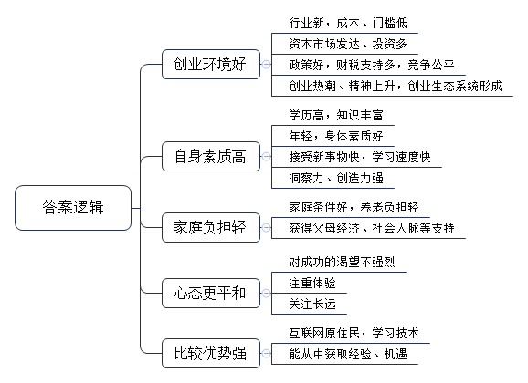
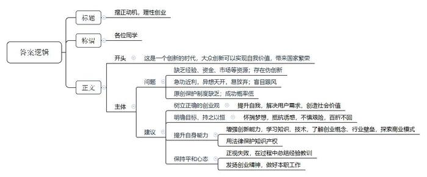
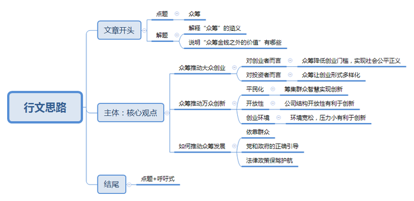

# 2016年公务员多省联考《申论》题（云南卷）

> 候选采集稿。参考答案及解析来自粉笔页面，不代表官方答案或真实高分答卷；来源使用许可与原卷对应关系仍需人工核实。

## 给定材料

### 材料 material-88eb667b115fd6cc

在北京西北部一栋办公楼冷飕飕的地下室里，一群想要成为企业家的人正聚集在计算机屏幕前，注视着他们最新的项目雏形。而在几公里之外，一个暖意融融、装修更为豪华的地下演讲厅里，30多名经理和创业者也在讨论有关新产品和新公司的创意。这两群人都验证着中国社会对创业热潮日益增长的兴趣。英语在线教学服务“英语流利说”创始人王某表示：“初创是令人迷恋的新事物。”“中国的创业精神呈现一种上升趋势。顶级风投公司正在寻找年轻的创业者——整套生态系统逐步形成。”

据不完全统计，从2013年5月至今，中央层面已经出台至少22份相关文件以促进创业创新。各地方政府也纷纷出台政策，简政放权，从财税、金融、保障服务、政策激励等方面支持创新型企业特别是创新型小微企业的发展，使各种创新资源向企业集聚，让更多金融产品和服务对接创新需求，用创新的翅膀使中国企业飞向新高度。2015年10月19日，在“全国大众创业万众创新活动周”启动仪式上，李克强总理被现场热烈气氛所感染而登台发表即席演讲，称“要为创新创业者站台”。李克强总理指出，大企业员工和草根创业者通过创新创业都可以成为更多财富的创造者和拥有者。这既是收入分配结构调整的重要内容，也促进了社会公平正义。“双创”为所有人提供了公平竞争的机会，让有能力的人通过自身奋斗获得上升通道。

### 材料 material-98c384cb836ea208

深圳的创业者乔峤想要做一款智能耳机，他发现，60%的人都会在跑步过程中听歌，并用手机APP记录运动数据。如果有产品能同时解决跑步人群运动数据记录和听歌的需求，又能通过音乐来实现运动激励，会有很好的市场前景。乔峤对记者说，他想针对每个人的身体特征，设计和提供有效的音乐服务产品，做到每一个硬件设备都是针对个人定制的。

可是，光有好点子还不行。初始创业的乔峤，面临既缺资金、又缺人才的尴尬，他尝试着用股权众筹的方式来实现自己的创业梦想。在众筹网上，他发布了自己的股权众筹商业计划书，以出让公司10%股份的方式，融资187万元，最低投资额1万元。最终，吸引了16名投资者参与。乔峤告诉记者，这些投资者为他引入了互联网、音乐、体育领域的强大资源，其中，几个最志同道合的投资人干脆直接加入了创业团队。

### 材料 material-98c86b217237f7b2

在某大学生创业大赛现场，5名女孩准备筹集40万元资金，到武汉近郊去承包50亩地，种植有机蔬菜。台上陈述的女孩充满激情和自信，台下观众也不时报以阵阵掌声。当评委问到：“你们种过蔬菜吗？”“你们的创业资金从哪里来？”“农民凭什么把土地转包给你？”“你们种出来的有机蔬菜准备卖给谁？”等问题时，她们的回答却难以令人满意。如今，“创业”已经成为青年人口中的高频词语，对大学生而言，创业正在变得“简单”，曾经的理想似乎也触手可及。

机械专业硕士小杨，进入杭州一家民营企业从事技术工作不满半年。因没有期待中的高薪，没有理想中的激情，他开始琢磨创业。此后，他每天都在与人交谈，项目、资金、人脉、经验等问题弄得他头疼，深感创业之艰的他最终放弃了创业梦。

某投资基金首席合伙人阎先生拥有20多年投资经历，曾位列《福布斯》中国年度最佳创业投资人榜首。他参与过投资的企业包括完美世界、环球雅思、凡客、分众传媒、百度、阿里巴巴、巨人网络等著名企业。在阎先生看来，当创业成了一种“时尚”和“运动”时，多数人都急功近利地把创业当成了投机行为。他说，“从时下来看，创业的动机大多是源自对财富和名声的渴望。”

某著名网站策略营销总监范女士认为，赚钱是创业的应有之意，但更多成功的创业者却是从想要赚钱开始，继而解决用户需求，是在解决用户需求、创造社会价值这条道路上不断自我追问、探寻并最终走向成功之地的；如果仅仅停留在“为了赚钱”上，是赚不到钱的。星巴克CEO舒尔茨曾说：“为钱创业是肤浅的，应为梦想所驱动。在创业路上有太多诱惑，也有太多艰险，只有怀揣理想的人才能够抵制诱惑，才能够不惧艰险，朝着自己的目标前行，百折而不回。”诺贝尔经济学奖得主菲尔普斯在《大繁荣》中指出，大多数创新并非是亨利·福特这一类孤独的梦想家带来的，而是由千百万普通人共同推动，他们有自由的权利去构思、开发和推广新产品与新工艺，或对现状进行改进。正是这种大众参与的创新带来了普通民众的繁荣兴盛——物质条件的改善加上广义的“美好生活”。大众创新带来了国家繁荣。

某公司创始人卢先生在接受记者采访时说，目前创业氛围很好，但创业却也成为一种时尚，仿佛不去创业就是落伍了。创业项目的选择，部分属于异想天开型的，部分属于复制型的。而现实需要创新型、技术型的项目，那些通过移动互联网，把原有的商业模式去中间化，搞流量，然后再找商业模式，这样的创新都是伪创新。仅怀着一腔热血，就幻想着自己只要去创业就能成为下一个马云，而对创业的概念、行业隐形的壁垒和门槛却知之甚少，这是许多大学生创业伊始的真实写照。在国内的互联网创业环境中，有一个非常不好的特性就是抄袭成风。很多创业者往往有一个好的创意，但却因为没有好的原创保护制度来保护，导致被其他一些公司抄袭过去，这些公司凭借着更雄厚的资本实力，迅速把原创者打败并挤出市场。

领英中国区总裁在日前的一次公开演讲中，用自身经验阐述了关于创业的两个公理：第一，创业成功是一个小概率的事件，每一个成功故事背后更多是失败；第二，创业没有失败者。即使是创业项目失败，作为创业者而言，过程中积累的经验将促进个人成长，即可定义为成功者。他认为，创业是没有失败者的历程。

ZUK联合创始人陈先生同样表达了对年轻人创业的观点。陈先生说：“创业是一件很复杂的事情，其实做好每一件事情就是创业。”

## 题目

### 第 1 题

**根据“给定资料**1**、**2**”，概括当代社会中“90后”群体开展创业的优势。(10分)**

关联材料：材料 material-88eb667b115fd6cc

作答要求：

要求：内容全面，观点明确，语言简洁。不超过200字。

### 第 2 题

**假定你是有关部门的一名工作人员，准备将“比逗咖啡馆”的创业经验向广大学生进行推介。请根据给定资料**3**\-**5**，归纳总结“比逗咖啡馆”的主要成功经验。(20分)**

关联材料：材料 material-98c384cb836ea208

作答要求：

要求：内容准确全面，总结有深度，有条理，字数不超过300字。

### 第 3 题

**假如你是某大学就业指导中心的工作人员，受邀为即将毕业的大学生做一次关于“创业”的专题报告，请你结合“给定资料**6**”，草拟一份讲话稿。（25分）**

关联材料：材料 material-98c86b217237f7b2

作答要求：

要求：观点明确，建议可行，语言简洁，有逻辑性；不超过350字。

### 第 4 题

**参考“给定资料”，结合当前政府推动“大众创业，万众创新”的社会形势，围绕“众筹：金钱之外的价值”，自选角度，自拟题目，写一篇文章。（45分）**

关联材料：材料 material-88eb667b115fd6cc

作答要求：

要求：观点明确，认识深刻，内容充实，结构完整，逻辑清晰，语言流畅。1000～1200字。

## 答案与解析

第 1 题

**参考答案（粉笔题库参考内容）**

1.创业环境好。行业新，成本、门槛低；资本市场发达、投资多；政策好，财税支持多，竞争公平；创业热潮、精神上升，创业生态系统形成。

2.自身素质高。学历高，知识丰富；年轻，身体素质好；接受新事物快，学习速度快；洞察力、创造力强。

3.家庭负担轻。家庭条件好，养老负担轻；获得父母经济、人脉等支持。

4.心态更平和。对成功的渴望不强烈，注重体验，关注长远。

5.比较优势强。互联网原住民，学习技术；能从中获取经验、机遇。

**解析**

**参考答案说明：**本参考答案从“创业环境好”“自身素质高”“家庭负担轻”“心态更平和”“比较优势强”这五个不同的方面进行了分条撰写。各条答案要点之间在内容上相互并列，没有交叉。

**考点**：考点特点类

**来源**：来源2016年公务员多省联考《申论》题（云南卷）

第 2 题

**参考答案（粉笔题库参考内容）**

比逗咖啡馆采用众筹模式，解决了资金、人才、销售、资源不足等问题，促进跨界合作。其成功的主要经验有：

1.前期准备充分。进行深入调研，确定股东目标群体，制定投资标准、金额，科学选址。

2.组建管理团队，确定经营理念。坚持“专业的事给专业的人做”的原则；建立董事会，股东拥有建议权，核心运营团队具有决策权。

3.优化股东结构。设置股东流转计划，根据贡献确定永久股东；并将毕业生股份流转给在校生，解决股权流动问题。

4.拓展业务。明确定位，利用校园优势，发展校内业务；举办创业交流活动，拓展校外业务；加强合作，整合校外资源。

5.公平合理分配。研发APP，加强股东交流，提高股东活跃度；进行数据化管理，公平分配股权、红利。

**解析**

**参考答案说明**：本答案以总分结构总结了“比逗咖啡馆”的成功经验。首先对“比逗咖啡馆”的成功经验进行了整体说明；接着从“前期准备”“团队建设与经营理念”“股东流转”“拓展业务”“公平分配”这几个方面进行了具体介绍。各条要点之间彼此独立，互不交叉，每条具体经验还提炼出了概括性较强的总括词前置。

**考点**：考点经验启示类

**来源**：来源2016年公务员多省联考《申论》题（云南卷）

第 3 题

**参考答案（粉笔题库参考内容）**

摆正动机，理性创业

各位同学：

这是一个创新的时代，大众创新可以实现自我价值，带来国家繁荣。

但依然存在问题：一、缺乏经验、资金、市场等资源；存在伪创新。二、急功近利，异想天开，易放弃；盲目跟风。三、原创保护制度缺乏；成功概率低。

我们大学生应该做到：一、树立正确的创业观。提升自我，解决用户需求，创造社会价值。二、明确目标，持之以恒。怀揣梦想，抵抗诱惑，不惧艰险，百折不回。三、提升自身能力。增强创新能力，学习知识、技术，了解创业概念、行业壁垒，探索商业模式；用法律保护知识产权。四、保持平和心态。正视失败，在过程中总结经验教训；发扬创业精神，做好本职工作。

**解析**

**参考答案说明：**（1）格式方面，本参考答案写到了“标题”“称谓”“正文”。（2）正文部分，一方面从内容来看，围绕着“理性创业”这一主题，本参考答案的开头先写到了“理性创业”的意义；主体部分指出了创业存在的问题，并从“树立正确的创业观”“明确目标，持之以恒”“提升自身能力”“保持平和心态”四个方面给出了“理性创业”的建议。另一方面，形式上，本参考答案做到了分段、分条撰写，整体上条理较为清晰。（3）本参考答案能够结合题目中“简洁”“有逻辑性”等要求，在语言表达上做到了简洁，段落及句子之间的衔接自然。

**考点**：考点总结类

**来源**：来源2016年公务员多省联考《申论》题（云南卷）

第 4 题

**参考答案（粉笔题库参考内容）**

参考范文一：

论众筹的价值超越性

在“大众创业，万众创新”的时代精神的感召下，**众筹**——一种公开向不特定的群众募资的新型商业模式诞生了。在一些人看来，众筹不过就是大家筹钱吗？这种是对众筹片面的理解，没有看到众筹超越金钱之外的价值。

除了能快速募集资金，众筹模式还具有门槛低、多样性、开放性、依靠大众、注重创新等特点。这种新模式带来不仅仅是金钱，而是机会、梦想、平台，是更加公平正义，更和谐的社会关系；是新思路，新模式，新视野。

众筹筹的不仅是钱，而是机会、梦想、平台，是更加公平正义，更和谐的社会关系。众筹是“**大众创业**”的驱动力，它让创业变得大众化、平民化、机会平等化，它让每个普通人都有机会实现“梦想”，让广大人民群众都有参与创业的机会，分享创业成果，从而有效调节收入分配结构，促进社会公平正义。在众筹模式没有大规模兴起之前，创业是少部分“专业”人士的特权，只有要么自身资金雄厚要么拿到专业投资机构的钱，才有资格创业。众筹的兴起，就是把这种“特权”变为“普权”，你不需要有钱，只需要有能力梦想能获得大家信任，大家就愿意支持你创业，创业的门槛大大降低。**与此同时**，创业形式也变得多样化，创业不必再自己成立经营企业，可以通过投入资金、技术、智慧、人脉等多种形式参与，这使得参与创业的机会触手可及。众筹不仅降低了创业的门槛，化解了创业风险，整合社会资源，还让大家共享创业收益，让人民群众也能共享创业的时代红利。

众筹对创业支持主要体现在众筹对“**万众创新**”的有效支持上。对创业驱动，主要不体现在金钱上，而是体现在创新上。众筹让创业变得靠创新驱动，而不是靠资金、政策、资源等传统的要素驱动。

**首先**，众筹的**平民化**决定了众筹依靠创新驱动。众筹驱动的创新和以往的专业化、精英化路线不同，是一种“万众创新”的人民创新路线。比起筹资来说，众筹筹集的更多是智慧、梦想、信任。参与众筹者，很多都是工薪阶层，是草根。他们资金有限，但智慧无穷。这种模式会倒逼着众筹的企业用更集约，更省钱，更高效，更智慧的方式，来驱动企业发展。 **其次**众筹公司结构的**开放性**有利于企业保持持续创新。以“一八九八咖啡馆”为例，其股东不仅人数众多，其中还包括各种不同行业、年龄、专业的人，而这些人既是公司股东又是生产者消费者，他们会不断给公司带来新资源、新思想，避免企业走向单一呆板僵化。**再次**，众筹模式的风险低、压力小为创新营造了**宽松的环境**。众筹解放了创业者，让我们不需要赌上身家性命去创业，从而使创业者敢于创新。众筹的开放性使企业人才更加多样化，无需创业者成为全才通才，可以更加专注于自己领域深入思考，更容易出创新成果。

金钱是众筹的基本要素，但众筹绝不仅仅意味着金钱，它让人民有更多的机会，使社会分配更加公平，让经济发展更有活力，它是“大众创业”的根据地，是“万众创新”的发动机。它是一场在党和政府领导下的发动人民、依靠人民、组织人民的新经济运动，是我党群众路线在经济领域的新体现。众筹既需要群众智慧，也离不开党和政府的正确引导，还需要政策和法律保驾护航。

我们有理由相信，在党和国家的号召下，在广大人民群众的努力下，在良好的社会环境的孕育下，众筹一定能筹出一个更加开放、平等、自由、公平、正义的新世界。

参考范文二：

众筹，金钱之外的价值

如今，从中央到地方各级政府都为创业营造了良好的环境，创业热潮日益高涨，创业精神呈现上升趋势。众筹就在这样的背景下应运而生，走进人们的视线中。它是21世纪一种新兴的商业集资模式，是时代的产物。如果说你只看到了众筹的集资价值，那就是见识浅薄、目光短浅了，因为众筹的价值远在金钱之外。

众筹，一方面能够筹资、筹合作伙伴、筹销路、筹平台、筹梦想；另一方面它更能响应国家号召，助力“大众创业、万众创新”在华夏大地上落地生根。

众筹是大众创业的驱动力。过去老百姓若想创业，谈何容易？人、钱、销路、合作……每走一步都是坎，每迈出去一步都顶着巨大的创业压力。创业，如此简单的两个字绝非老百姓所能为。然而，众筹模式的诞生为广大人民群众提供了实现梦想的平台，让人人都有机会参与创业，分享创业成果，共享时代红利，从而有效地调节了收入分配结构，促进社会公平正义。于此同时，众筹对于投资者而言也是一个福音，利用众筹创业何必单纯的靠投入资金呢？人脉、资源、智慧都是投资者在创业的道路上可以充分利用的，这种创业形式的多样化也大大降低了创业的门槛，解决了创业的尴尬。

众筹的价值更体现在对万众创新的支持上，使得我们的创业能够摆脱过去靠要素驱动的落后模式，形成靠创新驱动的新模式、新业态、新气象。

首先，众筹筹集了群众智慧，推动了创新。以“比逗咖啡馆”为例，一个缺乏社会经验的年轻团队，同样能够集合众人智慧创新了管理方式、运营团队和交流方式，他们能够源源不断的为团队带来新点子，始终保持着生命力去适应时代的变化，避免企业僵化，这无疑是众筹模式提供了良好的契机。其次，众筹之所以能够创新，是因为大家能够很轻松地做自己的事情了，就会主动去创新，每天为了生存去创业的时候，你就不可能去创新。众筹模式下的宽松创业环境势必能够激发人们内心创业的冲动，也必然能催生人才的专业化、多样化，释放潜藏在人民群众中的创新潜能。众筹的创新价值并非纸上谈兵，以乐视网为例，乐视网上线了首个众筹项目—“我签C罗你做主”，只要在规定期限内，集齐1万人支持（每人投资1元），乐视网就会签约C罗作为世界杯代言人。届时，所有支持者也会成为乐视网免费会员，并有机会参与一系列的后续活动。这可能是国内第一次用众筹方式邀请明星，创新了商业营销模式。

众筹是“大众创业”的引擎，是“万众创新”的活头源水。面对这一新事物，政府要完善原创保护制度，杜绝劣币驱逐良币的行为从而为众筹创造良好的生态环境。对于创业者而言，更要树立端正的创业观，将众筹模式运用在解决用户需求和创造社会价值的道路上；同时，也要加强实践经验才能真正地理解众筹的深层次涵义从而更有效地运用众筹去创业。

我们应该坚信，众筹一定能筹出一个更加平等、自由、公平、和谐的新世界。

**解析**

**考点**：考点文章写作题

**来源**：来源2016年公务员多省联考《申论》题（云南卷）

