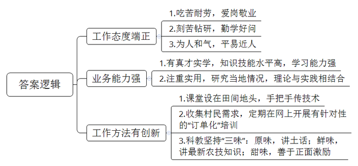
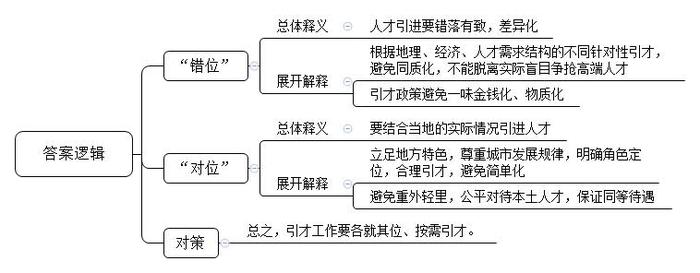
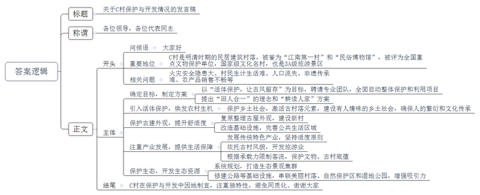
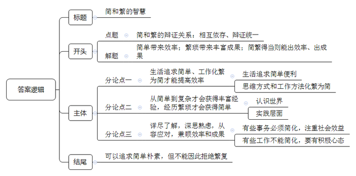

# 2018年公务员多省联考《申论》题（云南卷）

> 候选采集稿。参考答案及解析来自粉笔页面，不代表官方答案或真实高分答卷；来源使用许可与原卷对应关系仍需人工核实。

## 给定材料

### 材料 material-dd9219587aa4ded5

M市D区是省内实施科技特派员工程的试点地区。在村民们心中，科技特派员就是要给田间地头开药方，把先进的科技种到地里头，长出金苗苗。

不久前，D区记者小菲就本区科技特派员的情况，对区科技局局长李明进行了一次采访。在采访中，李局长感叹道：“我们还有很多的工作可以做。”

“我们的科技特派员大部分是行业领域的专家、大学生，有的讲授得偏重于纯理论，对农民来说，太过于抽象，不接地气，不实用。这在实际操作中是得不到农民欢迎的。再者说，术业有专攻，本是种蔬菜的农民，要是派一个专攻苗木培养的工作人员给他，又能有多少用呢？”李局长认为，“农民需要和专业领域对口的，有真才实学的，能听懂田坎语言的科技特派员对接，而非流于形式的‘拉郎配’。”

D区目前共有440多个行政村，但科技特派员总共才82名。这令李局长忧心。“在这支队伍里，60来岁的根本不算老，最大的已经70多岁了。想想这些老人们还能在田坎上、果林里跑几年？而一个大学生想要成为一名科技特派员，起码要跟着老特派员学习两年。但是，有多少大学生愿意跟着天天进村下地？我们这些年过花甲的特派员又有多少精力来带这些‘徒弟’呢？”

D区的村民老蒋也对小菲说道，“去年我养土鸡，上面给我安排了科技特派员。结果每次来就是帮我喂喂鸡苗，陪着唠唠嗑。后来我怀疑有些鸡苗害了瘟病，找他帮忙看看，他却说没事，叫我放心。结果后来几百只鸡全部染上了鸡瘟，让我损失惨重。”对此，老蒋表示很无奈。

小菲对全区82名科技特派员进行了问卷调查。调查发现：有近三分之二的科技特派员认为自己的知识结构趋于老化，需要更新丰富。而同时，80%的科技特派员表示因为工作的关系，自己根本没有时间去自行组织学习，但如果有相应的知识讲座、观摩交流会的话，他们会积极参加，有优质的网络学习资源也不愿错过。并且这些特派员有不少同专业同领域的朋友、同学其实也有成为服务农村的科技特派员的意愿，但最后都因为工作忙、不在本地、不在政府指派培养范围内等原因而作罢。

据悉，D区计划近期开展服务行动。围绕本地农业主导产业，建立一批“互联网+科技特派员”创新创业示范基地，对接国家、省里的“科技特派员管理服务平台”。

### 材料 material-6efb14c52e6ddb27

最近几年，很多二线城市的人才引进工作都开展得如火如荼。二线城市尚在努力，三四线城市自然也不甘落后：给钱、给房、给户口。然而，纵观很多三四线城市的“人才争夺战”，大多也只是出台买房打折、租房补贴、落户降标、项目资助、一次性奖励等引才政策。这固然有一定的吸引力。但作为本身经济实力和区位优势就不那么突出的三四线城市，给出和二线城市差不多的“彩礼”，能真正地“引凤求凰”吗？

“在人才工作中，一些地方的同质化倾向依旧明显。”一位从事人才引进工作多年的部门负责人说道，“现在，很多中小城市都要高学历、高效能、高层次、高大上、高精尖的人才；而给人才的往往就是‘老三样’——钱、房和户口。”

“很多地方把人才引进工作想得过于简单了。”一位评论家说道，“人才工作不是把人引进来就可以的，它其实更依赖人才生态的建设——如何利用、再培养、激励，如何留得住才是重中之重。然而，这往往是被很多中小城市忽视的。花了大力气，引不到人才；人才来了待不久。消耗了那么多的财力物力，也还是为他人做嫁衣。”问题还不止于此。现在一些地方的人才引进工作，已经给当地的财政带来不小的压力和负担了，但却收效甚微。很多地方都重视引进外地人才。可外地人才引不来，厚彼薄此、重外轻里的人才政策更让本地人颇有意见，可以用“赔本也没赚到吆喝”来形容。

“计算机、生物科技、航空航天这些尖端领域的顶尖人才本来就非常稀缺，即使在北上广深这样的城市都是‘肉少狼多’。在这样的环境中，实力薄弱许多的三四线城市往往是耗费了大量的财力人力，最后却还是被‘剩下’。而且，就算引进了，往往也用不好，甚至用不上。”一位人力资源专家说道，“引进人才要靠优势，但中小城市能靠的优势往往不是物质吸引力，而是自己的特色。”

另一位评论家也给了一个观点，“各个地方的人才引进工作，必须要‘错位’又‘对位’。我们的城市定位不应该也不可能是趋同的，要是采用同样的人才路线，是会‘撞车’的；毕竟错落有致，才既尊重城市发展规律，又符合建筑美学嘛。我国各个城市间的地理、经济等方面差距依旧巨大，对人才的吸引力、对人才的需求结构都是大不相同的。我们必须认清这个现实，找准自己的位置，才可能做好人才工作。因为你是你，你不是别的城市。你在全省，甚至是全国有你的角色定位，有你自己独特的优势。所以必须各就其位、各求所需。”

位于东部的B市，就曾犯过一种“经典”的错误。在五年时间里，B市花费数亿资金引进了大量外市的高职称人才。然而，效果却不尽如人意。“招来了女婿，气走了儿子。各个地方都是这样，厚彼薄此成了通病！”B市土生土长的科研人员小姚说道，“同样的学历、同样的职称，就因为我一直在本地，来路不同，待遇差距就这么大？果然是外来的和尚会念经？这让我们这些兢兢业业的本地人有些寒心。”而与此同时，小姚也接到了外地的一个职位邀请，待遇颇为优厚，他说自己正在考虑中。其实引进人才不能够片面地理解为“买进人才”。发掘培养本土人才也同样重要。

### 材料 material-1548a0bd8153ad10

位于湘西的C村，因三面环山、一面临水的地势而得名。这个明清时期的古代民居建筑村落，被誉为“江南第一村”和“民俗博物馆”。在晨雾中，绿荫环抱的小山村，一片青瓦白墙，一条流过门前的清澈小河，如此简单的画面让人心生向往。

C村在2006年被国务院公布为第六批全国重点文物保护单位；2007年被公布为国家级历史文化名村；现为国家3A级旅游景区。

这儿的建筑有一个特别之处：在侗式木屋的外面，还筑有徽式高墙。因为村子人口多，房屋十分密集，火灾是这儿的纯木质房屋极大的安全隐患。

几年前，村里的杨老犯了愁：村子里和他一起唱傩戏的人，已经没有几个了。作为省里的非遗，难道就真的逃脱不了失传的命运吗？当时，C村和中国所有乡村面临的状况十分相似：年轻人大都外出打工，留守和空巢现象较为严重。杨老说，年轻人也不是不想回来，但是村里房屋太挤了；在家种地挣不了几个钱，养不活自己和家人；因为古村保护不能乱建新房，年轻人在外面打工挣钱了当然想住一个新房，但没地方让他们建，老屋洗澡、上厕所都不方便。在这生计生活问题都解决不了，更别说什么非遗传承问题了。

“我们村里啊，有很多土生土长的好东西，比如野生茶、黑米茶、有机生态米、手工艺品等等。”村支书老高说道，“但以前这里建筑规划不行，交通也没跟上，我们不会包装，好东西也卖不出去，可惜哟。”

“活体保护，让古风留存。”这是县委书记为C村拟好的目标。为了更好地保护这一弥足珍贵的传统村落，县政府于2015年全面启动了C村整体保护与利用项目，并特邀了专业的乡村建筑设计团队来打造。面对C村的山水和生态，团队提出了“田人合一”的理念和“耕读人家”的设计方案，从房、水、旅、种、村、治等几个方面分别着手修复和调整：只有乡愁乡建，才能留住乡愁；只有古村古建，才能留存古风。

“乡建的重点，是在‘乡’上下功夫，而不是在‘建’上做文章；乡愁不是‘愁’上做文章，而要在‘乡’中找情感。乡就是农田、民居、菜园、养猪，就是充满人情味的乡土社会。让年轻人回村，只要他们回家了，人就可以养房，村中就有生机。”团队这样的理念重新激活了古村落的元素，把农村建设得更像农村。

过去对传统村落的保护，可能更侧重于单纯的物质上的保护，而忽略了人的繁衍、文化的传承，没有太多考虑年轻人为什么不愿意回来。县委书记介绍道：C村历史纵跨600多年，至今保存完好的一个很重要的因素，就是它有人活动，有侗汉苗民族老百姓在这里繁衍生息，所以我们必须引入活体保护的概念。

古村古建在外观上对C村进行了保护和传承。同时也注意提高农民生活的舒适度，改造了古村的基础设施和公共生活区域，让老人和年轻人都住得舒服；对外观上已经过度改造的房子，进行了复原整理；此外，还在古村旁边建了一个新村。

“有了新村，年轻人可以回家盖房。古村也因为年轻人的回归而注入了新要素，传统特色产业的发展也有了更坚实的依托和更广阔的空间。”县委书记说道。他认为，他们必须要保持有老百姓在这里生产、生活、繁衍生息这么一种风貌，也必须把群众赖以生存的各种产业做好。在传统特色产业活了以后，C村开始在旅游业方面大展拳脚。在这几年，C村连续被评为“中国十大最美丽乡村”。古村的自然素净吸引了来自全国各地的人们前来一睹芳姿。但即使是面对这样的旅游热，C村也保持了冷静的头脑：在发展旅游的同时，必须把古村的文物保护好，把文脉保护住，留住古村底蕴。产业发展也要适度，才可以避免失去特色；旅游限量接待游客，防止超过古村承载能力。只有这样，古村才有长久的魅力和旺盛的生命力。

但古村的保护发展工作还不止于此。“古村本身只是一个亮点，真正能将人留住的，是这里的青山绿水。这里非常宁静美好，就像一个世外桃源。虽然这里偏僻了一点，但现在已经改善了基础设施，比如修建沿河公路等等。现在县城到这儿，只要20分钟车程。”县委书记说，“附近还有一个国家级自然保护区和一个国家湿地公园，生态都非常好。这些都是我们当初就看到并且纳入规划的。”现在，公路已经把沿河的那些小小的美丽村落、自然保护区、湿地公园等都纳进来了。C村，就像是一串项链上最璀璨的明珠。

“如果当初大家照着别的古村例子来做，也有一定效果。但为了我们祖祖辈辈生活的家园，我们多想点办法，多动点脑筋，多流些汗也值。”C村村支书说道。

## 题目

### 第 1 题

**根据材料**1**、**2**，归纳概括出小童被评选为“全市十佳科技特派员”的原因。（15分）**

关联材料：material-dd9219587aa4ded5

作答要求：

要求：全面、准确、简明，有条理，字数不超过200字。

### 第 2 题

**根据材料**3**，谈谈你对其中划线部分“****各个地方的人才引进工作，必须要‘错位’又‘对位’****”的理解**。**（20分）**

关联材料：material-6efb14c52e6ddb27

作答要求：

要求：全面、准确、简明，字数不超过200字。

### 第 3 题

**假设****C****村所在的省份将开展一次关于古村落的保护与开发的经验交谈会，请你根据材料**4**，写一份介绍****C****村保护和开发情况的发言稿。（25分）**

关联材料：material-1548a0bd8153ad10

作答要求：

要求：紧扣材料，内容全面；逻辑清晰，语言准确；字数在450字左右。

### 第 4 题

**根据材料**5**中划线部分“****当简勿繁，当繁勿简；简繁得当，方能出效率，方能出成果****”写一篇文章。（40分）**

关联材料：material-dd9219587aa4ded5

作答要求：

要求：自选角度，立意明确；联系实际，不拘泥于“给定资料”；思路清晰，语言流畅；总字数1000～1200字。

## 答案与解析

第 1 题

**参考答案（粉笔题库参考内容）**

一、工作态度端正。1.吃苦耐劳，爱岗敬业；2.刻苦钻研，勤学好问；3.为人和气，平易近人。

二、业务能力强。1.有真才实学，知识技能水平高，学习能力强；2.注重实用，研究当地情况，理论与实践相结合。

三、工作方法有创新。1.课堂设在田间地头，手把手传技术；2.收集村民需求，定期在网上开展有针对性的“订单化”培训；3.科教坚持“三味”：原味，讲土话；鲜味，讲最新农技知识；甜味，善于正面激励。

**解析**

**参考答案说明：**本参考答案从“工作态度端正”“业务能力强”“工作方法有创新”这三方面展开，各条答案要点之间在内容上相互并列，没有交叉。

**参考答案****二**

一、工作态度端正。1.吃苦耐劳，爱岗敬业；2.刻苦钻研，勤学好问；3.学习能力强，理论联系实际。

二、业务能力强。1.态度好，沟通能力强；2. 课堂设在田间地头，手把手传技术，讲课接地气；3.收集村民需求，定期在网上开展“订单化”培训。

三、工作方法有创新。1.使用田坎用语，讲短话和土话；2.教授村民最新农业知识，讲致富经；3.对村民使用积极语言，正面激励。

**考点**：考点原因类

**来源**：来源2018年公务员多省联考《申论》题（云南卷）

粉笔申论页面对本题只提供「解析视频」入口，该入口是会员推广位，页面无视频地址与文字解析。

第 2 题

**参考答案（粉笔题库参考内容）**

一、“错位”指：人才引进要错落有致，差异化。1.根据地理、经济、人才需求结构的不同针对性引才，避免同质化，不能脱离实际盲目争抢高端人才。2.引才政策避免一味金钱化、物质化。

二、“对位”指：要结合当地的实际情况引进人才。1.立足地方特色，尊重城市发展规律，明确角色定位，合理引才，避免简单化。2.避免重外轻里，公平对待本土人才，保证同等待遇。

总之，引才工作要各就其位、按需引才。

**解析**

**参考答案说明：**思路方面，本参考答案按照“总体释义+展开解释+总结”的答题思路展开。内容方面，本答案分别解释什么是“错位”，什么是“对位”；然后展开解释“错位”和“对位”的具体体现；最后依据材料提出了对策，进行总结，即人才引进“如何做到‘错位’又‘对位’”。

**考点**：考点词句解释类

**来源**：来源2018年公务员多省联考《申论》题（云南卷）

粉笔申论页面对本题只提供「解析视频」入口，该入口是会员推广位，页面无视频地址与文字解析。

第 3 题

**参考答案（粉笔题库参考内容）**

关于C村保护与开发情况的发言稿

各位领导，各位代表同志：

大家好！C村是明清时期的民居建筑村落，被誉为“江南第一村”和“民俗博物馆”，被评为全国重点文物保护单位，国家级文化名村，也是3A级旅游景区。过去，也面临着火灾安全隐患大、村民生计生活难、人口流失、非遗传承难、农产品销售不畅等问题。为此，采取了以下措施：

一、确定目标，制定方案。以“活体保护，让古风留存”为目标，聘请专业团队，全面启动整体保护和利用项目，提出“田人合一”的理念和“耕读人家”方案。二、引入活体保护，焕发农村生机。保护乡土社会，激活古村落元素，建设有人情味的乡土社会，确保人的繁衍和文化传承。三、保护古建外观，提升舒适度。复原整理古屋外观，建设新村；改造基础设施，完善公共生活区域。四、注重产业发展，提供生活保障。发展传统特色产业，坚持适度原则；依托古村风貌，开发旅游业；根据承载力限制客流，保护文物、古村底蕴。五、保护生态，开发生态资源。系统规划，打造生态景观集群；修建公路等基础设施，串联美丽村落、自然保护区和湿地公园，增强吸引力。

总之，C村在保护与开发中因地制宜，注重独特性，避免同质化。谢谢大家！

**解析**

**参考答案说明：**（1）格式方面，本参考答案写到了“标题”“称谓”“正文”三个部分。（2）正文部分，一方面从内容来看，围绕着“古村落的保护与开发”这一主题，本参考答案的开头简单介绍了C村的背景；主体部分从“确定目标，制定方案”“活体保护，焕发生机”“保护古建外观，提升舒适度”“注重产业发展，提供生活保障”“保护生态，开发生态资源”等五个方面给出了具体的经验；结尾做出总结，并表示感谢。另一方面，形式上，本参考答案做到了分段、分条撰写，整体上条理较为清晰。

**考点**：考点总结类

**来源**：来源2018年公务员多省联考《申论》题（云南卷）

粉笔申论页面对本题只提供「解析视频」入口，该入口是会员推广位，页面无视频地址与文字解析。

第 4 题

**参考答案（粉笔题库参考内容）**

**简与繁的智慧**

简单与繁琐相互依存、辩证共生。简单代表便利，是我们在生活、工作、思维上追求的目标。但获得简单离不开曲折繁琐的探索过程，没有繁琐便成就不了简单。简单意味着效率；繁琐则给我们带来多样、丰富、深刻的经验；简繁得当，则能出效率、出成果。

正确处理简和繁的关系，需要智慧。有时我们要有删繁就简、化繁为简的艺术，有时则要有于简见繁，藏繁于简的睿智。

**当简勿繁，生活追求简单、工作化繁为简才能提高效率。追求简单，能推动科技进步，市场繁荣，反过来又让生活和工作更便捷，经济更发展。**人民追求生活简单便利，催生了技术进步，带来了互联网，带来了社交软件、移动支付等，节约了社交、购物、出行、吃饭等时间。这使我们有更多的机会从事创造，从而带来更多产品，活跃了经济。化繁为简，还是一种善于抓主线、抓重点的思维方式和工作方法。企业做产品追求简洁，才能做精做细，提高效率。苹果手机就是以产品的单一和极简主义获得成功的。政务而言，工作要抓要害，讲话要简洁，文章要简短，办事流程要删繁就简，才能不断给人民以轻松自由。

但我们不能因为追求简单就拒绝繁杂。如果化繁为简是一种能力，那么由繁到简、于简见繁可以说是一种磨砺和修行了。

**当繁勿简，从简单到复杂才会获得丰富经验，经历繁琐才会获得简单。认识世界是从简单到复杂，由浅入深的过程；实践层面，经过反复打磨，才能获得简单。**在思想认知层面，看似简单的逻辑概念、数学公式，是几代人绞尽脑汁、反复试验得来的。我们只有理解了其繁琐的推导过程，才能做到运用自如。简短的诗歌名句，只有充分了解了人物经历、历史背景才能真切体会。在实践层面，我们生活中简单易用的互联网APP产品，是产品经理和技术工程师以极为繁琐的流程反复推演、试用和修改完善而成的。政府工作也必须繁之又繁，细之又细，才能给老百姓减轻负担。在人情世界里，诸如爱情、亲情、友谊、团结等，显然也需要一些繁琐陪伴，才能获得那些弥足珍贵的东西。

**落脚点是简繁得当，即：详尽了解，深思熟虑，从容应对，兼顾效率和成果**。**这既是提升个人能力，也是创造社会价值的需要。**有些事务可以也必须简化，要以社会效益为导向。比如：管理中的一般事务性流程，官僚化审批环节，以及工业化产品的生产，很多重复性的机械劳动等，只有化繁为简，才能解放人，才能批量生产。有些工作、有些事情则是不能简化的，必须细之又细，我们要有积极心态，不厌其烦。比如：安全生产检查、医疗工作和教育工作等等。艺术品、诗歌和文章的创作，更是需要用心反复打磨。这些工作，我们要能从繁杂中学会谨慎，学会承担责任和高度自律。

无论是简单的，还是繁杂的，人生的所有经历都会在记忆中埋藏，孕育成长的根芽。我们可以追求简单朴素，但不能因此拒绝繁复，要去深入了解，于简见繁 ，当繁勿简，才能从繁到简。

**解析**

**文章分析**

**简与繁的智慧**

【**标题的优点：**首先，范文的标题“简与繁的智慧”突出了“简与繁的关系”这一主题。其次，形式上，文字简洁明快。】

（1）简单与繁琐相互依存、辩证共生。（2）简单代表便利，是我们在生活、工作、思维上追求的目标。但获得简单离不开曲折繁琐的探索过程，没有繁琐便成就不了简单。（3）简单意味着效率；繁琐则给我们带来多样、丰富、深刻的经验；简繁得当，则能出效率、出成果。

【**开头的优点：**★内容方面。范文的开头是紧扣题目给定的“当简勿繁，当繁勿简；简繁得当，方能出效率，方能出成果”这句话展开的。首先，开头第一句话点出主题，做到了主题明确。其次，对“简与繁的关系”这一主题进行了分析阐述，（1）指出了“简与繁”的具体关系。（2）（3）分别对“简单”与“繁琐”的重要性进行论证。★文字表达方面：长短句配合使用，使语言表达有节奏感。】

正确处理简和繁的关系，需要智慧。有时我们要有删繁就简、化繁为简的艺术，有时则要有于简见繁，藏繁于简的睿智。

【**过渡段的优点：**范文过渡段分析了如何正确处理“简与繁”，过渡段末尾的“有时我们要有删繁就简、化繁为简的艺术，有时则要有于简见繁，藏繁于简的睿智”是用来引起下文的过渡句。】

**当简勿繁，生活追求简单、工作化繁为简才能提高效率。追求简单，能推动科技进步，市场繁荣，反过来又让生活和工作更便捷，经济更发展。**（1）人民追求生活简单便利，催生了技术进步，带来了互联网，带来了社交软件、移动支付等，节约了社交、购物、出行、吃饭等时间。这使我们有更多的机会从事创造，从而带来更多产品，活跃了经济。（2）化繁为简，还是一种善于抓主线、抓重点的思维方式和工作方法。企业做产品追求简洁，才能做精做细，提高效率。苹果手机就是以产品的单一和极简主义获得成功的。政务而言，工作要抓要害，讲话要简洁，文章要简短，办事流程要删繁就简，才能不断给人民以轻松自由。

【**论述段****1****的优点：**★观点句：范文的观点句是紧扣“简与繁的关系”这一文章主题提出的。形式上，它在段首处直接写出，位置突出，容易发现。内容上，关键词突出，内容要点明确，可以明显看出它是从“当简勿繁”入手，指出了“简”的重要性。★论述内容：（1）先介绍了“追求简单让生活便利，经济发展”；（2）接着介绍了“追求简单让工作重点突出”。注意：以上两个方面的内容都是紧扣“当简勿繁，生活追求简单、工作化繁为简才能提高效率。追求简单，能推动科技进步，市场繁荣，反过来又让生活和工作更便捷，经济更发展”这个观点句进行分析论述的，论述的针对性强，内容层次丰富。最后，在论述方法和论据的选取上做到了讲道理、举例子相结合，做到了丰富多样。】

但我们不能因为追求简单就拒绝繁杂。如果化繁为简是一种能力，那么由繁到简、于简见繁可以说是一种磨砺和修行了。

**当繁勿简，从简单到复杂才会获得丰富经验，经历繁琐才会获得简单。认识世界是从简单到复杂，由浅入深的过程；实践层面，经过反复打磨，才能获得简单。**（1）在思想认知层面，看似简单的逻辑概念、数学公式，是几代人绞尽脑汁、反复试验得来的。我们只有理解了其繁琐的推导过程，才能做到运用自如。简短的诗歌名句，只有充分了解了人物经历、历史背景才能真切体会。（2）在实践层面，我们生活中简单易用的互联网APP产品，是产品经理和技术工程师以极为繁琐的流程反复推演、试用和修改完善而成的。政府工作也必须繁之又繁，细之又细，才能给老百姓减轻负担。（3）在人情世界里，诸如爱情、亲情、友谊、团结等，显然也需要一些繁琐陪伴，才能获得那些弥足珍贵的东西。

【**论述段****2****的优点：**★观点句：范文的观点句是紧扣“简与繁的关系”这一文章主题提出的。形式上，它在段首处直接写出，位置突出，容易发现。内容上，关键词突出，内容要点明确，可以明显看出它是从“当繁勿简”入手，指出了“繁”的重要性。★论述内容：（1）先介绍了“在思想认知层面‘繁’的意义”；（2）接着介绍了“实践层面‘繁’的意义”；（3）最后介绍了“人情世界里‘繁’的意义”。注意：以上三个方面的内容都是紧扣“当繁勿简，从简单到复杂才会获得丰富经验，经历繁琐才会获得简单。认识世界是从简单到复杂，由浅入深的过程；实践层面，经过反复打磨，才能获得简单”这个观点句进行分析论述的，论述的针对性强，内容层次丰富。最后，在论述方法和论据的选取上做到了讲道理、举例子相结合，做到了丰富多样。】

**落脚点是简繁得当，即：详尽了解，深思熟虑，从容应对，兼顾效率和成果**。**这既是提升个人能力，也是创造社会价值的需要。**（1）有些事务可以也必须简化，要以社会效益为导向。比如：管理中的一般事务性流程，官僚化审批环节，以及工业化产品的生产，很多重复性的机械劳动等，只有化繁为简，才能解放人，才能批量生产。（2）有些工作、有些事情则是不能简化的，必须细之又细，我们要有积极心态，不厌其烦。比如：安全生产检查、医疗工作和教育工作等等。艺术品、诗歌和文章的创作，更是需要用心反复打磨。这些工作，我们要能从繁杂中学会谨慎，学会承担责任和高度自律。

【**论述段****3****的优点：**★观点句：范文的观点句是紧扣“简与繁的关系”这一文章主题提出的。形式上，它在段首处直接写出，位置突出，容易发现。内容上，关键词突出，内容要点明确，可以明显看出它是从“繁简得当”入手，指出了如何正确看待“繁与简的关系”。★论述内容：（1）先介绍了“面对可以简化的事物应该怎么做”；（2）接着介绍了“面对不可以简化的事情应该怎么做”。注意：以上两个方面的内容都是紧扣“落脚点是简繁得当，即：详尽了解，深思熟虑，从容应对，兼顾效率和成果。这既是提升个人能力，也是创造社会价值的需要”这个观点句进行分析论述的，论述的针对性强，内容层次丰富。最后，在论述方法和论据的选取上做到了讲道理、举例子相结合，做到了丰富多样。】

【**论述段之间的关系**：★内容的内在逻辑：范文的论述段之间是依照“依次分析‘繁’与‘简’+正确处理‘繁与简的关系’”这一逻辑展开的。论述段1先写了“当简勿繁”，论述段2再写了“当繁勿简”，论述段3接着写了“繁简得当” 。★段与段的外在衔接：过渡段“但我们不能因为追求简单就拒绝繁杂。如果化繁为简是一种能力，那么由繁到简、于简见繁可以说是一种磨砺和修行了”，起到了承接论述段1、引出了论述段2的作用。】

无论是简单的，还是繁杂的，人生的所有经历都会在记忆中埋藏，孕育成长的根芽。我们可以追求简单朴素，但不能因此拒绝繁复，要去深入了解，于简见繁 ，当繁勿简，才能从繁到简。

【**结尾的优点：**范文的结尾回扣了“简与繁的关系”这一主题，并发出了号召希望，阐述了“于简见繁 ，当繁勿简”的深远意义。】

**考点**：考点文章写作题

**来源**：来源2018年公务员多省联考《申论》题（云南卷）

粉笔申论页面对本题只提供「解析视频」入口，该入口是会员推广位，页面无视频地址与文字解析。

