# 2018年421联考《行测》题（云南卷）（网友回忆版）

<!-- gwy:overview:start -->
> **云南 · 2018 · 行测 · 统考** ｜ 120 题 · 图片 93 处 · 答案随题折叠

| 题型模块 | 题量 | 题号 |
| --- | ---: | ---: |
| 常识判断 | 20 | 1–20 |
| 言语理解与表达 | 40 | 21–60 |
| 数量关系 | 10 | 61–70 |
| 判断推理 | 35 | 71–105 |
| 资料分析 | 15 | 106–120 |
| **合计** | **120** | |

导航：[题型与作答说明](#题型与作答说明) · [题目](#题目) · [材料 1](#材料-1)
<!-- gwy:overview:end -->

> 候选采集稿。参考答案及解析来自粉笔页面，不代表官方答案或真实高分答卷；来源使用许可与原卷对应关系仍需人工核实。

## 题型与作答说明

常识判断

（20题）

根据题目要求，在四个选项中选出一个最恰当的答案。

言语理解与表达

（40题）

本部分包括表达与理解两方面的内容。请根据题目要求，在四个选项中选出一个最恰当的答案。

数量关系

（10题）

在这部分试题中，每道题呈现一段表述数字关系的文字，要求你迅速、准确地计算出答案。

判断推理

（35题）

本部分包含图形推理、定义判断、类比推理和逻辑判断四个部分，根据题目的表述选择最佳选项。

资料分析

（15题）

所给出的图、表、文字或综合性资料均有若干个问题要你回答。你应根据资料提供的信息进行分析、比较、计算和判断处理。

## 题目

### 第 1 题

声音的音调、响度分别与其频率、振幅成正比。下图是甲乙丙三人的声音在示波器上相同量纲下显示的波形。据此，下列说法**错误**的是：

A. 甲、乙音调相同

B. 乙、丙响度相同

C. 丙的响度大于甲

D. 乙的音调高于丙

第 1 题 · 答案与解析

**参考答案（粉笔题库参考内容）**

D

**解析**

音调指声音的高低，是由发声体振动的频率决定，频率越高，音调越高；频率表示物体振动的快慢，物体振动的越快，频率越大。响度指声音的强弱，是由发声体振动的振幅决定，振幅越大，响度越大。

A项正确，对比甲图乙图，可以看出波峰出现的个数相同，都是3个，说明振动快慢（频率）相同，故甲、乙音调相同。

B项正确，对比乙图丙图，可以看出波振动的幅度相同，即振幅相同，都占满了整个框，故乙、丙响度相同。

C项正确，对比甲图丙图，可以看出丙振动的幅度大于甲振动的幅度，故丙的响度大于甲。

D项错误，对比乙图丙图，可以看出丙的频率高于乙的频率，故丙的音调高于乙。

本题为选非题，故正确答案为D。

**考点**：物理常识

**来源**：2018年贵州省选调高校优秀毕业生到基层工作考试《行测》试题（网友回忆版）第11题

### 第 2 题

下列选项中的现象包含了相同物理原理的是：

A. 搓手取暖：钻木采火

B. 摇扇纳凉：冰镇降温

C. 气球升空：桂花飘香

D. 水往低流：唱响全场

第 2 题 · 答案与解析

**参考答案（粉笔题库参考内容）**

A

**解析**

A项正确，冬天搓手取暖和钻木采火都是利用摩擦，使得机械能转换为内能。

B项错误，夏天摇扇体现的是空气的流动，空气的流动使人体表面的汗液蒸发加快，由于蒸发吸热，所以人感到凉快；冰镇降温体现的是熔化原理，因为冰在空气中会熔化，而熔化需要吸热，吸收人体的热量，让病人降温。

C项错误，气球升空体现的是浮力原理，桂花飘香体现的是分子在不停地做无规则运动。

D项错误，水受到地球磁场引力的作用，引力的方向是竖直向下的；唱响全场体现的是声音通过介质不断传播。

故正确答案为A。

**考点**：物理常识

**来源**：2018年贵州省选调高校优秀毕业生到基层工作考试《行测》试题（网友回忆版）第4题

### 第 3 题

下列最可能涉及对物质化学性质的描写的是：

A. 白蜡的燃点低

B. 水的比热容高

C. 橡胶耐磨性佳

D. 茶叶除脂效果好

第 3 题 · 答案与解析

**参考答案（粉笔题库参考内容）**

D

**解析**

本题考查科技常识。

A项错误，白蜡的燃点低体现的是物质的物理性质，燃点是指可燃物质在空气充足的条件下，达到某一温度时与火源接触即可着火，并在移去火源后继续燃烧的最低温度。

B项错误，水的比热容高体现的是物质的物理性质，比热容是热力学中常用的一个物理量，表示物体吸热或散热能力。

C项错误，橡胶耐磨性佳体现的是物质的物理性质，耐磨性是指抵抗某种机械作用的能力。

D项正确，茶叶里面有茶多酚、咖啡因和生物碱等物质，这些物质能和油脂发生反应，使油脂分子结构发生改变，从而去除油脂。因此茶叶除脂的能力是基于其化学成分与油脂发生化学反应的性质，这属于化学性质。

故正确答案为D。

**考点**：化学常识

**来源**：2018年云南省选调生录用考试《行测》试题（网友回忆版）第4题

### 第 4 题

在右侧的简易示意图中，问号处最可能的是：

A. 华山

B. 玉山

C. 恒山

D. 五台山

第 4 题 · 答案与解析

**参考答案（粉笔题库参考内容）**

A

**解析**

本题考查地理国情。

根据图片，狭义上的秦岭，仅限于陕西省南部、渭河与汉江之间的山地，东以灞河与丹江河谷为界，西止于嘉陵江。太行山是中国东部地区的重要山脉和地理分界线，位于山西省与华北平原之间，是中国地形第二阶梯的东缘，也是黄土高原的东部界线。因此，图片中问号位于我国地形第二阶梯，位于秦岭的东北端，太行山脉的西南端。

A项正确，华山古称“西岳”，为中国著名的五岳之一，位于陕西省渭南市华阴市，南接秦岭，北瞰黄渭，且位于太行山脉的西边。与题干图片位置符合。

B项错误，玉山，通常指玉山主峰，位于中国东部地区台湾省中部，是中国东部最高峰。与题干图片位置不符。

C项错误，恒山位于山西省大同市浑源县城南。北岳恒山位于太行山系的西北端。与题干图片位置不符。

D项错误，五台山属太行山系的北端，同样位于太行山脉的西北端，略南于恒山。与题干图片位置不符。

故正确答案为A。

**考点**：自然地理

**来源**：2018年贵州省选调高校优秀毕业生到基层工作考试《行测》试题（网友回忆版）第5题

### 第 5 题

下列选项中，最直接体现了生命新陈代谢的是：

A. 长江后浪推前浪，一浪高过一浪

B. 今春香肌瘦几分？缕带宽三寸

C. 江畔何人初见月？江月何年初照人

D. 中庭地白树栖鸦，冷露无声湿桂花

第 5 题 · 答案与解析

**参考答案（粉笔题库参考内容）**

B

**解析**

本题考查人文常识。

A项错误，“长江后浪推前浪，一浪高过一浪”，比喻事物的不断前进，多指新人新事代替旧人旧事，没有直接体现生命新陈代谢。

B项正确，“今春香肌瘦几分？缕带宽三寸”，出自元代王实甫的《十二月过尧民歌·别情》，意思是今年春天，我的身体瘦了多少，看衣带都宽出了三寸。诗句描写的身体消瘦，直接体现了生命新陈代谢。

C项错误，“江畔何人初见月，江月何年初照人”，出自唐代张若虚的《春江花月夜》，意思是谁在江畔第一次看到月亮，而江上的月亮又是哪时开始朗照人呢？体现了诗人面对这一轮江月深深地思考，满怀感慨和迷惘，没有直接体现生命新陈代谢。

D项错误，“中庭地白树栖鸦，冷露无声湿桂花”出自唐代王建的《十五夜望月寄杜郎中》，意思是庭院中月映地白树栖昏鸦，那寒露悄然无声沾湿桂花，描绘了自然现象，并没有直接体现生命新陈代谢。

故正确答案为B。

**考点**：文学常识

**来源**：2018年贵州省选调高校优秀毕业生到基层工作考试《行测》试题（网友回忆版）第6题

### 第 6 题

历史上，不少豪放派诗人（词人）有婉约佳作，而婉约派也不乏豪放名句，这是一种有趣的“反差”。下列选项中，**不能**体现这种“反差”的是：

A. 李清照：生当作人杰，死亦为鬼雄

B. 晏殊：无可奈何花落去，似曾相识燕归来

C. 苏轼：春宵一刻值千金，花有清香月有阴

D. 辛弃疾：众里寻他千百度，蓦然回首，那人却在，灯火阑珊处

第 6 题 · 答案与解析

**参考答案（粉笔题库参考内容）**

B

**解析**

本题考查文学常识。

A项正确，李清照，宋代女词人，婉约词派代表，有“千古第一才女”之称。“生当作人杰，死亦为鬼雄”出自李清照《夏日绝句》，意思是活着就要当人中的俊杰，死了也要做鬼中的英雄。这句诗反映出背负着亡国之恨的李清照对金人入侵和一味求安、南渡保全自己的南宋政府表示了强烈的愤慨。因此，与李清照婉约的风格不同。

B项错误，晏殊，北宋名相，婉约派著名词人。“无可奈何花落去，似曾相识燕归来”出自《浣溪沙·一曲新词酒一杯》，意思是那花儿落去我也无可奈何，那归来的燕子似曾相识。渗透在这句诗中的是一种混杂着眷恋和怅惆，既似冲澹又似深婉的人生怅触。因此，与晏殊婉约派的风格相符。

C项正确，苏轼，北宋文学家，豪放派主要代表。“春宵一刻值千金，花有清香月有阴” 苏轼的《春宵》，意思是春天的夜晚，即便是极短的时间也十分珍贵。花儿散发着丝丝缕缕的清香，月光在花下投射出朦胧的阴影。诗句华美而含蓄，耐人寻味，含蓄委婉地透露出作者对醉生梦死、贪图享乐、不惜光阴的人的深深谴责。因此，与苏轼豪放的风格不同。

D项正确，辛弃疾，南宋豪放派词人。“众里寻他千百度，蓦然回首，那人却在灯火阑珊处”出自辛弃疾的《青玉案·元夕》，意思是偶一回头，却发现自己的心上人站立在昏黑的幽暗之处。诗人通过此诗反映出自己当时不受重用，文韬武略施展不出，心中怀着一种无比惆怅之感，所以只能在一旁孤芳自赏。因此，与辛弃疾豪放的风格不同。

本题为选非题，故正确答案为B。

**考点**：文学常识

**来源**：2018年贵州省选调高校优秀毕业生到基层工作考试《行测》试题（网友回忆版）第2题

### 第 7 题

租客小赵经房东老张的同意，将自己所租的房子（租金2000元/月）其中的一个卧室以800元/月的价格租给小刘。小刘在租住期间，擅自拆除门窗造成了价值10000元的房屋损毁。据此，下列说法正确的是：

A. 小刘应向老张赔偿全部损失，但可向小赵追偿

B. 小赵应向老张赔偿全部损失，但可向小刘追偿

C. 小赵、小刘应分别赔偿老张6000元、4000元

D. 小赵在支付6000元赔偿后，可向小刘追偿

第 7 题 · 答案与解析

**参考答案（粉笔题库参考内容）**

B

**解析**

本题考查法律常识，主要考查民法知识。

首先，《中华人民共和国民法典》第七百一十六条规定：“承租人经出租人同意，可以将租赁物转租给第三人。承租人转租的，承租人与出租人之间的租赁合同继续有效，第三人造成租赁物损失的，承租人应当赔偿损失。承租人未经出租人同意转租的，出租人可以解除合同。”其次，小刘与小赵之间存在合同关系，《中华人民共和国民法典》五百七十七条规定：“当事人一方不履行合同义务或者履行合同义务不符合约定的，应当承担继续履行、采取补救措施或者赔偿损失等违约责任。”因此，基于合同关系，小赵应向老张赔偿全部损失，但可向小刘追偿。因此，B项正确，A、C、D三项错误。

故正确答案为B。

**考点**：民法典

**来源**：2018年贵州省选调高校优秀毕业生到基层工作考试《行测》试题（网友回忆版）第3题

### 第 8 题

在我国古代，很多事物往往被人们寄予特定的寓意，下列事物及其寓意对应**错误**的是：

A. 青鸟——友情

B. 桑梓——故乡

C. 仙鹤——长寿

D. 杨柳——离别

第 8 题 · 答案与解析

**参考答案（粉笔题库参考内容）**

A

**解析**

本题考查人文常识。

A项错误，“青鸟”的典故出自《山海经》。青鸟代表送达书信、消息的鸟，也可以说是信使，在古诗中常常用来指爱情信使，最著名的就是李商隐《无题·相见时难别亦难》中“蓬山此去无多路，青鸟殷勤为探看”的诗句。

B项正确，桑树的叶、果、树干、枝条、皮各有用途，梓树是一种速生树种，在古代还常被作为薪炭用材。所以，古代的人们经常在自己家的房前屋后植桑栽梓，故“桑梓”就成了故乡的象征。

C项正确，鹤为长寿仙禽，具有仙风道骨，据说，鹤寿无量，与龟一样被视为长寿之王，“仙鹤”就成了长寿的象征。

D项正确，“杨柳”最早就是柳树的意思。一到春天，柳树就会飞絮，很容易引起古人的伤感。“柳”即是“留”，折柳送别是古代的一种风俗，在抒发离愁别绪的诗词里经常出现，故“杨柳”就成了离别的象征。

本题为选非题，故正确答案为A。

**考点**：文化常识

**来源**：2018年贵州省选调高校优秀毕业生到基层工作考试《行测》试题（网友回忆版）第12题

### 第 9 题

日常中，垃圾一般分为：可回收垃圾、有毒垃圾、厨余垃圾和其他垃圾（不可回收垃圾）。据此，下列说法**错误**的是：

A. 可回收垃圾、其他垃圾的标志分别为

B. 充电电池、废旧灯管灯泡属于有毒垃圾

C. 受污染的纸张、过期药品等都应归为其他垃圾

D. 厨余垃圾包括剩饭菜、过期食品、菜梗菜叶等废弃的生热食物残渣

第 9 题 · 答案与解析

**参考答案（粉笔题库参考内容）**

C

**解析**

本题考查科技常识。

A项正确，可回收垃圾表示适宜回收和资源利用的垃圾，主要包括废纸、塑料、玻璃、金属和布料。其标志为；其他垃圾包括砖瓦陶瓷、渣土、瓷器碎片等难以回收的废弃物。其标志为。

B项正确，有毒垃圾表示含有毒害物质，需要特殊安全处理，会对人体健康或自然环境造成直接或潜在危害。包括废电池、废灯管、废灯泡、废溶剂及其包装物、废杀虫剂、消毒剂、过期药品等。充电电池、废旧灯管灯泡会对自然环境造成直接或潜在危害，均属于有毒垃圾。

C项错误，其他垃圾危害较小，但无再次利用的价值。受污染的纸张无再次利用的价值，可以归入其他垃圾；过期药品可能会污染土地、水源，对环境或者人体健康造成危害，故属于有毒垃圾，不能归入其他垃圾。

D项正确，厨余垃圾是居民日常生活及食品加工、饮食服务等活动中产生的垃圾，包括废弃的菜梗菜叶、剩饭、剩菜、果皮、蛋壳、变质的过期食品等。

本题为选非题，故正确答案为C。

**考点**：生活常识

**来源**：2018年云南省选调生录用考试《行测》试题（网友回忆版）第7题

### 第 10 题

最近几年，无需火电的即热型快餐备受人们欢迎。这种即热型快餐一般由两层铝箔（锡箔）纸包装构成，内层用于盛放需加热的食物，外层用于盛放加热材料。据此，下列最可能成为这种快餐加热材料的是：

A. 浓硫酸和水

B. 食盐和水

C. 石灰石和水

D. 生石灰和水

第 10 题 · 答案与解析

**参考答案（粉笔题库参考内容）**

D

**解析**

本题考查即热型快餐的加热材料，即分析哪一项的物质能通过化学反应放热。

A项，浓硫酸溶于水会有热量放出，但是浓硫酸有强腐蚀性，所以不能作为快餐加热材料，排除。

B项，食盐，主要成分是氯化钠，其溶于水没有明显的热量放出，所以不能作为快餐加热材料，排除。

C项，石灰石，主要成分是碳酸钙，其不溶于水，所以与水混合不会有明显的热量放出，故不能作为快餐加热材料，排除。

D项，生石灰，主要成分是氧化钙，生石灰与水反应生成氢氧化钙，并放出热量，可以作为快餐加热材料，正确。

故正确答案为D。

**考点**：化学常识

**来源**：2018年贵州省选调高校优秀毕业生到基层工作考试《行测》试题（网友回忆版）第7题

### 第 11 题

在铁饼比赛中，运动员会首先手握铁饼高速旋转几圈后再将其掷出。这样做，主要是为了让铁饼：

A. 获得更大的角加速度

B. 获得更大的角速度

C. 获得更大的加速度

D. 受到更大的力

第 11 题 · 答案与解析

**参考答案（粉笔题库参考内容）**

B

**解析**

本题主要考查物理常识。

A项错误，角加速度，是描述物体角速度的大小和方向对时间变化率的物理量。

B项正确，角速度，是以弧度为单位的圆（一个圆周为2π,即：360度=2π)，在单位时间内所走的弧度。人体在旋转几圈后，会加大角速度，从而加大铁饼投掷的初速度，这样铁饼会投掷得更远。

C项错误，加速度，是速度变化量与发生这一变化所用时间的比值，是描述物体速度变化快慢的物理量。

D项错误，铁饼在脱离手后，只受重力和空气阻力，运动员高速旋转几圈后再将铁饼掷出，是加大铁饼的角速度。

故正确答案为B。

**考点**：物理常识

**来源**：2018年云南省选调生录用考试《行测》试题（网友回忆版）第9题

### 第 12 题

以下现象，与液体表面张力**无关**的是：

A. 雨水落到荷叶上形成水珠

B. 某些小型昆虫在水上行走

C. 回形针能够漂浮在水面上

D. 船能够在水面上航行

第 12 题 · 答案与解析

**参考答案（粉笔题库参考内容）**

D

**解析**

本题主要考查物理常识。液体表面张力，是指作用于液体表面，使液体表面积缩小的力。其产生的原因是：液体跟气体接触的表面存在一个薄层，叫做表面层，表面层里的分子比液体内部稀疏，分子间的距离比液体内部大一些，分子间的相互作用表现为引力。

A项正确，由于荷叶具有疏水、不吸水的表面，落在叶面上的雨水不会浸润展开，而会因表面张力的作用形成水珠。

B项正确，昆虫一般长着细长的脚，像一个保持平衡的支架，来帮助昆虫利用水的表面张力（其作用力小于水的张力），从而在水面上行走自如。

C项正确，回形针在水面的有效张力范围内，用水撑起一张膜，从而支撑和分摊了回形针在水面的重量，使其不至于下沉。

D项错误，船能够漂浮在水面上，跟它排开水的体积有关。物体浮力的大小等于该物体下沉时排开的液体的重力，物体排开的水越多，它所受的浮力也就越大，当船浮在水面上时，船所受到的浮力等于船自身的重力，与表面张力无关。

本题为选非题，故正确答案为D。

**考点**：物理常识

**来源**：2018年贵州省选调高校优秀毕业生到基层工作考试《行测》试题（网友回忆版）第14题

### 第 13 题

平时人们说“他们一个唱红脸，一个唱白脸”。这其中，“唱白脸”的意思是：

A. 扮演正面人物

B. 充当反面角色

C. 故作温文尔雅

D. 假装暴躁易怒

第 13 题 · 答案与解析

**参考答案（粉笔题库参考内容）**

B

**解析**

本题考查人文常识。

“一个唱红脸一个唱白脸”比喻在解决矛盾冲突的过程中，一个充当友善或令人喜爱的角色，即正面角色；另一个充当严厉或令人讨厌的角色，即反面角色。“红脸”和“白脸”的表述源自于京剧中的脸谱。

京剧脸谱色彩十分讲究，不同含义的色彩绘制在不同图案轮廓里，人物就被性格化了。在京剧脸谱中，红色代表忠勇侠义，多为正面角色。如：关羽。黑色代表直爽刚毅，勇猛而智慧。如：包公。白色代表阴险奸诈，刚愎自用。如：曹操。紫色代表刚正威武，不媚权贵。如：荆轲。“唱白脸”在京剧中充当的是典型的反面角色。

故正确答案为B。

**考点**：文化常识

**来源**：2018年云南省选调生录用考试《行测》试题（网友回忆版）第10题

### 第 14 题

下面场景**不符合**我国医务常识的是：

A. 婴儿患吸入性肺炎，医疗人员在对其的治疗中使用了抗生素药物

B. 小红需要大量输血，但医生拒绝了她的直系血亲输血给她的要求

C. 医生严正拒绝向孕妇家属透露腹中胎儿的性别信息

D. 医生抽取了小张100立方厘米的血液用于常规体检

第 14 题 · 答案与解析

**参考答案（粉笔题库参考内容）**

D

**解析**

本题考查科技常识。

A项正确，婴儿吸入性肺炎是指婴儿意外吸入酸性物质，如食物、胃内容物以及其他刺激性液体等，引起的化学性肺炎，严重者可发生呼吸衰竭或呼吸窘迫综合征。治疗给予对症治疗，吸氧，取出异物等，出现继发细菌感染给予抗生素治疗。

B项正确，根据输血原则，直系亲属间输血有时会发生一种严重的输血反应，称为输血相关性移植物抗宿主病（TA-GVHD），这种输血反应虽然发病率低，但死亡率极高。故医生的做法是正确的。

C项正确，《中华人民共和国母婴保健法》（简称《母婴保健法》）在第三十二条第二款明确规定：“严禁采用技术手段对胎儿进行性别鉴定，但医学上确有需要的除外。”

D项错误，常规体检血常规抽取的血量一般在2-20毫升，最多不会超过50毫升，选项中100立方厘米是100ml，不符合医学常识。

本题为选非题，故正确答案为D。

**考点**：生物常识

**来源**：2018年贵州省选调高校优秀毕业生到基层工作考试《行测》试题（网友回忆版）第8题

### 第 15 题

2017年，在广东珠海成功完成首飞的我国首款大型灭火/水上救援水陆两栖飞机被命名为：

A. 鲲龙AG600

B. 蛟龙ZH215

C. 精卫CR919

D. 鲲鹏GD311

第 15 题 · 答案与解析

**参考答案（粉笔题库参考内容）**

A

**解析**

本题考查科技常识。

2017年12月24日上午9时39分许，由航空工业自主研发的我国首款大型水陆两栖飞机——“鲲龙”AG600在广东珠海金湾机场成功首飞。

A项正确，鲲龙AG600是我国为满足森林灭火和水上救援的迫切需要，首次研制的大型特种用途民用飞机，是我国首款大型灭火/水上救援水陆两栖飞机。

B项错误，蛟龙号是一艘由中国自行设计、自主集成研制的载人潜水器。

C项错误，无精卫CR919这种装备表述。

D项错误，鲲鹏号，是中国自主研发的新一代重型军用运输机，不符合题干水陆两栖飞机的表述。

故正确答案为A。

**考点**：科技理论与成就

**来源**：2018年贵州省选调高校优秀毕业生到基层工作考试《行测》试题（网友回忆版）第13题

### 第 16 题

下列说法正确的是：

A. 海拔高度即某地与海平面的高度差，我国海拔高度以东海海面为零点

B. 中国、挪威、印度尼西亚均拥有上千个大小岛屿，可称为“千岛之国”

C. 港口按照用途，可分为海港、河港、湖港及水库港四种

D. 印度半岛又称“南亚次大陆”，是世界上面积最大的半岛

第 16 题 · 答案与解析

**参考答案（粉笔题库参考内容）**

B

**解析**

本题考查地理国情。

A项错误。我国规定采用青岛验潮站求得的1956年黄海平均海水面为全国统一高程基准面，由其他不同高程基准面推算的高程均归化到统一高程基准面上，故我国海拔高度是以黄海海面为零点而非东海。

B项正确。可称为“千岛之国”是指这个国家拥有上千个大大小小各种各样的岛屿，除了选项中的中国、挪威、印度尼西亚之外，还有马尔代夫、菲律宾等国。

C项错误。港口按照用途可分为商港、渔港、工业港、军港、避风港。按港口所在的地理位置可分为海港、河港和湖港及水库港。

D项错误。印度半岛又称“南亚次大陆”，是喜马拉雅山脉以南的一大片半岛形的陆地，亚洲大陆的南延部分，是世界第二大半岛。而世界上面积最大的半岛是阿拉伯半岛。

故正确答案为B。

**考点**：自然地理

**来源**：2018年贵州省选调高校优秀毕业生到基层工作考试《行测》试题（网友回忆版）第9题

### 第 17 题

下列说法**错误**的是：

A. 花样游泳极具观赏性，被誉为“水上芭蕾”

B. 现代铁人三项包括：游泳、自行车及跑步

C. 正式的马术比赛不按选手性别分类，男女选手同场竞技

D. 投标枪起源于石器时代的渔猎活动，被誉为“运动之母”

第 17 题 · 答案与解析

**参考答案（粉笔题库参考内容）**

D

**解析**

A选项正确。花样游泳被誉为“水上芭蕾”。因为花样游泳融合了难度、速度和现场表现力，极具观赏性。同时又是集舞蹈、体操、游泳等项目于一体的竞技体育项目，完美地将游泳与音乐、舞蹈等艺术形式结合在一起，因此极具观赏性。自上世纪八十年代成为奥运会正式项目后，在每一届奥运会上都是电视收视率最高和现场观众最欢迎的项目之一，同样也是每届世界游泳锦标赛最受观众欢迎的项目之一。

B选项正确。铁人三项运动诞生于夏威夷，属于新兴综合性运动竞赛项目。比赛由天然水域游泳、公路自行车、公路长跑三个项目按顺序组成，运动员需要一鼓作气赛完全程。

C选项正确。马术运动是最为古老的运动之一，进入奥运会的历史也已经超过了百年，在奥运会中马术项目总共有3个项目6枚金牌，包括盛装舞步赛、障碍赛和三日赛，马术也是奥运会上唯一男女同场竞技的项目，不论性别，只看最后的成绩。

D选项错误。标枪是一种带镞的短投掷梭标，又称“投枪”、“投矛”、“短矛”等。在旧石器时代它就被用作重要的狩猎工具。但是被誉为“运动之母”的却不是标枪，而是田径运动。之所以称田径是“运动之母”，是因为田径中的走、跑、跳、投是运动的基础。

本题为选非题，故正确答案为D。

**考点**：文化常识

**来源**：2018年云南省选调生录用考试《行测》试题（网友回忆版）第19题

### 第 18 题

因意外事故，小明的小肠被切除1米，他因此患上了营养不良症。对此，下列说法正确的是：

A. 小肠是人体食物消化、废物排泄的主要器官，其长度影响食物消化和废物排出

B. 小肠是人体食物消化和营养吸收的主要器官，其长度影响消化和吸收

C. 小肠是人体食物储存的主要器官，其长度缩短后影响了食物的储存

D. 小明的营养不良症与小肠的长短无关

第 18 题 · 答案与解析

**参考答案（粉笔题库参考内容）**

B

**解析**

本题考查生物常识。

就位置来讲，小肠位于腹中，上端接幽门与胃相通，下端通过阑门与大肠相连，一般根据形态和结构变化分为三段，分别为十二指肠、空肠和回肠，是食物消化吸收的主要器官，而不是废物排泄的主要器官，也不是人体食物储存的主要器官。
就构成来讲，小肠由一层细胞组成，其管壁由黏膜、黏膜下层、肌层和浆膜构成。其中小肠粘膜，特别是空肠，具有许多环状皱襞和绒毛，大大扩大了粘膜的表面积，有利于营养物质的消化和吸收，切除部分小肠直接影响到食物的消化和营养的吸收。因此，B项正确，ACD选项说法错误。
故正确答案为B。

**考点**：生物常识

**来源**：2018年云南省选调生录用考试《行测》试题（网友回忆版）第20题

### 第 19 题

下列说法**错误**的是：

A. 大多数植物不能直接吸收氮气，需要经过氮的固定

B. 人类一氧化碳中毒的原因是血红蛋白与一氧化碳结合

C. 糖类、油脂、蛋白质、维生素、无机盐和水都属于营养素

D. 福尔马林不会对蛋白质产生变性作用，可用于动物标本防腐

第 19 题 · 答案与解析

**参考答案（粉笔题库参考内容）**

D

**解析**

本题考查科技常识。

A项正确，氮气化学性质稳定，很难跟别的物质发生反应。大多数植物不能直接吸收氮气，需要经过氮的固定。仅存在少数的例外，比如说豆科植物共生的固氮菌，有固氮酶，所以它能直接吸收。

B项正确，一氧化碳中毒是含碳物质燃烧不完全时的产物经呼吸道吸入人体从而引起的中毒现象。原因是一氧化碳与血红蛋白的亲合力比氧与血红蛋白的亲合力高很多倍，因此一氧化碳极易与血红蛋白结合，从而使血红蛋白丧失携氧的能力和作用，进而造成中毒。

C项正确，营养素是指食物中可给人体提供能量、构成机体和组织修复以及具有生理调节功能的化学成分。蛋白质、糖类、油脂、维生素、无机盐、水被称为人体所需的六大类营养素，是人类维持生命和健康的必需物。

D项错误，福尔马林能与动物标本中的蛋白质反应，破坏蛋白质的结构，避免动物标本的腐烂，而非题干中所说的不会对蛋白质产生变性作用。

本题为选非题，故正确答案为D。

**考点**：生物常识

**来源**：2018年贵州省选调高校优秀毕业生到基层工作考试《行测》试题（网友回忆版）第10题

### 第 20 题

爱因斯坦有言：在真理和认识方面，任何以权威者自居的人，必将在上帝的戏笑中垮台！

对此，下列理解正确的是：

①爱因斯坦否认世界是客观的

②爱因斯坦否认物质世界存在规律性

③爱因斯坦倾向于“意识会随着物质世界的发展而不断发展”的观点

④爱因斯坦并不一定是有神论者，他所说的上帝不是人格化的神

A. ①②

B. ②③

C. ③④

D. ①④

第 20 题 · 答案与解析

**参考答案（粉笔题库参考内容）**

C

**解析**

本题考查政治常识。

马克思主义认为：认识运动是一个实践、认识、再实践的不断反复的过程。一个正确的认识往往要经过多次反复以达到预期的结果为标志算完成，认识运动是无限发展、没有终点的。

真理是人们对客观事物及其规律的正确反映。真理具有客观性，客观性是真理的根本属性。真理具有具体性，任何真理都是在一定时间、地点、条件下主观与客观的符合，它受条件的制约，并随条件的变化而变化，一切以时间、地点和条件为转移。

爱因斯坦的名言“在真理和认识方面，任何以权威者自居的人，必将在上帝的戏笑中垮台”表述了认识是不断运动发展的，真理具有客观性与具体性。

①②表述错误，题干信息既不能推断出爱因斯坦否认世界是客观的，也不能得出爱因斯坦否认物质世界存在的规律性。

③表述正确，意识是随着物质世界的发展而不断变化发展的，任何“权威者”的认识都不是唯一的，永恒不变的，从“任何······，必将······垮台”等词就可以看出爱因斯坦倾向于“意识会随着物质世界的发展而不断发展”的观点。

④表述正确，题干中的“上帝”并非是人格化的神，爱因斯坦仅仅只是以此来说明在真理和认识方面，没有所谓的“权威者”。

故正确答案为C。

**考点**：认识论

**来源**：2018年贵州省选调高校优秀毕业生到基层工作考试《行测》试题（网友回忆版）第15题

### 第 21 题

数学研究所建立的各种计算方法和工具使得科学研究和现在一般意义上的哲学研究开始                ，而科学研究的定量化又使得科学研究的成果能够得到实际应用，定量化正是科学和哲学彻底分离的最显著标志。

填入划横线部分最恰当的一项是：

A. 各有怀抱

B. 各自为政

C. 分道扬镳

D. 分庭抗礼

第 21 题 · 答案与解析

**参考答案（粉笔题库参考内容）**

C

**解析**

横线处表示“科学研究”和“哲学研究”之间的关系，根据“定量化正是科学和哲学彻底分离的最显著标志”可知，两者之间的关系为相互分离、各有不同。C项“分道扬镳”比喻目标不同，各走各的路或各干各的事，能体现出相互分离的意思，当选。

A项“各有怀抱”指各有各的胸怀、心意，B项“各自为政”指不考虑全局，各搞一套，D项“分庭抗礼”比喻平起平坐、彼此对等的关系，三项均与文段所要表达的“彻底分离”之意不符，排除。

故正确答案为C。

【文段出处】《科学和宗教、伪科学的区别》

**考点**：对应关系-前后呼应、成语填空

**来源**：2018年贵州省选调高校优秀毕业生到基层工作考试《行测》试题（网友回忆版）第16题

### 第 22 题

实际上，就在反全球化思潮                的近些年，信息化、网络化仍在                ，移动互联网使地球每个角落发生的事情分秒间就传到世界各地，世界已经变成了“地球屋”。

依次填入划横线部分最恰当的一项是：

A. 泛滥成灾 一马当先

B. 甚嚣尘上 突飞猛进

C. 沸反盈天 快马加鞭

D. 无孔不入 一日千里

第 22 题 · 答案与解析

**参考答案（粉笔题库参考内容）**

B

**解析**

第一空，根据文意可知，近年来反全球化思潮日益盛行，B项“甚嚣尘上”形容消息普遍流传，议论纷纷，现多指某种言论十分嚣张，在文段中形容反全球化思潮的流行，符合文意。A项“泛滥成灾”比喻一件事物，多到了影响正常生活的地步，侧重点在数量“多”，与“反全球化思潮”搭配不当，排除；C项“沸反盈天”形容人声喧闹，乱成一片，与“反全球化思潮”无法搭配，排除；D项“无孔不入”指遇空隙就钻进去，也比喻善于四处钻营，善于利用一切机会，文段意在指出反全球化思潮盛行，而没有“四处钻营”之意，排除。初步判定正确答案为B项。

第二空，代入验证，根据“移动互联网使地球每个角落发生的事情分秒间就传到世界各地”可知，信息化、网络化发展迅猛，B项“突飞猛进”形容发展进步飞快，变化巨大，符合文意，当选。

故正确答案为B。

【文段出处】《科学认识经济全球化及其与中国的关系》

**考点**：词的辨析-搭配对象、对应关系-前后呼应、成语填空

**来源**：2018年贵州省选调高校优秀毕业生到基层工作考试《行测》试题（网友回忆版）第17题

### 第 23 题

地理位置不在沿线直接范围内的国家，也可以用新的形式加入到“一带一路”合作，政策沟通、设施        、贸易        、资金           、民心相通这五大合作理念与内容适用于世界上所有的国家和地区。随着形势的发展，“一带一路”也必将成为联结世界、融入全球的更为广阔的国际合作平台。

依次填入划横线部分最恰当的一项是：

A. 联通 畅通 融通

B. 畅通 联通 融通

C. 畅通 融通 联通

D. 融通 畅通 联通

第 23 题 · 答案与解析

**参考答案（粉笔题库参考内容）**

A

**解析**

本题可从第三空入手，横线处搭配“资金”，A、B项“融通”指使资金流通，“资金融通”为固定搭配，排除C、D两项。

第一空，横线处搭配“设施”，A项“联通”指关联沟通，置于此处表示设施可以相互关联，符合文意。B项“畅通”指毫无阻碍地通行或通过，与“设施”无法搭配，排除。初步判定正确答案为A。

第二空代入验证，横线处搭配“贸易”，“贸易畅通”表示贸易顺利进行，没有任何阻碍，符合文意。

故正确答案为A。

【文段出处】《“一带一路”推动开放型世界经济持续发展》

**考点**：词的辨析-词义侧重、词的辨析-搭配对象、实词填空

**来源**：2018年贵州省选调高校优秀毕业生到基层工作考试《行测》试题（网友回忆版）第18题

### 第 24 题

目前能在国际上制造大功率IGBT芯片的国家                ，中车株洲所成为国内唯一一家全面掌握IGBT芯片技术的企业，其技术可与世界顶尖的公司        ，而价格却远远低于竞争对手。

依次填入划横线部分最恰当的一项是：

A. 寥寥无几 比肩

B. 所剩无几 抗衡

C. 凤毛麟角 比拼

D. 屈指可数 媲美

第 24 题 · 答案与解析

**参考答案（粉笔题库参考内容）**

D

**解析**

第一空，根据“中车株洲所成为国内唯一一家”可知，横线处表达的意思是目前能在国际上制造大功率IGBT芯片的国家很少，A项“寥寥无几”形容稀少，没有几个；C项“凤毛麟角”比喻珍贵而稀少；D项“屈指可数”也形容数量极少，均与文意相符，保留。B项“所剩无几”表示剩下的没多少了，而第一空所表达的意思是没有几个国家能够达到，故与文意不符，排除。

第二空，根据文段“而价格却远远低于竞争对手”可知，横线处应体现其技术与世界顶尖公司同样优秀、先进，D项“媲美”指美好的程度可以相比，当选。A项“比肩”和C项“比拼”只表示两者能够相比、程度相同，不能体现美好、优秀之意，故不如“媲美”更符合文意，排除。

故正确答案为D。

【文段出处】《中国产IGBT守护高铁命脉》

**考点**：对应关系-前后呼应、混搭填空

**来源**：2018年贵州省选调高校优秀毕业生到基层工作考试《行测》试题（网友回忆版）第29题

### 第 25 题

汉武帝时，私学在官学的影响下得到进一步的发展，汉代私人讲学的事例                ，读书人学成即授徒相当普遍。而家学，是私学的特殊力量。家学所传习的内容很        ，并不仅限于经学范畴。

依次填入划横线部分最恰当的一项是：

A. 不一而足 宽宏

B. 不胜枚举 宽泛

C. 比比皆是 广阔

D. 数不胜数 广泛

第 25 题 · 答案与解析

**参考答案（粉笔题库参考内容）**

B

**解析**

本题可从第二空入手，横线处搭配“内容”，根据“并不仅限于经学范畴”可知，横线处表达的意思是家学传习的内容很广，B项“宽泛”、D项“广泛”均指涉及的面广、范围大，符合文意；A项“宽宏”指心胸开阔，度量大，常搭配人的胸怀，排除；C项“广阔”形容宽广、无边无际，常搭配草原、平原等，排除。

第一空，根据“读书人学成即授徒相当普遍”可知，横线处所填词语表示事例特别多之意，B项“不胜枚举”、D项“数不胜数”从意思上均可，都表示数量多，但是横线处搭配“事例”，即例子，而B项“不胜枚举”中的“举”与“事例”对应更恰当，故择优选择B项。

故正确答案为B。

【文段出处】《汉代家学的教育地位与影响》

**考点**：词的辨析-搭配对象、对应关系-前后呼应、混搭填空

**来源**：2018年云南省选调生录用考试《行测》试题（网友回忆版）第26题

### 第 26 题

心为志，笔为情，见此壮阔之情，他要尽吐胸中         。他以训练有素的书写线条写其枝干，直取其势，气脉贯穿，进而求其               ，疏密交错，并能灵活应用泼墨、破墨、渴墨诸法，大胆落笔，细心收拾。在形的基础上，求其笔韵、墨韵、水韵，有时浓墨焦墨，有时淡墨渴墨，能浑然一体，又能层次分明。

依次填入划横线部分最恰当的一项是：

A. 情愫 上下起伏

B. 胸臆 浓淡均匀

C. 块垒 参差向背

D. 丘壑 高低错落

第 26 题 · 答案与解析

**参考答案（粉笔题库参考内容）**

C

**解析**

第一空，根据文意可知，横线处表达要尽吐胸中的感情、想法之意，A项“情愫”指真实的情意，C项“块垒”指郁结的愁闷或气愤，均符合文意。B项“胸臆”指胸中的感情、想法，与横线前“胸中”语义重复，排除；D项“丘壑”指山峰与河谷，亦指绘画、作文时，心中已把握到了深远的意境，通常表述为“胸中有丘壑”，与前文“吐”搭配不当，排除。

第二空，根据文意可知，横线处表达树木的特点，C项“参差向背”指不整齐，填入文段与后文“疏密交错”构成对应，形容树木枝干的特点，符合文意。A项“上下起伏”指有起有落，无法形容树木枝干的特点，排除。

故正确答案为C。

【文段出处】《淋漓大写森林颂》

**考点**：词的辨析-搭配对象、对应关系-前后呼应、混搭填空

**来源**：2018年贵州省选调高校优秀毕业生到基层工作考试《行测》试题（网友回忆版）第27题

### 第 27 题

汉字自从成了汉语的书面符号，就一直是中华民族文化最重要的载体。它之所以能够              ，正是因为它的生命力来自它的内部结构。汉字是形音义三位一体的结构体，其中，表意是它的主体功能。稳定的形、义使它超越了表音能力的缺陷，尽管古今汉语和南北方言语音发生了重大变化，人们还能“由文知义”。于是，隔代的人可以           书面阅读，异地的人可以借助文字沟通。

依次填入划横线部分最恰当的一项是：

A. 长盛不衰 共享

B. 宝刀未老 超越

C. 永葆青春 凭借

D. 经久不衰 信赖

第 27 题 · 答案与解析

**参考答案（粉笔题库参考内容）**

A

**解析**

第一空，根据“一直”“正是因为它的生命力来自它的内部结构”可知，横线处所填成语应体现出长时间保持生命力之意，A项“长盛不衰”和D项“经久不衰”均能体现长时间保持旺盛的势头，符合文意，保留。B项 “宝刀未老”形容人到老年还依然威猛，不减当年，文中没有提到“年老”之意，排除；C项“永葆青春”是指长久保持年轻，文中也没有“年轻”的含义，排除。

第二空，“于是”表示结果，因为人们可以“由文知义”，所以隔代人也能跨越古今共同阅读，A项“共享”即共同分享，体现出通过汉字，人们可以阅读古今书籍，当选；D项“信赖”侧重于信任，文段并无体现，排除。

故正确答案为A。

【文段出处】《汉字的历史发展和现实观照》

**考点**：对应关系-前后呼应、混搭填空、关联关系-因果关系

**来源**：2018年贵州省选调高校优秀毕业生到基层工作考试《行测》试题（网友回忆版）第19题

### 第 28 题

生态好转，意味着我们能遏制库姆塔格大沙漠           的脚步，让沙漠明珠——月牙泉依然           在戈壁中，让弥足珍贵的莫高窟不会再次受到伤害。

依次填入划横线部分最恰当的一项是：

A. 侵蚀 摇曳

B. 侵吞 流淌

C. 吞并 闪烁

D. 吞噬 镶嵌

第 28 题 · 答案与解析

**参考答案（粉笔题库参考内容）**

D

**解析**

本题可从第二空入手，文段中将月牙泉比作沙漠明珠，则横线处所填词语用以修饰“明珠”。C项“闪烁”指光亮晃动不定，忽明忽暗；D项“镶嵌”指把一物体嵌入另一物体内，作为装饰。二者置于此处，均能体现月牙泉这一明珠为戈壁点缀，符合文意，保留。A项“摇曳”形容东西在风中轻轻摆动的样子；B项“流淌”形容液体流动，二者置于此处，均与“明珠”搭配不当，排除。

第一空，横线处所填词语搭配“大沙漠”，以体现沙漠扩大的特点。D项“吞噬”比喻消融，湮灭，符合文意，当选。C项“吞并”指并吞、兼并，常搭配公司、行业等，与“大沙漠”搭配不当，且文段没有体现兼并的意思，排除。

故正确答案为D。

【文段出处】《哈拉诺尔湖干涸六十年重现碧波，来敦煌戈壁滩看“海”了！》

**考点**：词的辨析-搭配对象、实词填空、对应关系-前后呼应、对应关系-形象表达

**来源**：2018年贵州省选调高校优秀毕业生到基层工作考试《行测》试题（网友回忆版）第21题

### 第 29 题

白大褂在19世纪末登上历史舞台是因为它能有效隔绝细菌，而一百多年后它遭到          却是因为在隔绝细菌上做得不够好。在前一个阶段，白大褂顺应了现代医疗的发展潮流，而在后一个阶段它被一部分人视作现代医疗发展的          。人们对白大褂态度的变化，从本质上说是人类认识进一步深化，更为接近事物原貌的结果，这么看，白大褂的发展也是现代医疗事业发展的          。

依次填入划横线部分最恰当的一项是：

A. 质疑 羁绊 缩影

B. 否定 桎梏 截图

C. 挫折 壁垒 象征

D. 排斥 累赘 历史

第 29 题 · 答案与解析

**参考答案（粉笔题库参考内容）**

A

**解析**

第一空，根据后文“因为在隔绝细菌上做得不够好”可知，横线处所填词语表达人们对于白大褂的一种消极态度。A项“质疑”指提出疑问，符合文意。B项“否定”、D项“排斥”均强调完全拒绝，根据文段可知白大褂仅是做的不够好，并未达到完全无用的程度，程度过重，故排除B、D两项；C项“挫折”通常与“遭遇”“遭受”搭配，与“遭到”搭配不当，排除。答案锁定A项。

第二空，代入A项“羁绊”验证，横线处应表达白大褂限制了现代医疗发展，A项“羁绊”指束缚、牵制，符合文意。

第三空，代入A项“缩影”验证，“缩影”指能代表同一类型特征的具体而微的人或事物，文段中白大褂的发展代表了现代医疗事业的发展，符合文意。

故正确答案为A。

【文段出处】《医生为什么穿白大褂？》

**考点**：词的辨析-程度轻重、实词填空、对应关系-前后呼应

**来源**：2018年贵州省选调高校优秀毕业生到基层工作考试《行测》试题（网友回忆版）第23题

### 第 30 题

研究表明，奥陶纪末大灭绝事件前后腕足动物组合的生态分布变化不大，大灭绝事件对生态系统的影响可能确实有限。通过分析华南奥陶纪末大灭绝前后腕足动物丰度及多样性资料在高级分类阶元上的表现，          了具志留纪特色的腕足动物于大灭绝前就已开始大量出现甚至在局部趋于          ，奥陶纪末大灭绝只是短暂点断了它们取代奥陶纪特色腕足动物的进程。

依次填入划横线部分最恰当的一项是：

A. 印证 繁茂

B. 证实 繁盛

C. 验证 兴隆

D. 证明 兴盛

第 30 题 · 答案与解析

**参考答案（粉笔题库参考内容）**

B

**解析**

本题可从第二空入手，根据递进关联词“甚至”可知，所填词语与“大量出现”语义相近且程度更重，表达腕足动物在局部极多之意。B项“繁盛”即繁荣兴盛，填入文段表达腕足动物数量极多，符合语境。A项“繁茂”指茂盛的、茁壮的，一般用作“枝繁叶茂”；C项“兴隆”指兴旺昌盛，一般用作“生意兴隆”；D项“兴盛”指繁荣昌盛，一般用作“国家兴盛”，均无法用来形容腕足动物数量多，故排除A、C、D三项。

第一空，代入“证实”验证，“证实”指通过一项或者多项客观存在来证明一件事情的真实性，填入文段表达通过分析证明了腕足动物大量出现的事实，符合语境，当选。

故正确答案为B。

【文段出处】《腕足动物研究表明奥陶纪末大灭绝存在复杂生态效应》

**考点**：词的辨析-搭配对象、词的辨析-程度轻重、实词填空

**来源**：2018年云南省选调生录用考试《行测》试题（网友回忆版）第39题

### 第 31 题

对于人工智能来说，这种学习的广度实在是\_\_\_\_\_\_\_，凡是人类社会的东西和事物，都是其学习的对象。但对它未学习过的东西，人工智能就会\_\_\_\_\_\_\_，而且不知道逻辑推理，犯错误和发生事故也在所难免。

依次填入划横线部分最恰当的一项是：

A. 巨细无遗 倍感沮丧

B. 不着边际 神经错乱

C. 广袤无边 不知所措

D. 浩如烟海 颠三倒四

第 31 题 · 答案与解析

**参考答案（粉笔题库参考内容）**

C

**解析**

第一空，搭配“广度”，根据后文“凡是人类社会的东西和事物，都是其学习的对象”可知，人工智能学习的广度很大，C项“广袤无边”，形容广阔得望不到边际，辽阔无边，比喻非常广阔，保留。A项“巨细无遗”指大小都没有遗漏，和“广度”搭配不当，排除；B项“不着边际”，在我们公考中，多指说话办事挨不上边、不切实际，排除；D项“浩如烟海”指文献、资料、书籍等多得无法计算，和“广度”搭配不当，排除。

第二空，验证，通过横线后的“而且不知道······”可知，横线处应表达出“人工智能对于没有学习过的东西不知道如何处理”的意思，对应C项“不知所措”，指不知道怎么办才好。

故正确答案为C。

【文段出处】《一起车祸暴露人工智能弱点》

**考点**：词的辨析-搭配对象、对应关系-前后呼应、成语填空

**来源**：2018年贵州省选调高校优秀毕业生到基层工作考试《行测》试题（网友回忆版）第22题

### 第 32 题

我们往往因成功而狂喜不已，或往往因挫折而\_\_\_\_\_\_\_，当然，开怀大笑与嚎啕大哭都是生命的自然\_\_\_\_，然而我们千万不要将微笑遗忘。唯有微笑能使我们享受到生命底蕴的\_\_\_\_，超越悲欢。

依次填入划横线部分最恰当的一项是：

A. 肝肠寸断 律动 底味

B. 灰心丧气 运动 韵味

C. 伤心欲绝 活动 本味

D. 痛不欲生 悸动 醇味

第 32 题 · 答案与解析

**参考答案（粉笔题库参考内容）**

D

**解析**

第一空，横线处所填成语与“狂喜不已”构成反义对应，“狂喜不已”指极端高兴到无法控制自己，高兴到极点，故所填词语应体现出伤心难过到极点之意，A项“肝肠寸断”比喻伤心到极点，C项“伤心欲绝”指极度悲哀，万分伤心的样子，D项“痛不欲生”形容悲痛到极点，均符合文段语境；B项“灰心丧气”形容因失败或不顺利而失去信心，意志消沉，置于此处程度过轻，排除。

第二空，文段意在表明 “开怀大笑与嚎啕大哭”是一种“自然”现象，A项“律动”指有节奏有规律地动，“开怀大笑”与“嚎啕大哭”并没有固有的规律和节奏，不合文意，排除；C项“活动”与D项“悸动”均可体现出“开怀大笑与嚎啕大哭”是一种自然现象，保留。

第三空，搭配“生命底蕴”，C项“本味”指本来的味道，D项“醇味”指纯粹纯正的味道。对比C、D两项,D项的“醇味”语义更加丰富且更能体现出“微笑”让人感受到的“生命底蕴”的纯粹与美，故排除C项。

故正确答案为D。

【文段出处】《从一个微笑开始》

**考点**：词的辨析-词义侧重、词的辨析-搭配对象、混搭填空、关联关系-并列关系

**来源**：2018年云南省选调生录用考试《行测》试题（网友回忆版）第30题

### 第 33 题

现在，创新的重要性已无需\_\_\_\_。这些年，无论是国家宏观层面，还是企业等微观层面，我国创新都取得了历史性成就。但也不用\_\_\_\_，创新孤岛化问题还未根本解决。少数企业特别是一些传统企业，不时还把“不创新等死、创新找死”作为口头禅。

依次填入划横线部分最恰当的一项是：

A. 强调 遮掩

B. 苛求 藏匿

C. 赘述 讳言

D. 点明 噤声

第 33 题 · 答案与解析

**参考答案（粉笔题库参考内容）**

C

**解析**

第一空，根据后文“我国创新都取得了历史性成就”，横线处应体现创新的重要性已经很明确，不需要再三强调，A项“强调”、C项“赘述”、D项“点明”均符合文意。B项，“苛求”，指“过高的要求”，放入文段体现对创新的要求低，语意不符，排除。

第二空，“已无需······也不用”提示相同句式构成的并列，且转折关联词“但”提示转折前后语义相反，C项，“不用讳言” 指用不着隐讳，可以直说的内容，“无需赘述”与“不用讳言”表意相反，符合文意，当选。A项，“不用遮掩”侧重于采取一系列的手段措施进行掩盖，文段只是提到存在当前的问题，并没有要掩盖的意思，不符合文意，排除；D项，“噤声”指闭口不作声，侧重于完全不作声，文段只是提到存在“创新孤岛化问题”，程度过重，并且“无需点明”与“不用噤声”不对应，排除。

故正确答案为C。

【文段出处】《创新创业创富的“密码”》

**考点**：词的辨析-搭配对象、实词填空、对应关系-前后呼应、关联关系-转折关系

**来源**：2018年云南省选调生录用考试《行测》试题（网友回忆版）第36题

### 第 34 题

与先进轨道交通国家比，国内APM等自动导向轨道交通系统占比还较小；因此，在未来的城市轨道交通建设中，将形成包括APM在内的多制式轨交系统。那么\_\_\_\_\_\_\_，鉴于APM300型无司机胶轮列车“小编组、大密度、高灵活”的特点，将来势必在国内机场摆渡线、城市远郊社区轨交线、景区及大型娱乐园观光线，乃至三四线城市轨道交通系统中\_\_\_\_\_\_\_，遍地开花。

依次填入划横线部分最恰当的一项是：

A. 莫此为甚 大展拳脚

B. 毋庸置疑 大马金刀

C. 未定之天 大有可观

D. 不言而喻 大有作为

第 34 题 · 答案与解析

**参考答案（粉笔题库参考内容）**

D

**解析**

第一空，由“在未来的城市轨道交通建设中，将形成包括APM在内······”、“鉴于APM······的特点，将来势必在······中遍地开花”可知，横线处表示作者对APM300型列车发展前景持积极肯定的态度，B项“毋庸置疑”指事实明显或理由充分，不必怀疑；D项“不言而喻”指不用说就可以明白，形容道理很浅显，均符合文意。A项“莫此为甚”没有什么能超过这个的了，多指不良倾向或形势严重，与文段感情色彩不符，排除；C项“未定之天”比喻事情还没有着落或还没有决定，与文意相悖，排除。

第二空，横线处所填成语与“遍地开花”构成并列关系，含义相近，“遍地开花”比喻好的事物到处涌现或普遍发展，因此横线处也要表达出发展好的意思，D项“大有作为”指能够充分发挥才能，做出很大成绩，符合文意，当选。B项“大马金刀”形容豪爽，气派大，或形容说话直率锋利，不留情面，无法与“遍地开花”构成并列，排除。

故正确答案为D。

**考点**：词的辨析-感情色彩、对应关系-前后呼应、成语填空、关联关系-因果关系、关联关系-并列关系

**来源**：2018年贵州省选调高校优秀毕业生到基层工作考试《行测》试题（网友回忆版）第28题

### 第 35 题

我们的整个文明都建立在自然生态之上，它们跟不上我们的步伐，终将令我们也随之\_\_\_\_。将责任推给“适者生存”，任凭野生动物在我们制造的阴影中\_\_\_\_\_\_\_，这不但是一件残忍的事情，更是一件愚蠢的事情。

依次填入划横线部分最恰当的一项是：

A. 消亡 自谋生路

B. 崩塌 自生自灭

C. 瓦解 自取灭亡

D. 崩溃 自求多福

第 35 题 · 答案与解析

**参考答案（粉笔题库参考内容）**

B

**解析**

第一空，横线处填入词语与“我们的整个文明” 搭配，分析文意可知，我们和大自然是一个整体，如果大自然出了问题，我们的整个文明也会产生严重的后果。D项“崩溃”指人因过度刺激情绪失控，置于此处搭配不当，排除。A、B、C三项均可保留。

第二空，“这”指代人类对野生动物的做法，由后文可知体现残忍和愚蠢之意，A项“自谋生路”形容自己谋求生存，与“残忍”无关，排除；C项“自取灭亡”指自己招致灭亡，不是野生动物自己招致自身灭亡的，不符合文意，排除；B项“自生自灭”形容自然发展，无人过问，可以体现人类对野生动物不过问的做法愚蠢和残忍，符合文意，当选。

故正确答案为B。

【文段出处】 《鄱阳筑闸，让白鹤适者生存就行吗？》

**考点**：词的辨析-搭配对象、词的辨析-程度轻重、对应关系-前后呼应、混搭填空

**来源**：2018年云南省选调生录用考试《行测》试题（网友回忆版）第21题

### 第 36 题

宋代真是大发宏愿的时代，绘画写实技巧                ，无论花鸟还是山水，与自然物象                。恰恰宋代又是我国古代科技发展的高峰，双峰并峙，正是“图像证史”一展身手的大舞台。

依次填入划横线部分最恰当的一项是：

A. 炉火纯青 不分轩轾

B. 目无全牛 不分畛域

C. 登堂入室 不谋而同

D. 登峰造极 不爽毫厘

第 36 题 · 答案与解析

**参考答案（粉笔题库参考内容）**

D

**解析**

第一空，由后文“科技发展的高峰，双峰并峙”，说明宋代绘画技巧达到高峰。A项“炉火纯青”指学问或技艺等达到纯熟完美的境界；B项“目无全牛”比喻技艺到了纯熟的、得心应手的境界；C项“登堂入室”比喻学问、学艺等由浅入深、循序渐进，达到很高的水平；D项“登峰造极”比喻学问、成就等达到了最高的境地。选项均符合文意。保留。

第二空，根据后文提到“图像证史”，说明宋代绘画技艺高超，画中的花鸟、山水十分逼真，可以达到证史的地步，D项“不爽毫厘”形容一点不差，可以体现出两者一点不差、很相似，符合文意，当选；A项“不分轩轾”指不分高下、轻重，比喻对待二者的态度或看法差不多，不能体现“一模一样”，排除；B项“不分畛域”指不分领域，文段并非强调花鸟画与自然景观是不同领域的事物，排除；C项“不谋而同”指事先没有商量过，意见或行动却完全一致，与文意无关，排除。

故正确答案为D。

【文段出处】《画说科技史——开篇语》

**考点**：词的辨析-搭配对象、对应关系-前后呼应、成语填空、对应关系-形象表达

**来源**：2018年贵州省选调高校优秀毕业生到基层工作考试《行测》试题（网友回忆版）第31题

### 第 37 题

在实现中华文化伟大复兴的历史征程中，悠久的诗教传统具有了        的土壤与需求。诗教不仅可以“兴观群怨”，可以提升人格、净化精神世界，更可以通过今天所提倡和大力加强的“美育”与“德育”，复兴这一传统文化精神，凝聚人心，                ，推动当代伟大实践。

依次填入划横线部分最恰当的一项是：

A. 勃兴 成风化人

B. 蓬勃 春风化雨

C. 发展 和风细雨

D. 兴旺 潜移默化

第 37 题 · 答案与解析

**参考答案（粉笔题库参考内容）**

A

**解析**

第一空搭配“诗教传统”，A项“勃兴”指蓬勃兴起，C项“发展”均可用于形容“诗教传统”，符合语境；B项“蓬勃”一般不直接形容诗教传统，多见于“蓬勃发展”，例如诗教传统蓬勃发展，排除；D项“兴旺”一般与“国家、事业”等搭配，与“诗教传统”不构成搭配，排除。

第二空，所填词语与“凝聚人心”形成并列，表示“诗教通过美育与德育”，对“大众”的积极教育作用。A项“成风化人”指通过倡导树立一种社会风气来影响、教育感化社会大众，符合文意；C项“和风细雨”比喻方式和缓，不粗暴，体现不出对大众的教化作用，排除。

故正确答案为A。

【文段出处】《“诗教”的启迪》

**考点**：词的辨析-搭配对象、混搭填空、关联关系-并列关系

**来源**：2018年贵州省选调高校优秀毕业生到基层工作考试《行测》试题（网友回忆版）第25题

### 第 38 题

直到3月中旬，长白山远望还是一片白雪皑皑。春天的脚步出了关外，到长白山脚下时，就有点               了。其实，立春以后没几天，长白山区的积雪就开始悄悄融化了，别看山里依旧寒风刺骨，但这与严冬腊月已经大不一样，凛冽中还夹杂着一丝潮湿、               的暖意。

依次填入划横线部分最恰当的一项是：

A. 外强中干 乍暖还寒

B. 入不敷出 犹抱琵琶

C. 踟蹰不前 若隐若现

D. 优柔寡断 东躲西藏

第 38 题 · 答案与解析

**参考答案（粉笔题库参考内容）**

C

**解析**

第一空，横线处所填词语形容“春天的脚步”，将春天拟人化，根据前文“长白山远望还是一片白雪皑皑”可知，春天并未完全到来，脚步在长白山脚下有所停滞、迟疑不前。C项“踟蹰不前”指迟疑不决，不敢前进，语义合适，保留。A项“外强中干”指外表强大，内里空虚；B项“入不敷出”指收入不够开支，形容非常贫穷，两项均与“停滞、迟疑不前”无关，排除；D项“优柔寡断”是指做事犹豫，缺乏决断，侧重强调“性格”，与“脚步”搭配不当，排除。

第二空代入验证，横线处所填词语形容长白山区寒冷中的“暖意”，对应“一丝潮湿”，需体现极少、不易察觉之意，C项“若隐若现”指隐隐约约，看不清楚，符合语境，当选。

故正确答案为C。

【文段出处】《长白山山珍 大山最美味的馈赠》

**考点**：对应关系-前后呼应、成语填空、对应关系-形象表达

**来源**：2018年贵州省选调高校优秀毕业生到基层工作考试《行测》试题（网友回忆版）第26题

### 第 39 题

口号是意识的一种表现形式，适量适度、通俗易懂、提炼准确的口号，对鼓舞士气、振奋人心、推动工作会产生积极作用。今天，改革攻坚面临繁重任务，群众的拥护和支持显得              ，务须以诚心换真心、以守信换信任，让口号和行动同频共振，把每一个诺言都         成可感的实绩。

依次填入划横线部分最恰当的一项是：

A. 弥足珍贵 兑现

B. 历久弥新 履行

C. 难能可贵 践行

D. 来之不易 实现

第 39 题 · 答案与解析

**参考答案（粉笔题库参考内容）**

A

**解析**

第一空，横线处搭配“群众的拥护和支持”，A、C、D三项均可以。B项“历久弥新”指经历长久的时间而更加鲜活，更加有活力，更显价值，一般搭配观点，和“拥护和支持”搭配不当，排除。

剩下三个成语进行对比。A项“弥足珍贵”就是十分珍贵，而C、D两项都是指很难做到、很难得到的事情做到了，因此十分珍贵。我们不能说“群众的拥护和支持”很难得到，群众是一直支持我们的，因此排除C、D两项，第一空锁定A项。

第二空进行验证，“兑现诺言”搭配没有问题。

故正确答案为A。

【文段出处】《让口号和行动同频共振》

**考点**：词的辨析-搭配对象、对应关系-前后呼应、混搭填空

**来源**：2018年云南省选调生录用考试《行测》试题（网友回忆版）第32题

### 第 40 题

在大时代背景下，一群文物修复师，默默地固守“冷宫”一隅，日复一日地打理着价值连城的“国宝”。宫墙外的世界             ，宫墙内的他们却要用几年的时间摩挲同一件文物。一座宫廷钟表上千个零件要              ，一件碎成100多片的青铜器要拼接完整，一幅古画揭一两个月······

依次填入划横线部分最恰当的一项是：

A. 沧海桑田 金瓯无缺

B. 熙熙攘攘 完璧归赵

C. 白云苍狗 精挑细选

D. 斗转星移 严丝合缝

第 40 题 · 答案与解析

**参考答案（粉笔题库参考内容）**

D

**解析**

第一空，由转折关联词“却”可知，横线处所填词语与“用几年的时间摩挲同一件文物”语义相反，表示宫墙外的世界一直随着时间的改变在变化。A项“沧海桑田”比喻世事变化很大；C项“白云苍狗”比喻世事变幻无常；D项“斗转星移”指时序变迁，岁月流逝，三项均符合文意，保留。B项“熙熙攘攘”形容人来人往，非常热闹，并非强调变化，与文意不符，排除。

第二空，横线处所填词语与“零件”搭配，且与后文句式相同，构成并列关系，故横线处所填词语与“拼接完整”语义相近，表示所有部分均可恰当连接。D项“严丝合缝”指缝隙严密闭合，与“零件”搭配恰当，且与后文对应恰当，符合文意，当选。A项“金瓯无缺”比喻国土完整，与“零件”搭配不当，排除。C项“精挑细选”指非常仔细地挑选，与文意不符，排除。

故正确答案为D。

【文段出处】《我在故宫修文物》

**考点**：词的辨析-搭配对象、对应关系-前后呼应、成语填空、关联关系-转折关系、关联关系-并列关系

**来源**：2018年云南省选调生录用考试《行测》试题（网友回忆版）第40题

### 第 41 题

虽然翻拍要比重新创作或“另起炉灶”显得容易些，但也不能因为翻拍就忽略了剧本的质量，胡编乱造更是行不通。创作是第一要务，是翻拍成败的基础，翻拍要是失败了，失掉的不仅是观众，还会带来对原来成功形象的瓦解和品牌贬值。

上述文字，意在强调翻拍：

A. 并不一定比“新拍”容易

B. 不能胡编乱造，颠覆经典

C. 也需要进一步挖掘和创新

D. 如果失败会反噬原有口碑

第 41 题 · 答案与解析

**参考答案（粉笔题库参考内容）**

C

**解析**

文段开篇指出“翻拍”相较于“重新创作”容易，随后通过转折关联词“但”指出在“翻拍”过程中不要忽略剧本质量，不能胡编乱造。后文通过程度词“第一要务”强调“创作”的重要性，强调“创作”是基础，并通过反面论证进一步强调“创作”对于“翻拍成败”的重要作用。故文段旨在强调在“翻拍”过程中需要进一步创作，对应C项。

A项，“并不一定比‘新拍’容易”与文段“翻拍······显得容易些”相悖，排除；

B项，“不能胡编乱造”对比C项表述不明确，且“颠覆经典”无中生有，排除；

D项，对应文段尾句反面论证内容，非重点，排除。

故正确答案为C。

【文段出处】《影视剧翻拍：领悟经典、尊重原创，秉持匠人精神》

**考点**：关联词-对策

**来源**：2018年云南省选调生录用考试《行测》试题（网友回忆版）第48题

### 第 42 题

理解视知觉工作机制的传统观点可追溯至16世纪的法国哲学家笛卡尔。笛卡尔认为，大脑会首先构建一个外部世界的镜像模型，之后在大脑内，我们像看电影一样地观察这个世界。据此观点，倒置眼镜会使内在的镜像模型也发生倒置，大脑根据这个倒置的镜像产生视知觉。但是，越来越多的人开始质疑这一解释，德根纳就是其中一个。他在实验进行到第30天时体验到的视觉现象使他彻底站到了笛卡尔镜像论的对立面。

接下来最可能讲的是：

A. 视知觉的工作机制

B. 德根纳的实验结果

C. 倒置眼镜的工作原理

D. 笛卡尔镜像论的缺陷

第 42 题 · 答案与解析

**参考答案（粉笔题库参考内容）**

B

**解析**

根据提问方式可知，本题为接语选择题，应在阅读全文基础上，重点关注文段最后谈论的核心话题。文段前部分通过对笛卡尔对视知觉观点的介绍，引出德根纳的实验。转折后，重点围绕德根纳的实验进行表述。最后一句将话题锁定在德根纳的实验上。故下文接下来讲述的内容应围绕尾句话题，即“德根纳的实验”的具体内容展开进一步论述，对应B项。

A项“视知觉的工作机制”、C项“倒置眼镜”均为前文论述过的内容，后文不会再论述，排除；D项“笛卡尔镜像论”与文段最后谈论的话题不一致，文段最后谈论的核心话题为“德根纳的实验”，排除。

故正确答案为B。

【文段出处】《世界颠倒了，大脑作何反应》

**考点**：接语选择题

**来源**：2018年贵州省选调高校优秀毕业生到基层工作考试《行测》试题（网友回忆版）第43题

### 第 43 题

近年来，我国新能源汽车的发展取得了阶段性的成果，全国各地新能源汽车的推广应用稳步推进，国内形成了从原材料供应到整车制造的一整套产业链，并形成了一定的产业规模。2016年全球年销售万辆以上的新能源汽车企业，我国占一半以上，遥遥领先其他国家。清洁能源汽车再次引发关注，一方面有利于持续推进新能源汽车产业健康可持续发展，另一方面有利于提升普通混合动力、天然气、甲醇等其他清洁能源，多种技术路线并存发展，这有利于促进我国汽车产业向低碳化、清洁化转型升级。

这段文字意在说明：

A. 我国清洁能源汽车前景光明，且已经处于世界领先地位

B. 清洁能源汽车可以推动我国汽车、能源等产业健康发展

C. 我国新能源汽车产业链逐渐完善，社会综合效益较明显

D. 清洁能源汽车将成为我国汽车行业赶超欧美国家的利器

第 43 题 · 答案与解析

**参考答案（粉笔题库参考内容）**

B

**解析**

文段首句通过“近年来”交代背景，介绍我国新能源汽车近年来取得的具体的发展成果。接下来引出“清洁能源汽车”这一核心话题，之后从两个角度集中强调清洁能源汽车产出的积极作用，既可以推动汽车产业发展，又可以提升多种能源技术并存发展。故文段重点强调清洁能源汽车对于能源、汽车等产业的积极影响，对应B项。

A项，“前景光明，且已经处于世界领先地位”对应文段开头，属于背景描述部分，非重点，排除；C项，“产业链逐渐完善”对应首句背景的表述，非重点，且文段谈论的主题词为“清洁能源汽车”，“新能源汽车”与文段主题词不符，排除；D项，“清洁能源汽车······赶超欧美国家”文段未提及，无中生有，排除。

故正确答案为B。

【文段出处】《我国清洁能源汽车2020年有望进入快速发展阶段》

**考点**：主题词

**来源**：2018年贵州省选调高校优秀毕业生到基层工作考试《行测》试题（网友回忆版）第37题

### 第 44 题

英国一项研究发现，咀嚼行为能激活口腔中一种名为Th17的免疫细胞，这种免疫细胞能抵御口腔常见的细菌和真菌感染。研究人员在实验室中给小鼠喂食硬度较高的食物，增加它们进食时的咀嚼次数，结果成功导致小鼠的Th17免疫细胞数量上升，证明了咀嚼行为激活相关免疫系统的效果。与皮肤、肠道等部位的免疫细胞不同，口腔中的Th17免疫细胞的激活机制比较独特，不是因出现细菌被激活，而是通过咀嚼行为被激活，从而引发牙龈中的免疫反应。

这段文字意在说明：

A. Th17免疫细胞激活机制的独特之处在于它是被咀嚼行为激活的

B. 口腔中能抵御细菌和真菌感染的免疫细胞只能被咀嚼行为激活

C. 咀嚼行为比细菌更能唤起牙龈的免疫反应

D. 适当的咀嚼行为有助于增强口腔的免疫力

第 44 题 · 答案与解析

**参考答案（粉笔题库参考内容）**

D

**解析**

文段开篇介绍一项研究成果，咀嚼行为可以激活Th17免疫细胞，从而达到增强口腔免疫力、抵御口腔感染的目的。之后通过“小鼠实验”进一步证明了咀嚼可以激活相关免疫系统，引发免疫反应。故文段为观点+解释说明结构，重点在首句，强调咀嚼行为能增强口腔免疫力，对应D项。

A项，“Th17免疫细胞”的独特之处对应尾句的表述，非重点，文段重点强调的是“咀嚼行为可以增强口腔免疫力”，偏离中心，排除；

B项，文中仅提到通过咀嚼可以激活“Th17免疫细胞”，“只能被咀嚼行为激活”表述过于绝对，文段未提及，排除；

C项，文段并未对比谁更能激起牙龈的免疫反应，故“更能唤起”无中生有，排除。

故正确答案为D。

【文段出处】《细嚼慢咽有助增强口腔免疫力》

**考点**：分述句特征-其他、主题词

**来源**：2018年贵州省选调高校优秀毕业生到基层工作考试《行测》试题（网友回忆版）第33题

### 第 45 题

如今，我们已经生活在信息时代。我们掌握的数据库越来越全面，它不再只是我们手头的一点点可怜的数据，而是包括了与这些现象相关的大量甚至全部的数据。我们不再需要那么担心某个数据点对整套分析的不利影响。我们要做的就是接受这些纷繁的数据并从中受益，而不是以高昂的代价消除所有的不确定性。

这段文字意在强调：

A. 所有的数据信息都不可避免地具有不确定性

B. 某单个数据点对整体分析并无大的消极影响

C. 大数据用概率说话，而不是囿于“确凿无疑”

D. 大数据时代，要学会接受并甄别纷繁与混乱

第 45 题 · 答案与解析

**参考答案（粉笔题库参考内容）**

C

**解析**

文段首先交代背景，指出我们进入信息时代，我们掌握的数据越来越全，包含了全部的数据。尾句引出对策，强调我们要做的是接受这些纷繁的数据并从中受益，而不是消除所有的不确定性。故文段为分总结构，重点在尾句，强调我们要接受大数据的不确定性并从中受益，对应C项。

A项，“所有的信息都具有不确定性”，表述过于绝对，排除。

B项，“某单个数据点对整体分析并无大的消极影响”，为尾句之前的表述，非重点，排除。

D项，文段强调的是接受纷繁的数据并从中受益，并没有提到要“甄别”，无中生有，排除。

故正确答案为C。

【文段出处】《大数据时代》

**考点**：关联词-对策

**来源**：2018年云南省选调生录用考试《行测》试题（网友回忆版）第46题

### 第 46 题

少年儿童对声音非常敏感，他们能够通过“听”轻松地记住那些语言优美的古诗文。一位著名的美学家回忆自己的学习经历时说：“我幼时全读的是《尚书》《左传》。《诗经》我没正式地读，我听了多遍，就能成诵大半。于今我记得最熟的经书，除《论语》外，就是听会的一套《诗经》。”另一位语言学家回忆儿时的学习情景时也说：“我们都觉得晚上念诗比白天念书轻松一点儿。我念的是《唐诗三百首》。我哥哥跟姊妹们另外还念《千家诗》跟别的诗集。他们念的诗，我就是没念也渐渐地背得出来了。”

这段文字意在说明：

A. 背诵诗文应该“从娃娃抓起”

B. 背诵诗文首选经典诗词名篇

C. 背诵诗文要发挥听觉记忆作用

D. 背诵诗文随意的听比刻意的念效果更好

第 46 题 · 答案与解析

**参考答案（粉笔题库参考内容）**

C

**解析**

文段开篇指出少年儿童能够通过“听”轻松地记住语言优美的古诗文，接下来通过美学家和语言学家儿时背诵诗文的经历进行举例论证，再次说明了听觉记忆对于背诵诗文的重要作用，对应C项，符合文意。

A项，“应该从娃娃抓起”强调的是幼年时期的重要性，而文段重在强调听觉记忆的重要性，偏离中心，排除。

B项，“首选经典诗词名篇”无中生有，排除。

D项，文段并未将“听”和“念”进行对比，无端比较，无中生有，排除。

故正确答案为C。

【文段出处】《古诗文背诵：是负担，还是捷径？》

**考点**：分述句特征-举例子、分述句特征-多角度论述、关联词-对策

**来源**：2018年贵州省选调高校优秀毕业生到基层工作考试《行测》试题（网友回忆版）第51题

### 第 47 题

现在一般认为不对称飞羽的出现和飞行起源相关。巨嵴彩虹龙的发现把不对称飞羽的出现时间提早了至少1000万年。从尾前部向后部，巨嵴彩虹龙尾羽的不对称性逐渐减弱，这种转化趋势也与现生飞行鸟类相一致，表明彩虹龙的大尾扇很可能在其“四翼”飞行中发挥着作用。与后部不同，巨嵴彩虹龙前肢上的飞羽却几乎对称。研究还发现，它的颈部、胸部以及尾基部等处的羽毛中，存在着与现生鸟类蜂鸟的彩虹颜色羽毛色素体相似的扁饼状色素体。因此推断彩虹龙很可能有鲜艳的羽色。

根据上述文字，下列叙述正确的是：

A. 巨嵴彩虹龙和现生鸟类蜂鸟有着相似的羽色

B. 巨嵴彩虹龙是迄今发现的最早具有不对称飞羽的动物

C. 巨嵴彩虹龙的发现加强了“不对称飞羽和飞行起源相关”的说法

D. 巨嵴彩虹龙从尾后部、尾前部，再到前肢，羽毛不对称性逐渐减弱

第 47 题 · 答案与解析

**参考答案（粉笔题库参考内容）**

B

**解析**

A项，根据文段信息“存在着与现生鸟类蜂鸟的彩虹颜色羽毛色素体相似的扁饼状色素体”可知，选项“相似的羽色”偷换概念，排除；

B项，“巨嵴彩虹龙的发现把不对称飞羽的出现时间提早了至少1000万年”可知，“巨嵴彩虹龙是迄今发现的最早的具有不对称飞羽的动物”表述正确，当选；

C项，“加强”无中生有，文段后文对于“巨嵴彩虹龙”的描述并非对于首句说法的加强，故表述错误，排除；

D项，根据文段信息“从尾前部向后部”可知，选项表述错误，排除。

故正确答案为B。

【文段出处】《我国发现迄今最早带不对称飞羽的彩虹色恐龙》

**考点**：细节判断题

**来源**：2018年云南省选调生录用考试《行测》试题（网友回忆版）第53题

### 第 48 题

说到海洋酸化的影响，每年渔业价值约2.2亿美元的珍宝蟹，可能会受到自身食物源减少的冲击，未来50年将面临强烈的低迷。但翼足类、桡足类、易受酸化伤害的带贝壳的微小海洋生物，可能会经历轻微的下降，因为它们十分丰富，足以抵消大部分影响。同时，海洋哺乳动物和海鸟较少受海洋酸化的影响。

从这段文字，我们可以看出作者认为：

A. 珍宝蟹的市场前景黯淡

B. 微小海洋生物的发展是乐观的

C. 海洋酸化影响海洋生物发展

D. 海洋酸化对海洋生物影响不大

第 48 题 · 答案与解析

**参考答案（粉笔题库参考内容）**

D

**解析**

文段首先引出“海洋酸化”这一话题，接下来指出海洋酸化可能对“珍宝蟹”产生不良影响，然后通过转折词“但”引出文段重点，转折之后通过“同时”引导的并列结构从“微小海洋生物”和“海洋哺乳动物和海鸟”两个方面强调海洋酸化对海洋生物的影响较小，故文段的重点对应D项。

A项，“珍宝蟹”为转折前的内容，非文段重点，排除；

B项，“微小海洋生物”只对应了文段中的一个方面，表述片面，排除；

C项，根据转折后的重点内容可知，文段强调的是海洋酸化影响较小，选项与文意相反，排除。

故正确答案为D。

【文段出处】《海洋酸化将重创珍宝蟹》

**考点**：关联词-转折

**来源**：2018年贵州省选调高校优秀毕业生到基层工作考试《行测》试题（网友回忆版）第39题

### 第 49 题

我们绝大多数人既不是有大笔财产可继承的“富二代”，也不是中得千万大奖的幸运儿，所以还是要咬紧牙关，去承担属于自己的那份责任，毕竟我们有父母需要赡养，有柴米油盐需要开支。但我们并非没有希望，我们希望通过今天的努力，能够得到职位的升迁，能够获得更丰厚的收入，然后让自己和家人过上更加富足的生活。                                      。他们没有甘于啃老，没有不劳而获，只是用自己的汗水和智慧来让自己和家人过上更好的生活。这种普通的劳动者所迸发出来的力量，是推动整个社会往前发展的能量，是撑起我们这个时代更加美好的基石。

根据上述文字，填入划横线部分最恰当的是：

A. 我们是非凡的普通人，都在努力生活着

B. 每个人，都有一颗坚强而勇敢的心

C. 为小小的希望努力，是踏实而幸福的

D. 一个努力生活的人，是值得尊敬的

第 49 题 · 答案与解析

**参考答案（粉笔题库参考内容）**

D

**解析**

本题为语句填空题，空在中间，横线处所填句子应与上下文构成衔接，空前阐述了对于绝大多数人而言，通过努力可以让自己和家人过上更加富足的生活，空后阐述了努力生活的人没有靠别人且能够推动社会和时代的进步，说明这是值得尊敬的。所以空处句子既要提及上文的“努力生活”又要体现下文的“值得尊敬”，因此对应D项，符合文意。

A项，后文主语是“他们”，而此选项主语是我们，主语不一致，排除。

B项，文段讨论的核心话题是“努力生活”，“坚强而勇敢的心”无中生有，排除。

C项，“踏实而幸福”与后文对社会的贡献无关，排除。

故正确答案为D。

【文段出处】《女背工的身影是“努力生活者”的缩影》

**考点**：横线在中间

**来源**：2018年贵州省选调高校优秀毕业生到基层工作考试《行测》试题（网友回忆版）第49题

### 第 50 题

我国科普工作虽然取得了很大进步，可是科普读物，无论数量还是质量，与发达国家还有着数量级的差距。在一些社会关注的重大问题上，科学家更应该主动站出来讲话。要把科学语言转化为老百姓听得懂的语言，实事求是讲真话。如果连科学家都不愿意、不敢讲话，任由真相缺失、谣言扩散，那么势必会引起公众的恐慌和困惑。

上述文字意在强调：

A. 科普工作应该通俗化，接地气

B. 我国科普读物数量少，质量差

C. 科学家负有做科普工作的义务

D. 科学家应坚持求真务实的原则

第 50 题 · 答案与解析

**参考答案（粉笔题库参考内容）**

C

**解析**

文段开篇提出问题，“我国科普读物，无论数量还是质量，与发达国家有差距”，后文以程度词“更”引出解决问题的重点对策，“科学家更应该主动站出来讲话”，即科学家应该担负起科普工作的任务，接着具体介绍了科学家如何做好科普工作，一方面要“老百姓听得懂”，另一方面要“实事求是”，尾句通过反面论证，论证前文观点。故文段重在强调科学家应担负起科普工作的重任，对应C项。

A项，“科普工作应该通俗化、接地气”只对应具体做法中的“老百姓听得懂”，表述片面，且缺少文段主题词“科学家”，排除；

B项，“我国科普读物数量少、质量差”为问题的表述，文段重在强调对策，非重点，排除；

D项，“科学家应坚持求真务实的原则” 只对应具体做法中的“实事求是讲真话”，表述片面，且缺少“科普”这一文段主题词，排除。

故正确答案为C。

【文段出处】《科普这活儿，最该做的就是科学家》

**考点**：关联词-对策

**来源**：2018年贵州省选调高校优秀毕业生到基层工作考试《行测》试题（网友回忆版）第52题

### 第 51 题

人的身高是生物学性状之一。一直以来，人们认为身高主要是遗传、饮食和环境因素综合决定的。但是，在人类认识了基因的作用后，开始认为基因在决定身高中占主要作用，于是在人类基因组计划完成后，开始寻找与身高相关的基因，并获得其与健康、疾病等有关的信息和知识。

接下来最可能讲述的是：

A. 身高差距大的人在外貌、健康状态上差异也大

B. 饮食、环境及个人健康状况对基因有影响

C. 寻找与身高基因有关的数据并实证分析

D. 决定身高的基因还影响着健康、疾病等

第 51 题 · 答案与解析

**参考答案（粉笔题库参考内容）**

C

**解析**

根据提问方式可知，本题为接语选择题，应在阅读全文基础上，重点关注文段最后谈论的核心话题。文段开篇指出人的身高是生物学性状之一，随后指出人们认为身高主要是遗传、饮食和环境因素综合决定的，紧接着通过转折词“但是”指出基因在决定身高中占主要作用，尾句通过结论词“于是”得出结论，强调人们寻找与身高相关的基因，并获得其与健康、疾病等有关的信息和知识。文段最后引出的核心话题为“寻找与身高相关的基因，并获取相关信息”，根据核心话题一致的原则，下文应围绕这一话题具体展开论述，对应C项。

A项，文段并未涉及“外貌”,与文段最后谈论的话题不符，排除。

B项，“饮食、环境”与文段最后谈论的话题不一致，排除。

D项，“健康、疾病”虽在文段有所提及，但最后论述的内容可分为两部分，“寻找与身高相关的基因，并获得其与健康、疾病相关的信息”，根据论述逻辑，应先论述“身高基因”这一话题，其次再论述“健康、疾病等”，故D项不是下文最有可能讲述的内容，排除。

故正确答案为C。

【文段出处】《身高基因的意义》

**考点**：接语选择题

**来源**：2018年贵州省选调高校优秀毕业生到基层工作考试《行测》试题（网友回忆版）第42题

### 第 52 题

锂离子电池是一种非常重要的储能技术，广泛应用于便携电子设备和新能源汽车上，随着电动汽车、智能电网时代的到来，锂离子电池大规模发展受到锂资源短缺的瓶颈制约。与锂相比，钠储量丰富、分布广泛、成本低廉，并且与锂具有相似的理化性质，因而钠离子电池的研究再一次受到科研界和工业界的广泛关注。与锂离子电池相比，钠离子电池的能量密度通常较低，虽不太适合应用在对能量密度有较高需求的便携式电子设备和电动汽车领域，但适合应用于对能量密度要求不太高，对成本敏感的低速电动车和通信基站、家庭储能等领域。

下列选项中，与这段文字意思相符的是：

A. 从经济效益来说，钠离子电池比锂离子电池实惠

B. 锂离子电池的昂贵造价是其发展的瓶颈

C. 钠离子电池的应用范围比锂离子电池广

D. 锂离子电池不会被钠离子电池完全取代

第 52 题 · 答案与解析

**参考答案（粉笔题库参考内容）**

D

**解析**

细节判断题，与文段内容一一对应。

A项，对比两类电池的经济效益，文段中仅提到钠成本低廉，但并未提及二者的成果、成效，所以无法得知二者的经济效益谁高谁低，排除。

B项，表述错误，锂资源短缺是锂离子电池发展的瓶颈，排除。

C项，表述错误，文段只说明这两类电池的适用范围，并未对比哪个比较广，排除。

D项，根据文段“与锂离子电池相比，钠离子电池的能量密度通常较低，虽不太适合应用在对能量密度有较高需求的便携式电子设备和电动汽车领域”可知，锂离子电池在对能量密度有较高需求的领域具有优越性，因而不会被钠离子电池完全取代，当选。

故正确答案为D。

【文段出处】《无烟煤有了新用途 将加快低成本钠离子电池的开发》

**考点**：细节判断题

**来源**：2018年贵州省选调高校优秀毕业生到基层工作考试《行测》试题（网友回忆版）第47题

### 第 53 题

烧碱即氢氧化钠，是具有强烈腐蚀性的“高危化学品”。但烧碱也是一种“可在各类食品加工过程中使用，残留量不需限定的加工助剂”，是一种高效的酸度调节剂。但用作食品加工的烧碱需要“食品级”，而不少报道提到的是“不法商贩使用工业烧碱”。食品级烧碱和工业烧碱的区别不在于主要成分，而在于前者对于重金属杂质有监控要求，后者则没有。其实，在食品中使用氢氧化钠，危险是由工作人员来承担的。而在最终食品中，它们的“腐蚀性”早已不存在。至于使用工业烧碱，则属于使用“不合格原料”，应该打击。

下列选项中，与这段文字意思**不相符**的是：

A. 工业烧碱含有大量重金属杂质，不可在食品加工环节使用

B. 在食品加工中使用烧碱，工作人员承担着被其腐蚀的危险

C. 在食品加工中使用烧碱并不违法，甚至对其残留量都没有规定

D. 食品级烧碱和工业烧碱的主要成分基本相同，都可作为酸度调节剂

第 53 题 · 答案与解析

**参考答案（粉笔题库参考内容）**

C

**解析**

A项，对应文段“至于使用工业烧碱，则属于使用‘不合格原料’，应该打击”，排除。

B项，对应文段“在食品中使用氢氧化钠，危险是由工作人员来承担的”，排除。

C项，表述错误，根据文段“但用作食品加工的烧碱需要‘食品级’”，即“对于重金属杂质有监控要求”，所以不是在食品加工中使用任何烧碱都不违法，而是使用“食品级”的烧碱不违法，当选。

D项，根据文段可知“烧碱是一种高效的酸度调节剂”，再根据文段“食品级烧碱和工业烧碱的区别不在于主要成分”可知，两者的主要成分基本相同，排除。

本题为选非题，故正确答案为C。

【文段出处】《食品中为何会有危险的烧碱》

**考点**：细节判断题

**来源**：2018年贵州省选调高校优秀毕业生到基层工作考试《行测》试题（网友回忆版）第36题

### 第 54 题

荆轲，那个“风萧萧兮易水寒，壮士一去兮不复还”的勇士，在我国历史上是个特有的文化符号。然而，在手游里，“荆轲”二字变成了刺客家族世代传承的名号；刘备变成了肩扛火枪身穿风衣的黑帮教父；“刺秦”的故事也被胡编乱造得南辕北辙······在手游里，几千年来人们熟知的历史人物变得面目全非。这对缺少历史知识的少年儿童来说很容易产生迷惑，历史在这里，真成了可以“被随意打扮的小姑娘”。

最适合做以上文字标题的一项是：

A. 手游也需要尊重历史

B. 手游不该“游戏”历史

C. 对历史的演绎不能过火

D. 历史不该被手游过度消费

第 54 题 · 答案与解析

**参考答案（粉笔题库参考内容）**

B

**解析**

文段由荆轲的例子引出“在手游中，人们熟知的历史人物变得面目全非”这个问题，紧接着尾句对这个问题的危害进行了分析，因此文段重点在于问题本身，需要针对问题提对策，对应B项。且B项表述非常符合标题的特点，当选。

A项，“尊重历史”没有表述出历史在手游里被游戏的现状，排除；C项，缺少主题词“手游”，偏离文段核心话题，排除；D项，文段重点介绍手游对历史的胡编乱造，“过度消费”属于无中生有，排除；

故正确答案为B。

【文段出处】《手游不该“游戏”历史》

**考点**：标题填入题

**来源**：2018年贵州省选调高校优秀毕业生到基层工作考试《行测》试题（网友回忆版）第34题

### 第 55 题

随着科学技术的进步，电脑的问世让人类制造这样的机器“耳朵”成为可能。20世纪60年代，科学家开始在实验室里研究声控技术的核心——语言识别技术。20世纪70年代末，微电脑的出现更是让声控技术实现了飞跃式发展——微电脑处理与存贮信息的神奇功能，以及它低廉的价格、小巧的体积，为声控技术走出实验室创造了必要条件，人们由此开启了实际应用声控技术的新时期。

这段文字主要介绍了：

A. 声控技术的发展

B. 语言识别技术的诞生

C. 应用声控技术时代的来临

D. 作为声控技术基础的电脑技术的发展

第 55 题 · 答案与解析

**参考答案（粉笔题库参考内容）**

A

**解析**

文段首句引出因为电脑的问世，人类制造机器“耳朵”成为可能，然后介绍20世纪60年代，人们在实验室里研究相关核心技术，在20世纪70年代，声控技术具备了走出实验室、被具体应用的条件，开启了实际应用声控技术的新时期。故文段按照时间顺序，围绕“声控技术”介绍了其萌芽-研发-应用过程，即阐述了声控技术的发展，对应A项。

B项，“语言识别技术”对应20世纪60年代，表述片面，排除；

C项，“应用声控技术时代”对应20世纪70年代，表述片面，排除。

D项，文段核心话题为“声控技术”，“电脑技术”为话题引入部分，非重点，排除。

故正确答案为A。

【文段出处】《声控自动化技术，让你动口不动手》

**考点**：关联词-因果

**来源**：2018年贵州省选调高校优秀毕业生到基层工作考试《行测》试题（网友回忆版）第55题

### 第 56 题

植物油的不饱和脂肪酸很多，但“不饱和”也就意味着不稳定，在烹饪中很容易被氧化，生成很多黑色有害成分，具体表现就是，油色易发黑——油炸食物最明显，外皮不再金黄，而是棕褐色；有害成分进入体内，反而比饱和脂肪酸害处更大。所以                               ，它最适合温度不太高的烹饪，比如凉拌、快炒等。

根据上述文字，填入划横线部分最恰当的是：

A. 植物油的健康是相对的

B. 植物油不一定那么健康

C. 要根据烹饪方式选择油

D. 食用植物油有很多禁忌

第 56 题 · 答案与解析

**参考答案（粉笔题库参考内容）**

A

**解析**

横线位于尾句，且为尾句的一个分句，应与尾句话题保持一致。根据横线前“所以”可知，横线处是对前文所有内容的总结。文段首先介绍植物油含有不饱和脂肪酸，接着介绍植物油在烹饪过程中容易生成有害物质，对人体有害，即不适合食用。横线之后“它”指代前文“植物油”，阐述植物油适合的食用方式。横线处内容应体现出食用植物油既有不适合的食用方式，也有适合的食用方式。对应A项“相对的”。

B项，强调植物油“不一定那么健康”，而空后表述的是植物油适合的食用方式，与文意相悖，排除；

C项，文段谈论的话题为“植物油”，而非“油”，话题不一致，排除；

D项的论述主体为“禁忌”，即“不应该做的事情”，但空后表述的是尾句强调的是植物油适合的食用方式，与文意相悖，排除。

故正确答案为A。

【文段出处】《油中的健康》

**考点**：横线在结尾

**来源**：2018年贵州省选调高校优秀毕业生到基层工作考试《行测》试题（网友回忆版）第50题

### 第 57 题

①在全球化进程中，资本主义生产方式与分工体系的急速扩张，引发资源短缺、生态破坏及环境难民增加

②资源匮乏与环境污染带来的生态危机，是全球风险社会的突出问题

③然而，由于选举周期的政治考虑或经济问题优先等现实局限

④而传统地缘治理体系却无法抑制，急需寻求对环境问题的全球治理方案

⑤一些国家缺乏解决生态问题的政治意愿，使全球生态环境的可持续发展无从谈起

将以上句子重新排列，语序正确的是：

A. ②①③⑤④

B. ①②③⑤④

C. ②①④③⑤

D. ③①②④⑤

第 57 题 · 答案与解析

**参考答案（粉笔题库参考内容）**

C

**解析**

分析选项，判断首句，①句论述在全球化进程中产生的各种问题，②句具体论述全球风险社会的突出问题是什么，③句开头出现转折关联词“然而”，根据首句特征首先排除D项，①②句难以判断，寻找其他线索，观察选项发现ABC三项中③⑤均捆绑，介绍因为政治考虑、现实局限的原因，全球生态环境的可持续发展无从谈起，且③句出现转折关联词，观察可知，④句中提到“寻求对环境问题的全球治理方案”，可与③⑤中的“无从谈起”构成转折，故④③⑤捆绑，对应C项。验证全文，②①引出全球面临的一系列问题，④句引出针对这些问题，传统治理无法抑制，并说明需要全球治理方案，③⑤转折之后说明因为种种原因，全球化治理也无从谈起，语义连贯。

故正确答案为C。

**考点**：确定首句-非首句特征、确定捆绑

**来源**：2018年贵州省选调高校优秀毕业生到基层工作考试《行测》试题（网友回忆版）第54题

### 第 58 题

①中国传统文人几乎都毫无例外地面临着仕与隐的人生抉择

②他之所以被人一次次提起而感慨不已，缘由也是他照亮了文人的心路历程

③屈原代表了文人共有的一种文化心理和悲剧人格

④而赋诗作文毕竟等而下之，于是就出现了一大批文化官僚

⑤屈原是个优秀诗人

⑥学而优则仕，通常是文人追求的目标，希望宦途可以实现自己的政治抱负

将以上句子重新排列，语序正确的是：

A. ③②①⑤④⑥

B. ③②①⑤⑥④

C. ⑤③②①⑥④

D. ⑤②③①④⑥

第 58 题 · 答案与解析

**参考答案（粉笔题库参考内容）**

B

**解析**

分析选项，判断首句，③句描述“屈原代表了文人共有的一种心理和人格”，⑤句介绍“屈原是个优秀诗人”，两句均可做为首句使用。观察尾句，④句介绍“赋诗作文等而下之”，且出现“于是”引导一个结果，对上文做总结。⑥句中通过“通常”一词引出学而优则仕是文人的目标，希望实现自己的抱负，而一般“通常”后还要论述一些相关事情，所以④句和⑥句对比，④句更适合做尾句，排除A、D项。

对比B、C项，⑤③相连或③②相连，⑤句提到“屈原是个优秀诗人”，③句论述“屈原代表了文人的心理和人格”。若⑤③相连，都是以“屈原”开始讲述，造成了主语重复，内容不够简洁，存在语法错误，而通常情况下，前文出现“屈原”，后文的句子一般用“他”进行指代，保证句子的简洁性，所以排除C项。

验证全文，文段开头论述屈原代表了文人共有的一种心理和人格，并照亮了他们的心路历程，之后解释了心路历程就是面临仕与隐的人生抉择，并具体介绍了仕的选择。

故正确答案为B。

【文段出处】《如水的放逐》

**考点**：确定尾句、确定顺序

**来源**：2018年云南省选调生录用考试《行测》试题（网友回忆版）第60题

### 第 59 题

发呆是跟思绪相对应的。人发呆的时候，脑子里没有思绪，是一种活在当下、沉浸在现实中的感受。而思绪关注的则是过去和未来。思绪太多，人就会逐渐失去与真实世界的联系，陷入各种情绪中。这时候，需要适时地断一断电，关掉思绪，把注意力拉回到现实，重新和这个真实世界建立联系。

这段文字意在强调：

A. 思绪是胡思乱想，发呆才是关注当下

B. 思绪太多有风险，必须时不时发发呆

C. 发呆能有效对抗那些不切实际的幻想

D. 发呆即活在当下，它具有现实的意义

第 59 题 · 答案与解析

**参考答案（粉笔题库参考内容）**

B

**解析**

文段开篇引出发呆和思绪的话题，并分别进行解释，后文引出问题，说明思绪过多会失去与真实世界的联系，尾句通过“需要”引出对策，当思绪过多时需要关掉思绪，将注意力拉回现实，即“发呆”，重新建立和这个世界的联系，故文段重点为尾句的对策，强调思绪太多时需要发发呆，对应B项。

A项，对“发呆”和“思绪”的介绍为引出话题，非重点，排除；

C项，文段强调的核心话题为“思绪”、“发呆”，选项偏离核心话题“思绪”，且“有效对抗”文中未提及，无中生有，排除；

D项，为前文“发呆”意义的介绍，引出“发呆”的话题，非重点，排除。

故正确答案为B。

**考点**：关联词-对策

**来源**：2018年贵州省选调高校优秀毕业生到基层工作考试《行测》试题（网友回忆版）第40题

### 第 60 题

近年来，众筹商业模式快速兴起，股权众筹、奖励型众筹、捐赠性众筹等不同形式的众筹如雨后春笋般蓬勃发展。但是，2016年一些中小众筹平台却没有挺过“年关”，众筹联盟最近发布的研究报告显示，截至2016年年底，平台下线或众筹业务下架的平台数量达89家，占正常运营众筹平台数量的五分之一。

接下来最可能讲的是：

A. 众筹平台怎样做到“曲不断，人不散”

B. 火热上线的众筹平台缘何遇冷下架

C. 众筹市场的未来为什么不容乐观

D. 众筹市场如何应对新的严峻挑战

第 60 题 · 答案与解析

**参考答案（粉笔题库参考内容）**

B

**解析**

根据提问方式可知，本题为接语选择题，应在阅读全文基础上，重点关注文段最后谈论的核心话题。文段开篇指出近年来各种众筹形式蓬勃发展，而后由转折关键词“但是”引出2016年有一些众筹平台没有挺过“年关”，下架的众筹平台数量达正常运营众筹平台的五分之一，最后围绕众筹平台遇到的问题展开阐述。故下文应继续围绕这一话题展开论述，且提出问题之后，应该首先分析问题，再解决问题，即论述众筹平台产生问题的原因，对应B项。

A项：“怎样做到‘曲不断，人不散’”为对策表述，对比B项，应该放在B项之后，排除。

C、D两项：均围绕“众筹市场”进行论述，而文段最后则围绕“众筹平台”进行阐述，话题不一致，排除。

故正确答案为B。

【文段出处】《众筹又出事了？众筹平台怎样做到“曲终人不散”》

**考点**：接语选择题

**来源**：2018年贵州省选调高校优秀毕业生到基层工作考试《行测》试题（网友回忆版）第35题

### 第 61 题

两对夫妇各带一个小孩乘坐有6个座位的游览车，游览车每排只有1个座位。为安全起见，车的首尾两座一定要坐两位爸爸；两个小孩一定要排在一起。那么，这6人的排座方法有：

A. 12种

B. 24种

C. 36种

D. 48种

第 61 题 · 答案与解析

**参考答案（粉笔题库参考内容）**

B

**解析**

由题干“排座方法有”，判断本题为排列组合问题。根据题意，先在车的首尾安排两位爸爸，考虑顺序，有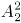种排座方法；再将两个小孩进行捆绑排在一起，有种方法；最后将两个小孩作为一个主体和两个妈妈排在一起，有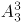种方法。分步用乘法，共种方法。

故正确答案为B。

**考点**：相邻问题

**来源**：2018年贵州省选调高校优秀毕业生到基层工作考试《行测》试题（网友回忆版）第56题

### 第 62 题

现有一种浓度为15%的盐水30千克，如果用50千克浓度更高的盐水和它混合，混合后的盐水浓度将大于20%，而小于35%。据此可知，后加入的盐水的浓度（假设浓度为x）范围是：

A. 23%<x<47%

B. 15%<x<35%

C. 15%<x<23%

D. 23%<x<50%

第 62 题 · 答案与解析

**参考答案（粉笔题库参考内容）**

A

**解析**

根据题意及溶液混合前后溶质（盐）质量不变可得：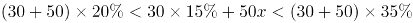，整理得，解得：23%<x<47%。

故正确答案为A。

**考点**：两溶液混合

**来源**：2018年贵州省选调高校优秀毕业生到基层工作考试《行测》试题（网友回忆版）第57题

### 第 63 题

小波通过往圆圈里投掷米粒（米粒本身长度不计，视为一个点）的方式决定自己的周末活动。经过试验，他将米粒投进圆圈内的成功率达到100%，但投掷在圆内的位置随机。如果米粒到圆心的距离大于圆半径的一半，那么他周末去看电影；若米粒到圆心的距离小于半径的，他会去打篮球；否则，他将在家看书。据此可知小波周末不在家看书的概率为：

A. 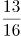

B. 

C. 

D. 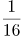

第 63 题 · 答案与解析

**参考答案（粉笔题库参考内容）**

A

**解析**

因题目中圆的半径均为比例关系，且最终所求概率，也为比例，故可设圆圈半径为4，则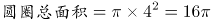。如图所示：；，则小波周末不在家看书的概率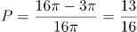。

故正确答案为A。

**考点**：几何公式类-平面图形、概率问题-其他

**来源**：2018年贵州省选调高校优秀毕业生到基层工作考试《行测》试题（网友回忆版）第65题

### 第 64 题

某公司有员工100人从事某产品的生产。现在，公司决定从这些员工中分流一些去生产新产品。分流后，继续从事老产品生产的员工平均每人每年创造产值在原有的基础上最多可增长1.2倍。若要保证老产品的年产值不减少，则最多能分流的人数是：

A. 15人

B. 16人

C. 53人

D. 54人

第 64 题 · 答案与解析

**参考答案（粉笔题库参考内容）**

D

**解析**

根据题意，公司共有100人从事生产，假设每人每年的产值为1，则总产值为100。分流后每位员工创造产值最多可增长1.2倍，即最多为。若要保证老产品的年产值不减少，则，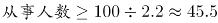，即最少要有46人从事老产品的生产，因此最多分流100-46=54人。

故正确答案为D。

**考点**：非典型最值问题

**来源**：2018年贵州省选调高校优秀毕业生到基层工作考试《行测》试题（网友回忆版）第63题

### 第 65 题

小张家养了一只大狗和一只小狗。现在，小狗的体重只有大狗的一半。如果两只狗的体重各增加5千克，那么小狗的体重将达到大狗的60%。据此可知，若两只狗的体重各增加10千克，小狗、大狗的体重比将会是：

A. 1:2

B. 2:3

C. 3:4

D. 4:5

第 65 题 · 答案与解析

**参考答案（粉笔题库参考内容）**

B

**解析**

设小狗的体重为x千克，则大狗的体重为2x千克。根据“两只狗的体重各增加5千克，那么小狗的体重将达到大狗的60%”，则有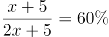，解得x=10，则大狗的体重为20千克。此时各增加10千克，则小狗、大狗的体重分别为10+10=20千克、20+10=30千克，则小狗、大狗的体重比为20:30=2:3。

故正确答案为B。

**考点**：和差倍比问题

**来源**：2018年贵州省选调高校优秀毕业生到基层工作考试《行测》试题（网友回忆版）第59题

### 第 66 题

下面各正方形中的四个数之间都有相同的规律，根据这种规律，可知m的值为：

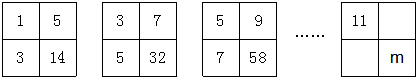

A. 180

B. 182

C. 184

D. 186

第 66 题 · 答案与解析

**参考答案（粉笔题库参考内容）**

C

**解析**

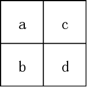

如上图所示，将图形中的四个方格由左上、左下、右上、右下分别标记为a、b、c、d。观察图形，每个图形均由4个数字组成，图形中d项数字较大，其余较小，考虑拼凑，观察发现：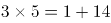，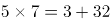，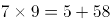。因此图形中规律为bc=a+d。且观察发现，图形中a项数字分别为1，3，5······11,为奇数列，且满足b=a+2，c=a+4。因此，所求图形中b项数据应为11+2=13，c项数据为11+4=15。根据规律，13×15=11+m，解得m=184。

故正确答案为C。

**考点**：图形数阵

**来源**：2018年云南省选调生录用考试《行测》试题（网友回忆版）第63题

### 第 67 题

A、B两种规格的产品需要在甲、乙两台机器上各自加工一道工序才能成为成品。已知A产品需要在甲机器上加工3小时，在乙机器上加工1小时；B产品需要在甲机器上加工1小时，在乙机器上加工3小时。在一个工作日内，甲机器至多只能使用11小时，乙机器至多只能使用9小时。A产品每件利润300元，B产品每件利润400元。据此可知，若这两台机器只加工A、B这两种产品，那么它们在一个工作日内能创造的最大利润为：

A. 1600元

B. 1700元

C. 1800元

D. 2000元

第 67 题 · 答案与解析

**参考答案（粉笔题库参考内容）**

B

**解析**

设生产x件A产品，生产y件B产品。根据两台机器都有最大使用时间，则有

3x+y≤11……①

x+3y≤9……②

要想利润最多，则要300x+400y尽可能的大。x、y均为整数，考虑代入，x最大值为3，最小值为0：

x=3时，要满足①②两式，y最大为2，此时利润300x+400y=900+800=1700元；

x=2时，要满足①②两式，y最大为2，此时利润300x+400y=600+800=1400元＜1700元；

x=1时，要满足①②两式，y最大为2，此时利润300x+400y=300+800=1100元＜1700元；

x=0时，要满足①②两式，y最大为3，此时利润300x+400y=1200元＜1700元；

所以当x=3，y=2时，利润最大，为1700元。

故正确答案为B。

**考点**：非典型最值问题、经济利润问题

**来源**：2018年贵州省选调高校优秀毕业生到基层工作考试《行测》试题（网友回忆版）第60题

### 第 68 题

有一项测验由20道单选题组成，每道题有A、B、C、D四个选项。回答正确1道题得2分，回答错误1道题倒扣1分。若20道题全部选择A，得分将为-5分；若全部选B，得分将为4分；若全部选C，得分将为1分。那么该项测验中正确答案为D项的题目有多少道？

A. 0

B. 2

C. 3

D. 4

第 68 题 · 答案与解析

**参考答案（粉笔题库参考内容）**

A

**解析**

设正确答案为A项、B项、C项和D项的题量分别为a道、b道、c道和d道。根据题意可得方程组，①+②+③,解得-3d=0，则d=0。

故正确答案为A。

**考点**：不定方程组

**来源**：2018年贵州省选调高校优秀毕业生到基层工作考试《行测》试题（网友回忆版）第62题

### 第 69 题

某地市区有一个长方形广场，其面积为1600平方米。由此可知，这个广场的周长至少有：

A. 160米

B. 200米

C. 240米

D. 320米

第 69 题 · 答案与解析

**参考答案（粉笔题库参考内容）**

A

**解析**

根据几何最值理论“平面图形中，若周长一定，越接近于圆，面积越大；若面积一定，越接近于圆，周长越小”可知，长方形广场越接近于圆，则周长越小。最接近圆的四边形是正方形，此时广场的边长为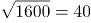米，因此周长最小为4×40=160米。

故正确答案为A。

注：长方形：有一个角是直角的平行四边形叫做长方形。正方形：有一个角是直角且有一组邻边相等的平行四边形是正方形。长方形包含正方形。

**考点**：几何结论类-几何小题型、非典型最值问题、几何公式类-平面图形

**来源**：2018年云南省选调生录用考试《行测》试题（网友回忆版）第67题

### 第 70 题

某市地铁1号线、2号线均是早上6点首发，分别间隔4分钟、6分钟发一次车。小李每天上班的路线及所需时间为：早上从家步行5分钟到达地铁1号线A站乘车（列车从1号线起点到A站需行驶15分钟），15分钟后到达B站，随后步行4分钟抵达2号线的起点站C，然后换乘2号线，20分钟后到D站，最后步行6分钟到达公司。据此，小李在保证9点能到达公司的前提下，早上最迟离家时间是：

A. 8:10

B. 8:08

C. 8:06

D. 8:04

第 70 题 · 答案与解析

**参考答案（粉笔题库参考内容）**

C

**解析**

题目复杂，考虑代入。题目问最迟离家时间，从A选项开始代入：

表中1号线的发车时间是根据6点首发、发车间隔为4分钟，以及运行到站需要15分钟计算所得；同理，表中2号线的发车时间是根据6点首发且发车间隔为6分钟计算所得。问题为最迟离家时间，对应C项。

故正确答案为C。

**考点**：统筹规划问题

**来源**：2018年贵州省选调高校优秀毕业生到基层工作考试《行测》试题（网友回忆版）第64题

### 第 71 题

从所给四个选项中，选择最适合的一个填入问号处，使之呈现一定规律性：

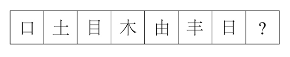

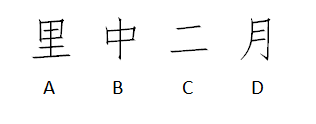

A. A

B. B

C. C

D. D

第 71 题 · 答案与解析

**参考答案（粉笔题库参考内容）**

D

**解析**

元素组成不同，优先考虑属性规律。观察题干发现，图1、3、5、7有封闭区域，优先考虑开闭性。图1、3、5、7有封闭区域，图2、4、6无封闭区域，则？处应选择无封闭区域，排除A、B。对比C、D，发现C是2部分图形，D是1部分图形，而题干均是1部分图形。

故正确答案为D。

**考点**：数量规律-复合、文字/字母/数字类

**来源**：2018年云南省选调生录用考试《行测》试题（网友回忆版）第77题

### 第 72 题

从所给四个选项中，选择最适合的一个填入问号处，使之呈现一定的规律性：

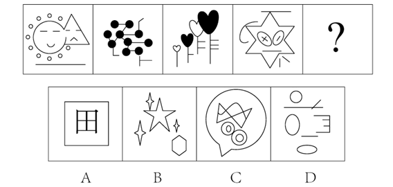

A. A

B. B

C. C

D. D

第 72 题 · 答案与解析

**参考答案（粉笔题库参考内容）**

D

**解析**

元素组成不同，且无明显属性规律，考虑数量规律。观察题干发现，图形出现了单一直线，优先考虑数直线。但直线数没有规律，观察发现横着的线条居多，考虑数横线数，图1至图4横线数均为6条，因此“？”处应选择一个横线数为6的图形。四个选项中，A项有5条横线，B项有2条横线，C项有0条横线，D项有6条横线。

故正确答案为D。

**考点**：数量规律-线

**来源**：2018年云南省选调生录用考试《行测》试题（网友回忆版）第76题

### 第 73 题

下列选项中，可以由题干图形拼凑而成的是：

A. A

B. B

C. C

D. D

第 73 题 · 答案与解析

**参考答案（粉笔题库参考内容）**

D

**解析**

本题考查平面拼合，注意本题图形可以旋转拼成（如果不发生旋转，无法得到任何一个选项中的图形，因此本题需要旋转拼合）。可采用平行等长相消的方式解题：消除平行等长的线段后进行组合即可得到轮廓图，即为D项，如下图所示：

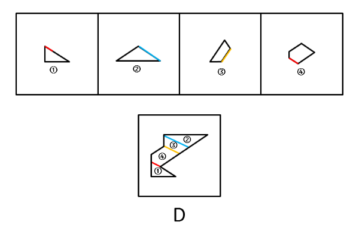

故正确答案为D。

**来源**：2018年贵州省选调高校优秀毕业生到基层工作考试《行测》试题（网友回忆版）第69题

### 第 74 题

从所给四个选项中，选择最适合的一个填入问号处，使之呈现一定的规律性：

A. 形

B. 94

C. 田

D. XY

第 74 题 · 答案与解析

**参考答案（粉笔题库参考内容）**

A

**解析**

元素组成不同，且无明显属性规律，考虑数量规律。观察发现，图3、图5出现简单汉字，优先考虑笔画数。题干六幅图的笔画数依次为1、2、3、4、5、6，因此？处应选择一个7笔画图形，A项7笔画，B项2笔画，C项5笔画，D项4笔画，只有A项符合。

故正确答案为A。

**考点**：数量规律-线、文字/字母/数字类

**来源**：2018年贵州省选调高校优秀毕业生到基层工作考试《行测》试题（网友回忆版）第70题

### 第 75 题

从所给四个选项中，选择最适合的一个填入问号处，使之呈现一定的规律性：

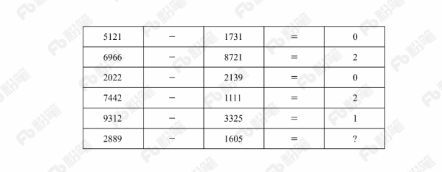

A. 1

B. 2

C. 3

D. 4

第 75 题 · 答案与解析

**参考答案（粉笔题库参考内容）**

C

**解析**

元素组成不同，且无明显属性规律，考虑数量规律。观察题干发现第一、三、五列都是由数字组成，第二、四列是由数学符号组成，并且数字有很多封闭空间，优先考虑数面。第一行中，“5121”和“1731”均是0个面，二者相减等于0。同理，第二至第五行均为前两个数字的面数量相减等于第三个数字，则最后一行应用此规律，“2889”是5个面，“1605”是2个面，相减等于3。

故正确答案为C。

**考点**：数量规律-面、文字/字母/数字类

**来源**：2018年云南省选调生录用考试《行测》试题（网友回忆版）第71题

### 第 76 题

从所给四个选项中，选择最适合的一个填入问号处，使之呈现一定的规律性：

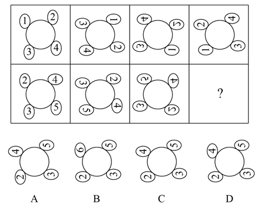

A. A

B. B

C. C

D. D

第 76 题 · 答案与解析

**参考答案（粉笔题库参考内容）**

D

**解析**

元素组成相同，优先考虑位置规律。第一行图形中，图1沿顺时针旋转得到图2，图2经过上下翻转得到图3，图3经过左右翻转得到图4；将此规律应用到第二行图形，图1沿顺时针旋转得到图2，图2经过上下翻转得到图3，因此“？”处图形应由图3经过左右翻转得到。

故正确答案为D。

**考点**：位置规律-综合

**来源**：2018年云南省选调生录用考试《行测》试题（网友回忆版）第74题

### 第 77 题

从所给四个选项中，选择最适合的一个填入问号处，使之呈现一定的规律性：

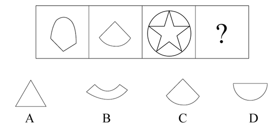

A. A

B. B

C. C

D. D

第 77 题 · 答案与解析

**参考答案（粉笔题库参考内容）**

C

**解析**

解析一：元素组成不同，优先考虑属性规律。题干每幅图形都由直线和曲线构成，排除A项；继续观察，发现每幅图形都只有一条曲线，排除B项；对比C项和D项，发现C项图形直线数多于曲线数，D项直线数等于曲线数，观察题干图形都是直线数多于曲线数。

故正确答案为C。

解析二：元素组成不同，优先考虑属性规律。题干每幅图形都由直线和曲线构成，排除A项；继续观察题干图形发现图1有明显刻意构造的角，图2及图3均有角，故问号处选择有角的图形，排除B项、D项。

故正确答案为C。

**考点**：数量规律-复合

**来源**：2018年云南省选调生录用考试《行测》试题（网友回忆版）第75题

### 第 78 题

比德，是指将自然物的某些特征比附于人们的某种道德情操，使自然物的自然属性人格化，人的道德品性客观化，其实质是认为自然美美在它所比附的道德伦理品格。

根据以上定义，下列**没有**包含“比德”自然审美观的是：

A. 人们总是把风儿比作叹息，那么秋天一定是最多愁善感、小性恼人的姑娘，她不可琢磨，难以讨好

B. 画家郑板桥以“咬定青山不放松，立根原在破岩中。千磨万击还坚劲，任尔东南西北风”赞美岩竹的坚韧顽强，隐喻自己藐视俗见的刚劲风骨

C. 作者在某小说中称赞生性淡泊、安分守己的少妇“宛如冬梅，风知素韵，霜晓寒姿”

D. 知者达于事理而周流无滞，有似于水，故知者乐水；仁者安于义理而厚重不迁，有似于山，故仁者乐山

第 78 题 · 答案与解析

**参考答案（粉笔题库参考内容）**

A

**解析**

第一步：找出定义关键词。

“将自然物的某些特征比附于人们的某种道德情操”。

第二步：逐一分析选项。

A项：将秋天比作多愁善感、小性恼人的小姑娘，而多愁善感、小性恼人并不是道德情操，不符合“将自然物的某些特征比附于人们的某种道德情操”，不符合定义，当选；

B项：将岩竹的坚韧顽强比作郑板桥藐视俗见的刚劲风骨，符合“将自然物的某些特征比附于人们的某种道德情操”，符合定义，排除；

C项：将冬梅的风韵姿态比作生性淡薄、安分守己的少妇，符合“将自然物的某些特征比附于人们的某种道德情操”，符合定义，排除；

D项：将循环流转、永不停滞的水比作聪慧敏捷的智者，将永恒不变的大山比作宽厚仁德的仁者，符合“将自然物的某些特征比附于人们的某种道德情操”，符合定义，排除。

本题为选非题，故正确答案为A。

**考点**：单定义-其他句式

**来源**：2018年贵州省选调高校优秀毕业生到基层工作考试《行测》试题（网友回忆版）第71题

### 第 79 题

慎微，即重视并正确处理细小的事情；慎初，即把住第一次，守住第一关。

根据上述定义，下列最**不能**体现“慎微”这一原则的是：

A. 妇女权益保护机构的工作人员劝诫人们：家庭暴力不是小事，而是犯罪，大家对此一定要零容忍

B. 小菲最近在积极瘦身，她毅力十足，高热量的食物一次都没吃，哪怕是一丁点儿

C. 李大叔为一年后的马拉松赛而完成了人生的第一次长跑，他计划着每天都会比前一天多跑一些，这样子就能渐渐达到马拉松的里程

D. 妈妈对小明的学习要求十分严格，如果儿子因为马虎大意犯了小错，也会立刻纠正他

第 79 题 · 答案与解析

**参考答案（粉笔题库参考内容）**

A

**解析**

第一步：找出定义关键词。

慎微：“重视并正确处理细小的事情”；

慎初：“把住第一次，守住第一关”。

第二步：逐一分析选项。

A项：劝诫人们要对家庭暴力零容忍，家庭暴力不是小事，即家庭暴力是大事要重视，不符合“重视并正确处理细小的事情”，不符合“慎微”定义，当选；

B项：减肥的小菲“一丁点的高热量食物”都没有吃，符合“重视并正确处理细小的事情”，符合“慎微”定义，排除；

C项：李大叔为了一年后的马拉松赛而完成了人生的第一次长跑，每天要比以前“多跑一些”，符合“重视并正确处理细小的事情”，符合“慎微”定义，排除；

D项：妈妈对小明要求严格，小明犯了“小错”也会立即纠正，符合“重视并正确处理细小的事情”，符合“慎微”定义，排除。

本题为选非题，故正确答案为A。

**考点**：常规问法

**来源**：2018年云南省选调生录用考试《行测》试题（网友回忆版）第79题

### 第 80 题

生物识别技术，即通过计算机与光学、声学、生物传感器和生物统计学原理等高科技手段密切结合，利用人体固有的生理特征（如指静脉、人脸、虹膜、指纹等）和行为特征（如笔迹、声音、步态等）来进行个人身份的鉴定。

根据上述定义，下列最可能运用了生物识别技术的是：

A. 受害者在旁听了嫌疑人的数码电话录音后，确定了他就是当时的袭击者

B. 警方在犯罪现场找到一张外卖送货小票，通过查询网上外卖订购系统信息，锁定了几个犯罪嫌疑人

C. 某涉密场所设置了严格的门禁，人们只有在密码输入正确且在电阻屏上手写出具有进入权限的工作人员姓名后才能进入

D. 某公司为考核员工出勤情况，引进了指纹打卡机，员工上班时必须输入指纹报到

第 80 题 · 答案与解析

**参考答案（粉笔题库参考内容）**

D

**解析**

第一步：找出定义关键词。

“通过计算机与高科技手段密切结合”、“利用人体固有的生理特征（如指静脉、人脸、虹膜、指纹等）和行为特征（如笔迹、声音、步态等）”、“进行个人身份的鉴定”。

第二步：逐一分析选项。

A项：通过数码电话录音鉴定身份，不符合“通过计算机与高科技手段密切结合”，不符合定义，排除；

B项：警方通过查询网上外卖订购系统信息，锁定嫌疑人，不符合“利用人体固有的生理特征和行为特征”，不符合定义，排除；

C项：通过输入密码和手写具有权限的人员姓名鉴定身份，不符合“利用人体固有的生理特征和行为特征”，不符合定义，排除；

D项：通过指纹打卡机鉴定身份，符合“通过计算机与高科技手段密切结合”、“利用人体固有的生理特征（指纹）”、“进行个人身份的鉴定”，符合定义，当选。

故正确答案为D。

**考点**：方式目的

**来源**：2018年贵州省选调高校优秀毕业生到基层工作考试《行测》试题（网友回忆版）第72题

### 第 81 题

健康教育是为促进人们自发地、自觉地接受并采取有益于健康的行为与生活方式，根除或者减少对健康有影响的危险因素，预防疾病并达到促进身心健康和提高生活质量的目标而开展的有组织、有计划的系统的社会教育活动。

根据上述定义，下列属于健康教育的是：

A. 某公司在乡下举办健康知识讲座，并以此为机会向老人们推销保健品

B. 某高校开设的一门“心理健康”选修课非常受同学们欢迎，甚至附近的市民都来蹭课

C. 周日某医院组织医务人员在小区广场举行义诊活动，免费为居民提供测血压、量体温以及医疗咨询等服务

D. 为防范入秋以来老年人心脑血管疾病高发的现象，社区每年9月份都会聘请知名专家针对老年居民举行系列讲座，普及相关医疗知识

第 81 题 · 答案与解析

**参考答案（粉笔题库参考内容）**

D

**解析**

第一步：找出定义关键词。

“为促进人们自发地、自觉地接受并采取有益于健康的行为与生活方式”、“根除或者减少对健康有影响的危险因素”、“开展社会教育活动”。

第二步：逐一分析选项。

A项：某公司举办健康知识讲座是为了推销保健品，不符合“为促进人们自发地、自觉地接受并采取有益于健康的行为与生活方式”，不符合定义，排除；

B项：某高校开设的选修课，不符合“开展社会教育活动”，不符合定义，排除；

C项：某医院举行义诊活动，免费为居民提供服务，不符合“开展社会教育活动”，不符合定义，排除；

D项：为防范老年人心脑血管疾病高发的现象，符合“根除或者减少对健康有影响的危险因素”，社区举行讲座，普及医疗知识符合“为促进人们自发地、自觉地接受并采取有益于健康的行为与生活方式”以及“开展社会教育活动”，符合定义，当选。

故正确答案为D。

**考点**：方式目的

**来源**：2018年贵州省选调高校优秀毕业生到基层工作考试《行测》试题（网友回忆版）第73题

### 第 82 题

反客为主式营销，是指消费者基于对产品质量及企业文化价值的认同，借助网络工具，成为营销活动的主导者，主动发起营销活动或直接参与营销传播的一种新型的网络营销。

根据上述定义，下列属于反客为主式营销的是：

A. 某商场新开业，发起朋友圈集“赞”赢奖品活动，利用微信用户的网络传播达到了一定的营销效果

B. 小泉是某手机品牌的忠实粉丝，最近该品牌又开发了一款智能手机，他第一时间购买了该手机，并在网上向朋友们宣传该手机的超凡性能

C. 张阿姨根据网络电视广告购买了一款医疗保健品，使用后觉得效果好，她又把这款保健品介绍给了其他人

D. 小丽兼职做微商卖化妆品，同事们为了照顾她的生意，纷纷帮她在网上转发销售广告

第 82 题 · 答案与解析

**参考答案（粉笔题库参考内容）**

B

**解析**

第一步：找出定义关键词。

“消费者基于对产品质量及企业文化价值的认同”、“借助网络工具，成为营销活动的主导者”、“主动发起营销活动或直接参与营销传播”。

第二步：逐一分析选项。

A项：商场发起朋友圈集“赞”赢奖品活动，消费者转发宣传是为了赢奖品，不符合“消费者基于对产品质量及企业文化价值的认同”，不符合定义，排除；

B项：小泉是某手机品牌的忠实粉丝，购买后宣传该手机的超凡性能，符合“消费者基于对产品质量及企业文化价值的认同”，第一时间购买并在网上向朋友宣传，符合“借助网络工具，成为营销活动的主导者”以及“主动发起营销活动或直接参与营销传播”，符合定义，当选；

C项：张阿姨把这款保健品介绍给了其他人，没有提到“借助网络工具”，不符合定义，排除；

D项：同事们为了照顾她的生意纷纷转发，不符合“消费者基于对产品质量及企业文化价值的认同”，不符合定义，排除。

故正确答案为B。

**考点**：方式目的

**来源**：2018年云南省选调生录用考试《行测》试题（网友回忆版）第82题

### 第 83 题

横向交往和纵向交往是组织内员工通过人际互动构建社会资本过程的两种工具性交往风格。横向交往是指个体通过与自身周围社会地位相似的群体建立广泛联系的过程；纵向交往是指个体能动地与社会中占据主导资源支配的群体建立关系的过程。

根据上述定义，下列属于纵向交往的是：

A. 每到节假日，院长都会代表学院去慰问对学院作出巨大贡献的退休干部

B. 老刘对自己家的保姆非常满意，为了让保姆过完春节后继续过来工作，他赠送了保姆探亲的往返机票

C. 老张为了能够继续顺利地承包村里的鱼塘，主动和村民搞好关系，每年春节都给村民免费发放几条鱼

D. 某家长为了让班级任课老师严格要求自己的孩子，节假日都会给老师们发去问候的短信

第 83 题 · 答案与解析

**参考答案（粉笔题库参考内容）**

D

**解析**

第一步：找出定义关键词。

纵向交往：“个体能动地”、“与社会中占据主导资源支配的群体建立关系”；

横向交往：“个体通过与自身周围社会地位相似的群体建立广泛联系”。

第二步：逐一分析选项。

A项：院长慰问退休干部，退休干部不符合“社会中占据主导资源支配的群体”，不符合“纵向交往”定义，排除；

B项：老刘赠送保姆机票，保姆不符合“社会中占据主导资源支配的群体”，不符合“纵向交往”定义，排除；

C项：老张和村民搞好关系，村民不符合“社会中占据主导资源支配的群体”，不符合“纵向交往”定义，排除；

D项：为了让班级任课老师严格要求自己的孩子，说明老师在孩子教育上是“社会中占据主导资源支配的群体”，家长节假日都会给老师们发去问候的短信，符合“个体能动地与社会中占据主导资源支配的群体建立关系”，符合“纵向交往”定义，当选。

故正确答案为D。

**考点**：常规问法

**来源**：2018年云南省选调生录用考试《行测》试题（网友回忆版）第83题

### 第 84 题

形象联想记忆法是把所需要记忆的材料同某些具体的事物、数字、字母、汉字或几何图形等联系起来，借助形象思维加以记忆。形象联想既有利于激发兴趣，调动学习的积极性，又有利于加深记忆。

根据上述定义，下列**没有**运用形象联想记忆法的是：

A. 新疆的地形特征“三山夹两盆”可与“疆”的右半部分联系起来：“三横”表示三山，“两田”表示两大盆地

B. 号称“时尚女鞋之国”的意大利，它的轮廓就像一只高跟靴子

C. 海参，长得就像黄瓜（cucumber），又长在海里（sea），所以它叫“sea cucumber”

D. 篮球界的迈克尔·乔丹、音乐界的迈克尔·杰克逊、赛车界的迈克尔·舒马赫······记住，这些牛人都叫“迈克尔”

第 84 题 · 答案与解析

**参考答案（粉笔题库参考内容）**

D

**解析**

第一步：找出定义关键词。

“需要记忆的材料同具体的事物、数字、字母、汉字或几何图形等联系起来”、“借助形象思维加以记忆”。

第二步：逐一分析选项。

A项：新疆的地形特征“三山夹两盆”是需要记忆的材料，与“疆”的右半部分联系起来记忆，符合“同具体的汉字联系起来”、“借助形象思维加以记忆”，符合定义，排除；

B项：意大利为“时尚女鞋之国”是需要记忆的材料，轮廓像“高跟鞋”，符合“同具体的几何图形联系起来”、“借助形象思维加以记忆”，符合定义，排除；

C项：“海参”的英文表述（sea cucumber）是需要记忆的材料，长得像黄瓜（cucumber），符合“同具体的事物联系起来”、“借助形象思维加以记忆”，符合定义，排除；

D项：篮球界、音乐界、赛车界······的这些牛人都叫“迈克尔”是需要记忆的材料，但没有体现“同具体的事物、数字、字母、汉字或几何图形等联系起来”，不符合定义，当选。

本题为选非题，故正确答案为D。

**考点**：拆词

**来源**：2018年贵州省选调高校优秀毕业生到基层工作考试《行测》试题（网友回忆版）第74题

### 第 85 题

甜柠檬效应就是个体在追求预期目标失败时，为了冲淡自己内心的不安，就百般提高现已实现的目标的价值，从而达到心理平衡的现象。

根据上述定义，下列属于“甜柠檬效应”的是：

A. 小明本来想买一台笔记本电脑，结果却在导购员的劝说下购买了平板电脑，使用后他很满意，并一直向朋友推荐

B. 这几周，小红为自己的销售业绩不断下滑而苦恼；但当她知道自己仍是公司的销售状元时，变得放心多了

C. 小文的数学成绩又让他的辅导老师失望了，老师最后只能用“比起上一次，还是有进步”来安慰自己

D. 据教练估计，小张需要减肥到60千克才能达到他想要的健身效果，可是小张在减到63千克时就放弃了，因为他觉得自己足够健美了

第 85 题 · 答案与解析

**参考答案（粉笔题库参考内容）**

C

**解析**

第一步：找出定义关键词。

“个体追求预期目标失败”、“为了冲淡自己内心的不安”、“百般提高现已实现的目标的价值”、“达到心理平衡”。

第二步：逐一分析选项。

A项：小明本来想买电脑最后买了平板电脑，没有实现预期目标，但是使用后很满意，不符合“为了冲淡自己内心的不安”、“百般提高现已实现的目标的价值”，不符合定义，排除；

B项：小红为销售业绩下滑而苦恼符合“个人追求预期目标失败”，但小红为销售状元是客观事实，不符合“为了冲淡自己内心的不安”、“百般提高现已实现的目标的价值”，不符合定义，排除；

C项：小文数学成绩让辅导老师失望，老师对小文的成绩的心理预期没有达到，符合“个体追求预期目标失败”，老师最后只能安慰自己小文比上一次进步了，符合“百般提高现已实现的目标的价值”，符合定义，当选；

D项：减肥到60千克才能达到效果是教练提出的目标，小张在63千克时放弃了，是小张自己主动放弃了，并不符合追求个人目标失败，不符合定义，排除。

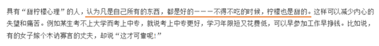

故正确答案为C。

**考点**：方式目的

**来源**：2018年福建省选调生考试《行政职业能力测验》第66题

### 第 86 题

蜘蛛∶织网∶爬行

A. 蚕∶破蛹∶吐丝

B. 蜜蜂∶酿蜜∶飞行

C. 夜莺∶筑巢∶歌唱

D. 猎豹∶奔跑∶捕食

第 86 题 · 答案与解析

**参考答案（粉笔题库参考内容）**

B

**解析**

第一步：判断题干词语间逻辑关系。

“蜘蛛”“织网”为主谓宾结构，“蜘蛛”“爬行”为主谓结构。

第二步：判断选项词语间逻辑关系。

A项：“蚕”“破蛹”为主谓宾结构，“蚕”“吐丝”也为主谓宾结构，与题干逻辑关系不一致，排除；

B项：“蜜蜂”“酿蜜”为主谓宾结构，“蜜蜂”“飞行”为主谓结构，与题干逻辑关系一致，当选；

C项：“夜莺”“筑巢”为主谓宾结构，“夜莺”“歌唱”为主谓结构，但“歌唱”是一种拟人化的表述，并非“夜莺”的生物学行为，与题干逻辑关系不一致，排除；

D项：“猎豹”“奔跑”为主谓结构，与题干逻辑关系不一致，排除。

故正确答案为B。

**考点**：语法关系

**来源**：2018年贵州省选调高校优秀毕业生到基层工作考试《行测》试题（网友回忆版）第77题

### 第 87 题

碗∶水杯

A. 玻璃∶书包

B. 光∶蜡烛

C. 沙发∶床

D. 电脑∶娱乐

第 87 题 · 答案与解析

**参考答案（粉笔题库参考内容）**

C

**解析**

第一步：判断题干词语间逻辑关系。

碗和水杯都是用来盛放东西的器具，二者为并列关系。

第二步：判断选项词语间逻辑关系。

A项：玻璃和书包没有必然的逻辑关系，与题干逻辑关系不一致，排除；

B项：蜡烛可以发出光，二者为功能对应关系，与题干逻辑关系不一致，排除；

C项：沙发和床都是可以供人休息的家具，二者为并列关系，与题干逻辑关系一致，当选；

D项：电脑可以用来娱乐，二者为功能对应关系，与题干逻辑关系不一致，排除。

故正确答案为C。

**考点**：逻辑关系-并列关系

**来源**：2018年贵州省选调高校优秀毕业生到基层工作考试《行测》试题（网友回忆版）第85题

### 第 88 题

秤∶重量

A. 水∶浮力

B. 地图∶距离

C. 台灯∶光亮

D. 尺子∶长度

第 88 题 · 答案与解析

**参考答案（粉笔题库参考内容）**

D

**解析**

第一步：判断题干词语间逻辑关系。

秤是用来测量重量的，二者是测量工具和测量对象的对应关系。

第二步：判断选项词语间逻辑关系。

A项：水可以产生浮力，并不是测量浮力的工具，与题干逻辑关系不一致，排除；

B项：地图可以显示距离，并不是测量距离的工具，与题干逻辑关系不一致，排除；

C项：台灯可以发出光，带来光亮，二者为功能对应关系，与题干逻辑关系不一致，排除；

D项：尺子是测量工具，是用来测量长度的，二者是测量工具和测量对象的对应关系，与题干逻辑关系一致，当选。

故正确答案为D。

**考点**：逻辑关系-对应关系

**来源**：2018年云南省选调生录用考试《行测》试题（网友回忆版）第87题

### 第 89 题

勤奋∶学习∶进步

A. 艰苦∶创业∶失败

B. 努力∶工作∶成功

C. 喝酒∶驾车∶车祸

D. 鲁莽∶说话∶厌恶

第 89 题 · 答案与解析

**参考答案（粉笔题库参考内容）**

B

**解析**

第一步：判断题干词语间逻辑关系。

勤奋的学习可能会带来进步，勤奋用来修饰学习，进步是积极的结果。

第二步：判断选项词语间逻辑关系。

A项：艰苦的创业可能会带来失败，艰苦用来修饰创业，但是失败是消极的结果，与题干逻辑关系不一致，排除；

B项：努力工作可能会带来成功，努力用来修饰工作，成功是积极的结果，与题干逻辑关系一致，当选；

C项：喝酒后驾车可能会带来车祸，喝酒和驾车是两个不同的动作，喝酒不能用来修饰驾车，与题干逻辑关系不一致，排除；

D项：鲁莽的说话可能会让人厌恶，鲁莽用来修饰说话，厌恶是消极的结果，与题干逻辑关系不一致，排除。

故正确答案为B。

**考点**：逻辑关系-对应关系、语法关系

**来源**：2018年贵州省选调高校优秀毕业生到基层工作考试《行测》试题（网友回忆版）第78题

### 第 90 题

左顾右盼∶上下打量

A. 南来北往∶东西奔走

B. 纵横交错∶中西合璧

C. 千叮万嘱∶一心一意

D. 天高地厚∶山清水秀

第 90 题 · 答案与解析

**参考答案（粉笔题库参考内容）**

A

**解析**

第一步：判断题干词语间逻辑关系。

左顾右盼指左右来回看；上下打量指上下看，二者都有看的意思，是近义关系，并且左顾右盼中的“左右”是反义关系，上下打量中的“上下”是反义关系。

第二步：判断选项词语间逻辑关系。

A项：南来北往指南北方向来回奔走；东西奔走指东西方向来回奔走，二者都有到处奔走的意思，是近义关系，并且南来北往中的“南北”是反义关系，东西奔走中的“东西”是反义关系，与题干逻辑关系一致，当选；

B项：纵横交错指横的竖的交叉在一起；中西合璧指中国和外国的好东西和建筑、名胜合到一块，二者不是近义关系，与题干逻辑关系不一致，排除；

C项：千叮万嘱指再三叮嘱；一心一意指做事专心，一门心思只做一件事，二者不是近义关系，与题干逻辑关系不一致，排除；

D项：天高地厚指恩情深厚，也指事物的复杂、深奥程度；山清水秀指山水风景优美，二者不是近义关系，与题干逻辑关系不一致，排除。

故正确答案为A。

**考点**：语义关系-近义关系

**来源**：2018年贵州省选调高校优秀毕业生到基层工作考试《行测》试题（网友回忆版）第79题

### 第 91 题

少壮不努力，老大徒伤悲∶惜时∶奋斗

A. 假作真时真亦假，无为有处有还无∶清醒∶智慧

B. 天生我材必有用，千金散尽还复来∶自信∶豁达

C. 苔花如米小，也学牡丹开∶自我∶认真

D. 它山之石，可以攻玉∶谦虚∶谨慎

第 91 题 · 答案与解析

**参考答案（粉笔题库参考内容）**

B

**解析**

第一步：判断题干词语间逻辑关系。

少壮不努力，老大徒伤悲，是指年轻力壮的时候不奋发图强，到了老年，悲伤也没用了。这句诗表达了要惜时、奋斗的思想，诗句和后两个词是对应关系。

第二步：判断选项词语间逻辑关系。

A项：假作真时真亦假，无为有处有还无，是指把假的当成真的，时间久了假的就被认为是真的，而真的被认为是假的，把不存在的东西说成是存在的东西时，那捏造的事实甚至比存在的事实更显得真实，反过来也是如此。这句诗说的是真实和虚假之间的关系，并没有表达出清醒、智慧的思想，与题干逻辑关系不一致，排除；

B项：天生我材必有用，千金散尽还复来，是指上天生下我，一定有需要用到我的地方，金钱用尽了，这些散失去的东西以后依然会归来。这句诗表达了要自信、豁达的思想，诗句和后两个词是对应关系，与题干逻辑关系一致，当选；

C项：苔花如米小，也学牡丹开，是指哪怕那如米粒一般微小的苔花，丝毫也不自惭形秽，依然像那美丽高贵的牡丹一样，自豪地盛开。这句诗表达的意思是自强、顽强，并没有表达出自我、认真的思想，与题干逻辑关系不一致，排除；

D项：它山之石，可以攻玉，是指别的山上的石头，可以琢磨玉器。这句诗比喻能帮助自己改正缺点的人或意见，可以表达出谦虚的思想，但是和谨慎没有关系，与题干逻辑关系不一致，排除。

故正确答案为B。

**考点**：逻辑关系-对应关系

**来源**：2018年云南省选调生录用考试《行测》试题（网友回忆版）第94题

### 第 92 题

拖鞋∶皮鞋∶场合

A. 药物∶手术∶病情

B. 川菜∶凉菜∶味道

C. 跑步∶踢球∶体力

D. 茶水∶咖啡∶爱好

第 92 题 · 答案与解析

**参考答案（粉笔题库参考内容）**

A

**解析**

第一步：判断题干词语间逻辑关系。

拖鞋和皮鞋都是鞋子的一种，二者是并列关系，且不同的场合选择的鞋子不同。

第二步：判断选项词语间逻辑关系。

A项：药物和手术都是治疗方式的一种，二者是并列关系，且不同的病情选择的治疗方式不同，与题干逻辑关系一致，保留；

B项：川菜和凉菜是交叉关系，且无法按照不同的味道选择，与题干逻辑关系不一致，排除；

C项：跑步和踢球都是运动方式的一种，二者是并列关系，但无法按照不同的体力来选择，与题干逻辑关系不一致，排除；

D项：茶水和咖啡都是饮品的一种，二者是并列关系，根据不同的爱好可以选择喝茶水和喝咖啡，与题干逻辑关系一致，保留。

对比A项和D项，场合和病情是客观的，而爱好是主观的，故A项与题干逻辑关系更近。

故正确答案为A。

注：拖鞋和皮鞋也可以看作交叉关系，与B项中川菜和凉菜的逻辑关系相同，但B项无法按照不同的味道选择川菜和凉菜，与题干逻辑关系不一致，所以不能选B项。

**考点**：逻辑关系-并列关系、逻辑关系-对应关系

**来源**：2018年贵州省选调高校优秀毕业生到基层工作考试《行测》试题（网友回忆版）第80题

### 第 93 题

品质∶好坏∶质量

A. 食物∶大小∶重量

B. 分数∶高低∶成绩

C. 旅游∶远近∶兴趣

D. 人口∶多少∶密度

第 93 题 · 答案与解析

**参考答案（粉笔题库参考内容）**

B

**解析**

第一步：判断题干词语间逻辑关系。

品质和质量是近义关系，且品质和质量都有好坏之分，为对应关系。

第二步：判断选项词语间逻辑关系。

A项：食物是有重量的，二者不是近义关系，与题干逻辑关系不一致，排除；

B项：分数和成绩是近义关系，且成绩和分数都有高低之分，为对应关系，与题干逻辑关系一致，当选；

C项： 旅游和兴趣不是近义关系，与题干逻辑关系不一致，排除；

D项：人口和密度不是近义关系，与题干逻辑关系不一致，排除。

故正确答案为B。

**考点**：语义关系-近义关系、逻辑关系-对应关系

**来源**：2018年贵州省选调高校优秀毕业生到基层工作考试《行测》试题（网友回忆版）第81题

### 第 94 题

网购∶上网

A. 读书∶书本

B. 喝水∶烧水

C. 练字∶写字

D. 唱歌∶歌唱

第 94 题 · 答案与解析

**参考答案（粉笔题库参考内容）**

C

**解析**

第一步：判断题干词语间逻辑关系。

网购必须要上网，上网是网购的必要条件。

第二步：判断选项词语间逻辑关系。

A项：书本是指装订成册的著作，不是读书的必要条件，比如可以看电子书，与题干逻辑关系不一致，排除；

B项：烧水不是喝水的必要条件，与题干逻辑关系不一致，排除；

C项：练字必须要写字，写字是练字的必要条件，与题干逻辑关系一致，当选；

D项：唱歌和歌唱是近义关系，与题干逻辑关系不一致，排除。

故正确答案为C。

**考点**：逻辑关系-对应关系

**来源**：2018年贵州省选调高校优秀毕业生到基层工作考试《行测》试题（网友回忆版）第82题

### 第 95 题

势均∶力敌

A. 旗鼓∶相当

B. 并驾∶齐驱

C. 不相∶上下

D. 平分∶秋色

第 95 题 · 答案与解析

**参考答案（粉笔题库参考内容）**

B

**解析**

第一步：判断题干词语间逻辑关系。

“势均”指势力均等，“力敌”指力量相当，二者是近义关系。

第二步：判断选项词语间逻辑关系。

A项：“旗鼓”指古代作战以摇旗击鼓指挥进退，“相当”指差不多，不相上下，二者不是近义关系，与题干逻辑关系不一致，排除；

B项：“并驾”指几匹马并排拉着一辆车，“齐驱”指一齐快跑，二者是近义关系，与题干逻辑关系一致，当选；

C项：“不相”指分不出，“上下”指高低好坏，二者不是近义关系，与题干逻辑关系不一致，排除；

D项：“平分”指平均分一半，“秋色”指秋天景色，二者不是近义关系，与题干逻辑关系不一致，排除。

故正确答案为B。

**考点**：语义关系-近义关系、拆分思维

**来源**：2018年云南省选调生录用考试《行测》试题（网友回忆版）第95题

### 第 96 题

某单位需选派人员参加对口扶贫工作。已知：如果小李不参加，那么就小马参加；如果小马不参加，那么小李也不参加；要么小马参加，要么小李参加。

下面各项中，符合要求的是：

A. 小马参加对口扶贫

B. 小李参加对口扶贫

C. 小马、小李都参加对口扶贫

D. 小马、小李都不参加对口扶贫

第 96 题 · 答案与解析

**参考答案（粉笔题库参考内容）**

A

**解析**

第一步：翻译题干。

①-小李→小马；

②-小马→-小李；

③要么小马，要么小李；

将②逆否可以推出④：小李→小马。

第二步：逐一分析选项。

根据①和④，无论小李是否参加，小马都会参加，再根据③可知，小马和小李只有一个参加，那么小李不参加，A项可以推出。

故正确答案为A。

**考点**：常规翻译

**来源**：2018年贵州省选调高校优秀毕业生到基层工作考试《行测》试题（网友回忆版）第86题

### 第 97 题

甘肃境内大地湾彩陶的发现解决了中国彩陶艺术的起源地问题。20世纪初，为了探索华夏文明的源头，学术界从考古、文献两个角度作出尝试和努力。1923年，为了寻找彩陶的起源，瑞典地质学家安特生来到甘肃，随着甘肃马家窑彩陶的不断出土，安特生认为，甘肃彩陶受西欧、西亚彩陶的影响比较明显。但是，之后大地湾一期出土的彩陶在年代上明显要早于马家窑彩陶，与目前发现的最早含有彩陶文化的西亚两河流域的耶莫有陶文化、哈孙纳文化的年代大致相当。

据此，我们可以推出：

A. 华夏文明受西欧、西亚文化影响明显

B. 甘肃是世界最早产生彩陶的区域之一

C. 大地湾彩陶文化是最早的彩陶文化

D. 甘肃地区是华夏文明的起源地

第 97 题 · 答案与解析

**参考答案（粉笔题库参考内容）**

B

**解析**

日常结论题，根据题干信息逐一分析选项。

A项：题干中指出，甘肃彩陶受西欧、西亚彩陶的影响比较明显，不能代表整个华夏文明受西欧、西亚文化影响明显，无法推出，排除；

B项：题干最后一句指出，大地湾彩陶与目前发现的最早含有彩陶文化的西亚两河流域的耶莫有陶文化、哈孙纳文化的年份大致相当，可以推出甘肃是世界最早产生彩陶的区域之一，当选；

C项：题干最后一句指出，大地湾彩陶与目前发现的最早含有彩陶文化的西亚两河流域的耶莫有陶文化、哈孙纳文化的年份大致相当，不代表大地湾彩陶文化是最早的彩陶文化，无法推出，排除；

D项：题干第一句指出，甘肃境内大地湾是中国彩陶艺术的起源地，选项中甘肃地区是华夏文明的起源地，彩陶艺术起源地不能代表整个华夏文明的起源地，无法推出，排除。

故正确答案为B。

**考点**：日常结论

**来源**：2018年云南省选调生录用考试《行测》试题（网友回忆版）第96题

### 第 98 题

南极可以、应该，甚至是必须被视为“准全球公域”。通常认为，全球公域是指处于国家管辖范围以外的区域及其资源。它属于全人类共有，人人都可以使用。《南极条约》对南极领土主权问题的搁置奠定了南极作为“准全球公域”的法律基础，而“开放”“和平”“科研自由”等规定，实际上赋予了南极公域的性质。“南极应只用于和平目的”这一规定，使得南极地区成为冷战期间一块难得的净土：避免遭受战争摧残，而且成功实现了无核化。

以下各项如果为真，最能支持上述论点的是：

A. 南极大陆蕴藏着丰富的生物资源、水资源，市场潜能巨大

B. 南极治理的主导权长期掌握在少数科技发达的西方国家手中

C. 美国组建了南极支援特遣队，常驻新西兰负责空军的南极飞行行动

D. 若南极冰盖消融，海平面将上升57米，这直接关系到人类的共同命运

第 98 题 · 答案与解析

**参考答案（粉笔题库参考内容）**

D

**解析**

第一步：找出论点和论据。

论点：南极可以、应该，甚至是必须被视为“准全球公域”。

论据：“南极应只用于和平目的”这一规定，使得南极地区成为冷战期间一块难得的净土：避免遭受战争摧残，而且成功实现了无核化。

论点和论据讨论的均为南极是“准全球公域”，二者话题一致，加强优先考虑补充论据。

第二步：逐一分析选项。

A项：论点说的是南极应该被视为“准全球公域”，该项说的是南极大陆蕴藏着丰富的资源，话题不一致，无关选项，无法加强，排除；

B项：南极治理的主导权长期掌握在少数发达的西方国家手中，说明南极不是“准全球公域”，无法加强，排除；

C项：论点说的是南极应该被视为“准全球公域”，该项说的是美国组建了南极支援特遣队，话题不一致，无关选项，无法加强，排除；

D项：因为南极冰盖消融直接关系到人类的共同命运，所以应该是全人类共有，被视为“准全球公域”，补充论据加强，当选。

故正确答案为D。

**考点**：补充论据

**来源**：2018年贵州省选调高校优秀毕业生到基层工作考试《行测》试题（网友回忆版）第94题

### 第 99 题

美国斯坦福大学的研究人员对130名同时患有血脂异常、高血压（并未服用降压药）的患者进行了长达12年的试验。在试验中，研究人员将这130名研究对象随机分成人数相等的两组，并让其中的一组研究对象服用松树皮提取物（每天服用的剂量为200毫克），另一组研究对象服用安慰剂。在这12年中，研究人员每6周测量1次研究对象的血压、血糖、胆固醇及C反应蛋白的水平。试验结果显示，服用松树皮提取物人员的上述各项指标与服用安慰剂人员的上述各项指标并无明显的差别。由此可知，松树皮提取物无降血压、降血糖、降血脂以及预防心血管疾病等功效。

以下各项如果为真，最能**反驳**上述结论的是：

A. 两组试验患者仅人数相等，其血压和血脂等的原始指标差异较大

B. 对照组服用安慰剂，对高血压和高血脂患者有心理暗示作用

C. 12年的实验时间太长，这有可能使一些重要的实验数据失真

D. 参加实验的患者人数仅130人，样本太小，代表性不够

第 99 题 · 答案与解析

**参考答案（粉笔题库参考内容）**

A

**解析**

第一步：找出论点和论据。

论点：松树皮提取物无降血压、降血糖、降血脂以及预防心血管疾病等功效。

论据：试验结果显示，服用松树皮提取物人员的上述各项指标与服用安慰剂人员的上述各项指标并无明显的差别。

论点论据都在说松树皮提取物无降压、降糖、降脂以及预防心血管疾病等功效，二者话题一致，削弱优先考虑削弱论点，其次考虑削弱论据。

第二步：逐一分析选项。

A项：此选项说明两组试验患者除了分别服用松树皮提取物和安慰剂外，其血压和血脂等的原始指标还差异较大，说明实验前起点不一致，能削弱，保留；

B项：此选项说明对照组服用安慰剂后有一定的心理暗示作用，但是心理暗示会降低还是升高他们的各项指标不确定，属于不明确选项，无法削弱，排除；

C项：此选项说明实验数据存在失真的可能，为可能性削弱，保留；

D项：此选项说明样本太小，代表性不够，有一定的削弱力度，保留。

对于A、C、D项，C项为可能性削弱，D项只是样本量不够，不具有代表性；但是A项直接说明题干实验本身就是有问题的，削弱力度更强，择优选A。

故正确答案为A。

**考点**：削弱-实验类、削弱论据

**来源**：2018年云南省选调生录用考试《行测》试题（网友回忆版）第101题

### 第 100 题

现在有一种观点认为：随着信用卡的普及以及近年来移动支付的发展，硬币将不可避免地迅速淡出流通市场。

以下各项如果为真，最能**反驳**上述观点的是：

A. 各国的硬币都是用本土的历史、文化及风俗等特色符号铸刻的微型浮雕，其本身具有很高的收藏价值

B. 在银行储蓄卡开始兴起时，人们对硬币的命运也有过相同的预测，但硬币根本没有因此淡出流通市场

C. 硬币本身的面值不高，但是正是这种“不值钱”的特性，让它在零售等方面发挥着重要的流通作用

D. 目前，一些在生活中扮演重要角色的自动贩售机等设备仍然只支持硬币支付，并且近几年这些设备不会更新换代

第 100 题 · 答案与解析

**参考答案（粉笔题库参考内容）**

D

**解析**

第一步：找出论点和论据。

论点：随着信用卡的普及以及近年来移动支付的发展，硬币将不可避免地迅速淡出流通市场。

论据：无。

第二步：逐一分析选项。

A项：论点讨论的是硬币将迅速淡出流通市场，该项讨论的是硬币在收藏方面有价值，话题不一致，无关选项，无法削弱，排除；

B项：论点讨论的是信用卡及移动支付普及时，硬币将迅速淡出流通市场，该项讨论的是银行储蓄卡兴起时，硬币没有淡出流通市场，类比削弱，保留；

C项：论点讨论的是硬币将迅速淡出流通市场，该项讨论的是硬币具有“不值钱”的特性在零售中有重要的流通作用，但是否能被替代，最终是否会淡出流通市场并不清楚，属于不明确选项，无法削弱，排除；

D项：论点讨论的是硬币将迅速淡出流通市场，该项讨论的是生活中重要的设备仍然只支持硬币，且近几年这些设备不会更新换代，因此硬币是不能被迅速替代的，削弱论点，保留；

对比B、D项，B项类比削弱，力度最弱，D项削弱论点，力度最强，择优选D。

故正确答案为D。

**考点**：削弱论点

**来源**：2018年贵州省选调高校优秀毕业生到基层工作考试《行测》试题（网友回忆版）第93题

### 第 101 题

随着新媒体技术的发展，患者在网上寻找医生信息的情况日益增多，为此有科研人员对美国28个典型医生评价商业网站展开研究。研究报告称，近60%的人在接受调查访问时表示，在选择医生时，网上评价对他们的选择非常重要。但对这28个网站的研究显示，允许用户根据“临床状况、医生性别、所说语言、所接受的保险”等条件搜寻的网站很少。研究人员得出结论说，对这些商业性医生评价网站而言，要找到相对准确的医生定量评价颇为困难。

以下各项如果为真，最能支持上述论证的是：

A. 病人通过医生评价网站能清楚了解某位医生的治疗经验

B. 美国医生评价网站存在搜索机制繁冗且评价稀缺等问题

C. 通过调查系统性地收集数据，才更有可能积累足够的评价

D. 调查发现有三分之一的抽样医生在所有网站中都没有评价

第 101 题 · 答案与解析

**参考答案（粉笔题库参考内容）**

B

**解析**

第一步：找出论点和论据。

论点：对这些商业性医生评价网站而言，要找到相对准确的医生定量评价颇为困难。

论据：对这28个网站的研究显示，允许用户根据“临床状况、医生性别、所说语言、所接受的保险”等条件搜寻的网站很少。

论点和论据都在说在这些网站上，较难找到相对准确的医生定量评价，二者话题一致，加强优先考虑补充论据。

第二步：逐一分析选项。

A项：病人通过医生评价网站能清楚了解某位医生的治疗经验，与论点找到医生定量评价的难易程度无关，无法加强，排除；

B项：美国医生评价网站存在搜索机制繁冗且评价稀缺等问题，解释了在这些网站上，较难找到相对准确的医生定量评价的原因，解释原因，可以加强，保留；

C项：通过调查系统性地收集数据，才更有可能积累足够的评价，不明确在这些网站上，是否较难找到相对准确的医生定量评价，无法加强，排除；

D项：调查发现有三分之一的抽样医生在所有网站中都没有评价，举例说明在这些网站上，较难找到相对准确的医生定量评价，举例加强，可以加强，保留。

对比B、D两项，B项为解释原因，D项为举例加强，解释原因的力度强于举例加强，故B项更为合适。

故正确答案为B。

**考点**：补充论据

**来源**：2018年贵州省选调高校优秀毕业生到基层工作考试《行测》试题（网友回忆版）第88题

### 第 102 题

微生物组在地球生态系统和人类健康中的作用超乎想象，它不仅将极大地帮助人类克服当今所面临的生存挑战，还能提供人类未来生存之道，这其中有一个道理，就是微生物之间能够互相协作，使得它们在生态系统中更加稳定、更加有效地发挥作用，并赋予微生物组具有超越单个微生物的更为强大的功能。

以下各项如果为真，最能支持上述观点的是：

A. 美国的“国家微生物组计划”正是为了在所有的生态系统、大自然及人造世界里推动最前沿的微生物科学研究

B. 作为新兴产业的生物农药和生物肥料，近年来在蓬勃发展，其在国际上的市场份额也逐年快速递增

C. 将多种微生物一起培养，其生物系统的稳定性和适应能力都大为提高，其对某些有害化合物的降解效率也提升了

D. 酿酒微生物场所提供了多种多样的微生物资源，可以从中发掘高效纤维素降解霉菌、高乙醇合成酵母等

第 102 题 · 答案与解析

**参考答案（粉笔题库参考内容）**

C

**解析**

第一步：找出论点和论据。

论点：微生物组在地球生态系统和人类健康中的作用超乎想象。

论据：微生物组不仅将极大地帮助人类克服当今所面临的生存挑战，还能提供人类未来生存之道；微生物之间能够互相协作，使得它们在生态系统中更加稳定、更加有效地发挥作用，并赋予微生物组具有超越单个微生物的更为强大的功能。

第二步：逐一分析选项。

A项：论点说的是微生物组对地球生态系统和人类健康的作用，该项说的是美国“国家微生物组计划”的研究内容，话题不一致，无法加强，排除；

B项：论点说的是微生物组对地球生态系统和人类健康的作用，该项说的是生物农药和生物肥料的市场份额，话题不一致，无法加强，排除；

C项：多种微生物一起培养，微生物系统的稳定性和适应能力提高，对有害化合物的降解效率也会提高，指出微生物之间相互协作确实可以发挥更为强大的功能，补充论据，可以加强，当选；

D项：论点说的是微生物组对地球生态系统和人类健康的作用，该项说的是酿酒的微生物可以合成酵母，并没有涉及多种微生物是否合作，是否有更强大的功能的问题，话题不一致，无法加强，排除。

故正确答案为C。

**考点**：补充论据

**来源**：2018年贵州省选调高校优秀毕业生到基层工作考试《行测》试题（网友回忆版）第89题

### 第 103 题

行驶超过60万千米的汽车都应当报废处理；有些行驶超过60万千米的汽车存在设计缺陷；在应当报废的汽车中有些不是T品牌汽车；所有T品牌汽车都不存在设计缺陷。

如果以上判断正确，则必定成立的是：

A. 有些T品牌汽车应当报废

B. 有些T品牌汽车不应当报废

C. 应当报废的汽车都行驶超过60万千米

D. 有些存在设计缺陷的汽车应当报废

第 103 题 · 答案与解析

**参考答案（粉笔题库参考内容）**

D

**解析**

第一步：翻译题干。

①超60万千米报废；

②有些超60万千米设计缺陷；

③有些报废T品牌；

④T品牌设计缺陷；

将②换位可得：有些设计缺陷超60万千米，和①可以递推出：⑤有些设计缺陷超60万千米报废。

第二步：逐一分析选项。

A项：翻译为有些T品牌→报废，由③“有些报废T品牌汽车”，推不出，排除；

B项：翻译为有些T品牌报废，由③“有些报废T品牌”无法得到“有些T品牌”的情况，推不出，排除；

C项：翻译为报废超60万千米，是对①的肯后，但肯后得不到确定性的结论，推不出，排除；

D项：翻译为有些设计缺陷报废，是对⑤的肯前，肯前必肯后，可以推出，当选。

故正确答案为D。

**考点**：集合推理

**来源**：2018年贵州省选调高校优秀毕业生到基层工作考试《行测》试题（网友回忆版）第87题

### 第 104 题

2017年，可以说是我国电影发展的重要一年。然而，一些电影从业者则认为：中国是电影大国，但不是电影强国。

以下各项如果为真，最**不能质疑**这些电影从业者观点的是：

A. 我国电影年产量达到近800部，位居世界前列；而全年500多亿元的总票房更是稳居全球第一

B. 我国的银幕总量、观众人次已经超过电影界长期的领头羊——北美市场，并且，观众的电影需求依旧旺盛，我国电影市场的潜力还有待挖掘

C. 判断一个国家是否是电影强国的最主要依据是其电影的全球竞争力，而国产电影的市场主要在大陆，和美国等传统电影强国差距较大，国际票房甚至低于印度

D. 中国电影业受近代中国曲折坎坷的命运的决定性影响，它发展多舛，但自2002年起，我国电影以奇迹般的发展速度迅速崛起，并预计将在未来10年内超越电影头号强国美国

第 104 题 · 答案与解析

**参考答案（粉笔题库参考内容）**

C

**解析**

第一步：找出论点和论据。

论点：中国是电影大国，但不是电影强国。

论据：无。

第二步：逐一分析选项。

A项：我国电影年产量位居世界前列，总票房稳居世界第一，指出中国在电影上取得了多项成就，说明中国属于电影强国，否定了论点，排除；

B项：我国的银幕总量、观众人次已经超过行业领头羊，说明中国在电影上取得了多项成就，属于电影强国，并且观众的需求依旧旺盛，市场的潜力还有待挖掘，说明未来还有很大的发展空间，否定了论点，排除；

C项：判断一个国家是否是电影强国的最主要依据是其全球竞争力，而国产电影和传统电影强国差距较大，国际票房较低，说明中国现在的全球竞争力并不强，不属于电影强国，加强了论点，当选；

D项：我国电影以奇迹般的速度崛起，说明我国电影发展速度很快，并且我国电影预计将在未来十年内超越电影头号强国美国，说明我国电影现在已位于电影强国之列，只不过还不是头号强国，有一定的削弱力度，排除。

本题为选非题，故正确答案为C。

**考点**：削弱选非题

**来源**：2018年贵州省选调高校优秀毕业生到基层工作考试《行测》试题（网友回忆版）第91题

### 第 105 题

最近有一位科学家提出新观点：地球板块运动开始的时间不会晚于35亿年前。他的依据是：板块运动必然会让自然界深色的镁铁质岩石转变成浅色的长英质岩石。而在35亿年前，地球已经有浅色的长英质岩石出现了。

以下各项如果为真，最能**质疑**这位专家观点的是：

A. 颜色浅的长英质岩石本质上是颜色深的镁铁质岩石“再生”而来的，而在数十亿年前，镁铁质岩石在地球上占有绝对的数量优势地位

B. 以全球各地35亿年前的沉积层样品分析，其中含有长英质岩石颗粒的不足一半

C. 长英质岩石在自然界中的占比比镁铁质岩石高出很多似乎只有板块运动这一解释，但早期的板块构造运动很可能是时断时续的，局部范围的

D. 35亿年前地球火山密布，火山爆发释放的岩浆会把镁铁质岩石深深埋在地下，这些镁铁质岩石会被熔化，进而转变成长英质岩石，但板块运动不是火山爆发的唯一原因

第 105 题 · 答案与解析

**参考答案（粉笔题库参考内容）**

D

**解析**

第一步：找出论点和论据。

论点：地球板块运动开始的时间不会晚于35亿年前。

论据：板块运动必然会让自然界深色的镁铁质岩石转变成浅色的长英质岩石，而在35亿年前，地球已经有浅色的长英质岩石出现了。

第二步：逐一分析选项。

A项：题干说的是能不能通过浅色的长英质岩石出现来判断地球板块运动开始的时间，该项说的是镁铁质岩石数量的多少，话题不一致，而且数十亿年时间也不够明确，无法削弱，排除；

B项：题干说的是能不能通过浅色的长英质岩石出现来判断地球板块运动开始的时间，该项说的是长英质岩石的颗粒在沉积层的占比多少，话题不一致，无法削弱，排除；

C项：“似乎”和“可能”说明不能确定是板块运动导致镁铁质岩石转变成长英质岩石，还是板块运动直接导致长英质岩石的占比高，而且并没有提到时间，属于不明确项，无法削弱，排除；

D项：火山爆发会把镁铁质岩石转化成长英质岩石，但板块运动不是火山爆发的唯一原因，指出镁铁质岩石转变成长英质岩石并不一定与板块运动有关，拆断了论据与论点之间的联系，是拆桥项，当选。

故正确答案为D。

**考点**：拆桥

**来源**：2018年贵州省选调高校优秀毕业生到基层工作考试《行测》试题（网友回忆版）第92题

## 材料 1

根据以下资料，回答下列小题。

2016年，全国平均气温，较常年平均气温偏高，为1951年以来第三高，仅次于2015年（）和2007年（）。2016年四季气温均偏高，其中夏季气温为历史最高；除1月偏低、11月接近常年同期外，其余各月均偏高，其中12月偏高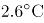，为历史同期最高。全国31个省（区、市）中，仅黑龙江平均气温较常年偏低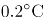，其他省（区、市）气温均偏高，其中青海、甘肃、河南和贵州4省均为1951年以来的历史最高。

2016年，全国年降水量范围为3.5毫米（新疆托克逊）～3494.4毫米（安徽黄山），全国平均降水量730.0毫米，较常年（629.9毫米）偏多16%，比2015年偏多13%，为1951年以来最多。2月和8月降水偏少，3月接近常年同期，其余各月均偏多，其中1月偏多94%，10月偏多55%，均为历史同期最多。

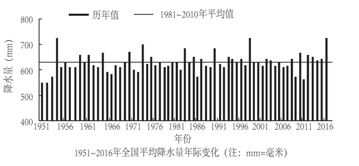

### 第 106 题

1951-2016年间，全国年平均气温最高的年份是：

A. 1998年

B. 2007年

C. 2015年

D. 2016年

第 106 题 · 答案与解析

**参考答案（粉笔题库参考内容）**

C

**解析**

定位文字第一段材料可知：“2016年，全国平均气温……为1951年以来第三高，仅次于2015年（）和2007年（）”，故1951-2016年间，全国年平均气温最高的年份是2015年。

故正确答案为C。

**考点**：直接找数、综合资料

**来源**：2018年贵州省选调高校优秀毕业生到基层工作考试《行测》试题（网友回忆版）第96题

### 第 107 题

2016年全国31个省（区、市）中，平均气温较常年偏低的是：

A. 新疆

B. 黑龙江

C. 重庆

D. 贵州

第 107 题 · 答案与解析

**参考答案（粉笔题库参考内容）**

B

**解析**

定位文字第一段材料可知：“全国31个省（区、市）中，仅黑龙江平均气温较常年偏低，其他省（区、市）气温均偏高。”故2016年全国31个省（区、市）中，平均气温较常年偏低的是黑龙江。

故正确答案为B。

**考点**：直接找数、综合资料

**来源**：2018年贵州省选调高校优秀毕业生到基层工作考试《行测》试题（网友回忆版）第98题

### 第 108 题

2015年全国平均降水量为：

A. 730.0毫米

B. 646.0毫米

C. 629.9毫米

D. 612.6毫米

第 108 题 · 答案与解析

**参考答案（粉笔题库参考内容）**

B

**解析**

根据题干“2015年全国平均降水量为……”，结合文字材料时间为2016年，可判定本题为基期计算问题。定位文字第二段材料可知：“2016年，全国平均降水量730.0毫米……比2015年偏多13%。”故2015年全国平均降水量毫米。

故正确答案为B。

**考点**：综合资料、基期计算

**来源**：2018年贵州省选调高校优秀毕业生到基层工作考试《行测》试题（网友回忆版）第97题

### 第 109 题

与常年同期相比，2016年降水偏少的月份是：

A. 1月和10月

B. 3月和12月

C. 2月和8月

D. 2月和10月

第 109 题 · 答案与解析

**参考答案（粉笔题库参考内容）**

C

**解析**

定位文字材料第二段可知，2016年全国年降水量，2月和8月降水偏少。

故正确答案为C。

**考点**：直接找数、综合资料

**来源**：2018年贵州省选调高校优秀毕业生到基层工作考试《行测》试题（网友回忆版）第99题

### 第 110 题

下列可由所给资料得出的数据有：

①2016年各季度气温均值

②青海、甘肃、河南和贵州4省平均气温偏高率

③2015年全国年降水范围

④2016年1月、10月月降水量之差

A. 0个

B. 1个

C. 2个

D. 3个

第 110 题 · 答案与解析

**参考答案（粉笔题库参考内容）**

A

**解析**

①：定位文字材料第一段可得，“2016年四季气温均偏高，其中夏季气温为历史最高；除1月偏低、11月接近常年同期外，其余各月均偏高，其中12月偏高，为历史同期最高。”关于2016年各季度气温均值并无相关具体数据，故无法得出；

②：定位文字材料第一段可得，“全国31个省（区、市）······，其中青海、甘肃、河南和贵州4省均为1951年以来的历史最高”，无气温相关数据，故无法得出；

③：定位文字材料第二段可得，“2016年，全国年降水量范围为3.5毫米（新疆托克逊）～3494.4毫米（安徽黄山）”，只能得出2016年全国年降水范围，无其他相关数据，故无法得出；

④：定位文字材料第二段可得，“2月和8月降水偏少，······其中1月偏多94%、10月偏多55%，均为历史同期最高”，无2016年1月和10月降水量相关数据，故无法得出。

①②③④均无法得出。

故正确答案为A。

**考点**：综合分析、综合资料

**来源**：2018年贵州省选调高校优秀毕业生到基层工作考试《行测》试题（网友回忆版）第100题

## 材料 2

根据以下资料，回答以下各题。

两周就诊率被定义为每百人中两周内因病或身体不适寻求各级医疗机构治疗服务的人次数。第五次国家卫生服务调查结果显示，调查地区居民两周就诊率为13.0%，其中城市地区为13.3%，农村地区为12.8%。城市地区，东部、中部、西部两周就诊率分别为15.4%、8.8%、15.8%；农村地区，东部、中部、西部两周就诊率分别为16.1%、11.4%、11.0%。

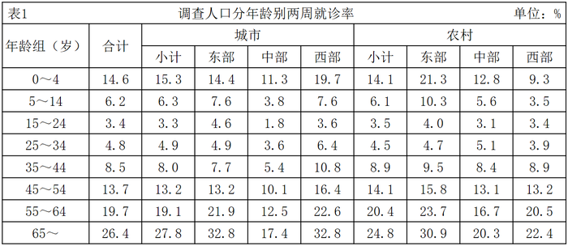

### 第 111 题

关于第五次国家卫生服务调查中调查地区的两周就诊率，下列说法正确的是：

A. 农村地区高于城市地区

B. 东部地区最高，西部地区最低

C. 从城市地区来看，东部最高，西部最低

D. 从农村地区来看，东部最高，西部最低

第 111 题 · 答案与解析

**参考答案（粉笔题库参考内容）**

D

**解析**

A项：定位文字材料可知，城市地区的就诊率为13.3%，农村地区的就诊率为12.8%，故农村地区低于城市地区，错误；

C项：定位文字材料可知，城市地区，东部地区的就诊率为15.4%，中部地区的就诊率为8.8%，西部地区的就诊率为15.8%，故城市地区西部地区的就诊率最高，中部地区的就诊率最低，错误；

D项：定位文字材料可知，农村地区，东部地区就诊率为16.1%，中部地区就诊率为11.4%，西部地区就诊率为11.0%，故农村地区东部就诊率最高，西部地区就诊率最低，正确；

B项：根据C项和D项，城市地区西部地区就诊率最高，中部地区就诊率最低，农村地区东部地区就诊率最高，西部地区就诊率最低，由于材料并未给出东、中、西部城市地区和农村地区人数比，故无法推出就诊率东部地区最高，西部地区最低，错误。

故正确答案为D。

**考点**：直接找数、综合资料

**来源**：2018年贵州省选调高校优秀毕业生到基层工作考试《行测》试题（网友回忆版）第115题

### 第 112 题

从调查人口分年龄别进行分析，两周就诊率随年龄组从低到高的变化是：

A. 先下降而后上升

B. 持续上升

C. 持续下降

D. 保持水平不变

第 112 题 · 答案与解析

**参考答案（粉笔题库参考内容）**

A

**解析**

定位材料表格1第二列可知，0~4岁、5~14岁、15~24岁就诊率持续下降；25~34岁、35~44岁、45~54岁、55~64岁、65~岁就诊率持续上升。故两周就诊率随年龄组从低到高的变化趋势为先下降而后上升。

故正确答案为A。

**考点**：直接找数、综合资料

**来源**：2018年贵州省选调高校优秀毕业生到基层工作考试《行测》试题（网友回忆版）第111题

### 第 113 题

从调查人口分年龄别进行分析，两周就诊率最大值与最小值相差最大的地区是：

A. 东部农村地区

B. 东部城市地区

C. 西部农村地区

D. 西部城市地区

第 113 题 · 答案与解析

**参考答案（粉笔题库参考内容）**

D

**解析**

定位材料表格1结合选项可知，两周就诊率最大值与最小值相差，东部农村地区=30.9%-4.0%=26.9%，东部城市地区=32.8%-4.6%=28.2%，西部农村地区=22.4%-3.4%=19%，西部城市地区=32.8%-3.6%=29.2%。比较可得，西部城市地区两周就诊率最大值与最小值相差最大。

故正确答案为D。

**考点**：综合资料、简单加减计算

**来源**：2018年贵州省选调高校优秀毕业生到基层工作考试《行测》试题（网友回忆版）第112题

### 第 114 题

在2013年，参加职工医保的调查者两周就诊的最主要去向是：

A. 社区卫生服务中心/卫生院

B. 县/市/区级医院

C. 地市级医院

D. 省级医院

第 114 题 · 答案与解析

**参考答案（粉笔题库参考内容）**

C

**解析**

定位表格材料表2可知，2013年参加职工医保的调查者两周就诊地点中，社区卫生服务中心/卫生院、县/市/区级医院、地市级医院、省级医院就诊人数占总人数的比重分别为12.4%、14.8%、33.5%、18.4%，所以就诊人数最多的是去地市级医院，即两周就诊的主要去向是地市级医院。

故正确答案为C。

**考点**：直接找数、综合资料

**来源**：2018年贵州省选调高校优秀毕业生到基层工作考试《行测》试题（网友回忆版）第113题

### 第 115 题

下列说法错误的是：

A. 较之2008年，2013年有职工医保的调查者在县/市/区级医院医疗机构的两周内就诊比重减少是因为流向了地市级及以上级别的医院

B. 县/市/区级医院医疗机构和社区卫生服务中心/卫生院在拥有居民医保、职工医保的调查人员的两周就诊率中扮演着重要角色

C. 高年龄段的被调查者两周就诊率随年龄增长而快速增长

D. 西部地区被调查者的身体健康状况相比中、东部地区较差

第 115 题 · 答案与解析

**参考答案（粉笔题库参考内容）**

D

**解析**

A项：定位表格材料表2知，相对于2008年，2013年职工医保的各就诊地点中，只有地市级医院、省级医院和其他比重上升，其他就诊地点比重下降，所以主要流向了地市级及以上级别的医院，正确；

B项：定位表格材料表2知，2008年，县/市/区级医院医疗机构和社区卫生服务中心/卫生院的职工医保就诊率分别为27.0%、27.4%，居民医保就诊率分别为27.0%、18.3%；2013年，县/市/区级医院医疗机构和社区卫生服务中心/卫生院的职工医保就诊率分别为14.8%、12.4%，居民医保就诊率分别为19.1%、18.6%。由此可以判断县/市/区级医院医疗机构和社区卫生服务中心/卫生院在拥有居民医保、职工医保的调查人员的两周就诊率中扮演着重要角色，正确；

C项：定位表格材料表1知，35岁及以上的高年龄组随着年龄增长，就诊率是逐年增加，且快速增长，正确；

D项：定位文字材料，已知城市和农村地区东中西部每百人中两周内的就诊率，其中城市地区西部地区就诊率最高，中部地区就诊率最低，农村地区东部地区就诊率最高，西部地区就诊率最低，由于材料并未给出东、中、西部城市地区和农村地区人数比，故无法推出西部地区就诊率低于中、东部地区，也无法推出西部地区被调查者健康状况相比中、东部地区较差，错误。

本题为选非题，故正确答案为D。

**考点**：综合分析、综合资料

**来源**：2018年贵州省选调高校优秀毕业生到基层工作考试《行测》试题（网友回忆版）第114题

## 材料 3

**根据以下资料，回答下列小题。**

2016年，全年原创首演剧目1423个，扶持了100名京剧、地方戏表演艺术家向200名青年演员传授经典折子戏。第十一届中国艺术节共汇聚67台参评参演剧目和1000余件美术作品，观众达40万人次。国家艺术基金2016年共有966个项目获得立项资助，较2015年增长了32.7%，资助资金总额7.3亿元。

2016年末全国共有艺术表演团体12301个，比上年末增加1514个，从业人员33.27万人，增加3.08万人。其中各级文化部门所属的艺术表演团体2031个，占16.5%；从业人员11.52万人，占34.6%。

全年全国艺术表演团体共演出230.60万场，比上年增长9.4%，其中赴农村演出151.60万场，增长9.0%；国内观众11.81亿人次，增长23.3%，其中农村观众6.21亿人次，比上年增长6.2%；总收入311.23亿元，比上年增长20.8%，其中演出收入130.86亿元，增长39.3%。

全年全国各级文化部门所属艺术表演团体共组织政府采购公益演出13.90万场，观众1.17亿人次。利用流动舞台车演出11.31万场次，观众10381万人次。中央直属院团全年开展公益性演出1335场，其中赴老少边穷地区演出241场，面向老红军、留守儿童等演出132场。

年末全国共有艺术表演场馆2285个，观众坐席数168.93万个。全年馆内艺术演出19.09万场次，增长39.5%；艺术演出观众3098万人次，增长8.6%。其中各级文化部门所属艺术表演场馆1265个，全年共举行艺术演出6.81万场次，增长25.0%，艺术演出观众2589万人次，增长8.4%。

年末全国国有美术馆462个，比上年末增加44个，从业人员4597人，增加502人。全国共举办展览6146次，比上年增长16.8%，参观人次3237万，增长4.8%。

### 第 116 题

2015年末，全国拥有艺术表演团体的数量是：

A. 10787个

B. 12301个

C. 14237个

D. 22031个

第 116 题 · 答案与解析

**参考答案（粉笔题库参考内容）**

A

**解析**

根据题干“2015年末······的数量是”，结合材料时间是2016年末，可判定本题为基期计算问题。定位材料第二段可得：“2016年末全国艺术表演团体12301个，比上年末增加1514个”。故2015年末全国拥有艺术表演团体的数量是：基期=现期-增长量=12301-1514=10787个。

故正确答案为A。

**考点**：文字资料、基期计算

**来源**：2018年贵州省选调高校优秀毕业生到基层工作考试《行测》试题（网友回忆版）第101题

### 第 117 题

在2015年全国艺术表演团体演出场次中，赴农村演出占比约为：

A. 64.77%

B. 65.74%

C. 65.97%

D. 66.91%

第 117 题 · 答案与解析

**参考答案（粉笔题库参考内容）**

C

**解析**

根据题干“在2015年······中，······占比约为”，结合材料时间是2016年，可判定本题为基期比重问题。定位材料第三段可得：“全年全国艺术表演团体共演出230.60万场，比上年增长9.4%，其中赴农村演出151.60万场，增长9.0%”。根据基期比重公式可得：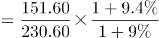，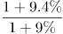略大于1，则最终结果略大于65.74%，C项最为接近。

故正确答案为C。

**考点**：文字资料、基期比重

**来源**：2018年贵州省选调高校优秀毕业生到基层工作考试《行测》试题（网友回忆版）第102题

### 第 118 题

在2016年中，下列平均场次观众最多的是：

A. 全国艺术表演团体演出

B. 全国艺术表演团体赴农村演出

C. 全国艺术表演场馆馆内艺术演出

D. 全国各级文化部门所属艺术表演场馆艺术演出

第 118 题 · 答案与解析

**参考答案（粉笔题库参考内容）**

A

**解析**

根据题干“在2016年中······平均······最多的是”，结合材料时间是2016年，可判定本题为现期平均数问题。

A项：定位材料第三段可得：“全年全国艺术表演团体共演出230.60万场，······国内观众11.81亿人次······”。故全国艺术表演团体演出平均场次观众为：；

B项：定位材料第三段可得：“······其中赴农村演出151.60万场，······其中农村观众6.21亿人次······”。故全国艺术表演团体赴农村演出平均场次观众为：；

C项：定位材料第五段可得：“······全年馆内艺术演出19.09万场次······艺术演出观众3098万人次······”。故全国艺术表演场馆馆内艺术演出平均场次观众为：；

D项：定位材料第五段可得：“······全年共举行艺术演出6.81万场次······艺术演出观众2589万人次······”。故全国各级文化部门所属艺术表演场馆艺术演出平均场次观众为：。

综上比较A项最多。

故正确答案为A。

**考点**：文字资料、现期平均数

**来源**：2018年贵州省选调高校优秀毕业生到基层工作考试《行测》试题（网友回忆版）第103题

### 第 119 题

2016年，全国艺术表演团体平均从业人员数和各级文化部门所属艺术表演团体从业人员平均数之比约为：

A. 1:0.346

B. 6:1

C. 1:2

D. 2:3

第 119 题 · 答案与解析

**参考答案（粉笔题库参考内容）**

C

**解析**

根据题干“2016年，······和······之比约为······”，可判定本题为比值计算问题。定位文字材料第二段可得：“2016年末全国共有艺术表演团体12301个，从业人员33.27万人······各级文化部门所属艺术表演团体2031个，从业人员11.52万人”。故2016年全国艺术表演团体平均从业人员数和各级文化部门所属艺术表演团体从业人员平均数之比约为，即比约为1:2。

故正确答案为C。

**考点**：比值计算、文字资料

**来源**：2018年贵州省选调高校优秀毕业生到基层工作考试《行测》试题（网友回忆版）第104题

### 第 120 题

从上述资料可以推断，在2016年：

A. 第十一届中国艺术节取得空前成功

B. 我国艺术创作演出的经济效益显著

C. 我国艺术表演团体演出收益较2015年减少

D. 平均每个文化部门所属艺术表演团体组织政府采购公益性演出场次超过60场

第 120 题 · 答案与解析

**参考答案（粉笔题库参考内容）**

D

**解析**

A项：定位文字材料第一段，“第十一届中国艺术节共汇聚67台参评参演剧目和1000余件美术作品，观众达40万人次”，未出现其他数据，无法推出，错误；

B项：材料未出现艺术创作演出的相关数据，无法推出，错误；

C项：定位文字材料第三段，“全年全国艺术表演团体······其中演出收入130.86亿元，增长39.3%”，故我国艺术表演团体演出收益较2015年增加，并非减少，且若将艺术表演团体演出收益理解为利润，材料中同样未出现相关数据，无法推出，错误；

D项：定位文字材料第二段，“······其中各级文化部门所属的艺术表演团体2031个”，及第四段“全年全国各级文化部门所属艺术表演团体共组织政府采购公益演出13.90万场”，故平均每个文化部门所属艺术表演团体组织政府采购公益性演出场次约为，即超过60场，正确。

故正确答案为D。

**考点**：文字资料、综合分析

**来源**：2018年421联考《行测》题（甘肃卷）（网友回忆版）第115题

