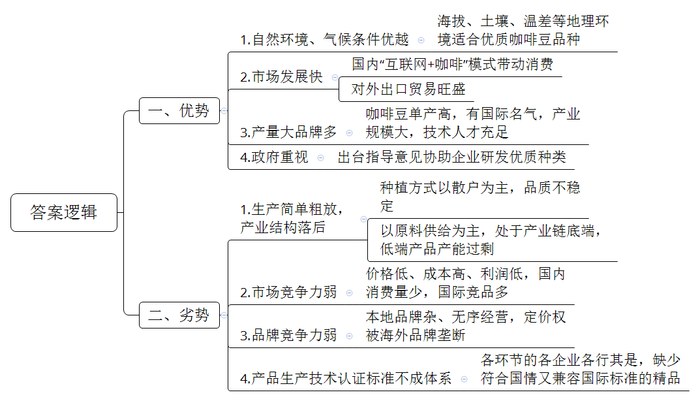

# 2019年公务员多省联考《申论》题（云南县级卷）

<!-- gwy:overview:start -->
> **云南 · 2019 · 申论 · 县级卷** ｜ 4 题 · 图片 4 处 · 答案随题折叠

导航：[题目](#题目) · [材料 1](#材料-1)
<!-- gwy:overview:end -->

> 候选采集稿。参考答案及解析来自粉笔页面，不代表官方答案或真实高分答卷；来源使用许可与原卷对应关系仍需人工核实。

## 给定材料

### 材料 1

“Y省的咖啡豆是天赐的礼物。”这是一位外国友人对Y省咖啡豆的评价。据统计，Y省大部分咖啡豆种植区的海拔都在1000米以上，肥沃的土壤，充足的光照和降雨，明显的昼夜温差，让其所产的咖啡豆颗粒饱满、口味醇厚，堪称“天地厚养”。

“Y省的咖啡豆，可以是高品质的，但这看运气。”咖啡爱好者小李说，“我喝到过顶级口感的，也喝到过如炒糊的黄豆的，而它们都来自Y省同一产地。”的确，就拿Y省咖啡种植大市B市、P市来说，其仍然以散户种植为主。这些咖啡树的“邻居”可能是烟草、水果、玉米等等。施肥、除虫可能都没有。咖啡果本身是水果，风一吹，各种植物的花粉漫天，以这样简单粗暴的方式种植，咖啡豆的品质怎么可能稳定呢？

Y省某著名的咖啡烘焙师对记者说：“我们的咖啡产业，主要还是在做咖啡豆供给，这属于产业链底端。种植的搞种植，烘焙的搞烘焙，各自为政，还要相互挤压利润空间。”

Y省的咖啡豆在国际上确实有些名气，但这种名气并不属于当地品牌，它只是在Y省生长出来的产品属性。很多著名连锁咖啡店使用的咖啡豆就是产自Y省的，但大部分人并不认为自己在喝Y省的咖啡，而是在喝咖啡店的咖啡。

现阶段中国人均咖啡消费量远落后于世界的平均水平。不过，近几年“互联网+咖啡”模式进一步发展，一部分人有了喝现磨咖啡的习惯。同时，即饮咖啡市场也在兴起。较之速溶咖啡，现磨、即饮对口感要求高，更倾向于使用阿拉比卡豆（咖啡豆的一种），而Y省种植的主要就是阿拉比卡豆。

“我们不想种咖啡豆了。”Y省咖农老王对记者抱怨道，“我们的咖啡豆价格比巴西、印尼、越南低，但采摘成本却高很多。所以，我们不赚钱，有时还赔本。我在电视上看到，有的地方的农产品是一个村甚至几个村一起统一种植、统一收割、统一标准加工，再‘组团进城’销售。我们要是也能那样就好了。”

当然，也有好消息：2015年，两条中欧国际货运班列开通，这促进了Y省咖啡出口贸易井喷式增长。当年，Y省咖啡创汇逾4亿美元，比上年翻了将近一番。可不少咖农还是担心：“我们隔壁可是世界上速溶咖啡产量最大的国家啊，会不会它们顺着国际货运列车，来抢我们的生意？”

“我们咖啡单产高，这应是优势，而不是我们产能过剩的原因。但在很早之前，我们就已有低端产品产能过剩的问题。”Y省政策研究室的工作人员说，“我们并没有从‘中国咖啡市场高速增长’中得到多少利润。举个例子，我们供给某外国品牌咖啡店的咖啡豆价格是25元一公斤，而它们在中国卖一杯咖啡就要价30元。其实，我们已建成了国内最大的焙炒咖啡生产线，还有几十个咖啡品牌以及大量满怀热情的咖啡产业技术人才，这些都是我们咖啡业发展的条件。”

“我们有难得的适宜种植利润丰厚的微批次精品咖啡豆的微环境、微气候。”某咖啡品牌主理人小雯感叹道，“可什么是精品，怎样才算微批次？我们用的是国外的概念和标准。而从种植到加工生产经营企业，有执行国际咖啡组织认证标准的，有执行欧盟认证标准的，有执行美国、日本认证标准的，可谓五花八门，为什么我们不制定符合我们国情，又兼容于国际的标准呢？不行动起来，我们还是会一直被牵着鼻子走。”

标准多等于无标准，品牌杂导致无名牌。目前，因咖啡产品生产技术认证标准不成体系，Y省咖啡产业从农业生产到工业加工，各个企业处于“八仙过海，各显神通”的境地。“一些浑水摸鱼、以次充好的经营者忽悠了消费者，也伤害了我们这些老老实实做咖啡的人。”小雯不无痛心地说。

其实，对于咖啡产业，Y省政府是高度重视和支持的，不仅出台了发展指导意见，更协助一些咖啡种植庄园从全球主产区引进瑰夏等优质咖啡品种，建起了世界咖啡博览园和Y省咖啡种子基因库，专注改善Y省咖啡品种单一的现状。经过近五年的种植培育，Y省某庄园已经产出了对当地环境、气候更加适应、风味更佳的二代品种。“这些成功的行动说明我们的地理环境和技术是很棒的，说明中国有好咖啡，就在我们这儿。”一位当地的咖啡庄园主人说道。

小陈是Y省某咖啡品牌创始人，他所经营的咖啡网店的年营收已破千万元，是国内最著名、最成功的咖啡电商之一。“曾经有个记者朋友用‘三杯咖啡’形容我的咖啡电商创业历程。第一杯是苦后回甘，第二杯是保持原味本色，第三杯是着力花式调配。其实，在我心中就一个字——动。”自称“咖啡创业青年”的小陈轻松地笑着，“千百万次地想‘要让全国都喜欢我们Y省的咖啡’，不如勇敢地迈出第一步，再踏踏实实地走下去。我们有得天独厚的资源禀赋，也有诸多后发劣势……所以，一切的一切都需要行动起来。因为，之于世间事，‘静’会给予很多‘如果’的假想，可唯有‘动’能带来‘但是’的希望。”

### 材料 2

“以前啊，这里很多老房子被废弃，濒临倒塌。屋顶残破，梁柱上出现斑斑点点的虫眼……像奄奄一息的病人。”XN村支书老王对从省里来调研的小姚介绍道，“屋里不亮堂，杂草丛生，墙体垮塌，有的连横梁都断裂了。”

“那时候，这儿的老房子基本没人住。我也跟着儿子去了县城，时不时回来一趟，可村子都空了。”村民吴大妈回忆时也不无叹息，“修得再漂亮，没人住也就是个屋子，没有人味儿！”

作家阿敏是XN村的租客，她已在村里住了些年头了。“我曾经离开过一段时间。因为那时候这里人越来越少，没有种田、犁地、收谷、摘果等生产活动，没有欢歌，没有笑语。这里成了‘空心村’，没有真正的生活气息，没有我想要的乡村民居的味道。”

“再不行动起来，要不了几年，我们村就将不复存在了！”当时，这样的警告在老王脑袋里响起。“我们的房子大部分不属于文物级别，没有办法申请经费修葺，但我们自己也得想办法，赶紧行动起来啊。”

2010年春，在老王和热心村民老冯的牵头下，全村人合力捐款捐物，自筹4万多元，对村里最具特色和保护价值的Y堂大宅院正屋破损部位进行了集中修缮，制定了以“保护环境、不准私占、清理整洁、损坏赔偿”等为基本内容的大宅院保护公约。此后，村民们自发成立了村志愿队，不仅承担了公共区域保洁工作，更常常挨家挨户地排查危房安全隐患，宣传自用民屋的日常修葺维护常识。“房子嘛，最怕水和火。没有住就容易坏掉，人住着，房子有点啥问题也能及时察觉。本来随便弄弄就能解决的小问题，因为没人，几年下来，就成大问题了。”

XN村请相关部门对全村有文物保护、旅游等方面价值的民居进行了清理，并划定了保护区域网格，立起了保护标志。而村民们更是主动当起了网格员，协助建立各栋民居的档案。

这几年，返乡的人越来越多，村里又有了生气。人回来了，自然是要居住的，这时候再不行动就没有道理了。

“现在，村里用土地流转办联合社赚到的钱，给大家改善了供水供电和通讯条件。住起来确实比以前舒服多啦。”吴大妈说道，“能住得舒服，谁不爱自己的老家呢?”

在调研完XN村自发的民居保护工作后，小姚在笔记上写道：

<u>有居民，方有民居</u>。和巍峨雄伟的皇宫比，民居更能代表中国的人文精神和生命血脉。它是家，是安身之处和心灵寄托。但保护再重要，也要以人为本、与时俱进。在民居保护工作中，我们要避免两个极端：一是过于追求“原汁原味”，只强调对民居原貌的修葺和保持，忽视甚至限制必要的现代化改造。这样的民居难以满足人们的生活需求，最后只会导致“人去屋空”。而另一个则是过度的现代化甚至是商业化的改造。比如某些古街改造，把各个时期的旧民居改建成清一色的仿古建筑，沿路店面几乎全在经营衣服、箱包，成了“服饰箱包一条街”，它们是商业之地，却不是人们生活之所。

### 材料 3

为了开辟“第二课堂”，阻断贫困代际传递，H市F县PA乡全面开展了教师家访工作。老师们送“育”上门，在学生家庭密集的院坝、楼栋等地，召开“院坝家长会”“楼栋家长会”，宣传教育政策、倾听家长意见。58名教师利用下班、双休日等，送“爱”上门，对学生逐一进行家访，了解家庭情况、沟通教育方法，把孤儿、单亲、留守等特殊情况家庭作为重点家访对象，通过举办关爱活动、微信视频连线等方式，关爱学生成长。其后，他们还开展了“家访问题分析会”，对家长意见、建议、相对集中的热点问题逐条进行分析，商讨解决方案，并定期回访，营造家庭、学校、社会“三位一体”的“家校共育”氛围。

而如此细致的家访工作的背景又是什么呢？“前些年，我们调研时发现，不少群众对政府有怨气，使得危房改造、厕所改造等不少利国利民的工作推进落实难。”F县县委书记说，之所以出现这种情况，在于干部和群众走动少了、交流少了，干群没有打成一片，没有建立起“骨肉相连”的信任感。2016年，F县开始探索干部走访、教师家访、医生巡访、农技随访的“四访”机制。

PA乡正是该县“四访”工作的示范代表。在PA乡，全乡划分为50个网格，有112名网格员，他们负责走访7016户农户。以下是关于PA乡“四访”工作的部分情况：

“要不是党的关心，哪能住新房？”老熊在自家新房里对记者感叹道。往昔在他眼前浮现：自己因骨髓炎截肢而痛不欲生；土胚房钻风漏雨更是让人度日如年……多年来，老熊与妻子都想改变家里境况，却力不从心。自“四访”工作开展以来，老熊家的困境在慢慢改变。从被列入建卡贫困户起，老熊就发现来访的干部多了，不仅来得勤，还问得细：每个家庭成员的年龄、文化程度、就业、身体状况，厨房、厕所、猪圈，土地是流转还是自己种，现有条件能发展哪些产业……事无巨细，都详细记录在了他们为老熊家建的台账里。老熊当上了护林员，妻子也成了村里的保洁员，两个人的工资让全家的基本生活有了保障……

夏大妈2018年种了近3亩的辣椒，收入两万余元。在2017年她也种了半亩小米椒，却只卖了千余元钱。究竟发生了什么，会有这样巨大的差别？“关键就是农技员来指导。”PA乡党委书记老文说，乡里引进了农业公司，建起了蔬菜基地。在公司人员的建议下，夏大妈从小米椒改种市场需求量大、价格也更高的二荆条辣椒。在种植中，负责农业技术指导的农服中心主任老任常到夏大妈的辣椒地里进行技术指导。“他们说用农家肥，我就用养的猪、鸡的粪便拌着草木灰来施肥；说要防虫害，我就按他们说的打药。”在农业技术人员指导下，夏大妈的二荆条辣椒获得了丰收，农业公司又以高价全部收购。文书记介绍，为了帮助农民提高生产水平，增收致富，全乡开展了农技随访。乡农服中心先后组织专业骨干75人次，深入农业基地、田间地头，传技术、教方法，为农民提供产业发展上的技术扶持，护航乡镇特色产业发展。

“我有胃病，要经常检查，但大医院太远了。小丁她们定期过来，真是很感谢。”目送医务车在雨中远去，刘阿姨慢慢走回屋内，“现在，我的病情稳定了。通过几次细致的诊察，乡里给我们制定了个性化治疗方案，建立了健康档案。和我家签约的家庭医生每月到我家来问诊至少2次，不仅送医送药上门，还会定期追踪治疗效果。”除了为刘阿姨这样的贫困户落实签约家庭医生外，PA乡还实行村医常态化入户送诊，对小病小患及时送诊送药，对突发性疾病由村医通过电话与签约医生等进行会诊，病情严重的由村医联系驻村工作队共同送往医院住院诊疗。这样的巡访，为村民提供了基本的医疗保障，也能及时发现村民潜藏的病患，减少因病致贫。但PA乡的医生巡访工作并不局限于这些。为深化巡访，PA乡进一步统筹乡镇中心卫生院和口碑较好的私人诊所的医务人员，利用群众会、赶场天等，在镇街、各村便民服务中心等人群聚集地，免费为全乡群众进行健康体检，提供基本医疗、基本公共卫生、健康教育、个性化健康管理等服务。

“我们的‘四访’工作可不是各做各的，而是实现了信息的互联共享。教育、健康、技术都和收入息息相关。通过两年多的工作，我们已经形成了较为完善的信息档案，这对我们这个深度贫困乡的精准脱贫工作有重要意义。”文书记说道。

### 材料 4

以下是一位游客关于C城的日志：

C城环水依山，沟多坡陡，特殊的地形造就了它独特而多样的交通。缆车，横跨两江的客运索道，沟通上下半城的客运电（扶）梯，还有跨过长江、沿江蔓延、穿过楼道的轻轨……

“妹子，你们现在来我们这儿可是方便得多啦。”一个火锅店老板跟我说，“你看看我们这儿的地形条件，当年没客运电梯，没轻轨的时候，大家都是爬坡上坎，稍微走远一点去逛个街，买个东西都麻烦得很呢。”

索道是C城的特色交通，它建在立体的山水间，让乘客在惊喜刺激中欣赏了这儿山环水拥的美景。乘坐跨江索道的最佳时间是晚上，坐在车里可以看到灯火辉煌的市中心半岛。

大扶梯当然不能错过，它承载着C城的记忆，是连接这座城市上下半城的交通工具：从火车站出来，横穿马路，直接走地下通道，就可以乘坐亚洲最长的坡地扶梯。像我这样初到C城的游客，确实好好感受了下这地方特色浓郁的交通。KX路电梯建于1986年，是国内首次将市内电梯用于城市公共交通。这个电梯高11层，曾经出现在C城造的火柴盒上，算得上是C城的标志之一。

最最不能略过的，当然是轻轨。C城的轻轨相当魔幻：它越过山岭，跨过长江，沿江蜿蜓，穿过楼道，真的是一站一种风景。

“好多人都以为地上跑的是轻轨，地下跑的就是地铁，才不是呢。”C城交通志愿者张大妈，一直以本地的轻轨为骄傲，“轻轨是载客量小，但移动速度快的轨道交通工具；它有自己的运行轨道，但不一定要与其他车辆隔离。重轨，即地铁，它载客量大，运行高速，独立于其他交通工具。”C城的轻轨采用跨座式单轨，噪音仅60分贝，所以即使穿楼而过，也不会影响周边居民的正常生活。依山而建的轨道，经常会有大的弯道，最大的弯道接近90度，乘坐轻轨犹如在坐过山车一样，庆幸的是它并没有过山车那么快，还是很平稳的，这引得不少摄影达人争先到访。轻轨1号线的X站被修建成了一个“森林城堡”。N站是2号线与3号线的换乘站点，位于城中心，有着长长的玻璃长廊，是眺望江景的好去处。这里特别适合晚上去，五彩斑斓的灯光、波光粼粼的江面，真的可以触景生情。

我还去了两江汇合之处的码头，沿着高速公路去看沿途风景。“这些年路修好了，货运、客运的生意都好多了。我们这里每个区、每个县都有高速公路，大家来往方便，也有利于经济的发展嘛。我们这地形条件就这样，财政收入也有限，能把交通搞成这样，不容易啊。”

C城地形的复杂造就了建筑的复杂，而地形复杂、建筑复杂又决定了它交通建设的复杂和困难。这复杂程度，需要更多的成本和智慧。“天生如此，但再难也得搞好交通建设，我们唯有精卫填海、愚公移山。”C城交通主管部门的负责人曾这样形容当地交通建设工作的艰难。

有人说C城是一座5D城市，它的交通向人们展示了，并让人们融入了这座城市山水相依、灯火辉煌的风景，并且它本身就是风景。这些年C城成为“网红”城市，引得各地的游客纷纷前来“打卡”领略。这其中，它的特色交通功不可没。

如果说交通是一个城市写在山川河流上的史书，那么C城书写的内容，肯定是丰富而精彩的。为C城点赞！

### 材料 5

人们建起了墙，关上了门，是维护，是保卫；人们开起了窗，修起了路，是凿通，是交流。与人交流，有得不到回应的尴尬；打开窗户，有被盗的可能；走出去，还有迷路的风险。事事有风险。有人说：有风险，我害怕。然而最大的风险是一点风险都不冒。走出去是风险，也是机遇。只有走出自我的时间和空间，你才会有一份阅历、一份沉淀、一份气质，才不会有动不动就说“这世界居然可以这样”的大惊小怪，才不会有永远偏守“这世界就只是那样”的固执狭隘。只有与时代脉搏同频共振，我们的乡村才有诗和远方，才不会成为泛黄相片里凋零的乡愁；只有以开放的姿态，与世界同呼吸、共命运，共发展、同分享，我们才能一起迈向更加美好的明天。应该说，我们与世界相交，与时代相通，才能让一切保值增值，更添赋流通的美。

“其实，‘交通’本有好几层意思，既包括道路运输，也指通信通讯，更有人际沟通交流之意。”一位交通主管部门负责人说道，“不管是道路运输工程建设，还是通信通讯技术的发展，它们的本质和目的都在第三层上：勾连。”逢山开路，遇水架桥。港珠澳大桥、兰渝铁路、海南环岛高铁、京新高速、川藏公路北线、北斗导航、5G技术、中国国际进口博览会、海南自贸试验区……它们让天堑变通途，让歧路成坦道，让蓝海与绿洲惊艳相逢，让雪域同水乡美丽邂逅，让天涯若比邻，让新朋成故交。它们打通了一个个偏远断点，让中国经济血脉变得更加畅通，并正在重塑中国经济地理的新标志，勾勒出中国经济运行效率的新版图。

一个国家的形象气质，显于它的自然山水，更融于它的交通之中。而这交通，既是道路桥梁、码头港湾、通信基建此类“骨肉皮”的塑造，更是民族性格培育、国家对外开放这样的“精气神”的铸就。事实证明，40年来，走出去的改革开放让我们在经济全球化进程中受益，而发展中的中国也为世界的发展提供着动力。一个流动的中国，充满了繁荣发展的活力。发展未有穷期，我们一直在路上。

## 题目

### 第 1 题

**根据“给定资料1”，归纳概括Y省发展咖啡产业的优势和劣势。（20分）**

关联材料：材料 1

作答要求：全面、准确、简明，有条理；字数不超过300字。

第 1 题 · 答案与解析

**参考答案（粉笔题库参考内容）**

一、优势：1.自然环境、气候条件优越：海拔、土壤、温差等地理环境适合优质咖啡豆品种。2.市场发展快：国内“互联网+咖啡”模式带动消费；对外出口贸易旺盛。3.产量大品牌多：咖啡豆单产高，有国际名气，产业规模大，技术人才充足。4.政府重视：出台指导意见协助企业研发优质种类。

二、劣势：1.生产简单粗放，产业结构落后：种植方式以散户为主，品质不稳定；以原料供给为主，处于产业链底端，低端产品产能过剩。2.市场竞争力弱：价格低、成本高、利润低，国内消费量少，国际竞品多。3.品牌竞争力弱：本地品牌杂、无序经营，定价权被海外品牌垄断。4.产品生产技术认证标准不成体系：各环节的各企业各行其是，缺少符合国情又兼容国际标准的精品。

**解析**

**参考答案说明**：本参考答案从“优势”“劣势”这两个方面展开书写，其中“优势”从“自然环境、气候条件优越”“市场发展快”“产量大品牌多”“政府重视”这四个方面进行了分条撰写；“劣势”从“生产简单粗放，产业结构落后”“市场竞争力弱”“品牌竞争力弱”“产品生产技术认证标准不成体系”这四个方面进行了分条撰写。各条要点之间在内容上是并列关系，没有交叉。并且撰写每条要点时，都提炼出了概括性强的总括句并前置。

**考点**：特点类

**来源**：2019年公务员多省联考《申论》题（云南县级卷）

### 第 2 题

**根据“给定资料2”，谈谈你对划线部分“有居民，方有民居”的理解。（15分）**

关联材料：材料 2

作答要求：紧扣资料，内容全面；逻辑清晰，语言准确；字数不超过200字。

第 2 题 · 答案与解析

**参考答案（粉笔题库参考内容）**

这句话指有居民，民居才持续存在。一、没有居民会导致：民居建筑废弃；生产停滞，失去人味、生活气息和乡村味道。二、有了居民就会积极主动修缮民居，做好保洁和安全隐患排查，改善供水供电和通讯条件等基础设施；管理有文物保护、旅游等特色价值的民居，吸引人员返乡，恢复生气。三、民居代表人文精神和生命血脉，是居民的安身之处和心灵寄托。要以人为本、与时俱进地适度保护，坚持原貌保护与现代化改造相结合，避免过度商业化。

**解析**

**参考答案说明：**思路方面，本参考答案按照词句解释题“总体释义+展开解释+总结”的一般答题思路展开。内容方面，本参考答案先对“有居民，方有民居”的含义进行了解释，接着分析了“没有居民”对民居带来的危害以及“有了居民”对民居的积极作用，最后进行了总结，介绍了民居的重要性及保护民居的对策。

**考点**：词句解释类

**来源**：2019年公务员多省联考《申论》题（云南县级卷）

### 第 3 题

**H市将召开一次关于F县“四访”工作的经验推广大会，假设你是F县发言代表，请你根据“给定资料3”，写一份介绍PA乡“四访”工作经验的发言提纲。（25分）**

关联材料：材料 3

作答要求：紧扣资料，全面、简明，有条理，语言流畅；字数不超过500字。

第 3 题 · 答案与解析

**参考答案（粉笔题库参考内容）**

关于PA乡“四访”工作经验的发言提纲

过去，由于干群交流不足，导致关系疏远、信任感不够，让群众对政府有怨气，工作推进落实难。为破解该局面，我乡开展四访工作，安排网格员走访农户。经验如下：

一、开展教师家访，阻断贫困代际传递。送育上门，在学生家庭密集地宣传教育政策、倾听家长意见；逐一家访，了解家庭情况、沟通教育方法，重点关注特殊情况家庭，关爱学生成长；分析、商讨热点问题，定期回访，营造家校共育氛围。

二、开展干部走访，帮助群众脱困。为贫困户建卡，提高来访频次，详细记录信息；提供就业岗位，保障其基本生活。

三、开展农技随访，提高生产水平，增收致富。农业公司人员提供建议，紧跟市场需求，种植高价品种；农服中心组织专业骨干，深入生产一线，提供技术扶持，护航特色产业发展。

四、开展医生巡访，落实医疗保障、发现潜藏病患、减少因病致贫。细致诊察，个性化治疗，建立健康档案；签约家庭医生，送医送药上门，定期追踪治疗效果，对突发疾病进行会诊，大病送医院诊治；统筹优秀医务人员，集中提供各类免费服务。

我乡打通四访工作，实现信息互联共享，形成完善的信息档案，切实推动精准扶贫工作。

**解析**

**参考答案说明：**（1）格式方面，本参考答案写到了“标题”“正文”两个部分。（2）正文部分，一方面从内容来看，围绕“PA乡‘四访’工作”这一主题，本参考答案的开头先写了PA乡开展“四访”工作的背景；主体部分从“开展教师家访”“开展干部走访”“开展农技随访”“开展医生巡访”四个方面给出了具体经验。另一方面，形式上，本参考答案做到了分段、分条撰写，整体上条理较为清晰。

**考点**：总结类

**来源**：2019年公务员多省联考《申论》题（云南县级卷）

### 第 4 题

**“给定资料5”中提到“我们与世界相交，与时代相通，才能让一切保值增值，更添赋流通的美”，请结合你对这句话的理解，自选角度，联系实际，写一篇文章。（40分）**

关联材料：材料 1、材料 2、材料 3、材料 4、材料 5

作答要求：

（1）立意明确，结构完整；

（2）思路清晰，语言流畅；

（3）参考“给定资料”，但不拘泥于“给定资料”；

（4）总字数1000～1200。

第 4 题 · 答案与解析

**参考答案（粉笔题库参考内容）**

**以开放之态** **添赋流通之美**

如今是个开放的、变化的时代，万物之间的联系深刻而广泛，事物的变化快速且凶猛。有人说，我们与世界相交，与时代相通，才能让一切保值增值，更添赋流通的美。的确，在这样一个时代，**封闭孤立、不思进取会注定走向没落。无论是一人一集体，还是一国一社会，都需要对外“交”“通”，**这样才能实现持续的发展。

**所谓的“交”与“通”，本义指对外交往的渠道，以及与他人的沟通。实质指空间上保持开放的姿态，走出一人、一地、一国，与世界相连；时间上紧跟时代的发展、与时俱进、突破自我、革旧维新。**

**作为生活在新时代的个体，要善于、勇于、乐于对外“交通”，要鼓足承担风险的勇气，避免自我封闭；要积极与他人往来、与外界接触；要与时代同频共振，以开放的姿态，融入其中。**

**走出自我时间与空间，向未知和可能进军，让人拥有阅历、沉淀与气质，让人眼界开阔，境界提升，变得开明、包容。**任何人的认知都有局限，尤其是在这个变化的时代，新的知识、研究领域不断出现，封闭会让我们错过整个时代、整个世界。只有开拓眼界，才能**理解、适应、融入这个时代，破解乡村发展困局，才能用新思路解决旧问题。**比如说，在城镇化、工业化浪潮的裹挟下，很多村庄日渐“空心化”，衰退着、凋零着，隐有“垂暮之态”。此时，多地通过现代化改造，改善人居环境，发展乡村旅游业……在传承中创新、在保护中开发，乡村也可以有人气、有活力、有效益。**只有人人保持开放的姿态、学习的状态、进步的心态，才能与世界和谐共生，共建人类命运共同体。**

**“交通”不仅需要个人的努力，还需要倚仗现实的“工具”，即需要完善的基础设施与发达的科技保障。**道路运输工程能实现人员、物资的交流输送，通讯技术能实现信息的交互往来，这都是“交通”的必备利器。山头的基站、陆上的高铁、跨海的大桥、云上的飞机、太空中的卫星……这些道路运输工程和通信通讯技术，能跨越空间距离，快速勾连世界，提高“交通”效率；更能打通偏远断点，形成商品和信息的流通渠道，畅通经济血脉，让落后地区有发展机遇，让各地的资源优势转变为经济优势，还能重塑经济地理标志，形成国家经济发展的全新格局。

**“交通”亦需要培育民族性格，需要在对外开放中，不断铸造国家的“精气神”**。自信、谦逊、乐于分享的民族性格，是我们与世界同呼吸、共命运的“软实力”，是我国“交通”发展更为顺畅的“润滑剂”；敞开国门、对外开放的国家政策是适应全球化发展的“硬保障”，是应对闭关锁国、固步自封的“高压线”。“软硬兼施”能让斑斓文化、优质产品和细致服务走向世界，能让我们引入先进的发展模式、理念、技术，充分汲取其发展养分，为我所用。唯有此，才能让流动、个性的中国充满繁荣发展的活力，在世界舞台展现“中国性格”。

流通的美是奔涌向前、不断攀升的美，是生机勃勃、充满活力的美，是互联互通、相扶相助的美。下一个40年，我们将会在更加开放、融通中，走出独具特色的步伐。

**解析**

**文章分析**

**以开放之态** **添赋流通之美**

【**标题的优点：**首先，范文的标题“以开放之态 添赋流通之美”突出了“相交相通”这一主题。其次，形式上，文字简洁明快。】

（1）<u>如今是个开放的、变化的时代</u>，<u>万物之间的联系深刻而广泛</u>，<u>事物的变化快速且凶猛</u>。有人说，我们与世界相交，与时代相通，（2）才能<u>让一切保值增值</u>，<u>更添赋流通的美</u>。的确，在这样一个时代，（3）**封闭孤立、不思进取会注定走向没落****。无论是一人一集体，还是一国一社会，都需要对外“交”“通”，**这样才能实现持续的发展。

【**开头的优点：**★内容方面。范文的开头是紧扣题目给定的“相交相通”这一主题展开的。首先，开头开门见山点出主题，做到了主题明确。其次，对“相交相通”这一主题进行了分析阐述，指出了（1）介绍了当前的时代背景；（2）介绍了“相交相通”的意义；（3）介绍了事物封闭孤立的危害。★文字表达方面。长短句配合使用，使语言表达有节奏感；使用了“无论……，还是……”关联词，使语言表达有逻辑性。】

（1）所谓的“交”与“通”，<u>本义指对外交往的渠道</u>，<u>以及与他人的沟通</u>。（2）实质指<u>空间上保持开放的姿态</u>，<u>走出一人、一地、一国</u>，<u>与世界相连</u>；<u>时间上紧跟时代的发展、与时俱进、突破自我、革旧维新</u>。

【**过渡段的优点：**范文过渡段分析了“交”与“通”的含义等方面的内容，分别阐释了（1）<u>“交”与“通”的本义</u>；（2）“交”与“通”的实质含义。】

**作为生活在新时代的个体，要善于、勇于、乐于对外“交通”，要鼓足承担风险的勇气，避免自我封闭；要积极与他人往来、与外界接触；要与时代同频共振，以开放的姿态，融入其中**。

**（1）****走出自我时间与空间，向未知和可能进军****，****让人拥有阅历、沉淀与气质****，****让人眼界开阔，境界提升****，****变得开明、包容****。**任何人的认知都有局限，尤其是在这个变化的时代，新的知识、研究领域不断出现，封闭会让我们错过整个时代、整个世界。（2）**只有开拓眼界****，****才能理解、适应、融入这个时代****，****破解乡村发展困局****，****才能用新思路解决旧问题****。**比如说，在城镇化、工业化浪潮的裹挟下，很多村庄日渐“空心化”，衰退着、凋零着，隐有“垂暮之态”。此时，多地通过现代化改造，改善人居环境，发展乡村旅游业……在传承中创新、在保护中开发，乡村也可以有人气、有活力、有效益。（3）**只有人人保持开放的姿态、学习的状态、进步的心态****，****才能与世界和谐共生****，****共建人类命运共同体**。

【**论述段1的优点：**★观点句：范文的观点句是紧扣“相交相通”这一文章主题提出的。形式上，它在段首处直接写出，位置突出，容易发现。内容上，关键词突出，可以明显看出它是从“个人角度”入手，指出了“如何实现个人相交相通”的对策。★论述内容：（1）介绍了走出自我，探索未知能够拥有阅历、开阔眼界、提升境界；（2）介绍了开拓眼界，我们就能更好地理解、融入这个时代，才能用新思路解决问题；（3）介绍了人们保持开放对民族、国家的积极影响。注意：以上几个方面的内容都是紧扣“作为生活在新时代的个体，要善于、勇于、乐于对外‘交通’，要鼓足承担风险的勇气，避免自我封闭；要积极与他人往来、与外界接触；要与时代同频共振，以开放的姿态，融入其中”这个观点句进行分析论述的，论述的针对性强，内容层次丰富。最后，在论述方法和论据的选取上做到了讲道理、举例子相结合，做到了丰富多样。】

“交通”不仅需要个人的努力，**还需要倚仗现实的“工具”，即需要完善的基础设施与发达的科技保障**。（1）<u>道路运输工程能实现人员、物资的交流输送</u>，<u>通讯技术能实现信息的交互往来</u>，这都是“交通”的必备利器。山头的基站、陆上的高铁、跨海的大桥、云上的飞机、太空中的卫星……这些道路运输工程和通信通讯技术，（2）<u>能跨越空间距离</u>，快速勾连世界，提高“交通”效率；<u>更能打通偏远断点</u>，形成商品和信息的流通渠道，畅通经济血脉，让落后地区有发展机遇，让各地的资源优势转变为经济优势，<u>还能重塑经济地理标志</u>，形成国家经济发展的全新格局。

【**论述段2的优点：**★观点句：范文的观点句是紧扣“相交相通”这一文章主题提出的。形式上，它在段首处直接写出，位置突出，容易发现。内容上，关键词突出，可以明显看出它是从“倚仗现实‘工具’”入手，指出了“实现相交相通的对策”。★论述内容：（1）介绍了道路运输和通讯技术是“交通”的必备；（2）介绍了“交通”带来的意义。注意：以上几个方面的内容都是紧扣“‘交通’不仅需要个人的努力，还需要倚仗现实的‘工具’，即需要完善的基础设施与发达的科技保障”这个观点句进行分析论述的，论述的针对性强，内容层次丰富。最后，在论述方法和论据的选取上做到了讲道理、举例子相结合，做到了丰富多样。】

**“交通”亦需要培育民族性格，需要在对外开放中，不断铸造国家的“精气神”。**（1）<u>自信、谦逊、乐于分享的民族性格</u>，是我们与世界同呼吸、共命运的“软实力”，是我国“交通”发展更为顺畅的“润滑剂”；（2）<u>敞开国门、对外开放的国家政策</u>是适应全球化发展的“硬保障”，是应对闭关锁国、固步自封的“高压线”。（3）<u>“软硬兼施”能让斑斓文化、优质产品和细致服务走向世界</u>，<u>能让我们引入先进的发展模式、理念、技术，充分汲取其发展养分</u>，为我所用。唯有此，才能让流动、个性的中国充满繁荣发展的活力，在世界舞台展现“中国性格”。

【**论述段3的优点：**★观点句：范文的观点句是紧扣“相交相通”这一文章主题提出的。形式上，它在段首处直接写出，位置突出，容易发现。内容上，关键词突出，可以明显看出它是从“培育民族性格”入手，指出了“实现相交相通的对策”。★论述内容：（1）介绍了民族性格与“交通”的关系；（2）介绍了国家政策与“交通”的关系；（3）民族性格与国家政策双管齐下给“交通”带来的意义。注意：以上几个方面的内容都是紧扣“‘交通’亦需要培育民族性格，需要在对外开放中，不断铸造国家的‘精气神’”这个观点句进行分析论述的，论述的针对性强，内容层次丰富。最后，在论述方法和论据的选取上做到了讲道理、举例子相结合，做到了丰富多样。】

【**论述段之间的关系**：★内容的内在逻辑：范文的论述段之间是依照“并列”的逻辑展开的。论述段1先写了“作为生活在新时代的个体，要善于、勇于、乐于对外‘交通’，要鼓足承担风险的勇气，避免自我封闭；要积极与他人往来、与外界接触；要与时代同频共振，以开放的姿态，融入其中”，论述段2写了“‘交通’不仅需要个人的努力，还需要倚仗现实的‘工具’，即需要完善的基础设施与发达的科技保障”，论述段3写了“‘交通’亦需要培育民族性格，需要在对外开放中，不断铸造国家的‘精气神’”。】

（1）<u>流通的美是奔涌向前</u>、<u>不断攀升的美</u>，<u>是生机勃勃</u>、<u>充满活力的美</u>，<u>是互联互通</u>、<u>相扶相助的美</u>。下一个40年，（2）<u>我们将会在更加开放</u>、<u>融通中</u>，<u>走出独具特色的步伐</u>。

【**结尾的优点**：范文的结尾回扣了“相交相通”这一主题。（1）再次提到“相交相通”这一主题；（2）发出了展望。】

**考点**：文章写作题

**来源**：2019年公务员多省联考《申论》题（云南县级卷）

