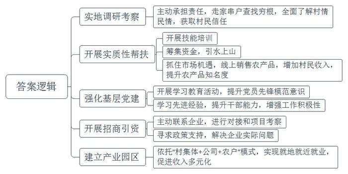
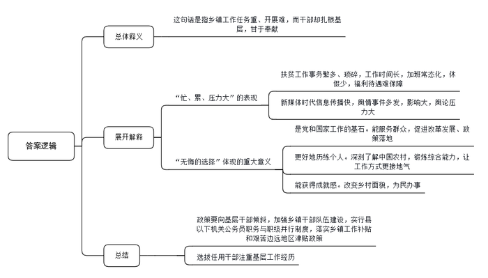

# 2020年0822公务员多省联考《申论》题（云南省级卷）

<!-- gwy:overview:start -->
> **云南 · 2020 · 申论 · 省级卷** ｜ 4 题 · 图片 4 处 · 答案随题折叠

导航：[题目](#题目)
<!-- gwy:overview:end -->

> 候选采集稿。参考答案及解析来自粉笔页面，不代表官方答案或真实高分答卷；来源使用许可与原卷对应关系仍需人工核实。

## 给定材料

### 材料 material-78813969ef6fcba5

T市新城，环湖公园已全景亮相，湖畔绿道成为健身爱好者的乐园，文化艺术中心正紧锣密鼓建设之中，国际秀场首秀在即……人居环境不断改善，城市功能不断优化，用高品质筑就生态宜居之城，这个新城规划时的梦想正在变成现实。

“今年六月份到年底，国家级和国际级的大型秀场活动都排满了。”国际秀场招商负责人的言语中透着自信与骄傲。国际秀场位于T市新城的时尚小镇内，是时尚小镇中的地标建筑，建设目标是成为中国时尚文化新窗口。目前，国际秀场已竣工，即将迎来“首秀”。

与国际秀场毗邻的是T市新城的文化艺术中心。这个拥有几何立面和斜面屋顶的建筑矗立在湖畔，自成姿态。T市人从此又多了一个看话剧、歌剧的好去处。“家门口就可以看戏、看话剧，梦寐以求的事情实现了。”小吴家住新城，以前看戏，他都要去主城区。“听说文化艺术中心的硬件设施是世界顶级的，”他充满了期待，“希望引进的剧种能多样化、多层次，既有经典又有流行。”

近两年，T市新城加速打造品质之城。人文是这座新城的“心”，沉淀着这个城市的故事，孕育出这个城市的灵气。

城心湖占地面积大，风景优美，历代文人墨客在此题咏。T市新城围绕城心湖而建，这座湖是新城的“肺”。如今，一条环湖的绿道已经建成。环湖绿道是T市新城打造的自然景观之一，全线滨水，视野开阔。从早上六点半到晚上八点半，环湖绿道上随处可见晨练、夜跑的人。中午时分，周边写字楼里的白领们也常常在绿道边漫步休闲，“听着鸟鸣，闻着花香，很舒服。”

未来，这条绿道将向整个新城延伸，设计有骑行道和步行道，还有VR体验馆，满足人们多样的需求。绿道不仅连接新城所有的公园和景点，还将城市与乡村紧密相连，走在绿道中，仿佛走在画中。绿道就像是新城的“脉”，通过绿道串起来的是一个大写的“融”字。绿道建设负责人说，“我们希望这条路连起所有新城人的梦想和记忆。”

城市如人，也要健康、好看。有心灵的跃动，脉搏的畅通，还要有肌肤的美丽。公园就是新城的肌肤。

藕花再现，湖泊复兴。新城将在环湖公园实现全域亮灯，呈现全线夜景灯光秀，一个“越夜越美丽”的环湖公园就要来到市民的生活中。环湖公园之美，靠的是技术和规划。环湖公园水生态养护的负责人说:“我们已经在湖中建成了一套成熟的水下生态系统。”水生态技术让这里的夏天再现“藕花满汀洲”的盛景。陆地上也有一套完整、科学的植被规划，以自然景观为基调形态，突出四季变化。春季赏花，夏季绿荫，秋季观叶，冬季葱郁，营造出充满活力的自然生态树林景观。

相较于环湖公园的自然与人文，体育公园的针对性更强。全民体育，乐跑体育，以运动促健康，是这里的主题。动与静、开放与私密、艺术与自然相结合的运动环境，满足了各年龄段人群健康、休闲、品质的运动需求。距离体育公园不远的花海公园则以“新城潮生活”为主题，怒放的花海让这里变得浪漫温馨。

公园让城市变得美丽光鲜，它为我们建造了一个“桃花源”，安放新城人生态宜居的梦想。

### 材料 material-861b312b3dd0d51a

只因看了一眼岩山，从此她就与岩山结缘。她就是D市岩山驻村帮扶工作组组长、驻村第一书记小孙。几年前，小孙从一所名牌大学硕士研究生毕业，来到A省商务厅工作。有一次，省委、省政府组织“机关干部下基层”社会实践活动，她随着实践小组来到了岩山。

“太美了！”小孙被岩山美丽的风景深深震撼，花红柳绿，山清水秀，真是如诗如画。当地淳朴的民风，热情好客的村民令她印象深刻。不过，令她同样印象深刻的还有岩山的贫困。岩山共有1345户、4130口人，其中贫困户占60%，人均耕地不足0.8亩，村民收入主要依靠传统农业和外出务工，是典型的国家级贫困村。脱贫是这里的村民一代又一代的梦想。如果能帮助岩山村这样长期贫困的地方摆脱贫困，人生该是多么有价值啊！小孙的心里涌起一个强烈的念头。

此时，D市正深入开展脱贫攻坚行动，巧合的是，岩山村正是商务局的对口扶贫村。小孙主动请缨，担任岩山驻村帮扶工作组组长。“作为名校研究生，有更好的机会，为什么选择到偏远乡村？”面对不解的目光，小孙没有回答，只是报以微笑。

从驻村工作开始的第一天起，帮助岩山这个贫困村脱贫致富的沉甸甸的责任，便落在了小孙的肩上。刚入村时，小孙准备先找村民了解情况，但却听到了这样的风凉话：“咋还派个女干部？一个城里女人能干啥？”

为了开好头，获取村民的信任，她和工作组同事，到田间地头了解情况，走家串户查找穷根。入村不到两个月，就完成了全村所有贫困户的走访，做到村里的“大事小情、家长里短”都了然于心。

随后，小孙与工作组同事组织村民参加手工纺织、月嫂服务等培训班。与此同时，他们筹集资金，在全村开工建设引水上山工程，彻底改变了村里几十年来缺水的落后状况。刚去的那一年，小孙注意到各家都用自家喂养的土猪腌制成腊肉，味道非常鲜美。除自己食用外，每年各家都会有可观的剩余。小孙与工作组同事在那年春节前，瞅准节日期间市场供货量增加的机会，积极利用微信朋友圈、联系微商等方式，全程参与推销，不仅给村民换来了“过年钱”，还使岩山的腊肉小有“名”气。一连串雪中送炭的实质性帮扶拉近了村民和工作组的距离，村民们被小孙这位“女干部”的真情付出深深打动。

“农村富不富，关键在支部。如何发挥基层党组织的战斗堡垒作用是驻村帮扶的首要工作。”小孙深有感触地说。为此，她和工作组同事带着村民党员积极开展学习教育活动，提升党员的先锋模范意识。为了提高村干部、村民代表引领产业发展、带领群众致富的能力，小孙多次组织大家到周边先进地区学习考察，“明显感觉到岩山的民心齐了，村干部的干劲足了、水平高了。”小孙帮助村民脱贫致富的信心更强了。

如何用工业化理念改变村民传统的生产生活方式，尽快引进增收产业项目为村民创造具有长期稳定收益的就业岗位，实现更多人的致富奔小康，是驻村帮扶工作组和村两委班子都要琢磨的“大事情”。在得知外省一家大型现代纺织企业老总是A省人，有回乡投资的想法后，小孙和工作组便第一时间与他取得联系，进行对接和项目考察。在充分了解到该纺织项目是非常适合岩山村的好项目后，小孙便积极与企业负责人沟通招商想法。针对企业提出的十几条落实投资的实际问题，小孙带领工作组到市、县、乡各项目主管单位咨询政策、寻求支持。仅仅5个多月的时间，小孙和工作组就协助企业完成了项目选址、各项手续办理、厂房建设、员工培训等一系列重要工作。村干部介绍说，目前，一个依托“村集体+公司+农户”模式形成的纺织产业园区已建立起来。村民不仅可以在家门口就业，而且可以实现既拿薪金又领股金还得租金的长效增收，岩山村的脱贫梦正在逐步实现。

“咱们岩山再也不是那个靠天吃饭的穷地方了，现在不少在外打工的年轻人都回来了。”村民喜滋滋地指着驻村工作组的办公室说，“变化就是从孙书记和她的组员到咱村来的那一天开始的。”

“我们的目标是成为北方最大的坯布集散地。”一个更大的梦想在小孙心中一点点描绘。环境越来越好，梦想越来越大，“但是，作为一个共产党员，我的信念和情怀不会变。”

### 材料 material-5a3928cc930ba807

“真希望自己是‘三头六臂’就好了！”M乡王乡长快人快语。王乡长正在负责完善贫困户档案，要了解家庭人员构成、住房改造前后照片对比、种植养殖种类及数量、扶持项目公示、会议记录、入户追访、满意度调查等内容。一方面，因为建档的需要，要填写大量的表格等资料。另一方面，“表格的内容很细致，不到贫困户家中实地调查那是不行的。看似简单的事情其实很繁琐，有时候要来回跑很多趟。”

基层工作千头万绪，事务繁多，而且某件事成为舆情热点，不仅会极大增加基层工作量，而且让基层干部倍感压力。经历过几次舆情热点事件，M乡宣传干事小陈已经略有心得：尽快披露事实，优先回应网友质疑......然而，小陈却坦言工作不易:“国家强调依法治国，事情处理起来都有程序，需要时间。但新媒体时代信息传播越来越快，造成舆论影响迅速放大。”一次该地出现旅游纠纷，消息在网上飞快传开，网友一边倒地批评景区，可是通过调查却发现，其实是游客挑衅。“虽然最后真相大白，可还是给我们造成了很大的压力。”小陈说。

基层，是整个社会的“地基”，这个“地基”是社会的主体，也是时代的主流。基层干部，是党和国家工作的“基石”，他们奋战在改革发展的主战场、服务群众的最前沿。目前绝大多数政策落地都在县乡，从脱贫攻坚到民生保障，再到招商引资、产业发展、入户做群众工作，都离不开基层干部。基层干部忙得脚打后脑勺，加班是常态，但干部们几乎都没有加班费。有关科研机构的调查显示，乡镇干部平均每天工作10到11个小时，不少乡镇干部五六年没休过假。

王乡长说：“乡镇工作虽然忙、累、压力大，但也是我们无悔的选择。”

C乡党委李书记至今已在5个乡镇工作过，乡镇的每个岗位几乎都干过。“乡镇是最基层的行政机构，但麻雀虽小，五脏俱全。产业发展、土地问题、安全生产……能最深刻地了解中国农村，最全面地锻炼干部能力。”李书记说。基层工作经历让乡镇干部的综合能力得到迅速提升，工作方式也更接地气，他们也很感谢这样的历练。

2017年，中共中央办公厅发文，强调要加强乡镇干部队伍建设，实行县以下机关公务员职务与职级并行制度，落实乡镇工作补贴和艰苦边远地区津贴政策。“而且现在干部的选拔任用更加注重基层工作经历，相关政策也更多向基层干部倾斜。干部想更长远发展，基层工作其实也是一个重要的经历。”李书记说。

不过，在李书记看来，最重要的还是乡镇工作独特的成就感。“我们很多人都是农村出身，很多亲戚朋友都在农村。改变家乡面貌，帮助农民做点事，这是我们肩负的使命。”C乡地处贫困地区，李书记带领群众克服海拔高、交通条件差、缺工人缺材料等困难，在三个月内改造了71栋房子，“看着很多贫困户欢欢喜喜搬进新房，我忍不住流下眼泪。想到靠自己的努力能够改造一方水土，有一种梦想正在一点点地实现的感觉，那个时候，你就会觉得所有的付出都值得。”

### 材料 material-bd57d30f6feb66a6

“我们都在努力奔跑，我们都是追梦人。”是的，我们都是追梦人。追梦，我们收获满满；追梦，我们希望满满。

正如习近平总书记所说，中国人民具有伟大梦想精神。改革开放40多年的征程，就是一个追梦之旅。改革开放之初，我们党以非凡的胆略、坚定的自信设计了用70多年、分三步走，基本实现社会主义现代化的宏伟蓝图。改革开放40多年的追梦路上，我们咬定青山不放松，风雨无阻朝着这个伟大目标前进。

从站起来、富起来到强起来，这是奋斗的力量，也是梦想的力量。

党的十九大对我国发展提出了更高的奋斗目标，形成了从全面建成小康社会到基本实现现代化、再到全面建成社会主义现代化强国的战略安排，发出了实现中华民族伟大复兴中国梦的最强音。

但是，船到中流浪更急，人到半山路更陡，并且“愈进愈难、愈进愈险而又不进则退、非进不可”。在这样的关键时刻，我们要心怀梦想、奋勇拼搏，一步一个脚印，一棒接着一棒，在新时代创造中华民族新的更大奇迹!

梦想是拼出来的，奇迹是干出来的。改革开放的辉煌成就背后，是40多年的不懈努力。未来中国梦的实现，同样需要汗水的浇灌。没有人能随随便便成功。改革开放40多年的历程告诉我们：伟大事业都始于梦想，基于创新，成于实干。梦想是激发活力的源泉，只要有梦想，就会有力量。只要有梦想，则时光不弃，未来可期。

## 题目

### 第 1 题

**根据给定资料**2**，总结T市新城生态宜居建设的主要理念和做法。（15分）**

关联材料：材料 material-78813969ef6fcba5

作答要求：

要求：准确，全面，有条理，不超过200字。

第 1 题 · 答案与解析

**参考答案（粉笔题库参考内容）**

理念：改善人居环境，优化城市功能，提高新城品质。

做法：1.打造文化设施，优化文化服务。打造时尚小镇，建设国际秀场、文化艺术中心；举办大型活动，开展话剧、歌剧演出。2.打造环湖绿道，连接新城脉络。向新城延伸，设计骑行、步行道等，满足多样化需求；连接城内公园景点，串联城乡。3.建设城市公园，美化新城环境。环湖公园依靠技术、规划打造灯光秀及生态景观；主题公园营造运动环境，营造温馨浪漫生活氛围。

**解析**

**参考答案说明：**答案先指出了T市新城生态宜居建设的主要理念，又从“打造文化设施，优化文化服务”“打造环湖绿道，连接新城脉络”“建设城市公园，美化新城环境”三个方面对具体做法进行了分条撰写。各条要点之间在内容上是并列关系，无交叉。

**考点**：考点多要素组合类

**来源**：来源2020年0822公务员多省联考《申论》题（云南省级卷）

粉笔申论页面对本题只提供「解析视频」入口，该入口是会员推广位，页面无视频地址与文字解析。

### 第 2 题

**根据给定资料**3**，归纳小孙为带领村民脱贫致富做了哪些工作。（20分）**

关联材料：材料 material-861b312b3dd0d51a

作答要求：

要求：准确，全面，有条理，不超过300字。

第 2 题 · 答案与解析

**参考答案（粉笔题库参考内容）**

1.实地调研考察。主动承担责任，走家串户查找穷根，全面了解村情民情，获取村民信任。

2.开展实质性帮扶。开展技能培训；筹集资金，引水上山；抓住市场机遇，线上销售农产品，增加村民收入，提升农产品知名度。

3.强化基层党建。开展学习教育活动，提升党员先锋模范意识；学习先进经验，提升干部能力，增强工作积极性。

4.开展招商引资。主动联系企业，进行对接和项目考察；寻求政策支持，解决企业实际问题。

5.建立产业园区。依托“村集体+公司+农户”模式，实现就地就近就业，促进收入多元化。

**解析**

**参考答案说明：**本参考答案从“实地调研考察”“开展实质性帮扶”“强化基层党建”“开展招商引资”“建立产业园区”等不同的角度进行了分条撰写；各条答案要点之间在内容上相互并列，没有交叉。

**考点**：考点概括措施类

**来源**：来源2020年0822公务员多省联考《申论》题（云南省级卷）

粉笔申论页面对本题只提供「解析视频」入口，该入口是会员推广位，页面无视频地址与文字解析。

### 第 3 题

**请根据给定资料**4**，谈谈你对划线句子“乡镇工作虽然忙、累、压力大，但也是我们无悔的选择”的理解。（25分）**

关联材料：材料 material-5a3928cc930ba807

作答要求：

要求：全面准确，条理清晰，分析透彻，不超过300字。

第 3 题 · 答案与解析

**参考答案（粉笔题库参考内容）**

这句话是指乡镇工作任务重、开展难，而干部却扎根基层，甘于奉献。

“忙、累、压力大”表现在：1.扶贫工作事务繁多、琐碎，工作时间长，加班常态化，休假少，福利待遇难保障；2.新媒体时代信息传播快，舆情事件多发，影响大，舆论压力大。

“无悔的选择”指基层工作意义重大：1.是党和国家工作的基石。能服务群众，促进改革发展、政策落地；2.更好地历练个人。深刻了解中国农村，锻炼综合能力，让工作方式更接地气；3.能获得成就感。改变乡村面貌，为民办事。

因此，政策要向基层干部倾斜，加强乡镇干部队伍建设，实行县以下机关公务员职务与职级并行制度，落实乡镇工作补贴和艰苦边远地区津贴政策；选拔任用干部注重基层工作经历。

**解析**

**参考答案说明：**思路方面，本参考答案按照词句解释题“总体释义+展开解释+总结”的一般答题思路展开。内容方面，本参考答案首先解释了“乡镇工作虽然忙、累、压力大，但也是我们无悔的选择”的含义；接着分别给出了“忙、累、压力大”的具体表现和“无悔的选择”体现的重大意义；最后给出了对策作为总结。词句表达方面，本参考答案加上了“因此”等连接词来承接上下文。

**考点**：考点词句解释类

**来源**：来源2020年0822公务员多省联考《申论》题（云南省级卷）

粉笔申论页面对本题只提供「解析视频」入口，该入口是会员推广位，页面无视频地址与文字解析。

### 第 4 题

**给定资料**5**中提到，****“****这是奋斗者的奖杯，这个奖杯上不仅有我的名字，还有我们团队的名字，其实还应该有国家的名字。****”****根据你的理解，参考给定资料，以****“人生的奖杯”为主题，联系实际，自拟题目，写一篇文章。（40分）**

关联材料：材料 material-bd57d30f6feb66a6

作答要求：

要求：

（1）自选角度，立意明确；

（2）思路清晰，语言流畅；

（3）参考“给定资料”，但不拘泥于“给定资料”；

（4）总字数1000-1200字。

第 4 题 · 答案与解析

**参考答案（粉笔题库参考内容）**

**勇敢追逐梦想，托起人生奖杯**

**这是一个追梦的时代，我们都是追梦人**。梦想，是我们人生起航的方向，是追梦路上星星点点的希望，亦是华夏儿女不懈奋斗的最终目标。正如习总书记所说，中国人民具有伟大梦想精神。只要有梦想，就会有改革的活力；只要有梦想，就会有发展的动力；只要有梦想，则时光不弃，未来可期。**在追梦的路上，个人、企业、国家都需要积极作为，勇敢前行，共同托起人生的奖杯。**

**为梦想不懈奋斗者，向来都不乏从头开始的勇气，****他们充满家国情怀，敢于担当，无私又无畏，用厚重的社会责任心托起沉甸甸的人生奖杯。**王安石为梦想变法革新，不畏权贵；玄奘为梦想万里跋涉，西天取经；王淦昌为梦想隐姓埋名，以身许国；丁先生为梦想放弃高薪，毅然回国……凡此种种，都在告诉我们，追梦途中要有奉献一切的担当与勇气。放眼当下，正因为胸怀天下，心系百姓，才会有“甘于寂寞勇创新”的科研工作者，才会有“黄沙百战穿金甲”的最美逆行者，才会有“不胜疫情终不还”的医务工作者。

**为梦想奋斗不止于个人的无私无畏，****企业也****要****奋勇开拓，埋头实干，以创新为抓手，坚持自主研发，百折不挠，加强合作，凝****聚****力量，不断****提****升****市场竞争力。**奋勇开拓不是单打独斗的蛮干，也不是追随大流的盲从，而是要跟随时代前行的脚步，学会合作，善于创新。面对美国的多次打压，华为之所以能够顶住压力，绝地求生，正是在于其团结一心，持续创新。然而，当下很多企业只愿做跟随者，而不愿做开拓者，长此以往必将无法适应竞争激烈的外部环境，更不利于创新氛围的形成。面向未来，企业应该凝聚力量，加强自主研发，积极寻求合作，实干苦干，以超凡的格局迎接风险和挑战。

“人民有梦想，国家有力量。”中华民族生生不息，恰在于人们追梦的脚步从未停滞。在追梦的路上，政府更要积极作为，为个人和企业的发展护航。

**除了****提供政策扶持****外，政府还要营造良好环境，激励大众创新创业，****为奋斗者保驾护航**。当前社会环境复杂，如果干事创业只凭一腔热血，缺少规划和引导，很可能会滑入失败的深渊。为此，国家要加大扶持力度，出台减税降费、证照合一等政策，营造公平的竞争环境，打造良好的科研环境，以创业园区、创业孵化器等为创业者提供发展空间，以创业培训、创业贷款等缓解他们资金上的燃眉之急。良好的政策环境不仅可以提升效率，促进创新成果的转化，还可以使创业创新者保持定力，增强信心，让创新源泉充分涌流，不断为国家高质量发展提供动力。

作为新时代的追梦人，我们要不忘初心和使命，勇敢前行，奋勇开拓，携手唱响“我辈岂是蓬蒿人”的时代颂歌。

**解析**

**文章分析**

**勇敢追逐梦想，托起人生奖杯**

【**标题的优点：**标题中含有“梦想”“人生奖杯”等主题词，使文章主题更突出、清晰。】

**这是一个追梦的时代，我们都是追梦人**。（1）梦想，是我们人生起航的方向，是追梦路上星星点点的希望，亦是华夏儿女不懈奋斗的最终目标。正如习总书记所说，中国人民具有伟大梦想精神。只要有梦想，就会有改革的活力；只要有梦想，就会有发展的动力；只要有梦想，则时光不弃，未来可期。（2）在追梦的路上，个人、企业、国家都需要积极作为，勇敢前行，共同托起人生的奖杯。

【**开头的优点：**★内容方面：范文的开头是紧扣“人生的奖杯（梦想）”这一主题展开的。首先，开篇点出主题，做到了主题明确。其次，对“人生的奖杯（梦想）”这一主题进行了分析阐述：（1）指出梦想的重要性和意义；（2）指出追梦路上需要个人、企业和政府的积极作为。★文字表达方面：使用了“……是……亦是……”“只要……就会……”等句式，使语言表达有逻辑性。】

**为梦想不懈奋斗者，向来都不乏从头开始的勇气，****他们充满家国情怀，敢于担当，无私又无畏，用厚重的社会责任心托起沉甸甸的人生奖杯。**王安石为梦想变法革新，不畏权贵；玄奘为梦想万里跋涉，西天取经；王淦昌为梦想隐姓埋名，以身许国；丁先生为梦想放弃高薪，毅然回国……凡此种种，都在告诉我们，（1）追梦途中要有奉献一切的担当与勇气。（2）放眼当下，正因为胸怀天下，心系百姓，才会有“甘于寂寞勇创新”的科研工作者，才会有“黄沙百战穿金甲”的最美逆行者，才会有“不胜疫情终不还”的医务工作者。

【**论述段****1****的优点**：★观点句：范文的观点句是紧扣“人生的奖杯（梦想）”这一文章主题提出的。形式上，它在段首处直接写出，位置突出，容易发现；内容上，关键词突出，内容要点明确，可以明显看出它是从“勇气”“家国情怀”“担当”“无私无畏”“社会责任心”等角度入手，指出追梦路上个人应如何作为。★论述内容：（1）追梦要有奉献一切的担当与勇气；（2）当下涌现出大量为梦想奋斗的先进典型。注意：以上两个方面的内容都是紧扣观点句“为梦想不懈奋斗者，向来都不乏从头开始的勇气，他们充满家国情怀，敢于担当，无私又无畏，用厚重的社会责任心托起沉甸甸的人生奖杯”进行分析论述的，针对性强、内容层次丰富。】

**为梦想奋斗不止于个人的无私无畏，****企业也****要****奋勇开拓，埋头实干，以创新为抓手，坚持自主研发，百折不挠，加强合作，凝****聚****力量，不断提升市场竞争力。**（1）奋勇开拓不是单打独斗的蛮干，也不是追随大流的盲从，而是要跟随时代前行的脚步，学会合作，善于创新。面对美国的多次打压，华为之所以能够顶住压力，绝地求生，正是在于其团结一心，持续创新。然而，（2）当下很多企业只愿做跟随者，而不愿做开拓者，长此以往必将无法适应竞争激烈的外部环境，更不利于创新氛围的形成。面向未来，（3）企业应该凝**聚**力量，加强自主研发，积极寻求合作，实干苦干，以超凡的格局迎接风险和挑战。

【**论述段****2的优点**：★观点句：范文的观点句是紧扣“人生的奖杯（梦想）”这一文章主题提出的。形式上，它在段首处直接写出，位置突出，容易发现；内容上，关键词突出，内容要点明确，可以明显看出它是从“奋勇开拓”“实干”“创新”“百折不挠”“合作”等角度入手，指出追梦路上企业应如何作为。★论述内容：（1）奋勇开拓的含义；（2）当下企业存在的问题及其危害；（3）企业应采取的措施。注意：以上三个方面的内容都是紧扣观点句“为梦想奋斗不止于个人的无私无畏，企业也要奋勇开拓，埋头实干，以创新为抓手，坚持自主研发，百折不挠，加强合作，凝聚力量，不断提升市场竞争力”进行分析论述的，针对性强、内容层次丰富。】

“人民有梦想，国家有力量。”中华民族生生不息，恰在于人们追梦的脚步从未停滞。在追梦的路上，政府更要积极作为，为个人和企业的发展护航。

【**过渡段的优点**：过渡段承上启下，先指出了人们追梦的脚步从未停止，然后用“在追梦的路上，政府更要积极作为，为个人和企业的发展护航”引出下文政府方面的对策。】

**除了****提供政策扶持****外，政府还要营造良好环境，激励大众创新创业，****为奋斗者保驾护航。**（1）当前社会环境复杂，如果干事创业只凭一腔热血，缺少规划和引导，很可能会滑入失败的深渊。为此，（2）国家要加大扶持力度，出台减税降费、证照合一等政策，营造公平的竞争环境，打造良好的科研环境，以创业园区、创业孵化器等为创业者提供发展空间，以创业培训、创业贷款等缓解他们资金上的燃眉之急。（3）良好的政策环境不仅可以提升效率，促进创新成果的转化，还可以使创业创新者保持定力，增强信心，让创新源泉充分涌流，不断为国家高质量发展提供动力。

【**论述段****3的优点**：★观点句：范文的观点句是紧扣“人生的奖杯（梦想）”这一文章主题提出的。形式上，它在段首处直接写出，位置突出，容易发现；内容上，关键词突出，内容要点明确，可以明显看出它是从“政策扶持”“营造良好环境”“激励大众创新创业”等角度入手，指出追梦路上政府要为奋斗者保驾护航。★论述内容：（1）政府为奋斗者保驾护航的必要性；（2）政府应如何积极作为；（3）政府积极作为的意义。注意：以上三个方面的内容都是紧扣观点句“除了提供政策扶持外，政府还要营造良好环境，激励大众创新创业，为奋斗者保驾护航”进行分析论述的，针对性强、内容层次丰富。】

【**论述段之间的关系**：★内在逻辑上：范文的论述段之间呈现递进关系，按照“先说个人，再说企业，最后说国家”的逻辑展开的。★外在衔接上：论述段2开头处的“为梦想奋斗不止于个人的无私无畏，企业也要……”，起到了承接论述段1，引出论述段2的作用；论述段2之后的过渡段“‘人民有梦想，国家有力量。’中华民族生生不息，恰在于人们追梦的脚步从未停滞。在追梦的路上，政府更要积极作为，为个人和企业的发展护航”，起到了承接论述段1、2，引出论述段3的作用。】

作为新时代的追梦人，我们要不忘初心和使命，勇敢前行，奋勇开拓，携手唱响“我辈岂是蓬蒿人”的时代颂歌。

【**结尾的优点**：范文的结尾回扣了“人生的奖杯（追梦）”这一主题词，语言精悍，不拖沓。】

**考点**：考点文章写作题

**来源**：来源2020年0822公务员多省联考《申论》题（云南省级卷）

粉笔申论页面对本题只提供「解析视频」入口，该入口是会员推广位，页面无视频地址与文字解析。

