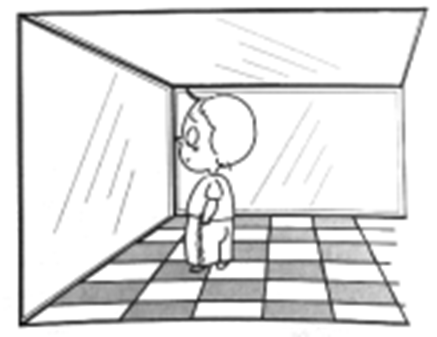
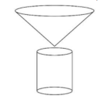
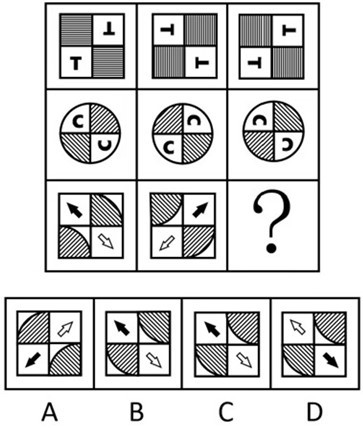
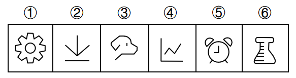
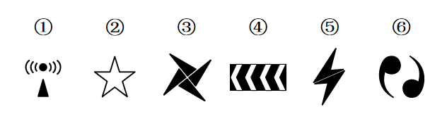
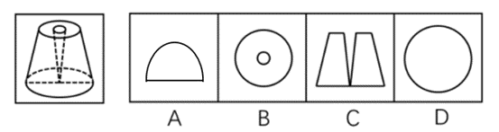

# 2020年云南公务员录用考试《行测》试题（网友回忆版）

> 候选采集稿。参考答案及解析来自粉笔页面，不代表官方答案或真实高分答卷；来源使用许可与原卷对应关系仍需人工核实。

## 题型与作答说明

常识判断

（20题）

根据题目要求，在四个选项中选出一个最恰当的答案。

言语理解与表达

（35题）

本部分包括表达与理解两方面的内容。请根据题目要求，在四个选项中选出一个最恰当的答案。

数量关系

（10题）

在这部分试题中，每道题呈现一段表述数字关系的文字，要求你迅速、准确地计算出答案。

判断推理

（40题）

本部分包括图形推理、定义判断、类比推理与逻辑判断四种类型的试题，在四个选项中选出一个最恰当的答案。

资料分析

（15题）

所给出的图、表、文字或综合性资料均有若干个问题要你回答。你应根据资料提供的信息进行分析、比较、计算和判断处理。

## 给定材料

### 材料 dom-material-cd4c567d1e3fb178

### 材料 dom-material-d40baf2e7945b387

2019年6月，全国发行地方政府债券8996亿元，同比增长68.37%，环比增长195.63%。其中，发行一般债券3178亿元，同比减少28.33%，环比增长117.08%，发行专项债券5818亿元，同比增长540.04%，环比增长268.46%；按用途划分，发行新增债券7170亿元，同比增长127.11%，环比增长332.71%，发行置换债券和再融资债券1826亿元，同比减少16.47%，环比增长31.75%。

2019年6月，地方政府债券平均发行期限11.1年，其中新增债券10.4年，置换债券和再融资债券13.4年；地方政府债券平均发行利率3.55%，其中新增债券3.52%，置换债券和再融资债券3.65%。

2019年1至6月，全国发行地方政府债券28372亿元，同比增长101.09%。其中，发行一般债券12858亿元，同比增长23.21%，发行专项债券15514亿元，同比增长322.38%；按用途划分，发行新增债券21765亿元，同比增长553.80%，发行置换债券和再融资债券6607亿元，同比减少38.71%。

2019年1至6月，地方政府债券平均发行期限9.3年，其中一般债券11.2年，专项债券7.8年；地方政府债券平均发行利率3.47%，其中一般债券3.53%，专项债券3.43%。

2019年全国地方政府债务限额为240774.3亿元。其中，一般债务限额133089.22亿元，专项债务限额107685.08亿元。截至2019年6月末，全国地方政府债务余额205477亿元，其中，一般债务118397亿元，专项债务87080亿元。

### 材料 dom-material-c03d9f67b5d0c0a9

截至2018年底，中国人工智能市场规模约为238.2亿元，同比增长率达到56.6%。从中国人工智能企业地域分布情况来看，北京企业数量最多，企业数量为368家；其次为广东，人工智能企业数量为185家；排名第三的是上海，数量为131家。

## 题目

### 第 1 题

手机电池的发展经历了镍镉电池、镍氢电池和锂离子电池3个阶段。锂离子电池相对于其他两种电池的优势在于：

①重量轻

②安全性高

③绿色环保

④高低温适应性强

A. ①②③

B. ①③④

C. ①②④

D. ②③④

### 第 2 题

下列诗词没有描述生物应激性反应的是：

A. 明月别枝惊鹊，清风半夜鸣蝉

B. 我有迷魂招不得，一唱雄鸡天下白

C. 人间四月芳菲尽，山寺桃花始盛开

D. 飞蛾性趋炎，见火不见我。愤然自投掷

### 第 3 题

为治疗由维生素缺乏导致的夜盲症、败血症、佝偻病和脚气病而需要补充相对应的食物依次是：

A. 谷类、深海鱼、胡萝卜、柑橘

B. 柑橘、深海鱼、谷类、胡萝卜

C. 深海鱼、胡萝卜、谷类、柑橘

D. 胡萝卜、柑橘、深海鱼、谷类

### 第 4 题

下列作家与其作品中所展现的地域对应错误的是：

A. 鲁迅—《阿Q正传》—绍兴

B. 沈从文—《边城》—湘西

C. 汪曾祺—《受戒》—高邮

D. 莫言—《红高粱》—东北

### 第 5 题

下列关于法律基础知识的表述正确的是：

A. 司法机关在适用法律审理案件时，优先适用法律原则，再适用法律规则

B. 法的渊源通常指法的形式意义上的渊源，即法律规范的创制方式和外部表现形式

C. 法的公布与法的实施是两个不同的概念，但实践中法的公布日期即法的实施日期

D. 当同一机关制定的法律出现效力冲突时，一般解决原则是新法优于旧法，一般法优于特别法

### 第 6 题

下列俗语与其蕴含的经济学道理对应错误的是：

A. 田忌赛马—成本与收益

B. 知人知面不知心—信息不对称

C. 十年栽树，百年树人—长期投资

D. 萝卜白菜，各有所爱—偏好理论

### 第 7 题

下列诗词所反映的历史时期按时间先后顺序排列正确的是：

①风云突变，军阀重开战。洒向人间都是怨，一枕黄粱再现

②外侮需人御，将军赋采薇。师称机械化，勇夺虎罴威

③宜将剩勇追穷寇，不可沽名学霸王。天若有情天亦老，人间正道是沧桑

④山高路远坑深，大军纵横驰奔。谁敢横刀立马？唯我彭大将军

A. ①②③④

B. ①②④③

C. ①④②③

D. ②③①④

### 第 8 题

下列关于我国科技自主可控的说法错误的是：

A. 基础性技术创新关乎科技自主可控的根本

B. 国产替代是我国近期和未来科技进步和工业发展的主要途径

C. 当前我国科技发展的主要问题表现为“缺芯少魂”“缺芯少屏”

D. 实现科技自主可控，要着力引进技术，引领关键核心领域科技崛起

### 第 9 题

为提升生态文明、建设美丽中国，党和政府做了一系列重要工作。下列有关生态文明建设的说法不正确的是：

A. 自2020年1月起，黄河流域的自然保护区将全面禁止生产性捕捞

B. 2019年8月，第一届国家公园论坛在青海省举行，与会代表形成了8条“西宁共识”

C. 2019年，第二轮中央生态环保督察启动，拟用三年时间完成例行督察，再用一年时间开展“回头看”

D. 2019年11月，住建部发布了新修订的《生活垃圾分类标志》标准，将生活垃圾类别调整为可回收物、有害垃圾、厨余垃圾和其他垃圾4个大类

### 第 10 题

下列有关公共卫生的说法正确的是：

A. 突发公共卫生事件应急响应分为Ⅰ级、Ⅱ级、Ⅲ级三个等级

B. 按照我国现行标准，甲类传染病有鼠疫、霍乱、传染性非典型肺炎三种

C. 省、自治区、直辖市人民政府卫生行政主管部门有权向社会发布本行政区域内突发事件的消息

D. 医疗卫生机构发现可能发生传染病暴发、流行的，应当在2小时内向所在地县级人民政府卫生行政主管部门报告

### 第 11 题

“一带一路”倡议自提出以来，已逐步成为当今世界广泛参与的重要国际合作平台。下列有关2019年“一带一路”发展成果的说法正确的是：

A. 中欧班列全年开列8200多列，“一带一路”在欧洲稳步前行

B. 2019年4月，第二届“一带一路”国际合作高峰论坛在杭州举行

C. 中国人民银行和联合国开发计划署共同撰写研究报告，提出了“一带一路”投融资规划框架

D. 第六届丝绸之路国际电影节于2019年10月在泉州举办，推动“一带一路”国家间的文化交流

### 第 12 题

为应对新冠肺炎疫情，我国出台了一系列政策举措，帮助企业和个体工商户减负纾困，促进复工复产。下列哪一选项不属于我国在支持复工复产方面的优惠政策：

A. 阶段性减免增值税小规模纳税人增值税

B. 阶段性减免企业和个体工商户物业租金

C. 阶段性减征职工基本医疗保险单位缴费

D. 阶段性减免企业养老、失业、工伤保险单位缴费

### 第 13 题

习近平总书记2020年3月6日在决战决胜脱贫攻坚座谈会上强调，这次会议的主要任务是，分析当前形势，克服新冠肺炎疫情影响，凝心聚力打赢脱贫攻坚战，做到“两个确保”。下列属于“两个确保”内容的是：

①如期完成脱贫攻坚目标任务 ②实现经济社会高质量发展

③打赢疫情防控阻击战 ④全面建成小康社会

A. ①②

B. ①③

C. ②④

D. ①④

### 第 14 题

2020年1月8日，习近平总书记在“不忘初心、牢记使命”主题教育总结大会上的讲话中引用了一句古语：“君子之过也，如日月之食焉：过也，人皆见之；更也，人皆仰之。”下列选项最能体现这一古语精髓的是：

A. 敢于自我革命，勇于开拓创新

B. 敢于坚持真理，勇于担当作为

C. 敢于直面问题，勇于修正错误

D. 敢于坚持原则，勇于承担责任

### 第 15 题

近年来，我国面临的农业安全复杂性不断增加。下列关于农业安全的说法不正确的是：

A. 为确保我国粮食安全，多部门制定了《沙漠蝗及国内蝗虫监测防控预案》，要求各地严防境外沙漠蝗入侵危害，继续做好国内蝗虫防治工作

B. 生物安全三级实验室需要从事某种高致病性动物病原微生物实验活动的，需要报省级以上畜牧兽医主管部门批准

C. 根据现行规定，举报为防控非洲猪瘟作出特别重大贡献的，可一次性给予举报人10万元奖励

D. 2020年是我国第三次全国农作物种质资源普查与收集行动的收官之年

### 第 16 题

囚徒困境是博弈论的非零和博弈的经典例子，表明个人的最佳选择并非团体的最佳选择。下列选项中不属于囚徒困境的是：

A. 广告战

B. 关税战

C. 军备竞赛

D. 股市中的散户跟庄

### 第 17 题

下列名言中出现最晚的一项是：

A. 笛卡尔：我思故我在

B. 亚里士多德：人是天生的政治动物

C. 亚当·斯密：人天生，并且永远，是自私的动物

D. 阿基米德：给我一个支点，我就能撬起整个地球

### 第 18 题

下列食物经过人体口腔能够初步消化的是：

A. 牛肉和鱼

B. 鸡蛋和牛奶

C. 青菜和螃蟹

D. 米饭和馒头

### 第 19 题

下列关于我国城市的表述错误的是：

A. 北京市、上海市、天津市和重庆市是直辖市

B. 昆山市、义乌市、江阴市、温岭市是县级市

C. 东莞市、三沙市、中山市和嘉峪关市是地级市

D. 成都市、西安市、杭州市和长沙市是副省级市

### 第 20 题

如下图所示，房间中互相垂直的墙和天花板都是由镜子构成，形成了3个两两互相垂直的平面镜。站在其中的小明会成多少个像？

A. 3个

B. 4个

C. 7个

D. 8个

### 第 21 题

曹雪芹通过贾府的衣食住行把            人家的富贵之相刻画得淋漓尽致。一屋一室，或雕梁画栋，或            ，或金碧辉煌，或简约古朴，相映成辉，相映成画；一餐一饮精烹细作，食不厌精；            ，雀衣彩绣，美轮美奂。但仍然没有宴席上的浅斟深酌更能体现出贾府“鲜花着锦、烈火烹油”之盛；没有比推杯换盏之时的琴歌酒赋更能体现出翰墨书香之族的风流雅致。

依次填入划横线部分最恰当的一项是：

A. 筚门圭窦 岸芷汀兰 一裙一裳

B. 兰艾同焚 粉墙黛瓦 一丝一缕

C. 钟鸣鼎食 曲径通幽 一衣一带

D. 桑枢瓮牖 小桥流水 一鞋一袜

### 第 22 题

近年来，人们的生活条件越来越好，对旅游        的要求也越来越高，从前到此一游、            的旅游方式已逐渐被深度体验、注重文化与互动的旅游方式所替代。正是在这种背景下，文化与旅游融合的发展方式            ，并成为热点。

依次填入划横线部分最恰当的一项是：

A. 质量 浮光掠影 脱颖而出

B. 环境 浅尝辄止 蔚然成风

C. 品质 走马观花 应运而生

D. 生态 蜻蜓点水 蔚为大观

### 第 23 题

随着学校消失，村庄的文化高地不在，村庄文化脉络的            受到了影响；青少年长期“不在场”，对村庄的            感逐渐增强。特别是在以传统农业文明为指征的村庄文化正在大面积            ，农村文化呈现虚化、空洞化，无疑更进一步加剧了村庄文化的衰亡，对村庄的可持续发展造成不利的影响。

依次填入下划线部分最恰当的一项是：

A. 纲维 疏远 消失

B. 维系 疏离 式微

C. 轴心 隔阂 衰亡

D. 衔接 陌生 凋零

### 第 24 题

改革开放以来，伴随着一系列体制障碍的清除，物质资本和人力资本得到巨大的             和有效的重新            。中国终于把自己在几个世纪“大分流”中的落后地位，            为向发达经济体的“大趋同”，开始了中华民族复兴的宏伟征程，并以成为世界第二位经济体为象征，取得了世人瞩目的发展成就。

依次填入下划线部分最恰当的一项是

A. 累积 组合 扭转

B. 积聚 分配 转化

C. 积累 配置 逆转

D. 积攒 组织 转化

### 第 25 题

目前，第五代移动通信（5G）已成为当前和未来全球业界的焦点，将        移动互联网进入新时代。美国高通公司指出，5G技术将成为同电力、互联网等发明一样的通用技术，        未来的转型变革，重新定义工作流程并        经济竞争优势规则。到2035年，5G将在全球创造12.3万亿美元的经济产出，同时创造2200万个工作岗位。

依次填入划横线部分最恰当的一项是：

A. 带领 催生 重造

B. 引领 催化 重塑

C. 引导 催发 制定

D. 带动 催促 制订

### 第 26 题

两相比较，白话文在通俗易懂的同时，往往在韵律上缺少节奏感，篇幅冗长，而文言文能用            传达出深层或多层意思，其凝练之美、韵律之美和意境之美是白话文            的。

依次填入划横线部分最恰当的一项是：

A. 一语双关 略逊一筹

B. 只言片语 无与伦比

C. 三言两语 相形见绌

D. 寥寥数语 无可比拟

### 第 27 题

饮食在中国文化传承中是较稳定的领域，国有盛衰，代有兴亡，用筷子吃饭数千年不变，与宴饮相关的某些礼仪程式也很少变化，盛行在西周的乡饮酒礼，上可溯至三代遗风，下传至清道光年间，其敬老、尊长、议政的古风            ，连酒会程序——谋宾、迎宾、旅酬和送宾等礼仪也            。

依次填入划横线部分最恰当的一项是：

A. 如出一辙 毫无二致

B. 一脉相承 大同小异

C. 一脉相通 相差无几

D. 衣钵相传 半斤八两

### 第 28 题

长期以来，人们对于“阳春白雪”的传统文化，都是一种仰望的姿态，认为            ，于是常常过而不入。从这个意义上说，搞好文创，需要首先激发起人们对文化的浓厚兴趣，然后同样重要的，是想方设法保留住它。如此，人们才会在文化探索的旅程中              ，走得更深、更远。

依次填入划横线部分最恰当的一项是：

A. 海水不可斗量 登堂入室

B. 百思不得其解 斗折蛇行

C. 夏虫不可语冰 登高履危

D. 可望而不可即 拾级而上

### 第 29 题

中国的格律诗，总体上在唐代            ，达到无法超越的地步。宋诗其实是唐诗的延续，宋代有一些优秀的诗人，他们的创作可与唐人媲美，譬如苏东坡、王安石、陆游等。宋诗中，写得情景交融、意境优美的作品，可以说             。

依次填入划横线部分最恰当的一项是：

A. 叹为观止 触目皆是

B. 登峰造极 俯拾皆是

C. 无出其右 汗牛充栋

D. 无与伦比 斗量车载

### 第 30 题

研究结果显示，只要手机在视线范围或            的范围之内，就会导致人们的注意力下降。这并不是手机的推送或通知分散了人的注意力，而是人们下意识地不去“        ”手机，但发布这个指令的过程本身就会耗费有限的认知资源，造成脑力流失。

依次填入划横线部分最恰当的一项是：

A. 近在咫尺 牵挂

B. 唾手可得 惦念

C. 触手可及 惦记

D. 一步之遥 想念

### 第 31 题

壁虎吸附墙壁是靠它们脚上细微毛发与墙壁        的分子间吸附力，仿壁虎材料运用了相同原理，核心在于有方向的吸附力，也就是说这种材料在平时不粘，而当有        的时候就会牢牢吸住物体表面，整个过程几乎不需要进行按压。

依次填入划横线部分最恰当的一项是：

A. 粘连 向心力

B. 附着 零重力

C. 贴合 离心力

D. 接触 切向力

### 第 32 题

在新型城镇化的过程中，凸显本地文化特色至关重要。文化是一座城市的灵魂，只有文化的 ，城市才能        其特色与气质。人是一种文化的存在，所以我们必须切实推进有文化记忆的城镇化。

依次填入划横线部分最恰当的一项是：

A. 传播 凸显

B. 继承 形成

C. 融入 定格

D. 浸润 彰显

### 第 33 题

文化是“人化”，同时又要“化人”。城市中的人一方面是文化形象的        和代言人，人们的精神面貌、道德修养、行为举止诸方面都反映出城市的文化形象；另一方面其行为方式又受到城市文化形象的影响，良好的文化形象会对人产生引导、规范和        作用。

依次填入划横线部分最恰当的一项是：

A. 载体 激励

B. 体现 训诫

C. 内涵 塑造

D. 象征 制约

### 第 34 题

向民众        科学知识，        科学精神，是科学家义不容辞的责任。但是科学家首先要致力于科研，他究竟能花多少时间来做科普，显然无法一概而论。通常，一线科学家很难花费太多的时间和精力直接参与一波又一波的科普活动。

依次填入划横线部分最恰当的一项是：

A. 传输 传递

B. 传递 传播

C. 传导 传扬

D. 传达 传承

### 第 35 题

苏区是一个坚实的实践样本，蕴含着整个中国近代历史的主题、主线，预示着中华民族的前途。苏区研究既属于历史主干研究，也属于历史支系研究。经过多年积累，目前的苏区研究，其广泛、细致的程度前所未有，堪称血肉丰满、            、支系发达。

填入划横线部分最恰当的一项是：

A. 枝繁叶茂

B. 繁花似锦

C. 春色满园

D. 生机盎然

### 第 36 题

从某种意义上来说，唐卡是藏文化中第一个走产业化的门类。文化产业化的指标之一是        ，早在数百年前，唐卡就已经有了《造像度量经》，而“度量”是决定一幅唐卡价值的基本条件，一幅上乘的手绘唐卡，应该是完全按照《造像度量经》之规定绘制的。

填入划横线部分最恰当的一项是：

A. 类型化

B. 标准化

C. 数据化

D. 规模化

### 第 37 题

业内专家建议建立国家营养日或营养周，开展“食育进农村”等活动，加大公益广告投入，发布适宜不同人群的膳食指南。针对农村留守儿童多的现状，在家庭监管        的情况下，政府可通过购买服务，让相关社会组织走进农村，帮助农村孩子健康成长。

填入划横线部分最恰当的一项是：

A. 缺失

B. 薄弱

C. 不力

D. 缺乏

### 第 38 题

上海合作组织成立十多年来，创造性提出并始终        “上海精神”，主张互信、互利、平等、协商、尊重多样文明、谋求共同发展，为世界各国共同繁荣、区域合作发展壮大提供了有益        ，为推动各国        建设人类命运共同体作出了重大贡献。

依次填入划横线部分最恰当的一项是：

A. 实践 启发 并肩

B. 推行 借镜 昂首

C. 践行 借鉴 携手

D. 履行 启示 挽手

### 第 39 题

不少街坊所熟知的“冬病夏治”，就是根据祖国医学“春夏养阳，秋冬养阴”的理论，        四时特性的养生疗法。“冬病”指某些好发于冬季，或在冬季加重的病变，如支气管炎、慢性阻塞性肺疾病、过敏性鼻炎、失眠、骨关节痛、体质虚寒症等疾病。“夏治”指夏季这些病情有所缓解，趁其发作缓解季节，补气扶阳、辨证施治，以        冬季旧病复发，或减轻其症状。

依次填入划横线部分最恰当的一项是：

A. 服从 防止

B. 适应 免予

C. 顺应 预防

D. 符合 避免

### 第 40 题

在未来30年里，“气候变化技术”既包括        防洪设施、使用转基因技术使庄稼抵御干旱气候等短期防御科技，也包括使用碳隔离方式将温室气体从大气层抽离并存入地下，将二氧化铝离子植入大气层以此来减少太阳辐射对地球温度影响等长期防御科技        。

依次填入划横线部分最恰当的一项是：

A. 修建 计划

B. 兴建 打算

C. 建设 设想

D. 建造 构想

### 第 41 题

随着智能科技和产业的发展，数据和计算正在成为            经济增长和发展的关键            。作为第四次工业革命的引擎，智能科技和经济在中国的发展            于经济转型升级中所创造的智能化需求。

依次填入划横线部分最恰当的一项是：

A. 推动 因素 产生

B. 驱使 要点 内化

C. 触动 质素 生长

D. 驱动 要素 内生

### 第 42 题

在移动阅读时代，自媒体的影响力不可小觑。由于拥有更广阔的传播途径和分发渠道，受公众关注度高，自媒体人掌握了一定话语权。有些自媒体人与传统媒体机构相比，确实不落下风，公信力给他们带来了收益。然而，公信力是把双刃剑，自媒体人既要看到流量背后的利益，也要认识到滥用自己的公信力会引发哪些负面效果。若以为可以仰仗传播力而“任性”，则实实在在打错了算盘。滥用话语权的后果，将直接影响自己辛苦树立起来的公信力，失去公众的支持与关注。

这段文字意在强调：

A. 自媒体具有强大的影响力

B. 自媒体人不应只关注收益

C. 自媒体人应争取公众支持

D. 自媒体的话语权不可滥用

### 第 43 题

非遗曲艺周、非遗公开课、非遗影像展等3700多项活动在全国同步展开，400多项体验传承活动在20多个省区市推出······刚刚过去的“文化和自然遗产日”，一系列精彩的活动让人们走进“养在深闺人未识”的文化遗产，感知岁月积淀的文化魅力，也让人们意识到，                    。

填入划横线部分最恰当的一项是：

A. 文化遗产保护为先，还需要社会公众的高度参与

B. 文化遗产可以摆脱高冷的标签，飞入寻常百姓家

C. 如何让文化遗产“活”起来也是值得思考的话题

D. 我国能有如此丰富的文化遗产，得益于保护管理

### 第 44 题

当传统媒体还在琢磨受众喜欢什么内容的时候，算法推荐已迅速赢得了大量用户，媒体技术的变革，重塑了新闻产品的生产与分发，也重构了新媒体的内容生态。面对全媒体时代，我们需要用主流价值纾解“算法焦虑”、用社会责任规范“内容生产”、用优质平台凝聚“众人之智”，以更多更好的正能量、主旋律内容供给，让舆论天空更清朗、舆论生态更健康。

最适合做这段文字标题的是：

A. 给以主流价值为底色的传统媒体内容产品插上算法分发的翅膀

B. 增强主流价值供给，纾解新媒体内容生产和传播中的技术问题

C. 面对算法焦虑和流量焦虑，主流媒体要保持主流价值内容定力

D. 用主流价值纾解“算法焦虑”：构建健康活跃的新媒体内容生态

### 第 45 题

①语言是符号体系，而每一种语言的符号体系都带着文化的烙印，都是这种语言的共同体集体认知的结果，都是文化的载体，这是语言的“体”

②语言和文化是一体两面的，没有谁能够把语言和文化彻底分开，这是由语言的属性决定的

③所以汉语国际教育不必把“文化传播”特意突出出来，因为学习一种语言不可能不涉及这种语言所负载的文化内容，这是不言而喻的

④语言中隐含着使用这种语言的人和社会群体的价值观念，而这种价值观念往往是习焉不察的

⑤语言也是思维工具和交际工具，我们在使用一种语言思维和交际的时候不可能不受这种语言的影响，这好似语言的“用”

将以上5个句子重新排列，语序正确的是：

A. ②①⑤④③

B. ④①⑤②③

C. ②⑤①③④

D. ④②①⑤③

### 第 46 题

近来，多家情商教育机构针对不同年龄段推出相应套餐，“情商班”火爆家长圈。情商是控制和驾驭情绪的能力，对人的生活和工作有重要的作用。可是，在很多人的心里，情商的内涵已经被异化，最早的情商概念和如今流行的情商观念大相径庭。许多人对情商的理解，是圆滑世故、阿谀奉承的另一种说法。实际上，情商的核心既是对自身情绪的认识和控制能力，也包括与人交往、融入集体的能力。这两种能力的培养，需要在日常生活中实践。孩子能否培养出良好的情绪控制能力和社交能力，很大程度上取决于家长，任何情商培训都无法取代日常生活中的情商培养。

接下来最可能讲述的是：

A. 情商补习应当引起家长高度关注

B. 家长在家庭教育中的身体力行

C. 家长要理性地看待情商培训班

D. 需要培养和提高家长的情商

### 第 47 题

生命存在的首要条件是液态水，一颗行星是否宜居取决于表面温度能否维持液态水的存在。冰行星或冰卫星地表原本被冰雪覆盖，此前研究认为，随着恒星辐射增强，其地表冰雪最终会融化形成液态水，从而适宜生命生存。不过，最新研究证明，随着恒星辐射增强，冰行星或冰卫星将直接进入极端炎热的温室逃逸状态，表面温度将升至100摄氏度以上，液态水无法存在。一旦冰雪融化，行星地表反射能力的突然降低使其吸收恒星辐射的能力大大增强。此外，冰雪融化后，大量水汽进入大气，强温室效应也使地表温度进一步升高。

下列说法与原文相符的是：

A. 宜居行星在事实上并不存在

B. 冰行星或冰卫星其实不宜居

C. 冰行星或冰卫星其实没有冰

D. 温室逃逸状态阻止了冰融化

### 第 48 题

有研究团队让22名17岁至42岁的志愿者在两周内每晚照常使用电子设备，但在睡前佩戴三小时防蓝光眼镜，发现其晚间褪黑激素水平整体上升了大约58%，上升幅度甚至超过服用褪黑激素补充剂带来的变化。志愿者感觉睡眠质量改善，入睡更快，整体睡眠时间延长。研究者说，最大的蓝光光源是日光，但大部分基于LED灯的设备也会发出蓝光，“人造蓝光”会激活对褪黑激素有抑制作用的内在光敏视网膜神经节细胞，从而干扰睡眠。该研究者建议睡前少用电子设备，或佩戴防蓝光眼镜。

从这段文字可以推出：

A. 电子设备的蓝光会减少褪黑激素的分泌而促进睡眠

B. 天然的日光并不会激活内在光敏视网膜神经节细胞

C. 睡前不佩戴防蓝光眼镜会使褪黑激素水平整体上升

D. 提升褪黑激素水平有助于入睡更快和睡眠质量改善

### 第 49 题

我国研究机构日前宣布，世界上第一个全超导托卡马克“东方超环”（EAST）实现了稳定的101.2秒稳态长脉冲高约束等离子体运行，创造了新的世界纪录。这标志着EAST成为世界上第一个实现稳态高约束模式运行持续时间达到百秒量级的托卡马克核聚变实验装置。EAST高11米、直径8米、重达400吨，是我国第四代核聚变实验装置，其科学目标是让海水中大量存在的氘和氚在高温条件下，像太阳一样发生核聚变，为人类提供源源不断的清洁能源，所以也被称为“人造太阳”。

这段文字主要说明了：

A. 大力发展清洁能源势在必行

B. 核聚变技术可创造清洁能源

C. 短期内难建成真正的“人造太阳”

D. “人造太阳”装置取得革命性突破

### 第 50 题

压缩空气储能属于一种物理方式的储能，即空气在整个过程中只存在温度、压强等状态的变化，而不会发生化学方面的变化。储存了众多电力的压缩空气需要放在一间封闭性极好的“屋子”里，而这间“屋子”的“主人”就是盐。食盐开采后会自然留下一个场所，学名叫做“盐穴”。“盐穴”是一种极其宝贵的不可再生资源，并且密封性能良好。然而，长期以来这种资源的利用系数很低。由于盐岩具有良好的蠕变特性、自愈合特性，渗透率极低，并且不会与空气中的氧气发生反应。因此，                    。

填入划横线部分最恰当的一项是：

A. 要依托盐穴资源的优势发展储能产业

B. “盐穴”是储存高压空气的理想场所

C. 应当利用盐穴储能改善发电与用电

D. 要大力开发盐岩提高能源利用效率

### 第 51 题

一次，苏格拉底与三个学生走过一块麦田，他要学生从这边走过，去摘一穗最大的麦穗。结果有一个学生空手而归，他总想最大的麦穗一定还在后面，不觉到了尽头，两手仍然空空；另一个则摘了一穗很小的麦穗，他一走进麦田便急忙摘了一穗，殊不知前面还有更大的；只有最后的学生摘了一穗很大的麦穗，虽然不一定是最大的，但他的结果是令人满意的。

这段文字意在说明：

A. 生活即思想，思想源于生活实际

B. 把握时机是人生快乐的最大诀窍

C. 优秀哲学家都以其毕生精力在孕育智慧的田地里耕耘

D. 苏格拉底一生注重实践，把哲学的注意力放在生活上

### 第 52 题

正因为中国法律史学除了单纯的理论研究，还要探究解决当代中国的法律问题，所以有必要坚持独立的中国立场。不论是单纯的理论研究，还是切近实际的应用研究，都需坚持独立思想立场，才能做出有价值的研究成果。这里的独立立场，其实就是中国自身的立场，而不是站在别国的立场之上。近代以来，西方国家一些学者对于中国法律不客观的负面评价，曾经影响到中国学者对待本国法律历史的态度。直到今天，这种影响仍没有完全消除，需要加以矫正。

这段文字旨在强调：

A. 中国法律史学研究需探究解决当代中国的法律问题

B. 中国法律史学研究受到西方学者不客观的负面评价

C. 中国法律史学研究必须坚持中国自身独立的立场

D. 中国法律史学研究曾受西方学者影响至今未消除

### 第 53 题

研究人员发现在大脑中存在着不同种类和巨大数量的高维几何结构，由紧密连接的神经元团块和它们之间的空白区域（空洞）组成。这些团块或空洞似乎对大脑功能至关重要，当研究人员给虚拟大脑组织施加刺激时，他们发现神经元以一种高度有组织性的方式对刺激做出了反应。这意味着我们思考问题的时候，神经元的团块会逐渐组合成更高维的结构，形成高维的孔隙或空洞，团块中的神经元越多，空洞的维度就越高，最高的时候可以达到11个维度。

根据上述文字，下列说法正确的是：

A. 团块中的神经元越多，空洞的维度就越高，意识越复杂

B. 神经元团块或空洞互相联系，以施压方式促进人的思考

C. 神经元能以高度有组织性的方式反应，取决于大脑功能

D. 人脑充满多维几何结构，最高时可在11个维度上运行

### 第 54 题

①用小小的木制手织机，固定在房角一柱上，一面伸出憔悴的手来

②做母亲的全按照一个地方的风气，当街坐下，织男子们束腰用的板带过日子

③当白日照到这长街时，这一条街静静的像在午睡

④敏捷地把手中犬骨线板压着手织机的一端，退着粗粗的棉线，一面用一个棕叶刷子为孩子们拂着蚊蚋

⑤许多小小的屋里，湿而发霉的土地上，头发干枯脸儿瘦弱的孩子们，皆蹲在土地上或伏在母亲身边睡着了

⑥什么地方柳树桐树上有新蝉单纯而又倦人的声音

将以上6个句子重新排列，语序正确的是：

A. ③⑥⑤②①④

B. ⑤①②④③⑥

C. ⑥⑤①②④③

D. ⑤①⑥②④③

### 第 55 题

生长在非洲大草原上的灰犀牛，身躯庞大，给人一种行动迟缓、安全无害的错觉，从而时常忽略了危险的存在——当灰犀牛被触怒发起攻击时，却会体现出惊人的爆发力，阻止它的概率接近于零，最终引发破坏性极强的灾难。概率大、破坏力强是“灰犀牛”事件最重要的特征。很多危机事件，与其说是“黑天鹅”，不如说更像是“灰犀牛”。它们并非发端于不可预测的小概率事件（“黑天鹅”），而是大概率、高风险事件（“灰犀牛”）不断演化的结果，这些风险的存在早就广为人知，却由于体制或认识的局限，没有得到积极防范和应对，最终升级为全面的系统性危机。

根据上述文字，下列说法正确的是：

A. “黑天鹅”和“灰犀牛”事件都是严重的无法防范的危机事件

B. 与“灰犀牛”相对，“黑天鹅”是指破坏性不强的小概率事件

C. 许多“黑天鹅”事件背后都隐藏着“灰犀牛”危机

D. “灰犀牛”和“黑天鹅”事件没有明显区别，一定条件下可以互相转化

### 第 56 题

小明每天从家中出发骑自行车经过一段平路，再经过一道斜坡后到达学校上课。某天早上，小明从家中骑车出发，一到校门口就发现忘带课本，马上返回，从离家到赶回家中共用了1个小时，假设小明当天平路骑行速度为9千米/小时，上坡速度为6千米/小时，下坡速度为18千米/小时，那么小明的家距离学校多远？

A. 3.5千米

B. 4.5千米

C. 5.5千米

D. 6.5千米

### 第 57 题

某企业员工组织周末自驾游。集合后发现，如果每辆小车坐5人，则空出4个座位；如果每辆小车少坐1人，则有8人没坐上车。那么，参加自驾游的小车有：

A. 9辆

B. 10辆

C. 11辆

D. 12辆

### 第 58 题

某篮球队共有九人，分三组举行三人制篮球赛，他们的球衣号码分别是从1号到9号，分组后发现三组的球衣号码之和不同，且最大和是最小和的两倍。则各组号码之和不可能是下列哪个数？

A. 10

B. 11

C. 12

D. 13

### 第 59 题

某社区拟对一块梯形活动场地进行扩建，经测算，如果将梯形的上底边增加1米，下底边增加1米，则面积将扩大10平方米；如果将梯形的上底边增加1倍，下底边增加1米，则面积将扩大55平方米；如果将上底边增加1米，下底边增加1倍，则面积将扩大105平方米。现拟将梯形的上底边增加1倍还多2米，下底边增加3倍还多4米，则面积将扩大多少？

A. 280平方米

B. 380平方米

C. 420平方米

D. 480平方米

### 第 60 题

某城市一条道路上有4个十字路口，每个十字路口至少有1名交通协管员，现将8个协管员名额分配到这4个路口，则每个路口协管员名额的分配方案有：

A. 35种

B. 70种

C. 96种

D. 114种

### 第 61 题

某工厂先从边长为1米的正方形铁皮切割掉一个半径1米、圆心角为直角的扇形，再用剩余材料切割正方形。为充分利用原材料，希望所得正方形越大越好。若不考虑切割损耗，问所切最大的正方形边长约为多少厘米？

A. 22.6

B. 25.6

C. 27.6

D. 31.6

### 第 62 题

某公司职员预约某快递员上午9点30分到10点在公司大楼前取件，假设两人均在这段时间内到达，且在这段时间到达的概率相等。约定先到者等后到者10分钟，过时交易取消。快递员取件成功的概率为：

A. 

B. 

C. 

D. 

### 第 63 题

某会展中心布置会场，从花卉市场购买郁金香、月季花、牡丹花三种花卉各20盆，每盆均用纸箱打包好装车运送至会展中心，再由工人搬运至布展区。问至少要搬出多少盆花卉才能保证搬出的鲜花中一定有郁金香？

A. 20盆

B. 21盆

C. 40盆

D. 41盆

### 第 64 题

村民陶某承包一块长方形种植地，他将地分割成如图所示的4个小长方形，在A、B、C、D四块长方形土地上分别种植西瓜、花生、地瓜、水稻。其中长方形A、B、C的周长分别是20米、24米、28米，那么长方形D的最大面积是：

A. 42平方米

B. 49平方米

C. 64平方米

D. 81平方米

### 第 65 题

野外生存需要用一个简易的圆锥型过滤器（如下图所示）装满溪水进行过滤。过滤器的底面直径为20cm，高为6cm。问全部过滤完毕后，在不考虑损耗的情况下，可使底面半径为5cm，高为15cm的圆柱型容器的水面高度达到：

A. 4cm

B. 6cm

C. 8cm

D. 12cm

### 第 66 题

如下图所示，左侧为大立方体，右侧为其部分立体截面，问哪个选项能够与其拼成完整的大立方体：  

A. A

B. B

C. C

D. D

### 第 67 题

从所给的四个选项中，选择最合适的一个填入问号处，使之呈现一定的规律性：

A. A

B. B

C. C

D. D

### 第 68 题

从所给的四个选项中，选择最适合的一个填入问号处，使之呈现一定的规律性：

A. A

B. B

C. C

D. D

### 第 69 题

把下面六个图形分为两类，使每一类图形都有各自的共同特征或规律，分类正确的一项是：

A. ①⑤⑥，②③④

B. ①②⑤，③④⑥

C. ①②④，③⑤⑥

D. ①③⑤，②④⑥

### 第 70 题

把下面六个图形分为两类，使每一类图形都有各自的共同特征或规律，分类正确的一项是：

A. ①②④，③⑤⑥

B. ①③④，②⑤⑥

C. ①③⑥，②④⑤

D. ①④⑤，②③⑥

### 第 71 题

从所给的四个选项中，选择最合适的一个填入问号处，使之呈现一定的规律性：

A. A

B. B

C. C

D. D

### 第 72 题

把下面的六个图形分为两类，使每一类图形都有各自的共同特征或规律，分类正确的一项是：

A. ①④⑥，②③⑤

B. ①③⑥，②④⑤

C. ①②⑥，③④⑤

D. ①②④，③⑤⑥

### 第 73 题

一圆锥台如下图所示，从正中心挖掉一个小圆锥体，然后从任意面剖开，下面哪一项不可能是该圆锥台的截面？

A. A

B. B

C. C

D. D

### 第 74 题

从所给的四个选项中，选择最合适的一个填入问号处，使之呈现一定的规律性：

A. A

B. B

C. C

D. D

### 第 75 题

亲环境行为是指个体通过减少或消除自身活动对环境的负面影响以达到改善生态系统结构的行为。它的本质是通过有效减轻环境问题实现环境改善，核心任务是构造环境稳态友好型的社会。

根据上述定义，下列选项属于亲环境行为的是：

A. 植树造林

B. 低碳出行

C. 细水长流

D. 围海造田

### 第 76 题

错觉是完全不符合刺激本身特征的失真的或扭曲事实的知觉经验，生活中，凭知觉经验所作的解释显然是失真的，甚至是错误的。幻觉是在没有相应的外界客观事物直接作用下发生的不真实感知。幻觉具有与真实知觉类似的特点，但它是虚幻的。正常人在某些特殊的状态下，如强烈的情绪体验并伴有生动的想象、回忆，或期待的心情、紧张的情绪，或处于催眠状态，都可能会出现幻觉。在入眠或醒觉状态的过程中，也会发生幻觉。

根据上述定义，下列属于幻觉的是：

A. 杯弓有蛇影，草木疑皆兵

B. 相看两不厌，唯有敬亭山

C. 寝兴目存形，遗音犹在耳

D. 蝉噪林逾静，鸟鸣山更幽

### 第 77 题

外部性是指经济当事人的生产和消费行为对其他经济当事人的生产和消费行为施加的有益或者有害影响的效应。正外部性是指某个经济行为个体的活动使他人或社会受益，而受益者无需花费代价。负外部性是指某个经济行为个体的活动使他人或社会受损，而造成负外部性的人却没有为此承担成本。

根据上述定义，下列选项属于正外部性的是：

A. 经过农田的蒸汽机车，喷出火花飞到农民种植的麦穗上

B. 飞速行驶的火车尖锐的汽笛声吓跑在农田吃稻谷的小鸟

C. 某工厂在村庄建起了扶贫车间，为村民就近就业提供便利

D. 某工厂排出了大量废水和有害气体，给周围居民带来健康危害

### 第 78 题

社会计算的内涵包括两个层面：一是社会的计算化，二是计算的社会化。社会的计算化是指通过人们在互联网上留下的海量而且相互关联的数据足迹，对人们的社会活动进行追踪、检索、汇编、计量和运算。计算的社会化则是指互联网创造了一种环境、一个平台，使人们能够广泛地参与计算过程，从而在数据的挖掘、分析和应用等方面获得更高效率。

根据上述定义，下列现象符合计算的社会化的是（ ）。

A. 某购物平台根据用户购物经历，定期向用户推荐商品

B. 某手机导航软件能为用户自动生成一个月来的行踪图

C. 全班同学在暑假田野调查结束后合作制成精美的相册

D. 小陈在众筹平台匿名捐款后，受助者上门送来感谢信

### 第 79 题

积极强化是指用某种有吸引力的结果对某一行为进行奖励和肯定，以期在类似条件下重复这一行为。消极强化是指在行为出现时把不愉快的刺激撤销或减少，这样也可以增加行为频率。

根据上述定义，下列选项属于积极强化的是（ ）。

A. 君子一日三省其身

B. 杀鸡骇猴以儆效尤

C. 重赏之下必有勇夫

D. 从轻发落戴罪立功

### 第 80 题

社会收缩是指人类聚落中人口持续流失，由此引发相应地区经济社会环境和文化在空间上的衰退过程。根据收缩行为是否是聚落行为主体主动采取的规划策略或管理措施，可以分为主动社会收缩和被动社会收缩。

根据上述定义，下列选项属于主动社会收缩的是（ ）。

A. 某市因疏解核心区功能导致城区人口下降

B. 2019年我国春运人口迁移规模近30亿人次

C. 某产煤大县因资源枯竭导致就业吸纳能力下降

D. 某制造业基地因产业升级导致房屋空置率居高不下

### 第 81 题

侵蚀作用指风力、流水、冰川、波浪等外力在运动状态下改变地面岩石及其风化物的过程。侵蚀作用可分为机械剥蚀作用和化学剥蚀作用。

根据上述定义，下列选项属于侵蚀作用的是：

A. 裸露的人造雕像在长期的风吹日晒雨淋下，会出现机械剥蚀，甚至会出现崩塌碎裂

B. 植物根部在岩缝中向岩石施加物理压力，并提供一个水及化学物的渗透渠道，造成岩石分解开裂

C. 可溶性石灰岩在流水中部分溶解形成天然溶液而随水流失，造成岩体缩小甚至消失，形成岩溶地貌

D. 在气温变化突出的地区，岩石中的水分冻融交替，冰冻时体积膨胀，像楔子插入岩体内，导致岩石崩碎

### 第 82 题

热传导是介质内无宏观运动时的传热现象，其在固体、液体和气体中均可发生。但严格而言，只有在固体中才是纯粹的热传导，在流体（泛指液体和气体）中又是另外一种情况，流体即使处于静止状态，也会由于温度梯度所造成的密度差而产生自然对流，因此在流体中热对流与热传导可能会同时发生。

根据上述定义，下列选项不存在热传导现象的是：

A. 海洋上层高温水体和下层低温水体因温度差而交换

B. 铁棒的一端放入热水中，另一端温度升高

C. 太阳照射，导致地球表面温度升高

D. 在热水中加入冷水，热水变成温水

### 第 83 题

印象管理是指人试图控制他人对自己形成的印象的过程。一个人留给他人的印象表明了他人对其的知觉、评价，甚至会使他人形成对其的特定应对方式。因而，为了给他人留下好的印象，得到他人好的评价与对待，人会用一种给他人造成特定印象的方式来自我表现。印象管理的运用，尤其要避免某些表演崩溃，包括无意动作、不合时宜的闯入、闹剧等。

根据上述定义，下列选项最能体现印象管理运用的是：

A. 沙子龙在夜静人稀时，关好门，舞出一套断魂枪，微微一笑说：“不传不传”

B. 许衡看到人们摘食路边的梨解渴，不为所动，说：“梨虽无主，而吾心有主”

C. 一向沉静温柔的小美在毕业之际，承受不住与同学离别的感伤，突然嚎啕大哭

D. 岳飞的母亲为了激励岳飞奋勇抗金，用针在其背上刺了四个字：“精忠报国”

### 第 84 题

疼痛共情的偏好性，是指个体对他人疼痛的感知、判断和情绪反应，总是由于个体与他人之间的亲疏远近关系或情感认同程度不同而不同。

根据上述定义，下列没有体现疼痛共情的偏好性的是（ ）。

A. 小明看到《西游记》里的白骨精被孙悟空打死，高兴得跳了起来

B. 小张看到外来游客不幸溺水而亡，从此再也不敢去那条河里游泳

C. 小李在看歌剧《白毛女》时跳上戏台拉住喜儿，不让黄世仁抢走

D. 小红听奶奶回忆自己在旧社会的苦日子时，禁不住潸然泪下

### 第 85 题

联觉是一种感觉器官受到刺激时引起性质完全不同的其他感觉的现象。它是不同感觉间相互作用的结果，也是一种条件反射现象。联觉现象在所有感觉中都存在，表现有个别差异。在现实生活中，由于某一种事物属性的出现经常伴随着另一种事物属性的出现，这两种事物属性所引起的感觉之间就形成了固定的条件联系。

根据上述定义，下列选项不属于联觉的是：

A. 小徐看到涂成蓝色的墙壁，浑身充满凉意

B. 各种菜肴香味飘来，小刘听到了旋律变化

C. 小李对人十分热情，人们都说他好像一团火

D. 看到写在纸上的手机号，小冯感到阵阵发麻

### 第 86 题

算法歧视是以算法为手段实施的歧视，主要指在大数据背景下，依靠机器计算的自动决策系统在对数据主体做出决策分析时，由于数据和算法本身不具有中立性或者隐含错误、被人为操控等原因，对数据主体进行差别对待，造成歧视性后果。

根据上述定义，下列属于算法歧视的是：

A. 某新生班主任根据学生的入学成绩高低来安排他们的学号

B. 某水果商家总是对长期参与团购的客户给予更低价格折扣

C. 某信用评估平台通过用户的网络使用行为来判定其信用值

D. 某招聘网站给男性推送高薪职位的广告次数是女性的6倍

### 第 87 题

了如指掌 对于（ ）相当于（ ）对于 坚固

A. 知道；铁板一块

B. 明白；坚不可摧

C. 理解；铜墙铁壁

D. 了解；固若金汤

### 第 88 题

（ ）对于 裁判 相当于 案件 对于（ ）

A. 球员；法庭

B. 黑哨；上诉

C. 比赛；法官

D. 比分；律师

### 第 89 题

花：牡丹：玫瑰

A. 茶：红茶：绿茶

B. 草：艾草：蓼草

C. 球：足球：绒球

D. 车：轿车：客车

### 第 90 题

羊：羊奶：腥膻

A. 蚕：蚕丝：雪白

B. 蜘蛛：蛛丝：粘缚

C. 蜂：蜂蜜：甘甜

D. 雨燕：燕窝：营养

### 第 91 题

初伏：中伏：末伏

A. 火星：木星：土星

B. 大雨：小雨：谷雨

C. 上旬：中旬：下旬

D. 大暑：小暑：处暑

### 第 92 题

空运：海运：运输

A. 平装：精装：装帧

B. 货轮：客轮：邮轮

C. 晚会：聚会：集会

D. 试飞：试航：航天

### 第 93 题

牵牛花：喇叭花

A. 乞巧节：七夕节

B. 七巧板：橡皮泥

C. 人行道：车行道

D. 防腐剂：添加剂

### 第 94 题

售后：品控

A. 数据：科学

B. 融资：风投

C. 龙骨：地板

D. 听证：监管

### 第 95 题

鸳：鸯

A. 蚱蜢：蝗虫

B. 白猫：黑猫

C. 雄鸡：雌鸡

D. 红男：绿女

### 第 96 题

十年寒窗：悬梁刺股：囊萤映雪

A. 七月流火：以荻画地：临池学书

B. 三月肉味：蓝田种玉：程门立雪

C. 一寸光阴：凿壁偷光：闻鸡起舞

D. 一日三秋：卧薪尝胆：铁杆磨针

### 第 97 题

肌萎缩侧索硬化症（ALS），俗称“渐冻症”。某科研团队研究发现，ALS的疾病发展与肠道微生物AM菌的数量密切相关。研究人员观察和比较了37名ALS患者及29名健康亲属的肠道菌群和血液、脑脊液样本。他们发现肠道细菌菌株有差异，其中有一种菌株与烟酰胺的产生有关。此外，在这些ALS患者的血液和脑脊液中，烟酰胺水平有所下降。

若要上述研究发现成立，需要补充的前提是：

A. 人类肠道中的微生物非常复杂

B. 烟酰胺是肠道微生物AM菌的代谢物

C. 小鼠补充烟酰胺后，ALS症状得到了减轻

D. 人体肠道细菌的变化与ALS的疾病发展速度有关

### 第 98 题

地球距离火星最近约为5500万公里，最远则超过4亿公里，只有地球与火星夹角为70°时发射探测器才能如期抵达火星。2020年，我国发射了火星探测器，预计2021年登陆火星。一位航天专家对此评论道：“如果没抓住2020年这个机会，那么，下一次合适的发射时间至少要推迟到2022年之后。”

上述专家的评论若要成立，需要补充的前提是：

A. 火星探测器发射后，需要经过不少于7个月的飞行，才能抵达火星轨道

B. 我国于2020年发射了火星探测器，缩小了与西方航天大国的差距

C. 地球与火星的相对近点约每15年出现一次，二者距离近的年份是登陆火星的最佳时机

D. 发射火星探测器须等到地球和火星形成一定夹角，而这个机会每隔26个月才出现一次

### 第 99 题

二氧化碳的排放量剧增导致全球气候变暖，使珠穆朗玛峰所在的喜马拉雅地区冰川面临急剧缩小的危险。研究显示，珠峰海拔在5000米到6000米的冰川集中区域出现快速融化的现象，这些地方将只在冬季而不是在温暖的季节时看到结冰。专家推论说，根据未来的气候变化趋势，喜马拉雅地区的冰川减少的速度还有可能加快，如果本世纪内气温如预计的一样继续升高，该地区的冰川最终将消失殆尽。

如果以下各项为真，最能削弱上述论证的是：

A. 喜马拉雅冰川每年缩小约0.1%到0.6%

B. 喜马拉雅其他地区冰川对温度不敏感

C. 过去50年珠峰周边冰川覆盖面积减少了33.3%

D. 珠穆朗玛峰7000米以上区域未出现冰川快速融化现象

### 第 100 题

学界一直认为第一个到达澳大利亚的是欧洲人。但有研究指出，来自今天的坦桑尼亚的东非人率先到达了澳大利亚，考古学家在澳大利亚的埃尔科岛上发现了一枚来自非洲中部的贸易城市基卢瓦（今属坦桑尼亚）的硬币。因此，有人提出，东非人到达澳大利亚的时间可能要比第一批欧洲探险者早数百年。

以下各项如果为真，最能支持上述观点的是：

A. 该硬币的重量尺寸与常见的基卢瓦硬币存在差异

B. 基卢瓦岛从13世纪开始与印度一直存在贸易联系

C. 东非与大洋洲在11世纪到16世纪间商贸往来十分频繁

D. 葡萄牙人于1505年先后袭击了基卢瓦和埃尔科岛并留下了这枚硬币

### 第 101 题

地球表面的大部分都被海洋覆盖，生命也诞生于海洋之中。然而，据估计，地球有80%的物种生活在陆地上，而海洋中仅为15%，剩下的5%生活在淡水中。研究者认为，陆地栖息地的物理布局相对海洋可能更加支离破碎，是导致陆地物种更加多样化的主要原因之一。

以下哪项如果为真，最能加强上述研究者的观点？

A. 地球表面可分成热带、南温带、北温带、南寒带、北寒带五个温度带，各温度带物种差异性大，种类丰富

B. 深海相对于有阳光照射的浅海岸地区而言，基本上像个冰箱，而且门已经关上很久，物种远不如浅海丰富

C. 根据某群岛记录显示，随着时间推移，自然选择甚至可以把两个岛屿上相同物种的不同族群变成截然不同的物种

D. 森林覆盖许多陆地，而树叶和枝干形成新的生态环境，海洋中的珊瑚也起同样作用，但覆盖海底的面积没那么大

### 第 102 题

食品添加剂是现代食品工业的重要组成部分，按规定使用食品添加剂既对人体无害，而且能够改善食品品质，起到防腐、保鲜的作用。正是因为有了食品添加剂的发展，才有了大量的方便食品，给人们的生活带来极大的便利。如果不加入食品添加剂，大部分食品要么难看、难吃或者难以保鲜，要么就是价格昂贵。

下列说法能够支持上面论点的是（ ）。

A. 食品添加剂和人类文明史一样悠久，例如点豆腐用的卤水

B. 如果不使用添加剂，食品会因微生物作用而引起食物中毒

C. 宣称无食品添加剂往往是商家迎合消费者心理造成的噱头

D. 三聚氰胺也是一种添加剂，在水泥里能够作为高效减水剂

### 第 103 题

在市场竞争十分激烈的时候，一个企业要是不激流勇进，创造出富有竞争力的产品，也不适时撤退、主动割爱，放弃没有前景的市场，那么这个企业最后一定会陷入危机之中。

如果以上论断为真，下列说法正确的是（ ）。

A. 某企业未能创造出富有竞争力的产品，最后一定会惨遭淘汰

B. 某企业紧要关头急流勇退，转向其它市场，就可以避免危机

C. 某企业放弃已显颓势的产业，转向新产品的开发，它可能不会被淘汰

D. 某企业研发出了富有竞争力的产品，它最后一定不会陷入危机之中

### 第 104 题

师范类院校学生来自全国各地，甲大学是师范类院校，所以甲大学的学生来自全国各地。

下列选项所犯逻辑错误与上述推理最相似的是：

A. 牛不是食肉动物，而狮子不是牛，所以狮子不是食肉动物

B. 父母爱读书的孩子爱运动，小黄爱运动，所以小黄的父母爱读书

C. 私人捐赠的教学楼遍布全国各高校，何况是邵逸夫先生捐赠的逸夫楼

D. 文明司机都是礼让行人的，有些公务司机礼让行人，所以有些公务司机是文明司机

### 第 105 题

一项最新研究发现，世界上的绿海龟越来越“雌性化”。专家估计，到2100年，约有93%的新生绿海龟为雌性。研究表明，决定绿海龟性别的主要因素是绿海龟孵化时周围沙子的温度。如果沙子的温度在28到30度之间，孵化出来的绿海龟雌雄比例差不多；如果温度高出这个范围，那孵化出来的绿海龟大多数是雌性，相反，则大多数为雄性。

以下哪项如果为真，最能支持上述论断？

A. 绿海龟终将无法正常繁殖最后在地球上灭绝

B. 绿海龟是一种由孵化时温度决定性别的动物

C. 温室效应将导致全球气候变暖问题日趋严重

D. 温度的持续升高使绿海龟孵化的死亡率增加

### 第 106 题

能够从上述资料中推出的是：

关联材料：dom-material-cd4c567d1e3fb178

A. 2016年A市气候调节价值年值超过700亿元

B. 2017年A市现代农业生态服务价值年值增长率、贴现值增长率最低的是同一个指标

C. 2017年A市生态与环境价值贴现值超过直接经济价值贴现值、间接经济价值贴现值之和的5倍

D. 2017年A市气候调节价值与水源涵养价值的年值之和超过生态与环境价值中其余指标的年值之和

### 第 107 题

2017年A市生态与环境价值中，年值、贴现值较上年均有所上升的指标有：

关联材料：dom-material-cd4c567d1e3fb178

A. 6个

B. 5个

C. 4个

D. 3个

### 第 108 题

2016年，A市旅游服务价值年值比农林牧渔业总产值年值多：

关联材料：dom-material-cd4c567d1e3fb178

A. 494.46亿元

B. 462.79亿元

C. 441.85亿元

D. 404.35亿元

### 第 109 题

2016年，A市直接经济价值年值占现代农业生态服务价值年值的比重为：

关联材料：dom-material-cd4c567d1e3fb178

A. 8.24%

B. 11.23%

C. 13.59%

D. 15.46%

### 第 110 题

能够正确描述2017年A市间接经济价值年值中三个指标占比的统计图是：

关联材料：dom-material-cd4c567d1e3fb178

A. A

B. B

C. C

D. D

### 第 111 题

2018年6月，发行置换债券和再融资债券约为：

关联材料：dom-material-d40baf2e7945b387

A. 3157亿元

B. 2186亿元

C. 1657亿元

D. 1386亿元

### 第 112 题

2018年1至6月，发行一般债券的占比较发行专项债券的占比约：

关联材料：dom-material-d40baf2e7945b387

A. 低9.36%

B. 低52.81%

C. 高47.93%

D. 高53.43%

### 第 113 题

2018年1至5月，全国发行地方政府债券约：

关联材料：dom-material-d40baf2e7945b387

A. 23029亿元

B. 19376亿元

C. 14109亿元

D. 8766亿元

### 第 114 题

2019年6月，全国发行的地方政府债券比2018年6月多约：

关联材料：dom-material-d40baf2e7945b387

A. 6151亿元

B. 5953亿元

C. 3653亿元

D. 3043亿元

### 第 115 题

2019年1至6月，全国发行地方政府债券同比增量绝对值排序正确的是：

关联材料：dom-material-d40baf2e7945b387

A. 新增债券>专项债券>置换债券和再融资债券>一般债券

B. 新增债券>置换债券和再融资债券>一般债券>专项债券

C. 专项债券>新增债券>置换债券和再融资债券>一般债券

D. 置换债券和再融资债券>专项债券>一般债券>新增债券

### 第 116 题

截至2017年底，中国人工智能市场规模约为：

关联材料：dom-material-c03d9f67b5d0c0a9

A. 141.1亿元

B. 152.1亿元

C. 156.1亿元

D. 164.1亿元

### 第 117 题

2015至2018年，中国人工智能市场规模同比增长率最高的年份是：

关联材料：dom-material-c03d9f67b5d0c0a9

A. 2015年

B. 2016年

C. 2017年

D. 2018年

### 第 118 题

若按照2018年同比增长率，到2019年底中国人工智能市场规模约为：

关联材料：dom-material-c03d9f67b5d0c0a9

A. 363亿元

B. 371亿元

C. 373亿元

D. 383亿元

### 第 119 题

图2中排名第二的省（市），其人工智能企业数量的个数约是排名后四位的数量之和的多少倍？

关联材料：dom-material-c03d9f67b5d0c0a9

A. 11.3

B. 12.3

C. 12.8

D. 13.3

### 第 120 题

下列说法正确的是：

关联材料：dom-material-c03d9f67b5d0c0a9

A. 截至2018年底，中国人工智能市场规模每年同比增长率都超过50%

B. 截至2018年底，中国人工智能企业地域分布情况中，广东企业数量最多

C. 截至2018年底，中国人工智能企业北京企业数量不超过上海企业数量的50%

D. 截至2018年底，福建人工智能企业的数量等于河南、天津、广西三省企业数量之和

## 答案与解析

第 1 题

**答案状态：unknown（来源未提供）**

**解析状态：unknown（来源未提供）**

第 2 题

**答案状态：unknown（来源未提供）**

**解析状态：unknown（来源未提供）**

第 3 题

**答案状态：unknown（来源未提供）**

**解析状态：unknown（来源未提供）**

第 4 题

**答案状态：unknown（来源未提供）**

**解析状态：unknown（来源未提供）**

第 5 题

**答案状态：unknown（来源未提供）**

**解析状态：unknown（来源未提供）**

第 6 题

**答案状态：unknown（来源未提供）**

**解析状态：unknown（来源未提供）**

第 7 题

**答案状态：unknown（来源未提供）**

**解析状态：unknown（来源未提供）**

第 8 题

**答案状态：unknown（来源未提供）**

**解析状态：unknown（来源未提供）**

第 9 题

**答案状态：unknown（来源未提供）**

**解析状态：unknown（来源未提供）**

第 10 题

**答案状态：unknown（来源未提供）**

**解析状态：unknown（来源未提供）**

第 11 题

**答案状态：unknown（来源未提供）**

**解析状态：unknown（来源未提供）**

第 12 题

**答案状态：unknown（来源未提供）**

**解析状态：unknown（来源未提供）**

第 13 题

**答案状态：unknown（来源未提供）**

**解析状态：unknown（来源未提供）**

第 14 题

**答案状态：unknown（来源未提供）**

**解析状态：unknown（来源未提供）**

第 15 题

**答案状态：unknown（来源未提供）**

**解析状态：unknown（来源未提供）**

第 16 题

**答案状态：unknown（来源未提供）**

**解析状态：unknown（来源未提供）**

第 17 题

**答案状态：unknown（来源未提供）**

**解析状态：unknown（来源未提供）**

第 18 题

**答案状态：unknown（来源未提供）**

**解析状态：unknown（来源未提供）**

第 19 题

**答案状态：unknown（来源未提供）**

**解析状态：unknown（来源未提供）**

第 20 题

**答案状态：unknown（来源未提供）**

**解析状态：unknown（来源未提供）**

第 21 题

**答案状态：unknown（来源未提供）**

**解析状态：unknown（来源未提供）**

第 22 题

**答案状态：unknown（来源未提供）**

**解析状态：unknown（来源未提供）**

第 23 题

**答案状态：unknown（来源未提供）**

**解析状态：unknown（来源未提供）**

第 24 题

**答案状态：unknown（来源未提供）**

**解析状态：unknown（来源未提供）**

第 25 题

**答案状态：unknown（来源未提供）**

**解析状态：unknown（来源未提供）**

第 26 题

**答案状态：unknown（来源未提供）**

**解析状态：unknown（来源未提供）**

第 27 题

**答案状态：unknown（来源未提供）**

**解析状态：unknown（来源未提供）**

第 28 题

**答案状态：unknown（来源未提供）**

**解析状态：unknown（来源未提供）**

第 29 题

**答案状态：unknown（来源未提供）**

**解析状态：unknown（来源未提供）**

第 30 题

**答案状态：unknown（来源未提供）**

**解析状态：unknown（来源未提供）**

第 31 题

**答案状态：unknown（来源未提供）**

**解析状态：unknown（来源未提供）**

第 32 题

**答案状态：unknown（来源未提供）**

**解析状态：unknown（来源未提供）**

第 33 题

**答案状态：unknown（来源未提供）**

**解析状态：unknown（来源未提供）**

第 34 题

**答案状态：unknown（来源未提供）**

**解析状态：unknown（来源未提供）**

第 35 题

**答案状态：unknown（来源未提供）**

**解析状态：unknown（来源未提供）**

第 36 题

**答案状态：unknown（来源未提供）**

**解析状态：unknown（来源未提供）**

第 37 题

**答案状态：unknown（来源未提供）**

**解析状态：unknown（来源未提供）**

第 38 题

**答案状态：unknown（来源未提供）**

**解析状态：unknown（来源未提供）**

第 39 题

**答案状态：unknown（来源未提供）**

**解析状态：unknown（来源未提供）**

第 40 题

**答案状态：unknown（来源未提供）**

**解析状态：unknown（来源未提供）**

第 41 题

**答案状态：unknown（来源未提供）**

**解析状态：unknown（来源未提供）**

第 42 题

**答案状态：unknown（来源未提供）**

**解析状态：unknown（来源未提供）**

第 43 题

**答案状态：unknown（来源未提供）**

**解析状态：unknown（来源未提供）**

第 44 题

**答案状态：unknown（来源未提供）**

**解析状态：unknown（来源未提供）**

第 45 题

**答案状态：unknown（来源未提供）**

**解析状态：unknown（来源未提供）**

第 46 题

**答案状态：unknown（来源未提供）**

**解析状态：unknown（来源未提供）**

第 47 题

**答案状态：unknown（来源未提供）**

**解析状态：unknown（来源未提供）**

第 48 题

**答案状态：unknown（来源未提供）**

**解析状态：unknown（来源未提供）**

第 49 题

**答案状态：unknown（来源未提供）**

**解析状态：unknown（来源未提供）**

第 50 题

**答案状态：unknown（来源未提供）**

**解析状态：unknown（来源未提供）**

第 51 题

**答案状态：unknown（来源未提供）**

**解析状态：unknown（来源未提供）**

第 52 题

**答案状态：unknown（来源未提供）**

**解析状态：unknown（来源未提供）**

第 53 题

**答案状态：unknown（来源未提供）**

**解析状态：unknown（来源未提供）**

第 54 题

**答案状态：unknown（来源未提供）**

**解析状态：unknown（来源未提供）**

第 55 题

**答案状态：unknown（来源未提供）**

**解析状态：unknown（来源未提供）**

第 56 题

**答案状态：unknown（来源未提供）**

**解析状态：unknown（来源未提供）**

第 57 题

**答案状态：unknown（来源未提供）**

**解析状态：unknown（来源未提供）**

第 58 题

**答案状态：unknown（来源未提供）**

**解析状态：unknown（来源未提供）**

第 59 题

**答案状态：unknown（来源未提供）**

**解析状态：unknown（来源未提供）**

第 60 题

**答案状态：unknown（来源未提供）**

**解析状态：unknown（来源未提供）**

第 61 题

**答案状态：unknown（来源未提供）**

**解析状态：unknown（来源未提供）**

第 62 题

**答案状态：unknown（来源未提供）**

**解析状态：unknown（来源未提供）**

第 63 题

**答案状态：unknown（来源未提供）**

**解析状态：unknown（来源未提供）**

第 64 题

**答案状态：unknown（来源未提供）**

**解析状态：unknown（来源未提供）**

第 65 题

**答案状态：unknown（来源未提供）**

**解析状态：unknown（来源未提供）**

第 66 题

**答案状态：unknown（来源未提供）**

**解析状态：unknown（来源未提供）**

第 67 题

**答案状态：unknown（来源未提供）**

**解析状态：unknown（来源未提供）**

第 68 题

**答案状态：unknown（来源未提供）**

**解析状态：unknown（来源未提供）**

第 69 题

**答案状态：unknown（来源未提供）**

**解析状态：unknown（来源未提供）**

第 70 题

**答案状态：unknown（来源未提供）**

**解析状态：unknown（来源未提供）**

第 71 题

**答案状态：unknown（来源未提供）**

**解析状态：unknown（来源未提供）**

第 72 题

**答案状态：unknown（来源未提供）**

**解析状态：unknown（来源未提供）**

第 73 题

**答案状态：unknown（来源未提供）**

**解析状态：unknown（来源未提供）**

第 74 题

**答案状态：unknown（来源未提供）**

**解析状态：unknown（来源未提供）**

第 75 题

**答案状态：unknown（来源未提供）**

**解析状态：unknown（来源未提供）**

第 76 题

**答案状态：unknown（来源未提供）**

**解析状态：unknown（来源未提供）**

第 77 题

**答案状态：unknown（来源未提供）**

**解析状态：unknown（来源未提供）**

第 78 题

**答案状态：unknown（来源未提供）**

**解析状态：unknown（来源未提供）**

第 79 题

**答案状态：unknown（来源未提供）**

**解析状态：unknown（来源未提供）**

第 80 题

**答案状态：unknown（来源未提供）**

**解析状态：unknown（来源未提供）**

第 81 题

**答案状态：unknown（来源未提供）**

**解析状态：unknown（来源未提供）**

第 82 题

**答案状态：unknown（来源未提供）**

**解析状态：unknown（来源未提供）**

第 83 题

**答案状态：unknown（来源未提供）**

**解析状态：unknown（来源未提供）**

第 84 题

**答案状态：unknown（来源未提供）**

**解析状态：unknown（来源未提供）**

第 85 题

**答案状态：unknown（来源未提供）**

**解析状态：unknown（来源未提供）**

第 86 题

**答案状态：unknown（来源未提供）**

**解析状态：unknown（来源未提供）**

第 87 题

**答案状态：unknown（来源未提供）**

**解析状态：unknown（来源未提供）**

第 88 题

**答案状态：unknown（来源未提供）**

**解析状态：unknown（来源未提供）**

第 89 题

**答案状态：unknown（来源未提供）**

**解析状态：unknown（来源未提供）**

第 90 题

**答案状态：unknown（来源未提供）**

**解析状态：unknown（来源未提供）**

第 91 题

**答案状态：unknown（来源未提供）**

**解析状态：unknown（来源未提供）**

第 92 题

**答案状态：unknown（来源未提供）**

**解析状态：unknown（来源未提供）**

第 93 题

**答案状态：unknown（来源未提供）**

**解析状态：unknown（来源未提供）**

第 94 题

**答案状态：unknown（来源未提供）**

**解析状态：unknown（来源未提供）**

第 95 题

**答案状态：unknown（来源未提供）**

**解析状态：unknown（来源未提供）**

第 96 题

**答案状态：unknown（来源未提供）**

**解析状态：unknown（来源未提供）**

第 97 题

**答案状态：unknown（来源未提供）**

**解析状态：unknown（来源未提供）**

第 98 题

**答案状态：unknown（来源未提供）**

**解析状态：unknown（来源未提供）**

第 99 题

**答案状态：unknown（来源未提供）**

**解析状态：unknown（来源未提供）**

第 100 题

**答案状态：unknown（来源未提供）**

**解析状态：unknown（来源未提供）**

第 101 题

**答案状态：unknown（来源未提供）**

**解析状态：unknown（来源未提供）**

第 102 题

**答案状态：unknown（来源未提供）**

**解析状态：unknown（来源未提供）**

第 103 题

**答案状态：unknown（来源未提供）**

**解析状态：unknown（来源未提供）**

第 104 题

**答案状态：unknown（来源未提供）**

**解析状态：unknown（来源未提供）**

第 105 题

**答案状态：unknown（来源未提供）**

**解析状态：unknown（来源未提供）**

第 106 题

**答案状态：unknown（来源未提供）**

**解析状态：unknown（来源未提供）**

第 107 题

**答案状态：unknown（来源未提供）**

**解析状态：unknown（来源未提供）**

第 108 题

**答案状态：unknown（来源未提供）**

**解析状态：unknown（来源未提供）**

第 109 题

**答案状态：unknown（来源未提供）**

**解析状态：unknown（来源未提供）**

第 110 题

**答案状态：unknown（来源未提供）**

**解析状态：unknown（来源未提供）**

第 111 题

**答案状态：unknown（来源未提供）**

**解析状态：unknown（来源未提供）**

第 112 题

**答案状态：unknown（来源未提供）**

**解析状态：unknown（来源未提供）**

第 113 题

**答案状态：unknown（来源未提供）**

**解析状态：unknown（来源未提供）**

第 114 题

**答案状态：unknown（来源未提供）**

**解析状态：unknown（来源未提供）**

第 115 题

**答案状态：unknown（来源未提供）**

**解析状态：unknown（来源未提供）**

第 116 题

**答案状态：unknown（来源未提供）**

**解析状态：unknown（来源未提供）**

第 117 题

**答案状态：unknown（来源未提供）**

**解析状态：unknown（来源未提供）**

第 118 题

**答案状态：unknown（来源未提供）**

**解析状态：unknown（来源未提供）**

第 119 题

**答案状态：unknown（来源未提供）**

**解析状态：unknown（来源未提供）**

第 120 题

**答案状态：unknown（来源未提供）**

**解析状态：unknown（来源未提供）**

