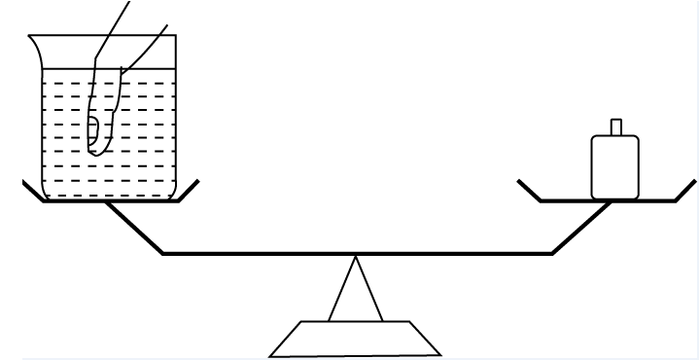
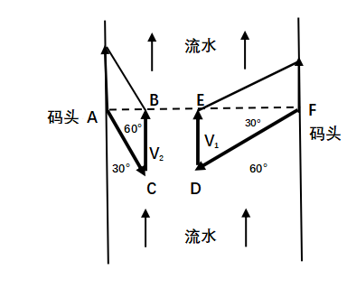
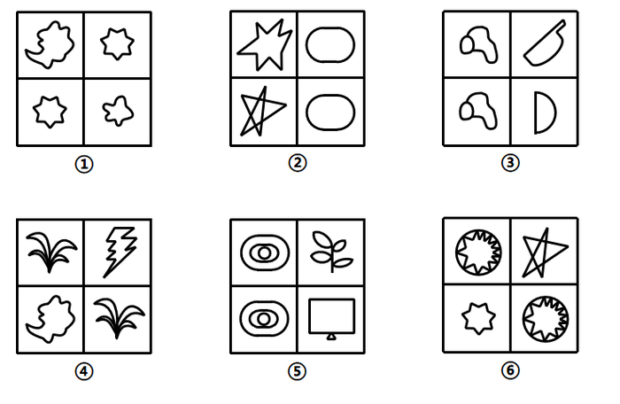
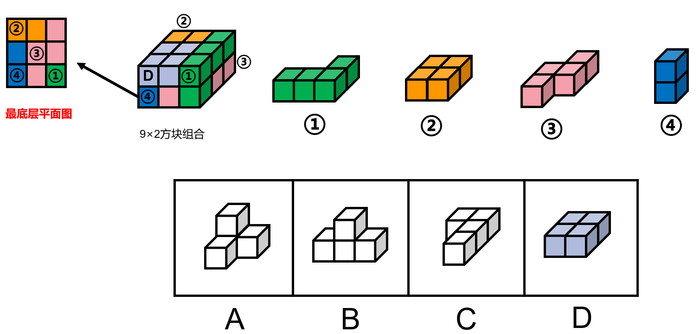
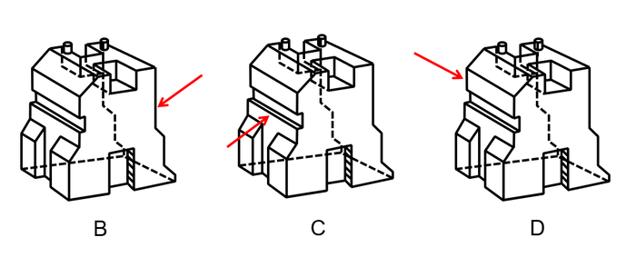
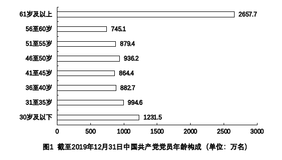

# 2021年云南公务员录用考试《行测》题（网友回忆版）

<!-- gwy:overview:start -->
> **云南 · 2021 · 行测 · 统考** ｜ 100 题 · 图片 25 处 · 答案随题折叠

| 题型模块 | 题量 | 题号 |
| --- | ---: | ---: |
| 常识判断 | 20 | 1–20 |
| 言语理解与表达 | 25 | 21–45 |
| 数量关系 | 10 | 46–55 |
| 判断推理 | 30 | 56–85 |
| 资料分析 | 15 | 86–100 |
| **合计** | **100** | |

导航：[题型与作答说明](#题型与作答说明) · [题目](#题目) · [材料 1](#材料-1)
<!-- gwy:overview:end -->

> 候选采集稿。参考答案及解析来自粉笔页面，不代表官方答案或真实高分答卷；来源使用许可与原卷对应关系仍需人工核实。

## 题型与作答说明

常识判断

（20题）

根据题目要求，在四个选项中选出一个最恰当的答案。

言语理解与表达

（25题）

本部分包括表达与理解两方面的内容。请根据题目要求，在四个选项中选出一个最恰当的答案。

数量关系

（10题）

在这部分试题中，每道题呈现一段表述数字关系的文字，要求你迅速、准确地计算出答案。

判断推理

（30题）

本部分包括图形推理、定义判断、类比推理与逻辑判断四种类型的试题，在四个选项中选出一个最恰当的答案。

资料分析

（15题）

所给出的图、表、文字或综合性资料均有若干个问题要你回答。你应根据资料提供的信息进行分析、比较、计算和判断处理。

## 题目

### 第 1 题

下列选项，在国家主席习近平发表的2021年新年贺词中没有提到的是：

A. 我们克服疫情影响，统筹疫情防控和经济社会发展取得重大成果

B. 2020年，全面建成小康社会取得伟大历史性成就，决战脱贫攻坚取得决定性胜利

C. 我国在世界主要经济体中率先实现正增长，预计2020年国内生产总值迈上百万亿元新台阶

D. 京津冀协同发展、长江经济带发展、粤港澳大湾区建设、长三角一体化发展按下快进键，黄河流域生态保护和高质量发展成为国家战略

第 1 题 · 答案与解析

**参考答案（粉笔题库参考内容）**

D

**解析**

本题考查政治常识。

A、C两项正确，国家主席习近平发表的2021年新年贺词指出，艰难方显勇毅，磨砺始得玉成。我们克服疫情影响，统筹疫情防控和经济社会发展取得重大成果。“十三五”圆满收官，“十四五”全面擘画。新发展格局加快构建，高质量发展深入实施。我国在世界主要经济体中率先实现正增长，预计2020年国内生产总值迈上百万亿元新台阶。

B项正确，国家主席习近平发表的2021年新年贺词指出，2020年，全面建成小康社会取得伟大历史性成就，决战脱贫攻坚取得决定性胜利。我们向深度贫困堡垒发起总攻，啃下了最难啃的“硬骨头”。历经8年，现行标准下近1亿农村贫困人口全部脱贫，832个贫困县全部摘帽。

D项错误，国家主席习近平发表的2020年新年贺词指出，2019年，我们用汗水浇灌收获，以实干笃定前行。京津冀协同发展、长江经济带发展、粤港澳大湾区建设、长三角一体化发展按下快进键，黄河流域生态保护和高质量发展成为国家战略。

本题为选非题，故正确答案为D。

**考点**：经济建设、重要会议讲话

**来源**：2021年云南公务员录用考试《行测》题（网友回忆版）第1题

### 第 2 题

在2020年12月召开的中央农村工作会议上，习近平总书记强调，在向第二个百年奋斗目标迈进的历史关口，巩固和拓展脱贫攻坚成果，全面推进乡村振兴，加快农业农村现代化，是需要全党高度重视的一个关系大局的重大问题。下列有关会议主要内容表述正确的是：

A. 脱贫攻坚目标完成后，对摆脱贫困的县，从脱贫之日起设立3年过渡期

B. 要健全防止返贫动态监测和帮扶机制，对易返贫致贫人口实施常态化监测

C. 构建新发展格局，把战略基点放在开源节流上，农村有巨大空间，可以大有作为

D. 要牢牢把住粮食生产主动权，严防死守13亿亩耕地红线，落实最严格的耕地保护制度

第 2 题 · 答案与解析

**参考答案（粉笔题库参考内容）**

B

**解析**

本题考查政治常识。中央农村工作会议于2020年12月28日至29日在北京举行。习近平出席会议并发表重要讲话强调，在向第二个百年奋斗目标迈进的历史关口，巩固和拓展脱贫攻坚成果，全面推进乡村振兴，加快农业农村现代化，是需要全党高度重视的一个关系大局的重大问题。

A项错误，习近平强调，党中央决定，脱贫攻坚目标任务完成后，对摆脱贫困的县，从脱贫之日起设立5年过渡期。过渡期内要保持主要帮扶政策总体稳定。

B项正确，习近平指出，要健全防止返贫动态监测和帮扶机制，对易返贫致贫人口实施常态化监测，重点监测收入水平变化和“两不愁三保障”巩固情况，继续精准施策。

C项错误，习近平强调，从中华民族伟大复兴战略全局看，民族要复兴，乡村必振兴。从世界百年未有之大变局看，稳住农业基本盘、守好“三农”基础是应变局、开新局的“压舱石”。构建新发展格局，把战略基点放在扩大内需上，农村有巨大空间，可以大有作为。

D项错误，习近平指出，要牢牢把住粮食安全主动权，粮食生产年年要抓紧。要严防死守18亿亩耕地红线，采取长牙齿的硬措施，落实最严格的耕地保护制度。

故正确答案为B。

**考点**：重要会议讲话、社会建设

**来源**：2021年青海省公务员录用考试《行测》题（网友回忆版）第2题

### 第 3 题

2020年底颁布的《政府督查工作条例》是我国政府督查领域的第一部行政法规，是政府督查工作长期实践的系统总结 。下列有关说法正确的是：

A. 政府督查机构可以根据督查结论或者整改核查结果，直接对督查对象追究责任

B. 应当严格控制督查频次和时限，科学运用督查方式，严肃督查纪律，提前培训督查人员

C. 政府督查可以采取开展检查、访谈，组织座谈、听证的方式，但不可采取暗访的方式进行

D. 督查对象对督查结论有异议的，可以自收到该督查结论之日起60天内，向作出该督查结论的人民政府申请复核

第 3 题 · 答案与解析

**参考答案（粉笔题库参考内容）**

B

**解析**

本题考查法律常识。

A项错误，根据《政府督查工作条例》第二十一条规定：“政府督查机构可以根据督查结论或者整改核查结果，提出对督查对象依法依规进行表扬、激励、批评等建议，经本级人民政府或者本级人民政府行政首长批准后组织实施。政府督查机构可以根据督查结论或者整改核查结果，提出对督查对象依法依规追究责任的建议，经本级人民政府或者本级人民政府行政首长批准后，交有权机关调查处理。”因此，政府督查机构不能直接对督查对象追究责任。

B项正确，根据《政府督查工作条例》第十五条第一款规定：“开展政府督查工作应当制定督查方案，明确督查内容、对象和范围；应当严格控制督查频次和时限，科学运用督查方式，严肃督查纪律，提前培训督查人员。”

C项错误，根据《政府督查工作条例》第十二条规定：“政府督查可以采取以下方式：（一）要求督查对象自查、说明情况；（二）听取督查对象汇报；（三）开展检查、访谈、暗访；（四）组织座谈、听证、统计、评估······”因此，可采取暗访的方式进行。

D项错误，根据《政府督查工作条例》第十七条规定：“督查对象对督查结论有异议的，可以自收到该督查结论之日起30日内，向作出该督查结论的人民政府申请复核。收到申请的人民政府应当在30日内作出复核决定。参与作出督查结论的工作人员在复核中应当回避。”

故正确答案为B。

**考点**：其他法律法规

**来源**：2021年云南公务员录用考试《行测》题（网友回忆版）第3题

### 第 4 题

碧空如洗，草木竞荣，2020年初夏召开的全国两会极不平凡。两会期间，习近平总书记多次“下团组”，对做好统筹疫情防控和经济社会发展工作、应对当前的风险和挑战、永远保持同人民群众的血肉联系等方面作出重要指示，传递出攻坚克难、化危为机的坚定信心和力量。以下选项对应关系不一致的是：

A. 谈经济社会发展——“在危机中育新机、于变局中开新局”

B. 谈生态文明建设——“坚定信心不动摇，咬定目标不放松”

C. 谈疫情防控——“慎终如始、再接再厉”

D. 谈执政为民——“人民至上、生命至上”

第 4 题 · 答案与解析

**参考答案（粉笔题库参考内容）**

B

**解析**

本题考查政治常识。

A项正确，2020年5月23日，习近平总书记看望参加全国政协十三届三次会议的经济界委员，听取意见和建议。在讲话中，习近平用全面、辩证、长远的眼光分析当前全球经济形势，剖析我国经济的优势和潜力，强调“在危机中育新机、于变局中开新局”，要求“确保各项决策部署落地生根，确保完成决胜全面建成小康社会、决战脱贫攻坚目标任务”，推动我国经济乘风破浪、行稳致远。

B项错误，2019年3月7日，习近平总书记参加甘肃代表团审议时强调，要坚定信心不动摇，咬定目标不放松，整治问题不手软，落实责任不松劲，转变作风不懈怠，确保脱贫攻坚任务如期完成。

C项正确，2020年5月24日，习近平总书记来到十三届全国人大三次会议湖北代表团参加审议。习近平强调，要时刻绷紧疫情防控这根弦，慎终如始、再接再厉，持续抓好外防输入、内防反弹工作，决不能让来之不易的疫情防控成果前功尽弃。

D项正确，2020年5月22日，中共中央总书记、国家主席、中央军委主席习近平参加十三届全国人大三次会议内蒙古代表团的审议。他强调：“在全国范围调集最优秀的医生、最先进的设备、最急需的资源，全力以赴投入疫病救治，救治费用全部由国家承担。人民至上、生命至上，保护人民生命安全和身体健康可以不惜一切代价。”

本题为选非题，故正确答案为B。

**考点**：经济建设

**来源**：2021年云南公务员录用考试《行测》题（网友回忆版）第4题

### 第 5 题

“十四五”时期是我国全面建成小康社会、实现第一个百年奋斗目标之后，乘势而上开启全面建设社会主义现代化国家新征程、向第二个百年奋斗目标进军的第一个五年。下列有关说法正确的是：

A. 提出到本世纪中叶基本实现社会主义现代化远景目标，人均国内生产总值达到中等发达国家水平，中等收入群体显著扩大

B. 坚持把发展经济着力点放在实体经济上，坚定不移建设制造强国、质量强国、网络强国、数字中国

C. 坚持又快又好工作总基调，以推动高质量发展为主题，以深化供给侧结构性改革为主线

D. “十四五”规划是在党的十九届四中全会上审议通过的，将于2021年开始实施

第 5 题 · 答案与解析

**参考答案（粉笔题库参考内容）**

B

**解析**

本题考查政治常识。2020年10月29日，中国共产党第十九届中央委员会第五次全体会议通过了《中共中央关于制定国民经济和社会发展第十四个五年规划和二〇三五年远景目标的建议》（以下简称《建议》）。

A项错误：《建议》指出：“到二〇三五年基本实现社会主义现代化远景目标。党的十九大对实现第二个百年奋斗目标作出分两个阶段推进的战略安排，即到二〇三五年基本实现社会主义现代化，到本世纪中叶把我国建成富强民主文明和谐美丽的社会主义现代化强国。展望二〇三五年，······人均国内生产总值达到中等发达国家水平，中等收入群体显著扩大，基本公共服务实现均等化，城乡区域发展差距和居民生活水平差距显著缩小；平安中国建设达到更高水平，基本实现国防和军队现代化；人民生活更加美好，人的全面发展、全体人民共同富裕取得更为明显的实质性进展。”

B项正确：《建议》指出：“坚持把发展经济着力点放在实体经济上，坚定不移建设制造强国、质量强国、网络强国、数字中国，推进产业基础高级化、产业链现代化，提高经济质量效益和核心竞争力。”

C项错误：《建议》指出：“坚持稳中求进工作总基调，以推动高质量发展为主题，以深化供给侧结构性改革为主线，以改革创新为根本动力，以满足人民日益增长的美好生活需要为根本目的，统筹发展和安全，加快建设现代化经济体系，加快构建以国内大循环为主体、国内国际双循环相互促进的新发展格局，推进国家治理体系和治理能力现代化，实现经济行稳致远、社会安定和谐，为全面建设社会主义现代化国家开好局、起好步。”

D项错误，2021年3月11日，十三届全国人大四次会议表决通过了《中华人民共和国国民经济和社会发展第十四个五年规划和2035年远景目标纲要》（简称“十四五”规划）。“十四五”规划将于2021年开始实施。

故正确答案为B。

**考点**：经济建设、重要文件

**来源**：2021年青海省公务员录用考试《行测》题（网友回忆版）第1题

### 第 6 题

下列国家勋章和国家荣誉称号与人名对应关系不正确的是：

A. 共和国勋章：申纪兰、屠呦呦、钟南山

B. 人民科学家：吴文俊、南仁东、程开甲

C. 人民英雄：张伯礼、张定宇、陈薇

D. 人民楷模：王文教、王继才、张桂梅

第 6 题 · 答案与解析

**参考答案（粉笔题库参考内容）**

D

**解析**

本题考查政治常识。

A项正确，2019年9月，为了庆祝中华人民共和国成立70周年，隆重表彰为新中国建设和发展作出杰出贡献的功勋模范人物，弘扬民族精神和时代精神，第十三届全国人民代表大会常务委员会第十三次会议决定，授予于敏、申纪兰、孙家栋、李延年、张富清、袁隆平、黄旭华、屠呦呦“共和国勋章”。2020年8月，第十三届全国人大常委会第二十一次会议表决通过关于授予在抗击新冠肺炎疫情斗争中作出杰出贡献的人士国家勋章和国家荣誉称号的决定，授予钟南山“共和国勋章”。

B项正确，2019年9月，为了庆祝中华人民共和国成立70周年，隆重表彰为新中国建设和发展作出杰出贡献的功勋模范人物，弘扬民族精神和时代精神，第十三届全国人民代表大会常务委员会第十三次会议决定，授予叶培建、吴文俊、南仁东、顾方舟、程开甲“人民科学家”国家荣誉称号。

C项正确，2020年8月，第十三届全国人大常委会第二十一次会议表决通过关于授予在抗击新冠肺炎疫情斗争中作出杰出贡献的人士国家勋章和国家荣誉称号的决定，授予张伯礼、张定宇、陈薇“人民英雄”国家荣誉称号。

D项错误，2019年9月，为了庆祝中华人民共和国成立70周年，隆重表彰为新中国建设和发展作出杰出贡献的功勋模范人物，弘扬民族精神和时代精神，第十三届全国人民代表大会常务委员会第十三次会议决定，授予王文教、王有德（回族）、王启民、王继才、布茹玛汗·毛勒朵（女，柯尔克孜族）、朱彦夫、李保国、都贵玛（女，蒙古族）、高德荣（独龙族）“人民楷模”国家荣誉称号。2020年12月，在如期完成新时代脱贫攻坚目标任务、决战脱贫攻坚取得重大胜利之际，中宣部向全社会宣传发布张桂梅同志的先进事迹，授予她“时代楷模”称号。

本题为选非题，故正确答案为D。

**考点**：重要事件、其他建设

**来源**：2021年云南公务员录用考试《行测》题（网友回忆版）第6题

### 第 7 题

脱贫攻坚的重大胜利，为实现第一个百年奋斗目标打下了坚实基础，极大增强了人民群众获得感、幸福感、安全感，彻底改变了贫困地区的面貌，改善了生产生活条件，提高了群众生活质量，“两不愁三保障”全面实现。以下习近平总书记的“金句”与脱贫攻坚无直接相关的是：

A. 脚下沾有多少泥土，心中就沉淀多少真情

B. 小康不小康，关键看老乡

C. 扶贫必扶智，治贫先治愚

D. 只争朝夕，不负韶华

第 7 题 · 答案与解析

**参考答案（粉笔题库参考内容）**

D

**解析**

本题考查政治常识。

A项正确，2015年6月18日，习总书记在部分省区市扶贫攻坚与“十三五”时期经济社会发展座谈会上的讲话当中指出，选派扶贫工作队是加强基层扶贫工作的有效组织措施，要做到每个贫困村都有驻村工作队、每个贫困户都有帮扶责任人。脚下沾有多少泥土，心中就沉淀多少真情。工作队和驻村干部要一心扑在扶贫开发工作上，强化责任要求，有效发挥作用。对在基层一线干出了成绩、群众拥护的驻村干部，要注意培养使用，让他们在扶贫开发工作中发挥更大作用。

B项正确，“小康不小康，关键看老乡”是2013年4月9日习近平总书记到博后村考察时提出的重要论述。这一重要论述，深深扎根于3600多名博后村村民的心底，也从这里传到大江南北老乡的心坎里，鼓舞全国亿万农民奋力奔向小康社会。

C项正确，2016年7月20日习总书记在《东西部扶贫协作座谈会上的讲话》中指出，摆脱贫困首要并不是摆脱物质的贫困，而是摆脱意识和思路的贫困。扶贫必扶智，治贫先治愚。贫穷并不可怕，怕的是智力不足、头脑空空，怕的是知识匮乏、精神委顿。脱贫致富不仅要注意富口袋，更要注意富脑袋。

D项错误，2019年12月31日，在新年贺词的最后，习近平总书记说到“让我们只争朝夕，不负韶华，共同迎接2020年的到来。”故“只争朝夕，不负韶华”与脱贫攻坚无直接关系。

本题为选非题，故正确答案为D。

**考点**：重要会议讲话、社会建设

**来源**：2021年云南公务员录用考试《行测》题（网友回忆版）第7题

### 第 8 题

下列关于我国生态环境保护方面的说法不准确的是：

A. 第二次全国污染源普查的结果显示，我国主要污染物排放量大幅下降

B. 我国生态环境保护三大保卫战指的是蓝天保卫战、碧水保卫战和净土保卫战

C. “无废城市”是一种先进的城市管理理念，实现了固体废物的完全资源化利用

D. 新修订的《中华人民共和国森林法》自2020年7月1日起施行，此次修订将森林生态效益补偿写入了法律

第 8 题 · 答案与解析

**参考答案（粉笔题库参考内容）**

C

**解析**

本题考查政治常识。

A项正确，2020年6月10日，国务院新闻办举行发布会，生态环境部、国家统计局、农业农村部共同发布《第二次全国污染源普查公报》。生态环境部副部长赵英民在国务院新闻办当天举行的新闻发布会上指出，污染源整体情况有三方面的变化：一是主要污染物排放量大幅下降。与第一次全国污染源普查数据同口径相比，2017年二氧化硫、化学需氧量、氮氧化物等污染物排放量比2007年分别下降了72%、46%和34%。二是产业结构调整成效显著。三是污染治理能力明显提升。

B项正确，2018年6月24日公布的《中共中央国务院关于全面加强生态环境保护坚决打好污染防治攻坚战的意见》提出，坚决打赢蓝天保卫战，着力打好碧水保卫战，扎实推进净土保卫战。

C项错误，2019年1月21日，国务院办公厅发布了《“无废城市”建设试点工作方案》。指出，“无废城市”是以创新、协调、绿色、开放、共享的新发展理念为引领，通过推动形成绿色发展方式和生活方式，持续推进固体废物源头减量和资源化利用，最大限度减少填埋量，将固体废物环境影响降至最低的城市发展模式。“无废城市”并不是没有固体废物产生，也不意味着固体废物能完全资源化利用，而是一种先进的城市管理理念。

D项正确，中华人民共和国第十三届全国人民代表大会常务委员会第十五次会议于2019年12月28日修订通过《中华人民共和国森林法》。新修订的《中华人民共和国森林法》自2020年7月1日起施行。新修订的《中华人民共和国森林法》第七条指出：“国家建立森林生态效益补偿制度，加大公益林保护支持力度，完善重点生态功能区转移支付政策，指导受益地区和森林生态保护地区人民政府通过协商等方式进行生态效益补偿。”

本题为选非题，故正确答案为C。

**考点**：生态文明建设

**来源**：2021年青海省公务员录用考试《行测》题（网友回忆版）第6题

### 第 9 题

下列有关我国2020年科技成就的说法正确的是：

A. 2020年12月，嫦娥五号返回器成功着陆，这是我国首次完成月球采样返回任务

B. 我国研制的“奋斗者”号载人潜水器于2020年11月坐底菲律宾海沟，创造了我国载人深潜新纪录

C. 中国环流器二号M装置于2020年底建成并实现首次放电，为我国核裂变堆的设计建造打下了坚实基础

D. 2020年7月，北斗三号全球卫星导航系统全面建成并开通服务，我国成为第四个独立拥有全球卫星导航系统的国家

第 9 题 · 答案与解析

**参考答案（粉笔题库参考内容）**

A

**解析**

本题考查科技常识。

A项正确，2020年12月17日，探月工程嫦娥五号返回器在内蒙古四子王旗预定区域成功着陆，标志着我国首次月球采样返回任务圆满完成。

B项错误，2020年11月10日8时12分，中国“奋斗者”号载人潜水器在马里亚纳海沟成功坐底，坐底深度10909米，创造了中国载人深潜的新纪录。

C项错误，2020年12月4日14时，新一代“人造太阳”装置——中国环流器二号M装置（HL-2M）在成都建成并实现首次放电，标志着中国自主掌握了大型先进托卡马克装置的设计、建造、运行技术，为我国核聚变堆的自主设计与建造打下坚实基础。

D项错误，北斗系统是党中央决策实施的国家重大科技工程。工程自1994年启动，2000年完成北斗一号系统建设，2012年完成北斗二号系统建设。北斗三号全球卫星导航系统全面建成并开通服务，标志着工程“三步走”发展战略取得决战决胜，我国成为世界上第三个独立拥有全球卫星导航系统的国家。目前，全球已有120余个国家和地区使用北斗系统。

故正确答案为A。

**考点**：科技理论与成就

**来源**：2021年青海省公务员录用考试《行测》题（网友回忆版）第5题

### 第 10 题

下列变化过程包含化学反应的有：

①鬼火

②光合作用

③水垢形成

④高粱酿酒

⑤舞台云雾的生成

A. ②③④⑤

B. ①②④⑤

C. ①③④⑤

D. ①②③④

第 10 题 · 答案与解析

**参考答案（粉笔题库参考内容）**

D

**解析**

本题考查科技常识。

①正确，“鬼火”也被称为“磷火”，是化学中的自燃现象，常发生在农村，一般出现在夏季的坟墓周围。发生“鬼火”的原因是人的骨头里含有磷元素，尸体腐烂后经过变化会生成磷化氢，磷化氢的燃点很低，可以自燃。

②正确，光合作用是指含有叶绿素等光合色素的绿色植物和某些细菌，在可见光的照射下，经过光反应和碳反应，利用光合色素，将二氧化碳和水转化为有机物，并释放出氧气的生化过程。同时也有将光能转变为有机物中化学能的能量转化过程。

③正确，含有钙、镁等盐类杂质的水进入水壶后，在烧水时吸收了许多热量，钙、镁盐类杂质便会发生化学反应，生成难以溶解的物质，最后析出，析出物随着沸水的不断蒸发而逐渐浓缩，当达到一定浓度时，就会成为固体，并沉淀附着在水壶内壁上，形成一层白色的“膜”。这就是我们所说的水垢，它的主要成分是碳酸钙、碳酸镁等。

④正确，酿酒是利用微生物发酵生产含一定浓度酒精饮料的过程。高粱在微生物作用下，经过复杂的生物化学反应，产生乙醇和白酒中的香味物质。

⑤错误，干冰是固态的二氧化碳，其升华时吸收大量的热，使其周围的温度迅速降低。处于低温区内的水蒸气就会液化成小水珠，许多细小的水珠聚在一起，在空中飘浮，就成为舞台上的云雾，属于物理变化。

因此①②③④包含化学反应。

故正确答案为D。

**考点**：化学常识

**来源**：2021年青海省公务员录用考试《行测》题（网友回忆版）第14题

### 第 11 题

下列关于我国突发事件应对的表述错误的是：

A. 突发事件应对工作实行预防为主、预防与应急相结合的原则

B. 新闻媒体应当无偿开展突发事件预防与应急、自救与互救知识的公益宣传

C. 突发事件分为自然灾害、事故灾难、公共卫生事件和群体性事件

D. 国务院有关部门、县级以上地方各级人民政府及其有关部门、有关单位应当为专业应急救援人员购买人身意外伤害保险

第 11 题 · 答案与解析

**参考答案（粉笔题库参考内容）**

C

**解析**

本题考查法律常识。

A项正确，根据《中华人民共和国突发事件应对法》第五条规定：“突发事件应对工作实行预防为主、预防与应急相结合的原则。”

B项正确，根据《中华人民共和国突发事件应对法》第二十九条第三款规定：“新闻媒体应当无偿开展突发事件预防与应急、自救与互救知识的公益宣传。”

C项错误，根据《中华人民共和国突发事件应对法》第三条第一款规定：“本法所称突发事件，是指突然发生，造成或者可能造成严重社会危害，需要采取应急处置措施予以应对的自然灾害、事故灾难、公共卫生事件和社会安全事件。”

D项正确，根据《中华人民共和国突发事件应对法》第二十七条规定：“国务院有关部门、县级以上地方各级人民政府及其有关部门、有关单位应当为专业应急救援人员购买人身意外伤害保险，配备必要的防护装备和器材，减少应急救援人员的人身风险。”

本题为选非题，故正确答案为C。

**考点**：其他法律法规

**来源**：2021年云南公务员录用考试《行测》题（网友回忆版）第11题

### 第 12 题

下列有关《中华人民共和国民法典》的说法不正确的是：

A. 民法典将人格权独立成编，调整的是因人格权的享有和保护产生的民事关系

B. 八周岁以上的未成年人为限制民事行为能力人，不可独立实施纯获利益的民事法律行为

C. 民法典实施后，婚姻法、继承法、民法通则、收养法、担保法、合同法、物权法、侵权责任法、民法总则同时废止

D. 民法典规定，自然人享有隐私权，隐私是自然人的私人生活安宁和不愿为他人知晓的私密空间、私密活动、私密信息

第 12 题 · 答案与解析

**参考答案（粉笔题库参考内容）**

B

**解析**

本题考查法律常识。

A项正确，根据《中华人民共和国民法典》第九百八十九条规定：“本编调整因人格权的享有和保护产生的民事关系。”民法典将人格权独立成编，调整的是因人格权的享有和保护产生的民事关系。

B项错误，根据《中华人民共和国民法典》第十九条规定：“八周岁以上的未成年人为限制民事行为能力人，实施民事法律行为由其法定代理人代理或者经其法定代理人同意、追认；但是，可以独立实施纯获利益的民事法律行为或者与其年龄、智力相适应的民事法律行为。”因此，八周岁以上的未成年人可以独立实施纯获利益的民事法律行为或者与其年龄、智力相适应的民事法律行为。

C项正确，根据《中华人民共和国民法典》第一千二百六十条规定：“本法自2021年1月1日起施行。《中华人民共和国婚姻法》、《中华人民共和国继承法》、《中华人民共和国民法通则》、《中华人民共和国收养法》、《中华人民共和国担保法》、《中华人民共和国合同法》、《中华人民共和国物权法》、《中华人民共和国侵权责任法》、《中华人民共和国民法总则》同时废止。”

D项正确，根据《中华人民共和国民法典》第一千零三十二条规定：“自然人享有隐私权。任何组织或者个人不得以刺探、侵扰、泄露、公开等方式侵害他人的隐私权。隐私是自然人的私人生活安宁和不愿为他人知晓的私密空间、私密活动、私密信息。”

本题为选非题，故正确答案为B。

**考点**：民法典

**来源**：2021年青海省公务员录用考试《行测》题（网友回忆版）第8题

### 第 13 题

下列谚语不涉及二十四节气的是：

A. 花木管时令，鸟鸣报农时

B. 白露身不露，寒露脚不露

C. 日晕三更雨，月晕午时风

D. 秋分早，霜降迟，寒露种麦正当时

第 13 题 · 答案与解析

**参考答案（粉笔题库参考内容）**

C

**解析**

本题考查人文常识。

二十四节气，是干支历中表示自然节律变化以及确立“十二月建”的特定节令。现行的“二十四节气”是依据太阳在回归黄道上的位置制定，即把太阳周年运动轨迹划分为24等份，每15°为1等份，每1等份为一个节气，始于立春，终于大寒。“二十四节气”是中华民族悠久历史文化的重要组成部分。

A项正确，“花木管时令，鸟鸣报农时”，意为不管是花草也好，鸟兽也罢，它们的活动大多呈现出季节性以及规律性，因此，被当作区分时令的重要参考。该谚语涉及二十四节气。

B项正确，“白露身不露，寒露脚不露”，意为白露节气一过，穿衣服就不能再赤膊露体；寒露节气一过，应注重足部保暖。该谚语涉及二十四节气。

C项错误，“日晕三更雨，月晕午时风”，意为若出现日晕的话，夜半三更将有雨，若出现月晕，则次日中午会刮风。该谚语不涉及二十四节气。

D项正确，“秋分早，霜降迟，寒露种麦正当时”，意为把握种麦时间，秋分时种麦早了，霜降时种麦迟了，而寒露时种麦是最好的。该谚语涉及二十四节气。

本题为选非题，故正确答案为C。

**考点**：文化常识

**来源**：2021年青海省公务员录用考试《行测》题（网友回忆版）第12题

### 第 14 题

下列关于风险管理的做法合适的是：

A. 某商业银行对不同信用等级的客户适用相同的贷款利率

B. 李某担心家中古董被盗造成损失，向保险公司购买财产保险

C. 考虑到大人和小孩风险承受力强弱不一，购买保险时小孩应优先于大人

D. 某外贸公司将要进口一批美国货物，为规避美元升值风险，向银行申请开立保函

第 14 题 · 答案与解析

**参考答案（粉笔题库参考内容）**

B

**解析**

本题考查经济常识。风险管理流程主要包括风险识别、风险计量、风险监测和风险控制四个步骤，其中风险控制是对经过识别和计量的风险采取分散、对冲、转移、规避和补偿等措施，进行有效管理和控制的过程。

A项错误，商业银行可以预先在金融资产定价中充分考虑到各种风险因素，通过价格调整来获得合理的风险回报，而对于那些无法通过风险分散、风险对冲、风险转移或风险规避进行有效管理的风险，商业银行可以采取在交易价格上附加更高的风险溢价，即通过提高风险回报的方式，获得承担风险的价格补偿。不同的信用的等级的客户有着不同程度的违约风险，应该适用不同的贷款利率，而不是相同的贷款利率，低信用等级的贷款利率由于信用风险更高，银行为了获得风险的价格补偿，应提供相对较高的贷款利率。

B项正确，风险转移是指通过购买某种金融产品或采取其他合法的经济措施将风险转移给其他经济主体的一种策略性选择。风险转移可分为保险转移和非保险转移，其中保险转移是指通过买保险，以缴纳保险费为代价，将风险转移给承保人。李某担心家中古董被盗造成财产损失，可以通过向保险公司购买财产保险，将财产损失的风险转移给保险公司。

C项错误，根据购买保险的原则，大人应该优先于小孩。如果优先给小孩配置保险，一旦大人生病或发生意外事故，则家庭将失去主要的经济来源，同时还要负担大笔的医疗费用支出，小孩的生活、教育开支将同样受到影响。因此，在购买保险时应该优先考虑大人，尤其是家中的经济支柱。

D项错误，保函，又称保证书，是指银行、保险公司、担保公司或担保人应申请人的请求，向受益人开立的一种书面信用担保凭证。保证在申请人未能按双方协议履行其责任或义务时，由担保人代其履行一定金额、一定时限范围内的某种支付或经济赔偿责任。银行保函以银行为担保人转移违约风险，但并不能转移美元升值的外汇风险。进口商为了避免美元升值所带来的外汇风险，可以采取远期外汇交易的套期保值，买入远期美元，而不是找银行开立保函。

故正确答案为B。

**考点**：宏观经济与调控政策

**来源**：2021年青海省公务员录用考试《行测》题（网友回忆版）第10题

### 第 15 题

下列物理现象与地球自转无关的是：

A. 日月星辰四季方位的变化

B. 昼夜更替

C. 在北半球，物体从高空自由下落，存在落点偏东的现象

D. 在北半球，水自然形成的漩涡是逆时针方向的

第 15 题 · 答案与解析

**参考答案（粉笔题库参考内容）**

A

**解析**

本题考查地理国情。

A项错误，日月星辰泛指宇宙的天体，日月星辰四季方位的变化也就是地球绕着太阳公转，转一圈是四个季节，每个季节的位置不同。日月星辰四季方位是由于地球公转引起的。

B项正确，由于地球是一个既不透明、也不发光的球体，所以在同一时间里，太阳只能照亮地球表面的一半。向着太阳的半球是白天，背着太阳的半球是黑夜。由于地球不停地自转，昼夜也就不断地更替。

C项正确，落体偏东是由于地球自西向东的旋转引起的。由于随地球自转而具有的线速度，一定大于地面上物体的线速度。所以该物体下落时必然相对地面有一个偏东的速度，落点自然就会偏东。

D项正确，在北半球，由于地球自转所形成的自转偏向力是向右的，因此水自然形成的漩涡是逆时针方向的。

本题为选非题，故正确答案为A。

**考点**：自然地理

**来源**：2021年青海省公务员录用考试《行测》题（网友回忆版）第19题

### 第 16 题

下列有关我国抗美援朝战争的说法正确的是：

A. 志愿军与美军第一次交锋，是在仁川登陆战

B. 抗美援朝战争中，中国人民志愿军的司令员是粟裕

C. 中国人民志愿军在战争中涌现出一大批英雄官兵，杨根思、黄继光、解秀梅是其中的优秀代表

D. 2020年是抗美援朝出国作战70周年，我国拍摄了《金刚川》《芳华》等一系列影视作品展现志愿军英勇无畏的优秀品质

第 16 题 · 答案与解析

**参考答案（粉笔题库参考内容）**

C

**解析**

本题考查毛中特。

A项错误，云山之战，是抗美援朝战争第一次战役的一次重要战斗，是中国人民志愿军与美军在朝鲜战场上首次交锋。云山之战从1950年11月1开始至3日结束，志愿军取得了同美军第一次较量的胜利。

B项错误，1950年10月19日，中国人民志愿军在司令员兼政治委员彭德怀率领下，跨过鸭绿江，赶赴朝鲜战场，25日，揭开抗美援朝战争序幕。

C项正确，杨根思是中国人民解放军全国战斗英雄、中国人民志愿军第一位特等功臣和特级战斗英雄，中国人民志愿军第一位“朝鲜民主主义人民共和国英雄”。解秀梅是我军在抗美援朝战争中唯一荣立一等功的女战士。黄继光在朝鲜上甘岭战役中，用胸膛堵住疯狂扫射的敌机枪眼英勇牺牲。中国人民志愿军给他追记特等功，追授“特级英雄”称号，所在部队追认他为中国共产党党员；朝鲜民主主义人民共和国追授他“朝鲜民主主义人民共和国英雄”称号和金星奖章和一级国旗勋章。

D项错误，《芳华》是根据严歌苓同名小说改编，以1970至1980年代为背景，讲述了在充满理想和激情的军队文工团，一群正值芳华的青春少年，经历着成长中的爱情萌发与充斥着变数的人生命运故事，与抗美援朝故事无关。

故正确答案为C。

**考点**：党的历史

**来源**：2021年云南公务员录用考试《行测》题（网友回忆版）第16题

### 第 17 题

下列有关我国疫情防控的说法错误的是：

A. 被隔离的人员，有工作单位的，工作单位不得停止支付其隔离期间的工作报酬

B. 根据《传染病防治法》的规定，发现传染病病人时，应当及时向附近的公安机关报告

C. 全国抗击新冠肺炎疫情表彰大会于2020年9月在人民大会堂举行，习近平总书记在大会上发表重要讲话

D. 2020年6月发布的《抗击新冠肺炎疫情的中国行动》白皮书，是真实记录中国抗疫艰辛历程的重要文献

第 17 题 · 答案与解析

**参考答案（粉笔题库参考内容）**

B

**解析**

本题考查政治常识。

A项正确，根据《传染病防治法》第四十一条第二款规定：“在隔离期间，实施隔离措施的人民政府应当对被隔离人员提供生活保障；被隔离人员有工作单位的，所在单位不得停止支付其隔离期间的工作报酬。”

B项错误，根据《传染病防治法》第三十一条规定：“任何单位和个人发现传染病病人或者疑似传染病病人时，应当及时向附近的疾病预防控制机构或者医疗机构报告。”

C项正确，2020年9月8日，全国抗击新冠肺炎疫情表彰大会在北京人民大会堂隆重举行。习近平总书记向国家勋章和国家荣誉称号获得者颁授勋章奖章并发表重要讲话。

D项正确，2020年6月发布的《抗击新冠肺炎疫情的中国行动》白皮书是真实记录中国抗疫艰辛历程的重要文献，约3.7万字，包括前言、正文和结束语。正文分为四个部分，分别是中国抗击疫情的艰辛历程、防控和救治两个战场协同作战、凝聚抗击疫情的强大力量、共同构建人类卫生健康共同体。

本题为选非题，故正确答案为B。

**考点**：重要事件、其他建设

**来源**：2021年青海省公务员录用考试《行测》题（网友回忆版）第4题

### 第 18 题

下列关于第七次全国人口普查工作的表述不正确的是：

A. 本次普查首次采集普查对象身份证号，以实现与公安、卫健等部门行政记录的比对核查

B. 本次普查采用全面调查的方法，以人为单位进行登记，普查对象可通过互联网自主填报

C. 普查短表包括反映人口基本状况的项目，由全部住户（不含港澳台居民和外籍人员）填报

D. 根据《全国人口普查条例》，人口普查工作每10年进行一次，尾数逢0的年份为普查年度

第 18 题 · 答案与解析

**参考答案（粉笔题库参考内容）**

B

**解析**

本题考查政治常识。

A项正确，第七次全国人口普查工作首次采集普查对象身份证号，这主要是出于数据比对的目的。所填数据将实现与公安、卫健等部门行政记录的比对核查，为的就是确保数据的真实性和准确性，并会对身份证号信息进行保密处理，普查全流程加强对公民个人信息的保护，严禁泄露公民个人信息。

B项错误，根据《第七次全国人口普查方案》规定：普查采用全面调查的方法，以户为单位进行登记。普查数据采集原则上采用电子化的方式。采取普查员使用电子采集设备（PAD或智能手机）登记普查对象信息并联网实时上报，或由普查对象通过互联网自主填报等方式进行。

C项正确，根据《第七次全国人口普查方案》规定：普查短表包括反映人口基本状况的项目，由全部住户（不包括港澳台居民和外籍人员）填报。

D项正确，新中国成立以来，我国分别在1953年、1964年、1982年、1990年、2000年和2010年成功进行过六次全国人口普查。根据《全国人口普查条例》有关规定，人口普查工作每10年进行一次，尾数逢“0”的年份为普查年度。经国务院批准，2020年开展第七次全国人口普查。

本题为选非题，故正确答案为B。

**考点**：重要事件、社会建设

**来源**：2021年青海省公务员录用考试《行测》题（网友回忆版）第9题

### 第 19 题

生活中，厨师在烹饪过程中除了使用酱油调色上色外，还可以采用下列哪一食材来给食物上色：

A. 食盐

B. 冰糖

C. 香叶

D. 花椒

第 19 题 · 答案与解析

**参考答案（粉笔题库参考内容）**

B

**解析**

本题考查科技常识。

B项正确，冰糖一般是以白砂糖为原料，溶成浓糖浆，倒入结晶容器中逐步制成的。冰糖可以用于做菜上色。例如：做红烧肉可采用冰糖上色，把油烧热后放入冰糖，使冰糖融化，冰糖融化后会出现焦糖色反应，此时放入用开水焯好的肉类，翻炒均匀后收汁即可。

故正确答案为B。

**考点**：生活常识

**来源**：2021年云南公务员录用考试《行测》题（网友回忆版）第19题

### 第 20 题

如下图所示，装有水的烧杯放在天平一端，另一端放置砝码使天平平衡，此时再放入一手指在水中，若手指完全静止在水中且没有触碰烧杯壁和烧杯底部，且水也没有溢出，那么这时天平的状态是：

A. 继续保持平衡状态

B. 放置砝码的一端下沉了

C. 放置烧杯的一端下沉了

D. 无法判断

第 20 题 · 答案与解析

**参考答案（粉笔题库参考内容）**

C

**解析**

本题考查科技常识。

将一手指放在水中，手指没有触碰烧杯壁和烧杯底部，此时手受到水的浮力。因为力的作用是相互的，水会受到浮力的反作用力。力会传到天平上，放置烧杯的一端受到的压力增大，所以放置烧杯的一端会下沉。

故正确答案为C。

**考点**：物理常识

**来源**：2021年青海省公务员录用考试《行测》题（网友回忆版）第18题

### 第 21 题

早在商汤时代，浴盘上就镌刻有“苟日新，日日新，又日新”的铭词，旨在激励自己澡身而浴德，澡雪而精神，既要盥洗身体，更要涤荡心灵，保持向新求新的精神，产生            的进步。

填入划横线部分最恰当的一项是：

A. 与日俱进

B. 日新月异

C. 竿头日上

D. 突飞猛进

第 21 题 · 答案与解析

**参考答案（粉笔题库参考内容）**

B

**解析**

根据横线前“保持向新求新的精神”可知，横线处应体现“新”的意思，且与“进步”搭配。B项“日新月异”形容每天都在更新，每月都有变化，可体现出“新”的意思，且搭配恰当，符合文意，当选。

A项“与日俱进”指随着时间一天天地进步，形容不断进步或提高。“与日俱进”侧重“提高进步”，且“与日俱进”与“进步”存在语义上的重复，搭配不当，排除；

C项“竿头日上”比喻学业进步很快，体现不出“新”的意思，排除；

D项“突飞猛进”形容进步和发展特别迅速，文段并未体现“进步和发展特别迅速”，且“突飞猛进”与“进步”重复，搭配不当，排除。

故正确答案为B。

【文段出处】《文明：文以化人 日新其德》

**考点**：词的辨析-搭配对象、对应关系-前后呼应、成语填空

**来源**：2021年青海省公务员录用考试《行测》题（网友回忆版）第21题

### 第 22 题

现代体育比赛不仅是各国运动员速度与力量的竞技场，也是世界各国展示形象、尖端科技与体育融合的大舞台。随着人类对挑战自身的执着追求，各竞技项目的成绩不断        人体能力的极限，要想进一步提高比赛成绩，哪怕是提高百分之一甚至千分之一，教练与运动员都要竭尽全力采用各种方式和技术去实现，科技的赋能作用也就愈发重要。

填入划横线部分最恰当的一项是：

A. 刷新

B. 挑战

C. 考验

D. 逼近

第 22 题 · 答案与解析

**参考答案（粉笔题库参考内容）**

D

**解析**

根据“随着人类对挑战自身的执着追求”以及后文“要想进一步提高比赛成绩······都要竭尽全力······去实现”可知，横线处要体现在人类的执着追求下，竞技项目的成绩被不断地提高，越来越接近“人体能力极限”。A项“刷新”意思是刷洗之后使之变新，“刷新”成绩不一定能接近人体能力极限，与文意不符，排除；B项“挑战”一般搭配人，“人挑战极限”或“人挑战自身”等等，一般不与“成绩”搭配，排除；C项“考验”的常见搭配为“考验能力”，与“极限”搭配不当，排除；D项“逼近”意思是向前靠近，接近，能体现出成绩不断接近人体能力极限，符合文意，当选。

故正确答案为D。

【文段出处】光明日报《体育中的“黑科技”》

**考点**：词的辨析-搭配对象、实词填空、对应关系-前后呼应

**来源**：2021年云南公务员录用考试《行测》题（网友回忆版）第22题

### 第 23 题

凡事绝非一日之功。我国生态文明建设水平仍滞后于经济社会发展，生态环境恶化趋势尚未得到根本扭转。特别是对积弊日久、历史欠账较多的生态环境来说，更不可能一蹴而就、            ，需要付出长期不懈的艰苦努力。

填入划横线部分最恰当的一项是：

A. 一劳永逸

B. 一了百当

C. 立竿见影

D. 水到渠成

第 23 题 · 答案与解析

**参考答案（粉笔题库参考内容）**

C

**解析**

根据顿号可知，横线处所填词语与“一蹴而就”构成近义并列，含义相近，故横线处应表达事情轻而易举，一下子就成功的含义，强调成功“快”。C项“立竿见影”比喻行事能马上看到效果或付出能马上得到收获，强调见效“快”，符合文意，当选。A项“一劳永逸”强调辛苦一次，把事情办好，以后就可以不再费力了，侧重强调“辛劳”，B项“一了百当”指办事妥当、彻底，D项“水到渠成”比喻有条件之后，事情自然会成功，均无快慢之意，不符合文意，排除。

故正确答案为C。

【文段出处】《开创生态文明新时代 绘出美丽中国新图景》

**考点**：成语填空、关联关系-并列关系

**来源**：2021年云南公务员录用考试《行测》题（网友回忆版）第23题

### 第 24 题

实体书店不仅是一种商业业态，也是一个文化标志，更是一座城市的文化招牌。实体书店要想在图书市场上赢得竞争，关键要找准定位，        自己的比较优势和市场价值，在服务上做得更加周到精准，才能让读者            ，让逛书店成为文化时尚，让更多人浸润在浓郁书香中。

依次填入划横线部分最恰当的一项是:

A. 明晰 络绎不绝

B. 确定 源源不断

C. 明确 纷至沓来

D. 确立 客似云来

第 24 题 · 答案与解析

**参考答案（粉笔题库参考内容）**

C

**解析**

第一空，搭配“比较优势和市场价值”，且由“关键要找准定位”可知，所填词语应体现出准确之意，A项“明晰”指清楚；不模糊，B项“确定”指明确而肯定，C项“明确”指使清晰明白而确定不移，均能体现出准确之意，符合文意，保留。D项“确立”指稳固地建立或树立，置于此处搭配不当，排除。

第二空，搭配“读者”，且由文段可知所填词语应体现出“实体书店能够吸引更多读者来”的意思，C项“纷至沓来”指连续不间断地到来，符合文意，当选。A项“络绎不绝”形容行人车马来来往往，接连不断，常用来形容街道、码头等人来人往十分热闹的场景，文段并非强调“实体书店”让“读者”来来往往，置于此处与文意不符，排除。B项“源源不断”形容连续而不间断，多用于形容事物，而少用于形容人，置于此处搭配不当，排除。

故正确答案为C。

【文段出处】《实体书店回暖 浸润浓郁书香》

**考点**：词的辨析-搭配对象、对应关系-前后呼应、混搭填空

**来源**：2021年青海省公务员录用考试《行测》题（网友回忆版）第26题

### 第 25 题

实际上普通话和方言不是同一层次上的交际工具，普通话是全民共同语，是官方语言，而方言是区域性的，是民间语言。通过明确        ，普通话和方言可以做到并行不悖，甚至            ，相得益彰。

依次填入划横线部分最恰当的一项是：

A. 规定 齐头并进

B. 划分 互为表里

C. 区分 珠联璧合

D. 界定 相辅相成

第 25 题 · 答案与解析

**参考答案（粉笔题库参考内容）**

D

**解析**

第一空，根据文意可知，普通话和方言通过明确划定各自的使用范围可以同时使用，并不冲突。A项“规定”意为对事物的数量、质量或方式、方法等做出具有约束力的决定，D项“界定”意为划定界限，确定所属范围，置于此处均符合文意，保留；B项“划分”指把整体分成若干部分，文段未体现普通话和方言存在整体和部分的关系，排除；C项“区分”指辨别，分辨，文段并非强调普通话和方言相似，不好分辨，与文意不符，排除。

第二空，根据“甚至”可知，表达递进关系，横线处所填词语应比“并行不悖”程度更重。D项“相辅相成”意为两件事物相互补充，互相配合，缺一不可，可与“并行不悖”构成递进关系，符合文意，当选；A项“齐头并进”意为不分先后地一齐前进或同时进行，程度与“并行不悖”一致，无法构成递进关系，排除。

故正确答案为D。

【文段出处】《普通话与方言如何相得益彰》

**考点**：词的辨析-词义侧重、词的辨析-程度轻重、混搭填空

**来源**：2021年青海省公务员录用考试《行测》题（网友回忆版）第33题

### 第 26 题

在高山相夹的谷底，有时能直观地看到地形对云的        ：气流翻山越岭被抬升形成波动气流，在气流的波峰与波谷之前，云也随之上下扭曲。在一些情况下，大气温度和高度成反比，处于波谷处的温度更高，达不到云        的温度，而波峰处的温度可以形成云，这样就形成了有云和无云条带反复交错的波状云天空。

依次填入划横线部分最恰当的一项是：

A. 塑造 凝结

B. 制造 凝集

C. 打造 凝聚

D. 创造 凝固

第 26 题 · 答案与解析

**参考答案（粉笔题库参考内容）**

A

**解析**

第一空，横线后出现冒号提示解释说明，根据“气流翻山越岭被抬升形成波动气流，在气流的波峰与波谷之前，云也随之上下扭曲”可知，文段意在说明地形对云的形状产生影响。A项“塑造”指通过培养、改造使人或事物达到某种预定的目标，可体现“影响”之意，保留。B项“制造”、C项“打造”、D项“创造”均强调从无到有的过程，而文段中云已然存在，强调的是地形对云的形状产生影响，与文意不符，排除。

第二空，代入验证，A项“凝结”能体现水蒸气变成云的过程，搭配恰当，符合文意，当选。

故正确答案为A。

**考点**：实词填空、对应关系-解释说明

**来源**：2021年青海省公务员录用考试《行测》题（网友回忆版）第35题

### 第 27 题

个人信息保护立法的优劣，最重要的评价标准就是科学而且精准地        两大法律价值，一方面是保障个人信息权益，同时又不能过度影响个人信息的合理利用。相信随着各方积极参与讨论，            ，最终一定会制定出一部良善的个人信息保护法，实现二者的        。

依次填入划横线部分最恰当的一项是：

A. 平衡 集思广益 兼顾

B. 权衡 齐心协力 融合

C. 衡量 博采众长 统一

D. 均衡 广开言路 两全

第 27 题 · 答案与解析

**参考答案（粉笔题库参考内容）**

A

**解析**

本题从第三空入手，由文段可知，横线处所填词语应体现出“个人信息权益的保障”和“个人信息的合理利用”两者都应当照顾得到，不能偏废的意思，A项“兼顾”指同时照顾几个方面，符合文意，保留。B项“融合”指几种不同的事物合成一体，C项“统一”指使成一体，文段并未体现使两者融为一体的意思，均排除；D项“两全”指顾全两个方面，与前文“二者”语义重复，排除。

第一空，代入验证。A项“平衡”指使平衡的意思，置于此处搭配恰当，且对应后文“一方面是保障个人信息权益，同时又不能过度影响个人信息的合理利用”，符合文意，保留。

第二空，代入验证。A项“集思广益”指集中众人的智慧，广泛吸取有益的意见，能够体现出“各方积极参与讨论”的意思，符合文意，当选。

故正确答案为A。

【文段出处】《一部建构个人信息保护制度体系的专门立法》

**考点**：词的辨析-搭配对象、对应关系-前后呼应、混搭填空

**来源**：2021年青海省公务员录用考试《行测》题（网友回忆版）第37题

### 第 28 题

当前，构建中国特色文艺理论体系已渐成学界共识，但在推进建设的道路上，            易，具体而微难；空喊口号易，付诸实践难。中国特色文艺理论体系建设，除了宏观维度的考量，更需要大功细作，从概念、范畴、术语及具体议题设置等微观层面入手，            ，聚沙成塔，一砖一瓦搭建大厦。

依次填入划横线部分最恰当的一项是：

A. 大而化之 条分缕析

B. 坐而论道 步步为营

C. 小题大做 集腋成裘

D. 通观大局 精雕细琢

第 28 题 · 答案与解析

**参考答案（粉笔题库参考内容）**

A

**解析**

第一空，由分号后的句子“空喊口号易，付诸实践难”可知，横线处所填词语应与“具体而微”构成反义并列，表达不具体、不细致的含义。A项“大而化之”形容做事情不小心谨慎，粗枝大叶，符合文意，保留；B项“坐而论道”指坐着空谈大道理，强调口头说说，不见行动，与文段想要表达的是否具体细致无关，排除；C项“小题大做”指拿小题目作大文章，比喻不恰当地把小事当作大事来处理，有故意夸张的意思，也与文意想表达的不具体不细致无关，排除；D项“通观大局”指通盘筹划，综合看待问题，侧重的是看待事情全面，有统筹协调的意识，文意想表达的是不够具体不够细致，与文意不符，排除。

第二空，代入验证，前文论述中国特色文艺理论体系建设需要大功细作，需要从微观层面入手，强调从细处入手，A项“条分缕析”指有条有理地细细分析，置于此处表达我们做事情需要有条有理地仔细地去分析梳理，符合文意，当选。

故正确答案为A。

【文段出处】《更好用中国文艺理论解读文艺实践》

**考点**：成语填空、关联关系-并列关系

**来源**：2021年青海省公务员录用考试《行测》题（网友回忆版）第28题

### 第 29 题

人体是一个庞大的共生体。人体皮肤表面、口腔、呼吸道、肠道        着大量微生物，它们的数量是人体本身细胞的数十倍，编码的基因是人体基因的100倍。每个人的身体里都会有微生物留存的痕迹，而人体的健康会与体内的菌群            。人们将特定环境中包括微生物在内的总DNA称为宏基因组。

依次填入划横线部分最恰当的一项是：

A. 寄生 同气连枝

B. 依附 表里相依

C. 潜伏 如影随形

D. 生存 休戚与共

第 29 题 · 答案与解析

**参考答案（粉笔题库参考内容）**

D

**解析**

本题从第二空入手，根据前文“人体是一个庞大的共生体”以及“每个人的身体里都会有微生物留存的痕迹”可知，横线处想要体现的是“人体的健康”和“体内的菌群”之间关系密切、共同生存的含义。A项“同气连枝”比喻同胞的兄弟姐妹，“人体的健康”和“体内的菌群”之间并无同胞的关系，排除。B项“表里相依”指关系密切，互相依存，C项“如影随形”比喻两个事物关系密切或两个人关系密切不能分离，D项“休戚与共”形容关系密切，利害相同，三个词语均有关系密切的含义，但是B项“表里相依”和C项“如影随形”两个词语侧重强调两者之间无法分离，相互依存的关系，D项“休戚与共”则更侧重两者关系紧密，利害相同。结合前文提到的“人体”和“菌群”之间是一种“共生”的关系，即两者生活在一个环境里边，健康和菌群之间相互影响，所以D项“休戚与共”更能体现两者之间利害相同，祸福相依这样一种关系，保留，排除B、C两项。

第一空，代入验证，人体当中“生存”着大量微生物，符合文意，D项当选。

故正确答案为D。

【文段出处】《基因测序“黑科技” 给生命来个完整的“数字化解读”》

**考点**：词的辨析-搭配对象、对应关系-前后呼应、混搭填空

**来源**：2021年青海省公务员录用考试《行测》题（网友回忆版）第22题

### 第 30 题

野草属于乡间大地。在城市里被水泥丛林挤得难有            的野草，即便得到了点滴瘠薄的土地，也生长得            ，茎叶上积满了灰尘，一副失魂落魄的样子。那些生长在乡间大地上的野草，则        地在风中低语，在雨中吟唱。

依次填入划横线部分最恰当的一项是：

A. 一席之地 没精打采 肆意

B. 弹丸之地 垂头丧气 适意

C. 一隅之地 奄奄一息 恣意

D. 栖身之地 萎靡不振 惬意

第 30 题 · 答案与解析

**参考答案（粉笔题库参考内容）**

D

**解析**

本题可从第三空入手，由“野草属于乡间大地”“在城市里······那些生长在乡间大地上的野草”可知，“则”在此处表达转折关系，第三空所填词语应与前文的“失魂落魄”语义相反，体现出野草在乡间大地生长得比较舒适自在的含义。B项“适意”指自在合意，D项“惬意”形容心情感到愉快畅快，愉悦、舒畅或者是满意，均符合文意，保留；A项“肆意”指不顾一切由着自己的性子，C项“恣意”指放纵，不加限制，任意，均与后文的“低语”“吟唱”无法对应，程度过重，排除。

第二空，搭配“生长”，且由“一副失魂落魄的样子”可知，野草在城市中生长得并不好，D项“萎靡不振”形容精神不振，意志消沉，符合文意，保留；B项“垂头丧气”形容因失败或不顺利而情绪低落的样子，多与情绪搭配，置于此处与“生长”搭配不当，排除。

第一空，代入验证，根据“被水泥丛林挤得”可知，野草在城市中很难有生存之地，D项“栖身之地”指暂时居住的地方，符合文意，当选。

故正确答案为D。

【文段出处】《乡间野草》

**考点**：词的辨析-程度轻重、混搭填空、对应关系-形象表达、关联关系-转折关系

**来源**：2021年青海省公务员录用考试《行测》题（网友回忆版）第39题

### 第 31 题

大自然的            让囊谦县成为了神圣的万山之宗、圣洁的江河之源，扎曲、孜曲、巴曲、热曲、吉曲五条大河由西北平行向东南贯穿全境。有人戏说，在囊谦旅行，不需要准备矿泉水，随处可见清澈纯净的溪流，掬        清泉入口，甘甜爽口，            。

依次填入划横线部分最恰当的一项是：

A. 鬼斧神工 一捧 沁人心脾

B. 天造地设 一把 心旷神怡

C. 巧夺天工 一掌 美轮美奂

D. 神来之笔 一洌 乐以忘忧

第 31 题 · 答案与解析

**参考答案（粉笔题库参考内容）**

A

**解析**

第一空，横线处搭配“大自然”，A项“鬼斧神工”形容艺术技巧高超，不像是人力所能达到的，与大自然为固定搭配，符合文意，保留。B项“天造地设”指事物自然形成，合乎理想，不必再加工，虽可搭配大自然，但用法不当，应为“天造地设的囊谦县”，排除；C项“巧夺天工”形容技艺极其精巧，与大自然搭配不当，排除；D项“神来之笔”形容作品文句精彩、笔墨传神，与囊谦县搭配不当，排除。

第二空，代入验证，掬“一捧”清泉入口搭配恰当，A项保留。

第三空，代入验证，A项“沁人心脾”指芳香凉爽的空气、饮料或花香使人感到舒适，与“甘甜爽口”构成并列，符合文意，当选。

故正确答案为A。

**考点**：词的辨析-搭配对象、混搭填空

**来源**：2021年青海省公务员录用考试《行测》题（网友回忆版）第40题

### 第 32 题

解释国家兴衰是许多学科            的学术好奇心所在，经济学家更是            地发展出各种理论框架，期冀破解经济增长之谜。激励学者们把中国这个经历了由盛至衰的历史作为主要研究对象的，是以著名的中国科技史学家李约瑟命名的所谓“李约瑟之谜”。这个谜题尝试回答为什么在前现代社会，中国科技            于其他文明，而近现代中国不再具有这样的领先地位。

依次填入划横线部分最恰当的一项是：

A. 绵延不绝 孜孜矻矻 迥然不同

B. 旷日持久 孜孜不倦 遥遥领先

C. 亘古不变 皓首穷经 名列前茅

D. 持之以恒 殚精竭虑 一枝独秀

第 32 题 · 答案与解析

**参考答案（粉笔题库参考内容）**

B

**解析**

第一空，搭配“学术好奇心”，B项“旷日持久”指耗费时日，在文中可指学科的学术好奇心长时间存在，搭配恰当，符合文意，保留；D项“持之以恒”指长久地坚持下去，搭配恰当，保留。A项“绵延不绝”形容相同的自然景观一个接一个不间断地出现，与“学术好奇心”搭配不当，排除；C项“亘古不变”指从古到今没有变化，表达过于绝对，排除。

第二空，根据“把中国这个经历了由盛至衰的历史作为主要研究对象”可知，文段意在表达经济学家进行了长时间研究。B项“孜孜不倦”指工作或学习勤奋不知疲倦，D项“殚精竭虑”形容用尽心思，均符合文意，保留。

第三空，根据“而近现代中国不再具有这样的领先地位”可知，文段意在说明前现代社会中国科技领先于其他文明。B项“遥遥领先”指远远地走在最前面，可准确对应“领先”，符合文意，当选。D项“一枝独秀”形容在同类事物中最为突出，最为优秀，不如B项对应“领先地位”准确，且一般不与“于”搭配使用，排除。

故正确答案为B。

【文段出处】《改革开放是中国经济由衰至盛的转折点》

**考点**：词的辨析-搭配对象、对应关系-前后呼应、成语填空

**来源**：2021年青海省公务员录用考试《行测》题（网友回忆版）第34题

### 第 33 题

退行心理是一种心理防御机制，是指人们在遭受挫折、面临困难时，以比较幼稚的态度，选择早期生活阶段的某种行为方式来应对当前情况。对于二三十岁的成年人来说，经常要面临来自各个方面的多重压力，于是在比较自由的环境中，很多人都会通过退行心理来调节情绪、释放压力，自称宝宝便是一种具体表现。事实上只要无伤大雅，这种暂时性的退行心理不仅是正常的，而且在某些情况下是极其有必要的。但如果一个人在遇到困难时，总利用退行心理去逃避现实问题或博取别人的同情，就很有可能发展成为某种心理疾病。

根据这段文字，下列说法正确的是：

A. 经常自称宝宝会发展为某种心理疾病

B. 时常回忆年幼时光是退行心理的表现

C. 人不应沉溺于用退行心理来逃避现实

D. 二三十岁的成年人自称宝宝极有必要

第 33 题 · 答案与解析

**参考答案（粉笔题库参考内容）**

C

**解析**

A项，根据尾句“总利用退行心理去逃避现实问题或博取别人的同情，就很有可能发展成为某种心理疾病”可知，经常自称宝宝不一定会发展为某种心理疾病，表述过于绝对，排除；

B项，根据首句退行心理的定义“人们在遭受挫折、面临困难时，以比较幼稚的态度，选择早期生活阶段的某种行为方式来应对当前情况”可知，“回忆年幼时光”不一定是在“遭受挫折、面临困难”时的选择，且“回忆年幼时光”也不属于“幼稚的态度”“早期生活阶段的某种行为方式”，表述错误，排除；

C项，根据尾句“总利用退行心理去逃避现实问题或博取别人的同情，就很有可能发展成为某种心理疾病”可知，人不可过分沉溺于用退行心理逃避现实，表述正确，当选；

D项，根据文段后文介绍的退行心理的利弊影响可知，过于依赖退行心理逃避现实可能引发某种心理疾病，故“极有必要”表述错误，排除。

故正确答案为C。

【文段出处】《成年人总自称宝宝竟是种病！》

**考点**：细节判断题

**来源**：2021年青海省公务员录用考试《行测》题（网友回忆版）第53题

### 第 34 题

传统的西方法律思想史研究存在“吃偏食”的现象，即研究的范围、题材的主次、对象的脉络等受制于英语学术谱系，这种单一的考察重心限制了研究者的视角。而实际上，在非英语学术谱系中存在大量有价值的材料。这要求研究者把目光投向先前不够重视的领域，比如“一带一路”建设参与国众多，对它们的法律思想史进行研究，可以发现新的史料，找到新的研究关注点。这就要求业内学者努力译介并尽快研究英语学术谱系外的相关权威学术资料，包括专题资料和通史资料，扩展我们对世界法治现代化进程的理解。

这段文字旨在强调：

A. 法律思想史研究受制于英语学术谱系

B. 法律思想史研究须重视非英语学术谱系

C. 西方法律思想史研究存在“吃偏食”现象

D. 非英语学术谱系中存在大量有价值的材料

第 34 题 · 答案与解析

**参考答案（粉笔题库参考内容）**

B

**解析**

文段开篇指出传统的西方法律思想史研究存在“吃偏食”的问题，接着通过转折词“实际上”指出非英语学术谱系中存在大量有价值的材料，后文通过“要求”提出对策，并通过“比如”进行举例论证，尾句通过指代词“这”总结前文，并通过“要求”提出对策，故文段为提出问题-解决问题的结构，重点为对策，即业内学者应该研究英语学术谱系外的内容，对应B项。

A项“受制于”为问题表述，且为文段话题引入部分内容，非重点，排除；

C项“西方法律思想史研究存在‘吃偏食’的现象”为文段话题引入部分内容，非重点，排除；

D项，“非英语学术谱系中存在大量有价值的材料”为对策之前的表述，非重点，排除。

故正确答案为B。

【文段出处】人民网：《拓展西方法律思想史的研究视野》

**考点**：关联词-对策

**来源**：2021年青海省公务员录用考试《行测》题（网友回忆版）第41题

### 第 35 题

高校设立家政本科专业受到舆论的质疑，因为在传统观念中，大学生是“天之骄子”，保姆似乎“低人一等”，二者难以画上等号。正是这样的错误观念，导致家政行业从业人员良莠不齐，整体素质不高。其实，家政行业是考验从业者综合素质的行业，高校设立家政专业，符合市场需求。当然，目前来看，家政专业培养出来的学生很少从事家政实务，不少都是从事家政企业管理和家政教育。要想真正吸引更多优秀人才进入家政行业，就要破除职业偏见，让家政服务从业人员能够获得应有的尊严，让他们的工作能够体现应有的劳动价值，让他们有良好的发展前景。

从这段文字可以看出，作者认为家政行业吸引优秀人才的关键在于：

A. 增强家政专业“含金量”

B. 提高从业者的综合素质

C. 尊重从业人员劳动价值

D. 破除家政专业职业偏见

第 35 题 · 答案与解析

**参考答案（粉笔题库参考内容）**

D

**解析**

文段开篇指出高校设立家政本科专业受到舆论的质疑，分析了其背后的错误观念，并指出家政行业从业人员整体素质不高这一问题，随后通过转折标志词“其实”说明高校设立家政专业，是符合市场需求的。接着再次说明目前家政实务方面缺少人才这一问题。文段结尾则通过对策标志词“要”提出对策，强调吸引优秀人才进入家政行业要破除职业偏见，并说明了对策带来的多重意义，故文段重在强调对策，即要破除家政专业职业偏见，对应D项。

A项，增强“含金量”即指提升家政专业的价值，文段并未提及，无中生有，排除；

B项，“从业者的综合素质”对应文段对策之前，为分析问题的部分，非重点，排除；

C项，“尊重从业人员劳动价值”对应文段对策带来的意义部分，非重点，排除。

故正确答案为D。

【文段出处】《“大学设家政专业”需破除职业偏见》

**考点**：关联词-对策

**来源**：2021年青海省公务员录用考试《行测》题（网友回忆版）第47题

### 第 36 题

每一个民族的文化复兴，都是从总结自己的遗产开始的。在几千年历史长河中，我国各族人民创造了丰富的历史文化财富，留下了大量文物遗存。历史文物是传统文化的重要物质载体，记录着我们历史的光辉过去，延续着我们国家和民族的精神血脉，承载着我们民族的认同感和自豪感。保护历史文物和文化遗产，是传承中华优秀传统文化、坚定文化自信的必然要求。不断加大文物保护力度，让我们的城市建筑更好地体现地域特征、民族特色和时代风貌，有助于我们传承优秀传统文化，凝聚伟大民族精神，为实现民族复兴提供正确的精神指引和强大的精神动力。

这段文字意在强调：

A. 民族文化复兴的途径

B. 传统文化的物质载体

C. 城市规划要富有特色

D. 文物保护的深远意义

第 36 题 · 答案与解析

**参考答案（粉笔题库参考内容）**

D

**解析**

文段先介绍了民族复兴是从总结遗产开始，接着论述我国有大量的文物遗存，并强调“历史文物”对我国和民族的重要性。接着引出“保护文物”的话题，并通过“必然要求”强调保护文物和文化遗产的重要性。尾句进一步论证，论述了“加大文物保护力度”的好处，对应D项。

A项，“民族文化复兴的途径”，对应文段首句，起到引出话题的作用，非重点，且缺少文段主题词“文物保护”，排除；

B项，“传统文化的物质载体”对应文段中“历史文物是传统文化的重要物质载体”，非文段重点，且缺少文段主题词“文物保护”，排除；

C项，“城市规划”文段并未提及，无中生有，排除。

故正确答案为D。

【文段出处】人民网评：《<《福州古厝》序>回答了怎样的时代命题》

**考点**：主题词

**来源**：2021年青海省公务员录用考试《行测》题（网友回忆版）第44题

### 第 37 题

机器学习的主旨是让计算机去模拟或实现人类的学习行为，是人工智能的核心。机器学习虽然可以在大数据训练中学到正确的工作方法，但它也很容易受到恶意干扰。通常攻击者是通过输入恶意数据来“欺骗”机器学习模型，导致其出现严重故障。近日，“Data61”机器学习小组研发出了一种机器学习的新算法。这种新算法通过类似疫苗接种的思路，帮助机器学习“修炼”出抗干扰能力。这是针对机器学习模型打造的防干扰训练，譬如，在图片识别领域，该算法能够对图片集合进行微小的修改或使其失真，激发出机器学习模型的抗干扰能力，并形成相关的自我抗干扰训练模型。

这段文字意在说明：

A. 干扰机器识别图像的新方法

B. 新算法助机器学习抵抗干扰

C. 机器学习是人工智能的核心

D. 机器学习大数据训练的方法

第 37 题 · 答案与解析

**参考答案（粉笔题库参考内容）**

B

**解析**

文段开篇引出“机器学习”的话题，接着通过转折词“但”指出机器学习存在容易受到干扰的问题，随后通过学习小组的研究给出了对策，即“一种机器学习的新算法”，并对对策本身进行具体解释说明。故文段为提出问题+解决问题+解释说明的分总分文段，重点在于对策，即强调针对机器学习防干扰的新算法，对应B项。

A项，文段的重点在于“防干扰”的做法，不是“干扰”的方法，排除；

C项，“机器学习是人工智能的核心”对应文段开篇引出话题的部分，非重点，排除；

D项，“大数据训练”对应转折之前的内容，非重点，排除。

故正确答案为B。

【文段出处】《全新算法助机器学习抵抗干扰》

**考点**：关联词-对策

**来源**：2021年青海省公务员录用考试《行测》题（网友回忆版）第49题

### 第 38 题

虽然树种对水分的利用规律大同小异，但不同的森林类型涵养水源的作用大小不一。科学评估显示，长江上游天然林保护工程的实施为岷江上游的水生态安全做出了明显贡献，但大面积的人工植被覆盖可能加重区域生态用水，从而降低流域产水量，且大规模集中连片种植的人工纯林引发的外来物种入侵、病虫害、生态系统健康问题凸显。因此，应首先                    。

填入划横线部分最恰当的一句是：

A. 保护现存的天然林植被

B. 发挥森林涵养水源功能

C. 保障水资源和生态安全

D. 加强人工造林植被建设

第 38 题 · 答案与解析

**参考答案（粉笔题库参考内容）**

A

**解析**

横线出现在文段末尾，根据“因此”以及“应首先”可知，所填入句子为针对上文问题的解决对策。文段首先说明了不同森林类型涵养水源的作用大小不一，接下来指出长江上游天然林保护工程为岷江上游的水生态安全做出了贡献，随后通过转折词“但”强调大面积的人工植被覆盖会带来一些问题，影响生态系统健康。故横线处所填内容需解决“大面积的人工植被覆盖”的问题，即应首先保护现有的天然林，而非大面积栽种人工植被，对应A项。

B项“发挥森林涵养水源功能”、D项“加强人工造林植被建设”均无法解决“大面积的人工植被覆盖”的问题，排除；

C项，“保障水资源和生态安全”没有提及具体的保护对策，表述不明确，排除。

故正确答案为A。

【文段出处】《森林与水是什么关系？中国林科院首次深度“揭秘”》

**考点**：横线在结尾

**来源**：2021年青海省公务员录用考试《行测》题（网友回忆版）第57题

### 第 39 题

为了进一步探索乌龙茶香气的酶促形成，团队成员系统研究了乌龙茶香气的酶促形成与胁迫的关联性。通过筛选各类胁迫因子，发现在乌龙茶加工过程中，损伤和低温胁迫是诱导茶叶香气酶促形成的关键胁迫因子。乌龙茶加工过程中做青阶段的连续损伤可诱导来自不同生物合成路径的香气物质合成关键基因的表达水平升高，进而促使这些香气物质的蓄积。此外，低温和损伤双胁迫对这些香气物质的合成具有显著协同效应。

这段文字意在说明：

A. 乌龙茶香气的酶促形成主要与胁迫相关

B. 做青阶段连续损伤可诱导香气物质的蓄积

C. 胁迫使香气物质合成关键基因表达水平升高

D. 损伤和低温是香气酶促形成的关键胁迫因子

第 39 题 · 答案与解析

**参考答案（粉笔题库参考内容）**

A

**解析**

文段开头指出团队成员系统研究了乌龙茶香气的酶促形成与胁迫的关联性以探索乌龙茶香气的酶促形成，接着介绍了研究发现的内容，指出在“损伤和低温胁迫是诱导茶叶香气酶促形成的关键胁迫因子”，然后指出“连续损伤可促使香气物质的蓄积”以及“低温和损伤双胁迫对这些香气物质的合成具有显著协同效应”，都在说明胁迫因子中的“损伤和低温威胁”对乌龙茶的香气物质形成有一定的作用，故文段是通过后文的研究来说明乌龙茶香气的酶促形成与胁迫有关，对应A项。

B、C、D三项均为后文解释部分的内容，未包含文段主题词“乌龙茶”，排除。

故正确答案为A。

【文段出处】《研究发现中国乌龙茶香气酶促形成机制》

**考点**：分述句特征-其他、主题词

**来源**：2021年青海省公务员录用考试《行测》题（网友回忆版）第42题

### 第 40 题

近日，由中国、意大利、美国学者组成的研究团队，最新研发出一种三维石墨烯—碳纳米管复合网络支架。这种生物支架能很好地模拟大脑神经网络结构，未来，将可用于药物筛选或植入大脑帮助治疗脑部疾病，该碳神经支架由我国率先提出并完成材料制备。科学家                    。科研人员发现，相比在二维的培养皿中观察、培养神经细胞，三维支架更接近脑部实际环境。

将下列四个句子重新排列，填入划横线处，语序正确的是：

①把体内正常的神经干细胞移植到细小的碳纳米管中

②用石墨烯模拟大脑内部四通八达的三维框架

③从而构建出一个“互联互通”的人造神经网络

④增殖和定向分化神经元细胞

A. ①②③④

B. ②④①③

C. ①③②④

D. ②①④③

第 40 题 · 答案与解析

**参考答案（粉笔题库参考内容）**

D

**解析**

本题是语句排序题与语句填空题的复合题型，需将句子排列整齐后放于文段横线处，横线出现在文段中间，所以还需要注意与前后文的衔接。

观察选项，判断首句。①句指出将正常的神经干细胞移植到碳纳米管中，②句论述用石墨烯模拟大脑的三维框架，根据前文可知，该框架就是指碳纳米管复合网络支架，按照逻辑顺序，应先有框架，再进行内容填充，先有了三维框架，才能将神经干细胞移植到其中，故②句应在①句前，排除A、C两项。

对比B、D两项，尾句均为③句，区别在于①句和④句的先后顺序，①句讲神经干细胞的移植，④句讲神经元细胞，按照逻辑顺序，应该先有神经干细胞，再分化为神经元细胞，故①句应在④句前，排除B项，锁定D项。

故正确答案为D。

【文段出处】《石墨烯——碳纳米管复合支架可模拟脑神经网络》

**考点**：语句排序题、语句填空题混合题型、确定顺序

**来源**：2021年青海省公务员录用考试《行测》题（网友回忆版）第54题

### 第 41 题

提到一座城市，人们往往会想到具有代表性的文化地标：600岁的紫禁城见证着北京城的过往，拓荒牛雕塑标记着深圳的开拓进取······城市文化地标                    ，成为一个城市的精神和文化象征，与人们产生紧密的情感连接、文化认同。文化地标是一个地方的文化名片，在传播城市形象方面有巨大的流量效应。近年来，文化旅游市场持续升温，各类文化地标成为热门参观地、网红打卡地。

填入划横线部分最恰当的一句是：

A. 大都强调人文景观与自然环境和谐共生，以形神兼备的呈现方式

B. 或深植于历史文化，或投射着时代风貌，以鲜明独特的符号形象

C. 不是凭借炫目奇特的视觉效果，或各类时髦文化元素的简单堆砌

D. 承载着无法替代的人文价值，满足着公众的审美旨趣和美好期待

第 41 题 · 答案与解析

**参考答案（粉笔题库参考内容）**

B

**解析**

横线出现在文段中间，需考虑与前后文的衔接。横线前文引出城市文化地标的话题，点出城市文化地标具有代表性，见证着一个地方的过去，标记着一个地方的风格，横线后指出城市文化地标是一个能让人们产生城市内情感连接、文化认同的精神、文化象征，是一个地方的名片，并举例说明当下很多城市文化地标成为名片的例子。因此横线处要承接前后文，表达城市文化地标代表了一个城市的过去及风格，且城市文化地标是一个具有城市地方特色的名片的语义，对应B项。

A项，“自然环境”无中生有，排除；

C项，“视觉效果”“各类时髦文化元素”无中生有，排除；

D项，“满足着公众的审美旨趣和美好期待”无中生有，且没有指出城市文化地标“是一个地方的文化名片”的独特象征地位，无法和后文衔接，排除。

故正确答案为B。

【文段出处】《打造有生命力的文化地标》

**考点**：横线在中间

**来源**：2021年青海省公务员录用考试《行测》题（网友回忆版）第56题

### 第 42 题

①获得相对的自由，从而充分地达到自我实现的境界

②“美”是人生的最高境界

③人只有满足自己和社会的需要才能达到“善”

④“善”侧重于掌握人的需要

⑤而“美”则侧重于在“真”“善”的前提下，超越二者的局限性

⑥“真”侧重于人掌握客观规律

将以上6个句子重新排列，语序正确的是：

A. ⑥④⑤③②①

B. ④③⑥⑤①②

C. ②④③⑤⑥①

D. ②⑥④③⑤①

第 42 题 · 答案与解析

**参考答案（粉笔题库参考内容）**

D

**解析**

根据选项判断首句，⑥句介绍了“真”的侧重，④句介绍了“善”的侧重，②句对美下定义，三者均可以作为首句，选择其他方法。⑤句强调“美”在“真”“善”的前提下能超越二者的局限性，因此⑤句在④句和⑥句之后，排除C项。②句最先引出“美”的定义，因此②句在⑤句之前，排除A项和B项。

故正确答案为D。

【文段出处】《美育需要每个家庭投入其中》

**考点**：确定顺序

**来源**：2021年云南公务员录用考试《行测》题（网友回忆版）第42题

### 第 43 题

当血管壁被蚊子戳破时，血液会启动凝血机制，来修补血管壁的缺口，让血液在局部区域凝固。这不利于蚊子吸血，为此蚊子进化出了可以抗凝血的蛋白，只需在吸血之前注入血管组织中，就可以阻止血液凝固。但人体内的免疫系统会释放出组胺蛋白质来抵抗这种抗凝血蛋白，而这个免疫反应就会引起蚊子叮咬部位的过敏反应，让我们感觉痒。一旦开始痒了，我们的第一反应往往就是挠，但挠痒痒的时候，手指对皮肤的挤压会加速血液流动，使局部区域的抗凝血蛋白和身体分泌的组胺蛋白向更大区域扩散，自然也就越挠越痒了。

最适合做本段文字标题的是：

A. 蚊子如何突破血液凝血机制吸血

B. 被蚊子叮咬了为什么会越挠越痒

C. 抗凝血蛋白助蚊子吸血一臂之力

D. 组胺蛋白质可抗蚊子抗凝血蛋白

第 43 题 · 答案与解析

**参考答案（粉笔题库参考内容）**

B

**解析**

文段开篇介绍血液具备凝血机制，可让血液在局部区域凝固，并介绍蚊子为此进化出抗凝血蛋白来阻止血液凝固，接着通过转折标志词“但”强调人体的免疫反应会引起蚊子叮咬部位的过敏反应，让我们感觉痒。后文进一步解释相关原因，结尾则通过结论引导词“使”强调被蚊子叮咬部位越挠越痒这一结果，故文段重在强调被蚊子叮咬后为什么会越挠越痒，对应B项。

A项，“血液凝血机制”对应转折之前的内容，非重点，排除；

C项，“抗凝血蛋白助蚊子吸血”对应转折之前的内容，非重点，排除；

D项，“组胺蛋白质”对应文段结论之前的内容，非重点，且为具体原因之一，表述片面，排除。

故正确答案为B。

【文段出处】《蚊子叮你不是因为血型而是因为你太“活跃”》

**考点**：标题填入题

**来源**：2021年云南公务员录用考试《行测》题（网友回忆版）第43题

### 第 44 题

制造业智能时代在创造出大量新的产品和服务的同时，也衍生出例如机器人操作和维护、工业数据工程师等全新的职业方向，就业形式上出现了更多自由职业者和兼职岗位，工作内容上也更加体现专业协作。制造业智能化产生的新兴岗位巨大供需差，要求职业院校准确把握专业方向，根据制造业产业链的变化对专业链进行及时调整和更新，以实现智能化产品在性能、质量和生产效率方面质的飞跃。

上述文字意在强调的是：

A. 岗位快速更迭要求专业动态调整

B. 技术技能人才培养目标发生变革

C. 制造业智能化衍生出全新职业方向

D. 职业教育为制造业智能化升级助力

第 44 题 · 答案与解析

**参考答案（粉笔题库参考内容）**

A

**解析**

文段围绕制造业智能时代的岗位更迭展开，首句介绍制造业智能时代衍生出许多全新职业，就业形式与内容也发生变化，接下来通过“要求”，就新兴岗位的巨大供需差提出应对措施，即职业院校需要对专业进行及时调整。文段重在尾句的对策，即面对岗位更迭变化，职业院校要对专业进行及时调整，对应A项。

B项，“人才培养目标”在文段中并未提及，无中生有，排除；

C项，“衍生出全新职业方向”为对策前的内容，非重点，排除；

D项，“职业教育为制造业智能化升级助力”并非对策表述，与文段重点形式不符，且文段尾句已交代了具体助力的对策即调整专业，相比A项，表述不明确，排除。

故正确答案为A。

【文段出处】《面对制造业智能化的机遇和挑战 职业教育准备好了吗》

**考点**：关联词-对策

**来源**：2021年青海省公务员录用考试《行测》题（网友回忆版）第59题

### 第 45 题

观照历史上多次出现过的媒介融合的进程结果，媒介材料的变更，绝不等于思想生活变现，正如汉字生产的主线，也绝不会因为纸张代替了简牍而出现颠覆性变化一样。事实上，简牍的汉字同纸张的汉字，并无太大差别，顶多只是字体有些不同而已。不可否认媒介变化肯定会带来表达的不同，如新近出现的网言网语，肯定是互联网语境下的表达产物。但无论媒介技术怎样发展变化，任何文明主干、任何文化血脉，都是一以贯之的。

这段文字意在强调：

A. 正确认识媒介革命的特殊性与普遍性，重视传统文化的传承

B. 媒介革命不仅涉及媒介技术，还关乎人们的思想观念等问题

C. 借鉴历史上简牍与纸张之媒介融合的经验，推动新媒介融合

D. 媒介革命必定改变人们观念，助力社会进步和提升文明层次

第 45 题 · 答案与解析

**参考答案（粉笔题库参考内容）**

A

**解析**

文段首句指出媒介材料的变更不等于思想生活变现，通过“正如”以纸张代替简牍没有改变汉字生产的主线为例，论证了媒介材料变更不等于思想发生改变，接着通过“事实上”进一步说明了简牍和纸张没有太大差别。接下来论述媒介变化确实会带来表达的不同，最后通过转折词“但”强调无论媒介技术怎么变，都不会改变文明和文化，故文段重点在尾句，强调媒介革命会带来多种情况，不变的是文明和文化，A项是文段重点的同义替换，当选。

B项，对应到文段开篇，非重点，排除；

C项，缺乏主题词“媒介革命”，偏离文段核心话题，排除；

D项，“必定改变”与文意相悖，“助力社会进步和提升文明层次”无中生有，排除。

故正确答案为A。

【文段出处】《媒介融合之历史观照》

**考点**：关联词-转折

**来源**：2021年青海省公务员录用考试《行测》题（网友回忆版）第52题

### 第 46 题

不超过100名的小朋友站成一列。如果从第一人开始依次按1，2，3，···，9的顺序循环报数，最后一名小朋友报的是7；如果按1，2，3，···，11的顺序循环报数，最后一名小朋友报的是9，那么一共有多少名小朋友？

A. 98

B. 97

C. 96

D. 95

第 46 题 · 答案与解析

**参考答案（粉笔题库参考内容）**

B

**解析**

根据题意，总人数÷9余7、总人数÷11余9，代入排除：

A项，98÷9余8，不满足题意，排除；B项，97÷9余7，97÷11余9，满足题意，当选；C项，96÷9余6，不满足题意，排除；D项，95÷9余5，不满足题意，排除。所以只有B项满足，则共有97名小朋友。

故正确答案为B。

**考点**：和差倍比问题

**来源**：2021年云南公务员录用考试《行测》题（网友回忆版）第46题

### 第 47 题

某果品公司急需将一批不易存放的水果从A市运到B市销售。现有四家运输公司可供选择，这四家运输公司提供的信息如下：

| 运输单位 | 运输速度（千米/小时） | 运输费用（元/千米） | 包装与装卸时间（小时） | 包装与装卸费用（元） |
| --- | ---: | ---: | ---: | ---: |
| 甲公司 | 60 | 6 | 4 | 1500 |
| 乙公司 | 50 | 8 | 2 | 1000 |
| 丙公司 | 100 | 10 | 3 | 700 |
| 丁公司 | 75 | 7 | 5 | 1200 |

如果A、B两市的距离为S千米（S<550千米），且这批水果在包装与装卸以及运输过程中的损耗为300元/小时，那么要使果品公司支付的总费用（包装与装卸费用、运输费用及损耗三项之和）最小，应选择哪家运输公司？

A. 甲

B. 乙

C. 丙

D. 丁

第 47 题 · 答案与解析

**参考答案（粉笔题库参考内容）**

C

**解析**

根据运输时间=运输路程/速度，各公司运输费用情况如下：

| 运输单位 | 运输费用（元） | 损耗（元） | 包装与装卸费用（元） | 总费用（元） |
| --- | --- | --- | ---: | --- |
| 甲公司 | 6S | (S/60+4)×300 | 1500 | 11S+2700 |
| 乙公司 | 8S | (S/50+2)×300 | 1000 | 14S+1600 |
| 丙公司 | 10S | (S/100+3)×300 | 700 | 13S+1600 |
| 丁公司 | 7S | (S/75+5)×300 | 1200 | 11S+2700 |

甲公司与丁公司总运费相同，因此二者均不可能为最小，排除A、D两项，丙公司总费用小于乙公司，可知丙公司总费用最小。

故正确答案为C。

**考点**：统筹规划问题

**来源**：2021年云南公务员录用考试《行测》题（网友回忆版）第47题

### 第 48 题

随着人们生活水平的提高，汽车拥有量迅速增长，汽车牌照号码需要扩容。某地级市交通管理部门出台了一种小型汽车牌照组成办法，每个汽车牌照后五位的要求必须是：前三位为阿拉伯数字，后两位为两个不重复的英文字母（字母O、I不参与组牌），那么用这种方法可以给该地区汽车上牌照的数量为：

A. 397440辆

B. 402400辆

C. 552000辆

D. 576000辆

第 48 题 · 答案与解析

**参考答案（粉笔题库参考内容）**

C

**解析**

先安排前三位，0-9共10个数字，所以前三位排法有C_10^1 × C_10^1 × C_10^1 = 1000种；再安排后两位，英文字母共26个，字母O、I不参与组牌，剩24个，且不重复，所以后两位排法有C(24,1)×C(23,1)=552种。可以给该地区汽车上牌照的数量为1000×552=552000辆。

故正确答案为C。

**考点**：基础排列组合

**来源**：2021年云南公务员录用考试《行测》题（网友回忆版）第48题

### 第 49 题

两个大人带四个孩子去坐只有六个位置的圆型旋转木马，那么两个大人不相邻的概率为：

A. 2/5

B. 3/5

C. 1/3

D. 2/3

第 49 题 · 答案与解析

**参考答案（粉笔题库参考内容）**

B

**解析**

方法一：六个人坐在圆型旋转木马的情况总数为A_(6-1)^(6-1) = A_5^5 = 120。现先让四个孩子去坐，情况数为A^(4-1)_(4-1) = A^3_3，四个孩子之间可形成4个空，再让两个大人各选一个空，情况数为A_4^2，故两个大人不相邻的情况数为A_3^3×A_4^2=6×12=72，题目所求概率为72/120 = 3/5。

方法二：六个人坐在圆型旋转木马的情况总数为A_(6-1)^(6-1) = A_5^5 = 120。考虑反面，两个大人相邻情况数为A_2^2×A_(5-1)^(5-1)=2×24=48，题目所求概率为1 − 48/120 = 3/5。

故正确答案为B。

备注：n个人随机围绕圆桌就坐，情况数为A_{n-1}^{n-1}。

**考点**：不相邻问题、环形排列问题、给情况求概率

**来源**：2021年青海省公务员录用考试《行测》题（网友回忆版）第64题

### 第 50 题

某商场为了促销，进行掷飞镖游戏。每位参与人员投掷一次，假设掷出的飞镖均扎在飞镖板上且位置完全随机，扎中阴影部分区域（含边线）即为中奖。该商场预设中奖概率约为60%，仅考虑中奖概率的前提下，以下四幅图形（图中的正三角形和正方形均与圆外切或内接）最适合作为飞镖板的是：

A. 

B. 

C. 

D. 

第 50 题 · 答案与解析

**参考答案（粉笔题库参考内容）**

B

**解析**

最适合作为飞镖板即阴影部分所占面积比例约为60%，故需分别求出四个选项阴影所占面积比例。

A项，赋值圆半径为1，则S圆 = πr^2 = π，S_三角形 = 1/2 × 底 × 高= 1/2 × √3 × 3/2=3√3/4，阴影面积所占比例=3√3/(4π)≈ 1.297 ÷ 3.14≈ 41.31%（√3 ≈ 1.73，π ≈ 3.14）；

B项，赋值圆半径为1，则S_三角形 = 1/2×2√3×3=3√3，S圆=π，阴影面积所占比例≈ 3.14 ÷ 3√3≈ 60.5%；

C项，赋值圆半径为1，则S圆 = πr^2 = π，S正方形=(√2r)^2=2，阴影面积所占比例≈2÷3.14≈ 63.69%；

D项，赋值圆半径为1，S圆=π，S正方形=2×2=4，阴影面积所占比例≈3.14÷4≈78.5%。

B选项最接近60%。

故正确答案为B。

**考点**：概率问题-其他

**来源**：2021年云南公务员录用考试《行测》题（网友回忆版）第50题

### 第 51 题

大江两岸有两个正面相对的码头，可供客轮往返。如下图所示，根据河流水文情况，“幸福号”客轮星期一沿着河岸60度夹角方向前行，刚好达到对岸码头；星期二“幸福号”准备返回时，发现河流水文情况发生变化，船长调整航向，沿河岸30度夹角方向返回，顺利到达码头。假设客轮往返速度均是V千米/小时，且行驶过程中河水流速是恒定的，问返程时河水流速是去程时的多少倍？

A. √3

B. √3/3

C. 1/2

D. 2

第 51 题 · 答案与解析

**参考答案（粉笔题库参考内容）**

A

**解析**

由题干可知船最终都是到达正对岸，说明船速与水速的合成速度的方向均在虚线上。假设去程的水速为V_1千米/小时，去程时间为t_1小时；返程的水速为V_2 千米/小时，返程时间为t_2小时。如图所示，由题干可推出，∠EFD=30°，∠BAC = 60°。根据直角三角形EFD的三边关系则有：V_1t_1=ED=1/2 FD=1/2Vt_1，化简得，V_1 = 1/2 V；同理在直角三角形ABC中，V2t2=BC=√3/2AC=√3/2Vt_2，化简得，V2 = √3/2 V。则返程水速/去程水速 =V_2/V_1=(√3/2 V)/(1/2 V) = √3倍。

故正确答案为A。

**考点**：几何结论类-三角形相关、流水行船

**来源**：2021年云南公务员录用考试《行测》题（网友回忆版）第51题

### 第 52 题

某装修公司订购了一条长为2.5m的长方体条形不锈钢管，要剪裁成60cm和43cm长的两种规格长度不锈钢管若干根，所裁钢管的横截面与原来一样，不考虑剪裁时材料的损耗，要使剩下的钢管尽量少，此时材料的利用率为：

A. 0.998

B. 0.996

C. 0.928

D. 0.824

第 52 题 · 答案与解析

**参考答案（粉笔题库参考内容）**

B

**解析**

设剪裁成60cm的不锈钢管x根，剪裁成43cm的不锈钢管y根，根据题意，长方体条形不锈钢管长为2.5m，单位统一为250cm，即：60x+43y≤250；

当x=1时，解得y=4，60×1+43×4 = 232cm，剩250-232=18cm；

当x=2时，解得y=3，60×2+43×3=249cm，剩250-249=1cm；

当x=3时，解得y=1，60×3+43×1=223cm，剩250-223=27cm。

由此可知剩下的钢管最少为1cm，利用率=249/250= (249 × 4)/(250 × 4)=996/1000=0.996。

故正确答案为B。

**考点**：统筹规划问题、普通不定方程

**来源**：2021年青海省公务员录用考试《行测》题（网友回忆版）第66题

### 第 53 题

一辆垃圾转运车和一辆小汽车在一段狭窄的道路上相遇，必须其中一车倒车让道才能通过，已知小汽车倒车的距离是转运车的9倍，小汽车的正常行驶速度是转运车的3倍，如果小汽车倒车速度是其正常速度的六分之一，垃圾转运车倒车速度是正常速度的五分之一，问应该由哪辆车倒车才能够使两车尽快都通过？

A. 小汽车

B. 垃圾转运车

C. 两车均可

D. 无法计算

第 53 题 · 答案与解析

**参考答案（粉笔题库参考内容）**

B

**解析**

赋值情况如下：

如果垃圾转运车先倒车，垃圾转运车的倒车时间为1÷0.4=2.5；此时垃圾转运车通过窄道，用时10÷2=5，合计时间2.5+5=7.5。如果小汽车先倒车，小汽车的倒车时间为9÷1=9；此时小汽车通过窄道，用时10÷6=5/3，合计时间9+5/3。

两种方案比较，垃圾转运车倒车才能够使两车尽快都通过。

故正确答案为B。

**考点**：普通行程

**来源**：2021年云南公务员录用考试《行测》题（网友回忆版）第53题

### 第 54 题

我国一支工兵部队在某国执行维和任务，负责道路抢修工作。某天，该部队负责的道路被炮弹炸出一个球面形状的大坑。经测量，弹坑直径16m，深4m。现需用车辆运送混凝土填充弹坑，铺平道路，假设每车次可运输10m^3的混凝土，问抢修道路至少需要出动运输车多少车次？（球缺体积计算公式为V=πh(3r^2+h^2)/6，其中r为球半径，h为球缺高，V为球缺体积）

A. 65

B. 66

C. 67

D. 68

第 54 题 · 答案与解析

**参考答案（粉笔题库参考内容）**

C

**解析**

球缺是指球被平面截下的部分，题干中的大坑即为一个球缺。如图所示，球缺高即为BD线段长，h=4m；在直角三角形OCD中，根据“弹坑直径16m”，可知截面半径CD=8m，OD=r-4m，OC=rm，依据勾股定理，(r−4)^2+8^2 = r^2，解得r=10；将球的半径r与球缺高h代入球缺体积公式，可得球缺体积V = πh(3r^2 + h^2)/6=4π(3×100+16)/6≈661m^3，所需= 661/10 = 66.1车次，即66车次不够，至少需要67车次。

故正确答案为C。

【备注】本题不严谨，题干所给公式中的r，理论上应为球缺底面的半径，但在考场上，按照命题人所给的公式及字母含义解题即可。

**考点**：几何结论类-三角形相关、几何公式类-立体图形

**来源**：2021年青海省公务员录用考试《行测》题（网友回忆版）第68题

### 第 55 题

一个不计厚度的圆柱型无盖透明塑料桶，桶高2.5分米，底面周长为24分米，AB为底面直径。在塑料桶内壁桶底的B处有一只蚊子，此时，一只壁虎正好在塑料桶外壁的A处，则壁虎从外壁A处爬到内壁B处吃到蚊子所爬过的最短路径长约为：

A. 10分米

B. 12.25分米

C. 12.64分米

D. 13分米

第 55 题 · 答案与解析

**参考答案（粉笔题库参考内容）**

C

**解析**

本题要求表面的最短路径，可考虑两种方式。第一种可在A点沿着外壁直上直下爬入桶内部，由于不考虑桶厚度，所以壁虎依然在A点位置，此时走了2.5×2=5分米，接下来壁虎只需沿直径从A爬到B即可，即又走了24分米/π ≈ 24分米/3.14 ≈ 7.64分米，此时从A到B共爬了5+7.64=12.64分米。

第二种可将图形进行展开，如图所示。原图中AB为直径，则在展开图中AB的距离=1/2×底面周长=1/2×24=12分米，AD=2.5分米。所求为AC+BC最小值，延长AD，使AD=A'D，则AC+BC=A'C+BC= A'B，在直角三角形A'AB中，AB=12分米，AA'=2AD= 2 × 2.5 = 5分米，根据勾股定理A'B = √(5^2 + 12^2)=13分米。

综上，第一种的距离更短，为12.64分米。

故正确答案为C。

**考点**：几何其他题型、非典型最值问题

**来源**：2021年青海省公务员录用考试《行测》题（网友回忆版）第67题

### 第 56 题

从所给的四个选项中，选择最合适的一个填入问号处，使之呈现一定的规律性：

| CKT | FSX | AZP |
| --- | --- | --- |
| JVY | LCH | EMO |
| UNT | FBI | ? |

A. A

B. B

C. C

D. D

第 56 题 · 答案与解析

**参考答案（粉笔题库参考内容）**

D

**解析**

解法一：元素组成不同，优先考虑属性规律。九宫格图形优先看横行，第一行图1的第1个字母包含曲线，图2的第2个字母包含曲线，图3的第3个字母包含曲线；第二行验证满足此规律；第三行运用此规律，则？处图形的第3个字母应包含曲线，只有D项符合。

故正确答案为D。

解法二：元素组成不同，考虑数量规律。观察发现，题干都是字母，且出现S、C、U、O等全曲线图形，优先考虑数曲线。九宫格图形优先看横行，第一行图形的曲线数分别为1、1、1，其相加和为3；第二行图形的曲线数分别为1、1、1，其相加也为3；第三行应满足同样的规律，图1和图2的曲线数分别为1、2，故？处图形的曲线数应为0，只有C项符合。

故正确答案为C。

注：解法一涉及整体每一个图形和位置，解法二仅关注了曲线，解法一相对解法二是更为全面的规律，因此粉笔更倾向于选D。

**考点**：属性规律-曲直性、文字/字母/数字类

**来源**：2021年云南公务员录用考试《行测》题（网友回忆版）第56题

### 第 57 题

从所给的四个选项中，选择最合适的一个填入问号处，使之呈现一定的规律性：

A. A

B. B

C. C

D. D

第 57 题 · 答案与解析

**参考答案（粉笔题库参考内容）**

D

**解析**

元素组成相同，优先考虑位置规律。观察发现，题干第一组图形中的两个白球在九宫格外圈整体顺时针平移2格，而两个“十字”在九宫格外圈整体顺/逆时针平移4格。第二组图形应遵循同样规律，只有D项满足。

故正确答案为D。

**考点**：位置规律-平移

**来源**：2021年青海省公务员录用考试《行测》题（网友回忆版）第99题

### 第 58 题

把下面的图形分为两类，使每一类图形都有各自的共同特征或规律，分类正确的一项是：

A. ①④⑥，②③⑤

B. ①③⑤，②④⑥

C. ①②④，③⑤⑥

D. ①⑤⑥，②③④

第 58 题 · 答案与解析

**参考答案（粉笔题库参考内容）**

A

**解析**

本题为分组分类题目。元素组成不同，无明显属性规律，考虑数量规律。观察发现，每幅图均有4个元素，且均存在两个相同元素，图①④⑥中相同元素都是相对的，图②③⑤中相同元素都是相邻的。即①④⑥为一组，②③⑤为一组。

故正确答案为A。

**考点**：数量规律-素

**来源**：2021年青海省公务员录用考试《行测》题（网友回忆版）第97题

### 第 59 题

从所给四个选项中，选出能与给定的①、②、③、④零件共同构成如下图所示的9×2方块组合的一项：

A. A

B. B

C. C

D. D

第 59 题 · 答案与解析

**参考答案（粉笔题库参考内容）**

C

**解析**

注：本题不严谨，CD都能拼成，选哪个都算对，因粉笔题库系统只能设置一个正确答案，故暂定答案为C。

解析一：优先考虑数数，但是选项都是4个方块，无法排除选项，因此考虑拼合。优先考虑把方块数量多的图进行拼合，可将图①贴边放，图②可以与图①拼在同一层，该层只差一个小方块，图④刚好竖着放，能填补空缺的小方块，那么底下一层拼满；再看上面一层，可以把图③贴边放，而且无论图③如何贴边放，都有一个单独的小方块空缺，刚好可以和图④的另一个小方块拼凑起来，观察发现，剩余空缺的部分刚好就是C项中的图形。

故正确答案为C。

解析二：如下图所示，将图③、图④拼在一起，那么这层还差1个方块和2个连在一起的方块可以填满，图①立起来刚好有1个方块可以填到该层空缺处，图②立起来刚好能填满另外2个方块空缺处，最底下一层可拼满；再看上面一层，刚好差4个方块的正方形，即D项中的图形可以填满上面一层。

故正确答案为D。

**考点**：空间类-立体拼合

**来源**：2021年青海省公务员录用考试《行测》题（网友回忆版）第100题

### 第 60 题

下图右侧四个选项中，哪一个不是左侧零件的立面？

A. A

B. B

C. C

D. D

第 60 题 · 答案与解析

**参考答案（粉笔题库参考内容）**

A

**解析**

本题考查三视图。如下图所示，B、C、D三项按图中箭头方向观察，均可看到，排除；A项最上面凹槽处缺少一根线，无法看到，当选。

本题为选非题，故正确答案为A。

**考点**：空间类-三视图

**来源**：2021年青海省公务员录用考试《行测》题（网友回忆版）第98题

### 第 61 题

分粥效应是哲学家罗尔斯在《正义论》中讨论社会财富时做的一个比喻，说明只要把制度建立在对每一个人都不信任的基础上，就可以导出合理、具有监管力度的制度。这种制度不但要科学，而且其制定一定要有所依据、简单明了，具有针对性、可操作性，便于执行。

根据上述定义，假设“M”是某团队一项小福利，下列选项最能体现该定义的是：

A. 通过选举，由品德高尚的小李主持分“M”，基本公平公正

B. 拟定一人负责分“M”工作，并成立董事会，及时处理问题

C. 选举产生分“M”委员会和监督委员会，有效落实执行和监督

D. 参与者轮流值日分“M”，但主持分“M”者每次必须最后领取

第 61 题 · 答案与解析

**参考答案（粉笔题库参考内容）**

D

**解析**

第一步：找出定义关键词。

“只要把制度建立在对每一个人都不信任的基础上，就可以导出合理、具有监管力度的制度”、“这种制度不但要科学，而且其制定一定要有所依据、简单明了，具有针对性、可操作性，便于执行”。

第二步：逐一分析选项。

A项：由品德高尚的小李主持分“M”，说明小李有了特权，其他人信任小李，不符合“只要把制度建立在对每一个人都不信任的基础上，就可以导出合理、具有监管力度的制度”，小李凭借高尚品德在主持分配，时间长了也可能导致分配不均，说明这种制度不够科学，也不符合“这种制度不但要科学，而且其制定一定要有所依据、简单明了，具有针对性、可操作性，便于执行”，不符合定义，排除；

B项：拟定一人负责分“M”工作，说明这个人拥有了分“M”的特权，其他人信任负责分配的人，不符合“只要把制度建立在对每一个人都不信任的基础上，就可以导出合理、具有监管力度的制度”，不符合定义，排除；

C项：选举产生分“M”委员会和监督委员会，说明委员会和监督委员会有了分“M”的特权，其他人信任委员会和监督委员会，不符合“只要把制度建立在对每一个人都不信任的基础上，就可以导出合理、具有监管力度的制度”，不符合定义，排除；

D项：参与者轮流值日分“M”，说明每个人都有机会主持分配“M”，这样就不存在特权，主持分“M”者每次必须最后领取，说明作为主持者能把自己利益放到最后，这样的分配才会更合理、更公平，符合“只要把制度建立在对每一个人都不信任的基础上，就可以导出合理、具有监管力度的制度”、“这种制度不但要科学，而且其制定一定要有所依据、简单明了，具有针对性、可操作性，便于执行”，符合定义，当选。

故正确答案为D。

**考点**：大前提

**来源**：2021年青海省公务员录用考试《行测》题（网友回忆版）第86题

### 第 62 题

虚假相关指的是两个没有因果关系的事件之间，基于一些其他未见的因素（潜在变量）而推断出因果关系，引致两个事件是“有所联系”的假象，但这种联系并不能通过客观的试验来证实。

根据上述定义，下列选项不属于虚假相关的是:

A. 童鞋的大小与孩子的语言能力

B. 冷饮的销量与泳池溺水的人数

C. 惯性的大小与汽车的核载重量

D. 网民的数量与房屋的折旧程度

第 62 题 · 答案与解析

**参考答案（粉笔题库参考内容）**

C

**解析**

第一步：找出定义关键词。

“两个没有因果关系的事件”、“基于一些其他未见的因素（潜在变量）而推断出因果关系”、“引致两个事件是‘有所联系’的假象，但这种联系并不能通过客观的试验来证实”。

第二步：逐一分析选项。

A项：童鞋的大小与孩子的语言能力不存在直接联系，二者没有因果关系，符合关键词“两个没有因果关系的事件”，但二者可能都与“年龄”相关，年龄大可能导致童鞋大，同时导致语言能力较强，基于“年龄”这一潜在变量，二者之间“有所联系”，符合关键词“基于一些其他未见的因素（潜在变量）而推断出因果关系”、“引致两个事件是‘有所联系’的假象，但这种联系并不能通过客观的试验来证实”，符合定义，排除；

B项：冷饮的销量与泳池溺水的人数不存在直接联系，二者没有因果关系，符合关键词“两个没有因果关系的事件”，但二者可能都是由于“天气炎热”引起的，基于“天气炎热”这一潜在变量，二者之间“有所联系”，符合关键词“基于一些其他未见的因素（潜在变量）而推断出因果关系”、“引致两个事件是‘有所联系’的假象，但这种联系并不能通过客观的试验来证实”，符合定义，排除；

C项：惯性与物体的质量有关，物体的质量越大则惯性越大，而汽车核载重量与汽车质量成正比，所以惯性的大小与汽车的核载重量存在因果关系，不符合关键词“两个没有因果关系的事件”，且惯性和物体重量之间的关系可通过实验来证实，不符合关键词“引致两个事件是‘有所联系’的假象，但这种联系并不能通过客观的试验来证实”，不符合定义，当选；

D项：网民的数量与房屋的折旧程度不存在直接联系，二者没有因果关系，符合关键词“两个没有因果关系的事件”，但二者可能都与“时间”相关，随着时间推移，网民数量逐渐增多，同时房屋折旧程度越高，基于“时间”这一潜在变量，二者之间“有所联系”，符合关键词“基于一些其他未见的因素（潜在变量）而推断出因果关系”、“引致两个事件是‘有所联系’的假象，但这种联系并不能通过客观的试验来证实”，符合定义，排除。

本题为选非题，故正确答案为C。

**考点**：单定义-其他句式

**来源**：2021年青海省公务员录用考试《行测》题（网友回忆版）第90题

### 第 63 题

产城融合是指产业园区与城市融合发展，以城市为基础，承载产业空间和发展产业经济，以产业为保障，驱动城市更新和完善服务配套，进一步提升土地价值，以达到产业、城市、人之间有活力、持续向上发展的模式。它一般由四个阶段组成，从“生产聚集”到“产业主导”，再到“产业完善”，最后完成“产城融合”。其核心就是促进居住和就业的融合，即居住人群和就业人群结构的匹配。

根据上述定义，下列选项属于产城融合的是：

A. 某市为避免污染影响居民生活，将药厂移至城郊新建的产业园

B. 某市出台相关政策吸引高校毕业生到新建的产业园创业、就业

C. 某市利用网络平台招商引资计划在郊区新建一个电子产业园区

D. 某市在成熟的产业园周边地区开发很多配套设施齐全的新楼盘

第 63 题 · 答案与解析

**参考答案（粉笔题库参考内容）**

D

**解析**

第一步：找出定义关键词。

“产业园区与城市融合发展，以城市为基础，以产业为保障”、“促进居住和就业的融合，即居住人群和就业人群结构的匹配”。

第二步：逐一分析选项。

A项：某市将药厂移至城郊新建的产业园，其目的是为了避免污染影响居民生活，不符合“促进居住和就业的融合，即居住人群和就业人群结构的匹配”，不符合定义，排除；

B项：某市出台相关政策吸引毕业生到新建的产业园创业、就业，其目的是为了吸引毕业生在产业园创业、就业，没有提到居住人群，不符合“促进居住和就业的融合，即居住人群和就业人群结构的匹配”，不符合定义，排除；

C项：某市利用网络平台招商引资计划新建电子产业园区，其目的是为了建立电子产业园，没有提到居住人群，不符合“促进居住和就业的融合，即居住人群和就业人群结构的匹配”，不符合定义，排除；

D项：某市在成熟的产业园周边开发了配套设施齐全的新楼盘，体现了“产业园区与城市融合发展，以城市为基础，以产业为保障”，且在产业园区周边建立新楼盘，可以保障在产业园区就业、在新开发楼盘居住，符合“促进居住和就业的融合，即居住人群和就业人群结构的匹配”，符合定义，当选。

故正确答案为D。

**考点**：方式目的

**来源**：2021年青海省公务员录用考试《行测》题（网友回忆版）第89题

### 第 64 题

音爆是飞行器在突破音障时，由于对空气的压缩无法迅速传播，会逐渐形成激波面，激波面上高度集中的声学能量引起巨大响声，让人耳感受到短暂而极其强烈的爆炸声。音爆只有在突破音速即超音速飞行时才会产生。音爆云则是以飞行器为中心轴、从机翼前段开始向四周均匀扩散的圆锥状云团。其产生主要是由于气流流速突破音速时比空气传导速度更快，无法有效向下拉气流，导致密度减小，气压降低，水气凝结成微小的水珠，肉眼看来就像是云雾般的状态。音爆云在跨音速飞行时常常出现，但不仅在跨音速飞行时才能出现。

根据上述定义，下列说法正确的是：

A. 音爆产生时就会出现音爆云

B. 音爆云出现标志着音爆产生

C. 音爆云出现说明突破了音障

D. 音爆产生时是超音速飞行

第 64 题 · 答案与解析

**参考答案（粉笔题库参考内容）**

D

**解析**

第一步：找出定义关键词。

音爆：“飞行器在突破音障时”、“对空气的压缩无法迅速传播，会逐渐形成激波面”、“激波面上高度集中的声学能量引起巨大响声，让人耳感受到短暂而极其强烈的爆炸声”、“只有在突破音速即超音速飞行时才会产生”；

音爆云：“以飞行器为中心轴、从机翼前段开始向四周均匀扩散的圆锥状云团”、“产生主要是由于气流流速突破音速时比空气传导速度更快，无法有效向下拉气流，导致密度减小，气压降低，水气凝结成微小的水珠，肉眼看来就像是云雾般的状态”、“在跨音速飞行时常常出现，但不仅在跨音速飞行时才能出现”。

第二步：逐一分析选项。

A项：音爆云在跨音速飞行时常常出现，说明在跨音速飞行时也可能不会产生音爆云，而音爆只有在突破音速即超音速飞行时才会产生，说明音爆产生时也有可能不会产生音爆云，因此“音爆产生时就会出现音爆云”的说法不正确，排除；

B项：音爆云不仅在跨音速飞行时才能出现，意味着音爆云可能在非跨音速飞行时产生，而音爆只有在突破音速即超音速飞行时才会产生，因此可能出现有音爆云但没有音爆的情况，因此“音爆云出现标志着音爆产生”的说法不正确，排除；

C项：说的是音爆云出现说明突破了音障，音爆是飞行器在突破音障时产生的，而音爆云的出现并不能说明突破了音障，因此“音爆云出现说明突破了音障”的说法不正确，排除；

D项：说的是音爆产生时是超音速飞行，符合音爆“只有在突破音速即超音速飞行时才会产生”，符合定义，当选。

故正确答案为D。

**考点**：特殊问法

**来源**：2021年青海省公务员录用考试《行测》题（网友回忆版）第91题

### 第 65 题

价值链的数字重生指价值链的某个必要环节以数字化方式呈现，以数据实时在线为基础推动价值链的实现。价值链的数字新生是以新定义的用户价值为中心、数据实时在线为基础，融合新价值链要素，创造全新价值链结构。

根据上述定义，下列哪项属于价值链的数字重生？

A. 为给用户带来全新的旅行前、旅行中和旅行后的服务体验，立体化整合旅游目的地的资源要素

B. 依靠在线实时数据，使美食供应商更便利精准地了解用户的美食习惯，开拓新颖的服务渠道

C. 电商平台通过发布商品信息和销售实时动态，使消费者在选购时可以查询货物即时情况

D. 核电设备的数字三维模型可以为设计、制造、运行以及维护等多个环节带来价值增长点

第 65 题 · 答案与解析

**参考答案（粉笔题库参考内容）**

C

**解析**

第一步：找出定义关键词。

价值链的数字重生：“某个必要环节以数字化方式呈现”、“数据实时在线为基础”、“推动价值链的实现”；

价值链的数字新生：“用户价值为中心”、“数据实时在线为基础”、“融合新价值链要素”、“创造全新价值链结构”。

第二步：逐一分析选项。

A项：整合资源给用户带来全新的旅行前、旅行中和旅行后的服务体验，不符合“某个必要环节以数字化方式呈现”，且没有提到“数据的实时在线”，不符合价值链的数字重生的定义，排除；

B项：依靠在线实时数据，符合“数据实时在线为基础”，开拓新颖的服务渠道，是对价值链的创新，不符合“推动价值链的实现”，不符合价值链的数字重生的定义，排除；

C项：电商平台发布商品信息和销售实时动态，符合“数据实时在线为基础”，消费者在选购时可以查询货物即时情况，符合“某个必要环节以数字化方式呈现”，符合价值链的数字重生的定义，当选；

D项：核电设备的数字三维模型可以为多个环节带来价值增长点，不符合“数据实时在线为基础”，不符合价值链的数字重生的定义，排除。

故正确答案为C。

**考点**：常规问法

**来源**：2021年青海省公务员录用考试《行测》题（网友回忆版）第94题

### 第 66 题

优雅：天鹅

A. 风沙：塞外

B. 高洁：梅花

C. 友好：同窗

D. 幽默：笑话

第 66 题 · 答案与解析

**参考答案（粉笔题库参考内容）**

B

**解析**

第一步：判断题干词语间逻辑关系。

天鹅象征着优雅，二者为比喻象征关系。

第二步：判断选项词语间逻辑关系。

A项：塞外有风沙，二者为地点对应关系，与题干逻辑关系不一致，排除；

B项：梅花象征着高洁的品质，二者为比喻象征关系，与题干逻辑关系一致，当选；

C项：同窗是指同在一个学校学习的人，同窗之间的关系可以是友好的，二者为对应关系，与题干逻辑关系不一致，排除；

D项：“笑话”是“幽默”的一种表现形式，二者为属性对应关系，与题干逻辑关系不一致，排除。

故正确答案为B。

**考点**：语义关系-比喻象征义

**来源**：2021年云南公务员录用考试《行测》题（网友回忆版）第66题

### 第 67 题

赫兹：频率

A. 法拉：电容

B. 焦耳：功率

C. 牛顿：压强

D. 电阻：欧姆

第 67 题 · 答案与解析

**参考答案（粉笔题库参考内容）**

A

**解析**

第一步：判断题干词语间逻辑关系。

“赫兹”是国际单位制中“频率”的单位，二者为对应关系。

第二步：判断选项词语间逻辑关系。

A项：“法拉”是国际单位制中“电容”的单位，二者为对应关系，与题干逻辑关系一致，当选；

B项：“焦耳”是“能量和做功”的国际单位，“瓦特”是国际单位制中“功率”的单位，焦耳和功率二者无明显逻辑关系，与题干逻辑关系不一致，排除；

C项：“牛顿”是“力”的国际单位，“帕斯卡”（简称帕）是国际单位制中表示“压强”的基本单位，牛顿和压强二者无明显逻辑关系，与题干逻辑关系不一致，排除；

D项：“欧姆”是“电阻”的国际单位，但二者与题干顺序相反，与题干逻辑关系不一致，排除。

故正确答案为A。

**考点**：逻辑关系-对应关系

**来源**：2021年青海省公务员录用考试《行测》题（网友回忆版）第81题

### 第 68 题

顿悟：醍醐灌顶

A. 渴望：望梅止渴

B. 移交：完璧归赵

C. 消费：坐吃山空

D. 孝顺：彩衣娱亲

第 68 题 · 答案与解析

**参考答案（粉笔题库参考内容）**

D

**解析**

第一步：判断题干词语间逻辑关系。

醍醐灌顶意思是将牛奶中精炼出来的乳酪浇到头上，比喻灌输智慧，使人得到启发，彻底醒悟，与顿悟是近义关系。

第二步：判断选项词语间逻辑关系。

A项：望梅止渴意思是梅子酸，人想吃梅子就会流涎，因而止渴，比喻愿望无法实现，用空想安慰自己。与渴望不是近义关系，与题干逻辑关系不一致，排除；

B项：完璧归赵意思是蔺相如将完美无瑕的和氏璧，完好地从秦国带回赵国，后比喻把物品完好地归还给物品的主人。与移交不是近义关系，与题干逻辑关系不一致，排除；

C项：坐吃山空意思是只坐着吃，山也要空，指光是消费而不从事生产，即使有堆积如山的财富，也要耗尽。与消费不是近义关系，与题干逻辑关系不一致，排除；

D项：彩衣娱亲意思是传说春秋时有个老莱子，很孝顺，七十岁了还穿着彩色衣服扮成幼儿，引父母发笑，后作为孝顺父母的典故。与孝顺是近义关系，与题干逻辑关系一致，当选。

故正确答案为D。

**考点**：语义关系-近义关系

**来源**：2021年云南公务员录用考试《行测》题（网友回忆版）第68题

### 第 69 题

超声波：次声波：军事

A. 处女作：代表作：文学

B. 路由器：隔离卡：网络

C. 潜水艇：核潜艇：科技

D. 北极星：北斗星：星辰

第 69 题 · 答案与解析

**参考答案（粉笔题库参考内容）**

B

**解析**

第一步：判断题干词语间逻辑关系。

超声波是指频率高于20000赫兹的声波，次声波是指频率小于20赫兹的声波，二者为并列关系；且超声波和次声波都可以运用在军事上，为对应关系。

第二步：判断选项词语间逻辑关系。

A项：有的处女作是代表作，有的处女作不是代表作，有的代表作是处女作，有的代表作不是处女作，二者为交叉关系，与题干逻辑关系不一致，排除；

B项：路由器是连接两个或多个网络的硬件设备，在网络间起网关的作用；隔离卡是一种应用在计算机上的硬件，使得计算机在完全安全状态下联结内网和外网，二者均为电脑硬件设备，为并列关系。且路由器和隔离卡都可以运用在网络连接上，为对应关系，与题干逻辑关系一致，当选；

C项：核潜艇是潜水艇的一种，二者为种属关系，与题干逻辑关系不一致，排除；

D项：北极星又称北辰、紫微星，指的是最靠近北天极的一颗恒星；北斗星又称北斗七星，是大熊座的组成部分，属于紫微垣的一个星官。二者不是并列关系，但二者都是星辰，前两词分别与第三词构成种属关系，与题干逻辑关系不一致，排除。

故正确答案为B。

**考点**：逻辑关系-并列关系、逻辑关系-对应关系

**来源**：2021年青海省公务员录用考试《行测》题（网友回忆版）第82题

### 第 70 题

戊：己：庚

A. 钠：镁：铝

B. 寅：卯：巳

C. 牛：虎：龙

D. 秦：汉：隋

第 70 题 · 答案与解析

**参考答案（粉笔题库参考内容）**

A

**解析**

第一步：判断题干词语间逻辑关系。

天干是中国古代的一种文字计序符号，其包括：甲、乙、丙、丁、戊、己、庚、辛、壬、癸，被称为“十天干”。戊、己、庚是“十天干”中的三个，三者是并列关系，且三者在天干中排列紧密连续。

第二步：判断选项词语间逻辑关系。

A项：钠、镁、铝是元素周期表中的三个元素，三者是并列关系，且三者在元素周期表中排列紧密连续，与题干逻辑关系一致，当选；

B项：寅、卯、巳是古代十二地支中的三个地支，三者是并列关系，但三者在十二地支中的排列并不是紧密连续的，与题干逻辑关系不一致，排除；

C项：牛、虎、龙是十二生肖中的三个生肖，三者是并列关系，但三者在十二生肖中的排列并不是紧密连续的，与题干逻辑关系不一致，排除；

D项：秦、汉、隋是我国古代的三个朝代，三者是并列关系，但三者在古代朝代中的排列并不是紧密连续的，与题干逻辑关系不一致，排除。

故正确答案为A。

**考点**：逻辑关系-并列关系

**来源**：2021年云南公务员录用考试《行测》题（网友回忆版）第70题

### 第 71 题

骈偶：颠倒

A. 语言：科技

B. 贡献：共享

C. 开关：旋转

D. 把握：给予

第 71 题 · 答案与解析

**参考答案（粉笔题库参考内容）**

D

**解析**

第一步：判断题干词语间逻辑关系。

“骈偶”指对偶，与“颠倒”没有明显的逻辑关系，故考虑词语拆分。“骈”和“偶”均可表示成双成对，“颠”和“倒”均可表示倒置、相反放置，都可以理解为近义关系。

第二步：判断选项词语间逻辑关系。

A项：“语言”和“科技”没有明显的逻辑关系，但“科”和“技”分别表示科学和技术，二者不是近义关系，与题干逻辑关系不一致，排除；

B项：“贡献”和“共享”没有明显的逻辑关系，但“共”表示公共、共同，而“享”表示享用，二者不是近义关系，与题干逻辑关系不一致，排除；

C项：“开关”和“旋转”没有明显的逻辑关系，但“开”和“关”是反义关系，与题干逻辑关系不一致，排除；

D项：“把握”和“给予”没有明显的逻辑关系，“把”和“握”均可表示拿和握，“给”和“予”均有送给的意思，都可以理解为近义关系，与题干逻辑关系一致，当选。

故正确答案为D。

**考点**：语义关系-近义关系、拆分思维

**来源**：2021年云南公务员录用考试《行测》题（网友回忆版）第71题

### 第 72 题

防爆膜：防刮花：抗撞击

A. 驱蛇粉：驱动器：驱逐舰

B. 萤火虫：荧光棒：荧惑星

C. 防晒伞：超轻便：抗强风

D. 净水器：除杂质：去异味

第 72 题 · 答案与解析

**参考答案（粉笔题库参考内容）**

D

**解析**

第一步，判断题干词语间逻辑关系。

防爆膜的功能是防刮花和抗撞击，后两词分别与第一词构成功能的对应关系。

第二步，判断选项词语间逻辑关系。

A项：驱动器和驱逐舰均不是驱蛇粉的功能，三词间无明显的逻辑关系，与题干逻辑关系不一致，排除；

B项：荧光棒和荧惑星均不是萤火虫的功能，荧惑星是指火星，与前两词无明显逻辑关系。与题干逻辑关系不一致，排除；

C项：超轻便是防晒伞的属性，第一词与第二词为属性对应关系，与题干逻辑关系不一致，排除；

D项：净水器的功能是除杂质和去异味，后两词分别与第一词构成功能的对应关系，与题干逻辑关系一致，当选。

故正确答案为D。

**考点**：逻辑关系-对应关系

**来源**：2021年云南公务员录用考试《行测》题（网友回忆版）第72题

### 第 73 题

区块链 对于 （ ） 相当于 （ ） 对于 核电站

A. 密码学；反应堆

B. 比特币；放射性

C. 云平台；常规岛

D. 物联网；原子能

第 73 题 · 答案与解析

**参考答案（粉笔题库参考内容）**

D

**解析**

逐一代入选项。

A项：区块链使用密码学技术，二者为应用与技术的对应关系，反应堆是核电站中的装置之一，二者为组成关系，前后逻辑关系不一致，排除；

B项：比特币使用区块链技术，核电站使用的部分物质具有放射性，前后逻辑关系不一致，排除；

C项：云平台使用区块链技术，二者为技术与应用的对应关系，常规岛是核电装置中汽轮发电机组及其配套设施和它们所在厂房的总称，属于核电站的一部分，二者为组成关系，前后逻辑关系不一致，排除；

D项：物联网使用区块链技术，核电站使用原子能技术，均为技术与应用的对应关系，前后逻辑关系一致，当选。

故正确答案为D。

**考点**：逻辑关系-对应关系

**来源**：2021年云南公务员录用考试《行测》题（网友回忆版）第73题

### 第 74 题

火箭筒 对于 （ ） 相当于 （ ） 对于 三节棍

A. 发射 狼牙棒

B. 手榴弹 方天戟

C. 爆炸 软器械

D. 热动力 锻造术

第 74 题 · 答案与解析

**参考答案（粉笔题库参考内容）**

B

**解析**

逐一代入选项。

A项：“火箭筒”具有“发射”火箭弹的功能，二者属于功能对应关系，狼牙棒和三节棍都是用于攻击的工具，二者为并列关系，前后逻辑关系不一致，排除；

B项：火箭筒和手榴弹都是武器，二者为并列关系，方天戟和三节棍都是兵器，二者为并列关系，前后逻辑关系一致，当选；

C项：火箭筒发射的火箭弹能够爆炸，二者为对应关系，三节棍是软器械的一种，二者为种属关系，前后逻辑关系不一致，排除；

D项：火箭筒的工作原理是利用了热动力，二者为原理对应关系，三节棍经过锻造术锻造而成，二者为工艺对应关系，前后逻辑关系不一致，排除。

故正确答案为B。

**考点**：逻辑关系-并列关系

**来源**：2021年青海省公务员录用考试《行测》题（网友回忆版）第85题

### 第 75 题

高屋建瓴 对于 （ ） 相当于 （ ） 对于 技艺

A. 格局 左支右绌

B. 形势 目无全牛

C. 气势 天造地设

D. 地势 逆水行舟

第 75 题 · 答案与解析

**参考答案（粉笔题库参考内容）**

B

**解析**

逐一代入选项。

A项：高屋建瓴意思是把瓶子里的水从高层顶上倾倒，形容居高临下的形势，与格局无必然联系；左支右绌意思是力量不足，应付了这一方面，那一方面又有了问题，与技艺无必然联系，前后逻辑关系不一致，排除；

B项：高屋建瓴意思是把瓶子里的水从高层顶上倾倒，形容居高临下的形势，高屋建瓴形容形势；目无全牛意思是眼中没有完整的牛，只有牛的筋骨结构，形容人的技艺高超，得心应手，已经到达非常纯熟的地步，目无全牛形容技艺，前后逻辑关系一致，当选；

C项：高屋建瓴意思是把瓶子里的水从高层顶上倾倒，形容居高临下的形势，与气势无必然联系；天造地设意思是自然形成而合乎理想，不必再加工，与技艺无必然联系，前后逻辑关系不一致，排除；

D项：高屋建瓴意思是把瓶子里的水从高层顶上倾倒，形容居高临下的形势，与地势无必然联系；逆水行舟意思是比喻学习或做事就好像逆水行船，不努力就要退步，与技艺无必然联系，前后逻辑关系不一致，排除。

故正确答案为B。

**考点**：逻辑关系-对应关系

**来源**：2021年云南公务员录用考试《行测》题（网友回忆版）第75题

### 第 76 题

越来越多的人已经习惯于在“云端”漫步，享受快速发展带来的成果，却不见：德国正在推进“工业4.0”计划，美国正在呼唤“再工业化”；却不知：没有强大的生产制造能力、创新设计能力，国计民生就没有保障，国家实力就无从谈起，“互联网+”也就只能是空中楼阁；却不思：只醉心于虚拟经济是靠不住的。越是在宏观层面，越要充分认识到互联网的诸多局限性。

如果以上为真，则以下哪项为真？

A. “互联网+”使很多人沉迷于虚拟经济

B. “互联网+”在微观层面的局限性更少

C. 只有国计民生得到保障，才能发展“互联网+”

D. 只有提高生产制造和创新设计能力，才能发展“互联网+”

第 76 题 · 答案与解析

**参考答案（粉笔题库参考内容）**

D

**解析**

第一步：翻译题干。

①-强大的生产制造能力、创新设计能力→-国计民生有保障

②-强大的生产制造能力、创新设计能力→-国家实力

③-强大的生产制造能力、创新设计能力→-“互联网+”

第二步：逐一分析选项。

A项：题干只涉及醉心于虚拟经济靠不住，并不涉及“互联网+”和使很多人沉迷于虚拟经济的关系，无法推出，排除；

B项：题干只涉及在宏观层面要充分认识到互联网的局限性，并不涉及“互联网+”在微观层面的局限性，无法推出，排除；

C项：翻译为发展“互联网+”→国计民生有保障，两者不存在推出关系，排除；

D项：翻译为发展“互联网+”→提高生产制造、创新设计能力，是对③的否后，否后必否前，可以推出，当选。

故正确答案为D。

**考点**：常规翻译

**来源**：2021年青海省公务员录用考试《行测》题（网友回忆版）第71题

### 第 77 题

如果一片森林的树木物种多样性非常丰富，那么这时缺失一个物种对于整个森林的生产力来讲，影响还并不是太大；但在物种多样性越稀缺的时候，树的种类继续变少，对整个森林生产力产生的打击就会越来越大。

由此可以推出：

A. 除非树木物种多样性锐减，整个森林的生产力不会受到影响

B. 只要森林的树木物种减少，整个森林的生产力就会受到影响

C. 如果森林的生产力下降，那么森林的树木物种多样性就已经受损

D. 要么森林的树木物种多样性非常丰富，要么森林的生产力非常可观

第 77 题 · 答案与解析

**参考答案（粉笔题库参考内容）**

C

**解析**

第一步：翻译题干。

①物种多样性丰富→对森林生产力影响不大

注：题干第一句话可以理解为“如果一片森林的树木物种多样性非常丰富，（即使缺失一个物种），对于整个森林的生产力影响还并不是太大”

如果A，即使B，那么C。此处的“即使B”不是充要条件，可以忽略，最后翻译为A→C即可。例.如果你不好好学习，即使你再聪明，也不能圆梦，翻译为-好好学习→-圆梦。

第二步：逐一分析选项。

A项：翻译为森林生产力受影响→物种多样性锐减（即“-物种多样性丰富”），仅根据“森林生产力受影响”无法判断影响的大小，无法推出，排除；

B项：翻译为树木物种减少→森林生产力受影响，仅根据“树木物种减少”无法判断是减少一种还是多种，是否影响树木物种丰富性，无法推出，排除；

C项：翻译为森林的生产力下降（即“对森林生产力影响大”）→树木物种多样性受损（即“树木物种多样性不丰富”），是对题干①的否后推否前，可以推出，当选；

D项：“要么···要么···”表示两者之间只能成立一个且必须成立一个，题干重点论述的是“树木物种多样性”对“森林的生产力”的影响，而不是二者只能有一种情况发生，无法推出，排除。

故正确答案为C。

**考点**：常规翻译

**来源**：2021年云南公务员录用考试《行测》题（网友回忆版）第77题

### 第 78 题

吴老师、张老师、孙老师、苏老师都是某校教师，分别教授语文、生物、物理、化学四门课程。

已知：

①如果吴老师教语文，那么张老师不教生物

②或者孙老师教语文，或者吴老师教语文

③如果张老师不教生物，那么苏老师不教物理

④或者吴老师不教化学，或者苏老师教物理

以下哪项如果为真，可以推出孙老师教语文：

A. 吴老师教语文

B. 张老师不教生物

C. 吴老师教化学

D. 苏老师不教物理

第 78 题 · 答案与解析

**参考答案（粉笔题库参考内容）**

C

**解析**

第一步：翻译题干。

①吴老师教语文→-张老师教生物；

②孙老师教语文或者吴老师教语文；

③-张老师教生物→-苏老师教物理；

④-吴老师教化学或者苏老师教物理。

第二步：逐一分析选项。

提问为“推出孙老师教语文”，本题是给出了结论，需要从结论出发倒推条件。

根据条件②可知：想要推出“孙老师教语文”，需要吴老师不教语文；

根据条件①可知：想要得到“吴老师不教语文”，需要张老师教生物；

根据条件③可知：想要得到“张老师教生物”，需要苏老师教物理；

根据条件④可知：想要得到“苏老师教物理”，需要吴老师教化学。

即：想要推出“孙老师教语文”，需要吴老师教化学。

故正确答案为C。

**考点**：常规翻译

**来源**：2021年青海省公务员录用考试《行测》题（网友回忆版）第73题

### 第 79 题

黑洞其实并不“黑”，它会以黑体热辐射的形式向外辐射能量，放出极其微弱的光（电磁波），这种光被称为“霍金辐射”。因为“霍金辐射”会释放出能量，所以黑洞会逐渐变小，直至最后消失（黑洞蒸发）。有科学家认为，“霍金辐射”中不含有信息，也就是说被黑洞吞噬的物体信息会消失。

以下说法如果为真，最能支持上述科学家观点的是：

A. 黑洞的表面就像“全息图的底片”，保存着黑洞内部所含的一切信息

B. 根据量子物理学的信息守恒定律，信息在任何条件下都不会完全消失

C. 任何携带信息的物质被黑洞吞噬后，从黑洞释放出的热辐射不携带任何信息

D. 黑洞引力极强，任何物质被它吞噬都无法逃逸，连光也不能幸免，因此无法确认被吞噬的物体信息

第 79 题 · 答案与解析

**参考答案（粉笔题库参考内容）**

C

**解析**

第一步：找出论点和论据。

论点：“霍金辐射”中不含有信息，也就是说被黑洞吞噬的物体信息会消失。

论据：无。

本文只有论点，因此优先考虑补充论据的形式来加强，考虑原因解释或举例子。

第二步：逐一分析选项。

A项：黑洞表面保存着黑洞内部的所有信息，说明被黑洞吞噬的物体信息不会消失，为削弱项，无法加强，排除；

B项：选项说信息不会完全消失，否定论点中的被黑洞吞噬的物体信息会消失，削弱项，无法加强，排除；

C项：选项解释了被黑洞吞噬的物体信息会消失，补充论据进行加强，当选；

D项：选项说明无法明确物体信息，属于不明确选项，无法加强，排除。

故正确答案为C。

**考点**：补充论据

**来源**：2021年青海省公务员录用考试《行测》题（网友回忆版）第74题

### 第 80 题

近几年，一些大城市的社区银行频频出现关门潮。与此同时，无人银行、5G银行、智能银行等一系列新概念银行不断出现，银行网点正在告别冷冰冰的玻璃柜台和金属板凳，传统网点交易处理的功能变弱了，定制服务、产品体验、社交互动等功能越来越突出。因此，有专家预测：二十年内，传统银行网点会消失。

以下各项如果为真，最能支持上述专家观点的是：

A. 客户需进门取号、等待叫号，办理一项简单的业务耗费较长时间

B. 人工智能等科技手段的引进，改变了人们对银行网点的固有印象

C. 复杂业务必须到银行网点面签办理，如开户、销户等需本人办理且务必人工审核

D. 网上银行、手机银行等接连涌现，银行网点作为服务主渠道的地位正在不断弱化

第 80 题 · 答案与解析

**参考答案（粉笔题库参考内容）**

D

**解析**

第一步：找出论点和论据。

论点：二十年内，传统银行网点会消失。

论据：近几年，一些大城市的社区银行频频出现关门潮。与此同时，无人银行、5G银行、智能银行等一系列新概念银行不断出现，银行网点正在告别冷冰冰的玻璃柜台和金属板凳，传统网点交易处理的功能变弱了，定制服务、产品体验、社交互动等功能越来越突出。

本题论点讨论的是传统银行网点会消失，论据陈述了传统银行的一些现状，论点和论据讨论的话题一致，加强可以考虑补充论据。

第二步：逐一分析选项。

A项：办理一项简单的业务耗费较长时间，讨论的是办理业务时间长短的问题，不能得出传统银行网点会消失的结论，无法加强，排除；

B项：人工智能等科技手段改变了人们对银行网点的固有印象，和论点讨论的传统银行网点是否会消失无关，无法加强，排除；

C项：复杂业务必须到银行网点面签办理，说明传统银行网点很重要，不会消失，削弱论点，无法加强，排除；

D项：银行网点地位弱化，补充论据解释了传统银行网点会消失的原因，可以加强，当选。

故正确答案为D。

**考点**：补充论据

**来源**：2021年云南公务员录用考试《行测》题（网友回忆版）第80题

### 第 81 题

某科学家在一个宇宙科学网站上刊载了一项成果，该成果宣称找到了地球生命来自彗星的“证据”，引发了广泛关注。他声称在一块坠落到斯里兰卡的陨石里找到了微观硅藻化石，该石头有着疏松多孔的结构，密度比在地球上找到的所有东西都低。他推断这是一颗彗星的一部分，并指出样本中找到的微观硅藻化石与恐龙时代留存下来的化石中的微观有机体类似，从而为彗星胚种论提供了强有力的证据。

以下哪项如果为真，最能反驳该科学家的观点？

A. 发表该成果的网站缺乏可信性，所载论文良莠不齐，有些曾沦为笑柄

B. 该科学家是彗星胚种论的狂热支持者，曾宣称SARS和流感来自彗星

C. 该成果配图中被标示成“丝状硅藻”的东西实际上只是硅藻细胞断片

D. 该成果根本无法证明该石头是碳质球粒陨石，甚至难以确定其是陨石

第 81 题 · 答案与解析

**参考答案（粉笔题库参考内容）**

D

**解析**

第一步：找出论点和论据。

论点：地球生命来自彗星。

论据：一块坠落到斯里兰卡的陨石里找到了微观硅藻化石，该石头有着疏松多孔的结构，密度比在地球上找到的所有东西都低。他推断这是一颗彗星的一部分，并指出样本中找到的微观硅藻化石与恐龙时代留存下来的化石中的微观有机体类似，从而为彗星胚种论提供了强有力的证据。

本题的论据说的是陨石找到的微观硅藻化石与恐龙时代留存下来的化石中的微观有机体类似，同时该研究还推断该陨石是一颗彗星的一部分，即说明该陨石（彗星的一部分）与生命有关系，而论点说的是地球生命来自彗星，所以，二者讨论话题一致，削弱可以考虑削弱论点，也可以考虑削弱论据。

第二步：逐一分析选项。

A项：该成果的网站缺乏可信性，所载论文良莠不齐，代表不了这次实验成果的可靠性，属于无关项，排除；

B项：只是说该科学家是彗星胚种论的狂热支持者，支持者说的话无法辨别真假，同时即便SARS和流感来自彗星，也无法判断生命是否来源于彗星，不明确选项，排除；

C项：选项是说配图中的东西本质是硅藻细胞断片，一定程度上质疑了题干研究成果的可信性，可能削弱论据，保留；

D项：该成果根本无法证明该石头是陨石，直接质疑了论据的研究成果，直接削弱论据，保留。

对比C、D两项：C项为可能削弱论据，D项为直接削弱论据，D项当选。

故正确答案为D。

**考点**：削弱论据

**来源**：2021年青海省公务员录用考试《行测》题（网友回忆版）第76题

### 第 82 题

慢性疲劳综合征危害极大，它使人在正常的工作后感到极度疲劳，怎么休息也无济于事。这种疾病过去不能通过验血或其他检查得出明确的生物指标，因此其病因历来被归为心理因素。最近，研究人员对诊断为慢性疲劳综合征的48名患者和39名健康志愿者的大便和血液样本进行研究后得出结论：肠道细菌和血液中的致炎因子可能与该疾病有关。

以下哪项如果为真，最不能支持上述结论？

A. 该疾病患者的大便样本中肠道细菌的多样性较低且抗炎细菌较少

B. 该疾病患者的血液样本中被检测出致炎因子，而健康志愿者没有

C. 目前不确定肠道细菌是导致该疾病的原因还是该疾病导致的结果

D. 最新研究表明饮食治疗和益生菌等无助于为该疾病患者缓解疲劳

第 82 题 · 答案与解析

**参考答案（粉笔题库参考内容）**

D

**解析**

第一步：找出论点和论据。

论点：肠道细菌和血液中的致炎因子可能与慢性疲劳综合征有关。

论据：无。

首先注意本题问的是“······最不能支持上述结论？”，我们的做题思路是找出哪些是能支持的排除，如果不能支持的选项中出现无关选项，不明确选项和削弱选项，首选削弱项。

第二步：逐一分析选项。

A项：患者的肠道细菌多样性低且抗炎细菌较少，说明了肠道细菌可能与该疾病有关，为题干中论点补充了论据，属于加强选项。题干问的是最不能支持的，排除；

B项：患者的血液样本中有致炎因子，而健康志愿者没有，说明了血液中的致炎因子可能与该疾病有关，补充论据，属于加强选项。题干问的是最不能支持的，排除；

C项：不确定肠道细菌是病因还是该疾病导致的结果，但无论是原因还是结果，都能证明肠道细菌与该疾病确实有关，属于加强选项，题干问的是最不能支持的，排除；

D项：饮食治疗和益生菌对缓解患者疲劳无用，与题干论点无关，不能加强，当选。

本题为选非题，故正确答案为D。

**考点**：加强选非题

**来源**：2021年青海省公务员录用考试《行测》题（网友回忆版）第79题

### 第 83 题

普通消费者囿于专业弱势群体的地位无从对错误或失真的负面信息进行有效甄别，即便企业努力澄清，但在当前“好事不出门，坏事传千里”的舆论传播环境下，强烈的记忆效应将使得追求风险规避的人们很难改变原有的错误认知，他们仍然会将之作为未来相当长一段时间内的消费决策指南，致使某些守法企业的“不白之冤”难以澄清，也给企业带来了严重损失。

以下哪项如果为真，最能削弱上述观点？

A. 传媒利用其便利且易与大众认知结构相契合的特点向社会普及专业知识

B. 监管部门为企业建立信用档案，为消费者提供企业情况的动态信息全景

C. 那些有过“前科”但力图“改过自新”的企业很难回归正常的交易轨道

D. 不良声誉一旦成为社会的集体记忆，在公众的认知中就会有很强的粘性

第 83 题 · 答案与解析

**参考答案（粉笔题库参考内容）**

B

**解析**

第一步：找出论点和论据。

论点：某些守法企业的“不白之冤”难以澄清，给企业带来了严重损失。

论据：普通消费者囿于专业弱势群体的地位无从对错误或失真的负面信息进行有效甄别······强烈的记忆效应将使得追求风险规避的人们很难改变原有的错误认知，他们仍然会将之作为未来相当长一段时间内的消费决策指南。

本题论点论据话题一致，讨论的都是普通消费者无法对错误或失真的负面信息进行有效甄别，最终会导致企业的“不白之冤”难以澄清，给企业带来损失。削弱优先考虑削弱论点，即守法企业的“不白之冤”可以澄清，不会给企业带来严重损失。

第二步：逐一分析选项。

A项：指出传媒向社会普及专业知识，但无法判断专业知识的具体内容是什么，也无法判断专业知识是否可以改变原有的错误认知，属于不明确项，无法削弱，排除；

B项：指出监管部门为企业建立信用档案和为消费者提供企业情况的动态信息全景，说明普通消费者可以通过该档案了解真实情况，企业的“不白之冤”可以澄清，削弱论点，当选；

C项：题干论点讨论的是某些“守法企业”的不白之冤难以澄清，而C项的主体是有过“前科”的企业，讨论主体不一致，排除；

D项：指出不良声誉一旦成为社会的集体记忆，在公众的认知中就会有很强的粘性，说明强烈的记忆效应将使得人们很难改变原有的错误认知，企业的“不白之冤”难以澄清，具有加强作用，无法削弱，排除。

故正确答案为B。

**考点**：削弱论点

**来源**：2021年青海省公务员录用考试《行测》题（网友回忆版）第78题

### 第 84 题

气象研究团队开发出一种基于人工智能的计算模型，用以检测云的旋转运动。研究人员鉴定并标记了逗点状云系的形态和运动，并利用计算机视觉和机器学习技术，“教会”计算机自动识别和检测卫星图像中的逗点状云系，以帮助人们更高效地在海量天气数据中及时发现恶劣天气的“端倪”。该计算模型有助于更快、更准确地预测恶劣天气。

以下各项如果为真，不属于上述结论必要前提的是：

A. 该计算模型能检测出逗点状云系，准确率达99%，甚至在其完全形成前就能检测到

B. 从卫星图像中看，逗点状云系因其外形类似于逗号而得名，与气旋的形成密切相关

C. 该计算模型如与其他天气预报模型相结合，将能有效地预测出64%的恶劣天气事件

D. 气象学认为气旋的形成可导致冰雹雷暴、大风和暴风雨等各种恶劣天气事件发生

第 84 题 · 答案与解析

**参考答案（粉笔题库参考内容）**

C

**解析**

第一步：找出论点和论据。

论点：基于人工智能的计算模型有助于更快、更准确地预测恶劣天气。

论据：研究人员鉴定并标记了逗点状云系的形态和运动，并利用计算机视觉和机器学习技术，“教会”计算机自动识别和检测卫星图像中的逗点状云系，以帮助人们更高效地在海量天气数据中及时发现恶劣天气的“端倪”。

本题论点和论据都在讨论该计算模型有助于发现、预测恶劣天气，二者话题一致，必要前提优先考虑必要条件。本题为选非题，找出结论成立的必要条件排除即可。

第二步：逐一分析选项。

A项：选项说明该计算模型准确率达99%，甚至在其完全形成前就能检测到，若该计算模型准确率低或者不能检测出逗点状云系，则该计算模型就无法预测恶劣天气，是上述结论的必要前提，排除；

B项：选项说明逗点状云系与气旋形成密切相关，若逗点状云系与气旋形成无关，则不能根据逗点状云系预测恶劣天气，是上述结论的必要前提，排除；

C项：选项说明该计算模型如果与其他天气预报模型结合，能有效预测出64%的恶劣天气事件，但是有效地预测情况是否为该计算模型的作用，不能确定，不是上述结论的必要前提，当选；

D项：论点是通过检测气旋的形成来预测恶劣天气的，选项说气旋的形成可导致恶劣天气，是上述结论的必要前提，排除。

本题为选非题，故正确答案为C。

**考点**：加强选非题

**来源**：2021年青海省公务员录用考试《行测》题（网友回忆版）第80题

### 第 85 题

长期生活不规律会导致免疫细胞和胆固醇积聚在血管壁上，变成粥样斑块。这些斑块破碎时会形成血栓，血栓有可能脱落，沿血管流动。由于牙周病菌是一种厌氧菌，而血管中有大量氧气，因此牙周病菌单独进入血管并不能存活。但是，因为免疫细胞能够有效隔绝血管中的氧气，所以人们认为牙周病菌能把免疫细胞当作交通工具，借此移动至身体各处。

以下哪项如果为真，最能加强上述论证？

A. 生活不规律会使体内产生大量胆固醇和厌氧菌

B. 血栓脱落会导致血管不通顺阻碍牙周病菌移动

C. 免疫细胞的整体内环境不会造成牙周病菌失活

D. 牙周病菌对身体血管健康的影响是公认的

第 85 题 · 答案与解析

**参考答案（粉笔题库参考内容）**

C

**解析**

第一步：找出论点和论据。

论点：牙周病菌能把免疫细胞当作交通工具，借此移动至身体各处。

论据：牙周病菌是一种厌氧菌，而血管中有大量氧气，免疫细胞能够有效隔绝血管中的氧气。

本题论点讨论的是免疫细胞帮助牙周病菌移动至身体各处，论据讨论的是免疫细胞帮助牙周病菌隔绝血管中的氧气，都在讨论免疫细胞帮助牙周病菌移动，话题一致，且问法为“加强论证”，加强优先考虑必要条件。

第二步：逐一分析选项。

A项：论点说的是免疫细胞帮助牙周病菌移动至身体各处，该项说的是生活不规律的危害，话题不一致，无法加强，排除；

B项：血栓脱落会导致血管不通顺阻碍牙周病菌移动，血栓阻碍了流通，那牙周病菌也无法移动，免疫细胞就无法帮助牙周病菌移动至身体各处，削弱项，无法加强，排除；

C项：免疫细胞的整体内环境不会造成牙周病菌失活，如果免疫细胞的整体内环境会造成牙周病菌失活，那免疫细胞就无法帮助牙周病菌移动至身体各处，因此该项是题干结论能够成立的必要条件，可以加强，当选；

D项：论点说的是免疫细胞帮助牙周病菌移动至身体各处，该项说的是牙周病菌对身体血管健康的影响，话题不一致，无法加强，排除。

故正确答案为C。

**考点**：必要条件

**来源**：2021年云南公务员录用考试《行测》题（网友回忆版）第85题

## 材料 1

| 产品名称 | 本期价格（元/吨） | 比上期价格涨跌（元/吨） |
| --- | ---: | ---: |
| 一、黑色金属 |  |  |
| 螺纹钢 | 4061.8 | 73.0 |
| 线材 | 4234.9 | 62.5 |
| 普通中板 | 4018.8 | 37.3 |
| 热轧普通薄板 | 3998.0 | 47.2 |
| 无缝钢管 | 4673.3 | 17.9 |
| 角钢 | 4196.9 | 35.0 |
| 二、有色金属 |  |  |
| 电解铜 | 46491.1 | −538.7 |
| 铝锭 | 13737.9 | −159.4 |
| 铅锭 | 15985.3 | −99.3 |
| 锌锭 | 19716.8 | −375.9 |
| 三、林产品 |  |  |
| 纸浆 | 4355.3 | 16.0 |
| 瓦楞纸 | 3393.8 | −2.1 |
| 四、化工产品 |  |  |
| 硫酸 | 250.0 | −13.3 |
| 烧碱 | 679.2 | 2.2 |
| 甲醇 | 2080.2 | −53.1 |
| 纯苯 | 5211.9 | 306.1 |
| 苯乙烯 | 8994.1 | 124.8 |
| 聚乙烯 | 8081.7 | 152.6 |
| 聚丙烯 | 8993.9 | 282.4 |
| 聚氯乙烯 | 6862.3 | 60.4 |
| 顺丁胶 | 10505.0 | −393.3 |
| 涤纶长丝 | 8996.9 | 446.9 |
| 注：上期为2019年6月下旬 |  |  |

### 第 86 题

2019年6月下旬，价格按从高到低排列居于第六位的生产资料是：

A. 苯乙烯

B. 聚乙烯

C. 聚丙烯

D. 涤纶长丝

第 86 题 · 答案与解析

**参考答案（粉笔题库参考内容）**

A

**解析**

根据题干“2019年6月下旬，价格按从高到低排列居于第六位······”，结合材料时间为2019年7月上旬，可判定本题为基期比较问题。根据公式，基期量=现期量-增长量，定位表格材料可得：第1名是电解铜，46491.1-(-538.7)=47029.8元/吨；第2名是锌锭，19716.8-(-375.9)=20092.7元/吨；第3名是铅锭，15985.3-(-99.3)=16084.6元/吨；第4名是铝锭，13737.9-(-159.4)=13897.3元/吨；第5名是顺丁胶，10505-(-393.3)=10898.3元/吨；第6名是苯乙烯，8994.1-124.8=8869.3元/吨。

故正确答案为A。

**考点**：统计表、基期比较

**来源**：2021年青海省公务员录用考试《行测》题（网友回忆版）第101题

### 第 87 题

2019年7月上旬，价格环比涨幅超过1%的生产资料有：

A. 6种

B. 7种

C. 8种

D. 9种

第 87 题 · 答案与解析

**参考答案（粉笔题库参考内容）**

C

**解析**

根据题干“2019年7月上旬，价格环比涨幅超过1%的生产资料有”，可判定本题为一般增长率计算问题。根据公式，增长率= 增长量/(现期量-增长量)。定位表格数据，可知2019年7月上旬：螺纹钢价格环比r = 73/(4061.8 − 73) ≈ 1.8% ＞ 1%；线材价格环比r = 62.5/(4234.9 - 62.5) ≈ 1.5% ＞ 1%；热轧普通薄板价格环比r = 47.2/(3998-47.2) ≈ 1.2% ＞ 1%；纯苯价格环比r=306.1/(5211.9−306.1)≈6.2%＞1%；苯乙烯价格环比r=124.8/(8994.1−124.8)≈1.4%＞1%；聚乙烯价格环比r = 152.6/(8081.7 − 152.6) ≈ 1.9% ＞ 1%；聚丙烯价格环比r=282.4/(8993.9−282.4)≈3.2%＞1%；涤纶长丝价格环比r = 446.9/(8996.9−446.9) ≈ 5.2% ＞ 1%；共8个增长率大于1%，其余种类增长率均小于1%。

故正确答案为C。

**考点**：一般增长率、统计表

**来源**：2021年青海省公务员录用考试《行测》题（网友回忆版）第102题

### 第 88 题

2019年6月下旬，电解铜的价格约是无缝钢管的：

A. 9.5倍

B. 9.8倍

C. 10.1倍

D. 10.4倍

第 88 题 · 答案与解析

**参考答案（粉笔题库参考内容）**

C

**解析**

根据题干“2019年6月下旬······”，材料给的时间是2019年7月上旬，并结合选项，可判定本题为基期倍数问题。根据基期倍数定义，定位表格数据，可得基期倍数= 2019年6月下旬电解铜的价格/2019年6月下旬无缝钢管的价格 =(46491.1−(−538.7))/(4673.3−17.9) =47029.8/4655.4≈10.1倍。

故正确答案为C。

**考点**：基期倍数、统计表

**来源**：2021年青海省公务员录用考试《行测》题（网友回忆版）第104题

### 第 89 题

按照2019年7月上旬的环比涨跌幅，2019年7月中旬聚乙烯的价格约为：

A. 7929.1元/吨

B. 8031.5元/吨

C. 8134.3元/吨

D. 8236.9元/吨

第 89 题 · 答案与解析

**参考答案（粉笔题库参考内容）**

D

**解析**

根据题干“按照2019年7月上旬的环比涨跌幅，2019年7月中旬聚乙烯的价格约为”，结合选项单位为元/吨，可判定本题为现期计算问题。定位表格数据：2019年7月上旬聚乙烯的价格为8081.7元/吨，比上期价格上涨152.6元/吨，则2019年7月上旬环比涨幅为152.6/(8081.7 − 152.6)=152.6/7929.1≈1.9%，因此2019年7月中旬聚乙烯的价格为8081.7 × (1 + 1.9%)≈8082×1.02≈8244元/吨，与D项最接近。

秒杀技巧：2019年7月上旬聚乙烯的价格为8081.7元/吨，比上期价格上涨152.6元/吨，按照2019年7月上旬环比涨跌幅，因基期量变大，则2019年7月中旬的增长量应大于152.6元/吨，因此2019年7月中旬聚乙烯的价格>8081.7元/吨+152.6元/吨，即2019年7月中旬聚乙烯的价格>8234.3元/吨，只有D项符合。

故正确答案为D。

**考点**：现期计算、统计表

**来源**：2021年云南公务员录用考试《行测》题（网友回忆版）第89题

### 第 90 题

能够从上述资料中推出的是：

A. 2019年6月下旬，烧碱的价格比甲醇低1401元/吨

B. 2019年7月上旬，黑色金属中的线材价格环比涨幅最快

C. 2019年6月下旬，铝锭、铅锭、锌锭三者的价格之和比电解铜高2948.9元/吨

D. 2019年7月上旬，化工产品中按价格从高到低排名前三位的是顺丁胶，涤纶长丝，苯乙烯

第 90 题 · 答案与解析

**参考答案（粉笔题库参考内容）**

D

**解析**

A项：定位表格材料，2019年6月下旬，烧碱的价格比甲醇低(2080.2+53.1)-(679.2-2.2)=1456.3元/吨（可利用尾数法判定），并非低1401元/吨，错误；

B项：环比涨幅的比较，需要比较增长量/基期量。结合材料中给出的数据和增长率比较技巧，直接比较增长量/现期量的大小即可。2019年7月上旬，螺纹钢该数据73.0/4061.8>线材该数据62.5/4234.9，说明螺纹钢价格环比涨幅大于线材价格环比涨幅，而非黑色金属中的线材价格环比涨幅最快，错误；

C项：定位表格材料，2019年6月下旬，铝锭、铅锭、锌锭三者的价格之和为(13737.9+159.4)+(15985.3+99.3)+(19716.8+375.9)=50074.6元/吨，电解铜价格为46491.1+538.7=47029.8元/吨，铝锭、铅锭、锌锭三者的价格之和比电解铜高50074.6-47029.8=3044.8元/吨（可利用尾数法判定），并非高2948.9元/吨，错误；

D项：定位表格材料，2019年7月上旬，化工产品中按价格从高到低排名前三位的是顺丁胶（10505.0元/吨），涤纶长丝（8996.9元/吨），苯乙烯（8994.1元/吨），正确。

故正确答案为D。

**考点**：综合分析、统计表

**来源**：2021年青海省公务员录用考试《行测》题（网友回忆版）第105题

## 材料 2

| 评价指标 | 2005年 | 2010年 | 2015年 | 2018年 | 2019年 |
| --- | ---: | ---: | ---: | ---: | ---: |
| 中国创新指数 | 100.0 | 133.0 | 174.0 | 211.8 | 228.3 |
| 一、创新环境指数 | 100.0 | 135.7 | 174.9 | 226.2 | 249.9 |
| 1.劳动力中的大专及以上学历人数指数 | 100.0 | 161.7 | 244.9 | 260.0 | 269.5 |
| 2.人均GDP指数 | 100.0 | 166.6 | 239.2 | 288.2 | 304.8 |
| 3.理工科毕业生占适龄人口比重指数 | 100.0 | 142.8 | 183.9 | 211.8 | 220.5 |
| 4.科技拨款占财政拨款的比重指数 | 100.0 | 116.4 | 101.2 | 109.6 | 114.0 |
| 5.享受加计扣除减免税企业所占比重指数 | 100.0 | 103.0 | 150.3 | 343.1 | 476.7 |
| 二、创新投入指数 | 100.0 | 132.3 | 164.2 | 193.4 | 199.1 |
| 1.每万人R&D人员全时当量指数 | 100.0 | 182.5 | 262.0 | 300.8 | 328.5 |
| 2.R&D经费占GDP比重指数 | 100.0 | 130.7 | 157.5 | 163.6 | 170.5 |
| 3.基础研究人员人均经费指数 | 100.0 | 163.5 | 248.0 | 313.4 | 298.6 |
| 4.企业R&D经费占主营业务收入比重指数 | 100.0 | 112.8 | 125.5 | 136.7 | 142.1 |
| 三、创新产出指数 | 100.0 | 137.2 | 208.3 | 264.1 | 295.3 |
| 1.每万人科技论文数指数 | 100.0 | 152.8 | 165.4 | 182.8 | 193.0 |
| 2.每万名R&D人员专利授权数指数 | 100.0 | 230.6 | 337.9 | 423.9 | 429.3 |
| 3.发明专利授权数占专利授权数的比重指数 | 100.0 | 89.3 | 136.7 | 122.8 | 144.8 |
| 4.每百家企业商标拥有量指数 | 100.0 | 100.1 | 180.0 | 325.3 | 386.4 |
| 四、创新成效指数 | 100.0 | 126.8 | 148.7 | 163.7 | 168.8 |
| 1.新产品销售收入占主营业务收入的比重指数 | 100.0 | 115.2 | 127.3 | 161.5 | 170.8 |
| 2.高新技术产品出口额占货物出口额的比重指数 | 100.0 | 109.0 | 100.7 | 104.9 | 102.1 |
| 3.单位GDP能耗指数 | 100.0 | 123.8 | 151.7 | 169.1 | 173.8 |
| 4.人均主营业务收入指数 | 100.0 | 179.0 | 292.5 | 302.3 | 328.4 |

### 第 91 题

2019年中国创新指数比2010年约增长：

A. 69%

B. 72%

C. 75%

D. 78%

第 91 题 · 答案与解析

**参考答案（粉笔题库参考内容）**

B

**解析**

根据题干“······约增长”，结合选项为百分数，可判定本题为一般增长率问题。定位表格材料可得：2019年中国创新指数为228.3，2010年为133.0。故2019年中国创新指数相对于2010年的增长率= (现期量 - 基期量)/基期量= (228.3 - 133.0)/133.0= 95.3/133.0≈72%。

故正确答案为B。

**考点**：一般增长率、统计表

**来源**：2021年青海省公务员录用考试《行测》题（网友回忆版）第106题

### 第 92 题

相比于2015年，2018年创新投入指数4个评价指标中增幅在20%与50%之间的有：

A. 1个

B. 2个

C. 3个

D. 4个

第 92 题 · 答案与解析

**参考答案（粉笔题库参考内容）**

A

**解析**

根据题干“······增幅······”，可判定本题为一般增长率问题。根据增长率= (现期量 - 基期量)/基期量，定位表格材料可得，相比于2015年，2018年创新投入指数4个评价指标的增长率分别为：

每万人R&D人员全时当量指数：(300.8−262.0)/262.0=38.8/262.0≈15%；

R&D经费占GDP比重指数：(163.6−157.5)/157.5= 6.1/157.5≈4%；

基础研究人员人均经费指数：(313.4 − 248.0)/248.0= 65.4/248.0≈26%；

企业R&D经费占主营业务收入比重指数：(136.7 − 125.5)/125.5= 11.2/125.5≈9%。

可见增幅在20%与50%之间的仅有基础研究人员人均经费指数，共1个。

故正确答案为A。

**考点**：一般增长率、统计表

**来源**：2021年青海省公务员录用考试《行测》题（网友回忆版）第108题

### 第 93 题

下列关于2018年评价指标指数大小排序正确的是：

A. 单位GDP能耗指数＞人均主营业务收入指数＞人均GDP指数

B. 人均GDP指数＞每万人R&D人员全时当量指数＞每万人科技论文数指数

C. 每万人科技论文数指数＞每百家企业商标拥有量指数＞单位GDP能耗指数

D. 基础研究人员人均经费指数＞每万人科技论文数指数＞单位GDP能耗指数

第 93 题 · 答案与解析

**参考答案（粉笔题库参考内容）**

D

**解析**

根据题干“2018年评价指标指数”，定位表格材料倒数第二列可得：单位GDP能耗指数为169.1；人均主营业务收入指数为302.3；人均GDP指数为288.2；每万人R&D人员全时当量指数为300.8；每万人科技论文数指数为182.8；每百家企业商标拥有量指数为325.3；基础研究人员人均经费指数为313.4。可以看出，D项基础研究人员人均经费指数（313.4）>每万人科技论文数指数（182.8）>单位GDP能耗指数（169.1）排序正确。

故正确答案为D。

**考点**：统计表、排序类

**来源**：2021年云南公务员录用考试《行测》题（网友回忆版）第93题

### 第 94 题

若保持2019年的同比增速不变，那么，2020年每百家企业商标拥有量指数将比2018年约多：

A. 72.6

B. 122.2

C. 133.7

D. 142.3

第 94 题 · 答案与解析

**参考答案（粉笔题库参考内容）**

C

**解析**

根据题干所求“2020年每百家企业商标拥有量指数将比2018年约多······”，可判定本题为增长量计算问题。定位表格材料，2018年每百家企业商标拥有量指数为325.3，2019年每百家企业商标拥有量指数为386.4。则2019年每百家企业商标拥有量指数的同比增长率= (386.4−325.3)/325.3= 61.1/325.3≈19%。根据现期量=基期量×(1+r)，2020年每百家企业商标拥有量指数约为386.4 × (1 + 19%)，比2018年约多386.4×(1+19%)−325.3= 386.4 − 325.3 + 386.4 × 0.19≈ 61.1+73.4=134.5， 与C项最接近。

故正确答案为C。

**考点**：增长量计算、统计表

**来源**：2021年青海省公务员录用考试《行测》题（网友回忆版）第109题

### 第 95 题

能够从上述资料中推出的是：

A. 2010年创新产出指数4个评价指标中超过150的有3个

B. 2019年创新成效指数4个评价指标中有2个同比增速高于8%

C. 2019年人均GDP指数同比增速高于每万人科技论文数指数同比增速

D. 2018年每万名R&D人员专利授权数指数在表中同期全部评价指标指数中位居第二

第 95 题 · 答案与解析

**参考答案（粉笔题库参考内容）**

C

**解析**

A项：2010年创新产出指数中，超过150的评价指标只有每万人科技论文数指数（152.8）、每万人R＆D人员专利授权数指数（230.6）2个，错误；

B项：2019年创新成效指数的评价指标中，新产品销售收入占主营业务收入的比重指数的同比增速= (170.8 − 161.5)/161.5≈9.3/160<8%；高新技术产品出口额占货物出口额的比重指数中，2019年的为102.1，小于2018年的104.9，增长率为负数，同比增速<8%；单位GDP能耗指数的同比增速= (173.8-169.1)/169.1≈4.7/170<8%；人均主营业务收入指数的同比增速= (328.4-302.3)/302.3≈26.1/300>8%，故只有1个指标同比增速高于8%，错误；

C项：2019年人均GDP指数的同比增速=(304.8-288.2)/288.2>16.6/290=5.7%+，每万人科技论文数指数的同比增速= (193.0 - 182.8)/182.8<10.2/180= 5.6%^+，故2019年人均GDP指数的同比增速高于每万人科技论文数指数的同比增速，正确；

D项：2018年每万名R&D人员专利授权数指数为423.9，在2018年全部评价指标指数位列第一，并非第二，错误。

故正确答案为C。

**考点**：综合分析、统计表

**来源**：2021年青海省公务员录用考试《行测》题（网友回忆版）第110题

## 材料 3

截至2019年12月31日，中国共产党党员总数为9191.6万名，同比增长1.46%。在党员的性别、民族和学历上，女党员2559.9万名，少数民族党员680.3万名，大专及以上学历党员4661.5万名。在党员的入党时间上，新中国成立前入党的17.4万名，新中国成立后至党的十一届三中全会前入党的1550.9万名，党的十一届三中全会后至党的十八大前入党的6127.7万名，党的十八大以来入党的1495.6万名。在党员的职业上，工人（含工勤技能人员）644.5万名，农牧渔民2556.1万名，企事业单位、社会组织专业技术人员1440.3万名，企事业单位、社会组织管理人员1010.4万名，党政机关工作人员767.8万名，学生196.0万名，其他职业人员710.4万名，离退休人员1866.1万名。

2019年共发展党员234.4万名，比上年增长14.06%。其中，发展女党员99.4万名，占42.4%；发展少数民族党员23.6万名，占10.1%；发展35岁及以下党员188.3万名，占80.3%；发展具有大专及以上学历的党员106.8万名，占45.6%。发展党员的职业上，工人（含工勤技能人员）14.3万名，企事业单位、社会组织专业技术人员31.6万名，企事业单位、社会组织管理人员25.3万名，农牧渔民42.4万名，党政机关工作人员13.4万名，学生84.4万名，其他职业人员22.9万名。

### 第 96 题

若阴影部分代表大专及以上学历党员人数，那么下列哪幅图最能反映截至2019年12月31日大专及以上学历党员占党员总数的比例？

A. A

B. B

C. C

D. D

第 96 题 · 答案与解析

**参考答案（粉笔题库参考内容）**

C

**解析**

根据题干“······2019年12月31日······占······的比例”，结合材料时间为2019年12月31日，可判定本题为现期比重问题。定位文字材料第一段可得“截至2019年12月31日，中国共产党党员总数为9191.6万名，······大专及以上学历党员4661.5万名。”故2019年12月31日大专及以上学历党员占党员总数的比例= 4661.5/9191.6 ≈ 4661.5/9200 ≈ 50.7%。结合饼状图，阴影部分代表大专及以上学历党员人数，所占比例约等于一半，C项满足。

故正确答案为C。

**考点**：现期比重、综合资料

**来源**：2021年青海省公务员录用考试《行测》题（网友回忆版）第111题

### 第 97 题

截至2019年12月31日，新中国成立后至党的十八大前入党的人数约是其余时间入党人数的：

A. 3.8倍

B. 4.1倍

C. 4.6倍

D. 5.1倍

第 97 题 · 答案与解析

**参考答案（粉笔题库参考内容）**

D

**解析**

根据题干“2019年12月31日······是······”，结合选项求倍数，且材料时间为2019年12月31日，可判定本题为现期倍数问题。定位文字材料第一段可得“在党员的入党时间上，新中国成立前入党的17.4万名，新中国成立后至党的十一届三中全会前入党的1550.9万名，党的十一届三中全会后至党的十八大前入党的6127.7万名，党的十八大以来入党的1495.6万名。”则新中国成立后至党的十八大前入党的人数为1550.9+6127.7=7678.6万名，其余时间入党人数为17.4+1495.6=1513万名，故新中国成立后至党的十八大前入党的人数约是其余时间入党人数的= 7678.6/1513 ≈ 7678.6/1500 ≈ 5.1倍。

故正确答案为D。

**考点**：现期倍数、综合资料

**来源**：2021年云南公务员录用考试《行测》题（网友回忆版）第97题

### 第 98 题

截至2019年12月31日，资料所列8种党员职业类型中，党员人数占比不低于15%的有：

A. 3类

B. 4类

C. 5类

D. 6类

第 98 题 · 答案与解析

**参考答案（粉笔题库参考内容）**

A

**解析**

根据题干“2019年12月31日······占比不低于······”，结合材料时间为2019年12月31日，可判定本题为现期比重问题。定位文字材料第一段可得“中国共产党党员总数为9191.6万名，…在党员的职业上，工人（含工勤技能人员）644.5万名，农牧渔民2556.1万名，企事业单位、社会组织专业技术人员1440.3万名，企事业单位、社会组织管理人员1010.4万名，党政机关工作人员767.8万名，学生196.0万名，其他职业人员710.4万名，离退休人员1866.1万名。”则2019年12月31日中国共产党党员总数的15%=9191.6×15%≈9200×15%=1380万名。故党员人数占比不低于15%的有农牧渔民2556.1万名，企事业单位、社会组织专业技术人员1440.3万名，离退休人员1866.1万名，共3类。

故正确答案为A。

**考点**：现期比重、综合资料

**来源**：2021年青海省公务员录用考试《行测》题（网友回忆版）第112题

### 第 99 题

2018年，发展党员数占同期党员总数的比例约为：

A. 1.8%

B. 2.3%

C. 2.7%

D. 3.2%

第 99 题 · 答案与解析

**参考答案（粉笔题库参考内容）**

B

**解析**

根据题干“2018年······占······的比例约为”，结合材料时间为2019年，可判定本题为基期比重问题。定位文字材料第一段可得“截至2019年12月31日，中国共产党党员总数为9191.6万名（B），同比增长1.46%（b）”，定位文字材料第二段可得“2019年共发展党员234.4万名（A），比上年增长14.06%（a）”。根据基期比重公式可得：A/B×(1+b)/(1+a)=234.4/9191.6×(1+1.46%)/(1+14.06%)≈230/9200×1.0/1.1=230/10120≈2.3%。

故正确答案为B。

**考点**：基期比重、综合资料

**来源**：2021年青海省公务员录用考试《行测》题（网友回忆版）第113题

### 第 100 题

不能从上述资料中推出的是：

A. 2019年发展的党员人数中，学生党员占比超过33%

B. 截至2019年12月31日，55岁以下党员占党员总数的比不超过65%

C. 截至2019年12月31日，61岁及以上的党员人数中，新中国成立前入党的不超过0.8%

D. 截至2019年12月31日，从事农牧渔民职业的党员人数与工人（含工勤技能人员）党员人数之比超过400%

第 100 题 · 答案与解析

**参考答案（粉笔题库参考内容）**

D

**解析**

A项：定位文字材料第二段：“2019年共发展党员234.4万名，……发展学生84.4万名”，则2019年发展的党员人数中，学生党员占比为84.4/234.4 ＞ 1/3 ＞ 33%，说法正确，排除；

B项：定位图1，截至2019年12月31日，55岁以上党员人数= 2657.7 + 745.1 ≈ 3400万名，则55岁及以下党员占党员总数的比=1-55岁以上党员占党员总数的比= 1 − 3400/9191.6 ≈ 1 − 3400/9200≈ 1 − 37% = 63% ＜ 65%，故55岁以下党员占党员总数的比不超过65%，说法正确，排除；

C项：定位文字材料第一段，新中国成立前入党的17.4万名；定位图1，截至2019年12月31日61岁以上党员人数为2657.7万名。而截至2019年12月31日，新中国成立前入党的人员都已满61岁。故61岁及以上的党员人数中，新中国成立前入党的人数占比为17.4/2657.7≈17.4/2660≈0.65%＜0.8%，说法正确，排除；

D项：定位文字材料第一段：“在党员的职业上，工人（含工勤技能人员）644.5万名，农牧渔民2556.1万名”，则从事农牧渔民职业的党员人数与工人（含工勤技能人员）党员人数之比为2556.1/644.5 ≈ 2556.1/645 ≈ 396% ＜ 400%，说法错误，当选。

本题为选非题，故正确答案为D。

**考点**：综合分析、综合资料

**来源**：2021年青海省公务员录用考试《行测》题（网友回忆版）第115题

