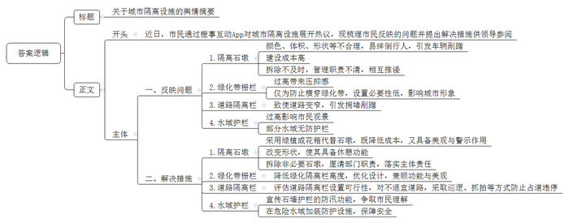
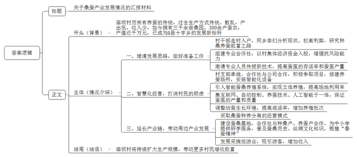
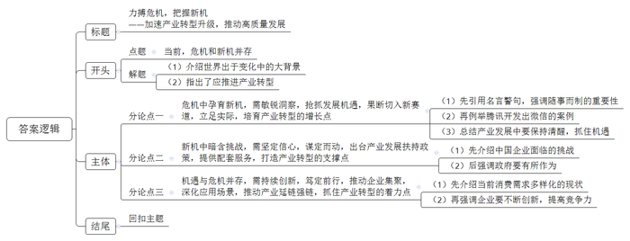

# 2024年公务员多省联考《申论》题（云南县乡卷）

> 候选采集稿。参考答案及解析来自粉笔页面，不代表官方答案或真实高分答卷；来源使用许可与原卷对应关系仍需人工核实。

## 给定材料

### 材料 material-b099d2f94b6c930e

F区有工业企业5000多家，规模以上企业588家，中小企业数量庞大。但由于规模小、资源少、实力弱，发展前景有限，大部分中小企业都面临高端人才匮乏的问题。

“200多名员工，本科学历专业人才仅15人。”尚志摩托张总感叹，尚志摩托一直无法对生产工艺进行改造，摆脱不了劳动密集型生产方式，更没有能力研发高端产品，长期处于低利润率甚至亏损状态。“企业再不转型迟早会被市场淘汰，但无高端人才，我们转型难度也很大。”

2022年5月，F区委组织部牵头成立调研组，深入4个工业园区，广泛收集企业的创新难题和人才需求。7月，出台《F区“科技副总”进企业专项实施细则（试行）》，明确从高校院所引进专家教授到企业担任“科技副总”，补齐企业高端人才短板。

9月，尚志摩托张总收到区经信委发来的专家人才情况介绍清单。几乎同一时间，交通大学机电工程学院孙教授也收到了首批企业的用才需求。由于孙教授的研究方向与尚志摩托瞄准的转型目标非常契合，双方不约而同选择了对方。

孙教授很快就加入企业的技术攻关中。他和尚志摩托的技术人员花了两个月时间，自主研制出制动踏板性能测试平台。这一测试平台让尚志摩托具备了制动踏板智能检测能力，产品合格率提升到99.99%，生产效率提高20%，相较外包平台检测降低成本70%。孙教授的加入，让尚志摩托在转型升级过程中多了一份底气和信心。目前，公司正在加速由生产传统的制动踏板、离合踏板等产品转向研发生产具有更高附加值的智能化产品。

F区建立“柔性借智、协同攻关”工作机制，由区经信委派出工作专班深入园区、企业精准摸排，和企业一起制订问题清单和需求清单，给予企业最大的自主选择权，帮助它们按需引进“科技副总”。同时，畅通“能进能出”通道，对“科技副总”建立优胜劣汰的考评管理机制。F区经信委胡主任说：“两年任期内，每位‘科技副总’可享受区里提供的5万元人才基础津贴和不设上限的绩效津贴，支持他们与企业‘一事一议’商定薪酬，建立区领导日常联系机制，配备人才服务专员……”

“我曾和其他‘科技副总’交流过，大家都认为‘科技副总’这个身份及其背后的政策支持，极大调动了我们的积极性。”孙教授说，许多“科技副总”已经把自己当作企业的一份子。

“我平均每周都要到公司一到二次，适合山地丘陵地形的电动履带式无人农机动力平台，就是在这种频繁交流中诞生的。”广田机械制造有限公司“科技副总”、中科院绿色智能技术研究院杨教授说，“该平台目前已经应用到多个地区的田间地头。高校院所科研人员擅长‘从0到1’的突破，企业擅长‘从1到100’的成果转化和应用。‘科技副总’正好将双方的优势结合了起来，互为对方补齐了短板。”

“‘科技副总’在一定程度上改变了企业的研发模式，过去企业单纯向高校院所购买专利，或与高校开展短期项目合作，现在双方实现了深度融合，围绕需求端进行联合研发、设计、生产，产品更容易落地，实现产业化。”广田机械王总经理说。

中建桥梁“科技副总”、工业大学刘教授的研究方向是大跨桥梁智能监测，“我之前与中建桥梁有过一些合作，但都是短期项目制的。”刘教授说，“‘科技副总’进企业专项启动后，双方再续前缘。跟之前相比，最大的变化是双方能开展长期、全方位的合作，进一步推动了‘产学研用’的深度融合。”再度牵手后，刘教授和中建桥梁不断碰撞出新的研究方向，并申请了两个发明专利，还为企业成功申报了国家重点研发计划“政府间国际科技创新合作”重点专项。

为了进一步深化校企合作，刘教授还邀请同校的林教授到中建桥梁调研，希望促成更多的合作。“一项工程会遇到很多问题，涉及许多细分领域，这需要更多的专家参与其中。”刘教授说，下一步，他计划借助“科技副总”这一模式，推动学院与企业共建人才培养基地，让学生到中建桥梁实习，企业的技术人员也可以依托学院的平台和资源开展培训，实现人才培养的双向互动。

“今年我们主动链接‘科技副总’的科研团队、专家人脉等智力资源，柔性引进工程院院士等顶尖专家到F区干事创业。”区委组织部负责人说，“‘科技副总’进企业专项行动实施一年以来，已经有46名专家人才和行业精英受聘到企业任职，帮助创建创新平台25个，实现科技成果转化40次，解决关键技术、管理、财务难题85个，创造直接经济效益2.8亿元，‘科技副总’们产生的价值已经远超出了当初的预期。”

### 材料 material-c9b910d29389d6f8

橙事互动App，是D市报业集团旗下重点打造的新型融媒体传播平台，设有橙事直通车、橙友圈等10余个功能模块，致力于提供全方位的城市新闻资讯、互动娱乐和同城社交服务，深受市民欢迎。

近日，有橙友在“橙事直通车”发帖称：“今天上午9点，青年路一饭店门口，一位老太太被石墩子绊倒，右手前臂骨折。”帖文中的照片显示，老太太坐在石墩子旁，手臂上用简易夹板夹着，现场还有警察和医生。

“橙事直通车”记者赶往事发现场，发现青年路靠近解放路一段，沿途设置了许多石墩子，底部宽约70厘米，高约30厘米。该路段辅道正在施工改造，安装石墩子是为了防止车辆误入施工路段。

据附近饭店的店员讲：“年轻人过这些石墩子都很小心，别说老人了。石墩子颜色与地面几乎一样，又比一般的石墩要大很多，如果视力不好很容易被绊倒，尤其是晚上更难注意到，我昨晚差点儿就被绊倒了。”

刚好路过的毛大伯指着解放路方向对记者说：“那边也有一些石墩子设在人行道上，可能是不让车辆上人行道停放，也没有警示颜色，还做成了比较高的锥子形，看着都吓人，你们可以去那边看看。”

在青年路社区，工作人员告诉记者：“我们也了解这个事，石墩子对维护交通秩序用处很大，但对过往行人确实不太友好。目前，我们正准备协调相关部门先拆除部分非必要的石墩，后续怎么办，还需要进一步协商。”

隔离石墩绊倒老人的帖文发布后，不少橙友在橙友圈的“吐槽与建议”栏目上留言——

嘤里嘤嗦：还不如放几盆大一点儿的绿植或花箱，既好看又能起到隔离作用，摆大石墩子这种东西的管理者要么“太有钱”、要么“太草率”。

流水豆腐：我昨天也被小区门口的石墩子绊倒了，脚肿得像馒头一样，正在和物业吵赔偿的事儿。

秦朝那些事儿：弄些能歇歇脚、坐一坐的石墩，难道不是更有价值吗？

溪水西下：拦了车子，绊了人，又有碍观瞻，这现象很普遍啊！要从根本上解决问题，还是要加强对开车人的管理，他们的素质要提高。

不文明的文化人：复兴路中央绿化带两旁的隔离栅栏差不多有两米高，开车像在笼子里走。

……

“橙事直通车”记者对复兴路进行实地探访后，在“橙事互动”发起讨论，请橙友们对绿化带隔离设施的作用表达意见——

路人甲：多少有点用。偶尔还是有人横穿绿化带，但并不多。是否有必要为极少数人的不文明行为去花钱建护栏，需要决策者好好衡量。

路人乙：完全没有用。一个城市的文明形象就被这些绿化带栏杆给毁了。看起来很有规矩，但反而说明这个城市很不文明。

路人丙：非常有用。复兴路中央绿化带里再也没有熊孩子出没踩踏了。竹制的隔离栅栏也与绿化景观相得益彰。

……

随着橙友们对城市各种隔离硬件的讨论越来越热，橙友圈晒出的相关帖文、照片、视频也越来越多。

良山西路是双向两车道，为防止车辆占道违停，路两边和中间都安装了隔离栏，导致道路变窄，经常发生拥堵和剐蹭，附近居民怨声载道。

新建的花海小区门前人行道原本很宽阔，居民常在此散步休闲。随着小区入住的人越来越多，在人行道乱停车的情况也越来越严重，给过往的行人造成了极大的不便，也存在安全隐患。现在安了石墩子，人行道又恢复了以往的整洁有序。

者城路地铁修建时，为分流车辆，专门加了些小石墩。可地铁通车都这么久了，小石墩却还在那儿杵着。昨天上午开车转弯时，一不小心，车子就被小石墩顶了。小石墩贴有反光条，晚上很醒目，白天反而不容易看到。

我们这边的石墩子“更狠”，不管白天晚上，不管贴不贴反光条，很多第一次开车来这儿的，都被剐蹭到了。也不知道是谁放的石墩子，又矮又乱！上次，有人打电话到住建局投诉，住建局说这归城管部门管，与城管局联系，对方说这是交警的事儿。

改造数年的两江交汇码头终于对外开放了。我带孩子们去码头步道看江景，结果发现步道临江的石墙护栏至少有1.6米高，我都得踮起脚来才看得到江景。孩子们看不到都急了，想和其他游客一样爬到石墙上去看，我可不敢让他们做这么危险的事。听说石墙护栏可以防止涨水时江水浸到路上来，是真的吗？

城郊的三河水库山清水秀，周边修建了很多娱乐休闲设施，我们经常带孩子去玩儿。但几乎每次去都会听说“又发生一起失足落水事件”。水库堤坝边没有任何防护栏，小孩儿游玩时一不小心就可能落水，这事儿谁来管管啊！

D市工商大学城市管理学院吴教授认为，城市管理中，硬件也要“柔软”一些，如何平衡好，是对城市管理者的考验。

### 材料 material-027d5aa76856c557

早上不到8点，庙坝村村民小刘已经开始忙碌了，只见他背着背篓穿梭在桑园中采桑叶，“桑叶太热，蚕就会不吃，所以一定要趁着早晨凉爽时采摘。”拥有三千余亩桑园，300余户蚕农，围绕“一只蚕”衍生出近1000万元产值……如今庙坝村的桑蚕产业已经成为B县十字乡的发展新标杆，但在过去谁也没有想到一只蚕竟然能吐出乡村振兴新“思路”。

庙坝村历来有养蚕的传统，这里的温度和湿度非常适合种桑养蚕，几乎家家户户都在养蚕。“但在很长一段时间里，对于乡亲们而言，养蚕并不是一个‘划算’的买卖。”庙坝村党支部王书记坦言，“桑蚕产业属于劳动密集型产业，季节性强，劳动强度大，一户人家最多养两张蚕，一年卖三批，算下来大约有1.2万元的收入，如果外出打工一年至少挣两三万元。”

近几年村里动员村民们种植过茶叶、中药材，发展过养牛养羊产业，但都没有成功。眼见在家挣不到钱，越来越多的村民选择外出务工，庙坝村渐渐少了烟火气。

如何让庙坝村发展得更好，让村民留在家里也能过好日子？

2018年村支部理清发展思路，“经过调研我们决定重走‘蚕桑路’。”王书记说，“村子本就有养蚕的基础，只是以前各自为政，比较散乱，如果能统一起来，发展空间很大。”

于是王书记带领村干部走村入户，同乡亲们分析现状，权衡利弊，与村民一道研究种桑养蚕致富之路。为增强抗风险能力，村支部决定组建蚕桑专业合作社，拿出50万村集体经济资金入股。为提高蚕茧的存活率和蚕茧产量，村里邀请农业大学专家和市里的农技人员向村民传授新的种桑养蚕技术。“但收入是否能够达到预期目标，销售渠道有无保障，村民们依然有顾虑。”王书记回忆道。

如何打消村民的顾虑？经过调研，由村支部牵线，合作社决定与龙翔茧丝绸有限公司合作。“他们也在探索如何将桑蚕产业做大做强，这与我们的发展理念不谋而合。”王书记高兴地说。同时，村支部积极争取项目，在村里修建养蚕场所，安装智能化设备，支持合作社参与智能化养蚕经营。

2022年4月，由龙翔茧丝绸有限公司研发的智能蚕桑养殖系统正式投入使用。“这套系统，让养蚕从横向养殖变为立体养殖。”王书记称。

在传统养蚕业中，蚕筐通常被放置在地上，如果扩大养蚕规模，则需要扩大场地规模。但现在，通过这套系统，幼蚕搭乘“电梯”，住进了12层高的“楼房”，极大提高了场地的利用率。不仅如此，该系统还集互联网、自动控制、养蚕技术、人工智能于一体，有效保证了蚕茧的产量和质量。

“幼蚕的生长对环境要求很高，必须要控制好温度、湿度等，这套系统能为幼蚕调整到最适宜生长的环境，幼蚕成活率更高。”庙坝村智能蚕房车间技术工人老刘称，“目前，我们已经实现一年养殖10批次，是传统养蚕的3倍。”

除了带动本地的发展，庙坝村还带动了周边村（社区）发展桑产业。

“我们采取桑蚕种养分离的经营模式，针对有能力种植桑叶但没有能力养蚕的村民，我们会收购他们的桑叶。”王书记称，“这比种土豆的收入要高，老百姓也愿意种。”

“蚕子成熟以后就会吐丝，然后作茧自缚变成蛹，再破茧而出化为蛾，所以有句古诗叫‘春蚕到死丝方尽’。”蚕桑基地中，带队老师正向学员们讲述蚕桑历史、丝绸文化等知识，增进孩子们对中国养蚕抽丝历史的了解。随后，基地工作人员带领学员来到智能养蚕车间，近距离观察蚕宝宝和蚕茧，孩子们带着好奇和疑问，这里摸摸，那里嗅嗅，一边喂桑叶，一边七嘴八舌交流着自己研学的感受，“春蚕精神”润物无声地根植在了心间。合作社与种桑户、养蚕户合作，为中小学提供研学服务，受到了孩子、家长、学校的一致欢迎。

“只要天气好，每天下午来的游客最多，要到晚上八点天黑了，人才走完……”4月初，桑葚园迎来了桑葚成熟期，红的、黑的桑葚密密麻麻地“趴”在壮硕的桑葚树上。天朗气清，前来采摘桑葚的游客越来越多，大家沉浸在采摘和品尝的喜悦中。

“走这边来，那边的没有这边的甜。”“快来这边，这里的桑葚是最多的。”“我们来比比哪个先摘满。”大家有说有笑，热闹非凡。去年有2万多名游客来庙坝摘果，创造收入300万元，桑蚕产业的产业链，也得以延长。

6月17日至19日，2023年蚕桑丝绸产业高质量发展大会在B县举行，专家们的建议让王书记看到了更多可能。

“今年，我们力争在2022年的规模上扩大一倍，带动更多村民增收致富。”对此，王书记信心满满。

## 题目

### 第 1 题

**“给定资料**1**”提到“从0到1”和“从1到100”，请谈谈“科技副总”在“从0到100”的过程中发挥了哪些作用。（15分）**

关联材料：material-b099d2f94b6c930e

作答要求：

要求：全面、准确、有条理。不超过300字。

### 第 2 题

**假如你是****D市城管局工作人员，请根据“给定资料**2**”，起草一份舆情摘要供领导参阅。（20分）**

关联材料：material-c9b910d29389d6f8

作答要求：

要求：

（1）内容包括反映问题和解决措施；

（2）问题梳理全面、准确；

（3）措施与问题对应，具体明确、切实可行；

（4）不超过400字。

### 第 3 题

**假如你是刚入职乡党政办的工作人员，领导安排你去庙坝村了解桑蚕产业发展情况，请根据****“给定资料**3**”，起草一份汇报材料提纲。（25分）**

关联材料：material-027d5aa76856c557

作答要求：

要求：

（1）紧扣资料，内容全面；

（2）逻辑清晰，语言精炼；

（3）不超过500字。

### 第 4 题

**“给定资料**4**”提到：“对机会的把握就像拔河，一头是危机，一头是新机，用力才可能赢得新机，泄力就可能输给危机。”请深入思考这句话，参考给定资料，联系实际，自选角度，自拟题目，写一篇文章。（40分）**

关联材料：material-b099d2f94b6c930e

作答要求：

要求：

（1）观点明确，见解深刻；

（2）参考给定资料，但不拘泥于给定资料；

（3）思路清晰，语言流畅；

（4）字数1000-1200字。

## 答案与解析

第 1 题

**参考答案（粉笔题库参考内容）**

科技副总帮助企业创建创新平台，实现科技成果转化，解决关键技术、管理、财务难题，提升经济效益，作用如下：

1.助力产业转型。补齐高端人才短板，改造生产工艺，改变劳动密集型生产方式，提升自主研发能力，提高产品合格率，降本增效，研发高附加值产品，提高利润率。

2.推动产学研用深度融合。改变企业研发模式，科研人员与企业双方优势互补，围绕需求端进行联合研发、设计、生产，实现产品产业化；开展长期、全方位合作，碰撞新的研究方向，申请发明专利和国家重点研发计划。

3.实现人才培养的双向互动。深化校企合作，推动学院与企业兴建人才培养基地，为学生提供实习场所，企业的技术人员依托学院的平台和资源开展培训。

**解析**

**参考答案说明**：本参考答案是“总分”逻辑，先指出科技副总在创新平台、成果转化、关键技术、管理等方面的整体作用，再从“助力产业转型”“推动产学研用深度融合”“实现人才培养的双向互动”这三个方面展开。各条答案要点之间在内容上相互并列，没有交叉。

**考点**：考点影响类

**来源**：来源2024年公务员多省联考《申论》题（云南县乡卷）

粉笔申论页面对本题只提供「解析视频」入口，该入口是会员推广位，页面无视频地址与文字解析。

第 2 题

**参考答案（粉笔题库参考内容）**

关于城市隔离设施的舆情摘要

近日，市民通过橙事互动App对城市隔离设施展开热议，现梳理市民反映的问题并提出解决措施供领导参阅。

一、反映问题：1.隔离石墩：颜色、体积、形状等不合理，易绊倒行人，引发车辆剐蹭；建设成本高；拆除不及时，管理职责不清，相互推诿。2.绿化带栅栏：过高带来压抑感；仅为防止横穿绿化带，设置必要性低，影响城市形象。3.道路隔离栏：致使道路变窄，引发拥堵剐蹭。4.水域护栏：过高影响市民观景；部分水域无防护栏。

二、解决措施：1.采用绿植或花箱代替石墩，既降低成本，又具备美观与警示作用；改变形状，使其具备休憩功能；拆除非必要石墩，厘清部门职责，落实主体责任。2.降低绿化隔离栏高度，优化设计，兼顾功能与美观。3.评估道路隔离栏设置可行性，对不适宜道路，采取巡逻、抓拍等方式防止占道违停。4.宣传石墙护栏的防汛功能，争取市民理解；在危险水域加装防护设施，保障安全。

**解析**

**参考答案说明：**（1）格式方面，本参考答案写到了“标题”“正文”两个部分。（2）正文部分，一方面从内容上来看，围绕“城市隔离设施”这一主题，本参考答案的开头先介绍了舆情的背景；主体部分从“反映问题”“解决措施”两个方面展开。另一方面，形式上，本参考答案做到了分段、分条撰写，整体上条理较为清晰。

**考点**：考点总结类

**来源**：来源2024年公务员多省联考《申论》题（云南县乡卷）

粉笔申论页面对本题只提供「解析视频」入口，该入口是会员推广位，页面无视频地址与文字解析。

第 3 题

**参考答案（粉笔题库参考内容）**

关于桑蚕产业发展情况的汇报材料

背景：庙坝村历来有养蚕的传统，过去生产方式传统、散乱，产出低，收入少，如今拥有三千余亩桑园，300余户蚕农，产值近千万元，已成为B县十字乡的发展新标杆。

情况介绍：

一、理清发展思路，做好准备工作。村干部走村入户，同乡亲们分析现状、权衡利弊，研究种桑养蚕致富之路；组建专业合作社，以村集体经济资金入股，增强抗风险能力；邀请专业人员传授新技术，提高蚕茧的存活率和蚕茧产量。

二、智慧化经营，打消村民的顾虑。村支部牵线，合作社与公司合作，积极争取项目，修建养蚕场所，安装智能化设备；引入智能蚕桑养殖系统，实现立体养殖，提高场地利用率；集互联网、自动控制、养蚕技术、人工智能于一体，保证蚕茧的产量和质量；调整幼蚕生长环境，提高成活率，增加养殖批次。

三、延长产业链，带动周边产业发展。采取桑蚕种养分离的经营模式；建设蚕桑基地，合作社与种桑户、养蚕户合作，为中小学提供研学服务，普及蚕桑历史、丝绸文化知识，根植“春蚕精神”；发展采摘旅游业，吸引游客，增加收入。

结语：庙坝村将持续扩大生产规模，带动更多村民增收致富。

**解析**

**参考答案说明：**（1）本题不需要考虑格式，只写正文即可，但为了保险起见，建议加上标题。（2）正文部分，一方面从内容来看，围绕着“庙坝村桑蚕产业发展情况”这一主题，本参考答案的开头先写到了庙坝村桑蚕产业发展的背景；主体部分从“理清发展思路，做好准备工作”“智慧化经营，打消村民的顾虑”“延长产业链，带动周边产业发展”等三个方面展开。另一方面，形式上，本参考答案做到了分段、分条撰写，整体上条理较为清晰。

**考点**：考点总结类

**来源**：来源2024年公务员多省联考《申论》题（云南县乡卷）

粉笔申论页面对本题只提供「解析视频」入口，该入口是会员推广位，页面无视频地址与文字解析。

第 4 题

**参考答案（粉笔题库参考内容）**

**力搏危机，把握新机**

**——加速产业转型升级，推动高质量发展**

世界百年未有之大变局，危机如突如其来的风暴，带来了挑战与考验的同时，也悄然孕育着变革与重生的契机，正如古语云：“祸兮福之所倚，福兮祸之所伏”。产业，作为国民经济的支柱，其发展轨迹与时代的脉搏紧密相连，科技革命的加速推进、消费者需求的多元化变化，传统产业模式的难以为继，时时刻刻都在提示产业要寻找新的发展道路，要在危机中发现并把握机会，在机遇中应对危机，在波涛汹涌中不断转型升级。

**危机中孕育新机，需敏锐洞察，抢抓发展****机遇****，果断切入新赛道，立足实际，培育产业转型的增长点。**习近平主席曾在博鳌亚洲论坛开幕式上引用了《盐铁论》中的“明者因时而变，知者随事而制”。意在提示在发展中，要摒弃不合时宜的旧观念，冲破制约发展的旧框框。在智能手机普及初期，腾讯洞察到移动互联网的潜力，尤其是社交领域，迅速组建团队，开发了划时代的社交软件——微信，并依据社交生态与支付、电商等多领域融合，打造综合性的生活服务平台，成为行业龙头。所以说，在产业发展中首要任务是保持清醒的头脑，通过深入分析市场趋势、政策导向等多方面信息，敏锐地洞察到其中蕴含的机遇，并要果断行动，将机遇转化为实际成果，抢占市场先机。

**新机中暗含挑战，需坚定信心，谋定而动，出台产业发展扶持政策，提供配套服务，打造产业转型的支撑点**。中国企业不可能总在风平浪静中发展，当在某一领域取得突出成就时，西方的霸权主义、欺凌主义，就会随之而来，但放弃就意味着淘汰，注定只能在“深海里练就游泳能力”，在弄潮中不断成长。在这样的环境下，就需要政府的有为之手，制定明确的产业发展规划，通过税收优惠、资金补贴、土地供应等政策措施，引导社会资本向重点产业和领域倾斜，同时强化人才培养和引进工作，建立完善的人才激励机制，提供有力的人才保障，为中国企业的发展保驾护航。

**机遇与危机并存，需持续创新，笃定前行，推动企业集聚，深化应用场景，推动产业延链强链，抓住产业转型的着力点。**新机为产业提供了转型升级的契机，而挑战则促使产业不断自我革新，走创新发展之路。随着全球化深入发展，消费者需求多元化，新技术、新业态层出不穷……这些要求企业不断适应和创新，否则将面临被市场淘汰的风险。面对机遇与危机并存的局面，企业要持续创新，加大研发投入，不断优化产品、服务，响应市场变化，还要与上下游产业加强联动，推动企业集聚，延伸产业链，推动成果转化，提高产业竞争力。

云海荡朝日，春色任天涯。产业发展唯有在挑战中寻找转机，将压力转化为前进的动力，将不确定性塑造为发展的源泉，才能真正实现转型升级，迎来发展新起点！

**解析**

**文章分析**

**力搏危机，把握新机**

**——加速产业转型升级，推动高质量发展**

【**标题的优点：**标题含有主题词，使文章主题更突出、清晰。其次，采用主副标题的形式，明确文章观点。】

（1）世界百年未有之大变局，危机如突如其来的风暴，带来了挑战与考验的同时，也悄然孕育着变革与重生的契机，正如古语云：“祸兮福之所倚，福兮祸之所伏”。（2）产业，作为国民经济的支柱，其发展轨迹与时代的脉搏紧密相连，科技革命的加速推进、消费者需求的多元化变化，传统产业模式的难以为继，时时刻刻都在提示产业要寻找新的发展道路，要在危机中发现并把握机会，在机遇中应对危机，在波涛汹涌中不断转型升级。

【**开头的优点：**★内容方面。范文的开头是紧扣题目给定的“危机和新机（产业转型）”这一主题展开的。首先，介绍世界处于变化中的大背景；其次，指出了应推进产业转型，应对危机与新机。★文字表达方面。运用了引用法，使语言表达更有文采。】

**危机中孕育新机，需敏锐洞察，抢抓发展机遇，果断切入新赛道，立足实际，培育产业转型的增长点。**（1）习近平主席曾在博鳌亚洲论坛开幕式上引用了《盐铁论》中的“明者因时而变，知者随事而制”。意在提示在发展中，要摒弃不合时宜的旧观念，冲破制约发展的旧框框。（2）在智能手机普及初期，腾讯洞察到移动互联网的潜力，尤其是社交领域，迅速组建团队，开发了划时代的社交软件——微信，并依据社交生态与支付、电商等多领域融合，打造综合性的生活服务平台，成为行业龙头。（3）所以说，在产业发展中首要任务是保持清醒的头脑，通过深入分析市场趋势、政策导向等多方面信息，敏锐地洞察到其中蕴含的机遇，并要果断行动，将机遇转化为实际成果，抢占市场先机。

【**论述段****1的优点：**★观点句：范文的观点句是紧扣“危机和新机（产业转型）”这一文章主题提出的。形式上，它在段首处直接写出，位置突出，容易发现。内容上，关键词突出，内容要点明确，可以明显看出主要论述从“抓住机遇，进入新赛道”方面入手。★论述内容：（1）先引用名言警句，强调随事而制的重要性；（2）再例举腾讯开发出微信的案例；（3）总结产业发展中要保持清醒，抓住机遇。注意：以上几个方面的内容都是紧扣“危机中孕育新机，需敏锐洞察，抢抓发展机遇，果断切入新赛道，立足实际，培育产业转型的增长点”这个观点句进行分析论述的，论述的针对性强，内容层次丰富。在论述方法上主要采用了讲道理与举例子结合，论述深刻透彻。】

**新机中暗含挑战，需坚定信心，谋定而动，出台产业发展扶持政策，提供配套服务，打造产业转型的支撑点。**（1）中国企业不可能总在风平浪静中发展，当在某一领域取得突出成就时，西方的霸权主义、欺凌主义，就会随之而来，但放弃就意味着淘汰，注定只能在“深海里练就游泳能力”，在弄潮中不断成长。（2）在这样的环境下，就需要政府的有为之手，制定明确的产业发展规划，通过税收优惠、资金补贴、土地供应等政策措施，引导社会资本向重点产业和领域倾斜，同时强化人才培养和引进工作，建立完善的人才激励机制，提供有力的人才保障，为中国企业的发展保驾护航。

【**论述段****2****的优点：**★观点句：范文的观点句是紧扣“危机和新机（产业转型）”这一文章主题提出的。形式上，它在段首处直接写出，位置突出，容易发现。内容上，关键词突出，内容要点明确，可以明显看出主要论述从“坚定信心，出台扶持政策，提供配套服务”方面入手。★论述内容：（1）先介绍中国企业面临的挑战；（2）后强调政府要有所作为。注意：以上几个方面的内容都是紧扣“新机中暗含挑战，需坚定信心，谋定而动，出台产业发展扶持政策，提供配套服务，打造产业转型的支撑点”这个观点句进行分析论述的，论述的针对性强，内容层次丰富。在论述方法上主要采用了讲道理的方式，论述清晰透彻。】

**机遇与危机并存，需持续创新，笃定前行，推动企业集聚，深化应用场景，推动产业延链强链，抓住产业转型的着力点。**新机为产业提供了转型升级的契机，而挑战则促使产业不断自我革新，走创新发展之路。（1）随着全球化深入发展，消费者需求多元化，新技术、新业态层出不穷……这些要求企业不断适应和创新，否则将面临被市场淘汰的风险。（2）面对机遇与危机并存的局面，企业要持续创新，加大研发投入，不断优化产品、服务，响应市场变化，还要与上下游产业加强联动，推动企业集聚，延伸产业链，推动成果转化，提高产业竞争力。

【**论述段****3****的优点：**★观点句：范文的观点句是紧扣“危机和新机（产业转型）”这一文章主题提出的。形式上，它在段首处直接写出，位置突出，容易发现。内容上，关键词突出，内容要点明确，可以明显看出主要论述从“持续创新，推进企业聚集，延链强链”方面入手。★论述内容：（1）先介绍当前消费需求多样化的现状；（2）再强调企业要不断创新，提高竞争力。注意：以上几个方面的内容都是紧扣“机遇与危机并存，需持续创新，笃定前行，推动企业集聚，深化应用场景，推动产业延链强链，抓住产业转型的着力点”这个观点句进行分析论述的，论述的针对性强，内容层次丰富。在论述方法上主要采用了讲道理与举例子结合，论述清晰透彻。】

云海荡朝日，春色任天涯。产业发展唯有在挑战中寻找转机，将压力转化为前进的动力，将不确定性塑造为发展的源泉，才能真正实现转型升级，迎来发展新起点！

【**结尾的优点：**范文的结尾回扣了“危机和新机（产业转型）”这个主题，并且进行了总结提升。】

**考点**：考点文章写作题

**来源**：来源2024年公务员多省联考《申论》题（云南县乡卷）

粉笔申论页面对本题只提供「解析视频」入口，该入口是会员推广位，页面无视频地址与文字解析。

