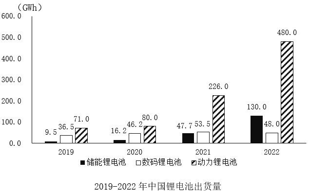
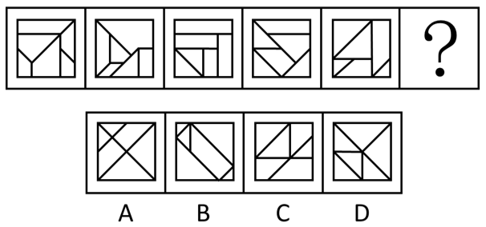
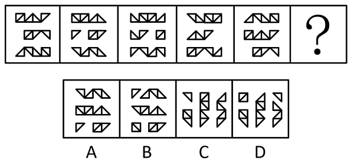
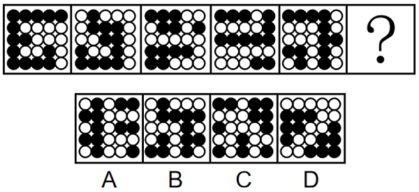
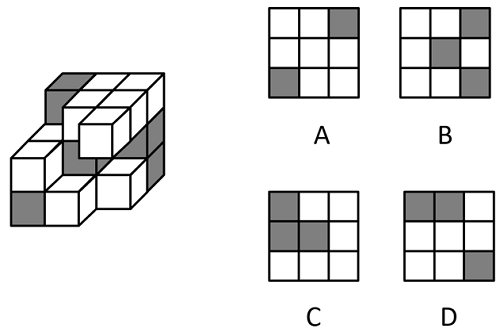
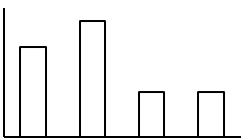

# 2024年云南公务员录用考试《行测》题（网友回忆版）

> 候选采集稿。参考答案及解析来自粉笔页面，不代表官方答案或真实高分答卷；来源使用许可与原卷对应关系仍需人工核实。

## 题型与作答说明

常识判断

（20题）

根据题目要求，在四个选项中选出一个最恰当的答案。

言语理解与表达

（25题）

本部分包括表达与理解两方面的内容。请根据题目要求，在四个选项中选出一个最恰当的答案。

数量关系

（10题）

在这部分试题中，每道题呈现一段表述数字关系的文字，要求你迅速、准确地计算出答案。

判断推理

（30题）

本部分包括图形推理、定义判断、类比推理与逻辑判断四种类型的试题，在四个选项中选出一个最恰当的答案。

资料分析

（15题）

所给出的图、表、文字或综合性资料均有若干个问题要你回答。你应根据资料提供的信息进行分析、比较、计算和判断处理。

## 给定材料

### 材料 dom-material-ccd0caeea3571e24

2022年中国锂电池出货量658GWh，同比增长101.1%。2022年中国动力锂电池装车量达294.6GWh，同比增长90.7%，高于全球同比增速18.9个百分点，占全球动力锂电池装车量的56.9%。

### 材料 dom-material-9f79fd4a29cc46b9

截止2022年12月，我国网民规模约为10.67亿，较2021年12月新增网民约3549万，互联网普及率达75.6%，较2021年12月提升2.6个百分点。我国网民使用手机上网的比例达99.8%，较2021年12月增加0.1个百分点；使用电视上网的比例为25.9%；使用台式电脑、笔记本电脑、平板电脑上网的比例分别为34.2%、32.8%和28.5%。我国城镇网民规模约为7.59亿，占网民整体的71.1%，农村网民规模约为3.08亿，较2021年12月增长约2371万，占网民整体的28.9%。

2022年12月，20-29岁、30-39岁、40-49岁网民占比分别为14.2%、19.6%和16.7%；50岁及以上网民群体占比由2021年12月的26.8%提升至30.8%，互联网进一步向中老年群体渗透。

2022年12月，线上办公用户规模约达5.4亿，较2021年12月增加7078万户，占整体网民的50.6%。互联网医疗用户规模约达3.63亿，较2021年12月增加约6466万，占网民整体的34%。农村地区在线教育和互联网医疗用户分别占农村网民整体的31%和21.5%，较上年分别增加2.7%和4.1%。

### 材料 dom-material-7594700f9f2f11af

2023年一季度，新疆外贸进出口总值680.7亿元，同比增长80.3%。其中，出口584.7亿元，同比增长86.9%。3月当月，新疆外贸进出口总值236.9亿元，同比增长70%。其中，出口203.4亿元，同比增长78.9%；进口33.5亿元，同比增长30.8%。

2023年一季度，新疆15个地州市中，乌鲁木齐、喀什、伊犁州、博州和塔城外贸规模居前五，贸易值分别是176.0亿元、142.1亿元、121.9亿元、94.9亿元、33.5亿元，伊犁州、塔城、哈密、克拉玛依、博州增速居前五，同比增速分别为198.4%、183.6%、179.4%、163.3%、150.6%。

2023年一季度，新疆实有备案外贸企业15486家，同比增长6.5%；一季度，新疆有进出口实绩的外贸企业1535家，同比增长12%。新疆民营企业进出口650.1亿元，同比增长94.2%。一季度，新疆国有企业进出口25.7亿元；外商投资企业进出口4.9亿元。

2023年一季度，新疆金属矿及矿砂、未锻轧铜及铜材、煤炭分别进口35.5亿元、11.4亿元、3.7亿元，同比分别增长134.1%、65.3%、79.6%，进口量同比分别增长102.5%、69.4%、78.8%。同期，进口农产品15.2亿元，同比增长20.5%。

## 题目

### 第 1 题

“周虽旧邦，其命维新”。习近平总书记指出，中国式现代化是中华民族的旧邦新命，必将推动中华文明重焕荣光。下列关于中国式现代化说法正确的有几项？

①中国式现代化深深植根于中华优秀传统文化，体现科学社会主义的先进本质

②中国式现代化借鉴吸收一切人类优秀文明成果，是一种全新的人类文明形态

③中国式现代化是中国共产党领导的社会主义现代化，是文明更新的结果

④中国式现代化蕴含的独特世界观、价值观、历史观、文明观、民主观、生态观等及其伟大实践，是对世界现代化理论和实践的重大创新

⑤中华文明赋予中国式现代化以深厚底蕴，走中国式现代化道路，赋予中华文明以现代力量

A. 2

B. 3

C. 4

D. 5

### 第 2 题

党的二十大报告指出，我们要坚持以推动高质量发展为主题，把实施扩大内需战略同深化供给侧结构性改革有机结合起来，增强国内大循环内生动力和可靠性。下列关于扩大内需说法正确的有几项？

①建立和完善扩大居民消费的长效机制，使居民有稳定收入能消费、没有后顾之忧敢消费、消费环境优获得感强愿消费

②加快发展贸易新业态新模式，进一步发挥进出口对我国经济的支撑作用

③深化供给侧结构性改革，形成供给牵引需求、需求创造供给的更高水平动态平衡

④通过政府投资和政策激励有效带动全社会投资，形成有本金和债务约束的金融需求

⑤鼓励和吸引更多民间资本参与国家重大工程和补短板项目建设，激发民间投资活力

A. 2

B. 3

C. 4

D. 5

### 第 3 题

习近平法治思想是对中国共产党领导法治建设丰富实践和宝贵经验的科学总结，是一个内涵丰富、论述深刻、逻辑严密、系统完备的科学理论体系。下列关于习近平法治思想说法正确的有几项？

①自由是秩序的目的，秩序是自由的保障

②党的领导是社会主义法治之魂，是我国法治与西方资本主义国家法治最大的区别

③发挥领导干部示范带头作用，努力使尊法学法守法用法在全社会蔚然成风

④新闻媒体要加强对执法司法工作的监督，但对执法司法部门的正确行动，要予以支持，加强解疑释惑，进行理性引导

⑤加强重点领域、新兴领域、涉外领域立法，统筹推进国内法治和涉外法治，以良法促进发展、保障善治

A. 2

B. 3

C. 4

D. 5

### 第 4 题

党的二十大报告指出，优化民营企业发展环境，依法保护民营企业产权和企业家权益，促进民营经济发展壮大。下列关于促进民营经济发展措施与其发挥作用对应正确的是：

①完善社会信用激励约束机制——发挥信用激励机制作用，提升信用良好企业获得感

②完善融资支持政策制度——支持符合条件的民营企业上市融资，缓解民营企业资金问题

③持续完善知识产权保护体系——严格落实侵权惩罚性赔偿，降低民营企业科技转化成本

④健全民营经济人士思想政治建设机制——深入开展理想信念教育，确保构建亲近政商关系

A. ①②

B. ①③

C. ②④

D. ③④

### 第 5 题

无农不稳，无粮则乱。习近平总书记指出，农业强，首要是粮食和重要农产品供给保障能力必须强，下列举措属于提升粮食产能的有几项？

①切实把种业振兴行动抓出成效，加快生物育种产业化步伐

②完善农资保供稳价应对机制，稳定农民预期、降低生产风险

③逐步把永久基本农田全部建成高标准农田，确保建一块成一块

④制止“舌尖上的浪费”，深入开展“光盘行动”，提倡健康饮食

⑤坚决守住18亿亩耕地红线，坚决遏制“非农化”，有效终止“非粮化”

A. 2

B. 3

C. 4

D. 5

### 第 6 题

党的二十大报告指出，坚持按劳分配为主体、多种分配方式并存，构建初次分配、再分配、第三次分配协调配套的制度体系。关于完善收入分配格局，下列说法正确的是：

①扩大中等收入群体比重，增加低收入群体收入，取缔过高收入，促进社会公平正义

②构建知识、技术、数据等创新要素参与收益分配机制，优化初次分配格局

③推动教育、养老、医疗、住房保障等基本公共服务均等化，逐步健全再分配机制

④通过发展企业年金、职业年金等措施，发挥第三次分配重要作用

A. ①②

B. ①④

C. ②③

D. ③④

### 第 7 题

中华文明源远流长，云娱乐中华民族的宝贵精神品格，\*\*\*\*\*\*\*\*\*，创造形成了引领中国社会发展进步的社会主义道德体系。下列古语符合社会主义道德体系建设要求的是：

①见侮而不斗，辱也

②百尺之室，以突隙之烟焚

③躬自厚而薄责于人，则远怨矣

④黑发不知勤学早，白首方悔读书迟

A. ①②

B. ①③

C. ②③

D. ③④

### 第 8 题

下图是中国国家博物馆西大厅的巨型浮雕，与之相关说法错误的是：

A. “锲而不舍，金石可镂”是浮雕故事主人公的名言

B. 毛泽东在七大闭幕词中提到了浮雕中的故事

C. 浮雕是以徐悲鸿同名国画为原本创作而成的

D. 浮雕所展现的故事记载在《列子·汤问》中

### 第 9 题

2023年3月1日，兰某入职某公司，入职10天后兰某发现自己怀孕，于是经常迟到早退，有时还旷工，已经达到了员工手册规定的解聘条件。2023年5月30日公司宣布解聘兰某。对于公司的解聘行为，下列说法正确的是：

A. 公司有权解聘兰某，且无需支付经济补偿金

B. 公司有权解聘兰某，但必须支付经济补偿金

C. 兰某处于孕期，按照劳动法的规定，公司不得解聘

D. 公司违法解除与兰某的劳动关系，应当双倍支付经济补偿金

### 第 10 题

胡女士在甲公司APP上看到乙酒店某型客房贵宾优惠价为2889元后付款，次日却发现该房型当晚的实际挂牌价仅1377元。胡女士认为其作为贵宾客户却支付了高于实际价格的费用，遂将甲公司起诉至法院。关于此案，下列说法错误的是：

A. 甲公司存在价格欺诈行为，胡女士有权退一赔三

B. 甲公司向胡女士承诺贵宾优惠价，但未践行承诺，侵害了胡女士的公平交易权

C. 甲公司的行为导致胡女士遭受了不必要的经济损失，侵害了胡女士的财产安全权

D. 甲公司APP作为中介平台，其未如实标注该房型的真实价格，侵害了胡女士的知情权

### 第 11 题

下列关于自首的判断说法正确的是：

A. 甲和乙共同实施盗窃犯罪，后甲因为内心害怕，主动到公安机关交代，并独自承担了全部罪行，甲构成自首

B. 甲和乙共同实施诈骗犯罪，后甲因酒驾被公安机关讯问时，主动交代乙曾经实施的故意杀人行为，甲构成自首

C. 王某交通肇事逃逸，其父知道后将其扭送至公安机关，王某主动交代了其肇事逃逸行为，王某构成自首

D. 甲公司非法集资且规模很大，该公司总经理李某因为害怕，瞒着其他高管偷偷到公安机关交代了相关情况，李某作为单位犯罪的直接责任人不能单独成立自首

### 第 12 题

唐太宗的《起居注》一直流传至今，以下情景不可能出现的是：

A. 与大臣一同品鉴李白的诗歌

B. 与房玄龄等大臣商议旱灾救助方案

C. 接见西域使者，被少数民族尊为“天可汗”

D. 宗庙祭祀，向其父唐高祖李渊上香祷告

### 第 13 题

关于我国历史上的科技著作，下列说法错误的是？

A. 《天工开物》——中国17世纪的工艺百科全书

B. 《坤舆万国全图》——中国最早的彩绘世界地图

C. 《水经注》——介绍了欧洲先进的水利技术和工具

D. 《徐霞客游记》——世界最早关于石灰岩地貌研究的文献

### 第 14 题

下列关于我国科技成就说法正确的是：

①“三峡氢舟1号”——助推我国首次在南海海域成功开采可燃冰

②“可持续发展科学卫星1号”——专门服务联合国2030年可持续发展议程的科学卫星

③“蓝鲸1号”——我国首艘氢燃料电池动力示范船

④“耕海1号”——将渔业养殖、海上旅游、科技研发等功能相结合的海洋牧场综合体

A. ①③

B. ②③

C. ①④

D. ②④

### 第 15 题

下列世界文化遗产及所在地对应错误的是：

A. 平遥古城——山西；鼓浪屿——福建

B. 龙门石窟——河南；云冈石窟——陕西

C. 布达拉宫——西藏；良渚古城遗址——浙江

D. 武当山古建筑群——湖北；西递村——安徽

### 第 16 题

下列文句与蕴含的哲理对应正确的是：

A. 竭泽而渔，岂不获得，而明年无鱼——事物是不断发展的

B. 井蛙不可以语于海，夏虫不可以语于冰——尊重客观规律

C. 吾生也有涯，而知也无涯。以有涯随无涯，殆已——勤学善记

D. 兵无常势，水无常形，能因敌变化而取胜者，谓之神——学会审时度势

### 第 17 题

下列关于我国之“最”说法错误的是：

A. 东北平原是我国最大平原，北部为松嫩平原，南部为辽河平原

B. 三沙市成立于2012年，隶属海南省，是我国位置最南的地级市

C. 台湾岛位于东海南部，是我国第一大岛，有“东海瀛洲”之称

D. 新疆维吾尔自治区是我国陆地面积最大、交界邻国最多的省级行政区

### 第 18 题

下列诗词中包含的生物学现象说法错误的是（ ）。

A. 野火烧不尽，春风吹又生——草原生态系统具有稳定性

B. 群雁辞归鹄南翔，念君客游思断肠——候鸟通过迁徙适应气候变化

C. 停车坐爱枫林晚，霜叶红于二月花——植物开花受温度和光照影响

D. 落红不是无情物，化作春泥更护花——微生物的分解作用及物质的循环

### 第 19 题

下列古籍中描述的现象与所体现的物理原理对应正确的是（ ）。

A. 《论衡》中提到摩擦过的琥珀能吸引像草芥一样的轻小物体——分子引力

B. 《考工记》中提到马拉车时，虽然马不再施力了，车仍能向前移动一段距离——惯性

C. 《墨子》中提到天平一端加重物，另一端必得加重物，两者必须相等才能平衡——力的相互作用

D. 《异苑》中提到有户人家的铜盆经常发出声音，后来发现是与宫中撞钟相应，用锉刀锉了铜盆后，声音就消失了——多普勒效应

### 第 20 题

下列有关生活常识说法错误的是：

A. 白糖水分含量少、糖分高，不耐储存

B. 食醋的pH值比较低，可以抑制微生物的生长

C. 美白牙膏通常采用过氧化钙等过氧化物漂白牙齿

D. 削了皮的苹果变色是一种化学反应，会影响苹果的口感

### 第 21 题

要解决一个大问题，往往要有好的工具。工具的发展是一个            的过程，新工具能够促进学问的继续发展，提升我们看待问题的深度，又反过来促进我们进一步发展工具。每一次工具的进步，都会带动有意义的、重要的、突破性的学问的发展。

填入画横线部分最恰当的一项是：

A. 锦上添花

B. 精益求精

C. 千锤百炼

D. 精雕细琢

### 第 22 题

近年来，以云计算、大数据、人工智能等技术引领的新一代数字化浪潮            。数字化转型按下“加速键”，数字技术应用深度和广度不断拓展，新技术新业态新模式            ，数字经济日渐成为继农业经济、工业经济之后的新兴经济形态。

依次填入画横线部分最恰当的一项是:

A. 汹涌澎湃 此起彼伏

B. 浩浩荡荡 层出不穷

C. 波澜壮阔 生生不息

D. 气壮山河 方兴未艾

### 第 23 题

文旅开发需注重对古镇自然环境的呵护，避免简单        其他文旅项目大广场、大草坪、大展馆等设计，应当留住古镇清幽、古朴的历史风貌，而大规模迁移原住居民、过度引入商业设施的开发模式，已经让众多注重旅游体验的游客“用脚投票”，尤当            。

依次填入画横线部分最恰当的一项是：

A. 移植 引以为戒

B. 复制 居安思危

C. 参考 防微杜渐

D. 借鉴 慎之又慎

### 第 24 题

中国的岁时节日既情意盎然又韵味绵长，以其深厚的旨趣，令人            ，堪称中国人的精神原乡。作为人类非物质文化遗产，如今的中国岁时节日，早已把中国与世界紧密地联系到一起，世界各地都有中国的节庆文化，华夏民族的古老智慧，在            中滋润着这个世界。

依次填入画横线部分最恰当的一项是：

A. 心向往之 春风化雨

B. 心旌摇荡 继往开来

C. 心驰神往 历久弥新

D. 心旷神怡 经久不衰

### 第 25 题

电影黄金档期票房以及年度总票房在整个经济总量中占比不高，但电影产业的经济影响            ，因为人们会通过这一数字，来        经济、社会的运转状况，尝试从中寻找规律、得到启发。

依次填入画横线部分最恰当的一项是：

A. 毋庸置喙 分析

B. 不容小觑 管窥

C. 举足轻重 估量

D. 兹事体大 洞察

### 第 26 题

中国地理位置相对独立，南有热带丛林，西南有世界屋脊喜马拉雅山和青藏高原， 西有昆仑山、天山、阿尔泰山等高山和中亚沙漠，北有蒙古高原和戈壁荒滩，东方则面海。它们虽不能构成人类迁徙的绝对        ，但会给大规模人群的流动带来挑战，尤其在环境恶化时更是如此。在这样相对封闭的生态环境中，于气候适宜期迁徙至此的早期直立人生存繁衍，            。

依次填入画横线部分最恰当的一项是：

A. 隔断 代代相传

B. 阻碍 绵绵不绝

C. 障碍 开花结果

D. 屏障 开枝散叶

### 第 27 题

对于热议的“网约车订单饱和”情况不能            ，部分城市部分时段或部分月份可能出现短暂性动态饱和，回归到市场供求来说，网约车平台的多少，尤其是网约车车辆的多少，最终还是取决于公众出行需求多寡。市场具有自主调节能力，相关部门适时        风险，对于动态调整市场供求关系也将发挥积极作用。

依次填入画横线部分最恰当的一项是：

A. 简而言之 防范

B. 一概而论 预警

C. 予以臧否 调控

D. 妄下结论 评估

### 第 28 题

科学从来不会        自己洞察了宇宙所有的真相和奥秘，它从不否认自身的局限性：超出一定范围和条件之后，没有任何一种理论能够        和解释所有的现象，回答所有的问题。

依次填入画横线部分最恰当的一项是：

A. 宣称 描述

B. 认定 把握

C. 预言 分析

D. 标榜 论证

### 第 29 题

一款零食以前能靠独特口味畅销十几年，这在今天几乎是天方夜谭。新爆款横空出世，模仿者很快            ，消费者的新鲜感被迅速透支。当朝生暮死成为网红食品的常态，相比于            的零食巨头，轻资产的中小品牌反而更容易在时代变幻莫测的风向中            。

依次填入画横线部分最恰当的一项是：

A. 蜂拥而至 尾大不掉 闪转腾挪

B. 后来居上 作茧自缚 捷足先登

C. 青出于蓝 因循守旧 稳操胜券

D. 龙争虎斗 老气横秋 脱颖而出

### 第 30 题

20世纪80年代，伴随乡村民俗及观念的日益        ，写实风格绘画也在快速地构建新的民间审美意趣，反映社会生活、农村新貌的作品取代原来的民俗题材成为年画主体，年画艺术与“年”的关系            ，木版年画的雕版套印技术，以及由此形成的传统审美趣味至此走到了        的边缘。

依次填入画横线部分最恰当的一项是：

A. 弱化 形同陌路 式微

B. 淡化 渐行渐远 没落

C. 淡出 今非昔比 衰亡

D. 遗失 每况愈下 消弭

### 第 31 题

蜱虫具有恐怖的吸血能力，它会找到皮肤上隐蔽的角落            地吸血好几天，人却无法察觉。这是因为蜱虫的唾液就像鸡尾酒一样，由各种蛋白质“        ”而成，其中一些让人不痛不痒，一些让血液不会凝固，还有一些保证不会        人的免疫系统。多种病原体便会趁机入侵人体。

依次填入画横线部分最恰当的一项是：

A. 不声不响 搅拌 启动

B. 堂而皇之 调配 惊扰

C. 明目张胆 凝结 触发

D. 有恃无恐 混合 唤醒

### 第 32 题

当前，电信网络诈骗犯罪国际化        ，催生了网络赌博、偷渡、人口贩卖等一系列违法犯罪行为，严重影响了各国人民的人身财产安全，给各国社会稳定带来了        隐患。特别是在信息手段        下，流量爆棚的短视频平台容易沦为诈骗高发区，跨境电信诈骗犯罪呈现骗术隐蔽性强、链条化运作和涉案者年轻化等趋势，让案件侦破难度进一步提高。

依次填入划横线处最恰当的一项是：

A. 漫延 危险 支持

B. 蔓延 严峻 加持

C. 延伸 严重 影响

D. 蔓引 重大 助力

### 第 33 题

文言和白话是两个相互依存的概念，无文言，也就无所谓白话，但它们并不等同于书面语和口语。受限于语言保存技术，我们现在能感知的古代汉语都是书面上的，包括文言，也包括白话。文言是在先秦口语的基础上形成的古代汉语书面语。先秦两汉的典籍、六朝以后文人仿古写出的作品都属于文言文。 白话是汉魏六朝以后，随着语言发展变化而形成的较为接近口语的言语，偶尔也夹杂一些文言成分，较能反映语言的时代性和区域性特点。

根据这段文字，下列说法正确的是：

A. 汉魏六朝以后的作品都属于白话文

B. 古代汉语实际上包含白话文的成分

C. 文言文更能反映语言的时代性特点

D. 文言与白话分别等同书面语与口语

### 第 34 题

竹秆质地坚硬，其堪与木材媲美的木质特性，来自于初生结构中发达的机械组织和细胞壁木质化的基本组织；木材的木质特性，则来自于年轮式样分布的次生木质部。竹秆外形与其他禾本科草本植物的茎相似，具有明显的节和节间，节数和粗细在出笋时就已基本固定；节附近分布有居间分生组织，节间伸长时，各节分生组织同时活动，竹子迅速拔高；缺少形成层，不能长粗，只能保持“婴儿时期的身材”。竹壁分为竹青、竹肉、竹黄三个部分，竹青含叶绿素呈绿色，可以进行光合作用。

根据这段文字，下列说法错误的是：

A. 竹秆只能长高不能长粗

B. 竹子能够进行光合作用

C. 竹秆的节数在出笋时就已基本固定

D. 竹子的木质特性来自于次生木质部

### 第 35 题

开发前沿技术应用场景的实践价值在于，通过将前沿技术落地转化为生产力。高技能人才的可贵之处不在于突破核心技术，而在于为产业痛点、难点问题找到核心技术的最佳实践运用场景。例如，将智能技术引入水、电、煤等公用事业领域，但不同行业在应用场景选择上存在差异，电力企业重点推进智能电网建设，燃气行业的建设重点是智能表具系统······这些前沿技术的应用场景不是原始创新，而是技术的跨界融合，需要一线技术人员基于行业特点寻找适合的前沿技术实现赋能和融合。

最适合做这段文字标题的是：

A. 智能技术的开发与利用具有行业选择性

B. 技术落地的基础——突破创新，跨界融合

C. 找准问题——开发前沿技术应用场景的核心

D. 高技能人才——前沿技术应用落地的“嫁接者”

### 第 36 题

长期来看                     。美国“人类脑计划”研究发现，坚持运动可以明显增加神经细胞的数量，使大脑像肌肉一样越练越强大。该现象可能源于一种叫脑源性神经营养因子（BDNF）的物质，有维持现有神经细胞活力并促进新生神经细胞生长的功能。在大脑中，BDNF活跃在前额叶和海马体区域，前额叶掌控着决策、注意力以及人格；海马体具备形成及存储长时记忆的重要功能。

填入画横线部分最恰当的一项是：

A. 运动能够增强人的记忆力

B. 运动让人更健康、有活力

C. 运动会增加大脑中某些营养因子

D. 运动能够改变大脑的结构和功能

### 第 37 题

我国平台经济具有较好的数据贯通能力和智能分析能力，能够更好地帮助实体经济升级营销模式，提升管理决策效率和营销系统化能力，还可以利用平台应用的能力，提升实体经济中的产业链协同协作效应。因此，政府应积极地引导、支持消费互联网平台转型发展，对平台企业在新技术、新业态等方面的探索和投资布局给予更大的包容与支持，发挥平台优势助力构建我国自主可控的产业生态，在上下游联动、数实融合中创新孵化。

根据这段文字，我国平台经济需向哪个方向引导？

A. 提升管理能力

B. 助力产业协同

C. 赋能实体经济

D. 孵化创新产业

### 第 38 题

“中华”一词始于胡汉的区分，却终于胡汉的融合。所以产生这样的结果，根本原因在于“中华”一词并不是一个狭义的“汉人”概念，而是一个较宽泛的文化概念，既不对胡族设限，胡族对其也无明显的抵触与排斥。特别是“中华”之“华”所具有的以“衣冠礼乐”来喻指文化的象征意义，给“中华”这一概念带来了极大的包容度。入唐以后，“中华”一词作为唐朝别称与中国名号被广泛使用的事实，清楚地告诉我们，“中华”概念的实质是“华夷融合”。从很大意义上说，这正是后来历史发展中被“中华”所称谓的人们共同体得以不断扩大的原因。

根据这段文字，“中华”一词的特点是：

A. 文化性

B. 历时性

C. 模糊性

D. 开放性

### 第 39 题

天文学家用基尼系数来描述星系的面亮度分布不均（用星光替代社会学基尼系数定义中的人类财富）：基尼系数越大，意味着亮度越集中分布在少数区域，星系越倾向为椭圆（年老）星系。年轻和年老星系的分界线就在0.5-0.6左右，即如果一个星系的亮度分布不均匀程度超过0.5，则该星系很大概率近似椭圆星系，已失去了制造新恒星的能力了（变成年老星系）。基尼系数在区分不同类星系中的巨大成功使其成为研究星系及星系形态的一个重要参数。

根据这段文字，基尼系数在区分不同类星系中的成功表现是：

A. 区别不同星系表面的明亮程度

B. 演示不同星系从年轻到年老的过程

C. 可以用来描述不同星系与恒星的形状

D. 判断不同星系是否失去制造新恒星的能力

### 第 40 题

近年来，为建设便民生活圈，北京、上海、杭州等多地兴办了不少社区食堂。除了老年人，一些年轻人、附近社区居民也逐渐成为忠实的消费者。数据显示，截至2022年底，上海市已累计建成社区（长者）食堂305家，老年助餐点1303家。不过，在一些社区食堂备受追捧的同时，也有部分食堂出现运营困难，客源单一、饭菜质量不高是其乏人问津的主要原因。社区食堂的经营需通过科学布局、集约建设和精细化运营实现，要避免脱离社区实际盲目配置食堂，浪费公共资金。经营者也须有市场化竞争意识，在长期运营上拿出“绣花功夫”。

最适合做这段文字标题的是：

A. 社区食堂的“小餐桌”与“大民生”

B. 统筹社区食堂“公益”与“效益”

C. 激发活力，创新社区食堂运营新模式

D. 办好食堂，让社区居民共享幸福“食”光

### 第 41 题

在真空蒸发器内，卤水在外来蒸汽的作用下加热沸腾，水分的蒸发使卤水得到浓缩，卤水蒸发出的二次蒸汽温度低于外来输入蒸汽的温度，但仍然携带较多热量，二次蒸汽中的热量会被输入到下一级蒸发器中，二次蒸汽的温度相对较低，为了有效利用其中的热量，此时会降低蒸发器中的压力，水的沸点会随之降低，卤水会在更低的温度下沸腾，其产生的蒸汽又能够被用于气压更低的下一级蒸发器中。如此，通过多个蒸发器联用，不断回收蒸汽来进行加热，可以大大节省蒸汽的消耗量。

根据这段文字，为了节省蒸汽消耗量需采取的措施是：

A. 降低卤水的浓度

B. 提高蒸汽的温度

C. 降低蒸发器中气压

D. 增加蒸发器的数量

### 第 42 题

发展现代设施农业是转变农业发展方式的重要内容。相较于传统农业，现代设施农业把保护环境、低碳节能作为发展的前提条件，按照循环发展理念，通过运用人工智能技术、物联网技术等，不仅可以节约大量水资源、土地资源和人力资源，还能有效降低污染物的排放量，减少资源浪费和环境污染。此外，现代设施农业使用高科技技术和先进设备，通过农业生产标准化、精准化、智能化，让土地利用率、劳动产出率更高，资源能耗、生产成本更低，产品更有品质、生态更加安全，助力农业增效和农民增收。

关于现代设施农业，这段文字未提及：

A. 推动传统农业向现代农业转型升级

B. 减少资源消耗将促进农民收入增长

C. 有效降低环境污染有利于保护环境

D. 运用人工智能实现农业无人化生产

### 第 43 题

语言规划学的研究告诉我们，什么样的语言生活，塑造什么样的语言样态，也就培育什么样的语言能力。古诗词和复杂灵动的修辞有其恒久的价值与魅力，但不要忘记，在唐诗宋词滥觞的岁月，它们也是因适应当时的文人语言生活才获得发展的。回到今天，不论线上线下，我们都很难要求话语里也三句一成语、五句一典故。恰恰相反，不同于直接生硬的引用，在这个网络时代，有恒久魅力的经典语言文化正在以新的方式焕发生机。如把古诗词咏唱出来，新造成语用四字格描述今人情绪······如此种种不胜枚举。

这段文字意在说明：

A. 经典的文化元素在每个时代都会流行

B. 每个时代都有其独特的语言生活和样态

C. 语言文化必须适应语言生活才能获得发展

D. 经典文化元素在不同时代会有不同的表现形式

### 第 44 题

①而一些飞鸟会凭借着敏锐的感知能力发现这一变化

②为了逃生，这些动物就会表现出异常的举动

③地震发生之前发出的次声波，能够被许多动物提前感知到

④地震出现之前，地球的磁场也会发生变化

⑤地震的出现，是板块随着时间的推移，进行不断的挤压和碰撞形成的自然现象

⑥所以在地震来临之前，鸟类就会因为磁场的变化，而率先感知到了危险，并做出异于平常的行为

将以上6个句子重新排列，语序正确的一项是：

A. ⑤③②④①⑥

B. ⑤④①⑥③②

C. ③②④①⑥⑤

D. ③⑤⑥①④②

### 第 45 题

①作为研究文化遗存的一门学科，考古学无法与人相割裂，在科研中，应力求“透物见人”，抓住人类历史进程的发展规律

②公共考古学应积极搭建考古知识的传播与共享平台，加快考古学文化的普及化与大众化，促进考古学知识与民众的沟通交流

③以公众为中心，进行考古和文化遗产的公共文化传播是考古工作者的社会责任

④在这一过程中，考古工作者只是启蒙者，公众才是真正的践行者

⑤坚持考古学的大众化，以公众为中心是应该坚持的原则之一

⑥在共享中，更要以人为中心，以多方式、多角度、多层次对考古学知识进行阐释，提供更多的“文明的碎片”和观点，拉近公众与考古的距离，帮助公众完成自己的“文明拼图”

将以上6个句子重新排列，语序正确的一项是：

A. ③②⑤①⑥④

B. ⑤④③②①⑥

C. ③⑤⑥②①④

D. ⑤②④③①⑥

### 第 46 题

甲和乙两个工厂共同承接 50 万个零件的生产任务，\*\*\*\*\*\*\*\*个，之后乙也招聘新工人，

将日产量提升 20%，问两个工厂还需要多少天才能完成全部生产任务（不足 1 天的部分算 1

天）?

A. 12

B. 13

C. 14

D. 15

### 第 47 题

运动会招募志愿者，第一次招募了不到100人，其中男女比例为11：7；补招若干女性志愿者后，男女比例变为4：3。问最多可能补招了多少名女性志愿者？

A. 3

B. 5

C. 6

D. 10

### 第 48 题

c地为a、b两地直线道路上的一点，甲、乙两人9：00分别自a、b两地同时出发匀速相向而行，甲的速度是乙的1.5倍，甲9：40到达c地休息10分钟后继续向b地前进；乙全程不休息，在10：40到达c地，问甲、乙相遇的时间为：

A. 10：00

B. 10：10

C. 10：20

D. 10：30

### 第 49 题

从甲地到乙地的全价机票为2000元，购买全价或折扣机票，每张都要支付120元税费，从甲地到乙地的高铁票价为680元，企业要安排20人当日从甲地前往乙地出差，单程总预算不超过2万元，已知当日高铁票、机票都充足，2折、3折和5折机票分别还剩余2张、3张和5张，其余为全价机票，问在预算范围内最多能安排多少人乘飞机前往乙地？

A. 11

B. 12

C. 13

D. 14

### 第 50 题

一块直角三角形绿地的三边均铺有长度为整数米的水管，其中一条直角边外的水管长7米。若在水管上随机任选1个点做标记，则该标记点在斜边上的概率在以下哪个范围内？（忽略水管直径）

A. 小于0.35

B. 在0.35~0.42之间

C. 在0.42~0.50之间

D. 大于0.50

### 第 51 题

高校管理学院某期培训班有不到100名学员参加，期中、期末两次考试平均分分别为68分和75分，期中考试不及格学员平均分为53分，及格学员平均分为74分；期末考试不及格学员平均分为47分、及格学员平均分为83分。问这期培训班有多少名学员参加？

A. 42

B. 54

C. 63

D. 77

### 第 52 题

一个白色圆柱体零件的底面半径是高的1.5倍，现将其表面涂上黑漆之后，沿下图所示虚线方向切割为4个完全相同的部分。问单个部分的黑色面积是白色面积的多少倍？（）

A. 不到1.1倍

B. 1.1-1.2倍之间

C. 1.2-1.3倍之间

D. 1.3倍以上

### 第 53 题

商店销售甲、乙、丙、丁四种商品，每件分别盈利15元、9元、4元和1元。某日销售这四种商品共40件，共盈利201元。四种商品每种至少销售1件，且甲、丁商品销量相同。问当天丙商品的销量为多少件？

A. 21

B. 27

C. 29

D. 31

### 第 54 题

安排A、B、C、D共4个研发团队参与甲、乙、丙3个课题的研究，要求每个课题至少有1个团队参与，每个团队必须且只能参与1个课题，如甲课题参与的团队数超过1个，则A、B都不参与甲课题，问共有多少种不同的安排方式？

A. 24

B. 26

C. 36

D. 42

### 第 55 题

部队射击比赛中，5名参赛的战士共击中了88次目标。已知任意2人击中的目标数量均互不相同，问射击成绩排前两名的战士至少击中了多少次目标？

A. 37

B. 39

C. 58

D. 82

### 第 56 题

从所给的四个选项中，选择最合适的一个填入问号处，使之呈现一定规律性：

A. A

B. B

C. C

D. D

### 第 57 题

从所给的四个选项中，选择最适合的一个填入问号处，使之呈现一定的规律性：

A. A

B. B

C. C

D. D

### 第 58 题

把下面的六个图形分为两类，使每一类图形都有各自的共同特征或规律，分类正确的一项是：

A. ①③④，②⑤⑥

B. ①③⑤，②④⑥

C. ①⑤⑥，②③④

D. ①④⑥，②③⑤

### 第 59 题

请从所给的四个选项中，选择最合适的一个填入问号处，使之呈现一定的规律性：

A. A

B. B

C. C

D. D

### 第 60 题

下图为15个白色和5个灰色正方体组合而成的多面体，右边哪一个不可能是其某个角度的视图？

A. A

B. B

C. C

D. D

### 第 61 题

矛盾职业认同是指从业者对自身职业兼具认同和不认同，或认同职业某一方面而不认同其他方面，反映了个体对自身职业的复杂情感。

根据上述定义，下列属于矛盾职业认同的是：

A. 小强对未来就业感到迷茫，一方面认为本专业相对好就业，另一方面觉得工作压力会很大

B. 虽然觉得社会上有很多人对网络主播并不认同，但小飞却决定将主播当作一生的事业来做

C. 小刚的父母希望他毕业后考公务员，但小刚自己却更喜欢做一名教师

D. 老汪觉得送快递很累，但工作时间相对自由，因此他还是决定干下去

### 第 62 题

述情障碍是指个体情感功能相对受限，个体无法识别自己或他人的情感，在生活中常常表现为无法找到合适的言语来表达个人感情的一种人格特征。

根据上述定义，下列涉及述情障碍的是：

A. 面对同事的误解和质疑，小刘依然没有半句解释，一如既往地选择了沉默

B. 在铁证如山的事实面前，一向能言善辩的嫌疑人犹如泄了气的皮球，一句话也说不出来

C. 小马理解不了人们为何总是在散发恶臭的垃圾面前常常皱眉，对社会丑恶现象也视而不见

D. 面对老师的批评，其他几位被批评的同学已经羞得无地自容，但小刚却还挤眉弄眼笑嘻嘻

### 第 63 题

领导负面反馈是指领导对员工当前行为或绩效未达到目标或标准时所给予员工的指示、否定或批评，其目的是激励员工更加努力工作或改变行为方式以减小差距。

根据上述定义，下列属于领导负面反馈的是：

A. 人力资源部王部长对总经理说，员工小李的工作能力实在太差，建议合同到期后不再续聘

B. 厨师小徐因为炒菜口味问题被顾客多次投诉，厨师长对他进行了严肃批评并帮他寻找原因

C. 在单位年终总结会上，小冯为激励自己进步，积极就自身工作不足向同事们征求批评意见

D. 办公室侯主任把年度考核不合格的员工名单递交给人事处，人事处向员工通报了处理结果

### 第 64 题

职场义警是指认为自己在没有正式授权的情况下，能够监控周围环境中是否存在违反公司规范的迹象，并在自认为适当或合理的时候对感知到的违规同事进行直接或间接处罚的人。

根据上述定义，下列属于职场义警的是：

A. 小张认为公司强制加班的行为违反了劳动法，于是向公司主管部门进行实名举报

B. 戴红袖标的居委会王阿姨在斑马线义务执勤时，对乱闯红灯的行人进行口头批评

C. 有同事利用上班时间闲聊，老周看不过去，瞅准机会找到这位同事进行批评教育

D. 保卫科小刘专门就公司员工安全意识弱现象向领导进行汇报，建议领导通报批评

### 第 65 题

警觉性市场学习是指企业或组织为提高深度市场洞察而提前建立预警系统，并保持注意力集中以预测市场变化或感知客户需求微弱信号的学习行为。

根据上述定义，下列属于警觉性市场学习的是：

A. 公司提醒小吴要想在职场中保持优势地位，避免被淘汰，就必须利用业余时间多学习

B. 阳阳上课时注意力不集中，为帮他养成良好学习习惯，家长聘请了心理专家进行干预

C. 某知名企业组建市场调研部，定期监测市场动向，积极培训员工，努力规避潜在风险

D. 某房地产开发商通过暂缓开发或拖延施工进度等方式，试图化解可能面临的发展危机

### 第 66 题

前因后果：因果

A. 内忧外患：忧患

B. 南征北战：征战

C. 左顾右盼：顾盼

D. 有始无终：始终

### 第 67 题

风吹：草低：见牛羊

A. 浪打：船摇：靠舵手

B. 光照：叶肥：促生长

C. 游人：如织：显道窄

D. 雨淋：花落：闻余香

### 第 68 题

（ ） 对于 主演 相当于 顾客 对于 （ ）

A. 配角；消费者

B. 主角；主顾

C. 男主角；客户

D. 导演；店主

### 第 69 题

专业课 对于 （ ） 相当于 （ ） 对于 交响曲

A. 网络课：独奏曲

B. 公共课：进行曲

C. 考试课：古筝曲

D. 选修课：前奏曲

### 第 70 题

文字：汉字

A. 判断：概念

B. 宇宙：恒星

C. 中国：北京

D. 工人：矿工

### 第 71 题

山西：陈醋：粮食

A. 甘肃：秦艽：植物

B. 河南：汝瓷：瓷土

C. 四川：蜀绣：丝绸

D. 陕西：剪纸：纸张

### 第 72 题

飞机：机库：机场

A. 课桌：桌椅：桌面

B. 药品：药盒：药箱

C. 乘客：客车：车站

D. 汽车：车轮：车轴

### 第 73 题

制造：中国制造：智能化中国制造

A. 小说：长篇小说：中长篇科幻小说

B. 批评：自我批评：剖析式自我批评

C. 学习：深度学习：机器人深度学习

D. 锻炼：体育锻炼：有意识体育锻炼

### 第 74 题

信息科技：生物科技：科技

A. 机械工业：智能工业：工业

B. 纺织产业：物流产业：产业

C. 公共交通：城市交通：交通

D. 商品住房：保障住房：住房

### 第 75 题

政治家：文学家：思想家

A. 污染物：氧化物：硫化物

B. 科幻片：纪录片：故事片

C. 马铃薯：西红柿：农作物

D. 运动员：跆拳道：大学生

### 第 76 题

帕金森病作为一种严重的神经变性疾病，其背后发生的潜在原因尚不清楚，尽管遗传突变已经成为诱发帕金森病的一种已知原因，但90%的病例仍然是零星发生的，且没有明确的遗传起源，最新研究发现，环境因素如肠道微生物代谢产物会破坏人类产生多巴胺的神经元，导致类似帕金森病的症状出现，这一发现表明潜在的环境因素是帕金森病的诱因之一。

以下哪项如果为真，最能支持上述观点？

A. 人类微生物组可能影响神经退行性疾病

B. 帕金森病患者的肠道微生物组环境与健康人不同

C. 帕金森病诱因的发现为开发新型疗法提供了方向

D. 杀虫剂和工业化学物质等与机体神经退化之间存在明显关联

### 第 77 题

科学家一直在对珠峰顶部积雪的厚度进行测量研究，过去由于没有探地雷达，测量研究结果具有不确定性，一般认为珠峰顶部积雪深度在0.92到3.5米之间。最近，中国研究人员在珠峰北坡，利用探地雷达沿着海拔7000米以上的山脊设置了26个测量点，通过采集大量数据得出结论，珠峰顶部积雪比以前认为的要深得多，平均达9.5米。

以下哪项如果为真，最能支持上述结论?

A. 探地雷达的测量结果证明了珠峰山脊的地形相对平坦

B. 集中于珠峰山脊的26个测量点显示，各点积雪深度均为9.5米

C. 探地雷达对珠峰北坡海拔7000米以上山脊反复测量的结果可靠

D. 雪和岩石表面差异很大，探地雷达可准确确定这两种物质的边界

### 第 78 题

世界上一些棉花种植区域的虫害导致全球棉花价格大幅上涨，相比之下，大豆的价格长期保持稳定，由于棉花成熟快，甲国许多大豆种植者计划停止大豆种植而改种棉花。所以，至少在未来几年内，棉花价格的高涨将大幅提高棉花种植者的收入。

以下哪项如果为真，最能削弱上述论证？

A. 过去几年大豆种植成本显著增加，预计将继续攀升

B. 很少有消费者愿意为棉织品支付比现在更高的价格

C. 甲国新研发的杀虫剂价格低廉，还能有效杀死棉花害虫

D. 未来几年，甲国的棉花和棉花制品需求量不会急剧增加

### 第 79 题

有研究报告指出，当前地球上有近一半的开花植物受到灭绝的威胁，数量超过10万种。而鉴于90%的药物来自植物，因此人类可能会失去大多数药物来源。

以下哪项如果为真最能质疑上述观点？

A. 动物以及真菌类也是重要的药物来源

B. 植物受威胁甚至濒临灭绝的情况明显超过动物

C. 地球上的植物大概有40万种，当前开发为药用植物的有1万多种

D. 植物的药用价值也正是其濒临灭绝的主要原因，亟需寻找可替代药物

### 第 80 题

视觉（光）是哺乳动物重要的感知，其促进幼年大脑发育的功能得到了广泛关注。在发育过程中视网膜自感光神经节细胞是最早具有感光功能的视网膜感光细胞，专家认为它可能是介导光促进幼年大脑发育最关键的感光细胞。

以下哪项如果为真，最能支持专家的观点？

A. 蜻蜓拥有近乎三百六十度的视野，它们不用频繁地扭动头部，就可以发现目标猎物

B. 新生儿出生前视网膜已经发育，随着婴儿月龄增加，追物能力变强，视野扩大，多增加光环境可以促进新生儿大脑发育

C. 细胞光感受的缺失，会导致幼鼠在学习速度上的缺陷，但这种缺陷可以被幼年时人为激活该细胞或视上核的催产素神经元所弥补

D. 小蝙蝠的视杆细胞主要用于感受暗光，虽然它们具有视力，但回声定位能力却是其感知周围环境的主要手段，可以忽略视觉对它的重要性

### 第 81 题

借助水文气象卫星20年采集的数据，科学家看到全球56%的海水变得越来越绿，这些海水都处在南纬40度和北纬40度之间的热带和亚热带水域，海水颜色由上层海水所含物质决定，深蓝色意味着海洋中没有太多生物，绿色则代表海里存在着以浮游植物为基础的生态系统，科学家据此认为，气候变暖让这片海域变得越来越绿。

以下哪项如果为真，最能支持上述结论？

A. 变绿海域都处在热带和亚热带，特别是赤道附近

B. 如果海洋持续变暖，海洋变绿现象会持续地加剧

C. 气候变暖会大大加速热带和亚热带海洋浮游植物生长

D. 模拟海洋生态系统证明气候变暖与海水变绿之间存在正相关关系

### 第 82 题

地球生命已历经五次由极端自然现象引起的生物多样性大规模灭绝事件。现今，许多专家警告说。xxx人类可以饲养一些动物xxx，但这些举措并不能针对所有物种，由此可见其无法扭转物种灭绝的总体趋势。

以下哪项如果为真，最能支持上述结论？

A. 植物灭绝速度远低于陆生动物，不会灭绝

B. 地球生物多样性的存在完全是为了人类利益需要

C. 人类可以饲养海量的各类动物，特别是哺乳动物

D. 人类需重点关注和保护最具生物多样性的热带雨林

### 第 83 题

某高校针对去年起图书馆的图书借阅情况做了调查，数据显示，文学类书籍的借阅量大大超过了科技类书籍。因此，文学类书籍的受欢迎程度要高于科技类书籍。

以下哪项如果为真，最能削弱上述论证？

A. 科技类书籍学习难度较大

B. 文学类书籍占该校图书馆馆藏一半以上

C. 该校就读文科专业的学生接近三分之二

D. 除了文学类书籍，法律、哲学类书籍也很受欢迎

### 第 84 题

小赵、小李、小周、小孙、小钱五人一起参与“谁是卧底”的游戏。已知五人中有两人是卧底，且存在以下情况：

①小赵、小李两人中至少有一人是卧底

②如果小李是卧底，小周一定是卧底

③只有在小孙是卧底时，小钱才是卧底

④如果小钱不是卧底，那么小赵也不是卧底

⑤小孙不是卧底

则卧底是：

A. 小赵和小钱

B. 小钱和小李

C. 小李和小周

D. 小赵和小周

### 第 85 题

某单位邀请7位评标专家甲、乙、丙、丁、戊、己、庚参加评标工作，7位评标专家随机被分成两组，其中第一组3人，第二组4人，但分组须符合以下要求：

①甲和丙不能在同一个小组

②如果乙在第一组，那么丁必须在第一组

③如果戊在第一组，那么丙必须在第二组

④己必须在第二组

如果丙、戊在同一组，那么不可能在同一组的是：

A. 甲和乙

B. 甲和丁

C. 乙和庚

D. 丙和庚

### 第 86 题

以下锂电池出货量指标中同比增速最快的是：

关联材料：dom-material-ccd0caeea3571e24

A. 2021年储能锂电池出货量

B. 2021年动力锂电池出货量

C. 2022年储能锂电池出货量

D. 2022年动力锂电池出货量

### 第 87 题

2021年，全球动力锂电池装车量约为多少GWh？

关联材料：dom-material-ccd0caeea3571e24

A. 271.5

B. 295.6

C. 301.4

D. 323.6

### 第 88 题

2019-2022年，中国锂电池年出货量超过全球锂电池年出货量一半的年份有几个？

关联材料：dom-material-ccd0caeea3571e24

A. 1

B. 2

C. 3

D. 4

### 第 89 题

2019-2022年，中国数码锂电池年均出货量在以下哪个范围内？

关联材料：dom-material-ccd0caeea3571e24

A. 不到45GWh

B. 45-47GWh之间

C. 47-49GWh之间

D. 49GWh以上

### 第 90 题

在以下信息中，能够从上述资料中推出的有几项？

①2019-2022年，中国储能锂电池出货量年均增速为3类锂电池中最快

②2019-2022年，中国锂电池出货量逐年增加

③2019-2022年，中国数码锂电池年出货量同比增速逐年下降

④2022年，中国新能源汽车产量同比增速慢于2021年水平

关联材料：dom-material-ccd0caeea3571e24

A. 1

B. 2

C. 3

D. 4

### 第 91 题

以下信息中，能够从上述资料中推出的有几项？

①2022年12月我国手机网民人数同比增量

②2021年12月我国线上办公用户占网民整体的比重

③2022年12月我国城镇地区互联网医疗用户规模

关联材料：dom-material-9f79fd4a29cc46b9

A. 0

B. 1

C. 2

D. 3

### 第 92 题

以下柱状图中，最能准确反映2019年12月-2022年12月全国互联网普及率同比增量变化趋势的是（横轴位置代表增量为0）：

关联材料：dom-material-9f79fd4a29cc46b9

A. 

B. 

C. 

D. 

### 第 93 题

根据上述材料，截止2022年12月我国网民使用上网前3位的设备是：

关联材料：dom-material-9f79fd4a29cc46b9

A. 手机、台式电脑、笔记本电脑

B. 手机、笔记本电脑、平板电脑

C. 手机、电视、台式电脑

D. 电视、台式电脑、平板电脑

### 第 94 题

截至2022年12月，我国20岁以上网民人数是20岁以下网民人数的：

关联材料：dom-material-9f79fd4a29cc46b9

A. 不到3倍

B. 3-4倍之间

C. 4-5倍之间

D. 5倍以上

### 第 95 题

截至2022年12月，我国城镇网民规模同比增速约为：

关联材料：dom-material-9f79fd4a29cc46b9

A. 1.2%

B. 1.6%

C. 2.0%

D. 2.4%

### 第 96 题

2023年一季度，新疆外贸进口值同比增长约：

关联材料：dom-material-7594700f9f2f11af

A. 26%

B. 32%

C. 48%

D. 56%

### 第 97 题

2023年一季度，新疆外贸规模与增速均居前五的地州市有：

关联材料：dom-material-7594700f9f2f11af

A. 喀什、博州和塔城

B. 伊犁州、博州和塔城

C. 哈密、克拉玛依和博州

D. 伊犁州、博州和乌鲁木齐

### 第 98 题

2022年3月，新疆外贸出口值约为：

关联材料：dom-material-7594700f9f2f11af

A. 126亿元

B. 114亿元

C. 139亿元

D. 160亿元

### 第 99 题

2023年一季度，新疆进口的金属矿及矿砂、未锻轧铜及铜材、煤炭合计约占新疆外贸进口值的：

关联材料：dom-material-7594700f9f2f11af

A. 8.6%

B. 16%

C. 43%

D. 53%

### 第 100 题

不能从上述资料中推出的是：

关联材料：dom-material-7594700f9f2f11af

A. 2022年一季度，新疆进口农产品总值超过12亿元

B. 2023年一季度，新疆煤炭进口单价高于上年同期水平

C. 2023年一季度，外贸规模前五的地州市贸易值之和，占新疆外贸进出口总值的比重高于75%

D. 2023年一季度，新疆民营企业进出口总值占新疆外贸进出口总值比重低于上年同期水平

## 答案与解析

第 1 题

**答案状态：unknown（来源未提供）**

**解析状态：unknown（来源未提供）**

第 2 题

**答案状态：unknown（来源未提供）**

**解析状态：unknown（来源未提供）**

第 3 题

**答案状态：unknown（来源未提供）**

**解析状态：unknown（来源未提供）**

第 4 题

**答案状态：unknown（来源未提供）**

**解析状态：unknown（来源未提供）**

第 5 题

**答案状态：unknown（来源未提供）**

**解析状态：unknown（来源未提供）**

第 6 题

**答案状态：unknown（来源未提供）**

**解析状态：unknown（来源未提供）**

第 7 题

**答案状态：unknown（来源未提供）**

**解析状态：unknown（来源未提供）**

第 8 题

**答案状态：unknown（来源未提供）**

**解析状态：unknown（来源未提供）**

第 9 题

**答案状态：unknown（来源未提供）**

**解析状态：unknown（来源未提供）**

第 10 题

**答案状态：unknown（来源未提供）**

**解析状态：unknown（来源未提供）**

第 11 题

**答案状态：unknown（来源未提供）**

**解析状态：unknown（来源未提供）**

第 12 题

**答案状态：unknown（来源未提供）**

**解析状态：unknown（来源未提供）**

第 13 题

**答案状态：unknown（来源未提供）**

**解析状态：unknown（来源未提供）**

第 14 题

**答案状态：unknown（来源未提供）**

**解析状态：unknown（来源未提供）**

第 15 题

**答案状态：unknown（来源未提供）**

**解析状态：unknown（来源未提供）**

第 16 题

**答案状态：unknown（来源未提供）**

**解析状态：unknown（来源未提供）**

第 17 题

**答案状态：unknown（来源未提供）**

**解析状态：unknown（来源未提供）**

第 18 题

**答案状态：unknown（来源未提供）**

**解析状态：unknown（来源未提供）**

第 19 题

**答案状态：unknown（来源未提供）**

**解析状态：unknown（来源未提供）**

第 20 题

**答案状态：unknown（来源未提供）**

**解析状态：unknown（来源未提供）**

第 21 题

**答案状态：unknown（来源未提供）**

**解析状态：unknown（来源未提供）**

第 22 题

**答案状态：unknown（来源未提供）**

**解析状态：unknown（来源未提供）**

第 23 题

**答案状态：unknown（来源未提供）**

**解析状态：unknown（来源未提供）**

第 24 题

**答案状态：unknown（来源未提供）**

**解析状态：unknown（来源未提供）**

第 25 题

**答案状态：unknown（来源未提供）**

**解析状态：unknown（来源未提供）**

第 26 题

**答案状态：unknown（来源未提供）**

**解析状态：unknown（来源未提供）**

第 27 题

**答案状态：unknown（来源未提供）**

**解析状态：unknown（来源未提供）**

第 28 题

**答案状态：unknown（来源未提供）**

**解析状态：unknown（来源未提供）**

第 29 题

**答案状态：unknown（来源未提供）**

**解析状态：unknown（来源未提供）**

第 30 题

**答案状态：unknown（来源未提供）**

**解析状态：unknown（来源未提供）**

第 31 题

**答案状态：unknown（来源未提供）**

**解析状态：unknown（来源未提供）**

第 32 题

**答案状态：unknown（来源未提供）**

**解析状态：unknown（来源未提供）**

第 33 题

**答案状态：unknown（来源未提供）**

**解析状态：unknown（来源未提供）**

第 34 题

**答案状态：unknown（来源未提供）**

**解析状态：unknown（来源未提供）**

第 35 题

**答案状态：unknown（来源未提供）**

**解析状态：unknown（来源未提供）**

第 36 题

**答案状态：unknown（来源未提供）**

**解析状态：unknown（来源未提供）**

第 37 题

**答案状态：unknown（来源未提供）**

**解析状态：unknown（来源未提供）**

第 38 题

**答案状态：unknown（来源未提供）**

**解析状态：unknown（来源未提供）**

第 39 题

**答案状态：unknown（来源未提供）**

**解析状态：unknown（来源未提供）**

第 40 题

**答案状态：unknown（来源未提供）**

**解析状态：unknown（来源未提供）**

第 41 题

**答案状态：unknown（来源未提供）**

**解析状态：unknown（来源未提供）**

第 42 题

**答案状态：unknown（来源未提供）**

**解析状态：unknown（来源未提供）**

第 43 题

**答案状态：unknown（来源未提供）**

**解析状态：unknown（来源未提供）**

第 44 题

**答案状态：unknown（来源未提供）**

**解析状态：unknown（来源未提供）**

第 45 题

**答案状态：unknown（来源未提供）**

**解析状态：unknown（来源未提供）**

第 46 题

**答案状态：unknown（来源未提供）**

**解析状态：unknown（来源未提供）**

第 47 题

**答案状态：unknown（来源未提供）**

**解析状态：unknown（来源未提供）**

第 48 题

**答案状态：unknown（来源未提供）**

**解析状态：unknown（来源未提供）**

第 49 题

**答案状态：unknown（来源未提供）**

**解析状态：unknown（来源未提供）**

第 50 题

**答案状态：unknown（来源未提供）**

**解析状态：unknown（来源未提供）**

第 51 题

**答案状态：unknown（来源未提供）**

**解析状态：unknown（来源未提供）**

第 52 题

**答案状态：unknown（来源未提供）**

**解析状态：unknown（来源未提供）**

第 53 题

**答案状态：unknown（来源未提供）**

**解析状态：unknown（来源未提供）**

第 54 题

**答案状态：unknown（来源未提供）**

**解析状态：unknown（来源未提供）**

第 55 题

**答案状态：unknown（来源未提供）**

**解析状态：unknown（来源未提供）**

第 56 题

**答案状态：unknown（来源未提供）**

**解析状态：unknown（来源未提供）**

第 57 题

**答案状态：unknown（来源未提供）**

**解析状态：unknown（来源未提供）**

第 58 题

**答案状态：unknown（来源未提供）**

**解析状态：unknown（来源未提供）**

第 59 题

**答案状态：unknown（来源未提供）**

**解析状态：unknown（来源未提供）**

第 60 题

**答案状态：unknown（来源未提供）**

**解析状态：unknown（来源未提供）**

第 61 题

**答案状态：unknown（来源未提供）**

**解析状态：unknown（来源未提供）**

第 62 题

**答案状态：unknown（来源未提供）**

**解析状态：unknown（来源未提供）**

第 63 题

**答案状态：unknown（来源未提供）**

**解析状态：unknown（来源未提供）**

第 64 题

**答案状态：unknown（来源未提供）**

**解析状态：unknown（来源未提供）**

第 65 题

**答案状态：unknown（来源未提供）**

**解析状态：unknown（来源未提供）**

第 66 题

**答案状态：unknown（来源未提供）**

**解析状态：unknown（来源未提供）**

第 67 题

**答案状态：unknown（来源未提供）**

**解析状态：unknown（来源未提供）**

第 68 题

**答案状态：unknown（来源未提供）**

**解析状态：unknown（来源未提供）**

第 69 题

**答案状态：unknown（来源未提供）**

**解析状态：unknown（来源未提供）**

第 70 题

**答案状态：unknown（来源未提供）**

**解析状态：unknown（来源未提供）**

第 71 题

**答案状态：unknown（来源未提供）**

**解析状态：unknown（来源未提供）**

第 72 题

**答案状态：unknown（来源未提供）**

**解析状态：unknown（来源未提供）**

第 73 题

**答案状态：unknown（来源未提供）**

**解析状态：unknown（来源未提供）**

第 74 题

**答案状态：unknown（来源未提供）**

**解析状态：unknown（来源未提供）**

第 75 题

**答案状态：unknown（来源未提供）**

**解析状态：unknown（来源未提供）**

第 76 题

**答案状态：unknown（来源未提供）**

**解析状态：unknown（来源未提供）**

第 77 题

**答案状态：unknown（来源未提供）**

**解析状态：unknown（来源未提供）**

第 78 题

**答案状态：unknown（来源未提供）**

**解析状态：unknown（来源未提供）**

第 79 题

**答案状态：unknown（来源未提供）**

**解析状态：unknown（来源未提供）**

第 80 题

**答案状态：unknown（来源未提供）**

**解析状态：unknown（来源未提供）**

第 81 题

**答案状态：unknown（来源未提供）**

**解析状态：unknown（来源未提供）**

第 82 题

**答案状态：unknown（来源未提供）**

**解析状态：unknown（来源未提供）**

第 83 题

**答案状态：unknown（来源未提供）**

**解析状态：unknown（来源未提供）**

第 84 题

**答案状态：unknown（来源未提供）**

**解析状态：unknown（来源未提供）**

第 85 题

**答案状态：unknown（来源未提供）**

**解析状态：unknown（来源未提供）**

第 86 题

**答案状态：unknown（来源未提供）**

**解析状态：unknown（来源未提供）**

第 87 题

**答案状态：unknown（来源未提供）**

**解析状态：unknown（来源未提供）**

第 88 题

**答案状态：unknown（来源未提供）**

**解析状态：unknown（来源未提供）**

第 89 题

**答案状态：unknown（来源未提供）**

**解析状态：unknown（来源未提供）**

第 90 题

**答案状态：unknown（来源未提供）**

**解析状态：unknown（来源未提供）**

第 91 题

**答案状态：unknown（来源未提供）**

**解析状态：unknown（来源未提供）**

第 92 题

**答案状态：unknown（来源未提供）**

**解析状态：unknown（来源未提供）**

第 93 题

**答案状态：unknown（来源未提供）**

**解析状态：unknown（来源未提供）**

第 94 题

**答案状态：unknown（来源未提供）**

**解析状态：unknown（来源未提供）**

第 95 题

**答案状态：unknown（来源未提供）**

**解析状态：unknown（来源未提供）**

第 96 题

**答案状态：unknown（来源未提供）**

**解析状态：unknown（来源未提供）**

第 97 题

**答案状态：unknown（来源未提供）**

**解析状态：unknown（来源未提供）**

第 98 题

**答案状态：unknown（来源未提供）**

**解析状态：unknown（来源未提供）**

第 99 题

**答案状态：unknown（来源未提供）**

**解析状态：unknown（来源未提供）**

第 100 题

**答案状态：unknown（来源未提供）**

**解析状态：unknown（来源未提供）**

