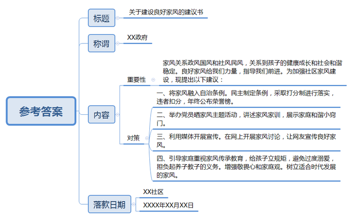

# 2016年政法干警招录培养考试《申论》（本硕类）

<!-- gwy:overview:start -->
> **公安招警和公检法 · 2016 · 申论 · 政法干警（本硕类）** ｜ 4 题 · 图片 1 处 · 答案随题折叠

导航：[题目](#题目) · [材料 1](#材料-1)
<!-- gwy:overview:end -->

> 候选采集稿。参考答案及解析来自粉笔页面，不代表官方答案或真实高分答卷；来源使用许可与原卷对应关系仍需人工核实。

## 给定材料

### 材料 1

家风，可以很大，就像一首名为《家风》的歌所唱的：“家风那个正那个国风兴，家国兴旺好家风，一辈做给那一辈看，一辈讲给那一辈听。”家风，可以很小。某网友说，小时候好多规矩：吃多少盛多少，不允许有剩饭；米粒掉桌上也要吃掉；吃饭得双手扶碗；坐那儿不准抖腿；不能说谎；看到长辈要先打招呼。

领导干部家风不正，事情就大了。古语云，修身、齐家、治国、平天下。新时代，治国当从治家开始，领导干部的家风，是党风廉政建设的“晴雨表”。纵观十八大以来查处的大案要案，很多腐败分子的违纪违法行为中，往往有“家族腐败”因素。父子兵、夫妻档、兄弟帮屡见不鲜，甚至“全家总动员”，把公权力变成“私人订制”，最终一起走上不归路。

除了“全家腐”，其他犯罪型家庭和濒临解体型家庭同样存在家风教育失败的问题，从而产生许多“问题少年”。

陈某是一位17岁的单身母亲。似乎从她记事起，父母就在无休止地打架，陈某也免不了挨打，终于，她走出了家门，在一群终日混迹电玩室的少男少女中找到了“解脱”和“温暖”。快到15岁那年，陈某怀孕了，孩子的父亲却不知所踪。

16岁的金某正在服刑，他的父亲平时游手好闲，经常带朋友到家里赌博，从来不避讳他。“我3岁时就能帮助他们洗牌、摆牌，他们还夸奖我是个天才。”金某说，自己稍大一点就跟着父亲偷东西卖钱。

“这些极端案例让我想起一句话——‘父母皆祸害’。”某学者说，这句话来源于英国作家尼克·霍恩比的小说《自杀俱乐部》。少女杰丝在小结自己失败的青春时，说了这样的话。

### 材料 2

一个人走得再远，最初的能量无不来自家庭。好家风是从一代代的家庭生活中积淀而成的，凝聚着先辈的经验和智慧，代表着中华民族优秀的文化传统。好家风承载了先辈们对后代的希望和鞭策，今天依然能指导我们前进。

A市某村召开村民代表大会，通过了该村自治条例，而且采取打分制进行落实，违反规定要扣分，年终总结时得分高者则公布在村口的荣誉榜上。这部乡规民约公布后，得到了村民们的广泛支持，使村里的环境有了较大的改善。过去懒散的村民，或包大棚种地，或去厂里上班。平时休闲活动也换成了跳广场舞、打太极拳等文体活动。如今，该村已彻底摘掉了“贫困村”的帽子。

该村的往昔却是另一番景象，不仅环境糟糕，而且一些村民农闲时喜欢聚众赌博，纠纷不断。改变这一切的秘诀在哪里？村民认为该村的改变多亏了将家风融入自治条例，指引村民堂堂正正做人，实实在在做事。驻村干部说：“治理农村不能忽略来自田埂上、盛行泥土间的百姓家风，它们虽无华丽辞藻，但不乏为人处世的朴素哲理。”

在该市的另一个社区，党员们“晒”出家风正能量，该社区举行了一场主题为“论家风、思更远”的党员家庭家风美德论坛活动，党员居民讲述了各自的家风家训，向大家展示了家庭和睦的“小窍门”。

首先“晒”家风的是88岁高龄的包某。他和爱人结婚已有66年，“初为夫妻就开始经历了人生的磨难，但我们总是互相守护在对方身边，相互关爱，细心劝解，从来没有因为生活的磨难而生嫌隙，女儿也深受感染，持家有道。”

“尊老爱幼，乐于助人”“知足常乐，俭以养德”……大家纷纷畅谈着各自的家风、家训，家庭是社会的细胞，家庭的文明进步关系到整个社会文明程度的提高。社区书记表示：“我们就是想通过挖掘党员家庭的好家风好家训，引领更多居民树立健康的家庭理念，以家风作为载体推动社会主义核心价值观建设。

### 材料 3

家风，一头连着党风政风，一头连着社风民风。家风是什么？一千个人有一千种答案，网友A说：“只要不偷不抢不坑不骗，愿干啥干啥。”网友B说：“家风是孝顺！父亲是大孝子，一直伺奉我奶奶去世，搬个椅子睡在医院的走廊上，即使年纪大了被骂也从不和父母顶嘴。”网友C说：“吃得了苦，做得了事，享得了乐，踏踏实实做人，兢兢业业做事，从商不贪，为官不腐。家风的确让我擦亮眼睛。”

但人们也意识到，家风传承有式微的趋势，网友D说：“小时候有好多规矩，现在仍然遵守，但感觉现在的小孩子太宠，太没有规矩了。”

家风传承淡漠的背后，是社会结构的巨大变化。四世同堂，几十口人共处一室的景象已很少见，取而代之的是三五口之家，从“大家族”进入“小家庭”时代，传统家庭观念受到猛烈冲击。

有些地方，独生子女成为“小霸王”，受到过度溺爱，家长不问“熊孩子”给别人造成多大的心理阴影面积，一味以“他还小”等必杀技“护短”。另一些地方，父母面临两难选择：是守在孩子身边陪伴他们度过美好的童年时光，还是离家打工挣钱给孩子一个好的生活环境，很多父母最终选择了后者。“空心村”“留守村”大量出现，家庭名存实亡。父母和子女长期分离，“生而不养，养而不教”，带来严重的社会问题。

“家是安乐窝，如果家没法让人安心快乐，社会也难以安定和顺。”有学者说，在中国文化以家庭为基础。过去中国人敬畏天地、敬畏祖宗，做事要对得起后代，而今这种敬畏心和家庭观均有所缺失，很多社会乱象的产生都与此有关。

大学生任某从小在家里被告知要尊敬长辈，吃饭须老人先动筷子，看到老人要施以援手。但这些优良家风，在现实中遭遇挑战。“比如说老人跌倒了要不要扶，已经成为一个社会问题。”

近几十年来，人类社会演变迅速，互联网技术发展迅猛，家庭代际之间的思想观念差异进一步拉大，现在二三十岁的年轻人与他们的父母被称为“历史上差异最大的两代人”。27岁的李某认为，年轻人思想独立，可能不太理解老一辈的价值观，而过去家风中的一些要求确实已经不合时宜了。

### 材料 4

企业家郭某在谈到“家风”时有这样一段文字：父亲只是一名送奶员，但是非常爱学习并且注重内省。母亲督促我们追求卓越、追求成就，并最终走向成功。郭某表示，“我无论在事业上取得什么样的成就，都与我父母的影响分不开。”

很多企业家在谈到各自的成就时，也一样归功于“家风”文化的培养，企业家李某记得，1977年高考前的“煤油灯下3年苦难日子”，父母能给予他们的食粮就是“读书读书再读书，只有知识可以改变命运”。企业家唐某曾精心准备过一次竞选广告，在一张母亲的照片边配上旁白：“妈妈跟我说做人要脚踏实地”，那是唐氏家族真正的“百年来坚守不变的家风”。

家风是企业家精神成长的基石，家风塑造了企业家的精神，企业家的精神决定了企业的兴盛衰退。某家族是一个具有传奇色彩的商业世家，创造了百年辉煌。该家族的历史里，处处可见家风的深刻烙印：“发上等恩，结中等缘，享下等福；择高处立，就平处坐，向宽处行”“固守稳健，谨慎行事，绝不投机”“干得痛快、处处争第一”，等等。家风塑造了这个商业世家的家族性格，是这个商业世家百年辉煌的秘密。

一位“落马”企业家在监狱写下忏悔书：“我祖辈都是善良、本分的农民，但是自己没有在管理者的岗位上坚持本分，丢失了家风。”而同样从农村走出来的企业家俞某，在与大学生分享“家风”时也特别讲到，走遍千山万水，难忘那些村落宗祠大门上书写的“德泽源流远，家风世泽长”对联。

### 材料 5

一个家庭有家风，一个企业同样有家风，无论是家庭里的家风还是企业里的家风，都是为了能够让自己的后世子弟和企业员工能够把企业最优秀的文化传承下去，把世代积累下来的经验传递下去，不至于让这些优秀的文化和经验流失。无论是家庭还是企业，对于自己的家风都是极为珍惜的。

某中药企业是一家有着三百多年悠久历史的著名老字号企业，在全国都享有着极高的声誉，该企业有两句极为有名的口号，也是他们的家风，叫做“炮制虽繁必不敢省人工，品味虽贵必不敢减物力”，第一句说的是工作不偷懒，第二句则是说不要偷工减料，正是因为该企业有着这样的家风，并且能够长期恪守，所以才成为绵延三百多年而历久弥新的老品牌，该企业靠的是什么？是质量，更是对于质量坚守的家风。

其实不仅仅是做药品，做什么东西不是如此呢？只要不偷工减料，不偷懒耍滑，人们迟早会认识到产品的好，这应该是中国所有企业的家风，是我们的社会风气。如果社会上的产品质量都非常好，那么社会上互相信任的风气就很容易建立起来，我们的社会也就很容易和谐起来。

### 材料 6

企业的家风不仅仅是道德教化的口号，还是家族传统的体现，要通过企业家的具体行为去传承和发展。某豆腐是一道名扬四海的地方特色食品，它以细腻柔韧、口感清香、味道鲜美著称于本省内外，吴某作为吴家豆腐第四代传人，自22岁起接替父亲执掌豆制品厂帅印。

吴某从先辈们那里继承了“诚实守信，乐善好施”的传统美德，加之掌管企业多年，在行业内外都赢得了美誉和口碑。S公司是该豆制品厂长期合作的伙伴，2014年春节前夕，S公司定制的豆腐没能赶上最后的班车，全部滞留在火车站，为了坚守诚信，不让老客户受损失，吴某立刻调动人员把豆腐装上汽车，亲自开车连夜前往该公司，这一趟专车送豆腐吴某损失利润1500多元，吴某却说：“我们虽然是小厂，但从来都没有让客户承担损失的先例，假如让客户受了损失，我们的损失就更大了，因为我们会因此失去诚信，这样的事，我不做。”

凡是认识吴某的人，只要提起他的为人，无不竖起大拇指为他点赞，说他是个“热心人”。员工小刘的父亲突发脑溢血住进医院，小刘在无力凑齐手术费的情况下打电话向吴某求助，吴某立即亲自把钱送到医院。当地某村因电线老化发生火灾，很多农户受灾，损失惨重。吴某得到消息后，毫不犹豫地买来大米、食用油、棉被等生活物资，无偿捐赠给受灾村民，帮助灾民渡过难关。良好的声誉让企业赢得了当地人的信任，企业不仅因此收获了稳定可靠的经济回报，也和谐地融入了当地的社会。

### 材料 7

在现实社会，越来越多的年轻人沉迷于手机，忽视了对家人的陪伴。“手机究竟是个什么妖怪？妈妈走路时看着它、吃饭时看着它、睡觉还要看它，爸爸去厕所也要带着它……”漫画《被手机抓走的爸爸妈妈》在网络上走红，它以一名幼儿的视角来控诉“低头族”爸妈，吃饭、睡觉、走路，甚至连上厕所都目不转睛“刷屏”，花在手机上的时间远多于陪孩子的时间，久而久之，就逐渐形成了“两耳不闻身边事，一心只是捧手机”的家风，深深影响着孩子的成长。一份《国民家庭亲子关系报告》显示，17.8%的父母在与孩子共处时常看手机，51.8%的父母偶尔看手机。两者相加，有近70%的家长会在陪孩子的时候玩手机。孩子的童年时光是非常短暂的，父母本应好好珍惜，陪伴他们度过美好童年。但现在手机却吸引住了很多父母，让他们无暇顾及孩子，很多孩子都表示自己会因为父母沉迷手机而感到被忽视。

手机也惹怒了老人，赵伯的子女成家后和自己分开住，只有周六上午大家才回来一块吃中午饭。一次周末，赵伯和老伴从一早就开始忙活午饭，但子女、孙子一大帮人进门后，却自顾着玩手机，没有人主动上前去帮忙，也没人陪老人聊聊天。等到菜上桌子，儿孙们还全在玩手机，赵伯叫了两次大家才慢吞吞凑过来吃饭。饭没吃到一半，大家又拿起手机边吃饭边玩，赵伯多次想和孩子们说说话，但发现个个低头拿着手机玩。赵伯觉得自己很不受尊重，一怒之下，站起来掀翻桌子，拂袖而去。赵伯掀桌离席后，子女们意识到自己的不是，赶忙道歉。赵伯气消后，也立下了一个“家规”——吃饭时不能玩手机。在赵伯看来，家庭聚餐本是一件开心的事情，“有什么事情比一家人坐在一起吃饭更重要呢？”

一份来自中国妇联的调查报告显示，智能手机的过度使用正在破坏使用者的婚姻幸福，严重者可导致家庭破裂。60%的已婚受访者抱怨智能手机对夫妻关系存在不良影响。当然，这种现象并不仅限于中国。有调查显示，在美国25%的手机使用者认为与伴侣在一起时，伴侣的注意力会被他们的手机所分散；8%的手机使用者曾因为伴侣过度上网而与其发生过争执。而在智能手机用户数量超过5亿的中国，这个问题更严重和普遍。为此，全国妇联向全社会发出倡议——每天关机一小时，多与家人相处。“移动电子产品本身并没有对错，关键在于我们如何使用，才能使家人之间的关系更亲密而不是更疏远”。

### 材料 8

随着手机技术的突飞猛进，尤其是智能手机的快速发展，手机的功能越来越强大，手机越来越广泛地渗透到了我们的世界中。无论在哪儿似乎都能看到同一个姿势——吃饭、看电视、等地铁，甚至是和家人聊天的时候，很多人都喜欢拿出手机低头摆弄，看看微信朋友圈有什么动态，微博有什么留言。不知不觉间，很多人都成为了手机的臣民，“低头族”“屏奴”等词应运而生。

人与人之间的交互方式从面对面地品茗论道、谈笑风生演变为无时不刻地手握手机，思及千里——交谈者坐在对面，却丝毫不顾，创造了一个又一个“在场的缺席”。全神贯注地低头拨弄手机时，人们很容易忘记身处其中的现实世界。在美国旧金山一辆轻轨列车上，车厢中的乘客都专注地玩着手里的手机、平板，身旁有凶徒挥舞手枪竟无人察觉，凶徒因无人阻止便更加肆无忌惮，当场枪杀了一名准备下车的男大学生。手机直接引发的种种险状也时有发生，某地一名17岁女生边走路边玩手机，经过一座桥时一脚踏空，掉入十余米的深坑中，最终经抢救无效死亡……很多人都处于被手机偷走安全的状态，随便在任何一处斑马线上，你都能看见边玩手机边过马路的行人。在大学课堂上，“低头族”时时可见，“有时候也不是老师讲得不好，但自己就是每隔几分钟要刷下微博，看看朋友圈，要不实在受不了。”有大学生说。正是接受知识的大好时机，很多大学生却迷失在手机的诱惑里。一位大学老师说：“我们的学生对学习机会的获得普遍缺乏珍惜感，我曾经在课上对玩手机的学生说，‘父母辛苦挣钱供你们上大学，你们上课却埋头刷手机，对得起他们吗？’结果却收效甚微。”

有调查显示，全国白领日均使用手机时长为3.93小时，这意味着除去8小时睡觉时间和8小时工作时间，剩余时间被手机占去了一半。用来看世界的眼睛在各种屏幕之间切换、游离，人们在各种信息铺天盖地的轰炸中头晕目眩，疲于奔命。

“交通基本靠走，通讯基本靠吼”，形容的诚然是落后的生活状态，但一家人在一个屋檐下过日子，却要用微信通知“饭好了，快过来吃”，显然并不意味着进步，而是被科技深深地禁锢了。在智能手机普及的年代，人们的一切“碎片化”时间，似乎都被用来消费在手机上。从心理学角度看，这是一种“瘾”，是“瘾”都需要戒。当我们开始抱怨与手机重度依赖相伴而生的颈椎、手指关节的劳损，以及胸闷、心慌时，也许是时候该放下手机，静下心来，好好读一本书，浇一盆花，选择与身边人面对面交流，回归到人与人之间最质朴的交流方式。

### 材料 9

手机真是让人爱恨交加。某周刊在其官方微博转发一组图片《现代人的社交为何注定灭亡》，图片中的男女从第一次约会到彼此示爱，从一起看电影到共同为心爱的球队呐喊助威，都通过手机完成。它以一种近乎夸张的方式警告人们，手机正在毁掉我们正常的社交方式，像是为这组图片做注脚，现实中的人们更多地选择当沉默的“低头族”，某著名舞蹈家举办告别演出，台上舞姿曼妙，台下却是不停闪烁的手机屏，手机主人在微博、微信上向朋友们宣告：“我来了！我看到了！”相比于用心欣赏舞蹈，他们更乐意在网络上表明自己的存在。在家庭聚会时，很多年轻人与父母说不到几句话，就开始低头摆弄手机，而母亲节时却深情地在微博上发表感恩，他们似乎更愿意对着网络表达自己的情感。“你在网上这么孝顺，你妈知道吗？”有人这样指责他们。

媒体纷纷批评“低头族”沉湎虚拟空间，忽视现实世界，呼吁不要让人情在技术面前失去温度。对此，有些“低头族”并不认同。孙某是一位白领，他说：“我有什么样的同学同事、邻居熟人，都不是我的选择，为了工作、生活我必须与他们交往，在此之外，我没必要囿于这样的现实人际圈子，我更乐意通过手机和圈子里的朋友交流。”基于共同的兴趣爱好，现实中沉默的“低头族”在异度空间里找到知己，形成圈子，圈子好友不注重现实中的身份，而认同身份背后共同的观念，交往更加率性。在拉萨，潘某在微博上发了一张大昭寺照片，韩某跟帖说“我也在大昭寺”。原本陌生的两人加了好友，结伴游拉萨，此后再无联系。一年后，潘某到丽江旅游，忽然想起韩某，就“私信”了她，没想到韩某也在丽江，于是两人结伴穿越虎跳峡，之后又相忘于江湖。

今天，人们用手机购物、寻找美食、预订酒店，手机俨然成为全智全能型保姆。在一家外资饮料公司做营销的刘某，经常要丢下小学6年级的女儿去出差。但她并不因此牵肠挂肚，因为很多宾馆都有免费WIFI，她可以每天通过手机微信、微博看女儿动态，与女儿视频聊天。在一家报社做部门主任的况某抱怨自己的工作是“从早到晚刷微博，眼睛都要刷瞎了。生怕突然出现重要新闻，第二天别人连篇累牍，而我们不着一字，那就等着挨老总尅吧！”她说幸亏有了微博，人们纷纷转发，才不至于漏新闻。而一旦发现有价值的新闻，她会用手机提醒同事关注，不必常常开会。手机以其移动、便捷的终端模式而成为资讯之王。一本分数线是多少，哪里又出了新地王，黄金的最新价格是多少……世界变化快，一天不看手机新闻，就跟不上办公室的聊天话题。中文系的大三学生苏某随身携带无线WIFI，随时可以通过手机对微博热门话题发言。“我对很多事情都有表达欲，看到感兴趣的话题都会留言参与。”大二学生孙某对诗词很感兴趣，听了系里诗词写作的课还意犹未尽，手机上网搜索到了很多诗词写作公开课。“想学就学，我可以随时学习”，孙某说。

## 题目

### 第 1 题

**请根据“给定资料7～9”，概括过度依赖手机给人们带来的不良后果。（15分）**

关联材料：材料 7、材料 8、材料 9

作答要求：全面、准确、简明，有条理。不超过200字。

第 1 题 · 答案与解析

**参考答案（粉笔题库参考内容）**

一、疏远家庭关系：1.孩子感到被家长忽视，影响孩子成长；2.老人不被家人尊重，产生亲情隔阂；3.破坏婚姻幸福，导致家庭破裂；

二、阻碍人际交往：沉湎虚拟空间，忽视现实世界，毁掉正常的社交方式，人情失温；

三、造成安全隐患：忽视身边的危险，威胁人生安全；

四、浪费学习时光：学生对学习机会缺乏珍惜感；

五、破坏身心健康：造成颈椎、手指关节劳损、胸闷、心慌等问题；时间被手机过多占用，信息爆炸导致头晕目眩，疲于奔命。

**解析状态：unknown（来源未提供）**

### 第 2 题

**请根据“给定资料3”，概括传统家风在当前面临的主要挑战。（15分）**

关联材料：材料 3

作答要求：紧扣材料，全面准确；简明扼要，分条陈述；不超过200字。

第 2 题 · 答案与解析

**参考答案（粉笔题库参考内容）**

一、社会结构巨变，从大家族进入小家庭时代，传统家庭观念受到冲击，家风传承式微、淡漠；

二、家庭教育两极化：1.过度溺爱造成子女缺乏教养、没规矩；2.长期与子女分离，生而不养，养而不教，带来社会问题；

三、敬天法祖的敬畏心和家庭观缺失，社会乱象丛生；

四、优良家风在现实遭遇诚信危机、道德滑坡的挑战；

五、科技发展使代际间的思想观念差距拉大，年轻人思想独立，不理解老一辈的价值观；一些传统家风与现代需求不相适应。

**解析状态：unknown（来源未提供）**

### 第 3 题

**假如你是某社区工作人员，请结合“给定资料1～3”，撰写一份如何在社区建设良好家风的建议书。（20分）**

关联材料：材料 1、材料 2、材料 3

作答要求：内容充实，针对性强；方案合理、切实可行；思路清晰，结构完整；语言得体，简明扼要；不超过400字。

第 3 题 · 答案与解析

**参考答案（粉笔题库参考内容）**

关于建设良好家风的建议书

XX政府：

家风关系政风国风和社风民风，关系到孩子的健康成长和社会和谐稳定。良好家风给我们力量，指导我们前进。为加强社区家风建设，现提出以下建议：

一、将家风融入自治条例。民主制定条例，采取打分制进行落实，违者扣分，年终公布荣誉榜。

二、举办党员晒家风主题活动，讲述家风家训，展示家庭和谐小窍门。

三、利用媒体开展宣传。在网上开展家风讨论，让网友宣传良好家风。

四、引导家庭重视家风传承教育，给孩子立规矩，避免过度溺爱，担负起养子教子的义务。增强敬畏心和家庭观。树立适合时代发展的家风。

XX社区

XXXX年XX月XX日

**解析状态：unknown（来源未提供）**

### 第 4 题

**请根据你对“给定资料3”中划线部分的理解，围绕某学者提到的“敬畏”的说法，自选角度，自拟题目，写一篇议论文。（45分）**

关联材料：材料 1、材料 2、材料 3、材料 4、材料 5、材料 6、材料 7、材料 8、材料 9

作答要求：中心明确，思想深刻；结合资料，联系实际；内容充实，论证有力；结构完整，语言流畅；不少于1000字。

第 4 题 · 答案与解析

**参考答案（粉笔题库参考内容）**

常怀敬畏之心，传承家风之美

古人云：“畏则不敢肆而德以成，无畏则从其所欲而及于祸。”这里的“畏”指的是对良知、正义、天理的畏惧。过去国人敬天畏地、祭祖尊宗，究其一生传承中华民族传统家风美德，如今社会结构变革，家风传承逐渐淡漠，随之产生的社会问题也频频发生，究其原因，便是由于缺少古人的敬畏之心。心存敬畏是保持内心的执着与宁静、是恪守底线的从容与淡定、个人品德、企业道德、社会公德无不需要怀揣敬畏之心，传承家风之美。

拥有敬畏之心，传承家风，不仅关乎个人发展，更关乎企业兴盛、社会和谐稳定。“家”是构成社会的基本细胞，是人生的第一所学校；良好的家风是千千万万个企业得以生存的保障和基石；家是最小国，国是千万家，家庭是国家发展、民族进步、社会和谐的基点。家风相连成民风，民风相融汇国风。习近平总书记强调：“不论时代发生多大变化，不论生活格局发生多大变化，我们都要重视家庭建设，注重家庭、注重家教、注重家风。”

常怀敬畏之心，传承弘扬个人品德的美好家风。个人和家庭的关系密不可分，家风破坏，祸及全家。一些普通家庭由于家风不正，对子女管教不严、方式欠妥，从而产生“问题少年”，这是典型的家风教育失败问题。领导干部的家风，是党风廉政建设的“晴雨表”，如果他们的家风崩毁，则不仅祸害家庭，而且还直接影响党和政府的形象，即使这样，现实生活中也不乏有“贪腐父子兵”“受贿夫妻档”“一人当官全家涉腐”的现象发生。究其根本在于，个人缺乏敬畏之心，家庭缺乏优秀家风。曾国藩曾言：“心存敬畏方行有所止。”因此，我们应当常怀敬畏之心，时刻怀揣如履薄冰的谨慎态度，保持克己慎行的戒惧意念，约束个体行为方式，同时，要知礼仪、重家风，清廉质朴，善良守信，传承中华民族优秀家风美德。

常怀敬畏之心，传承弘扬企业道德的美好家风。对企业来说，企业文化就是家风，经营者能否将商业道德贯彻其中，形成独特的精神思想并敬畏遵守，决定着企业的发展前途。当前，部分企业趋于利益需求，不顾道德操守，诚信缺失，类似三聚氰胺“毒奶粉”、企业拖欠农民工工资、不惜破坏环境的生产作业等企业道德失衡的问题频频发生。从中暴露出企业价值观念弱化、社会责任意识不强、社会监管不力等诸多深层问题。这就需要我们树立企业正确的价值观念，加强企业公共服务意识，优化企业生产管理制度，使企业怀揣敬畏之心，传承企业文化，塑造优秀的企业道德家风。

常怀敬畏之心，传承弘扬社会公德的美好家风。社会公德是人类文明成果的一种沉淀和积累，它关乎着国家的长治久安，决定着中华民族的未来。然而，当前社会变革加速，导致社会风气逐渐涣散、社会公德准则失衡、传统思想遭受冲击，自私自利、唯利是图、假公济私现象也频频发生。长远看我们应当正视这些关乎国家发展、民族强盛的社会公德问题，时刻提醒我们应当常怀敬畏之心，加强社会公德宣传教育，营造良好的社会风气和公德素养，传承优秀传统文化，同时，按照中共中央印发的《公民道德建设实施纲要》中对公民提出的公共道德要求，提升自身公德意识，在全社会传承文明礼貌、助人为乐、爱护公物、保护环境、遵纪守法的公德家风。

敬畏，是一种人生态度，更是一种自省和自警；家风，是一种文化传承，更是一种继承和发扬。让我们常怀敬畏之心，在传承中华民族优秀家风之美的道路上披荆斩棘、排除万难，使中华民族伟大复兴的梦想之轮扬帆远航！

**解析状态：unknown（来源未提供）**

