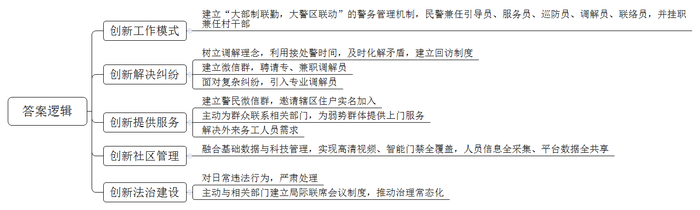
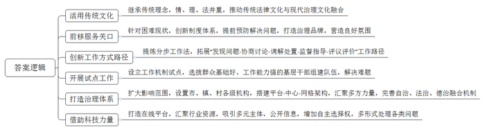
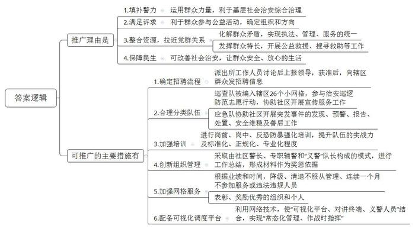
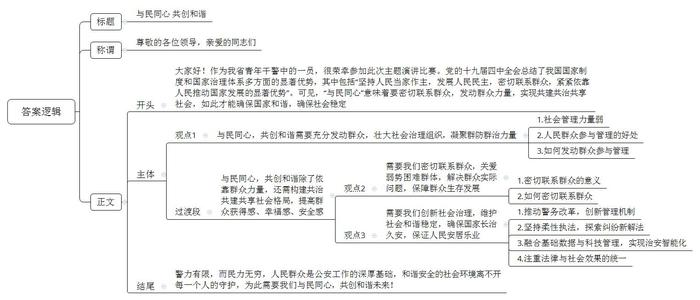

# 2020年公安院校联考《申论》题

<!-- gwy:overview:start -->
> **公安招警和公检法 · 2020 · 申论 · 公安院校联考** ｜ 4 题 · 图片 4 处 · 答案随题折叠

导航：[题目](#题目) · [材料 1](#材料-1)
<!-- gwy:overview:end -->

> 候选采集稿。参考答案及解析来自粉笔页面，不代表官方答案或真实高分答卷；来源使用许可与原卷对应关系仍需人工核实。

## 给定材料

### 材料 1

“这几个玉米是我亲手种的，没有洒农药，您一定得带回所里煮了给大伙儿尝尝……”

近日，H省S市新风派出所的郑副所长来到溪后村入户走访。刚从菜园子回来的张大妈看到后，热情地招呼他进屋，亲如家人。由于儿子在外务工，已经76岁的张大妈常年独居。前段时间，张大妈在菜园里摔倒，民警闻讯赶到将她送往医院治疗。之后，所里的民警经常来家里走访，关心张大妈的日常生活情况，帮助她解决生活中的实际困难，并将“警民联系卡”贴在厅堂的醒目位置，以便她能及时联系到民警。

“随着警务改革的深入，对农村警务工作的要求自然也就更高了。”S市公安局政工室詹主任说。近年来，S市公安局建立“大部制联勤，大警区联动”的警务管理机制，实行“1警+5员”工作模式，即每1名民警身兼“引导员、服务员、巡防员、调解员、联络员”5个角色，派出所民警全部挂职兼任村干部，既促进地方发展又延伸警务触角，实现警务覆盖全域化、警务跟进实时化、警务惠民终端化。“党建引领下的‘1警+5员’工作模式打通了服务群众的‘最后一公里’，实现了资源的最大整合，有利于打造共建共治共享的社会治理格局。”詹主任说。

2019年6月，S市南郊派出所接到村民赵某报警，称其利用自家门前空地扩宽路面时，遭到邻居吴某的多次阻挠。“扩宽路面本是一件便民利民的好事，为何遭到邻居阻挠？”带着疑问，民警赶赴现场了解到，赵某正在扩宽的道路路基较高，邻居吴某担心路面扩宽后，如遇降雨天，屋檐水溅起的水花会导致他家的墙体受损。为防止矛盾纠纷进一步升级，民警对吴某晓之以理、动之以情，一面努力平复其情绪，向其耐心释法说理；另一面联系吴某在外工作的儿子，让其做父亲的思想工作。与此同时，说服赵某做出承诺，路面扩宽后做好相关防水措施。最终，两人握手言和。

如何更好为民服务，有效化解矛盾纠纷，真正建成“平安南郊、和谐南郊”？近年来，南郊派出所坚持发展新时代“枫桥经验”，积极探索矛盾纠纷新解法。南郊派出所周所长介绍，派出所牢固树立“调解也是执法”的理念，推动执法活动向矛盾纠纷调解延伸、执法资源向矛盾纠纷调解倾斜，利用接处警的“黄金时间”，最大限度把矛盾纠纷就地化解在一线。同时，建立矛盾纠纷回访制度，以提高群众对矛盾纠纷调解工作的满意度。做“专”调解队伍，是南郊派出所践行“枫桥经验”的又一法宝。该所建立了乡村“调解微信群”，把熟悉辖区情况、在群众中有威望、具备一定法律知识、热心并善于调解的离退休干部、村干部、法律工作者等聘为专、兼职村级调解员，同时邀请国土、民政、司法等部门工作人员充实乡一级调解队伍，实现线上线下调解同步进行，提升矛盾纠纷化解的质效和权威。对一些属疑难杂症的矛盾纠纷，由接处警民警做好先期取证后，第一时间联合乡、村两级调委会，发挥专业人民调解员和调解志愿者的作用，这样既能实现非警务警情的有效分流，又能发挥人民调解员的专业优势，防止“民转刑”，起到“第一道防线”的作用。

“王大爷，您儿子用微信转账转了500元，让我们转交给您，他怕您老人家不会用手机取钱。”民警前往后村社区王大爷家中，转交了其儿子给他的生活费。王大爷是一名“留守老人”，儿子在外务工。因老人取款困难，他儿子便联系民警，将钱用微信转账给民警，再由民警帮忙提现转交给老人。考虑到他们许久没有见面，民警还用微信让父子俩进行视频聊天，以解思亲之情。S市的每个派出所都专门建了“民警在身边”微信群，让辖区的每一户都至少有一人实名加入微信群，坚持做到“民需警应”。如今，“民警在身边”微信群成了加强警民联系，便利民生、服务百姓的互动平台。近年来，派出所主动为群众联系相关部门，上门为孤寡老人、留守儿童和残疾人提供服务，实现“民警多动腿，群众少翻山”。派出所还将“民警在身边”微信群的二维码送到工地，使外来务工人员办理暂住登记“一次都不用跑”，用实际行动解决群众需求。

2019年7月，S市“智慧平安小区”——明德小区南门视频监控系统突然报警，其所在区的公安分局迅速组织警务站民警赶至该小区，通过调阅小区内部道路、单元门、电梯视频监控，成功在该小区抓获一名在逃人员。2019年，S市将“建设智慧平安小区”列为年度10件实事之一，通过基础数据与科技管理的深度融合，打造具有“高清视频全覆盖、智能门禁全安装、人员信息全采集、平台数据全共享”等特征的新型“智慧平安小区”，提高治安防控的智能化水平。

2019年8月，S市市区内一辆汽车与电动车发生刮蹭，两名驾驶员在雨中打斗，被人拍了视频传到网上，引起舆论关注。S市公安局北城分局当天即对两人分别作出行政拘留15日、处1000元罚款和处500元罚款的决定，并向社会公布。当地群众说，这件事给百姓上了一堂法治课。在推进社会治安综合治理过程中，S市公安机关注重法律效果与社会效果的统一，加强典型违法犯罪的刑事处罚与行政处罚的有效衔接，对公共场合辱骂他人、殴打他人、滋事扰序和交通违章违规等违法“小事”，一律依法严肃处理。市公安局马政委表示：“从‘小事’抓起，提升社会正气，让法治成为基层治理的价值标准，是S市公安机关推进社会治理的一个特点。”在社会治安综合治理实践中，S市公安机关还把依法治理的手段前移，主动与住建、规划、土地、商务、金融办等部门建立局际联席会议制度，就交通运输、土地转让、民间借贷等方面的突出问题向各单位发函，适时提出建议，推动社会治安治理向制度化治理、常态化治理迈进。马政委说：“党的十九大提出‘加强和创新社会治理，维护社会和谐稳定，确保国家长治久安、人民安居乐业’，这为S市公安机关的工作提供了根本遵循。”

### 材料 2

2017年，H省P市新埭镇星光村在法院的涉诉纠纷是39起，2018年下降到25起，2019年至今只有11起。星光村涉诉纠纷走起了“下坡路”，靠的正是P市近年来探索推广的“无讼”工作——调和息讼，就地化解矛盾。这一基层社会治理的新路子不仅从源头上有效减少了矛盾纠纷的产生，更推动了传统无讼文化与现代法治精神的融合。

“无讼”理念可追溯至被誉为“天下第一清廉”的文化名人陆稼书。陆稼书，清代理学家，康熙九年进士，历官江南嘉定知县、直隶灵寿知县、四川道监察御史等。“陆稼书任职嘉定、灵寿知县时，‘动之以情、晓之以理、喻之以法’的‘无讼’理念，深受百姓推崇，使得两县政清人和，庭可生草，以至无讼之境。”P市市委祁书记说。“以和为贵、乡党调处、义理断案”，陆稼书倡导的法律文化价值仍可“活用”于当下P市基层社会治理。

近年来，伴随经济社会快速发展，P市社会矛盾纠纷易发多发。同时，基层法院面临“案多人少”“案结事不了”的现实困境。“面对转型期基层社会治理的困难和现状，P市以先贤陆稼书‘息事无讼’文化为工作理念和导向，将矛盾纠纷预防和化解的关口前移，打造‘无讼’村（社区）。”祁书记说。2017年开始，P市深挖“无讼”文化，积极探索创新，创设了“调解优先、诉讼断后”制度体系，打造了“息事无讼”的基层社会治理品牌。2019年1-9月，P市法院收案数同比下降8.2%，其中民商事案件收案数同比下降13.9%，逐渐形成了“不轻易言讼、不争讼”的良好氛围。

“P市的‘无讼’实践是基因式的文化传递和传承。传统法律文化和现代治理文化交相辉映，带来了社会的和谐稳定。”P市政法委孙书记说，“‘无讼’并不是指完全没有诉讼，而是第一时间把矛盾纠纷化解在萌芽、化解在基层；‘无讼’也不是通过‘压讼’来掩盖矛盾，而是通过‘解讼’化解纠纷。”在创建“无讼”村（社区）、成立“息事无讼”工作室的过程中，P市创新地提炼出了“提、议、调、督、评”的“无讼”五步工作法，纵深拓展“发现问题-协商讨论-调解处置-监督指导-评议评价”的“无讼”工作路径。

P市新埭镇是先贤陆稼书的故里，2017年成为“息事无讼”工作机制试点。作为新埭镇星光村的一名村干部，沈斌在村里工作多年，群众基础好，工作能力强。如今他还有另外一个身份，那就是村里的无讼员。“星光村目前有一支由8名党员干部、组长等组成的无讼员队伍，自成立以来，化解了不少矛盾。”沈斌举例，承包户、租赁户拖延租金是该村一大难题，以往年底收缴率在70%左右，有时遇到恶意拖欠、拒不缴纳的，只能上诉公堂，费时费力。而开展“无讼”试点后，如今收缴率已接近100%。

“不只在农村，‘无讼’的理念其实对城市治理也有影响，比如‘红色物业’。”孙书记以近期P市“红色物业”解决小区停车难问题为例：社区“红色议事厅”用减少5%绿化面积，增加140个车位，满足业主停车需求的办法，将矛盾纠纷的关口进一步前移，增强了群众的获得感、幸福感、安全感。市一级有“无讼工作中心”，镇一级建“无讼工作室”，村一级设“无讼站”；站里汇聚各方力量，无讼调解员、无讼志愿者、法律顾问、平安书记……P市正通过打造“四平台一中心一网格”的社会治理体系，完善自治、法治、德治“三治融合”机制。

P市的“无讼”在线调解平台也是践行“无讼”理念的一大亮点。无论是婚姻、家事，还是民间借贷、道路交通事故，各种类型的民事纠纷，都可以在这个平台上进行调解。孙书记介绍：“我们的平台汇聚了各个行业的优质解纷资源，既有人民调解、综治调解、法院特邀调解，又有行业调解、律师调解、仲裁调解等，主体多元，形式多样。平台现有线上调解机构39家，线上调解员166名，调解机构和调解员均注明擅长领域，方便当事人做出选择。”有当事人在调解结束后发出感叹：“没想到现在矛盾调解也处处渗透着科技感，确实给我们带来了极大方便！”

### 材料 3

就在上个月，H省D市的C派出所被授予了一个响当当的荣誉——全省“人民满意的公务员集体”称号。那天，C派出所“义警协会”秘书长老陈在微信朋友圈写下这样一句话：“回顾既往，百姓欢欣鼓舞；展望明天，警民同心，携手共进……”

多年来，D市作为人口大市，万人警力配备数却不到6人。如何在警力有限的情况下，筑牢基层社会治安综合治理这道防火墙，一直困扰着C派出所的刘所长。

今年3月，C派出所开展常态化“大走访”工作，在商业街走访了老陈等20多名店主后了解到，这一带的群众都有一个共同的愿望——参与公益组织，但苦于没有组织和方向。刘所长马上产生一个想法：能不能运用群众的力量，解决警力不足的问题呢？这个想法经过所里人员的反复讨论之后上报了上级领导部门，获得批准后，所里马上向辖区群众发出招聘“义警”的信息，一周的时间一支近百人的“义警”队伍就成立了。

成立不久，“义警”就立了大功。今年5月，“义警”在巡逻中听闻有一伙驾驶外地车辆的可疑人员在收集黄鳝血，便一边赶赴现场，一边报告派出所，最终协助派出所抓获了8名犯罪嫌疑人，一举破获一起利用黄鳝血碰瓷的连环诈骗案件。

C派出所将“义警”队伍分为巡查“义警”队和应急“义警”队，根据报名者的特长及意愿将人员分配到相应类别。巡查“义警”队被编入辖区26个小网格，参与网格治安巡逻防范志愿行动，对群租、电动车停放楼道、违规充电、违章搭建、违规经营等问题进行及时报送，同时协助社区开展环境卫生、消防安全、反扒反诈骗、矛盾纠纷化解等宣传服务工作。应急“义警”队协助社区开展突发事件的发现、预警、报告、处置、安全维稳及善后工作。

自组建“义警”队伍后，C派出所对“义警”进行了岗前、岗中培训。同时针对人员密集场所，定期组织“义警”队伍开展反恐防暴强化培训，切实提升“义警”队伍的实战能力。通过一系列举措，“义警”队伍的标准化、正规化、专业化程度越来越高。

老陈在第一时间加入了“义警”队伍。每天晚上6点半，他都会穿着红背心，带着队员准时出现在大街小巷。“现在辖区马路上的500块窨井盖在什么位置、有无破损，我心里都一清二楚。”老陈介绍，“义警”每周至少需要参加一次所在小网格的服务，时间不低于2小时，服从网格片区的任务安排、考勤、记录等管理。对不服从管理、连续一个月不参加服务或出现违法违规行为的“义警”，将作“清退”处理。

C派出所牵头组织“义警”队伍后，采取由社区警长、专职辅警和“义警”队长构成的“1+1+1”组织管理模式，有序推进工作开展，每周进行工作总结，形成材料作为奖励及完善“义警”模式的重要依据。

“义警”达到不同的服务业绩和服务时间，会得到不同的“星级义警”评定，星级由低至高分为五级。对表现优秀的组织和个人，积极申报表彰对其奖励，而对表现不佳、不符合要求的队员，则予以降级或劝退处理。

“义警”队伍中，有热心志愿服务的居民，他们能更好地将众多资源进行整合，拉近与居民之间的距离，有利于第一时间掌握群众诉求、化解群众矛盾、解决群众难题，实现执法、管理、服务的有机统一；也有拥有一技之长的专业人士，刚刚增设的“义警突击队”就是由具备越野、登山、水上运动、无人机操作等专业特长的人员组成，他们利用自己的一技之长，协助公安、交警、消防等开展公益救援、搜寻救助等工作。

C派出所还配备了可视化调度平台，这也是首次应用4G网络技术对讲终端服务“义警”。当“义警”发现警情，可立即用4G对讲实时拍摄视频上传，并用对讲汇报警情支援需求。可视化指挥平台迅速定位警情位置，并在平台地图框选“案发”附近“三警”（民警、辅警、义警）队伍人员，发出支援指令。通过“可视化平台、对讲终端、义警人员”有效结合，切实达到“常态化管理、作战时指挥”的良好作用。

“自从有了‘义警’后，每天都有人在我开的店面附近巡逻，社会治安越来越好了，我可以专心做生意，什么都不用担心。”经营五金店的李先生说，“不仅是我这样认为，周边的邻居都感觉现在有‘义警’巡逻，既安全又放心，我们为政府的‘义警’举措点个大大的赞。”

“‘义警’就是我们的左膀右臂，已经有越来越多的群众要求加入‘义警’。”C派出所刘所长说。

### 材料 4

党的十九届四中全会提出“我国国家治理体系和治理能力是中国特色社会主义制度及其执行能力的集中体现”，并总结了我国国家制度和国家治理体系多方面的显著优势，其中包括“坚持人民当家作主，发展人民民主，密切联系群众，紧紧依靠人民推动国家发展的显著优势”。从北京街头的“西城大妈”“朝阳群众”，到遍布全国各地的平安建设志愿者组织，一个个社会组织将公共服务的触角伸向社会的每一个角落，为促进社会的平安和谐增添助力。各地公安机关围绕构建共建共治共享的社会治理格局目标，充分发动群众，凝聚起群防群治新力量，不断增强着人民群众的获得感、幸福感、安全感。警力有限，而民力无穷，人民群众是公安工作的深厚基础和力量源泉，和谐安全的社会环境需要每一个人来守护。

## 题目

### 第 1 题

**根据****“给定资料**1**”，概括S市公安机关在加强社会治安综合治理方面的主要做法。（15分）**

关联材料：材料 1

作答要求：

要求：全面、准确、有条理。不超过300字。

第 1 题 · 答案与解析

**参考答案（粉笔题库参考内容）**

一、创新工作模式。建立“大部制联勤，大警区联动”的警务管理机制，民警兼任引导员、服务员、巡防员、调解员、联络员，并挂职兼任村干部。

二、创新解决纠纷。树立调解理念，利用接处警时间，及时化解矛盾，建立回访制度；建立微信群，聘请专、兼职调解员；面对复杂纠纷，引入专业调解员。

三、创新提供服务。建立警民微信群，邀请辖区住户实名加入；主动为群众联系相关部门，为弱势群体提供上门服务；解决外来务工人员需求。

四、创新社区管理。融合基础数据与科技管理，实现高清视频、智能门禁全覆盖，人员信息全采集、平台数据全共享。

五、创新法治建设。对日常违法行为，严肃处理；主动与相关部门建立局际联席会议制度，推动治理常态化。

**解析**

**参考答案说明：**本参考答案从“创新工作模式”“创新解决纠纷”“创新提供服务”“创新社区管理”“创新法治建设”等五个方面进行了分条撰写。各条答案要点之间在内容上相互并列，没有交叉。

### 第 2 题

**根据****“给定资料**2**”，请你谈谈P市“无讼”实践为创新基层社会治理提供了哪些启示？（20分）**

关联材料：材料 2

作答要求：

要求：分析全面，条理清晰。不超过300字。

第 2 题 · 答案与解析

**参考答案（粉笔题库参考内容）**

1.活用传统文化。继承传统理念，情、理、法并重，推动传统法律文化与现代治理文化融合。

2.前移服务关口。针对困难现状，创新制度体系，提前预防解决问题，打造治理品牌，营造良好氛围。

3.创新工作方式路径。提炼分步工作法，拓展“发现问题-协商讨论-调解处置-监督指导-评议评价”工作路径。

4.开展试点工作。设立工作机制试点，选拔群众基础好、工作能力强的基层干部组建队伍，解决难题。

5.打造治理体系。扩大影响范围，设置市、镇、村各级机构，搭建平台-中心-网格架构，汇聚多方力量，完善自治、法治、德治融合机制。

6.借助科技力量。打造在线平台，汇聚行业资源，吸引多元主体，公开信息，增加自主选择权，多形式处理各类问题。

**解析**

**参考答案说明：**本参考答案从“活用传统文化”“前移服务关口”“创新工作方式路径”“开展试点工作”“打造治理体系”“借助科技力量”等六个方面进行了分条撰写。各条答案要点之间在内容上相互并列，没有交叉。

### 第 3 题

**“给定资料**3**”中，C派出所的“义警”队伍创建工作成效显著，受到D市公安局的肯定。经研究后，D市公安局决定向全市推广，假设你是该局的一名工作人员，请拟写推广材料中的“推广理由”和“可推广的主要措施”这两部分内容。（25分）**

关联材料：材料 1、材料 2、材料 3、材料 4

作答要求：

要求：

（1）紧扣资料，内容具体；

（2）理由充分，措施明确；

（3）条理清晰，语言通畅；

（4）不超过500字。

第 3 题 · 答案与解析

**参考答案（粉笔题库参考内容）**

推广理由是：1.填补警力。运用群众力量，利于基层社会治安综合治理。2.满足诉求。利于群众参与公益活动，确定组织和方向。3.整合资源，拉近党群关系。化解群众矛盾，实现执法、管理、服务的统一；发挥群众特长，开展公益救援、搜寻救助等工作。4.保障民生。可改善社会治安，让群众安全、放心的生活。

可推广的主要措施有：1.确定招聘流程。派出所工作人员讨论后上报领导，获准后，向辖区群众发招聘信息。2.合理分类队伍。巡查队被编入辖区26个小网格，参与治安巡逻防范志愿行动，协助社区开展宣传服务工作；应急队协助社区开展突发事件的发现、预警、报告、处置、安全维稳及善后工作。3.加强培训。进行岗前、岗中、反恐防暴强化培训，提升队伍的实战力及标准化、正规化、专业化程度。4.创新组织管理。采取由社区警长、专职辅警和“义警”队长构成的模式，进行工作总结，形成材料作为奖惩依据。5.加强网格服务。根据业绩和时间，降级、清退不服从管理、连续一个月不参加服务或违法违规人员；表彰、奖励优秀的组织和个人。6.配备可视化调度平台。利用网络技术，使“可视化平台、对讲终端、义警人员”结合，实现“常态化管理、作战时指挥”。

**解析**

**参考答案说明：**（1）本题要求写推广材料的“部分内容”，因此不必考虑格式，写出题干要求的“推广理由”和“可推广的主要措施”即可；（2）围绕着“‘义警’队伍创建工作”这一主题，本参考答案先从“填补警力”“满足诉求”“整合资源，拉近党群关系”“保障民生”这四方面介绍了“推广理由”；接着从“确定招聘流程”“合理分类队伍”“加强培训”“创新组织管理”“加强网格服务”“配备可视化调度平台”六个方面阐述了“可推广的主要措施”。另一方面，形式上，本参考答案做到了分段、分条撰写，整体上条理较为清晰。

### 第 4 题

**H省拟举行全省公安系统“与民同心 共创和谐”主题演讲比赛。假设你是参赛的“青年公安干警代表”，请你结合给定资料，自拟题目，撰写一份演讲稿。（40分）**

关联材料：材料 1、材料 2、材料 3、材料 4

作答要求：

要求：

（1）角色定位准确；

（2）内容切合主题；

（3）语言流畅，有感染力；

（4）字数800～1000字。

第 4 题 · 答案与解析

**参考答案（粉笔题库参考内容）**

**与民同心** **共创和谐**

尊敬的各位领导，亲爱的同志们：

大家好！作为我省青年干警中的一员，很荣幸参加此次主题演讲比赛。党的十九届四中全会总结了我国国家制度和国家治理体系多方面的显著优势，其中包括“坚持人民当家作主，发展人民民主，密切联系群众，紧紧依靠人民推动国家发展的显著优势”。可见，“与民同心”意味着要密切联系群众，发动群众力量，实现共建共治共享社会，如此才能确保国家和谐，确保社会稳定。

**与民同心，共创和谐需要****充分发动群众，****壮大社会治理组织，****凝聚群防群治力量****。**当前基层警力严重不足，难以满足基层治理需求。而人民群众是社会治理的力量源泉，发动群众力量，让其加入社会治理组织是构建安全社会的必然选择。但目前群众有参与社会治理的愿望，却苦于没有组织和方向。为此，我们需要向群众发出邀请，合理分类志愿队伍，构建志愿服务组织。同时，加强反恐、防暴等培训，通过借助群众优势，解决基层治理难题。

**与民同心，共创和谐除了依靠群众力量，还需****构建共治共建共享社会格局，提高群众获得感、幸福感、安全感。**

**一方面，需要我们****密切联系群众，关爱弱势****困难****群体，解决群众实际问题****，保障群众生存发展。**无论何时，密切党群干群关系，保持和深化鱼水关系，是社会良治久安的基础与保障。建立血浓于水的鱼水情需要强化警民联系，做到便利民生、服务百姓。这不仅需要我们勇于下基层，建立民警微信群，了解普通百姓生活困难，并及时提供帮扶；还要关爱弱势群体，主动上门为孤寡老人、留守儿童和残疾人提供服务，实现“民警多动腿，群众少翻山”。

**另一方面，需要我们****创新社会治理，****维护社会和谐稳定，确保国家长治久安，保证人民安居乐业。**“工欲善其事，必先利其器”。公安机关是社会治理的关键力量，唯有自身积极创新，做到科学治理，才能有效维护稳定。这就需要推动警务改革，创新管理机制，革新工作模式，整合资源，打通服务群众的“最后一公里”；需要坚持柔性执法，探索纠纷新解法，建设调解队伍，优化调解流程，高效处理基层矛盾；也需融合基础数据与科技管理，实现治安智能化；还需注重法律与社会效果的统一，提升社会正气，让法治成为基层治理的价值标准。

警力有限，而民力无穷，人民群众是公安工作的深厚基础，和谐安全的社会环境离不开每一个人的守护，为此需要我们与民同心，共创和谐未来！

**答案****分析**

**与民同心** **共创和谐**

【**标题的优点**：主题突出，简洁明快。】

尊敬的各位领导，亲爱的同志们：

【**称谓的优点：**演讲稿的称谓定位准确、格式正确。本演讲稿是在H省举行的公安系统演讲比赛上使用，演讲对象为领导和同事，因此称谓可以写为：尊敬的各位领导，亲爱的同志们。】

（1）大家好！<u>作为我省青年干警中的一员</u>，<u>很荣幸参加此次主题</u><u>演讲比赛</u>。（2）党的十九届四中全会总结了我国国家制度和国家治理体系多方面的显著优势，其中包括“<u>坚持人民当家作主</u>，<u>发展人民民主</u>，<u>密切联系群众</u>，紧紧依靠人民推动国家发展的显著优势”。可见，“<u>与民同心</u>”<u>意味着要密切联系群众</u>，<u>发动群众力量</u>，<u>实现共建共治共享社会</u>，如此才能确保国家和谐，确保社会稳定。

【**开头****的优点：**演讲稿的开头介绍了“与民同心，共创和谐”的背景，明确了演讲的主题。（1）首先，进行礼貌问好，表达出荣幸参加演讲比赛的意思。（2）其次，引用十九届四中全会的内容作为背景，引出“与民同心，共创和谐”这一主题。】

**与民同心，共创和谐需要****充分发动群众，****壮大社会治理组织，****凝聚群防群治力量****。**（1）当前<u>基层警力严重不足</u>，<u>难以满足基层治理需求</u>。（2）而人民群众是社会治理的<u>力量源泉</u>，<u>发动群众力量</u>，让其<u>加入社会治理组织</u>是构建安全社会的<u>必然选择</u>。（3）但目前群众<u>有</u><u>参与社会</u><u>治理</u><u>的</u><u>愿望</u>，却<u>苦于没有组织和方向</u>。（4）为此，我们需要向群众<u>发出邀请</u>，合理分类<u>志愿</u><u>队伍</u>，构建<u>志愿服务组织</u>。同时，加强反恐、防暴等<u>培训</u>，通过<u>借助群众优势</u>，解决基层治理难题。

【**主体部分****1****的优点：**★核心句：紧扣“与民同心，共创和谐”这一主题提出。形式上，它在段首处直接写出，位置突出，容易发现。内容上，关键词突出，内容要点明确，可以明显看出它是从“发动群众，壮大社会治理组织”这一方面入手，介绍了凝聚群防群治力量方面的做法。★具体展开：（1）指出基层治理存在的问题；（2）指出群众加入社会治理组织的必要性；（3）指出群众参与治理存在的问题；（4）指出发动群众的具体做法。注意：以上四个方面的内容都是紧扣“充分发动群众，壮大社会治理组织，凝聚群防群治力量”这个核心句进行分析论述的，具体展开的内容针对性强，层次丰富。在具体内容的展开上主要采用了讲道理的方式，论述清晰、切合主题。】

**与民同心，共创和谐除了依靠群众力量，还需****构建共治共建共享社会格局，提高群众获得感、幸福感、安全感。**

【**过渡段****的优点：**过渡段起到了承上启下的作用，前面的“依靠群众力量”承接上文，末尾的“还需构建共治共建共享社会格局，提高群众获得感、幸福感、安全感”引出下文的具体做法。】

**一方面，需要我们****密切联系群众，关爱弱势****困难****群体，解决群众实际问题****，保障群众生存发展。**无论何时，（1）<u>密切党群干群关系</u>，<u>保持和深化鱼水关系</u>，<u>是社会良治久安的基础与保障</u>。（2）建立血浓于水的鱼水情需要<u>强化警民联系</u>，做到<u>便利民生</u>、<u>服务百姓</u>。这不仅需要我们<u>勇于下基层</u>，<u>建立民警微信群</u>，<u>了解普通百姓生活困难</u>，并及时<u>提供帮扶</u>；还要<u>关爱弱势群体</u>，<u>主动上门为孤寡老人</u>、<u>留守儿童和残疾人提供服务</u>，实现“民警多动腿，群众少翻山”。

【**主体部分****2****的优点：**★核心句：紧扣“与民同心，共创和谐”这一主题提出。形式上，它在段首处直接写出，位置突出，容易发现。内容上，关键词突出，内容要点明确，可以明显看出它是从“密切联系群众”这一方面入手，介绍了“关爱弱势困难群体，解决群众实际问题，保障群众生存发展”方面的做法。★具体展开：（1）强调了密切党群干群关系的重要性；（2）介绍了强化警民联系，便利民生、服务百姓的具体做法。注意：以上两个方面的内容都是紧扣“密切联系群众，关爱弱势困难群体，解决群众实际问题，保障群众生存发展”这个核心句进行分析论述的，具体展开的内容针对性强，层次丰富。在具体内容的展开上采用了讲道理、举例子相结合，论述清晰，内容充实。】

**另一方面，需要我们****创新社会治理，****维护社会和谐稳定，确保国家长治久安，保证人民安居乐业。**（1）“工欲善其事，必先利其器”。公安机关是社会治理的关键力量，唯有<u>自身积极创新</u>，做到<u>科学治理</u>，才能<u>有效维护稳定</u>。（2）这就需要<u>推动警务改革</u>，<u>创新管理机制</u>，<u>革新工作模式</u>，<u>整合资源</u>，打通服务群众的“最后一公里”；（3）需要坚持<u>柔性执法</u>，探索<u>纠纷新解法</u>，<u>建设调解队伍</u>，<u>优化调解流程</u>，<u>高效处理基层矛盾</u>；（4）也需<u>融合基础数据与科技管理</u>，实现治安<u>智能化</u>；（5）还需注重<u>法律与社会效果的统一</u>，提升<u>社会正气</u>，让<u>法治</u>成为基层治理的价值标准。

【**主体部分****3****的优点：**★核心句：紧扣“与民同心，共创和谐”这一主题提出。形式上，它在段首处直接写出，位置突出，容易发现。内容上，关键词突出，内容要点明确，可以明显看出它是从“创新社会治理”这一方面入手，介绍了“维护社会和谐稳定，确保国家长治久安，保证人民安居乐业”方面的做法。★具体展开：（1）介绍了公安机关创新治理的重要性；（2）介绍了警务改革的具体做法；（3）介绍了执法、调解的具体做法；（4）介绍了治安智能化的做法；（5）强调依法治理社会。注意：以上五个方面的内容都是紧扣“创新社会治理，维护社会和谐稳定，确保国家长治久安，保证人民安居乐业”这个核心句进行分析论述的，具体展开的内容针对性强，层次丰富。在具体内容的展开上主要采用了讲道理的方式，论述清晰，深刻有力。】

警力有限，而民力无穷，人民群众是公安工作的深厚基础，和谐安全的社会环境离不开每一个人的守护，为此需要我们与民同心，共创和谐未来！

【**结尾****的优点：**回扣了“与民同心，共创和谐”这一主题。语言精练，不拖沓。】

**解析状态：unknown（来源未提供）**

