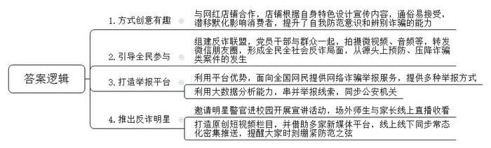
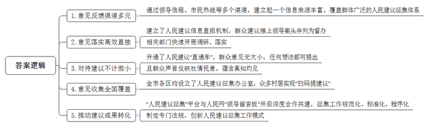
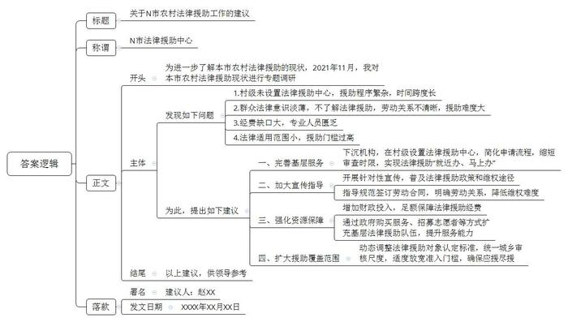
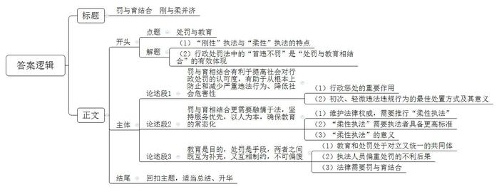

# 2022年公安院校联考《申论》题

<!-- gwy:overview:start -->
> **公安招警和公检法 · 2022 · 申论 · 公安院校联考** ｜ 4 题 · 图片 4 处 · 答案随题折叠

导航：[题目](#题目) · [材料 1](#材料-1)
<!-- gwy:overview:end -->

> 候选采集稿。参考答案及解析来自粉笔页面，不代表官方答案或真实高分答卷；来源使用许可与原卷对应关系仍需人工核实。

## 给定材料

### 材料 1

近年来，形式多变的网络诈骗屡屡见诸报端，成为笼罩在人民群众头顶上的一朵乌云。由于犯罪分子精确掌握了个人的相关信息，并针对个人设下了环环相扣的诈骗陷阱，普通人稍不留神便会掉入陷阱，酿成了不少悲剧。2021年4月，习近平总书记对打击治理电信网络诈骗犯罪工作作出重要指示，强调要坚持以人民为中心，统筹发展和安全，强化系统观念、法治思维，注重源头管理、综合治理，坚持齐抓共管、群防群治，全面落实打防管控各项措施和金融、通信、互联网等行业监管主体责任，加强法律制度建设，加强社会宣传教育防范，推进国际执法合作，坚决遏制此类犯罪多发高发态势，为建设更高水平的平安中国、法治中国作出新的更大的贡献。

玉兰路作为J市最具代表性的街区之一，近年来，在众多网红店的聚集下焕发出了新的生机。2021年的元旦假期，很多来玉兰路打卡的朋友会发现，这条路上出现的新风景，就是隐藏在各个店铺内的各具特色的防范电信网络诈骗提示。

“你以为这是一条发财路，结果他们却跑了路。”“他爱你？他只是想养肥你，再狠狠诈骗你……”玉兰路上的这家下午茶店里，一张张详细讲解“杀猪盘”诈骗套路的提示台卡吸引了不少人的注意。这些小提醒反诈于无形，潜移默化地影响着进店的客人。“花样”反诈，不得不给他们的创意点赞！

原来，玉兰路派出所“跨界联名”了好几家网红店，让店铺根据自己的特色设计防范电信网络诈骗的宣传内容，既接地气又有趣，还特别容易让客人接受。说起和网红店铺的合作，玉兰路派出所郑教导员颇感欣慰：“我们联系一些店家协商开展防范电信网络诈骗合作时，大家表现出了极大的热情，可以说是一拍即合。店家们也希望来店的消费者能提高警惕，他们表现出了很强的社会责任感。”

结合各个店家的特色，玉兰路派出所提供了不同的宣传方案。像J市百货中心这样客流量大的商家，通过在店内的投影设备循环播放案例剖析类的防范宣传视频，在顾客等位或等餐的过程中进行具有针对性的宣传。还有一些店家提出由自己来设计结合店铺特色的宣传内容，比如漫生活原豆巧克力工厂就在餐垫上印刷了以巧克力豆卡通形象为“股权投资类”电信网络诈骗受害者的漫画。尚轻食餐厅则使用卡通小猪表现“杀猪盘”电信网络诈骗，并为此印制了托盘纸和面包封袋。许多消费者表示，像这样接地气又有趣的宣传方式更容易让人接受，大家在轻松愉快的氛围中提升了自我防范意识和辨别诈骗的能力。

“不熟的号码不要乱接，不熟的微信不要乱聊……”最近这几天，J市L镇的村民发现，自己手机微信朋友圈里经常出现该镇党委书记和一些村书记拍摄的短视频，他们有的化身老娘舅苦口婆心劝说，有的则扮演水果摊摊主边卖水果边讲道理……

原来，为解决当前反诈宣传工作存在的难点，L镇派出所与镇党委、镇政府组建了“L镇反诈联盟”，拍摄视频的书记们都是该联盟成员。同时，镇上的妇联主席、联村书记、学校校长等纷纷从刷单返现、冒充领导等现实案例说起，利用通俗易懂的L镇方言或普通话拍摄“全民反诈我来讲”系列微视频，并通过转发微信朋友圈的形式，定向、定点地推送给全镇人民。

“全镇25个村（社区）喇叭每天播放反诈警示语，定期开展反诈宣传讲座，但还是有群众被骗。”L镇派出所叶所长说。为彻底解决“今天在宣传，明天还被骗”的情况，L镇派出所与镇党委、镇政府反思反诈宣传工作存在的问题和短板，决定让群众加入进来，使反诈宣传工作由“独角戏”向“大合唱”转变。

“反诈不仅仅是公安的反诈，应该是全民的反诈，是一项动员全民参与的工程。”叶所长说，“群众自己参与进来，拍摄新颖的反诈视频、音频等，让他们从被动转为主动，形成全民全社会反诈局面，从源头上预防、压降诈骗类案件的发生。”目前，L镇25个行政村、129家企事业单位、4家中小学校已成为“L镇反诈联盟”的先行军。

J市公安局还联合M互联网企业共同推出警民联合网络诈骗信息举报平台——警网平台。该平台集公安机关的刑侦优势与互联网企业的平台优势于一身，面向全国网民提供网络诈骗举报服务。自成立以来，警网平台累计收集各类诈骗举报超过26万次，举报总金额达3.5亿元。警网平台为用户提供了视频、音频、图片及文字等多种举报方式，全面收集犯罪分子信息，同时利用互联网企业的大数据分析能力，将举报线索进行串并，所有信息直接同步公安机关。截至目前，警网平台已与全国400余个地区的公安机关建立联系，协助侦破100多起重大网络诈骗犯罪案件，涉案金额达1.7亿元，打掉10余个组织严密、分工明确的大型诈骗团伙。

“‘光头李’来了，你抢到票了吗？”日前，J市某大学邀请市公安局反电信网络诈骗中心网红明星“光头李”——李警官来校开展“全员反诈·校园无诈”反电信网络诈骗主题宣讲活动，现场座无虚席，掌声、笑声不断。“听李警官讲故事，不要再让辛苦钱被骗光了！”场外师生与家长以线上同步直播的方式收看，一边“点赞”，一边刷屏转发。李警官专门从事反诈工作，他用幽默、诙谐、有趣的表演风格，把单调、重复的诈骗案例，通过富有创意的文案和充满感染力的激情演绎，讲述反诈知识，揭秘诈骗套路。

为有效提高市民防诈识骗能力，不断提升人民群众的安全感和满意度，让市民在新传播方式中接受反诈知识，2020年11月，市公安局在线上线下同步推出了《光头李讲反诈》系列原创短视频栏目。栏目每期一个案例，每期时长一分半钟左右，用案例讲述反诈知识，揭秘各种诈骗套路，让人耳目一新，赢得了大家的肯定。《光头李讲反诈》已在“J市公安”新媒体微信视频号、抖音号、快手号等平台先后推送了58期，全网综合阅读量已突破8000万。J市公安局常态化密集推送《光头李讲反诈》宣传短视频，提醒大家时刻绷紧防范之弦，谨防新型电信网络诈骗，在J市营造了全民反诈的浓厚氛围。目前，市可防性案件警情同比下降了32.5%，电信网络诈骗警情同比下降了34.7%。

### 材料 2

2020年7月，市民古美华接到了一个特殊的邀请——为即将成立的S市人民建议征集办公室揭牌，获邀理由是她曾贡献过“金点子”。古美华是一家24小时便利店的经营者，在工作中她注意到一个问题：按照相关规定，便利店夜间要配备2名员工值守，否则将受到处罚，但她认为，这项规定已经滞后于移动支付时代，在一定程度上还提高了成本，制约了便利店的发展。于是，她通过人民建议征集平台提交了一份《关于尽快废止便利店夜间需2人值守规定的建议》——古美华没想到，自己的这条建议从提出到有关政府部门落实解决，前后只用了不到1个月的时间。

“近年来，S市正不断以更新的机制、更主动的姿态，推动人民建议征集深入百姓生活、融入社会治理、走进决策视野。”S市信访办、人民建议征集办王主任说。10年前，S市信访办设立人民建议征集处，专门处理人民群众通过信访渠道反映的意见建议，这拉开了人民建议征集专门化发展的大幕。2020年7月，S市信访办挂上了市人民建议征集办公室的牌子，集纳“人民建议征集信箱”“市委领导信箱”“市政府领导信箱”及12345市民热线等多个渠道，建立起一个信息来源丰富、覆盖群体广泛的人民建议征集体系。

“缺少针对老年人的营养定制菜谱，口味单一、菜品单一，仅能保证有的吃，但不一定能吃得好。”市民丁德友致信人民建议征集信箱希望根据老年人用餐特点，选择老字号餐饮企业共建“长者食堂”。丁德友提的建议，通过人民建议信息直报机制，摆上了市领导的办公桌同时被列为督办件。S市民政、商务部门迅速对全市老年助餐服务情况开展调研，并提出让有条件的老字号企业加入老年助餐服务。

2020年初，S市某大学霍教授走在D区滨江水岸时萌生了一个想法：“滨江是属于人民的会客厅，不妨多倾听人民心声，可以专门设置一个收集人民意见的平台。”他把想法通过书信提交到当地区委，不久，这一构想正式落地，霍教授也有了一个新身份“D区发展建设特聘建议人”。D区人民建议征集办林主任介绍，2020年，D区开通了人民建议“直通车”，迄今为止已收集到数百条人民建议，一批“金点子”已得到采纳和运用。“市民、游客有任何想法，哪怕只是一个台阶、一个标识的事，都可以提。”林主任说。

2020年疫情期间，S市明确规定：乘坐地铁必须全程佩戴口罩。市民小乔在一次乘坐地铁忘带口罩后，萌生了是否能在地铁站里增设口罩自助售卖机的设想，并在人民建议征集网站上提交了建议。市人民建议征集办对这条建议非常重视，随即，这条建议推动了多部门的联合调研。没过多久，小乔的设想便得到了实现。“各职能部门积极采纳群众建议，推动出台规范性文件170余件。”王主任说，“群众声音是原汁原味的社情民意，蕴含着大量真知灼见。一条好建议完善一项政策、改进一项工作已经成为常态。”

2020年，市人民建议征集办共接收处理群众意见建议2万余件，内容涵盖经济社会发展的方方面面，除向职能部门转递外，有175件报送市委、市政府领导，平均两天1件，职能部门采纳率达98.3%。全市16个区均设立人民建议征集办公室，6100多个村居实现“扫码提建议”。围绕制定S市“十四五”规划，20多位市民应邀与政府有关部门负责人座谈，不少切合实际的建议被吸收写进了发展规划。聚焦教育、医疗、住房等民生热点，S市人民建议征集办与相关职能部门已开展联合征集17次。人民建议征集工作在解决一大批具体问题的同时，还推动相关部门制定了一大批规范性文件。

结合党史学习教育，S市深化人民建议征集工作，促进“我为群众办实事”更加精准有效。2021年5月19日，S市“人民建议征集”平台与人民网“领导留言板”开启深度合作共建，进一步推动建议成果转化，更好地从政策层面解决问题。“人民建议征集工作是送上门的群众工作，必须进一步加强这项工作的规范化、标准化、程序化建设。”王主任说，“如今，我市人民群众的‘金点子’正逐步成为城市治理的‘金钥匙’。”

2021年6月23日，S市人大常委会会议表决通过《S市人民建议征集若干规定》，并于2021年7月1日起正式施行。该规定是全国第一部由省级人大常委会制定的专门促进和规范人民建议征集工作的地方性法规。如今，以地方立法为契机，S市正不断创新人民建议征集工作模式，进一步畅通民意表达的渠道方式，推动人民建议征集的成果及时转化。有专家指出，这是对“全过程民主”的有益探索，有力彰显了新时代的民主立法、科学立法，也是“人民城市人民建，人民城市为人民”的具体实践。

### 材料 3

2021年10月的一天，农民工老梁来到N市法律援助中心，对在法律援助中心帮助下获得了合法赔偿表示感谢。2020年6月18日，老梁在某企业生产菌棒过程中因机器发生故障导致右手手掌受伤，后经有关部门认定为工伤，并鉴定为伤残十级。但是，该企业并未给老梁缴纳工伤保险。为解决赔偿事宜，老梁向N市法律援助中心求助。据了解，当时该企业认为他们与老梁之间不存在劳动关系，是劳务关系，老梁受伤与企业有些关系但不是企业的全部责任。该企业认为老梁不是他们的工人，不应该被认定为工伤。在法律援助律师的帮助下，老梁向当地劳动人事争议仲裁委员会提出仲裁申请，请求依法裁决该企业与其解除劳动关系并做出赔偿。经仲裁庭审理查明并调解后，该企业与老梁自愿解除劳动关系，并自愿于2021年10月1日前一次性支付老梁各项赔偿合计83000元。

为进一步了解本市农村法律援助的现状，2021年11月，N市法律援助中心的工作人员小赵进行了专题调研，下面是小赵在调研中了解到的一些情况：

“有时候，我们会发现，有的农民工可能为了几千元就走上违法犯罪的道路，还有一些群体性案件，如果处理不好就会影响社会稳定。有了法律援助律师之后，这些问题就有可能避免。法律援助是体现以人民为中心的发展思想，切实维护人民群众合法权益的一项重要民生工程。”董丽律师对小赵说。

“农民工法律援助之路并不好走，可以说，每个法援案子都要耗费大量精力去搜集资料，整合证据，特别是有些案子还是群体性的维权案件，就更复杂。”W农民工法律援助与研究中心律师肖薇对小赵表示，“不过，每当看到受援者拿到赔偿款后露出的笑容，我觉得自己的工作还是很有意义的，付出的艰辛都值得。法律援助有利于贯彻公民在法律面前一律平等的原则，使公民不论经济条件好坏、社会地位高低都能获得必要的法律服务；有利于保障社会公平正义，保证人民群众在遇到法律问题或者权利受到侵害时获得及时有效的法律援助。”

“从农村法律援助制度本身来看，2018年各地在《法律援助条例》明确规定的适用范围之外的民事、行政案件数为54万余件，占民事、行政案件总数的56%，而后还显递进趋势。我国很多地区的法律援助中心都是四级制，最低到县一级，对于乡村等级却没有设置相应的法律援助中心，这对于农村群众直接咨询法律援助或申请法律援助等都是一大阻碍。法律援助需要经过申请、审查等一系列繁杂程序，时间跨度长。另据有关社会调查，42.55%的群众对法律援助有些了解，51.06%的群众不太了解，仅6.38%的人听过法律援助宣讲。”吴良律师说，“一些农民工出现纠纷后，一是没有合同，二是仅认识工长或包工头，工长或包工头一旦失联，就很难查证农民工的劳动关系，而劳动关系不清晰，索要工资的主体就没法明确，从而增加了法律援助的难度。”

“据统计，截至2018年底，全国法津援助机构数量为3281个，全额拨款事业单位为1259个，业务经费尤其是农村法律援助财政缺口巨大。法律援助工作站39526个，其中有近50%是依托司法所、看守所以及工、青、妇、老、残等相关场所设立，平均每个法律援助机构的工作人员不到4人，平均10个法律援助机构或工作站仅有1位法律援助注册律师。很多乡镇或农村地区甚至没有法律援助工作站及联络站。”P法律研究中心刘主任对小赵说，“现行法规对法律援助对象的界定也不符合当前农村经济发展需要，同时，农村地区对法律援助的标准设定以及审核情况并不一致，很多地区的援助审核较为严格，援助标准存在偏高的情况，导致有些需要法律援助的农村群众被拒之门外。”

令人鼓舞的是，2021年8月20日，十三届全国人大常委会第三十次会议表决通过《中华人民共和国法律援助法》，该法自2022年1月1日起施行。这部法律必将更好地维护公民合法权益，为社会公平正义提供保障。

### 材料 4

2021年7月15日，新修订的《中华人民共和国行政处罚法》（以下简称行政处罚法）正式施行，这是行政处罚法自1996年颁布实施以来的首次全面修改。本次法律修改亮点颇多，特别是第三十三条新增了“首违不罚”规定，即初次违法且危害后果轻微并及时改正的，可以不予行政处罚。在持续推进“放管服”改革的大背景之下，大力推行“柔性执法”，对轻微违法者进行说服教育与劝诫，更有利于提高社会对行政处罚的认可度，有助于从根本上防止和减少严重违法行为、降低社会危害性。“首违不罚”兼容行政执法的力度和温度，是落实行政处罚法关于“处罚与教育相结合”原则的具体体现。

不久前，船员老郝收到一张《交通运输轻微违法行为告知承诺书》，签完承诺书的他表示今后一定会加强法律意识，带齐有效证件再上船，这是H市交通港航执法部门F大队作出的第七起“首违不罚”决定。“‘首违不罚’很有人情味，给了我自我纠错的机会，更体贴和包容了。以前执法就是开罚单，几乎不存在减轻、从轻、不予处罚的好事，似乎交钱扣分就能解决问题，也不管你心里服不服、以后会不会改。现在的‘首违不罚’更触动人心，再没了以往受罚时的对立情绪，反而从内心认识和理解了人家执法检查是为了我们的行船安全和行业更好发展。这下要把规矩牢记心里，以后都不会再犯了。”老郝感慨道，“以前罚十次都没用，这一次不罚反而有了觉悟，真是神奇！”融情于法，F大队坚持服务优先，让执法过程不仅成为查处违法行为的过程，更成为宣传法律、法规、政策、标准和帮助群众解决问题的过程。在新坝船闸执法检查时，船舶都会有一个预先停靠引航道等待的过程，F大队执法人员总是会先帮助船舶安全停靠后再登船进行检查。船舶在靠泊时最容易发生安全事故，尤其在套缆绳的时候，经验不足的船员往往没办法一次套进去。“虽然我们是执法者，但更是服务者。帮助相对人套缆绳，并不会损害我们的执法权威，相反更能让他们理解我们执法检查的初衷。”F大队执法人员小王认为。

“行政相对人并不是行政对立人。”F大队陈队长强调，“如果罚了款却不能使行政相对人改正错误，或者因忽视了可以减轻、从轻、不予处罚的情节而导致相对人内心更抗拒，这样不仅没有维护相关法律法规的权威性，同时也得不到群众认可，实际问题也没有解决。法律不是越严越好，执法也并不是罚单一开就万事大吉。法不等于罚，而是罚与育的结合。”

## 题目

### 第 1 题

**根据“给定资料1”，概括J市在反诈宣传方面有哪些特色。（15分）**

关联材料：材料 1

作答要求：

要求：全面、准确、有条理。不超过300字。

第 1 题 · 答案与解析

**参考答案（粉笔题库参考内容）**

1.方式创意有趣。与网红店铺合作，店铺根据自身特色设计宣传内容，通俗易接受，潜移默化影响消费者，提升了自我防范意识和辨别诈骗的能力。

2.引导全民参与。组建反诈联盟，党员干部与群众一起，拍摄微视频、音频等，转发微信朋友圈，形成全民全社会反诈局面，从源头上预防、压降诈骗类案件的发生。

3.打造举报平台。利用平台优势，面向全国网民提供网络诈骗举报服务，提供多种举报方式；利用大数据分析能力，串并举报线索，同步公安机关。

4.推出反诈明星。邀请明星警官进校园开展宣讲活动，场外师生与家长线上直播收看；打造原创短视频栏目，并借助多家新媒体平台，线上线下同步常态化密集推送，提醒大家时刻绷紧防范之弦。

**解析**

**参考答案说明：**本参考答案从“方式创意有趣”“引导全民参与”“打造举报平台”“推出反诈明星”这四个方面展开，各条答案要点之间在内容上相互并列，没有交叉。

### 第 2 题

**根据“给定资料2”，分析S市人民群众的“金点子”能够成为城市治理“金钥匙”的原因。（20分）**

关联材料：材料 2

作答要求：

要求：全面、准确、有条理。不超过300字。

第 2 题 · 答案与解析

**参考答案（粉笔题库参考内容）**

1.意见反馈渠道多元。通过领导信箱、市民热线等多个渠道，建立起一个信息来源丰富、覆盖群体广泛的人民建议征集体系。

2.意见落实高效直接。建立了人民建议信息直报机制，群众建议摆上领导案头并列为督办；相关部门快速开展调研、落实。

3.对待建议不计微小。开通了人民建议“直通车”，群众意见无大小，任何想法都可提出；且群众声音反映社情民意，蕴含真知灼见。

4.意见收集全面覆盖。全市各区均设立了人民建议征集办公室，众多村居实现“扫码提建议”。

5.推动建议成果转化。“人民建议征集”平台与人民网“领导留言板”开启深度合作共建，征集工作规范化、标准化、程序化；制定专门法规，创新人民建议征集工作模式。

**解析**

**参考答案说明：**本参考答案从“意见反馈渠道多元”“意见落实高效直接”“对待建议不计微小”“意见收集全面覆盖”“推动建议成果转化”五个方面展开，各条答案要点之间在内容上相互并列，没有交叉。

### 第 3 题

**假如你是N市法律援助中心的工作人员小赵，根据“给定资料3”，请针对此次调研中发现的主要问题，撰写一份工作建议。（25分）**

关联材料：材料 3

作答要求：

要求：

（1）问题梳理全面、准确；

（2）所提建议有针对性、切实可行；

（3）不超过500字。

第 3 题 · 答案与解析

**参考答案（粉笔题库参考内容）**

关于N市农村法律援助工作的建议

N市法律援助中心：

为进一步了解本市农村法律援助的现状，2021年11月，我对本市农村法律援助现状进行专题调研，发现如下问题：

1.村级未设置法律援助中心，援助程序繁杂，时间跨度长；2.群众法律意识淡薄，不了解法律援助，劳动关系不清晰，援助难度大；3.经费缺口大，专业人员匮乏；4.法律适用范围小，援助门槛过高。为此，提出以下建议：

一、完善基层服务。下沉机构，在村级设置法律援助中心，简化申请流程，缩短审查时限，实现法律援助“就近办、马上办”。二、加大宣传指导。开展针对性宣传，普及法律援助政策和维权途径；指导规范签订劳动合同，明确劳动关系，降低维权难度。三、强化资源保障。增加财政投入，足额保障法律援助经费；通过政府购买服务、招募志愿者等方式扩充基层法律援助队伍，提升服务能力。四、扩大援助覆盖范围。动态调整法律援助对象认定标准，统一城乡审核尺度，适度放宽准入门槛，确保应援尽援。

以上建议，供领导参考。

建议人：赵XX

XXXX年XX月XX日

**解析**

**参考答案说明**：（1）格式方面，本参考答案写到了“标题”“称谓”“正文”“落款”四个部分。（2）正文部分，一方面从内容上来看，围绕“法律援助”这一主题，本参考答案的开头先写到了“法律援助调研的目的”；主体部分从“村级未设置法律援助中心”“群众法律意识淡薄”“经费缺口大”“法律适用范围小”这四个方面指出问题、给出了具体建议；结尾部分添加了结束语。另一方面，形式上，本参考答案做到了分段、分条撰写，整体上条理较为清晰。

### 第 4 题

**结合给定资料，以“处罚与教育”为主题，联系实际，自拟题目，自选角度，写一篇文章。（40分）**

关联材料：材料 1、材料 2、材料 3、材料 4

作答要求：

要求：

（1）观点明确，见解深刻；

（2）参考“给定资料”，但不拘泥于“给定资料”；

（3）思路清晰，语言流畅；

（4）字数：1000-1200字。

第 4 题 · 答案与解析

**参考答案（粉笔题库参考内容）**

**罚与育结合 刚与柔并济**

刚似山，柔似水。如果把“山”作为执法“刚性”隐喻，强调法律的严肃性、原则性，那么“水”则可以作为执法“柔性”隐喻，充分尊重人的感受，以人为本。我国新修订的行政处罚法新增的“首违不罚”，就是兼具了执法的力度与温度，刚柔并济，是“处罚与教育相结合”原则的有效体现。

**罚与育相结合有利于提高社会对行政处罚的认可度，有助于从根本上防止和减少严重违法行为、降低社会危害性。**行政惩处是行政机关有效行使行政管理职权的重要手段，假如没有了惩处的“利剑”，在维持社会秩序方面就会脆弱无力，对严重违法行为无法起到震慑作用。而对于初次违法且危害后果轻微并及时改正的违法违规行为，则更适用警示告诫、劝告教育等方式，以彰显法律的帮助和引导作用，让群众弄清是非界限，在权衡利弊得失的前提下，转变思想，端正态度，这样也往往更能让制度入脑入心。比如交通港航执法部门贯彻“首违不罚”，开出《交通运输轻微违法行为告知承诺书》，给予相对人自我纠错的机会，消解了受罚时的对立心情，理解了执法的初衷，真正起到了执法的教育意义。

**罚与育相结合更需要融情于法，坚持服务优先，以人为本，确保教育的常态化。**法律的权威不是依赖于严厉的惩罚手段，而是来自于民心所向，在持续推进“放管服”改革的大背景之下，大力推行“柔性执法”，坚持以群众需求为导向的执法，将人性、理性、柔性融入执法的全过程，能让执法既有温度又有力度。当然文明执法、柔性执法，对执法者也提出了更高的标准。要达到这一标准，除了掌握法律法规政策及其精神，更重要的是要心怀对老百姓的感情，敬畏、顺应民意。在日常工作中树立善意执法理念，将宣传教育、服务指引、告诚监管等手段进行普及和贯彻。执法中若多一点柔性，以人为本，将更有利于实现社会和谐，法不容情，但法可融情。

**教育是目的，处罚是手段，两者之间既互为补充，又互相制约，不可偏废。**不能脱离教育而一味地处罚，也不能缺乏必要的处罚来推进教育，教育和处罚处于对立又统一的共同体之中。但现实中，面对较大的行政惩处裁量空间，执法人员更偏向于以“罚”避开潜在的不作为责任，由此造成“罚教失衡”“以罚代教”的问题，背离了“惩处与教育相结合”的原则。从而导致相对人内心抗拒，不仅没有维护相关法律法规的权威性，同时也得不到群众认可，实际问题也没有解决。法律不是越严越好，执法也并不是罚单一开就万事大吉。法不等于罚，而是罚与育的结合。

柔弱之水，亦有万钧之力，只有既坚持法律的刚性，又发挥执法的柔性，宽严相济，坚持惩罚与教育相结合的原则，才能让执法为民成为一道看得见的风景，不断增强人民群众的法治获得感。

**文章分析**

**罚与育结合** **刚与柔并济**

【**标题的优点：**首先，范文的标题突出了“处罚与教育”这一主题。其次，形式上采用对称式结构，使标题更加完整饱满。】

（1）刚似山，柔似水。如果把“<u>山</u>”<u>作为执法</u>“<u>刚性</u>”<u>隐喻</u>，<u>强调法律的严肃性</u>、<u>原则性</u>，那么“<u>水</u>”<u>则可以作为执法</u>“<u>柔性</u>”<u>隐喻</u>，<u>充分尊重人的感受</u>，<u>以人为本</u>。（2）我国<u>新修订的行政处罚法新增的</u>“<u>首违不罚</u>”，就是<u>兼具了执法的力度与温度</u>，<u>刚柔并济</u>，是“<u>处罚与教育相结合</u>”<u>原则的有效体现</u>。

【**开头的优点：**★内容方面。范文的开头是紧扣“处罚与教育”这一主题展开的。首先，开头点出主题，做到了主题明确。其次，对“处罚与教育”这一主题进行了分析阐述，指出了：（1）“刚性”执法与“柔性”执法的特点；（2）行政处罚法中的“首违不罚”是“处罚与教育相结合”的有效体现。★文字表达方面。使用了“如果……那么……”等连接词，使语言表达更有逻辑性。】

**罚与育相结合有利于提高社会对行政处罚的认可度，有助于从根本上防止和减少严重违法行为、降低社会危害性**。（1）<u>行政惩处是行政机关有效行使行政管理职权的重要手段</u>，假如<u>没有了惩处的</u>“<u>利剑</u>”，在<u>维持社会秩序方面就会脆弱无力</u>，<u>对严重违法行为无法起到震慑作用</u>。（2）而对于<u>初次违法且危害后果轻微并及时改正的违法违规行为</u>，则<u>更适用警示告诫</u>、<u>劝告教育等方式</u>，以<u>彰显法律的帮助和引导作用</u>，<u>让群众弄清是非界限</u>，在权衡利弊得失的前提下，转变思想，端正态度，这样也往往<u>更能让制度入脑入心</u>。比如交通港航执法部门贯彻“首违不罚”，开出《交通运输轻微违法行为告知承诺书》，<u>给予相对人自我纠错的机会</u>，<u>消解了受罚时的对立心情</u>，<u>理解了执法的初衷</u>，<u>真正起到了执法的教育意义</u>。

【**论述段1的优点：**★观点句：范文的观点句是紧扣“处罚与教育”这一文章主题提出的。形式上，它在段首处直接写出，位置突出，容易发现。内容上，关键词突出，内容要点明确，可以明显看出是从“处罚与教育相结合的意义”的角度展开论述。★论述内容：（1）行政惩处的重要作用；（2）初次、轻微违法违规行为的最佳处置方式及其意义。注意：以上两个方面的内容都是紧扣“罚与育相结合有利于提高社会对行政处罚的认可度，有助于从根本上防止和减少严重违法行为、降低社会危害性”这个观点句进行分析论述的，论述的针对性强，内容层次丰富。在论述方法上采用了讲道理、举例子相结合的方式，论述充实清晰。】

**罚与育相结合更需要融情于法，坚持服务优先，以人为本，确保教育的常态化**。（1）<u>法律的权威不是依赖于严厉的惩罚手段</u>，<u>而是来自于民心所向</u>，在持续推进“放管服”改革的大背景之下，大力推行“柔性执法”，<u>坚持以群众需求为导向的执法</u>，<u>将人性</u>、<u>理性</u>、<u>柔性融入执法的全过程</u>，<u>能让执法既有温度又有力度</u>。（2）当然<u>文明执法</u>、<u>柔性执法</u>，<u>对执法者也提出了更高的标准</u>。要达到这一标准，<u>除了掌握法律法规政策及其精神</u>，<u>更重要的是要心怀对老百姓的感情</u>，<u>敬畏</u>、<u>顺应民意</u>。在日常工作中<u>树立善意执法理念</u>，<u>将宣传教育</u>、<u>服务指引</u>、<u>告诚监管等手段进行普及和贯彻</u>。（3）<u>执法中若多一点柔性</u>，<u>以人为本</u>，<u>将更有利于实现社会和谐</u>，<u>法不容情</u>，<u>但法可融情</u>。

【**论述段2的优点：**★观点句：范文的观点句是紧扣“处罚与教育”这一文章主题提出的。形式上，它在段首处直接写出，位置突出，容易发现。内容上，关键词突出，内容要点明确，可以明显看出是从“处罚与教育相结合需要融情于法，以人为本”的角度展开论述。★论述内容：（1）维护法律权威，需要推行“柔性执法”；（2）“柔性执法”需要执法者具备更高标准；（3）“柔性执法”的意义。注意：以上三个方面的内容都是紧扣“罚与育相结合更需要融情于法，坚持服务优先，以人为本，确保教育的常态化”这个观点句进行分析论述的，论述的针对性强，内容层次丰富。在论述方法上主要采用了讲道理的方式，论述清晰透彻。】

**教育是目的，处罚是手段，两者之间既互为补充，又互相制约，不可偏废**。（1）<u>不能脱离教育而一味地处罚</u>，<u>也不能缺乏必要的处罚来推进教育</u>，<u>教育和处罚处于对立又统一的共同体之中</u>。（2）但<u>现实中</u>，<u>面对较大的行政惩处裁量空间</u>，<u>执法人员更偏向于以</u>“<u>罚</u>”<u>避开潜在的不作为责任</u>，由此造成“罚教失衡”“以罚代教”的问题，背离了“惩处与教育相结合”的原则。从而<u>导致相对人内心抗拒</u>，不仅<u>没有维护相关法律法规的权威性</u>，同时也<u>得不到群众认可</u>，<u>实际问题也没有解决</u>。（3）<u>法律不是越严越好</u>，<u>执法也并不是罚单一开就万事大吉</u>。<u>法不等于罚</u>，<u>而是罚与育的结合</u>。

【**论述段3的优点：**★观点句：范文的观点句是紧扣“处罚与教育”这一文章主题提出的。形式上，它在段首处直接写出，位置突出，容易发现。内容上，关键词突出，内容要点明确，可以明显看出是从“处罚与教育互为补充、不能偏废”的角度展开论述。★论述内容：（1）教育和处罚处于对立又统一的共同体；（2）执法人员偏重处罚的不利后果；（3）法律需要罚与育结合。注意：以上三个方面的内容都是紧扣“教育是目的，处罚是手段，两者之间既互为补充，又互相制约，不可偏废”这个观点句进行分析论述的，论述的针对性强，内容层次丰富。在论述方法上采用了讲道理的方式，论述充实深刻。】

【**论述段之间的关系：**★内容的内在逻辑：范文的论述段之间是依照“并列”的逻辑展开的。论述段1先写了“处罚与教育相结合的意义”，论述段2再写了“处罚与教育相结合需要融情于法，以人为本”，论述段3最后写了“处罚与教育互为补充、不能偏废”，文章整体论述思路清晰。】

柔弱之水，亦有万钧之力，只有既坚持法律的刚性，又发挥执法的柔性，宽严相济，坚持惩罚与教育相结合的原则，才能让执法为民成为一道看得见的风景，不断增强人民群众的法治获得感。

【**结尾的优点：**范文的结尾回扣了“处罚与教育”这个主题，并且进行了总结升华。】

**解析状态：unknown（来源未提供）**

