# 2008年内蒙古自治区公务员录用考试《行测》题

<!-- gwy:overview:start -->
> **内蒙古 · 2008 · 行测 · 统考** ｜ 135 题 · 图片 65 处 · 答案随题折叠

| 题型模块 | 题量 | 题号 |
| --- | ---: | ---: |
| 言语理解与表达 | 25 | 1–25 |
| 数量关系 | 25 | 26–50 |
| 判断推理 | 45 | 51–95 |
| 常识判断 | 20 | 96–115 |
| 资料分析 | 20 | 116–135 |
| **合计** | **135** | |

导航：[题型与作答说明](#题型与作答说明) · [题目](#题目) · [材料 1](#材料-1)
<!-- gwy:overview:end -->

> 候选采集稿。参考答案及解析来自粉笔页面，不代表官方答案或真实高分答卷；来源使用许可与原卷对应关系仍需人工核实。

## 题型与作答说明

言语理解与表达

（25题）

每道题包含一段文字或一个句子，后面是一个不完整的陈述，要求你从四个选项中选出一个来完成陈述。注意：答案可能是完成对所给文字主要意思的提要，也可能是满足陈述中其他方面的要求，你的选择应与所提要求最相符合。

数量关系

（25题）

本部分包括数字推理与数量关系两种类型的试题。

判断推理

（45题）

本部分包括图形推理、定义判断与类比推理三种类型的试题。

常识判断

（20题）

常识判断部分涵盖法律、政治、经济、管理、人文、科技等方面，主要侧重测查考生的法律知识运用能力，涉及宪法、行政法、经济法、民法等内容。

资料分析

（20题）

所给出的图、表或一段文字均有5个问题要你回答。你应根据资料提供的信息进行分析、比较、计算和判断处理。

## 题目

### 第 1 题

黄河的下游地区，河床比河流的两边高出10米左右，以致其又称“地上河”。这是由于黄河泥沙含量大，到下游时水速缓慢，泥沙不断沉积而造成的。

造成“地上河”的原因是什么：

A. 黄河下游为防洪，以致把堤坝修得太高

B. 黄河泥沙含量大，到下游时由于水速度慢，泥沙不断沉积

C. 黄河下游时常断流

D. 黄河下游经过的地方原来地势就比较高

第 1 题 · 答案与解析

**参考答案（粉笔题库参考内容）**

B

**解析**

根据提问可知本题考查细节判断。

材料第一句讲黄河被称为“地上河”的原因，第二句讲造成“地上河”的原因。定位原文“由于······而造成的”，可知造成“地上河”的原因是“黄河泥沙含量大，到下游时由于水速度慢，泥沙不断沉积”。

因此，结合选项应该选择B。

选项A、C在材料中未提及；选项D中的“原来”不准确。

故正确答案为B。

### 第 2 题

人的泪腺能够不停地制造泪水，泪水具有杀灭细菌、湿润眼球和冲刷眼球表面的脏东西的作用。

在上述话中，泪水的作用哪一项没被提及：

A. 杀灭细菌

B. 排出人体内的脏物

C. 湿润眼球

D. 冲刷眼球表面的脏东西

第 2 题 · 答案与解析

**参考答案（粉笔题库参考内容）**

B

**解析**

根据提问可知考查细节判断。

将选项与原文“泪水具有杀灭细菌、湿润眼球和冲刷眼球表面的脏东西的作用”对照，可知A、C、D三项均有提及，B项没有提及。

本题为选非题，故正确答案为B。

### 第 3 题

尽管他后来步入了哲学上的悲观主义，但这和他的生活景况是不相干的，而在现实世界中，他可以算是个幸运儿了。

对上述话理解最正确的一项是：

A. 尽管他的生活很不幸，但他在哲学上始终是幸运的

B. 他在现实世界中的幸运，反而导致了他在哲学上的悲观主义

C. 他的生活景况虽然不佳，但在现实世界中依然是幸运的

D. 在现实世界中，他的命运还是不错的

第 3 题 · 答案与解析

**参考答案（粉笔题库参考内容）**

D

**解析**

根据提问方式可知考查的是细节判断。

材料前半部分讲“在哲学上是悲观主义”，后半部分讲“他在现实世界中是幸运儿”，可以判断“在现实世界中，他的命运还是不错的”，应选D。

A项说法明显错误；由“在现实世界中，他可以算是个幸运儿了”可知，“哲学上的悲观主义”与“现实世界中的幸运”没有必然因果关系，B项错误；由材料可知，“生活景况”与“现实世界”意义相同，都是“幸运”的，C项错误。

故正确答案为D。

### 第 4 题

这也就是“看见”和“发现”的区别：你“看见”了，但你没有“发现”；可以使人一朝成功的那个伟大的“偶然”，就在你的注视下大摇大摆地溜走了。

从上述话中，对于那个伟大的“偶然”，我们如何理解：

A. 只能被“发现”，不能被“看见”

B. 可能被“看见”，但不能被“发现”

C. 一旦被“发现”，就会取得成功

D. 即使“看见”了，也可能被放过

第 4 题 · 答案与解析

**参考答案（粉笔题库参考内容）**

D

**解析**

根据提问方式可知考查词语理解。

材料大意为“偶然”被“看见”了，但因没有被“发现”而失去成功的机会。进一步分析可以得到，促成成功的因素“可以看见，也可能被放过”，具有“偶然”性。

因此，结合选项应该选D。

A、B项说法明显错误；C项说法过于绝对。

故正确答案为D。

### 第 5 题

虽然他们也知道不应该迷信古书上的道理，应该重视客观事实，可是，在走投无路的时候，他们还是冒着病痛去拜了菩萨。

对上述话理解不正确的一项是：

A. 他们不知道迷信是不应该的

B. 他们知道不应该迷信

C. 他们在极端的情况下还会迷信

D. 他们的思想和行为存在一些矛盾

第 5 题 · 答案与解析

**参考答案（粉笔题库参考内容）**

A

**解析**

A项，根据“虽然他们也知道不应该迷信古书上的道理”可知，他们是知道迷信是不应该的，选项与原文表述相悖，当选；

B项，根据“虽然他们也知道不应该迷信古书上的道理”可知，他们知道不应该迷信，选项表述正确，排除；

C项，根据“在走投无路的时候，他们还是冒着病痛去拜了菩萨”可知，他们在极端的情况下还会迷信，选项表述正确，排除；

D项，根据“知道应该尊重客观事实还要去拜菩萨”可知，他们的思想和行为存在些矛盾，选项表述正确，排除。

本题为选非题，故正确答案为A。

### 第 6 题

当今世界科学技术发展的不平衡，由于国与国、地区与地区、集团与集团之间的科技保密而显得更为突出。然而，科学技术的所有发明创造本应是全人类的财富，任何国家、集团或个人都不应该也不可能长期据为己有。

这段话主要观点是什么：

A. 应该向国外学习先进的科学技术

B. 对科学的保密是有限的，迟早都要泄漏出去

C. 应该加强对科学技术的保密工作

D. 科学技术是全人类的财富，不应该也不能长期保密

第 6 题 · 答案与解析

**参考答案（粉笔题库参考内容）**

D

**解析**

文段开篇指出科技保密使得当今世界科技发展不平衡更为突出。随后通过“然而”进行转折，强调科学技术的所有发明创造应是全人类的财富，不应该也不可能长期被据为己有。故文段强调科学技术属于全人类，不应被长期保密，对应D项。

A项，“向国外学习先进的科学技术”文段未提及，无中生有，排除；

B项，文段重点强调科学技术不应长期被据为己有，而非讨论保密是否会泄漏，偏离文段核心，排除；

C项，与文段的观点相悖，排除。

故正确答案为D。

### 第 7 题

佛教虽提倡超尘脱俗，四大皆空，但到底不能离开人间，所以它也并不能完全免俗。佛教中也有不少财神爷，看来，爱财之心，根除也难。据佛经上讲，佛祖释迦牟尼曾接受过龙女的布施 —— 一颗价值三千大千世界的珠宝！释迦牟尼就马上让她立地成佛。

对这段话最准确的复述是：

A. 佛教也不能免俗

B. 爱财之心，人之常情

C. 提倡四大皆空的佛教也有爱财之心

D. 面对财宝，提倡四大皆空的佛教也不能完全免俗

第 7 题 · 答案与解析

**参考答案（粉笔题库参考内容）**

D

**解析**

根据提问方式“复述”一词可知本题为中心理解题，且要求全面概括。

整个材料是“提出观点—举例论证”的“总—分”结构。首句根据总结词“所以”，可以判断材料主旨为“佛教不能完全免俗”。后两句通过“爱财”这方面加强主旨。

因此，结合选项应该选择D。

“复述”要求全面概括，选项A未提到“爱财”方面；选项B未提到“佛教”；选项C只提到了不能免俗的表现，没有抓住“不能免俗”这个重点。

故正确答案为D。

### 第 8 题

农村工业化和城市化的同步发展，将从根本上解决欠发达地区农村剩余劳动力转移的问题。经济发展的进程表明，农业发展和流入城市的农民所积累的资金，成为发展乡镇企业的启动资金，乡镇企业的发展使位置优越、交通便利的城镇规模不断扩大，小城市则发展成为中等城市。城市化步伐的加快又进一步促进乡镇企业的发展。如此相辅相成，也就为农村工业化、乡村城镇化铺平了道路。

这段话主要观点是什么：

A. 应当坚持农村工业化和城市化的同步发展

B. 乡镇企业将发展成为农村的小城市

C. 农村工业化和城市化的同步发展是相辅相成的举措

D. 城市化步伐的加快将促进乡镇企业的进一步发展

第 8 题 · 答案与解析

**参考答案（粉笔题库参考内容）**

A

**解析**

根据提问方式“主要观点”可知本题为中心理解题。

材料首先提出观点即“农村工业化和城市化要同步发展”，然后来具体阐述“同步发展”所带来的好处，最后进行总结，重申观点，故强调农村工业化和城市化要同步发展，对应A项。

B、D为解释说明的内容，非重点，排除；C项只说明“农村工业化和城市化的同步发展”是举措，并未指出要同步发展，偏离中心，排除。

故正确答案为A。

### 第 9 题

我国是发展中国家，经济文化比较落后，处在创业时期，即使经济有了大的发展，人民生活有了大的改善，仍然需要保持和发扬艰苦创业的精神。要在广大干部群众中深入持久地进行艰苦创业精神的教育，引导人们正确认识国情，正确认识建设有中国特色社会主义的艰巨性和长期性，牢固树立勤俭建国、勤俭办事业的思想，大力发扬艰苦奋斗，励精图治，知难而进，自强不息的精神。

这段话主要观点是什么：

A. 我国是发展中国家，并且还处在创业时期

B. 要在全民族树立艰苦创业的思想

C. 社会主义是一项艰巨而又长期的建设事业

D. 艰苦创业精神要不断加强教育

第 9 题 · 答案与解析

**参考答案（粉笔题库参考内容）**

D

**解析**

根据提问方式“主要观点”一词可知该题为中心理解题。

文段第一句提出问题“如何保持和发扬艰苦创业的精神”，后一句讲教育是实现“保持和发扬艰苦创业的精神”的对策。整段材料构成“提出问题—解决问题”的结构，且核心话题为“艰苦创业精神”，对应D项。

A、C项是提出问题的背景，非文段重点，排除；B项没有提及文段主题词“艰苦创业精神”，非重点，排除。

故正确答案为D。

### 第 10 题

阴山以南的沃野不仅是游牧民族的苑囿，也是他们进入中原地区的跳板。只要占领了这个沃野，他们就可以强渡黄河，进入汾河或黄河河谷。如果他们失去了这片沃野，就失去了生存的依据，史载“匈奴失阴山之后，过之未尝不哭也”，就是这个原因；在另一方面，汉族如果要排除从西北方面袭来的游牧民族的威胁，也必须守住阴山的峪口，否则这些骑马的民族就会越过鄂尔多斯沙漠，进入汉族居住区的心脏地带。

这段话主要观点是什么：

A. 阴山以南地区是一片沃野

B. 阴山以南的沃野是游牧民族生存的依据

C. 阴山以南的沃野不仅是游牧民族的苑囿，也是他们进入中原地区的跳板

D. 阴山以南的沃野对游牧民族和汉族都是极为重要的

第 10 题 · 答案与解析

**参考答案（粉笔题库参考内容）**

D

**解析**

据提问“主要观点”一词知该题为中心理解题。

根据分号划分结构，材料前半部分强调“阴山以南的沃野对游牧民族的重要性”，后半部分强调“阴山以南的沃野对汉族的重要性”，整篇材料构成“分—分”结构。由此可知材料的主体包括“游牧民族”和“汉族”两个方面。

因此，结合选项应该选择D。

选项A显然不是材料的主要观点；B、C项片面，仅提到了“游牧民族”。

故正确答案为D。

### 第 11 题

人类的社会生活虽是文学艺术的唯一源泉，虽是较之后者有不可比拟的生动丰富内容，但是人民还是不满足于前者而要求后者。这是为什么呢?因为虽然两者都是美，但是文艺作品中反映出来的生活却可以而且应该比普通的实际生活更高、更强烈、更集中、更典型、更理想，因而就更带普遍性。革命的文艺，应当根据实际生活创造出各种各样的人物来，帮助群众推动历史前进。例如一方面是人们受饿、受冻、受压迫；一方面是人剥削人、人压迫人，这个事实到处存在着，人们也看得很平淡；文艺就是把这种日常的现象集中起来，把其中的矛盾和斗争典型化，构成文学作品或艺术作品，就能使人民群众惊醒起来，感奋起来，推动人民群众走向团结和斗争，改造自己的环境。如果没有这样的文艺，那么这个任务就不能完成，或者不能有力而迅速地完成。

最能准确复述这段话主要意思的是：

A. 人类的社会生活是文学艺术的唯一来源

B. 人类的社会生活比文学艺术有更生动丰富的内容

C. 文艺来源于生活，又应高于生活

D. 生活原本是实实在在、平平淡淡的，来自于生活的艺术也是同样

第 11 题 · 答案与解析

**参考答案（粉笔题库参考内容）**

C

**解析**

根据提问可知该题为中心理解题。

整个材料构成“提出论点—解释原因”的“总—分”结构。材料首先阐述人民对文学艺术的需求，接着追问这种需求的原因，用转折词“但是”引出材料的论点“文艺作品中反映出来的······更带普遍性”，即文艺作品高于生活。

因此，结合选项应该选择C。

选项A的“唯一”，说法过于绝对，且不是材料的重点；选项B是材料的铺垫信息，不是重点；选项D与文意不符。

故正确答案为C。

### 第 12 题

随着发明和发现的产生，随着制度的发展，人类的心灵也必然因之而愈来愈开豁，人类的脑子也在逐渐变大，尤其是大脑部分。在蒙昧阶段，人们要从一无所有的环境里想出最简单的发明是极其困难的。因此当时人类心智发展之迟缓是不可避免的。要把这样一些蒙昧初开、野犷难驯的人组织起来，形成一个社会，当然也是十分困难的。毫无疑问，最早的发明项目、最早的社会组织，是难于产生的，因此从蒙昧阶段过渡到野蛮阶段所经历的时间是最长的。

最能准确复述这段话主要意思的是：

A. 发明、发现的产生，社会制度的建立，都开始于蒙昧阶段，但由于从无到有是非常困难的，所以蒙昧阶段特别长

B. 发明、发现的产生，社会制度的建立，是野蛮阶段的开始。而在蒙昧阶段，这一切都是很困难的，所以蒙昧阶段特别长

C. 在蒙昧阶段，人类无发明、发现和制度可言。而这三者是野蛮社会开始的必要条件，因此三者之间有一段相当长的间隔时间

D. 通过蒙昧阶段发明、发现和建立制度的困难，说明原始人智力发展迟缓的原因

第 12 题 · 答案与解析

**参考答案（粉笔题库参考内容）**

A

**解析**

根据提问可知该题为中心理解题。

材料第一句讲随着发明、发现的产生，社会制度的建立，人类的心灵愈加开豁。二、三句讲人类心智发展迟缓的原因。第四句讲把心智不发达的人组织成社会困难。最后一句通过弱总结词“毫无疑问”提出观点。材料构成“铺垫解释原因—提出观点”的分—总结构。则“总”的部分是材料的表面主旨，即“最早的发明项目、最早的社会组织，是难于产生的，因此从蒙昧阶段过渡到野蛮阶段所经历的时间是最长的”。由此可知，蒙昧阶段特别长的原因正是从无到有的困难。另外，发明、发现的产生，社会制度的建立过程，就是发生在蒙昧阶段到野蛮阶段的过渡阶段，即“发明、发现的产生，社会制度的建立”始于蒙昧阶段，而其真正确立则成为进入野蛮阶段的标志。

因此，结合选项应该选择A。

发明、发现的产生，社会制度的建立都开始于蒙昧阶段，而不是野蛮阶段的开始，故选项B错误；蒙昧阶段发明、社会组织“难于产生”，不代表“在蒙昧阶段人类无发明、发现和制度”，故选项C理解偏颇；材料主要论述“从蒙昧阶段过渡到野蛮阶段特别长”的原因，故选项D说法不准确。

故正确答案为A。

### 第 13 题

虽然希腊不是欧洲足球强国，但众所周知，希腊不乏有实力的足球俱乐部和球队，也有不少有水平的教练和球员。希腊的足球很普及，观众很有激情，主力球员像电影明星和大政治家一样是公众崇拜的偶像。

这段话主要介绍了希腊的什么特点：

A. 足球水平很高

B. 足球水平在欧洲不算很高

C. 足球俱乐部实力较强

D. 足球很普及，很受欢迎

第 13 题 · 答案与解析

**参考答案（粉笔题库参考内容）**

D

**解析**

材料第一句用转折词“但”强调希腊足球俱乐部、球队、教练和球员多，进而转向“希腊的足球很普及，很受欢迎”，语意重点在后。

因此，结合选项应该选择D。

由材料“希腊不是欧洲足球强国”，可以判断A项错误；B项虽说法正确，但材料主要强调“足球的普及”，并非主要特点，可排除B项；材料只提到“不乏有实力俱乐部”，并不代表俱乐部整体“实力较强”，可排除C项。

故正确答案为D。

### 第 14 题

虽然某些防火建筑的主要部分都是由耐火材料建成，但却可通过门厅和其他通道里的易燃材料使火势蔓延以至完全被摧毁。这些建筑甚至可能由于金属梁、柱的坍倒而遭到严重的结构破坏。

这段话主要说明某些防火建筑什么特点：

A. 受火的损坏少于受金属支撑物坍倒的损坏

B. 可能会遭到火的严重破坏

C. 拥有特殊结构的走廊和门厅

D. 对建筑物内各种设施的保护不如一般建筑

第 14 题 · 答案与解析

**参考答案（粉笔题库参考内容）**

B

**解析**

材料第一句用转折词“但”强调防火建筑仍可通过易燃材料使火势蔓延以至完全被摧毁，进而补充火灾还可能造成梁柱坍塌而严重破坏建筑。综合两句话都说明了“防火建筑遭遇火可能受到严重破坏”。

因此，结合选项应该选择B。

材料并未提及防火建筑受火的损坏与受金属支撑物坍塌的损坏间的比较，故排除A项；C项说法错误，防火建筑内门厅和其他通道里使用易燃材料，不代表结构特殊；D项说法错误，防火建筑内一些设施使用易燃材料，不代表其设施的保护不如一般建筑。

故正确答案为B。

### 第 15 题

教学包括教和学两个方面。研究教学的一般理论的科学称为教学论，也译作教授学，是教育科学中一个相对独立的分支学科。教学论要解决的是有关教学方面的理论问题。

这段话主要观点是什么：

A. 教学包括教和学两方面

B. 教学论是教育科学中一个相对独立的分支学科

C. 教学论的研究对象是教学中的一般理论问题

D. 教学论是研究教和学两方面理论问题的总称

第 15 题 · 答案与解析

**参考答案（粉笔题库参考内容）**

D

**解析**

根据提问方式可知该题为中心理解题。

材料中的讨论是以主题词“教学论”展开的，材料先给出“教学论”的定义“研究教和学的一般理论科学”，后分析“教学论”解决的问题。因此材料的主要观点是“教学论是研究教和学两方面理论问题的总称”。

因此，结合选项应该选择D。

选项A缺乏主题词；选项B、C说法片面，不能概括整段材料的主要观点。

故正确答案为D。

### 第 16 题

蛇经常会把舌头伸出来，并不是用它来吸收水分，或者想感受新鲜空气，或者是一种习惯性的动作，而是用它来帮助闻味进而来寻找食物和判断所处的环境。

蛇经常伸出舌头来是为了什么：

A. 用舌头帮助闻味进而来寻找食物和判断所处的环境

B. 吸收水分

C. 想感受新鲜空气

D. 是一种习惯性的动作

第 16 题 · 答案与解析

**参考答案（粉笔题库参考内容）**

A

**解析**

根据提问方式可知考查细节判断。

转折词“而是”后面的内容是蛇经常伸出舌头的原因。

因此，结合选项应该选择A。

由材料“并不是······的动作”，易知选项B、C、D错误。

故正确答案为A。

### 第 17 题

向人提出较重大的请求时，必须注意把握恰当的时机。比如，当对方正遭遇到一场重大变故时，你就不应随便前去打扰，请求他帮你做什么事。当对方心情愉快，时间充裕时，向其提出请求就可能有较好的效果。

这段话主要是告诉我们（    ）。

A. 不应该随便向别人提出重大的请求

B. 当对方心情愉快时，请求帮助就有好的效果

C. 请求别人的帮助时，要把握适当的时机

D. 当对方正遭遇重大变故时，是请求不到他的帮助的

第 17 题 · 答案与解析

**参考答案（粉笔题库参考内容）**

C

**解析**

这是一道中心理解题。文段第一句话就给出中心观点：向别人提请求时应该注意把握恰当时机。第二句话用“比如”进行了举例论证。C选项是对文段中心思想的同义替换选项。

文中并没有否定对别人提请求这一行为，故A选项无中生有。

B选项只是对应后边例子，不是文段重点，并且只对应例子中的一方面，也不全面。故排除。

D选项是对后边例子的概括，不是文段重点，故排除。

故正确答案为C。

### 第 18 题

由于信息革命的出现，在世纪交替之际，我们的教育理论和教育模式正面临着一场重大的变革和挑战。在未来几年内，交互式多媒体系统将以其丰富的功能、强有力的影响、方便便宜的特点在教育界得到广泛的应用，从而掀起一场新型教育革命。

这段话的中心思想是：

A. 人类社会已出现信息革命

B. 教育面临着挑战

C. 功能强大的多媒体在教育界的应用将引发一场新型的教育革命

D. 多媒体的功能很强大

第 18 题 · 答案与解析

**参考答案（粉笔题库参考内容）**

C

**解析**

根据提问方式“中心思想”一词可知本题为中心理解题。

材料第一句讲“教育理论和教育模式正面临着变革和挑战”，第二句讲“交互式多媒体系统将掀起一场新型教育革命”，重心落在后句，主题词为“多媒体”。

因此，结合选项应该选择C。

选项A、B未抓住材料的主题词“多媒体”；选项D是中心思想“多媒体在教育界的应用将引发一场新型的教育革命”的原因。

故正确答案为C。

### 第 19 题

生物质能是一种新能源。但由于目前其利用受到土地资源等多方面限制，发展前景还不是很广阔。

这段话主要支持了这样一种论点，即生物质能：

A. 是一种新能源

B. 利用受到限制

C. 发展前景并不广阔

D. 利用面很窄

第 19 题 · 答案与解析

**参考答案（粉笔题库参考内容）**

B

**解析**

从文中最后一句中，“发展前景还不是很广阔”，可以看出，生物质能利用受到限制。因此，B选项符合题意。

故正确答案为B。

### 第 20 题

从严格的意义上说，中国的改革并不是一个纯粹的经济问题，只不过在经济、政治、社会、文化这个大系统中经济的改革走在了前列。但随着改革的深入，随着改革走入中期，经济改革超前而其他方面的改革滞后所造成的社会心理和社会道德的差异，已经开始教育我们了。

这段话主要是为了阐明：

A. 中国的改革不纯粹是一个经济问题

B. 经济改革走在各项改革的前列

C. 经济改革给我们带来了问题

D. 经济改革和其他各方面的改革的不平衡已经开始给我们的社会带来了值得重视的问题

第 20 题 · 答案与解析

**参考答案（粉笔题库参考内容）**

D

**解析**

根据提问方式“阐明”一词可知该题为中心理解题。

由转折关联词“但”可知后半部分为重要内容，即“经济改革超前而其他方面的改革滞后所造成的社会心理和社会道德的差异已对我们造成影响”，即“经济改革和其他各方面的改革的不平衡已经开始给我们的社会带来了值得重视的问题”。

因此，结合选项应该选择D。

选项A、B不是材料阐述的重点；选项C说法过于空泛。

故正确答案为D。

### 第 21 题

一种哲学的重大发展不在于或者说主要不在于它对已有的问题给出新的解释、新的说明，而在于面对时代的要求，它改变了自己提出哲学问题的方式。它面对时代的新发展提出了新问题，凝结出新的范畴和新的理论。

这段话的主要意思是：

A. 哲学之所以能对时代发展有所促进，在于它提出了新问题，凝结出新的范畴和理论

B. 哲学与它所面对的时代有着密切的关系，它总要对时代的新发展提出新问题

C. 哲学上的重大发展，在于它面对时代要求改变了自己提出问题的方式

D. 哲学的重大发展不在于它对已有问题的新解释，而在于它用新的方法解决问题

第 21 题 · 答案与解析

**参考答案（粉笔题库参考内容）**

C

**解析**

根据提问方式“主要”一词可知本题为中心理解题。

材料前面先铺垫“哲学的发展主要不在于······”，中间通过转折词“而”提出“哲学的重大发展在于改变了自己提出哲学问题的方式”，后半部分再对“哲学的重大发展”进行补充说明。整段材料构成“分—总—分”的结构。材料的表面主旨为中间的“总”。

因此，结合选项应该选择C。

选项A的“能对时代发展有所促进”，材料没有提到；选项B未抓住材料重点，是后面的“分”；选项D的“它用新的方法解决问题”，材料中没有提到。

故正确答案为C。

### 第 22 题

所谓信息加工观点就是将人脑与计算机进行类比，将人脑看做类似于计算机的信息加工系统。但是这种类比只是机能性质的，也就是在行为水平上的类比，而不管作为其物质构成的生物细胞和电子元件的区别。换句话说，这种类比只涉及软件而不涉及硬件。

这段话中“硬件”指代的是：

A. 机能性质

B. 行为水平

C. 物质构成

D. 生物细胞和电子元件

第 22 题 · 答案与解析

**参考答案（粉笔题库参考内容）**

D

**解析**

据提问知此题是词语指代题。

将材料后两句简化为“这种类比是甲的类比，不管乙的区别”。这种类比只涉及“丙”，不涉及“丁”，“丁”所指的就是“乙”，即“物质构成的生物细胞和电子元件”，其核心是“生物细胞和电子元件”。

故正确答案为D。

### 第 23 题

吴官正说，大中小学生目前都在紧张地复习功课，迎接期终考试。考试是必要的，但不要搞得太难，不要出偏题、难题，不能搞得大多数学生不及格。现在的学生负担太重，一天到晚处于紧张的状态。要呼吁全社会来关心学生，学校布置的作业不要太多，家长也不要打骂自己的孩子。尤其是中小学生，学生积极性已经很高了，再也不要加码了。没有考取大学的不一定都比考上大学的差。有许多人没有读大学，但很有才干。要让学生参加一些社会实践活动，参加一些劳动，做到德智体全面发展。

关于这段话下列说法不正确的是：

A. 全社会都已经就中小学生的负担达成共识

B. 考试的试题要把握得当

C. 不读大学不一定没有出路

D. 学生不应囿于书本和学校

第 23 题 · 答案与解析

**参考答案（粉笔题库参考内容）**

A

**解析**

据提问方式可知本题为细节判断题。

由材料“要呼吁全社会······再也不要加码了”可知，社会仍存在加重中小学负担的行为，故选项A说法不正确。

由“考试是必要的······大多数学生不及格”可知，选项B说法正确；由“没有考取大学······很有才干”可知，选项C说法正确；由“要让学生参加······德智体全面发展”可知，选项D说法正确。

本题为选非题，故正确答案为A。

### 第 24 题

无论是在温州市区，还是在桥头、白象镇，你总感到一种异常浓烈的气氛和活力在包围着你，这就是温州特有的商品经济气氛和活力。在温州城乡，你看到千家万户都在从事商品经营，到处有车间、作坊，到处有专业市场、自由市场和零售摊点，到处有大大小小的商品，到处有种类繁多的新产品。几百万温州人不是忙于生产，就是在忙于销售。古代有一幅名画叫《清明上河图》，温州商品经济所展现的图画是现代的《清明上河图》，而它比古画所描绘的更繁荣百倍、千倍。

下列哪句话能最好概括上文：

A. 温州所展现的景象是一幅现代的《清明上河图》

B. 温州到处是商品交易

C. 温州到处是商品生产

D. 温州到处呈现出繁荣的商品交易和商品生产，让人感受到她特有的商品经济气氛和活力

第 24 题 · 答案与解析

**参考答案（粉笔题库参考内容）**

D

**解析**

根据提问方式“复述”一词可知本题为中心理解题。

整个材料构成“总—分—总”的结构。材料第一句提出“温州特有商品经济气氛和活力”的观点，后半部分举例说明“温州特有的商品经济气氛和活力”，最后以《清明上河图》比喻“温州繁荣的商品经济”。因此材料的表面主旨即“总”的部分。

因此，结合选项应该选择D。

选项A没有提到主题词“商品经济”，不能概括材料；选项B、C都是中间“分”的内容。

故正确答案为D。

### 第 25 题

现代科学的思维方式在现代科学发展过程中经历了巨大的变化，形成了与近代科学差异很大的新角度、新方位，从机械观思维向以系统观为主导的思维转变，强调认识系统的整体性、动态性、复杂性和决定性。

这段话主要支持了这样一种论点，即（    ）。

A. 现代科学的思维方式在现代科学发展过程中经历了巨大的变化

B. 现代科学的思维方式明显不同于近代科学的思维方式

C. 现代科学的主导思想从机械观向系统观转变

D. 现代科学以系统观为主导思维

第 25 题 · 答案与解析

**参考答案（粉笔题库参考内容）**

C

**解析**

本题属于中心理解题。文段首先指出现代科学的思维方式经历了巨大变化，表现出与近代科学不同的特点，后指出具体的变化，即“从机械观思维向以系统观为主导的思维转变”，并进一步强调现代科学的思维方式的特征——整体性、动态性、复杂性、决定性。文段的中心是现代科学的思维方式经历的从机械观思维向以系统观为主导的思维转变。结合选项，C项符合文段中心。

A项，仅指出经历了变化，未指出具体的变化是什么，表述模糊，故排除。

B项，文段中心是强调现代科学的思维方式的具体变化，而不是与近代科学的比较，故排除。

D项，未指出“变化”这一中心，故排除。

故正确答案为C。

### 第 26 题

1，4，7，10，13，（    ）

A. 14

B. 15

C. 16

D. 17

第 26 题 · 答案与解析

**参考答案（粉笔题库参考内容）**

C

**解析**

1，4，7，10，13，（    ）为一个等差数列，后项减前项的差为3。

故正确答案为C。

### 第 27 题

3，4，6，9，（    ），18

A. 11

B. 12

C. 13

D. 14

第 27 题 · 答案与解析

**参考答案（粉笔题库参考内容）**

C

**解析**

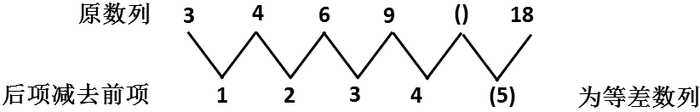

故正确答案为C。

### 第 28 题

34，35，69，104，（    ）

A. 138

B. 139

C. 173

D. 179

第 28 题 · 答案与解析

**参考答案（粉笔题库参考内容）**

C

**解析**

观察数列，相邻三项之间存在加和关系，即：34+35=69，35+69=104。由此可得，第一项+第二项=第三项，则所求项为69+104=173。

故正确答案为C。

### 第 29 题

3，9，27，81，（    ）

A. 243

B. 342

C. 433

D. 135

第 29 题 · 答案与解析

**参考答案（粉笔题库参考内容）**

A

**解析**

原数列是一个等比数列，后一项除以前一项的商为3，因此答案为81×3＝243。

故正确答案为A。

### 第 30 题

8，8，12，24，60，（    ）

A. 90

B. 120

C. 180

D. 240

第 30 题 · 答案与解析

**参考答案（粉笔题库参考内容）**

C

**解析**

原数列为二级作商数列。

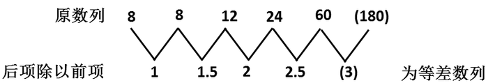

故正确答案为C。

### 第 31 题

1，4，9，（    ），25，36

A. 10

B. 14

C. 20

D. 16

第 31 题 · 答案与解析

**参考答案（粉笔题库参考内容）**

D

**解析**

原数列为平方数列，开方后为1、2、3、（4）、5、6，成等差数列，则未知项为16。

故正确答案为D。

### 第 32 题

51，66，83，102，123，（    ）

A. 144

B. 145

C. 146

D. 147

第 32 题 · 答案与解析

**参考答案（粉笔题库参考内容）**

C

**解析**

原数列为二级等差数列。

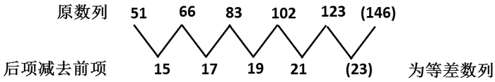

故正确答案为C。

### 第 33 题

1，8，27，（    ）

A. 36

B. 64

C. 72

D. 81

第 33 题 · 答案与解析

**参考答案（粉笔题库参考内容）**

B

**解析**

1，8，27，（    ）=，，，（）。

故正确答案为B。

### 第 34 题

0，6，24，60，120，（    ）

A. 186

B. 210

C. 220

D. 226

第 34 题 · 答案与解析

**参考答案（粉笔题库参考内容）**

B

**解析**

方法一：数列各项均在幂次数附近，优先考虑幂次数列。将原数列转化为：，，，，，（    ），幂次项底数为1，2，3，4，5，（    ），是公差为1的等差数列，则下一项为6；指数均为3；修正项为-1，-2，-3，-4，-5，（    ），是公差为-1的等差数列，则下一项为-6。故所求项为6^3-6=216-6=210。

方法二：数列无明显特征，优先考虑多级数列。后项减前项可得新数列：6，18，36，60，（    ），无明显特征，再次作差，后项减前项得：12，18，24，（    ），是公差为6的等差数列，下一项为24+6=30，则新数列下一项为60+30=90。故所求项为120+90=210。

故正确答案为B。

### 第 35 题

257，178，259，173，261，168，263，（    ）

A. 275

B. 178

C. 164

D. 163

第 35 题 · 答案与解析

**参考答案（粉笔题库参考内容）**

D

**解析**

原数列中，奇数项为257、259、261、263是一个等差数列；偶数项为178、173、168、（163）也是一个等差数列。因此答案为163。

故正确答案为D。

### 第 36 题

8724×65＋8725×35的值为：

A. 872535

B. 872565

C. 872435

D. 872465

第 36 题 · 答案与解析

**参考答案（粉笔题库参考内容）**

C

**解析**

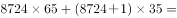。

故正确答案为C。

### 第 37 题

9513－465－635－113的值是：

A. 8275

B. 8270

C. 8300

D. 8370

第 37 题 · 答案与解析

**参考答案（粉笔题库参考内容）**

C

**解析**

9513-465-635-113=(9513-113)-(465＋635)=9400-1100=8300。

故正确答案为C。

### 第 38 题

4532×79÷158的值是：

A. 2266

B. 2166

C. 2366

D. 2362

第 38 题 · 答案与解析

**参考答案（粉笔题库参考内容）**

A

**解析**

。

故正确答案为A。

### 第 39 题

119×120的值是：

A. 14280

B. 14400

C. 14820

D. 12840

第 39 题 · 答案与解析

**参考答案（粉笔题库参考内容）**

A

**解析**

分析选项可以看出四个选项的十位上的数分别为8、0、2、4，因此只需计算结果的后两位即可。

，显然120×120的后两位为00，再减去120后，十位上应该为8。

故正确答案为A。

### 第 40 题

80×35×15的值是：

A. 42000

B. 36000

C. 33000

D. 48000

第 40 题 · 答案与解析

**参考答案（粉笔题库参考内容）**

A

**解析**

解析一：

解析二：

故正确答案为A。

### 第 41 题

456×55＋457×45的值是：

A. 45645

B. 45655

C. 45665

D. 45675

第 41 题 · 答案与解析

**参考答案（粉笔题库参考内容）**

A

**解析**

。

故正确答案为A。

### 第 42 题

7900÷25÷8的值是：

A. 39

B. 39.5

C. 41.5

D. 42.5

第 42 题 · 答案与解析

**参考答案（粉笔题库参考内容）**

B

**解析**

。

故正确答案为B。

### 第 43 题

123,456×654,321的值为：

A. 80,779,853,376

B. 80,779,853,375

C. 80,779,853,378

D. 80,779,853,377

第 43 题 · 答案与解析

**参考答案（粉笔题库参考内容）**

A

**解析**

分析选项可以看出四个选项中的数字个位数不相同，因此只需计算出个位上的数字即可。

结果个位数显然为6。

故正确答案为A。

### 第 44 题

423×187－423×24－423×63的值是：

A. 41877

B. 42300

C. 42323

D. 42703

第 44 题 · 答案与解析

**参考答案（粉笔题库参考内容）**

B

**解析**

。

故正确答案为B。

### 第 45 题

0.0016的开方的值是：

A. 0.08

B. 0.04

C. 0.004

D. 0.008

第 45 题 · 答案与解析

**参考答案（粉笔题库参考内容）**

B

**解析**

0.04的平方等于0.0016，一般情况下，小数平方后小数点后位数应该翻倍。

故正确答案为B。

### 第 46 题

一飞机上的座位分成两部分：头等舱50个座位，普通舱150个座位，如果20%的头等舱和30%的普通舱的座位是空的，那么整个飞机的座位空置率是：

A. 20.5%

B. 25.5%

C. 27.5%

D. 40.5%

第 46 题 · 答案与解析

**参考答案（粉笔题库参考内容）**

C

**解析**

本题可以使用浓度问题的公式进行运算。整个飞机的座位空置率。

故正确答案为C。

### 第 47 题

一话剧共分三幕。第一幕的演出时间比第三幕短18分钟；第二幕的演出时间是第一幕的两倍。如果全剧的演出时间是138分钟，问第三幕的演出时间是多少分钟：

A. 30

B. 39

C. 46

D. 48

第 47 题 · 答案与解析

**参考答案（粉笔题库参考内容）**

D

**解析**

解法1：

设第一幕时间为a分钟，则第二幕和第三幕时间分别为2a分钟和a＋18分钟，根据已知有a＋2a＋a＋18＝138，解之得a＝30，所以第三幕时间为30＋18＝48分钟。

解法2：

根据已知，138－18＝120为四倍的第一幕时间，所以第一幕时间30分钟，第三幕时间48分钟。

故正确答案为D。

### 第 48 题

李华要打印90封信，第一天打了36，第二天打了剩下的信的，到第二天结束时，他还有多少封没有打印：

A. 36

B. 32

C. 24

D. 18

第 48 题 · 答案与解析

**参考答案（粉笔题库参考内容）**

A

**解析**

解析1：

第一天过后还剩90－36＝54封信，第二天打印封信，所以还剩54－18＝36封信没有打印。

解析2：

第二天打印了剩余部分的，所以第二天打印的量小于，所以剩余量大于90－36－30＝24，从A、B中选择A代入即可。

故正确答案为A。

### 第 49 题

一体育俱乐部赠给其成员的票，如按人均算，则每个成员得92张，实际是每个女成员得84张，每个男成员得96张。问该俱乐部男女成员间的比率是多少：

A. 1∶1

B. 1∶2

C. 1∶3

D. 2∶1

第 49 题 · 答案与解析

**参考答案（粉笔题库参考内容）**

D

**解析**

解析1：

设俱乐部男女各a、b人，则根据已知有，解得a:b=2:1。

解析2：

因为平均数为92，男成员平均数为96，女成员平均数为84。而92－84＝8＝2×(96－92)，所以两个男成员、一个女成员才能凑出平均数为92的情况，所以男女比例为2:1。

故正确答案为D。

### 第 50 题

一本书初版时共印了10000册，每卖出一册，该书作者可得0.8元，后再版，这时每卖出一册，作者只可得0.6元，如果这些书全部卖光后，作者共获得26000元，问该书共印了多少册：

A. 36000

B. 20000

C. 3000

D. 40000

第 50 题 · 答案与解析

**参考答案（粉笔题库参考内容）**

D

**解析**

初版印刷共获得10000×0.8＝8000元，所以再版共印刷了(26000‐8000)÷0.6＝30000，因此共印刷30000＋10000＝40000册。

故正确答案为D。

### 第 51 题

从所给四个选项中，选择最合适的一个填入问号处，使之呈现一定的规律性：

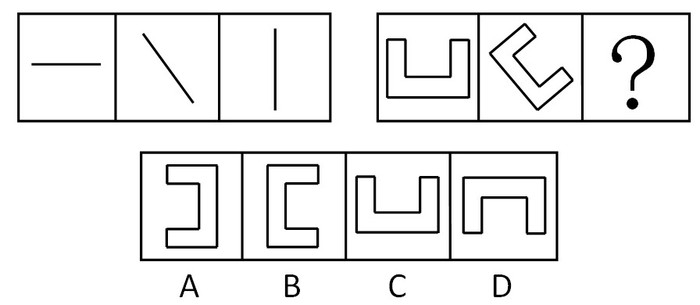

A. A

B. B

C. C

D. D

第 51 题 · 答案与解析

**参考答案（粉笔题库参考内容）**

B

**解析**

元素组成相同，考查位置规律。

第一组的三个图形依次顺时针旋转45°得到下一个图形，第二组图形中前面的图形依次顺时针旋转45°后得到后面的图形。

故正确答案为B。

### 第 52 题

从所给四个选项中，选择最合适的一个填入问号处，使之呈现一定的规律性：

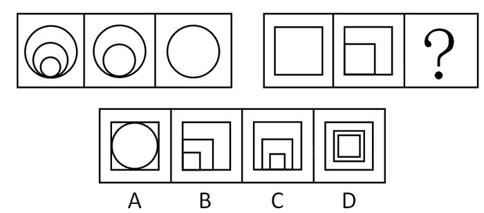

A. A

B. B

C. C

D. D

第 52 题 · 答案与解析

**参考答案（粉笔题库参考内容）**

B

**解析**

第一组的三个图形中后面的图形依次在前一个图形的基础上减少基本构成元素“圆”，第二组的图形依次在前一个图形的基础上加上基本构成元素“正方形”。

故正确答案为B。

### 第 53 题

从所给四个选项中，选择最合适的一个填入问号处，使之呈现一定的规律性：

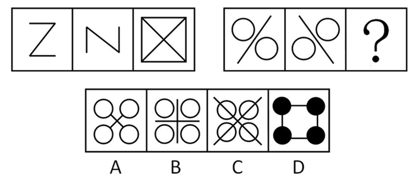

A. A

B. B

C. C

D. D

第 53 题 · 答案与解析

**参考答案（粉笔题库参考内容）**

C

**解析**

元素组成相似，元素叠加。

第一组的前两个图形叠加得到第三个图形。第二组的前两个图形叠加后得到答案。

故正确答案为C。

### 第 54 题

从所给四个选项中，选择最合适的一个填入问号处，使之呈现一定的规律性：

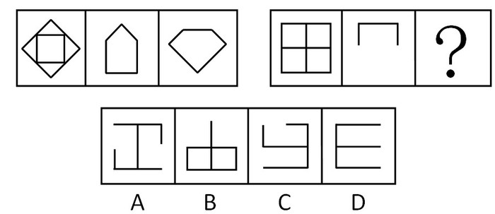

A. A

B. B

C. C

D. D

第 54 题 · 答案与解析

**参考答案（粉笔题库参考内容）**

B

**解析**

元素组成相似，元素叠加。

每一组的前两个图形叠加后去同存异得到第三个图形。

故正确答案为B。

### 第 55 题

从所给四个选项中，选择最合适的一个填入问号处，使之呈现一定的规律性：

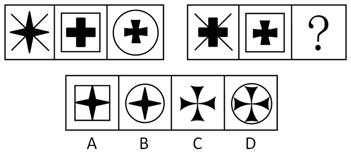

A. A

B. B

C. C

D. D

第 55 题 · 答案与解析

**参考答案（粉笔题库参考内容）**

B

**解析**

元素组成相似，元素周遍。

第一组的三个图形内部的黑色图形依次出现一次，且外部的十字叉、正方形、圆依次出现一次。故第二组图形也对应出现一次，外部应为圆、内部为黑色的尖十字。

故正确答案为B。

### 第 56 题

从所给四个选项中，选择最合适的一个，使之呈现一定的规律性：

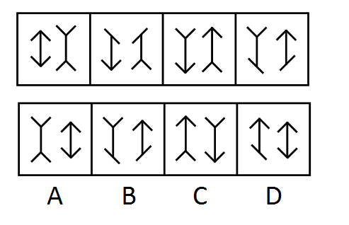

A. A

B. B

C. C

D. D

第 56 题 · 答案与解析

**参考答案（粉笔题库参考内容）**

A

**解析**

元素组成相同，考查位置规律。每个图形可分为左右两个图形，对于左边的图形，可看作1条竖线和4条小短线构成，分别给图1到图4左边的图形的小短线加上标号如下图所示：

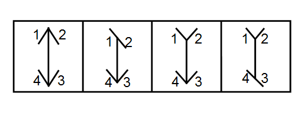

观察发现，从第一个图到第二个图是短线1发生了水平90°翻转，第二个图到第三个图是短线2翻转，第三个图到第四个图是短线3翻转，因此下面应该是短线4翻转，翻转之后得到A答案。右边的图形也是按照同样的规律翻转得到。

故正确答案为A。

### 第 57 题

从所给四个选项中，选择最合适的一个填入问号处，使之呈现一定的规律性：

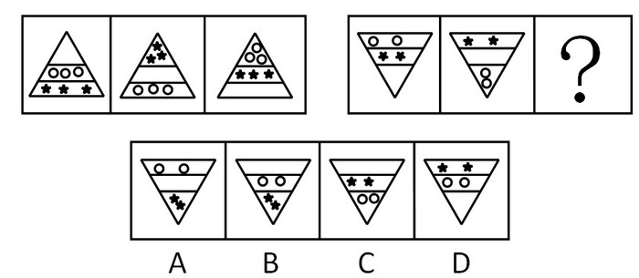

A. A

B. B

C. C

D. D

第 57 题 · 答案与解析

**参考答案（粉笔题库参考内容）**

B

**解析**

元素的遍历，第一组图中圆分别出现在2、3、1层，五角星分别出现在3、1、2层，即圆和五角星在每一层都必须出现一次，第二组图也满足这一规律，则问号处的图形的圆在第二层，五角星在第三层。

故正确答案为B。

### 第 58 题

左边给定的是正方体的外表面展开图，右边哪一项能由它折叠而成？请把它找出来。

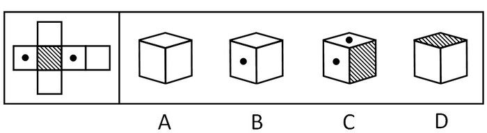

A. A

B. B

C. C

D. D

第 58 题 · 答案与解析

**参考答案（粉笔题库参考内容）**

B

**解析**

选项A中白色的三个面中有两个是相对的面，不可能三个白色的面相邻；

选项C中有黑点的两个面是相对面，不可能相邻；

选项D中与阴影的面相邻的两个白色的面为对立面，不能相邻。

故正确答案为B。

### 第 59 题

左边给定的是纸盒外表面的展开图，右边哪一项能由它折叠而成？请把它找出来。

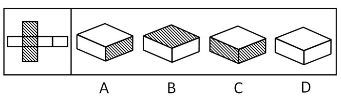

A. A

B. B

C. C

D. D

第 59 题 · 答案与解析

**参考答案（粉笔题库参考内容）**

B

**解析**

白色的三个面中有两个是相对面，三个面不能相邻，排除D项；C项中顶面的白色图形应为细长的长方形，侧面的黑色图形不是细长的长方形，排除C项；A项中顶面的白色图形应为细长的长方形，排除A项。

故正确答案为B。

### 第 60 题

左边给定的是八面体的外表面展开图，右边哪一项能由它折叠而成？

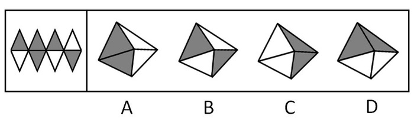

A. A

B. B

C. C

D. D

第 60 题 · 答案与解析

**参考答案（粉笔题库参考内容）**

B

**解析**

A、C项中与黑色阴影的两个面相邻的两个面因为一白一黑，不能同时为白，排除A、C；

D项下面的两个白色图形应为一白一黑，排除D。

故正确答案为B。

### 第 61 题

凡事都应该有个“度”，正如做饭，火小了，不熟；火大了又会烧糊；只有正好，才能吃到可口的饭菜。但是这个“度”并不是折中主义，不同的事物其“度”也是不同的。

这就是说：

A. 只有具体地把握事物的“度”，才能把事情办好

B. 事物折中的结果肯定不是我们要寻求的“度”

C. 事物的“度”是无法得知的，更无从测量

D. 折中主义也是有一定道理的

第 61 题 · 答案与解析

**参考答案（粉笔题库参考内容）**

A

**解析**

第一步：抓住题干主要信息。

第一句强调凡事都有“度”，并举例说明“度”不同，结果也不同；

第二句说明不同的事物有不同的“度”。

第二步：分析题干信息，结合选项得出答案。

A项，从第一句话中的举例可以看出，只有把“度”把握得恰如其分，才能把事情办好，选项A的表述正确。

B项，题干中提到的折中主义是为了说明不同的事物有不同的“度”，没有说明事物折中的问题，无法推出；

C项，“度”是否可知可测量，题干没有涉及，无法推出；

D项，题干没有对折中主义作出评价，无法判断。

B、C、D均无法从题干推出。

故正确答案为A。

### 第 62 题

人们在一些几乎从不使用的小器具、小玩意上浪费的金钱数额令人吃惊。例如：我兄弟两年前用100元买了一个电子冰淇淋制作机，时至今日他只用过三次。而他坚持说，不管他使用这个冰淇淋机的次数多少，这次投资是划算的，因为：

A. 将来冰淇淋价钱会上涨

B. 他买这个冰淇淋机是为了获得需要时即能使用的便利

C. 由于使用频率这么低，他节约了大量电能

D. 由于通货膨胀，今天的100元已不像两年前值那么多了

第 62 题 · 答案与解析

**参考答案（粉笔题库参考内容）**

B

**解析**

第一步：找出论点和论据。

论点：不管这个冰淇淋机的使用次数多少，这次投资是划算的。

没有明显的论据。

第二步：判断加强方式。

论据有利于说明论点的正确，所以本题加强论点。

第三步：逐一判断选项的作用。

A项无法加强论点，从题干可知他使用冰淇淋机的次数不多，因此冰淇淋未来价格上涨无法说明投资划算；

B项说明他买冰淇淋的目的不在于频繁制作冰淇淋，而在于需要时能随时用到，所以这样的投资是划算的，加强题干论点；

C项是否节约电能不能说明最初投资的100元是值得的，无法加强论点；

D项，现在的100元跟两年前相比是否贬值，跟题干中“我兄弟”投资冰淇淋机之间没有直接关系，无法加强论点。

故正确答案为B。

### 第 63 题

民主制的一个基本原则是多数原则，即少数服从多数，认为多数人同意的就是对的。但有时候，真理是掌握在少数人手中的，因为在事物发展的初期，能够看到真理的只能是少数人。因此：

A. 我们应当坚持真理，而不是盲目跟随多数人的决定

B. 民主制是不好的，它不能够做到决策的正确

C. 应当以少数人的意见为准

D. 即使是错误的，也应当坚持多数人的意见，因为多数人的力量是无限强大的

第 63 题 · 答案与解析

**参考答案（粉笔题库参考内容）**

A

**解析**

第一步：抓住每句话中的对象及其中心思想。

第一句：说明民主制即少数服从多数，认为多数人同意就是对的。

第二句：转折，说明真理掌握在少数人手中。

第二步：逐一判断选项的作用并确定正确答案。

A项与题干意思相符，应该坚持真理，不要盲从；

题干并没有说民主制不好，B项与题干不符；

C、D项属于以偏概全，错误。

故正确答案为A。

### 第 64 题

某商店被盗，警方掌握的线索如下：

①甲、乙、丙三人中最多有一个是罪犯；

②如果甲是罪犯，乙肯定是同犯；

③盗窃案发生时，丙正在家里吃饭。

可见：

A. 甲、丙都不是罪犯

B. 甲是罪犯

C. 乙是罪犯

D. 丙是罪犯

第 64 题 · 答案与解析

**参考答案（粉笔题库参考内容）**

A

**解析**

由条件①知，有1人或者0人是罪犯。结合条件②如果甲是罪犯，乙肯定是同犯，可知甲不是罪犯。由条件③知道，丙不是罪犯。故甲、丙都不是罪犯。但不能推出乙一定是罪犯，可能存在没有人是罪犯的情况。

故正确答案为A。

### 第 65 题

真正高明的伪造家制造的钞票从不会被发现，所以一旦他的作品被认出是伪造的，则伪造者不是位高明的伪造者，真正的伪造家从不会被抓到。下列哪种推理方式与这段话类似？

A. 小张是一个玩魔术的专家，他的魔术总能掩人耳目，从未被揭穿，所以他是一个高明的魔术师

B. 小张是一个玩魔术的人，他的魔术一般不会被揭穿，偶尔有一两次被人揭穿，但这不妨碍他是一名优秀的魔术师

C. 小张是一个玩魔术的人，他的魔术一般不会被人看穿，偶尔有一两次被人看穿，说明他并不是一个高明的魔术师，因为高明的魔术师不会被人看穿

D. 小张的魔术很好，从不会被揭穿，所以他是个优秀的魔术师

第 65 题 · 答案与解析

**参考答案（粉笔题库参考内容）**

C

**解析**

第一步：翻译题干。

高明的伪造师⇒不被发现，结论：－不被发现⇒－高明的伪造师。

第二步：逐一翻译选项。

A项，小张的魔术⇒未被揭穿，结论：小张⇒高明的魔术师；

B项，小张的魔术⇒偶尔被揭穿，结论：小张⇒优秀的魔术师；

C项，高明的魔术师⇒不被看穿，结论：－小张的魔术不被看穿⇒－小张是高明的魔术师；

D项，小张的魔术⇒不被看穿，结论：小张⇒优秀的魔术师。

对比题干与选项的推理形式，只有C项的形式与题干最为接近。

故正确答案为C。

### 第 66 题

甲是一名计算机编程专家，乙是一位数学家。其实所有的编程专家都是数学家，我们知道，今天国内的大多数综合性大学都在培养计算机编程专家，据此我们可以认为：

A. 甲是由综合性大学培养的

B. 大多数计算机编程专家是由综合性大学培养的

C. 乙并不是毕业于综合大学的

D. 有些数学家是计算机编程专家

第 66 题 · 答案与解析

**参考答案（粉笔题库参考内容）**

D

**解析**

第一步：翻译题干，利用充分必要条件。

第一句：甲：编程专家，乙：数学家；

第二句：编程专家⇒数学家；

第三句：大多数综合性大学⇒培养编程专家。

第二步：从事实信息开始推导，得到结论。

A项，由甲是编程专家，大多数综合性大学⇒培养编程专家知，“编程专家”属肯后件，无法推出绝对表达的结论，A错；

B项，一些编程专家⇒综合性大学，“编程专家”属肯后件，无法推出绝对表达的结论，B错；

C项，由乙是数学家，编程专家⇒数学家知，“数学家”属于肯后件，无法推出绝对表达的结论，故C错；

D项，有些数学家⇒编程专家，“有些数学家”属肯后件，无法推出绝对表达的结论，但可以推出可能性结论。

故正确答案为D。

### 第 67 题

①小张是百事可乐公司在中国的高级雇员之一。

②那怎么可能，小张只喝可口可乐。

对话中，②的陈述隐含的一个前提是：

A. 百事可乐公司是可口可乐的分公司

B. 小张是可口可乐公司一名并不重要的职员

C. 可乐喝起来味道非常相近

D. 一般的，所有的高级职员只喝本公司的产品

第 67 题 · 答案与解析

**参考答案（粉笔题库参考内容）**

D

**解析**

第一步：找出论点和论据。

论点：小张不是百事可乐公司在中国的高级雇员。

论据：小张只喝可口可乐。

本题论点和论据话题不一致，加强优先考虑搭桥。

第二步：逐一分析选项。

A项：该项说明百事可乐公司隶属于可口可乐公司，讨论的是两个公司间的隶属关系，但论点讨论的是小张属于哪家公司，二者讨论的话题不一致，无关项，无法加强，排除；

B项：该项指出小张是可口可乐公司一名并不重要的职员，该项讨论的侧重点是小张的职位对于公司是否重要，而论点讨论的侧重点是小张属于哪家公司，二者讨论的侧重点并不相同，话题不一致，无法加强，排除；

C项：该项讨论的是两种可乐的味道是否相近，而论点讨论的是小张属于哪家公司，二者讨论的话题不一致，无关项，无法加强，排除；

D项：该项说明高级职员只喝本公司的产品，而论据说小张只喝可口可乐，由此可以推出小张是可口可乐公司的高级职员，而非百事可乐公司的高级雇员，在高级职员与喝饮料习惯之间建立联系，二者讨论的话题一致，搭桥项，可以加强，当选。

故正确答案为D。

### 第 68 题

长期以来，我国的政治宣传一直给人们这样一种印象：革命的就是好的，保守的就是不好的。其实革命与保守只是代表人们对社会现实的两种不同看法，革命派认为现实是不合理的，需要打破进行重新组合；保守派则认为现实是合理的，力图要维持这一秩序。

由上面这段话可以看出：

A. 革命的就一定是好的

B. 保守的一定是不好的

C. 保守派的人一般都代表大多数人民的利益，因而受到当政者们欢迎和支持

D. 革命与保守两种观点究竟哪一个更好应当具体问题具体分析

第 68 题 · 答案与解析

**参考答案（粉笔题库参考内容）**

D

**解析**

第一步：抓住题干主要信息。

第一句表达的观点是传统的政治宣传认为革命是好的，保守不好；

第二句对革命和保守进行解释。两句间是在陈述一个现象，并没有给出明确的观点。

第二步：判断整体关系。

革命与保守只是代表人们对社会现实的两种不同看法，具体谁好没有定论，具体问题具体分析，即答案D。

第三步：逐一判断选项的作用。

A和B这两种观点太绝对，错误；C中的保守派应受到欢迎和支持无法定论。

故正确答案为D。

### 第 69 题

一个年轻的美国外交官在访问中国时，问了一个令他自己尴尬的问题：东方人怎么会如此令人费解。中国官员笑了笑，然后，温和地回答他：就西方人的缺乏观察力而言，他们的民族才是令人费解的。

以下哪一个选项最好地反映了中国官员解释的要点？

A. 不仅中国人，所有东方人都是令人费解的

B. 大多数美国人都是不能理解中国文化

C. 人们没有观察到的东西也许是因为观察的粗浅，而不是事物本身的隐晦

D. 自从美国和共产主义中国恢复外交关系，许多中国人逐渐不信任美国人

第 69 题 · 答案与解析

**参考答案（粉笔题库参考内容）**

C

**解析**

第一步：抓住每句话的重点。

第一句：美国外交官问：东方人怎么会如此令人费解。

第二句：中国官员回答：就西方人的缺乏观察力而言，他们的民族才是令人费解的。

第二步：综合判断并给出答案。

中国官员的意思即西方人观察的太肤浅，而不是东方人令人费解。与此相关的解释为C项；

A项与题干意思相悖，B项的说法太片面，不如C项的理解深刻，D项属于无关选项。

故正确答案为C。

### 第 70 题

美国国内存在严重的种族歧视。白人处于上层地位，看不起有色人种。黑人在受教育、找工作等方面都受到歧视对待，他们不断举行游行示威活动以争取平等的社会地位。

由以上可知：

A. 美国是一个等级制度森严的国家

B. 美国国内存在严重的人权问题

C. 黑人是一个崇尚暴力的群体

D. 黑色人种在世界上的地位比较卑鄙

第 70 题 · 答案与解析

**参考答案（粉笔题库参考内容）**

B

**解析**

第一步：抓住每句话的中心思想。

第一句强调美国存在种族歧视，第二句说明白人处于上层地位，第三句说明黑人举行示威争取平等地位。

第二步：逐一判断选项的正确。

A项说到等级制度，而题干说的是种族歧视，故A属于无关选项；

B项与题干意思相符，种族歧视即人权问题；

C项说黑人崇尚暴力，从题干无从得知；

D项说黑人在世界上的地位，而题干只说明美国的问题，并不能代表黑人在世界上的地位。

故正确答案为B。

### 第 71 题

共产党员如果敢于坚持真理，那么，必须同歪风邪气进行针锋相对的斗争；如果对错误的东西一味顺着、跟着、护着，只能助长不正之风的恶性蔓延。所以：

A. 搞不正之风的人中没有共产党员

B. 只有共产党员才对不正之风进行针锋相对的斗争

C. 敢于坚持真理的共产党员必定和歪风邪气进行针锋相对的斗争

D. 所有的共产党员都应跟歪风邪气进行针锋相对的斗争

第 71 题 · 答案与解析

**参考答案（粉笔题库参考内容）**

C

**解析**

第一步：翻译题干，利用充分必要条件。

第一句：坚持真理的共产党员⇒针锋相对的斗争；

第二句：坚持错误的东西⇒不正之风。

第二步：逐一翻译选项并判断选项的正确。

A项：不正之风⇒－共产党员，“不正之风”属肯后件，无法推出绝对表达的结论，A错；

B项：针锋相对的斗争⇒共产党员，“针锋相对的斗争”属于肯后件，无法推出绝对表达的结论，B错；

C项：坚持真理的共产党员⇒针锋相对的斗争，符合题干推导关系的第一句，正确；

D项：所有的共产党员⇒针锋相对的斗争，此推论错在“所有的”，只有坚持真理的共产党员才能得出此推论，故D错。

故正确答案为C。

### 第 72 题

生产关系一定要适应生产力发展，这是一条规律。当生产力发展了，超越了生产关系，就需要对生产关系作出调整以适应生产力，所以在社会发展过程中：

A. 社会是在自发运行的

B. 对生产关系进行改革是必要的也是必然的

C. 生产关系时刻适应生产力

D. 生产关系永远滞后于生产力的发展

第 72 题 · 答案与解析

**参考答案（粉笔题库参考内容）**

B

**解析**

第一步：抓住每句话的中心思想。

第一句说明生产关系一定要适应生产力发展；

第二句说明生产关系要适时调整以适应生产力。

第二步：逐一判断选项的正误。

A项题干说的是生产关系与生产力的关系，A项为无关选项；

B项对生产关系进行改革是必要的也是必然的，是对题干第二句话的同义复述，B正确；

C、D项太绝对，题干中生产关系要适应生产力，但不是时刻适应或者永远滞后于生产力，故C、D错误。

故正确答案为B。

### 第 73 题

小王到商店买衬衫，售货员问她想要哪种颜色的，小王幽默地说：“我不像讨厌黄色那样讨厌红色，我不像讨厌白色那样讨厌蓝色，我不像喜欢粉色那样喜欢红色，我对蓝色不如对黄色那样喜欢”。

小王最后会选择的颜色是：

A. 黄色

B. 蓝色

C. 红色

D. 粉色

第 73 题 · 答案与解析

**参考答案（粉笔题库参考内容）**

D

**解析**

第一步：翻译题干，并总结规律。

讨厌：黄＞红；白＞蓝。

喜欢：粉＞红；黄＞蓝。

按喜欢程度来排序就是：红>黄，蓝>白，粉>红，黄>蓝，即：粉>红>黄>蓝>白。

第二步：分析题干确定正确答案。

小李最喜欢的是粉色，最不喜欢的是白色，她会选择粉色。

故正确答案为D。

### 第 74 题

时间是有方向性的，问题从过去向未来流动。这就是时间之箭。在生物进化过程中，时间的过去与未来是不对称的，这是一个不可逆过程。但生物进化的时间箭头与熵增不同。熵增意味着退化，即旧事物的分解和衰亡；而进化是新事物的产生和发展，它的时间箭头是指向熵减少的。因此：

A. 生物的进化只有一个方向

B. 生物的演化可分为退化和进化两大类

C. 生物进化过去用的时间短，未来用的时间长

D. 熵的变化是没有方向性的

第 74 题 · 答案与解析

**参考答案（粉笔题库参考内容）**

B

**解析**

第一步：抓住题干主要信息。

第一句说明时间之箭是从过去向未来流动；

第二句说明在生物进化过程中，事件的过去与未来不对称，生物进化是不可逆的；

第三句说明生物进化的时间箭头是指向熵减少的，不同于熵增。

第二步：分析题干信息，结合选项得出答案。

由第三句可知，生物进化是熵减少，熵增加对应的是生物退化，熵增加和熵减少是相对的，可推知生物演化过程包括进化和退化两种，B项正确；

A项题干只说明生物进化的过程不可逆，没有说明生物进化的方向，无法推出；

C项题干只说明生物进化过程中，时间的过去与未来是不对称的，没说明过去和未来哪个用的时间长，无法推出；

D项错误，由第三句可知，熵有增加和减少两种变化。

故正确答案为B。

### 第 75 题

事物发展的根本原因，不是在事物的外部而是在事物的内部，在于事物内部的矛盾性。任何事物内部都有矛盾性。因此：

A. 任何事物都处在不断的运动和发展之中

B. 有一部分事物可以处于静止状态

C. 处于运动和发展中的事物都以同样的速度向前进

D. 当一个社会处于封闭状态时，这个社会就是一个静止的社会

第 75 题 · 答案与解析

**参考答案（粉笔题库参考内容）**

A

**解析**

第一步：分析题干。

第一句：事物发展的根本原因是事物内部的矛盾性。

第二句：任何事物内部都有矛盾性。

故由于任何事物内部都有矛盾性，故任何事物一直都处于不断的发展中。

第二步：逐一判断选项的作用。

A项与题干意思相符，正确，因此排除B；

C项中的发展速度从题干无法得知；

D项属于无关选项。

故正确答案为A。

### 第 76 题

政治斗争是政治冲突的一种形式。它是指各政治主体之间基于自身的利益要求，为实现特定的权利而围绕着公共政治权力所产生的对抗性互动行动。

依上述定义，下列不属于政治斗争的是：

A. 暴动、武装起义和战争

B. 社会各个阶层、政党、集团、派别及其代表在议会里所进行的斗争

C. 两名议员在街上公开宣讲自己的政见

D. 一个人在街上与小贩讨价还价

第 76 题 · 答案与解析

**参考答案（粉笔题库参考内容）**

D

**解析**

第一步：抓住定义中的关键词。

关键词强调“政治冲突”、“政治主体”和“公共政治权力”。

第二步：逐一判断选项。

A、B、C中都是围绕公共政治权力，而D中一个人的讨价还价是围绕个人利益的对抗性互动行动，而不是公共政治权力而进行的，故不符合定义。

本题为选非题，故正确答案为D。

### 第 77 题

发散思维是指沿着不同的方向、不同的角度思考问题，从多方面寻找解决答案的思维模式。

下列属于发散思维的一项是：

A. 以某个问题为中心，从不同的方向和不同的角度，将思维指向这个中心

B. 牛顿从苹果落地领悟到地心引力

C. 鲁班从草拉破手得到了启发，发明锯子

D. 人类从昆虫的眼睛构成得到启示，研制了许多先进的夜视武器

第 77 题 · 答案与解析

**参考答案（粉笔题库参考内容）**

A

**解析**

第一步：抓住定义中的关键词。

“沿着不同的方向、不同的角度思考问题”、“从多方面寻找解决答案的思维模式”。

第二步：逐一判断选项。

A项：从不同的方向和不同的角度，将思维指向这个中心，符合“沿着不同的方向、不同的角度思考问题”、“从多方面寻找解决答案的思维模式”，符合定义，当选；

B项：从苹果落地领悟到地心引力，只是从苹果为什么落地这一个方向和角度思考问题，不符合“沿着不同的方向、不同的角度思考问题”、“从多方面寻找解决答案的思维模式”，不符合定义，排除；

C项：从草拉破手得到了启发，发明锯子，只是从草的外形一个方向和角度思考问题，不符合“沿着不同的方向、不同的角度思考问题”、“从多方面寻找解决答案的思维模式”，不符合定义，排除；

D项：从昆虫的眼睛构成得到启示，研制了许多先进的夜视武器，只是从昆虫眼睛构成这一个方向和角度思考问题，不符合“沿着不同的方向、不同的角度思考问题”、“从多方面寻找解决答案的思维模式”，不符合定义，排除。

故正确答案为A。

### 第 78 题

价值规律，指在商品经济中，商品的价值取决于生产商品的社会必要劳动时间和商品以价值相等的原则进行交换的客观必然性。

下列情况违背价值规律的一项是：

A. 由于制造火箭技术，成本远比制造汽车要求高，火箭也远比汽车贵

B. 火柴远比汽油便宜

C. 某骗子用一块砖头骗走别人的一块金子，因为骗子说那是秦代文物

D. 古代少数民族在天水与汉族人进行物物交换，用他们的毛皮换等价值的汉人的大米

第 78 题 · 答案与解析

**参考答案（粉笔题库参考内容）**

C

**解析**

第一步：抓住定义中的关键词。

关键词强调“价值相等”。

第二步：逐一判断选项。

A、B、D中均是根据生产商品的社会必要劳动时间并以价值相等的原则进行判断得出的结论，符合价值规律。

而C中骗子并没有用价值相等的原则进行交换，违背了价值规律。

本题为选非题，故正确答案为C。

### 第 79 题

证券：就是记载和代表一定权利的文书，即用以证明证券的持有人，有权按照证券所载的内容，享有相应权益的一种凭证。

根据上述定义，下列不属于证券的是：

A. 股票

B. 国库券

C. 合同

D. 支票

第 79 题 · 答案与解析

**参考答案（粉笔题库参考内容）**

C

**解析**

第一步：抓住定义中的关键词。

关键词强调“持有人”，“享有相应权益”，强调单方享有的权益。

第二步：逐一判断选项。

A项，股票是股份公司在筹集资本时向出资人公开或私下发行的、用以证明出资人的股本身份和权利，并根据持有人所持有的股份数享有权益和承担义务的凭证，即“出资人”“享有权益”，符合定义；

B项，国库券是指国家财政当局为弥补国库收支不平衡而发行的一种政府债券，国库券的债务人是国家，即“国家”享有“债券”，符合定义；

C项，合同是当事人或当事双方之间设立、变更、终止民事关系的协议，即双方之间的协议，不是单方享有的权益，故不属于证券；

D项，支票是出票人签发，委托办理支票存款业务的银行或者其他金融机构在见票时无条件支付确定的金额给收款人或持票人的票据，即“持票人”享有“金额”，属于证券。

A、B、D三项都符合单方根据规定享有的权益，而C项的合同是双方之间的协议。

本题为选非题，故正确答案为C。

### 第 80 题

机械组织，指在稳定情况下，环境对组织的要求有一定常规，组织工作有较稳定的方向，对面临的问题有既定的解决方式。工作程序周而复始，比较固定的一类组织。

下列属于机械组织的一项是：

A. 王华与李明一起去秋游，遇上另外几个游览者，大家为省钱，一起去买团体票

B. 电视剧中的一家人

C. 电视剧组的工作室及其成员

D. 红军长征途中，年青的与年弱的一起相伴前进，以免掉队

第 80 题 · 答案与解析

**参考答案（粉笔题库参考内容）**

C

**解析**

第一步：抓住定义中的关键词。

关键词强调“组织”、“环境对组织的要求有一定常规”、“既定的”、“周而复始”。

第二步：逐一判断选项。

A项中的王华、李明和另外几个游览者不属于组织，只是临时凑在一起，故不属于机械组织；

B项中电视剧中的一家人工作程序不会周而复始，不属于机械组织；

C项中“剧组”属于“组织”，且剧组按照剧本周而复始地拍片，符合定义中的关键词，属于机械组织；

D项中红军长征途中年轻和年老的结伴前进，还会遇到很多新问题，这些问题不可能一开始就有既定的解决方式，不属于机械组织。

故正确答案为C。

### 第 81 题

社会竞争，是指在人类生活中，个人或团体为了取得或利用某种有限事物，以达到占有为目的，不顾他方的努力，而发生的彼此相互争夺的一种行为。

下列不属于社会竞争的一项是：

A. 人类在进化过程中，为争取基本生存权而进行的战争

B. 商品社会里，商人为了占得市场，花大量的钱做广告

C. 无产阶级领导的革命和斗争，主要是为了用社会主义制度取代资本主义制度

D. 王阳明一个人在后院看竹子格物致知

第 81 题 · 答案与解析

**参考答案（粉笔题库参考内容）**

D

**解析**

第一步：抓住定义中的关键词。

关键词强调“为了取得某种事物”、“彼此相互争夺”。

第二步：逐一判断选项。

A项中人类为了争取基本生存权而进行战争，符合“为了取得某种事物”和“彼此相互争夺”，属于社会竞争；

B项中的商人为了占得市场而做广告，“占得市场”符合“为了取得某种事物”，“做广告”符合“彼此相互争夺”，属于社会竞争；

C项中“为了取代资本主义制度”符合“为了取得某种事物”，“斗争”符合“彼此相互争夺”，也属于社会竞争；

D项中的格物致知解释为推究事物的原理法则而总结为理性知识，为个人行为，并没有发生相互争夺，不属于社会竞争。

本题为选非题，故正确答案为D。

### 第 82 题

咨询，是指人们以信息为基础，对信息、情报、资料进行综合加工和创造，为社会有关用户提供各项服务的一项智力活动。

下列属于咨询的一项是：

A. 老师上课时向学生提问

B. 某学生课余时间到图书馆向值班人员询问工具书的检索方法

C. 在中美两国入世谈判开始之前，中方人员问美方人员的接听器是否完好

D. 法官为了判案的需要，向原告和被告问有关事实经过

第 82 题 · 答案与解析

**参考答案（粉笔题库参考内容）**

B

**解析**

第一步：抓住定义中的关键词。

关键词强调“信息、情报、资料”、“综合加工和创造”、“提供各项服务”。

第二步：逐一判断选项。

A项中的提问不符合“综合加工和创造”和“提供各项服务”，不属于咨询；

B项中工具书的检索方法需要图书馆工作人员对大量的图书信息材料进行加工提炼创造，符合“信息综合加工和创造”，且学生询问值班人员，值班人员向学生解答的过程就是一种提供服务的过程，符合“提供各项服务”，故B项属于咨询；

C项中中方人员向美方询问的问题是普通询问，没有经过信息加工和创造，不属于咨询；

D项中的法官询问的是事实经过，不符合“综合加工和创造”，不属于咨询。

故正确答案为B。

### 第 83 题

行政诉讼，是指人民法院基于公民、法人或者其他组织的请求，对行政机关具体行政行为的合法性进行审查并做出判决，解决行政争议的活动。

根据上述定义，下列行为属于行政诉讼的是：

A. 某国家行政机关工作人员因酒后发疯打伤一人，被告上法庭

B. 两个国营企业因为经济纠纷而打官司

C. 人大代表对某行政法规的合理性提出怀疑，并提交修改意见

D. 某地公民因乡政府违章占用耕地，而对其提出控诉，要求给予赔偿

第 83 题 · 答案与解析

**参考答案（粉笔题库参考内容）**

D

**解析**

第一步：抓住定义中的关键词。

关键词强调“对行政机关具体行政行为的合法性进行审查”、“解决行政争议”。

第二步：逐一判断选项。

A项中行政机关工作人员因酒后发疯打伤一人，被告上法庭，不涉及“行政行为”，是刑事诉讼，不属于行政诉讼；

B项两个国营企业因为经济纠纷而打官司，属于民事诉讼，不属于行政诉讼；

C项是人大代表行使权力，不涉及“解决行政争议”，不属于行政诉讼；

D项中公民因乡政府违章占用耕地，而对其提出控诉，符合“对行政机关具体行政行为的合法性进行审查”和“解决行政争议”，属于行政诉讼。

故正确答案为D。

### 第 84 题

有限责任公司，又称有限公司，指依照公司法的有关规定设立的，股东以其出资额为限对公司承担责任，公司以其全部资产对公司的债务承担责任的企业法人。其股东人数有最高人数的限制，不能公开募集股份，不能发行股票，而且股东转让有严格限制。

下列单位哪一项不是有限责任公司？

A. 北京电气有限责任公司

B. 北京市证券交易所挂牌上市的100家公司

C. 河北食品贸易有限责任公司

D. 公司倒闭破产后，公司经理的股份全部亏空，但他个人财产不受影响的公司

第 84 题 · 答案与解析

**参考答案（粉笔题库参考内容）**

B

**解析**

第一步：抓住定义中的关键词。

关键词强调“股东以其出资额为限对公司承担责任”，“不能公开募集股份，不能发行股票”。

第二步：逐一判断选项。

B中上市公司可以公开募集股份，发行股票，而A、C、D都符合关键词强调的内容。

本题为选非题，故正确答案为B。

### 第 85 题

行政机关，是依照宪法或行政组织法的规定而设置的行使国家行政职能的国家机关。其主要特征是：①行使国家行政职权，管理国家行政事务；②行政机关在组织体系上实行领导服从属制；③行政机关在决策体制上实行首长负责制；④行政机关行使职能通常是主动的、经常的和不间断的。

根据上述定义，下列属于行政机关的是：

A. 国务院

B. 中国人民政治协商会议

C. 全国人大

D. 最高人民法院

第 85 题 · 答案与解析

**参考答案（粉笔题库参考内容）**

A

**解析**

第一步：抓住定义中的关键词。

定义中的关键词“行使国家行政职权”、“领导从属制”、“首长负责制”、“主动的、经常的、不间断的”。

第二步：逐一判断选项。

A项正确，国务院是最高国家权力机关的执行机关，是最高国家行政机关。

B项中国人民政治协商会议不符合“主动的、经常的、不间断的”，C项全国人大不符合“领导从属制”、“首长负责制”，D项最高人民法院是司法机关，不行使行政职权，不符合“行使国家行政职权”。

故正确答案为A。

### 第 86 题

医生：患者

A. 工人：机器

B. 啄木鸟：病树

C. 警察：罪犯

D. 法官：律师

第 86 题 · 答案与解析

**参考答案（粉笔题库参考内容）**

B

**解析**

第一步：判断题干词语间逻辑关系。

题干两词是对应关系，且是主体和服务对象之间的对应关系。

第二步：判断选项词语间对应关系。

A、C项错误，A、C项是对应关系，但不符合服务对象的关系；

B项正确，啄木鸟和病树是对应关系，且啄木鸟对病树可以看作是一种服务；

D项错误，D项是并列关系。

故正确答案为B。

### 第 87 题

紫竹：植物学家

A. 金属：铸工

B. 铁锤：石头

C. 动物：植物

D. 蝴蝶：昆虫学家

第 87 题 · 答案与解析

**参考答案（粉笔题库参考内容）**

D

**解析**

第一步：判断题干词语间逻辑关系。

题干两词是对应关系，且是对象和人物之间的一一对应关系。

第二步：判断选项词语间逻辑关系。

D项与题干逻辑关系相同；

A、B项不是对象和人物之间的一一对应关系；

C项为并列关系。

故正确答案为D。

### 第 88 题

老师：学生

A. 教师：职工

B. 编辑：读者

C. 师傅：学徒

D. 演员：经济人

第 88 题 · 答案与解析

**参考答案（粉笔题库参考内容）**

C

**解析**

第一步：判断题干词语间逻辑关系。

题干两词是对应关系，且是人物和其教授对象的一一对应关系。

第二步：判断选项词语间逻辑关系。

与题干相同的逻辑关系为C；

A项无明显逻辑关系，B、D为对应关系，但不是人物和其教授对象的一一对应关系。

故正确答案为C。

### 第 89 题

书法：艺术

A. 抢劫：犯罪

B. 鲁迅：周树人

C. 历史：世界史

D. 权力：金钱

第 89 题 · 答案与解析

**参考答案（粉笔题库参考内容）**

A

**解析**

第一步：判断题干词语间逻辑关系。

题干两词是包容关系，且前者是后者的一种形式。

第二步：判断选项词语间逻辑关系。

A项与题干逻辑关系相同，B项为全同关系，C项为包容关系，但历史包含世界史，即后者是前者的一种，故C错误，D项为并列关系。

故正确答案为A。

### 第 90 题

森林：树木

A. 头：身体

B. 花：菊花

C. 山脉：山

D. 身体：身躯

第 90 题 · 答案与解析

**参考答案（粉笔题库参考内容）**

C

**解析**

第一步：判断题干词语间逻辑关系。

题干两词间是包容关系，且为包容关系中的组成关系，后者是前者的组成部分。

第二步：判断选项词语间逻辑关系。

A项为包容关系的组成关系；

B项属于包容关系中的种属关系；

C项与题干逻辑关系相同；

D项属于全同关系。

故正确答案为C。

### 第 91 题

工人：机器

A. 赌球：球员

B. 无产者：资本家

C. 农民：土地

D. 商人：商品

第 91 题 · 答案与解析

**参考答案（粉笔题库参考内容）**

C

**解析**

第一步：判断题干词语间逻辑关系。

题干两词是对应关系，且属于人物和其谋生手段之间的对应关系。

第二步：判断选项词语间逻辑关系。

A、B和题干逻辑关系不同，排除；

C、D与题干逻辑关系相同，但C项中的土地和题干中的机器均为生产资料，而D项中的商品不属于生产资料，故排除D项。

故正确答案为C。

### 第 92 题

教师：教室

A. 士兵：子弹

B. 士兵：战斗

C. 战场：战士

D. 士兵：军营

第 92 题 · 答案与解析

**参考答案（粉笔题库参考内容）**

D

**解析**

第一步：判断题干词语间逻辑关系。

题干两词为对应关系，且为职业和地点之间的一一对应关系。

第二步：判断选项词语间逻辑关系。

与题干相同的逻辑关系即为D，士兵的工作地点在军营；A、B没有地点，C项逻辑顺序与题干相反。

故正确答案为D。

### 第 93 题

发奋：成功

A. 点灯：放火

B. 饮料：可乐

C. 扶贫：账户

D. 自满：失败

第 93 题 · 答案与解析

**参考答案（粉笔题库参考内容）**

D

**解析**

第一步：判断题干词语间逻辑关系。

题干两词是因果关系，且为或然因果关系。

第二步：判断选项词语间逻辑关系。

与题干相同的逻辑关系为D项。

A项无明显逻辑关系，B项为包容关系，C项为对应关系。

故正确答案为D。

### 第 94 题

中国：国家

A. 秦国：战国

B. 人：动物

C. 昆仑山：武夷山脉

D. 生物：植物

第 94 题 · 答案与解析

**参考答案（粉笔题库参考内容）**

B

**解析**

第一步：判断题干词语间逻辑关系。

题干两词间是包容关系，且属于包容关系中的种属关系，前者是后者的一种。

第二步：判断选项词语间逻辑关系。

与题干相同的逻辑关系为B。

A项中需要注意战国并不是国家，而是时期，秦国是中国春秋战国时期的一个诸侯国，A错误；

C项属于并列关系；

D项是包容关系中的种属关系，但后者是前者的一种，与题干正好相反。

故正确答案为B。

### 第 95 题

资本家：工人

A. 地主：佃户

B. 教师：学生

C. 店员：客户

D. 父亲：儿子

第 95 题 · 答案与解析

**参考答案（粉笔题库参考内容）**

A

**解析**

第一步：判断题干词语间逻辑关系。

题干两词间是对应关系。

第二步：判断选项词语间逻辑关系。

四个选项均是对应关系，题干中资本家和工人间存在剥削关系，A项中地主和佃户间同样存在剥削关系。

其他选项均无此关系。

故正确答案为A。

### 第 96 题

十六届五中全会指出，我国现代化进程的重大历史任务是：

A. 建设小康社会

B. 建设社会主义新农村

C. 正确处理新形势下人民内部矛盾

D. 发展科技教育

第 96 题 · 答案与解析

**参考答案（粉笔题库参考内容）**

B

**解析**

本题考查时事政治。

党的十六届五中全会提出的建设社会主义新农村是我国现代化进程中的一项重大历史任务，它的目标要求是：“生产发展、生活宽裕、乡风文明、村容整洁、管理民主。”

故正确答案为B。

本题相关知识点：

“小康社会”是由邓小平在20世纪70年代末80年代初在规划中国经济社会发展蓝图时提出的战略构想。随着中国特色社会主义建设事业的深入，其内涵和意义不断地得到丰富和发展。在20世纪末基本实现“小康”的情况下，中共十六大报告明确提出了“全面建设小康社会”。

### 第 97 题

十六届五中全会通过“十一五”规划建议，提出2010年实现人均国内生产总值比：

A. 2000年翻一番

B. 2001年翻一番

C. 2000年翻两番

D. 2001年翻两番

第 97 题 · 答案与解析

**参考答案（粉笔题库参考内容）**

A

**解析**

本题考查时事政治。

中国共产党第十六届中央委员会第五次全体会议，于2005年10月8日至11日在北京举行。全会按照十六大对本世纪头二十年全面建设小康社会的总体部署，提出了“十一五”时期经济社会发展的主要目标：在优化结构、提高效益和降低消耗的基础上，实现2010年人均国内生产总值比2000年翻一番；资源利用效率显著提高，单位国内生产总值能源消耗比“十五”期末降低20％左右。

故正确答案为A。

### 第 98 题

事物发展过程中不确定的发展趋势是：

A. 必然性

B. 可能性

C. 现实性

D. 偶然性

第 98 题 · 答案与解析

**参考答案（粉笔题库参考内容）**

D

**解析**

必然性是指事物联系和发展中一定要发生的、不可避免的趋势。偶然性是指事物联系和发展中不确定的趋向。必然性和偶然性是对立统一的关系。

故正确答案为D。

本题相关知识点：必然性是由事物的本质决定的，认识事物的必然性就是认识事物的本质。

### 第 99 题

“人不能两次踏进同一条河流”和“人一次也不能踏进同一条河流”，这两种说法：

A. 前者是辩证法的观点，后者是诡辩论的观点

B. 前后二者都是辩证法的观点

C. 前者是诡辩论的观点，后者是辩证法的观点

D. 前后二者都是诡辩论的观点

第 99 题 · 答案与解析

**参考答案（粉笔题库参考内容）**

A

**解析**

“人不能两次踏进同一条河流”说明物质是运动和发展的，是辩证法的观点。“人一次也不能踏进同一条河流”是形而上学的观点，不承认客观事物的存在及其规律性，抹杀概念的客观内容。

辩证法是关于对立统一、斗争和运动、普遍联系和变化发展的哲学学说。唯物辩证法的三个基本规律是对立统一规律、质量互变规律、否定之否定规律。

诡辩，是指为明显的谬误或与公认的合理观念相对立的谬见提供论据的似是而非的推理和论断。诡辩论思想方法的实质是主观主义和形而上学。

故正确答案为A。

### 第 100 题

衡量社会进步的标准是（    ）发展水平。

A. 政治

B. 科学

C. 文化

D. 生产力

第 100 题 · 答案与解析

**参考答案（粉笔题库参考内容）**

D

**解析**

衡量社会进步的标准是综合的，生产关系的性质、政治法律制度、科学文化发展水平和道德风尚都是衡量社会进步的标准，而生产力发展水平则是衡量社会进步的最高的根本的标准。

故正确答案为D。

### 第 101 题

不同事物具有不同的质，这主要是由于：

A. 不同的事物内部有其不同的否定方面

B. 不同的事物有不同的发展规律

C. 不同的事物之间存在着特殊的联系

D. 不同的事物内部有其特殊的矛盾

第 101 题 · 答案与解析

**参考答案（粉笔题库参考内容）**

D

**解析**

马克思主义哲学认为，事物的存在就是以矛盾的方式存在。任何事物内部都存在着肯定的一面和否定的一面，肯定与否定就是一对矛盾。这对矛盾是促使事物产生和发展、消亡的动力。那么一个特殊的事物之所以产生，就是由其内部存在的特殊矛盾所决定。矛盾的特殊性造成了事物存在的特殊性，不同的事物具有不同的质是由其内部特殊的矛盾决定的。

故正确答案为D。

### 第 102 题

有关财政，错误的说法是：

A. 财政是国家凭借政权对一部分社会产品进行分配而形成的分配关系

B. 财政投资的多少和分配于不同部门直接制约着扩大再生产的规模和产业结构

C. 根据财政收入的划分，债务收入属于预算外收入

D. 财政政策的目标体现出简明、集中和相对稳定的特点

第 102 题 · 答案与解析

**参考答案（粉笔题库参考内容）**

C

**解析**

A选项正确，财政是国家为实现其职能，凭借政治权力参与部分社会产品和国民收入的分配和再分配所形成的一种特殊分配关系；

B、D选项正确，财政包括财政收入和财政支出两个部分，既包括生产要素的分配，也包括个人收入的分配。B、D选项说明财政投资的重要性及财政政策的特点，是正确的；

C选项错误，通常按政府取得财政收入的形式进行分类，将财政收入分为税收收入、国有资产收益、国债收入和收费收入以及其他收入等。因此债务收入属于财政收入。

本题为选非题，故正确答案为C。

### 第 103 题

我国经济体制改革的中心环节是：

A. 国有企业改革

B. 培育市场体系

C. 加强宏观调控体系

D. 健全社会保障制度

第 103 题 · 答案与解析

**参考答案（粉笔题库参考内容）**

A

**解析**

国有企业是我国国民经济的支柱，是我国社会主义制度的重要经济基础。国有企业改革是我国经济体制改革的中心环节。

故正确答案为A。

### 第 104 题

（    ）是社会保障体系中的基本纲领。

A. 社会福利

B. 社会优抚

C. 社会救助

D. 社会保险

第 104 题 · 答案与解析

**参考答案（粉笔题库参考内容）**

D

**解析**

社会保障体系是指社会保障各个有机构成部分系统的相互联系、相辅相成的总体。我国的社会保障体系，包括社会保险、社会救助、社会福利、优抚安置和社会互助、个人储蓄积累保障。社会保险在社会保障体系中居于核心地位，它是社会保障体系的重要组成部分，是实现社会保障的基本纲领。

故正确答案为D。

本题相关知识点：

1、社会救助属于社会保障体系的最低层次，是实现社会保障的最低纲领和目标。

2、社会福利是社会保障的最高层次，是实现社会保障的最高纲领和目标。

3、社会优抚安置是社会保障的特殊构成部分，属于特殊阶层的社会保障，是实现社会保障的特殊纲领。

### 第 105 题

著作财产权包括：

A. 发表权

B. 署名权

C. 修改权

D. 演绎权

第 105 题 · 答案与解析

**参考答案（粉笔题库参考内容）**

D

**解析**

著作财产权又称“著作经济权”，是著作人身权的对称，指作者及传播者通过某种形式使用作品，从而依法获得经济报酬的权利。

1、发表权、修改权和署名权属于著作权中的占有权，是专属著作权人的人身权利。

2、著作权中的财产权其实是指因著作权而产生的收益权，包括出版作品、允许他人转载自己作品等获得报酬的权利。演绎权即属此类。

A、B、C三项均属著作人身权，错误，D项正确。

故正确答案为D。

### 第 106 题

自动放弃犯罪行为，从而避免了犯罪结果的发生，这种行为属于：

A. 犯罪预备

B. 犯罪表示

C. 犯罪未遂

D. 犯罪中止

第 106 题 · 答案与解析

**参考答案（粉笔题库参考内容）**

D

**解析**

本题考查法律常识。

A项错误，犯罪预备，是指在犯罪分子在犯罪的准备阶段，由于意志以外的原因未能着手。

B项错误，犯罪表示，又称为犯意表示，一般是指以口头、书面或者其他方法，将真实的犯罪意图表现于外部。比如，张三告诉李四，他想杀王五，属于犯意表示。

C项错误，犯罪未遂，是指犯罪分子已经着手实施犯罪，由于意志以外的原因未得逞。

D项正确，犯罪中止，是指犯罪分子在犯罪过程中，自动放弃犯罪或者自动有效地防止犯罪结果发生。

故正确答案为D。

### 第 107 题

我国刑法规定，情节显著轻微危害不大的，不认为是犯罪。这应理解为：

A. 是犯罪不以犯罪论处

B. 是犯罪不以犯罪处罚

C. 不构成犯罪

D. 是缩小打击面的特殊策略

第 107 题 · 答案与解析

**参考答案（粉笔题库参考内容）**

C

**解析**

现行刑法第十三条“但书”规定：“情节显著轻微危害不大的，不认为是犯罪。”“不认为构成犯罪”，意思是指该行为在法学理论上已经是犯罪，但出于立法者的考虑，在立法阶段就将此种行为排出在了犯罪行为之外，因此，在司法实践中，自然也就不是犯罪。

故正确答案为C。

### 第 108 题

转继承适用的范围是：

A. 遗嘱继承

B. 法定继承

C. 遗赠抚养协议

D. 法定继承和遗嘱继承

第 108 题 · 答案与解析

**参考答案（粉笔题库参考内容）**

D

**解析**

《中华人民共和国民法典》第一千一百五十二条规定：“继承开始后，继承人于遗产分割前死亡，并没有放弃继承的，该继承人应当继承的遗产转给其继承人，但是遗嘱另有安排的除外”，《最高人民法院关于适用中华人民共和国民法典继承编的解释（一）》第三十八条规定：“继承开始后，受赠人表示接受遗赠，并于遗产分割前死亡的，其接受遗赠的权利移转给他的继承人”，说明转继承包括法定继承和遗嘱继承。

故正确答案为D。

本题相关知识点：

转继承，是指继承人在继承开始后实际接受遗产前死亡，该继承人的合法继承人代其实际接受其有权继承的遗产。

### 第 109 题

被判处无期徒刑的罪犯，经过一次或几次减刑以后，实际执行的刑期不能少于：

A. 原判刑期的二分之一

B. 13年

C. 15年

D. 15年以上20年以下

第 109 题 · 答案与解析

**参考答案（粉笔题库参考内容）**

B

**解析**

根据《刑法》第七十八条第二款规定：“减刑以后实际执行的刑期不能少于下列期限：（一）判处管制、拘役、有期徒刑的，不能少于原判刑期的二分之一；（二）判处无期徒刑的，不能少于十三年；（三）人民法院依照本法第五十条第二款规定限制减刑的死刑缓期执行的犯罪分子，缓期执行期满后依法减为无期徒刑的，不能少于二十五年，缓期执行期满后依法减为二十五年有期徒刑的，不能少于二十年。”

故正确答案为B。

### 第 110 题

关于行政诉讼的范围和行政复议范围关系的表述正确的是：

A. 能提起行政诉讼的具体行政行为也一定能提起复议

B. 能提起复议的具体行政行为也一定能提起行政诉讼

C. 有些案件只能提起行政诉讼，有些案件只能提起行政复议

D. 两者的范围是相同的

第 110 题 · 答案与解析

**参考答案（粉笔题库参考内容）**

A

**解析**

行政诉讼解决的是行政机关具体行政行为的合法性问题；而行政复议既解决上面“行政机关具体行政行为的合法性问题”，还解决具体行政行为的合理性问题以及抽象行政行为的问题。因此，行政诉讼的受诉范围包括在行政复议范围内。

故正确答案为A。

本题相关知识点：

1、行政复议是指公民、法人或者其他组织不服行政主体作出的具体行政行为，认为行政主体的具体行政行为侵犯了其合法权益，依法向法定的行政复议机关提出复议申请，行政复议机关依法对该具体行政行为进行合法性、适当性审查，并作出行政复议决定的行政行为。

2、行政诉讼是指公民、法人或者其他组织认为行政机关和行政机关工作人员的具体行政行为侵犯其合法权益，依法向人民法院提起诉讼，由人民法院依法进行审理和判决的诉讼制度。

### 第 111 题

离职学习超过一年的国家公务员应办理的手续是：

A. 免职手续

B. 辞职手续

C. 调任手续

D. 转任手续

第 111 题 · 答案与解析

**参考答案（粉笔题库参考内容）**

A

**解析**

本题考查法律常识。

根据《国家公务员暂行条例》第四十八条规定：“国家公务员有下列情形之一的，应当予以免职：

（一）转换职位任职的；

（二）晋升或者降低职务的；

（三）离职学习期限超过一年的；

（四）因健康原因不能坚持正常工作一年以上的；

（五）退休的；

（六）因其他原因职务发生变化的。”

故正确答案为A。

### 第 112 题

下面哪种社会关系，公务员可以不用回避：

A. 夫妻

B. 密友

C. 甥子女

D. 祖父母

第 112 题 · 答案与解析

**参考答案（粉笔题库参考内容）**

B

**解析**

任职回避，又称职务回避，是指对有法定亲情关系的公务员，在担任某些关系比较密切的职务方面做出的限制。任职回避亲属范围包括：

1、夫妻关系；2、直系血亲关系，包括祖父母、外祖父母、父母、子女、孙子女、外孙子女；3、三代以内旁系血亲关系，包括伯叔姑舅姨、兄弟姐妹、堂兄弟姐妹、表兄弟姐妹、侄子女、甥子女；4、近婚亲关系，包括配偶的父母、配偶的兄弟姐妹及其配偶、子女的配偶及子女配偶的父母、三代以内旁系血亲的配偶。

故正确答案为B。

本题相关知识点：

公务员法规定的回避包括任职回避、地域回避、公务回避。

### 第 113 题

县级以上地方各级人民政府主要领导人的任职，（    ）人以下，在该级人大闭会期间由该级人大常委会决定任命。

A. 3

B. 4

C. 2

D. 5

第 113 题 · 答案与解析

**参考答案（粉笔题库参考内容）**

C

**解析**

我国《宪法》规定：县级以上地方各级人民政府主要领导人的任职，2人以下，在该级人大闭会期间由该级人大常委会决定任命。

故正确答案为C。

### 第 114 题

我国唯一国家级的培训高级公务员机构是：

A. 中央党校

B. 国家行政学院

C. 北京大学政治学与行政管理系

D. 中国人民大学

第 114 题 · 答案与解析

**参考答案（粉笔题库参考内容）**

B

**解析**

国家行政学院是适应改革开放和现代化建设事业的需要，根据中国共产党第十三次全国代表大会和第七届全国人民代表大会第一次会议的决定而建立的。国家行政学院是负责培养高中级公务员、高层次的管理人员和政策研究人才，提供政府管理政策咨询、开展公共管理等领域理论研究的正部级机构，为国务院的直属事业单位。

故正确答案为B。

本题相关知识点：

中共中央党校是轮训培训党的高中级领导干部和马克思主义理论干部的最高学府，是党中央直属的重要部门，是学习、研究、宣传马列主义、毛泽东思想和中国特色社会主义理论体系的重要阵地和干部加强党性锻炼的熔炉，是党的哲学社会科学研究机构。

### 第 115 题

以下说法错误的是：

A. 指示具有强制约束作用，要求下级机关必须遵守和执行

B. 决定具有指导性，具有较强的理论性和政策性，是指导工作的准则

C. 任免通知落款处由任免机关领导人亲笔签署（或代以签名章）

D. 迁移、更改电话号码等可使用通告

第 115 题 · 答案与解析

**参考答案（粉笔题库参考内容）**

D

**解析**

通告是在一定范围内公布应当遵守或周知的事项时使用的公文。通告不同于公告，它主要用于有关单位开展业务工作需要。迁移、更改电话号码等不是与有关单位开展业务有关，不可使用通告。

故正确答案为D。

本题相关知识点：

1、指示是领导机关对下级机关布置工作，阐明工作活动要点及要求、步骤和方法时所使用的一种具有指导原则的下行公文。指示具有较强的指导性、政策性，可以使某项重要事项、工作能顺利进行起着决定性作用。

2、决定是对重要事项或重大行动做出安排时使用的一种公文。决定可由机关作出，也可由会议作出。决定对领导机关而言，发挥着领导作用；对公民而言，有着行动凭据的作用。

## 材料 1

2000年，中国财政大幅度增加社会保障支出，仅中央财政就安排养老、失业、下岗职工基本生活保障和城镇居民最低生活保障等社会保障支出478亿元，比1999年增长86%。到2000年底，全国有10408万职工参加失业保险，日平均领取失业保险金人数为188万人；有10447万职工和3170万离退休人员参加了基本养老保险；有4300万职工参加了基本医疗保险。

### 第 116 题

2000年中央财政社会保障支出为：

A. 478亿

B. 257亿

C. 349亿

D. 412亿

第 116 题 · 答案与解析

**参考答案（粉笔题库参考内容）**

A

**解析**

根据资料“2000年，中国财政大幅度增加社会保障支出，仅中央财政就安排养老、失业、下岗职工基本生活保障和城镇居民最低生活保障等社会保障支出478亿元，比1999年增长86%。”

故正确答案为A。

### 第 117 题

参加基本养老保险的在职职工与离退休人员相差：

A. 3170万

B. 2458万

C. 7277万

D. 6387万

第 117 题 · 答案与解析

**参考答案（粉笔题库参考内容）**

C

**解析**

根据资料可知“有10447万职工和3170万离退休人员参加了基本养老保险”，所以两者之差为10447-3170，显然计算结果的后两位为77，只有C选项符合。

故正确答案为C。

### 第 118 题

2000年底，全国参加失业保险的职工有：

A. 104.07万

B. 10408万

C. 3170万

D. 13617万

第 118 题 · 答案与解析

**参考答案（粉笔题库参考内容）**

B

**解析**

根据材料可以找到参加失业保险的职工有10408万。

故正确答案为B。

### 第 119 题

如果参加失业保险的有10%的人失业，那么失业人数有多少：

A. 188万

B. 124.9万

C. 15.6万

D. 1040.8万

第 119 题 · 答案与解析

**参考答案（粉笔题库参考内容）**

D

**解析**

根据材料参加失业保险共10408万人，所以该题答案为10408×10%＝1040.8万。

故正确答案为D。

### 第 120 题

2000年底参加失业保险的与参加基本养老保险的相差：

A. 4300万

B. 104.08万

C. 6108万

D. 3209万

第 120 题 · 答案与解析

**参考答案（粉笔题库参考内容）**

D

**解析**

参加失业保险的人数为10408万，参加基本养老保险的人数为10447﹢3170＝13617万人，显然两者之差的尾数为9，只有D选项符合。

故正确答案为D。

## 材料 2

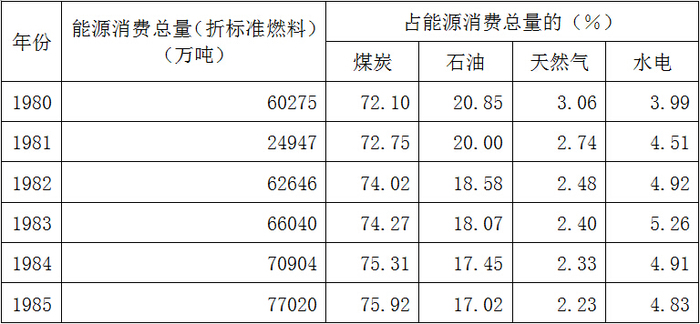

### 第 121 题

哪一年能源消费总量最少？

A. 1980

B. 1981

C. 1982

D. 1983

第 121 题 · 答案与解析

**参考答案（粉笔题库参考内容）**

B

**解析**

直接分析表格可以看出1981年的能源消费总量24947为各年最小。

故正确答案为B。

### 第 122 题

1983年消耗的天然气为多少万吨（折合为标准燃料）？

A. 1584.96

B. 1538.80

C. 1547.12

D. 1545.03

第 122 题 · 答案与解析

**参考答案（粉笔题库参考内容）**

A

**解析**

1983年消耗的天然气为。

故正确答案为A。

### 第 123 题

1985年能源消耗总量比1981年高多少万吨？

A. 16745

B. 52073

C. 49125

D. 6116

第 123 题 · 答案与解析

**参考答案（粉笔题库参考内容）**

B

**解析**

解析1：

1985年总量为77020，1981年总量为24947，两者作差后两位为73。

解析2：

首位作差得到5，也可以选出答案B。

故正确答案为B。

### 第 124 题

能源消费构成中，从1980年到1985年变化比例最大的是：

A. 煤炭

B. 石油

C. 水电

D. 天然气

第 124 题 · 答案与解析

**参考答案（粉笔题库参考内容）**

B

**解析**

从1980年到1985年，煤炭比例变化75.92－72.10＝3.82，石油比例变化20.85－17.02＝3.83，天然气和水电变化都小于2。

故正确答案为B。

### 第 125 题

在能源消费构成中，比例一直处于上升趋势的是：

A. 煤炭

B. 石油

C. 水电

D. 天然气

第 125 题 · 答案与解析

**参考答案（粉笔题库参考内容）**

A

**解析**

分析数据表可以看出，只有煤炭的比重从1980到1985年逐年上升，其他各项均不合题意。

故正确答案为A。

## 材料 3

1990年某市对六种鞋类的全年消费情况进行了调查，发现城乡居民购买倾向有一定差别，农民人均年消费量除旧式球鞋高于城镇居民，布鞋持平外，其他鞋类消费量均低于城镇居民。例如，农民每百人年均消费皮鞋17.6双，比城镇居民低83%，旅游鞋25.3双，比城镇居民低53%，雨鞋7.5双，比城镇居民低66%，拖鞋30.2双，比城镇居民低80%。

### 第 126 题

资料所列鞋中，农民人均年消费量高于城镇居民的是：

A. 雨鞋

B. 布鞋

C. 旧式球鞋

D. 拖鞋

第 126 题 · 答案与解析

**参考答案（粉笔题库参考内容）**

C

**解析**

查看资料可知农民人均年消费量高于城镇居民的是旧式球鞋。

故正确答案为C。

### 第 127 题

所列四种鞋中，哪种鞋类农民人均年消费量与城镇居民人均年消费量相差最大？

A. 皮鞋

B. 拖鞋

C. 雨鞋

D. 旅游鞋

第 127 题 · 答案与解析

**参考答案（粉笔题库参考内容）**

B

**解析**

根据资料可知“农民每百人年均消费皮鞋17.6双，比城镇居民低83%，旅游鞋25.3双，比城镇居民低53%，雨鞋7.5双，比城镇居民低66%，拖鞋30.2双，比城镇居民低80%”。则城镇居民皮鞋为，则农村和城镇相差103.5-17.6=85.9；城镇居民旅游鞋为，则农村和城镇相差53.8-25.3=28.5；城镇居民雨鞋为，农村和城镇相差22.1-7.5=14.6；城镇居民拖鞋为，则农村和城镇相差151-30.2=120.8，故相差最大的是拖鞋。

故正确答案为B。

### 第 128 题

下列鞋类，农民人均年消费量最少的是：

A. 拖鞋

B. 皮鞋

C. 雨鞋

D. 旅游鞋

第 128 题 · 答案与解析

**参考答案（粉笔题库参考内容）**

C

**解析**

根据资料，雨鞋的农民人均年消费量7.5双为最小。

故正确答案为C。

### 第 129 题

资料所列鞋类中，农民人均年消费量与城镇居民持平的是：

A. 拖鞋

B. 布鞋

C. 雨鞋

D. 旅游鞋

第 129 题 · 答案与解析

**参考答案（粉笔题库参考内容）**

B

**解析**

根据资料可知，农民人均年消费量与城镇居民持平的是布鞋。

故正确答案为B。

### 第 130 题

该资料所列鞋类中，共比较了几种鞋类？

A. 4

B. 5

C. 6

D. 7

第 130 题 · 答案与解析

**参考答案（粉笔题库参考内容）**

C

**解析**

从资料中统计得出，共比较了“旧式球鞋”“布鞋”“皮鞋”“旅游鞋”“雨鞋”和“拖鞋”共计6种鞋类。

故正确答案为C。

## 材料 4

自1981年至1985年，境外来中国大陆访问的人数增加得很快。例如，自1981年至1985年，各年度入境访问和旅游的总人数依次为780万、790万、950万、1290万、1780万。其中港澳台居民来访人数各年度依次为710万、720万、860万、1170万、1640万。其他来访者主要是西方国家的旅游者。境外来中国大陆访问者的增加带来了外汇收入的增加。自1981年至1985年，各年旅游依次为7.9亿美元、8亿美元、9亿美元、11亿美元、13亿美元。

### 第 131 题

1982年大约有多少西方国家旅游者来中国旅游？

A. 140万

B. 90万

C. 70万

D. 120万

第 131 题 · 答案与解析

**参考答案（粉笔题库参考内容）**

C

**解析**

根据资料，1982年访问大陆总人数为790万人，而其中港澳台访问人数为720万人，所以西方国家旅游者共790－720＝70万人。

故正确答案为C。

### 第 132 题

自1981年至1985年，到中国来的西方国家旅游者人数总和大约是多少？

A. 490万

B. 500万

C. 510万

D. 520万

第 132 题 · 答案与解析

**参考答案（粉笔题库参考内容）**

A

**解析**

根据资料，从1981年至1985年访问中国的西方国家旅游者分别为780-710=70，790-720=70，950-860=90，1290-1170=120，1780-1640=140。所以总和为70+70+90+120+140=490万。

故正确答案为A。

### 第 133 题

1982年每个境外来中国大陆的访问者带来的旅游外汇收入平均约为多少美元？

A. 11000

B. 990

C. 101

D. 90

第 133 题 · 答案与解析

**参考答案（粉笔题库参考内容）**

C

**解析**

根据资料，1982年旅游外汇收入为8亿美元，旅游人数为790万人。，所以结果应该比100稍大。

故正确答案为C。

### 第 134 题

西方国家旅游者来华人数增加得最多的是哪一年？

A. 1982

B. 1983

C. 1984

D. 1985

第 134 题 · 答案与解析

**参考答案（粉笔题库参考内容）**

C

**解析**

因为1981至1985年各年访问大陆的西方国家旅游者人数为70、70、90、120、140万人，所以1984年增长最多为120－90＝30万人。

故正确答案为C。

### 第 135 题

1985年与1981年相比，海外来中国大陆访问者人数增加了多少？

A. 12.8％

B. 128％

C. 56％

D. 228％

第 135 题 · 答案与解析

**参考答案（粉笔题库参考内容）**

B

**解析**

根据资料，1985年和1981年访问大陆人数分别为1780和780万人，所以增长百分比应该为，因为780＜1000＜780×2，所以。

故正确答案为B。

