# 2011年内蒙古自治区公务员录用考试《行测》题

<!-- gwy:overview:start -->
> **内蒙古 · 2011 · 行测 · 统考** ｜ 120 题 · 图片 96 处 · 答案随题折叠

| 题型模块 | 题量 | 题号 |
| --- | ---: | ---: |
| 常识判断 | 20 | 1–20 |
| 言语理解 | 30 | 21–50 |
| 数量关系 | 15 | 51–65 |
| 判断推理 | 40 | 66–105 |
| 资料分析 | 15 | 106–120 |
| **合计** | **120** | |

导航：[题型与作答说明](#题型与作答说明) · [题目](#题目) · [材料 1](#材料-1)
<!-- gwy:overview:end -->

> 候选采集稿。参考答案及解析来自粉笔页面，不代表官方答案或真实高分答卷；来源使用许可与原卷对应关系仍需人工核实。

## 题型与作答说明

常识判断

（20题）

根据题目要求，在每个选项中选出一个正确答案。

言语理解

（30题）

本部分包括表达与理解两个方面的内容，请根据题目要求，在四个选项中选出一个最恰当的答案。

数量关系

（15题）

本部分包括数字推理与数学运算两种类型的试题。

判断推理

（40题）

本部分包括图形推理、定义判断、事件排序与逻辑判断四种类型的试题。

资料分析

（15题）

所给出的图、表或一段文字均有5个问题要你回答。你应根据资料所提供的信息进行分析、比较、计算和判断处理。

## 题目

### 第 1 题

根据《中华人民共和国宪法》，我国的政权组织形式是：

A. 人民民主专政

B. 人民代表大会制度

C. 统一的多民族国家

D. 中国共产党领导的多党合作和政治协商制度

第 1 题 · 答案与解析

**参考答案（粉笔题库参考内容）**

B

**解析**

《宪法》第3条规定：“中华人民共和国的国家机构实行民主集中制原则。全国人民代表大会和地方各级人民代表大会都由民主选举产生，对人民负责，受人民监督。国家行政机关、审判机关、检察机关都由人民代表大会产生，对它负责，受它监督。”这表明，我国的政权组织形式是人民代表大会制度。

故正确答案为B。

**本题相关知识点：**

人民民主专政是我国国体。人民代表大会制度是我国的政权组织形式。

**考点**：宪法

**来源**：2011年内蒙古自治区公务员录用考试《行测》题第1题

### 第 2 题

下列说法正确的是：

A. 十二大明确提出社会主义初级阶段的理论

B. 十三大提出建立社会主义市场经济体制

C. 十五大提出并论述了党在社会主义初级阶段的基本路线

D. 十六大提出全面建设小康社会的奋斗目标

第 2 题 · 答案与解析

**参考答案（粉笔题库参考内容）**

D

**解析**

A选项错误，1987年十三大提出社会主义初级阶段的理论；

B选项错误，1992年十四大提出建立社会主义市场经济体制；

C选项错误，1997年十五大提出了党在社会主义初级阶段的基本纲领；

D选项正确，2002年十六大提出了全面建设小康社会的奋斗目标。

故正确答案为D。

**考点**：经济建设

**来源**：2011年内蒙古自治区公务员录用考试《行测》题第2题

### 第 3 题

下列关于我国行政法的说法正确的是：

A. 国家行政机关是最主要的行政主体；按照法定授权而获得行政权的组织，也可以成为行政主体

B. 未经行政确认的行为一旦实施，将受到相应的法律制裁

C. 法律、行政法规、国务院决定、地方性法规和各级人民政府的决定可以设定行政许可

D. 行政处罚的适用主体是人民法院、行政机关或法律、法规授权的组织

第 3 题 · 答案与解析

**参考答案（粉笔题库参考内容）**

A

**解析**

B选项错误，属于片面说法；

C选项错误，只有省、自治区、直辖市人民政府可以制定政府规章，设定临时性的行政许可，并非各级政府都可以设定行政许可；

D选项错误，法院属于司法审判机关，不属于行政处罚的适用主体。

故正确答案为A。

**考点**：行政法

**来源**：2011年内蒙古自治区公务员录用考试《行测》题第3题

### 第 4 题

下列不属于公务员的是：

A. 某县党委委员

B. 某市工商行政管理局干部

C. 某国有企业工人

D. 某民主党派机关干部

第 4 题 · 答案与解析

**参考答案（粉笔题库参考内容）**

C

**解析**

本题考查法律常识。

《公务员法》第二条第一款规定：“本法所称公务员，是指依法履行公务、纳入国家行政编制、由国家财政负担工资福利的工作人员。”A、B、D项正确，都属于公务员；

C项错误，国有企业工人不是公务员。

本题为选非题，故正确答案为C。

**考点**：行政法

**来源**：2011年内蒙古自治区公务员录用考试《行测》题第4题

### 第 5 题

关于知识产权，下列说法正确的是：

A. 知识产权为权利人所专有，不能随意转让

B. 知识产权只在特定国家、领域内发生法定效力

C. 知识产权如未设定期限，则永久有效

D. 企业的注册商标不属于其知识产权

第 5 题 · 答案与解析

**参考答案（粉笔题库参考内容）**

B

**解析**

知识产权，指“权利人对其所创作的智力劳动成果所享有的专有权利”，知识产权具有专有性的特点，即独占性或垄断性，除权利人同意或法律规定外，权利人以外的任何人不得享有或使用该权利。

A项错误，知识产权出让主体与知识产权受让主体，根据与知识产权转让有关的法律、法规和双方签定的转让合同，可以将知识产权的权利进行出让；

B项正确，知识产权具有地域性；

C项错误，知识产权具有时间性，即法律对各项权利的保护，都规定有一定的有效期；

D项错误，知识产权主要包括著作权、专利权、商标权等。

故正确答案为B。

**考点**：民法典

**来源**：2011年内蒙古自治区公务员录用考试《行测》题第5题

### 第 6 题

下列不属于刑事处罚的是：

A. 罚金

B. 管制

C. 拘留

D. 拘役

第 6 题 · 答案与解析

**参考答案（粉笔题库参考内容）**

C

**解析**

刑事处罚是指违反刑法，应当受到刑法的制裁。根据我国刑法的规定，刑事处罚包括主刑和附加刑两部分。主刑有：管制、拘役、有期徒刑、无期徒刑和死刑。附加刑有：罚金、剥夺政治权利和没收财产；此外还有适用于犯罪的外国人的驱逐出境。拘留不在此范围内。

本题为选非题，故正确答案为C。

**考点**：刑法

**来源**：2011年内蒙古自治区公务员录用考试《行测》题第6题

### 第 7 题

推翻了统治中国几千年的君主专制制度的辛亥革命属于：

A. 资产阶级革命

B. 无产阶级革命

C. 新民主主义革命

D. 工人阶级革命

第 7 题 · 答案与解析

**参考答案（粉笔题库参考内容）**

A

**解析**

资产阶级革命一般指由资产阶级组织领导、以推翻阻碍资本主义生产关系的势力、发展资本主义为目的的暴力革命。如英国、法国、美国等国近代史上的革命，其中英法推翻的是封建统治，是最“正宗”的资产阶级革命，而美国推翻的是英国的殖民统治，又带有民族解放的性质。与这些资本主义国家不同的是，近代亚非拉国家的革命，更多的带有反封建、反侵略（或曰反帝、反封建）的双重色彩，一般也称为资产阶级革命，如中国的“辛亥革命”。

故正确答案为A。

**考点**：中国历史

**来源**：2011年内蒙古自治区公务员录用考试《行测》题第7题

### 第 8 题

“修身”、“齐家”、“治国”、“平天下”出自：

A. 道家典籍

B. 儒家典籍

C. 墨家典籍

D. 法家典籍

第 8 题 · 答案与解析

**参考答案（粉笔题库参考内容）**

B

**解析**

“格物、致知、诚意、正心修身、齐家、治国、平天下”是中国古代儒家思想中的一个重要概念，源于《礼记‧大学》八目。

故正确答案为B。

**考点**：文学常识

**来源**：2011年内蒙古自治区公务员录用考试《行测》题第8题

### 第 9 题

以下有关我国古代著作的表述不正确的是：

A. 《大唐西域记》记录了当时中亚、南亚多个国家、地区的地理、文化、政治情况

B. 《尚书》是我国最古老的政治文献汇编

C. 《海国图志》是中国近代史上最早的一部介绍世界地理、历史的巨著

D. 《齐民要术》是一部介绍民间医学方法的医书

第 9 题 · 答案与解析

**参考答案（粉笔题库参考内容）**

D

**解析**

《齐民要术》是北魏时期的中国杰出农学家贾思勰所著的一部综合性农书，也是世界农学史上最早的专著之一。是中国现存的最完整的农书。书名中的“齐民”，指平民百姓。“要术”指谋生方法。《齐民要术》大约成书于北魏末年（公元533-544年），《齐民要术》系统地总结了6世纪以前黄河中下游地区农牧业生产经验、食品的加工与贮藏、野生植物的利用等，对中国古代农学的发展产生了重大影响。而不是介绍民间医学方法的医书，故D选项表述错误。

本题为选非题，故正确答案为D。

**考点**：文学常识

**来源**：2011年内蒙古自治区公务员录用考试《行测》题第9题

### 第 10 题

下列提法错误的是：

A. 七情：喜、怒、哀、乐、爱、恶、欲

B. 国画四君子：梅、兰、竹、菊

C. 四库：经、史、子、集

D. 岁寒三友：松、竹、梅

第 10 题 · 答案与解析

**参考答案（粉笔题库参考内容）**

A

**解析**

七情是指人们与生俱来的一些心理反应。不同的学术、门派、宗教对七情六欲的定义稍有不同。本题中的说法应为，七情：喜、怒、哀、惧、爱、恶、欲。故A选项错误。

本题为选非题，故正确答案为A。

**考点**：文化常识

**来源**：2011年内蒙古自治区公务员录用考试《行测》题第10题

### 第 11 题

下列不属于我国四大名园的是：

A. 拙政园

B. 颐和园

C. 承德避暑山庄

D. 圆明园

第 11 题 · 答案与解析

**参考答案（粉笔题库参考内容）**

D

**解析**

中国四大名园：颐和园、拙政园、承德避暑山庄、留园。

本题为选非题，故正确答案为D。

**考点**：文化常识

**来源**：2011年内蒙古自治区公务员录用考试《行测》题第11题

### 第 12 题

海上丝绸之路又称陶瓷之路，是中国古代与外国交通、贸易和文化交往的海上通道，以下各国中，海上丝绸之路不经过其领海的国家是：

A. 印尼

B. 奥地利

C. 斯里兰卡

D. 索马里

第 12 题 · 答案与解析

**参考答案（粉笔题库参考内容）**

B

**解析**

海上丝绸之路从广东沿海的港口出发沿着海岸线，从中南半岛南下，绕过马来半岛，穿过马六甲海峡，通往孟加拉湾沿岸，最远抵达印度半岛南端和斯里兰卡岛。不经过奥地利。

本题为选非题，故正确答案为B。

**考点**：文化常识

**来源**：2011年内蒙古自治区公务员录用考试《行测》题第12题

### 第 13 题

下列文化遗址属于旧石器时代的是：

A. 半坡遗址

B. 大汶口遗址

C. 河姆渡遗址

D. 周口店遗址

第 13 题 · 答案与解析

**参考答案（粉笔题库参考内容）**

D

**解析**

人类以石器为主要劳动工具的早期泛称旧石器时代，元谋猿人、蓝田猿人、北京周口店人、山顶洞人等基本上都处于这一时期。

新石器时代的代表文化有：大汶口仰韶文化、河姆渡文化和半坡细石器文化等。

故正确答案为D。

**考点**：中国历史

**来源**：2011年内蒙古自治区公务员录用考试《行测》题第13题

### 第 14 题

长白山天池从成因上分类，属于：

A. 火山口湖

B. 构造湖

C. 冰川湖

D. 溶蚀湖

第 14 题 · 答案与解析

**参考答案（粉笔题库参考内容）**

A

**解析**

我国的四大火山口湖为：长白山天池、湖光岩、四栈山火口湖和大屯火山口湖。

故正确答案为A。

**本题相关知识点：**

长白山天池又称白头山天池，坐落在吉林省东南部，是中国和朝鲜的界湖。

长白山系复合式盾形休眠火山，为中国东北和欧亚大陆东部的最高峰，是松花江、鸭绿江、图们江之源。

当火山爆发喷射出大量熔岩之后，火山口处形成盆状，时间一长，积水成湖，便形成了现在的天池。而火山喷发出来的熔岩物质则堆积在火山口周围，成了屹立在其四周的16座山峰，其中7座在朝鲜境内，9座在我国境内。

**考点**：其他

**来源**：2011年内蒙古自治区公务员录用考试《行测》题第14题

### 第 15 题

通常所说的“白色污染”是指：

A. 工厂排出的烟尘

B. 石灰窑产生的粉尘

C. 可卡因、海洛因等毒品

D. 聚乙烯等塑料垃圾

第 15 题 · 答案与解析

**参考答案（粉笔题库参考内容）**

D

**解析**

白色污染是人们对难降解的塑料垃圾(多指塑料袋)污染环境现象的一种形象称谓。它是指用聚苯乙烯、聚丙烯、聚氯乙烯等高分子化合物制成的各类生活塑料制品使用后由于随意乱丢乱扔，被弃置成为固体废物，难于降解处理，以致造成城市环境严重污染的现象。

故正确答案为D。

**考点**：其他

**来源**：2011年内蒙古自治区公务员录用考试《行测》题第15题

### 第 16 题

下列说法中错误的是：

A. 生物都是由细胞组成的

B. 生物都能生长、繁殖和发育

C. 生物都能对外界事物的刺激做出反应

D. 生物都有新陈代谢作用

第 16 题 · 答案与解析

**参考答案（粉笔题库参考内容）**

A

**解析**

除了病毒外，其它生物都由细胞组成。病毒是由一个核酸分子(DNA或RNA)与蛋白质构成的非细胞形态的营寄生生活的生命体。

故A选项错误。

本题为选非题，故正确答案为A。

**考点**：生物常识

**来源**：2011年内蒙古自治区公务员录用考试《行测》题第16题

### 第 17 题

下面不属于喀斯特地貌的是：

A. 云南石林

B. 湖南张家界

C. 福建武夷山

D. 广西桂林象鼻山

第 17 题 · 答案与解析

**参考答案（粉笔题库参考内容）**

C

**解析**

武夷山属于丹霞地貌，由陆相红色砂砾岩构成的具有陡峭坡面的各种地貌形态。形成的必要条件是砂砾岩层巨厚，垂直节理发育。因在中国广东省北部仁化县丹霞山有典型发育而得名。同样出名的丹霞地貌山还有江西龙虎山、甘肃张掖、贵州赤水。

故正确答案为C。

**考点**：其他

**来源**：2011年内蒙古自治区公务员录用考试《行测》题第17题

### 第 18 题

下列关于发明的说法错误的是：

A. 避雷针的发明者是富兰克林

B. 电视机的发明者是爱迪生

C. 电话的发明者是贝尔

D. 炸药的发明者是诺贝尔

第 18 题 · 答案与解析

**参考答案（粉笔题库参考内容）**

B

**解析**

电视机的发明者是英国电子工程师约翰·洛吉·贝尔德。

本题为选非题，故正确答案为B。

**来源**：2011年内蒙古自治区公务员录用考试《行测》题第18题

### 第 19 题

下列说法正确的是：

A. 与宇宙飞船相比，航天飞机对航天员的身体要求较低

B. 与宇宙飞船、宇宙空间站相比，航天飞机的技术更简单

C. 发射最多，用途最广的飞船是卫星式载人飞船

D. 目前，只有美国、俄罗斯、中国能够独立发射航天飞机

第 19 题 · 答案与解析

**参考答案（粉笔题库参考内容）**

C

**解析**

A项错误，航天飞机对航天员的身体要求极其严格，不在宇宙飞船之下；

B项错误，无结论表明宇宙飞船、宇宙空间站的技术难度比航天飞机的高；

C项正确；

D项错误，发射航天飞机需要国家间的合作，不能某一国独立发射。

故正确答案为C。

**考点**：科技理论与成就

**来源**：2011年内蒙古自治区公务员录用考试《行测》题第19题

### 第 20 题

下列关于灾害预警信号说法正确的是：

A. 大雾橙色预警信号发出时，高速公路可以不关闭

B. 出现暴雨橙色预警时，除特殊行业外，各单位均应停业

C. 低温预警信号与寒潮预警信号通常同时发布

D. 冰雹预警信号严重程度的划分主要依据冰雹颗粒的大小

第 20 题 · 答案与解析

**参考答案（粉笔题库参考内容）**

A

**解析**

A说法正确，大雾橙色预警信号发出时交通部门尽量减少雾带来的交通事故，但高速公路不用关闭；

B说法错误，当出现暴雨红色预警时，停止集会、停课、停业（除特殊行业外），而非橙色；

C说法错误，低温预警信号分二级,分别以蓝色、黄色表示，以最低气温为标准来划分，寒潮预警信号分四级，分别以蓝色、黄色、橙色、红色表示，主要以气温下降度数、风力情况等为标准来划分。二者的划分标准不同，一般不同时发布；

D说法错误，冰雹预警信号分二级，分别以橙色、红色表示，划分依据是时间及可能造成的雹灾程度。

故正确答案为A。

**考点**：其他

**来源**：2011年内蒙古自治区公务员录用考试《行测》题第20题

### 第 21 题

干净、整洁、低能源消耗是全世界都需要的东西，所以我从不怀疑“城市车”概念的＿＿，我们不是在＿＿让“城市车”概念成真，而是必须努力让它实现。

A. 超前 梦想

B. 可行 尝试

C. 科学 期待

D. 实用 研究

第 21 题 · 答案与解析

**参考答案（粉笔题库参考内容）**

B

**解析**

本题考查实词的语境填空。

先看第一空，“所以”一词表明前后句构成因果关系，因为“是全世界都需要”，所以“城市车”概念“可行”。

A、C两项“超前”和“科学”均无法从“全世界都需要”中得出，D项“实用”应指“城市车”，而不是“城市车”概念。

再看第二空，“不是……而是……”构成了取舍关系，根据后面“必须努力让它实现”可知不能仅仅是“尝试”。

故正确答案为B。

**考点**：关联关系-因果关系、关联关系-并列关系、实词填空、对应关系-前后呼应

**来源**：2011年内蒙古自治区公务员录用考试《行测》题第21题

### 第 22 题

人按照自己的本性生活，当时可能是最快乐的，但是却往往和社会冲突，使自己和别人以后却不快乐，因此，我们必须学会自我＿＿＿，与现实相协调，从而使自己能够获得更长远的快乐。

A. 控制

B. 评价

C. 安慰

D. 暗示

第 22 题 · 答案与解析

**参考答案（粉笔题库参考内容）**

A

**解析**

本题考查近义实词的辨析填空。

根据语意，自己“当时”快乐和社会、别人“以后”不快乐之间的矛盾是由“人按照自己的本性生活”造成的，因此要学会“与现实相协调”，学会自我“控制”，使自己不能完全按照自己的本性生活，故A项符合语意。

“评价”“安慰”“暗示”都无法达到“与现实相协调”的效果，所以都不选。

故正确答案为A。

**考点**：实词填空、对应关系-前后呼应

**来源**：2011年内蒙古自治区公务员录用考试《行测》题第22题

### 第 23 题

由于国际原油价格的＿＿＿攀升，汽油产品的售价一直呈上扬的态势，因此油耗低的经济型轿车的市场需求也逐步增大。

A. 再三

B. 持续

C. 反复

D. 日趋

第 23 题 · 答案与解析

**参考答案（粉笔题库参考内容）**

B

**解析**

本题考查近义实词的辨析填空。

“由于……因此……”构成因果关系，前两句为原因。根据下文汽油产品的售价“一直”呈上扬的态势，所以空格处填入的词语应为“一直”的近义词，故选“持续”。

“再三”“反复”“日趋”都没有体现出“一直”的意思，且“持续攀升”为常用搭配。

故正确答案为B。

**考点**：关联关系-因果关系、实词填空、对应关系-前后呼应、词的辨析-搭配对象

**来源**：2011年内蒙古自治区公务员录用考试《行测》题第23题

### 第 24 题

中国古代教育有两条线索：官学和私学。官学的优点是：有正式的场所，有讲堂，藏书楼，有固定的学田，经济上有＿＿＿，私学的长处是：可以自由讲学，老师以个人身份讲学，不一定是朝廷的官员，因此思想是＿＿＿的。

A. 支撑 开放

B. 保障 活跃

C. 供给 自由

D. 来源 进步

第 24 题 · 答案与解析

**参考答案（粉笔题库参考内容）**

B

**解析**

本题考查近义实词的辨析填空。

首先看第一空，空格处所填入的词语形容的是“官学”在经济上的优点，联系下文易得知，“官学”的优点是“有固定的经济来源”，但文段中的提问方式为“经济上”，后面应该接“保障”，故保留B项，排除D项。

“支撑”“供给”都涉及外部因素，不合文意，故排除A、C两项。

再看第二空，由“私学可以自由讲学”可知，私学的思想是“活跃”的，而非固定的思维方式，故B项当选。

故正确答案为B。

**考点**：关联关系-因果关系、实词填空、对应关系-前后呼应、词的辨析-搭配对象

**来源**：2011年内蒙古自治区公务员录用考试《行测》题第24题

### 第 25 题

中国是世界上发展最快的经济体，如果它继续按照专家们的＿＿＿发展下去，那么在20年后可以与美国＿＿＿。

A. 猜测 比肩

B. 预测 匹敌

C. 推断 抗衡

D. 预期 媲美

第 25 题 · 答案与解析

**参考答案（粉笔题库参考内容）**

B

**解析**

第一空，根据“中国是世界上发展最快的经济体，如果它继续······”可知，专家们对中国的发展情况有一定判断、推测，B项“预测”指预先测定或推测，C项“推断”指推测而断定，D项“预期”指事先的期望，均符合文意，保留。A项“猜测”指凭想象估计，文中专家们的判断、推测不是依据“想象”得来的，与文意不符，排除。

第二空，根据文意可知，横线处词语应体现20年后的中国经济实力与美国相当，B项“匹敌”指（力量等）对等、相当，符合文意，当选。C项“抗衡”指彼此对抗，不相上下，文段并未体现“对抗”之意，排除；D项“媲美”指比美，美好的程度彼此相当，文段并非强调“美好”，排除。

故正确答案为B。

**考点**：实词填空、词的辨析-词义侧重

**来源**：2011年内蒙古自治区公务员录用考试《行测》题第25题

### 第 26 题

现代社会的变迁使人们的生活变得丰富多彩，与此同时，个体对社会事务的承担能力和意愿增强，科技的进步和网络的普及打破了时空的限制，社会的沟通更为便捷和＿＿＿化，个体自由获得了广阔的空间。

A. 即时

B. 具体

C. 程度

D. 复杂

第 26 题 · 答案与解析

**参考答案（粉笔题库参考内容）**

A

**解析**

本题考查实词的语境填空。

根据句意，“和”字前后的两个词应该意思相近，所以空格处所填入的词语应该与“便捷——方便、快捷”相一致，“即时”延伸有最快的，最方便的意思，符合句意，且与前面“打破了时空的限制”形成相互照应，所以应填入“即时”。

“具体”、“程度”、“复杂”都无法体现出“便捷”之意，不符合句意，所以都不选。

故正确答案为A。

**考点**：关联关系-并列关系、实词填空

**来源**：2011年内蒙古自治区公务员录用考试《行测》题第26题

### 第 27 题

意大利实行的是市场经济，但总有一部分物价由国家规定，不允许自由竞争，他们主管物价的官员说，政府规定的死价格有＿＿＿通货膨胀的作用。

A. 遏制

B. 抵制

C. 终止

D. 阻止

第 27 题 · 答案与解析

**参考答案（粉笔题库参考内容）**

A

**解析**

本题考查近义实词的辨析填空。

根据语意，“通货膨胀”是指有部分物价过高，而“死价格”可以“控制”这种势头和态势。“遏制”为制止、控制的意思，符合语意。“抵制”为阻止、抗拒、排斥，“通货膨胀”无法被阻止，故排除B项。

“终止”和“阻止”都不合适，“止”的意思为“停止”，死价格无法达到使“通货膨胀”停止的效果，所以排除C、D项。

故正确答案为A。

**考点**：实词填空、词的辨析-搭配对象、词的辨析-词义侧重

**来源**：2011年内蒙古自治区公务员录用考试《行测》题第27题

### 第 28 题

我国还处于社会主义初级阶段，民主建设的起点比较低，社会主义民主建设受到几个条件的制约，因此绝不是＿＿＿的事情。

A. 一朝一夕

B. 操之过急

C. 一蹴而就

D. 轻而易举

第 28 题 · 答案与解析

**参考答案（粉笔题库参考内容）**

C

**解析**

本题考查成语填空。

根据前文中的“还处于”，“起点比较低”可知要完成“社会主义民主建设”还需要很长的时间，不是短时期内能够完成的，空格处所填入的成语要表达出这层含义。

A项“一朝一夕”指一个早晨或一个晚上，形容时间短促；

B项“操之过急”指处理事情或处理问题过于急躁、性急，不符合语意，故排除；

C项“一蹴而就”形容事情轻而易举，一下子就能完成，多用于否定句中说明事情需要一个长期艰巨的过程，完成并不容易。用在本题中最符合语境；

D项“轻而易举”形容事情容易做，不费力，事情简单，放入空格处只体现出了事情的难度，并没有体现出“需要很长时间”这层含义，故排除；

故正确答案为C。

**考点**：关联关系-因果关系、成语填空

**来源**：2011年内蒙古自治区公务员录用考试《行测》题第28题

### 第 29 题

音乐剧是欧美兴起的一种艺术形式，《鹰》的创作是对这种艺术形式的＿＿＿ 。但作者又不是简单的拿来，而是在＿＿＿方面做了大胆的探索并取得了很好的成绩。

A. 改良 本土化

B. 创新 国际化

C. 发展 市场化

D. 借鉴 民族化

第 29 题 · 答案与解析

**参考答案（粉笔题库参考内容）**

D

**解析**

本题考查近义实词的辨析填空。

由题目中“不是简单地拿来”可以直接判断出，作者活用了音乐剧，借鉴了该艺术形式。

先看第一空，“但”表转折，根据下文“作者又不是简单的拿来”可知，前面应该是关于“拿来”的表述，“借鉴”把别的人或事当镜子，对照自己，以便吸取经验或教训，表现出了“拿来”之意。“改良”、“创新”、“发展”重在突出在原有艺术形式上的“进步”，而不是“拿来”，与下文不能构成鲜明的转折关系，故排除A、B、C项。

再看第二空，根据“拿来”一词可知作者主要是“借鉴”这种艺术形式为自己所用，故应为体现“同化”作用的“民族化”。

故正确答案为D。

**考点**：关联关系-转折关系、实词填空

**来源**：2011年内蒙古自治区公务员录用考试《行测》题第29题

### 第 30 题

两家合作公司都不是电脑生产商，这使PC行业原有的模式＿＿＿。以往，电脑厂商＿＿＿的销售渠道往往成为软件公司追逐的推广平台，而现在，他们希望手里的资源能吸引电脑厂商主动找上门来合作。

A. 突破 独有

B. 改变 成熟

C. 颠覆 广泛

D. 打破 特殊

第 30 题 · 答案与解析

**参考答案（粉笔题库参考内容）**

B

**解析**

本题考查近义实词的辨析填空。

根据下文中的“以往”和“而现在”可知下文在分别介绍以前和现在的模式。第一句为文段的“总句”，第一个空格所填入的词语要体现出模式的“变化”，“改变”和“打破”均可以表达这层含义。

A项“突破”无法体现，因为文中并没有具体说明“现在”的模式比“过去”的模式好，排除A项；C项“颠覆”语意过重，故排除；所以从B、D项中选择。

再看第二空，下文中“而”字表转折，说明现在是电脑公司主动找软件公司，而以前是软件公司依靠电脑公司的销售渠道来做推广。由此可知，以往电脑公司的销售渠道应该很好，从B、D项中来看，“成熟”和“特殊”相比，体现出了销售渠道的成功，而“特殊”并没有体现出渠道的效果，所以第二空填“成熟”。

故正确答案为B。

**考点**：关联关系-转折关系、实词填空、对应关系-前后呼应、词的辨析-程度轻重

**来源**：2011年内蒙古自治区公务员录用考试《行测》题第30题

### 第 31 题

筷子，是中国人的一大发明。早在3000多年前的殷商时代就开始使用筷子。不过最初它并不叫筷子，而是叫箸或筴，筷这个称呼是怎么出现的呢？据文献记载，中国东部江南一带的人认为箸和住的发音一样，在江边行船的人很忌讳停住，就取反意称箸为筷。到公元10世纪的宋朝，人们又在快字上加上了竹字头，因为筷子大都是用竹子做成的。于是，中国人发明的这件食具就有了现在大家知道的名字“筷”。

这段文字主要介绍了筷子的：

A. 得名过程

B. 历史演变

C. 文献记载

D. 出现年代

第 31 题 · 答案与解析

**参考答案（粉笔题库参考内容）**

A

**解析**

据提问可知本题为中心理解题。

材料为“提出问题——解释问题”的总分结构，由问号引导的问句“筷这个称呼是怎么出现的呢？”为文章的总句，后文来具体阐述“筷称呼”的来源。

“总”句体现了材料所讲的主要内容，即“筷子称呼的来源”，A项“得名过程”最符合。

B项“历史演变”不准确，材料为“筷子称呼”的历史演变，而非“筷子”的历史演变；

C、D项未抓住文章主旨，文献和年代都是为了来说明“筷子得名的过程”，所以排除。

故正确答案为A。

**考点**：主题词、分述句特征-其他

**来源**：2011年内蒙古自治区公务员录用考试《行测》题第31题

### 第 32 题

对于“自保型谎言”的区分对待，倘若形势所迫必须自保，可在不伤害第三方的前提下为之，倘若撒谎或者不撒谎都不会改变结果。那宁可不撒谎，还能落个老实的好名声。

以下说法符合原文意思的是：

A. 善意的谎言是可以容忍的

B. 无论是否利己撒谎都是不对的

C. 撒谎有时是不得不为之的自保行为

D. 为自保可以在不损人的情况下撒谎

第 32 题 · 答案与解析

**参考答案（粉笔题库参考内容）**

C

**解析**

A项，“善意的谎言”文中并未涉及，无中生有，排除；

B项，“无论是否利己撒谎都是不对的”表述过于绝对，排除；

C项，根据文中“倘若形势所迫必须自保”可知撒谎为“形势所迫”，是“不得不为之”的行为，表述正确，当选；

D项，“不损人”与文段表述不一致，文段强调的是“不损害第三方”，即有可能会损害对方的利益，排除。

故正确答案为C。

**考点**：细节判断题

**来源**：2011年内蒙古自治区公务员录用考试《行测》题第32题

### 第 33 题

文化遗产不应该是城市发展的绊脚石，当你把它当成是城市发展的负担时，它只能蓬头垢面地呆在角落里，而当你把它当成城市发展的不竭动力与文化资源时，它就立刻站起来，光照四方，文化遗产应拥有自己的尊严，应融入经济社会发展，成为一个城市美丽的地方。

这段文字主要谈论的是（    ）。

A. 文化遗产是树立城市形象的标志

B. 城市发展要善于利用文化遗产

C. 文化遗产具有重大的经济社会价值

D. 如何对待文化遗产是城市发展的关键因素

第 33 题 · 答案与解析

**参考答案（粉笔题库参考内容）**

B

**解析**

文段开篇指出文化遗产不应该是城市发展的绊脚石，之后通过转折指出积极对待文化遗产对城市发展的意义；随后提出对策，进一步强调文化遗产应融入经济社会发展，成为城市发展的重要组成部分。故文段意在强调要在城市发展中积极、合理地利用文化遗产，使其真正发挥作用。B项“城市发展要善于利用文化遗产”准确把握了这一主旨，契合文意，当选。

A项，“树立城市形象”文段未提及，无中生有，排除；

C项，文段为“把文化遗产融入经济社会中”，未提及“文化遗产具有重大的经济社会价值”，无中生有，排除；

D项，如何对待”表述不明确，文段已经明确指出“要善于利用”，且“关键因素”无中生有，排除。

故正确答案为B。

【文段出处】单霁翔：《把尊严还给文化遗产》

**考点**：关联词-对策、关联词-转折

**来源**：2011年内蒙古自治区公务员录用考试《行测》题第33题

### 第 34 题

如果没有达尔文，马可尼等专家的新科技观的涌现，就不会产生世界上第一部科幻小说；如果没有广义相对论、量子力学的发展，就不会迎来科幻小说的黄金时代；如果没有量子物理、太空科学的发展，就不会有灾难科幻作品或超级空间探险小说。

这段话的主要意思是：

A. 科幻小说对科学的发展起了强大的推动作用

B. 科幻小说的发展依赖于科技进步

C. 科幻小说被用来形象地描述最新的科学发现

D. 科幻文学与科学相互促进，共同发展

第 34 题 · 答案与解析

**参考答案（粉笔题库参考内容）**

B

**解析**

文段以两个分号引导了三个“如果······就······”的并列句式，需全面概括。文段首先指出没有达尔文等专家的新科技观，就不会产生第一部科幻小说，其次指出没有广义相对论等的发展，不会有科幻小说的发展，最后论述没有原子物理、太空科学的发展，不会有灾难科幻等作品的出现，故文段论述了“科技”对“科幻小说”的推动作用，即科幻小说的出现与发展是以科学技术为基础的，B项符合文意，当选。

A项，因果倒置，文段强调科技进步推动科幻小说的发展，排除；

C项，文段未提及“形象地描述最新科学发现”，无中生有，排除；

D项，文段强调科技对科幻小说单向的影响，“相互促进，共同发展”与文意不符，排除。

故正确答案为B。

**考点**：关联词-并列

**来源**：2011年内蒙古自治区公务员录用考试《行测》题第34题

### 第 35 题

任何金融投资行为都存在一定的风险，这是毋庸置疑的，只是风险的大小不同而已，想要找到没有任何风险的金融投资项目几乎是不可能的。但是，不能因此认为：风险既然难以避免，因而就无所谓。实际情况是减小、锁住乃至规避风险，或者以较小的风险获取较大的投资回报，其有一定的规律性，可以在一定程度上把握。

这段文字主要说明：

A. 人们对金融投资风险的认识是逐步加深的

B. 研究者的心态是控制金融投资风险的制约因素

C. 现实生活中人们往往会夸大金融投资的风险

D. 金融投资虽然有风险，但还是能够掌握的

第 35 题 · 答案与解析

**参考答案（粉笔题库参考内容）**

D

**解析**

根据提问“主要说明”可知该题为中心理解题。

根据转折词“但是”可知，前面为事实的描述，指出“金融投资行为总是存在风险的”，“但是”后面为作者要强调的内容，后面提出了作者的观点，即“金融投资风险是可以减小、锁住乃至规避的”， 所以文章的主旨为“但是”后面的内容，D项表述符合。

A、B、C项在文中均未涉及到，都排除。

故正确答案为D。

**考点**：关联词-转折

**来源**：2011年内蒙古自治区公务员录用考试《行测》题第35题

### 第 36 题

迟钝的人说，文学需要天才，我既没有天才，就生来与文学无缘。纵然努力，也于事无补，白费精神。聪明人说，我有天才，这就够了，努力不单是多余的，而且显得天才有缺陷，天才之所以是天才，正在于他不费力而又有过人的成就。这两种心态都很普遍，误人不浅。

根据这段文字可以看出，作者认为：

A. 天分是文学创造的基础

B. 迟钝的人和聪明的人对文学的理解是不一样的

C. 公众对文学的理解存在很多误差

D. 跨入文学的大门单凭自身的天分是不够的

第 36 题 · 答案与解析

**参考答案（粉笔题库参考内容）**

D

**解析**

根据提问可知该题为中心理解题。

材料为“分总”结构，第一句先描述“迟钝的人”的心态，即“文学需要天才，不然再多的努力也没用”，第二句描述“聪明人”的心态，即“文学有天才就够了，不需要努力”，最后一句为对两种人心态的总结，表明作者的态度“两种心态误人不浅”，由此来强调表达“文学需要天才，更需要努力”，所以D项表述符合。

A项强调“天分”，属于“聪明人”的观点，且不是作者的观点，排除；

B项为客观事实，是结论之前的内容，非重点，排除；

C项表述太过笼统，并不是针对本材料提出的，排除。

故正确答案为D。

**考点**：关联词-因果

**来源**：2011年内蒙古自治区公务员录用考试《行测》题第36题

### 第 37 题

信鸽具有较强的飞行能力，时速可达到100公里，其记忆能力和识别能力在动物中也是出类拔萃的。它不怕疲劳，忠诚可靠，没有逃兵和投降者，不受地形限制，传递信息及时，信鸽自从从军以来屡建奇功。

这段话支持了以下哪种观点：

A. 信鸽具有较强的飞行能力，所以屡建奇功

B. 信鸽是一种适用于作战活动的动物

C. 信鸽的许多独特优点在军事上有很大作用

D. 信鸽参与军事活动是胜利的保障

第 37 题 · 答案与解析

**参考答案（粉笔题库参考内容）**

C

**解析**

根据提问知本题为中心理解题。

材料主要讲的是信鸽的“独特优点”与“军事”的关系，前面介绍了信鸽的独特优点，后面提到信鸽用于军事屡建奇功，所以文段的主旨要包括“信鸽的优点”和“军事”两个主体词，C项表述“信鸽的许多独特优点在军事上有很大作用”准确地表达出了文段的主旨。

A项表述不准确，信鸽“屡建奇功”是因为其有很多独特的优点，而不仅仅是因为其具有较强的飞行能力，前后不能构成因果关系，故排除；

B项未体现文段的主体词，且该表述文段并未涉及；

D项表述过于绝对，文段中的“屡建奇功”并不等同于“是胜利的保障”，所以排除。

故正确答案为C。

**考点**：主题词

**来源**：2011年内蒙古自治区公务员录用考试《行测》题第37题

### 第 38 题

在阅读传统的纸质图书时，文字本身不会移动，可以让人平心静气，但在电脑屏幕前阅读时，鼠标点击和滚屏不可避免地会打断人的注意力，让人很难对文字进行全面把握，令人失去耐心。此外，手指触摸纸张和显示屏对大脑的感知区域的刺激也完全不同。前者更有助于激发人的潜意识，帮助人深入理解文字之美，而不仅仅止步于获取信息。

这段文字主要介绍的是：

A. 传统的纸质图书具有难以替代的优势

B. 传统的阅读方式更有助于大脑的开发

C. 获取信息并非阅读的主要目的

D. 使用电脑阅读给全面理解文意带来诸多障碍

第 38 题 · 答案与解析

**参考答案（粉笔题库参考内容）**

A

**解析**

根据提问“主要”可知该题为中心理解题。

根据“此外”的并列关系可知，前面通过“纸质图书”和“电脑屏幕”的对比说明纸质图书使人更能集中注意力，后面说明“纸质图书”更有助于激发人的潜意识，深入理解文字之美，二者结合就是文段的主旨，即A项中所表述的“传统的纸质图书具有难以替代的优势”。

B项表述过于片面，仅为传统阅读方式的优势的一方面；

C项为第二句中的部分内容，不能构成文段的主旨；

D项未抓住文章主旨，仅为第一句所描述的内容，且没有体现出“传统阅读”的优势。

故正确答案为A。

**考点**：关联词-并列

**来源**：2011年内蒙古自治区公务员录用考试《行测》题第38题

### 第 39 题

在英国家庭中，绝对看不到孩子被没有理由地娇宠，犯错误的孩子会受到纠正甚至惩罚。家长们往往在尊重孩子独立人格的前提下，对孩子进行严格的管束，为的是让孩子明白：他们的行为不是没有边际的，不可以为所欲为。英国的法律明确规定允许家长体罚孩子。

对这段文字的理解不准确的是：

A. 英国人从不娇惯孩子

B. 英国人经常体罚孩子

C. 英国人管孩子时不伤其自尊

D. 英国人的法律有管教孩子的条款

第 39 题 · 答案与解析

**参考答案（粉笔题库参考内容）**

B

**解析**

根据提问知本题为细节判断题。

A项正确，从文中第一句可知，英国人对孩子是很严格的，不会娇惯孩子，即使有“娇惯”也不是没有理由的；

B项错误，文中只说“英国的法律明确规定允许家长体罚孩子”，并不意味着“英国人经常体罚孩子”，所以不准确；

C项正确，从文中“家长们往往在尊重孩子独立人格的前提下，对孩子进行严格的管束”可知；

D项正确，“英国的法律明确规定允许家长体罚孩子”，体罚孩子为“管教孩子”的一部分，故“英国人的法律有管教孩子的条款”。

本题为选非题，故正确答案为B。

**考点**：细节判断题

**来源**：2011年内蒙古自治区公务员录用考试《行测》题第39题

### 第 40 题

科学探索不会因为一个失败或某个环节不完善就止步不前。比如，人类为了科学利用太空，探索过程中不乏出现意外事件，但这并没有阻止人类继续探索太空的秘密。核能的利用也是如此。历史上发生的核电站爆炸事故，尽管使世界上不少人谈核色变，对未来的和平利用核能产生了偏见，但实际上，和平利用核能是人类进步的重要里程碑。

这段文字意在说明：

A. 利用核能不能因噎废食

B. 科学探索绝非一帆风顺

C. 人类应谨慎利用和发展核能

D. 和平利用核能是人类文明的重要标志

第 40 题 · 答案与解析

**参考答案（粉笔题库参考内容）**

B

**解析**

文段为“提出观点——举例论证”的总分结构，首句提出观点“科学探索不会因为一个失败或某个环节不完善就止步不前”，二句和三、四句分别通过“太空利用”和“核能”两个例子来进行论证，所以文章的主旨为“总”的部分，主题词应为“科学探索”，B项所阐述的“科学探索绝非一帆风顺”符合，当选。

A、C、D项均未涉及到主题词“科学探索”，且都是“举例论证”部分的内容，不能构成文段的主旨，所以均排除。

故正确答案为B。

**考点**：主题词、分述句特征-举例子

**来源**：2011年内蒙古自治区公务员录用考试《行测》题第40题

### 第 41 题

历史曾为民族复兴之路留下许多珍贵的影像，但不论哪一帧历史的截影，似乎都不能直接放大成为一件历史主题的完美杰作。历史题材的美术作品作为一种历史的图像，当然对缺失的历史即是影像的弥补，但更重要的是一种符合历史逻辑与影像的艺术创造。一幅历史主题的美术作品，至少记载并浓缩了一个历史事件，也通过这个历史事件塑造了历史人物。

这段文字意在说明，历史题材的美术作品应：

A. 充分尊重并充分再现历史事实

B. 在理解历史的基础上进行历史题材的创作

C. 对历史人物及事件进行细致刻画

D. 在还原历史的同时突出艺术感召力

第 41 题 · 答案与解析

**参考答案（粉笔题库参考内容）**

B

**解析**

根据提问“意在”可知本题为中心理解题。

材料总共有三句话，第一句话，“但”之后强调历史不能直接成为好的作品，第二句话，“但”之后强调美术作品要符合历史逻辑与影像的重要性，第三句话，“也”之后强调美术作品是在塑造历史人物。综合三句，即美术作品要在符合历史逻辑与影像的基础上进行艺术创作，塑造出历史人物形象。所以B项“在理解历史的基础上”体现出了文段所强调的内容，正确。

根据最后一句，“再现历史事实”并非美术作品的根本追求，还要“通过历史事件塑造历史人物”，故A不准确，排除。

C、D项中的“细致刻画”“艺术感召力”文段中并未涉及，所以都排除。

故正确答案为B。

**考点**：关联词-并列

**来源**：2011年内蒙古自治区公务员录用考试《行测》题第41题

### 第 42 题

茶饮料近年受到历史的追捧，根源正是消费者对健康饮食的追求。中国人对茶情有独钟，认为茶有很多保健功效，茶饮料也因沾了“茶”的光，而被消费者认为是更加健康的饮料。研究表明，茶的保健功能主要归于茶多酚，也就是说，消费者选择茶饮料，其实是选择这种含有茶多酚元素的饮品。但这一个最为重要的指标，却并未被要求向公众公开，一瓶茶饮料中到底有多少茶多酚，消费者无法知道。

这段文字一再强调：

A. 茶饮料需标明具体保健功能的成分含量

B. 公众对茶饮料营养价值的认识存在误区

C. 消费者在消费过程中应强化知情意识

D. 国家应加强对茶饮料的质量监控

第 42 题 · 答案与解析

**参考答案（粉笔题库参考内容）**

A

**解析**

文段首先讲述“茶饮料作为健康的饮料受到了消费者的追捧”，最后一句提出问题，即“保健功能的成分含量并未向公众公开”。故作者意在强调茶饮料需标明具体保健功能的成分含量，对应A项。

B项表述错误，作者对“茶饮料是健康的饮料”并未否认，排除；C项“强化知情意识”无中生有，排除；D项在文中并未涉及，“质量监控”没有根据，排除。

故正确答案为A。

**考点**：关联词-对策、关联词-转折

**来源**：2011年内蒙古自治区公务员录用考试《行测》题第42题

### 第 43 题

从《论语》看，孔子对音乐的重视，可以说远远超出了后世那些尊敬他的人的想象，这一方面来自他对于乐的精神艺术的新发现，艺术，只在人们精神的发现中才存在，可以说，就现在见到的材料看，孔子可能是中国历史上最伟大的艺术精神的发现者。

这段文字重点强调：

A. 孔子在音乐方面的成就与贡献

B. 后人评价孔子时所存在的偏颇

C. 艺术精神在乐教传承中的作用

D. 《论语》作为文献的重要意义

第 43 题 · 答案与解析

**参考答案（粉笔题库参考内容）**

A

**解析**

从提问“强调”可知该题为中心理解题。

材料首先从《论语》中说明孔子对音乐的重视，结尾肯定了孔子“乐”的艺术精神发现者的地位，既表现了孔子本人很高的艺术造诣，也可以看出他对“艺术精神”的发现给后代人所做出的贡献，综合来看，A项表述符合文章主旨。

B项错误，文中说“可以说远远超出了后世那些尊敬他的人的想象”主要是为了突出孔子音乐上的高成就，不是重在说明“后人评价孔子所存在的偏颇”；C项错误，原文中并未体现乐的艺术精神的具体作用；D项并不是主要讲《论语》，主体不符合，所以排除。

故正确答案为A。

**考点**：主题词

**来源**：2011年内蒙古自治区公务员录用考试《行测》题第43题

### 第 44 题

在中国，大家非常明显地感觉到网络民意代表了民意。所谓网络民意其实非常复杂，通过研究，可以证实网民的统计学构成跟整个中国人群统计学构成是不同的，如果把网络民意直接等同于当今社会民意的话，其实有点像把一个城市里的富人区视为整个城市的代表。常上网的人都知道，这里大多数人是沉默的，只有少部分人是积极的参与者，大声喧哗的其实永远是少数人，然而就是这些少数人决定了网络议题的走向，给人造成一种感觉，似乎这些人代表了网络民意，再推广一下的话，似乎代表了整个中国社会的民意。

这段文字意在强调：

A. 调查网络民意需要科学分析网民的统计学构成

B. 通过网络进行社会民意调查的方式不够科学

C. 对网络民意应理性分析和全面认识

D. 网络议题的走向不应由少数人决定

第 44 题 · 答案与解析

**参考答案（粉笔题库参考内容）**

C

**解析**

根据提问“意在”可知本题为中心理解题。

材料首先提出社会现象的描述“大家非常明显地感觉网络民意代表了民意”，然后作者提出了自己的思考，即“网民的统计学构成跟整个中国人群统计学构成是不同的”，后文具体用这种思维方式来说明这种“把网络民意当作社会民意”想法的不合理性。

所以材料主要是为了说明“大家感觉网络民意代表了民意”是一种错觉，适当引申为“要理性分析和对待网络民意”，C项所描述的为作者想要强调的内容。

A项内容在文中没有涉及，文中只提到“网民的统计学构成跟整个中国人群统计学构成是不同的”，故排除；

B项说法错误，文中并没有说社会民意调查的方法是通过“网络”进行的，只不过是人们误把网络民意当成了社会民意，故排除；

D项说法错误，网络议题的走向是由少数人决定的，但是社会民意不是由少数人决定的，所以对于“少数人决定了网络议题的走向”，作者并没有加以否定，故排除。

故正确答案为C。

**考点**：关联词-对策

**来源**：2011年内蒙古自治区公务员录用考试《行测》题第44题

### 第 45 题

月球是距离地球最近的天体，但是如何从地球飞到月球并不是一个简单的问题，虽然早在30多年前阿波罗航天员就已经登上月球，但是今天人类重返月球不能简单的重复阿波罗登月的方式。因为今天人类重返月球比当年阿波罗登月要复杂和困难，不仅飞往月球的人数比阿波罗飞行要多得多，而且人们到达月球后不是简单的进行探险和考察，而是要在月球上建造基地，要对月球进行全面的开发和利用，还要在月球上长期的工作和生活。

这段文字旨在说明：

A. 人类重返月球所肩负的使命更艰巨

B. 人类重返月球所面临的环境更加复杂

C. 人类登月的目的是开辟新的生存空间

D. 人类对月球的开发和利用尚待时日

第 45 题 · 答案与解析

**参考答案（粉笔题库参考内容）**

A

**解析**

文段首先说从地球飞到月球不是一个简单的问题，不能简单重复阿波罗登月的方式，也就是不能简单登上月球就行。后文通过“因为”进行原因的解释，从人类飞往月球的人数、在月球上建造基地、对月球进行全面的开发和利用、在月球上工作和生活多个方面分析人类重返月球没有那么容易以及责任，故文段是提出观点+解释说明的文段，重点在观点上，即人类从地球飞往月球没有那么容易，要肩负很多的责任，对应到A项。

B项，“面临的环境更加复杂”属于解释说明，并且只是其中一个方面，文段还有人数多以及要做的工作，排除；

C项，“目的是开辟新的生存空间”属于解释说明，并表述片面，文段还有研究和探索月球，排除；

D项，“尚待时日”无中生有，排除。

故正确答案为A。

**考点**：关联词-转折、分述句特征-其他

**来源**：2011年内蒙古自治区公务员录用考试《行测》题第45题

### 第 46 题

经济复苏的根本就是产业复苏，特别是全球分工体系框架下，各国经济已不再致力于构建大而全的生产体系，而是侧重于强化世界范围内的比较优势。并且在危机沿着产业链条进行全球传递的过程中，各国各产业受到的伤害程度存在差异。因此，适时、适度、具体的产业政策对于各国走出危机具有重要意义。

这段文字的主旨是：

A. 介绍促进经济复苏的方法和途径

B. 强调经济复苏需制定有针对性的产业政策

C. 说明经济形势和产业结构的特点

D. 阐述差别化的产业调控应该如何实现

第 46 题 · 答案与解析

**参考答案（粉笔题库参考内容）**

B

**解析**

根据提问“主旨”可知本题为中心理解题。

根据总结关系词“因此”可知，整个材料语意重点应是其后的内容，即“适时、适度、具体的产业政策对于各国走出危机具有重要意义”。

“适时、适度、具体的产业政策”表明对不同的国家要采取有针对性的产业政策，B项表述为其同义替换。

A、D项表述太泛，只指出了文段的话题，而非主旨，均排除；C项在文中并未涉及，所以排除。

故正确答案为B。

**考点**：关联词-因果

**来源**：2011年内蒙古自治区公务员录用考试《行测》题第46题

### 第 47 题

铁树开花有很强的地域性，生长在热带的铁树，10年后就能年年开花结果。北方近年来铁树频频开花，是因为铁树大多被当做盆景养殖，人们在培育铁树的各个环节中都非常讲究，从幼苗培育到栽培技术，再到日常照顾都非常细心、认真，具体到选择高科技肥料、使用适宜的水量等等，生长在温室中的铁树自然容易开花结果。而且，铁树是裸子植物，达到一定的树龄自然会开花，不开花反而不正常。

这段文字意在表明：

A. 人工干预使铁树在北方的花期缩短

B. 铁树在寒冷的北方开花属于正常现象

C. 地域性强的植物通过人力能改变其品种

D. 裸子植物在北方的开花时间因品种而异

第 47 题 · 答案与解析

**参考答案（粉笔题库参考内容）**

B

**解析**

A项，原文段是说人工培育使北方铁树开花，但并没有提及“花期缩短”；

B项，文段前两句是说铁树在南北都会开花，南方开花是因为处于热带，在北方开花则主要是人工培育。最后一句是总结句说明铁树开花是正常现象，没有奇怪之处；

C项“改变品种”错误；

D项文中没有提及，文段论述的重点是“铁树”，而不是“裸子植物”。

故正确答案为B。

**考点**：分述句特征-引入铺垫

**来源**：2011年内蒙古自治区公务员录用考试《行测》题第47题

### 第 48 题

对于爱因斯坦，除了他的相对论之外，他对于科学相关的哲学思考，对诸多社会、政治、文化问题的关注和精辟的言论，有时却在传统只注意传播具体科学知识的科普中缺席了。这不能说不是一件令人遗憾的事。

对这段文字概括最为恰当的是：

A. 人们对科学家的了解不足

B. 爱因斯坦的哲学理论更值得关注

C. 科普所宣传的科学知识应更为广泛

D. 真正的科学家研究兴趣是极为广博的

第 48 题 · 答案与解析

**参考答案（粉笔题库参考内容）**

C

**解析**

本段首先指出与相对论相比，爱因斯坦的哲学思考在科普中缺席，尾句通过“这”指代前文这一问题，指出这是一件遗憾的事，故文段重在强调在科普的过程中科学知识的传播不能局限于某一理论，应该更加广泛，对应C项。

A项“人们对于科学家的了解”与文段不符，文段重在强调科普过程中知识的传播要广泛，而非人们对科学家的了解，排除；B项“哲学理论更值得关注”无中生有，文段并未提及哪一理论更值得关注，仅在论述科普的知识要广泛，排除；D项“科学家研究兴趣”非重点，文段中提到爱因斯坦这一科学家仅为举例子的内容，重在通过这一例子强调科普的知识要广泛，排除。

故正确答案为C。

**考点**：关联词-因果、关联词-对策

**来源**：2011年内蒙古自治区公务员录用考试《行测》题第48题

### 第 49 题

实验证明，植物体内含有一种觉察光的蛋白质，可以“分辨”光的强弱。这种能力很可能使植物看到人类视力所看不到的波长，而且具有较高的灵敏度。植物能感觉光照射过来的方向，光使植物知道早上什么时候该醒来，同样也能促使植物额外分泌栎精和堪非醇这两种无色色素，它们能过滤强烈的阳光，充分发挥遮光剂的作用，从而保护植物免受紫外线的强烈照射。

这段文字主要介绍的是：

A. 植物是怎么辨别方向的

B. 植物是如何避免阳光暴晒的

C. 植物具有一定意义上的“视觉”

D. 感知阳光对植物生长的重要性

第 49 题 · 答案与解析

**参考答案（粉笔题库参考内容）**

C

**解析**

根据提问知本题为中心理解题。

材料开头说植物体内察觉光的蛋白质可以使其“分辨”光的强弱，后面提到“这种能力很可能使植物看到人类视力所看不到的波长”，表明这种蛋白质使得植物具有了“视觉”，后文具体介绍这种“视觉”的作用。

所以文段介绍的是植物这种一定意义上的“视觉”，即C项所述。

A、B项都为后文中对“视觉”作用具体描述的部分，不是文段的主旨；D项在文段中并未涉及，所以排除。

故正确答案为C。

**考点**：关联词-因果

**来源**：2011年内蒙古自治区公务员录用考试《行测》题第49题

### 第 50 题

社会生活中的消费市场是体现市场理念的重要领域之一。努力提高产品质量、服务质量是厂家、商家毋庸讳言的责任，客户至上也是一种无可置疑的营销理念，但“客户是上帝”却是一种普遍的偏见。因为消费者与消费提供者之间一方付出了金钱，另一方提供了相应的产品，或者说一方提供了服务，另一方当然要付出等值的代价。从本质上说，这里面并无高低贵贱之分。

这段文字意在强调：

A. 论述“客户是上帝”的观念有其产生的背景和局限

B. 介绍新的消费理念比“客户是上帝”更具合理性

C. 说明人们生活中习惯性的消费观念并非都是正确的

D. 强调消费者与厂家、商家是平等的交易关系

第 50 题 · 答案与解析

**参考答案（粉笔题库参考内容）**

D

**解析**

根据提问中的“意在”可知本题为中心理解题。

“但‘客户是上帝’却是一种普遍的偏见”表转折，后文介绍“消费者”与“消费提供者”两者之间的关系，最后得出结论“两者并无高低贵贱之分”。

材料主要通过对“客户是上帝”这一普遍偏见进行解说，来说明客户与厂商之间的地位是平等的，D项表述表明文段主旨。

A项内容在文中并未提到；B项表述错误，文中并未介绍“新的消费理念”；C项属于过度推断，有点脱离文段，所以排除。

故正确答案为D。

**考点**：分述句特征-引入铺垫

**来源**：2011年内蒙古自治区公务员录用考试《行测》题第50题

### 第 51 题

0，2，2，4，6，（  ）

A. 4

B. 6

C. 8

D. 10

第 51 题 · 答案与解析

**参考答案（粉笔题库参考内容）**

D

**解析**

原数列为作和递推数列。

0+2=2，2+2=4，2+4=6，即从第三项起，每一项都等于它前两项的和，故未知项为4+6=10。

故正确答案为D。

**来源**：2011年内蒙古自治区公务员录用考试《行测》题第51题

### 第 52 题

27，11，16，5，11，6，(  )

A. 5

B. 9

C. 13

D. 17

第 52 题 · 答案与解析

**参考答案（粉笔题库参考内容）**

A

**解析**

相邻奇数项作差等于中间的偶数项，相邻偶数项作和等于中间的奇数项。11=27-16，5=16-11，6=11-(5)。

故正确答案为A。

**来源**：2011年内蒙古自治区公务员录用考试《行测》题第52题

### 第 53 题

，，，，，

A. 

B. 

C. 

D. 

第 53 题 · 答案与解析

**参考答案（粉笔题库参考内容）**

A

**解析**

对原数列反约分，变为、、、、，分子列为等差数列，分母列为二级等差数列，则未知项为。

故正确答案为A。

**来源**：2011年内蒙古自治区公务员录用考试《行测》题第53题

### 第 54 题

1，1，6，21，81，306，(  )

A. 1017

B. 1161

C. 1285

D. 1527

第 54 题 · 答案与解析

**参考答案（粉笔题库参考内容）**

B

**解析**

前两项相加乘以3等于第三项。

，，，。

故正确答案为B。

**来源**：2011年内蒙古自治区公务员录用考试《行测》题第54题

### 第 55 题

A. 0

B. 2

C. 4

D. 6

第 55 题 · 答案与解析

**参考答案（粉笔题库参考内容）**

C

**解析**

。

，，。

故正确答案为C。

**来源**：2011年内蒙古自治区公务员录用考试《行测》题第55题

### 第 56 题

某工厂去年的总产值比总支出多60万元，今年比去年总产值增加10%，总支出节约20%，如果今年的总产值比总支出多120万元，那么去年的总支出是多少万元：

A. 240

B. 200

C. 180

D. 120

第 56 题 · 答案与解析

**参考答案（粉笔题库参考内容）**

C

**解析**

假定去年的总支出为x万元，则去年的总产值为x＋60万元，则今年的总产值为1.1(x＋60)万元，总支出为0.8x万元，由题意1.1(x＋60)－0.8x＝120，解得x＝180。

故正确答案为C。

**考点**：和差倍比问题

**来源**：2011年内蒙古自治区公务员录用考试《行测》题第56题

### 第 57 题

甲、乙、丙三人共处理文件48份，已知丙比甲多处理8份，乙比甲多处理4份，则甲、乙、丙处理文件的比是：

A. 2：5：4

B. 3：5：4

C. 4：2：5

D. 3：4：5

第 57 题 · 答案与解析

**参考答案（粉笔题库参考内容）**

D

**解析**

设甲处理文件x份，乙处理(x＋4)份，丙处理(x＋8)份。根据题意，有x＋(x＋4)＋(x＋8)＝48，解得x＝12。甲、乙、丙处理文件的比是12:(12＋4):(12＋8)＝3:4:5。

故正确答案为D。

**考点**：和差倍比问题

**来源**：2011年内蒙古自治区公务员录用考试《行测》题第57题

### 第 58 题

全班有48人，喜欢打乒乓球的30人，喜欢打羽毛球的25人，既喜欢打乒乓球又喜欢打羽毛球的至少有多少人：

A. 5

B. 7

C. 10

D. 18

第 58 题 · 答案与解析

**参考答案（粉笔题库参考内容）**

B

**解析**

解析1：

根据两集合容斥原理推论公式可知，48＝30＋25－x，解得x＝7。

两集合容斥原理推论公式：满足条件1的个数+满足条件2的个数-都满足的个数=总数-都不满足的个数。

解析2：

喜欢打球的一共有30+25=55人次，全班共有48人，比全班人数还多7人次，最少必然有7人既打乒乓球又打羽毛球。

故正确答案为B。

**考点**：两集合、非典型最值问题

**来源**：2011年内蒙古自治区公务员录用考试《行测》题第58题

### 第 59 题

现有甲、乙两个水平相当的技术工人需进行三次技术比赛，规定三局两胜者为胜方，如果在第一次比赛中甲获胜，这时乙最终取胜的可能性有多少：

A. 1/2

B. 1/3

C. 1/4

D. 1/6

第 59 题 · 答案与解析

**参考答案（粉笔题库参考内容）**

C

**解析**

由题意，甲乙水平相当，则在任意一场比赛中，甲获胜的概率为，乙获胜的概率也为。已知第一场比赛甲获胜，则在三局两胜的比赛中，乙要想取胜，剩下两场必须都获胜，可得乙最终取胜的概率为。

故正确答案为C。

**考点**：给概率求概率

**来源**：2011年内蒙古自治区公务员录用考试《行测》题第59题

### 第 60 题

公园里准备对300棵珍稀树木依次从1~300进行编号，问所有的编号中数字“1”一共会出现几次：

A. 148

B. 152

C. 156

D. 160

第 60 题 · 答案与解析

**参考答案（粉笔题库参考内容）**

D

**解析**

先考虑个位出现1，十位有10种选择，百位有3种选择，共计30种；十位出现1，同理有30种；百位出现1，十位与个位均有10种选择，共计100种。因此1共出现30＋30＋100＝160次。

故正确答案为D。

**考点**：基础排列组合

**来源**：2011年内蒙古自治区公务员录用考试《行测》题第60题

### 第 61 题

若干学生住若干房间，如果每间住4人，则有20人没地方住，如果每间房住8人，则有一间房只有4人住，问共有多少学生：

A. 30

B. 34

C. 40

D. 44

第 61 题 · 答案与解析

**参考答案（粉笔题库参考内容）**

D

**解析**

解析1：

设学生有x人，房间有y间。则有4y+20=x，8(y-1)+4=x，解得x=44，y=6。

解析2：

每间住4人，若改住8人则每间再添4人，原来剩余的20人可以分配到5个房间，结果只剩下一间房只有原先的4个人，因此房间有6间。则共有学生6×4＋20＝44人。

故正确答案为D。

**考点**：和差倍比问题

**来源**：2011年内蒙古自治区公务员录用考试《行测》题第61题

### 第 62 题

将矩形的宽增加4米，长减少5米，得到的正方形面积比原来的矩形面积增加了6平方米，问原矩形的面积为多少平方米：

A. 190

B. 196

C. 250

D. 256

第 62 题 · 答案与解析

**参考答案（粉笔题库参考内容）**

A

**解析**

设正方形边长为x米，原矩形宽(x-4)米、长(x+5)米，则有，解得x=14。则原矩形的面积为平方米。

故正确答案为A。

**考点**：几何公式类-平面图形

**来源**：2011年内蒙古自治区公务员录用考试《行测》题第62题

### 第 63 题

有一1500米的环形跑道，甲，乙二人同时同地出发，若同方向跑，50分钟后甲比乙多跑一圈，若以反方向跑，2分钟后二人相遇，则乙的速度为：

A. 330米/分钟

B. 360米/分钟

C. 375米/分钟

D. 390米/分钟

第 63 题 · 答案与解析

**参考答案（粉笔题库参考内容）**

B

**解析**

同向跑为追及模型，速度差为1500÷50＝30米/分钟；反向为相遇模型，速度和为1500÷2＝750米/分钟。据此可知乙的速度为(750－30)÷2＝360米/分钟。

环形运动中，同向运动：；反向运动：。

故正确答案为B。

**考点**：相遇追及

**来源**：2011年内蒙古自治区公务员录用考试《行测》题第63题

### 第 64 题

甲、乙、丙三人爬山，空手从山脚到山顶，甲用10分钟，乙用20分钟，丙用30分钟，有20个同等重量的包，甲每多带一个包，上山时间多5分钟;乙每多带一个包，上山时间多2分钟;丙每多带一个包，上山时间多1分钟。三人同时出发，将这20个包都带到山顶，最少需用多少分钟：

A. 35

B. 36

C. 37

D. 38

第 64 题 · 答案与解析

**参考答案（粉笔题库参考内容）**

C

**解析**

解析1：

三个人空手用时各不相同，先通过加包平衡至一致，即先给甲4个包、给乙5个包。此时三个人耗时均为30分钟，剩余11个包。这11个包无论在乙、丙之间怎么分配，增加时间都会超过5分钟，因此先将11个包的1个分配给甲，则甲上山时间又增加5分钟，此时可以给丙5个包、给乙2个包，将时间平衡至35分钟（乙耗时34分钟），还剩3个包。再给乙1个包、丙2个包。此时分配为甲5个包、乙8个包、丙7个包，三人耗时分别为35分钟、36分钟、37分钟，因此最少需要用37分钟。

解析2：

甲如果带4个包就跟丙空手用的时间一样了，所以甲带的包一定超过4个。让甲多拿一个包，一共5个包，那么甲需要35分钟。剩下了15个包，先给乙5个，那么乙就需要30分钟。再剩下的10个包给乙3个，丙7个，一共在37分钟之内就都能上山了。

故正确答案为C。

**考点**：统筹规划问题

**来源**：2011年内蒙古自治区公务员录用考试《行测》题第64题

### 第 65 题

某水库共有10个泄洪闸，当10个泄洪闸全部打开时，8小时可将水位由警戒水位降至安全水位；只打开6个泄洪闸时，这个过程为24个小时。如水库每小时的入库量稳定，问如果打开8个泄洪闸时，需要多少小时可将水位降至安全水位？

A. 10

B. 12

C. 14

D. 16

第 65 题 · 答案与解析

**参考答案（粉笔题库参考内容）**

B

**解析**

牛吃草问题。设原有水量为N，水库每小时的入库量为x，则根据题意有N＝（10－x）×8，N＝（6－x）×24，解得，x＝4，N＝48。因此当打开8个泄洪闸时，用时48÷（8－4）＝12小时。

故正确答案为B。

**来源**：2011年内蒙古自治区公务员录用考试《行测》题第65题

### 第 66 题

从所给的四个选项中，选择最合适的一个填入问号处，使之呈现一定的规律性。

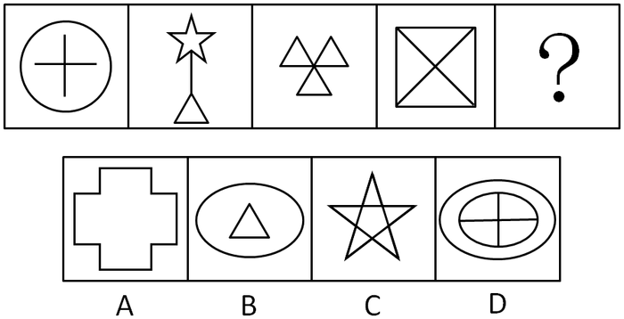

A. A

B. B

C. C

D. D

第 66 题 · 答案与解析

**参考答案（粉笔题库参考内容）**

D

**解析**

元素组成凌乱，考虑数量规律。

本题为数面（封闭空间）。已知图形的面数分别为1、2、3、4，因此下一个图形的面数应该为5。通过分析，A、B、C和D四选项中图形的面数分别为1、2、6和5，因此只有D项中图形符合。

故正确答案为D。

**考点**：数量规律-面

**来源**：2011年内蒙古自治区公务员录用考试《行测》题第66题

### 第 67 题

从所给的四个选项中，选择最合适的一个填入问号处，使之呈现一定的规律性。

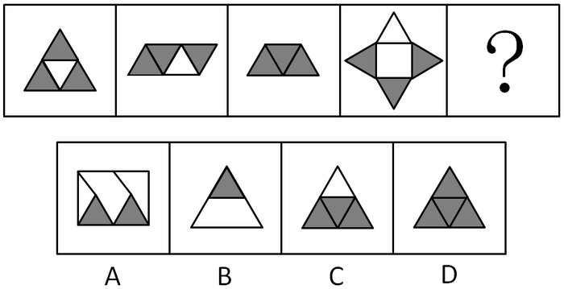

A. A

B. B

C. C

D. D

第 67 题 · 答案与解析

**参考答案（粉笔题库参考内容）**

C

**解析**

本题考查数量规律中的素。

已知图形每个图形中都有3个阴影三角形，因此下一个图形中也应有3个阴影三角形。

通过分析，A、B、C和D四选项中含有的阴影三角形个数分别为2、1、3和4，因此只有C项中图形符合。

故正确答案为C。

**考点**：数量规律-素

**来源**：2011年内蒙古自治区公务员录用考试《行测》题第67题

### 第 68 题

从所给的四个选项中，选择最合适的一个填入问号处，使之呈现一定的规律性。

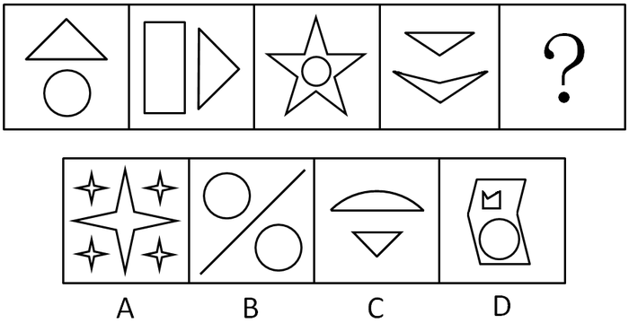

A. A

B. B

C. C

D. D

第 68 题 · 答案与解析

**参考答案（粉笔题库参考内容）**

C

**解析**

本题为数面（封闭空间）。

已知图形每个图形中的面数都为2，且都是两个图形元素（不含有第三个图形元素）构成的封闭空间，因此下一个图形中的面数也应该是2，且应该是由两个图形元素构成的封闭空间。

通过分析，A、B、C和D四选项中图形的面数分别为5、2、2和3，又知B项中图形还含有第三个图形元素一条直线，因此只有C项中图形符合。

故正确答案为C。

**考点**：数量规律-素、数量规律-面

**来源**：2011年内蒙古自治区公务员录用考试《行测》题第68题

### 第 69 题

从所给的四个选项中，选择最合适的一个填入问号处，使之呈现一定的规律性。

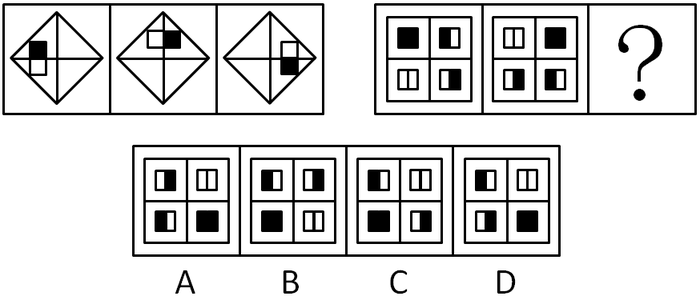

A. A

B. B

C. C

D. D

第 69 题 · 答案与解析

**参考答案（粉笔题库参考内容）**

A

**解析**

元素组成相同，考查位置规律。

本题考查图形元素平移。已知的第一组图形中的第一个图形中全黑正方形和全白正方形都分别按照下图1中1→2→3→4→1四个位置依次循环移动得到第二个和第三个图形，因此第二组图形也应符合该规律，即第二组图形中的第一个图形中全黑正方形、左半黑正方形、右半黑正方形和全白正方形都分别按照下图2中A→B→C→D→A四个位置依次循环移动得到第二个和第三个图形。

因此第三个图形中全黑正方形应该在C位置，左半黑正方形应该在D位置，右半黑正方形应该在A位置，全白正方形应该在B位置。通过分析，只有A项中图形符合。

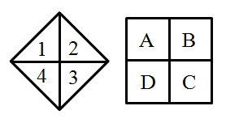

故正确答案为A。

**考点**：位置规律-平移

**来源**：2011年内蒙古自治区公务员录用考试《行测》题第69题

### 第 70 题

从所给的四个选项中，选择最合适的一个填入问号处，使之呈现一定的规律性。

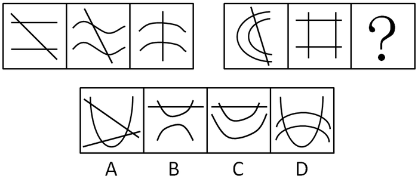

A. A

B. B

C. C

D. D

第 70 题 · 答案与解析

**参考答案（粉笔题库参考内容）**

D

**解析**

本题为数交点。已知的第一组图形中每个图形交点个数都为2，第二组图形中前两个图形的交点个数都为4，因此第三个图形的交点个数也应该为4。通过分析，A、B、C、D四项中图形的交点个数分别为5、2、2、4，因此只有D项中图形符合。

故正确答案为D。

**考点**：数量规律-点

**来源**：2011年内蒙古自治区公务员录用考试《行测》题第70题

### 第 71 题

从所给的四个选项中，选择最合适的一个填入问号处，使之呈现一定的规律性。

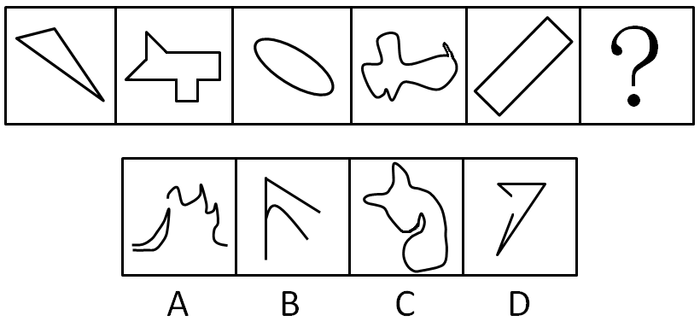

A. A

B. B

C. C

D. D

第 71 题 · 答案与解析

**参考答案（粉笔题库参考内容）**

C

**解析**

已知图形均为封闭图形，因此下一个图形也应是封闭图形。通过分析，只有C项中图形符合。

故正确答案为C。

**考点**：属性规律-开闭性

**来源**：2011年内蒙古自治区公务员录用考试《行测》题第71题

### 第 72 题

从所给的四个选项中，选择最合适的一个填入问号处，使之呈现一定的规律性。

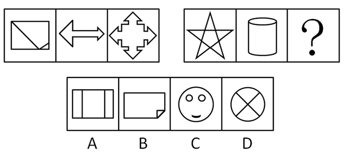

A. A

B. B

C. C

D. D

第 72 题 · 答案与解析

**参考答案（粉笔题库参考内容）**

B

**解析**

元素组成凌乱，考查数量规律。

本题考查数笔画。已知图形都是一笔画，因此下一个图形也应是一笔画。

通过分析，A、D至少2笔，C项4笔，只有B项中图形是一笔画。

故正确答案为B。

**考点**：数量规律-线

**来源**：2011年内蒙古自治区公务员录用考试《行测》题第72题

### 第 73 题

左边给定的是纸盒的外表面，右边哪一项不能由它折叠而成。

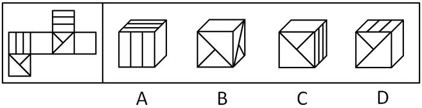

A. A

B. B

C. C

D. D

第 73 题 · 答案与解析

**参考答案（粉笔题库参考内容）**

D

**解析**

本题需注意题干中所说的是纸盒的“外表面”。通过观察题干中的表面图可知，当有两平行线的面和类似房梁结构的面同时出现，且有两平行线的面为顶面，类似房梁结构的面为正面时，两者只能是下图两种样式的位置关系，因此D项不能由给定图形折叠而成。

本题为选非题，故正确答案为D。

**考点**：空间类-空间重构-六面体

**来源**：2011年内蒙古自治区公务员录用考试《行测》题第73题

### 第 74 题

从所给的四个选项中，选择最合适的一个填入问号处，使之呈现一定的规律性。

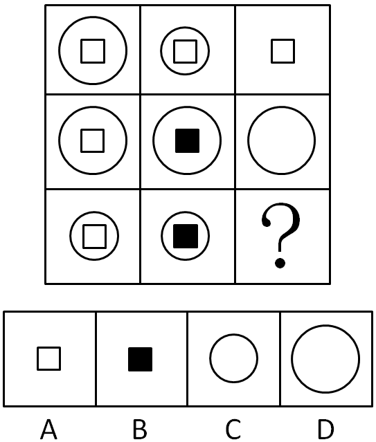

A. A

B. B

C. C

D. D

第 74 题 · 答案与解析

**参考答案（粉笔题库参考内容）**

C

**解析**

本题考查元素叠加。已知图形每一行中前两个图形叠加后去异存同形成第三个图形。通过分析只有C项中图形符合规律。

故正确答案为C。

**考点**：样式规律-加减同异

**来源**：2011年内蒙古自治区公务员录用考试《行测》题第74题

### 第 75 题

从所给的四个选项中，选择最合适的一个填入问号处，使之呈现一定的规律性。

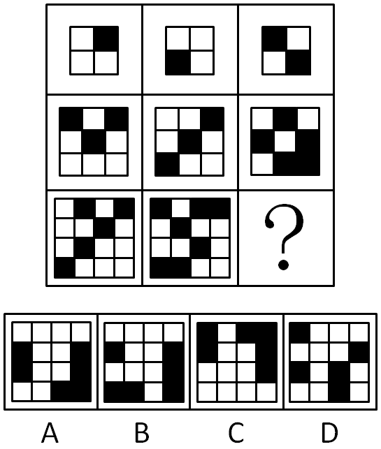

A. A

B. B

C. C

D. D

第 75 题 · 答案与解析

**参考答案（粉笔题库参考内容）**

A

**解析**

本题考查元素叠加。

已知图形每一行中前两个图形黑白叠加形成第三个图形。本题规则为：白＋白＝黑，黑＋白＝白，白＋黑＝白，黑＋黑＝白。通过分析，只有A项中图形符合规律。

故正确答案为A。

**考点**：样式规律-黑白运算

**来源**：2011年内蒙古自治区公务员录用考试《行测》题第75题

### 第 76 题

知识技能型人才是既具备较高的专业理论知识水平，又具备较高的操作技能水平的人员。他们能够将所掌握的理论知识用于指导生产实践，创造性地开展工作，主要分布在高新技术产业和新兴职业领域。

根据上述定义，下列属于知识技能型人才的是：

A. 西式面点师

B. 快递业务员

C. 动车组司机

D. 色彩搭配师

第 76 题 · 答案与解析

**参考答案（粉笔题库参考内容）**

D

**解析**

第一步：抓住定义中的关键词。

关键词包括“高新技术产业和新兴职业领域”。

第二步：逐一判断选项。

A项中的西式面点师，B中的快递业务员，C项中的动车组司机三项均不符合关键词“高新技术产业和新兴职业领域”，因此都不属于知识技能型人才；D项中的色彩搭配师符合关键词，因此属于知识技能型人才。

故正确答案为D。

备注：C项中的动车组司机可能会引起争议，这里重点分析一下。从分布上面看，动车组司机所在行业属于交通运输行业而并非高新技术产业，自1964年日本的新干线系统开通以来，这个职业领域已经存在了接近半个世纪之久，因此动车组司机不是知识技能型人才。

**考点**：单定义-其他句式

**来源**：2011年内蒙古自治区公务员录用考试《行测》题第76题

### 第 77 题

社区作为社会生活的基本单位，是指一定数量居民组成的，具有内在互动关系与文化维系力的地域性的生活共同体。地域、人口、组织结构和文化是社区构成的基本要素。

根据上述定义，下列属于社区的是：

A. 某医院住院部的所有病人

B. 具有多个地方办事处的某行业协会

C. 居住在某个自然村的所有农村居民

D. 负责处理居民事务的某街道办事处

第 77 题 · 答案与解析

**参考答案（粉笔题库参考内容）**

C

**解析**

第一步：找出定义关键词。

“一定数量居民组成的”、“具有内在互动关系与文化维系力”、“地域性的生活共同体”、“地域、人口、组织结构和文化”。

第二步：逐一分析选项。

A项：医院住院部的病人只是临时聚集在一起，不是生活共同体，不符合“具有内在互动关系与文化维系力”、“地域性的生活共同体”，不符合定义，排除；

B项：行业协会是社会团体，不是由居民构成的生活共同体，不符合“一定数量居民组成的”、“地域性的生活共同体”、“地域、人口、组织结构和文化”，不符合定义，排除；

C项：居住在某自然村的所有农村居民，符合“一定数量居民组成的”、“具有内在互动关系与文化维系力”、“地域性的生活共同体”、“地域、人口、组织结构和文化”，符合定义，当选；

D项：街道办事处是处理居民事务的行政机关，不是由居民构成的生活共同体，不符合“一定数量居民组成的”、“地域性的生活共同体”、“地域、人口、组织结构和文化”，不符合定义，排除。

故正确答案为C。

**考点**：单定义-其他句式

**来源**：2011年内蒙古自治区公务员录用考试《行测》题第77题

### 第 78 题

应急预案是指面对突发事件如自然灾害、重特大事故、环境公害及人为破坏的应急管理、指挥、救援计划等。它一般应建立在综合防灾规划上，应急预案所称突发公共事件是指突然发生，造成或者可能造成重大人员死亡，财产损失，生态环境破坏和严重社会危害，危及公共安全的紧急事件。

根据上述定义，下列成功应用应急预案的是：

A. 特大山洪暴发后，甲市立即制定相关的救援计划解救被困群众

B. 乙省遭遇台风，因气象部门预报准确，群众提前做好了防护准备，整体损失较小

C. 丙市某幼儿园突然发生人质劫持事件，50多名教师和儿童被困，救援人员临危不乱，凭借集体的智慧成功化解了这场危机

D. 丁市突然发生大型化学工厂有毒化学物外漏事件，政府马上按照预定方案进行民众的疏导和救援

第 78 题 · 答案与解析

**参考答案（粉笔题库参考内容）**

D

**解析**

第一步：抓住定义中的关键词。

关键词包括“突发公共事件”，“应急管理、指挥、救援计划”，“预案”。

第二步：逐一判断选项。

A项中甲市“立即制定”说明没有预先制定的方案，不符合关键词“预案”，因此不属于成功应用应急预案；

B项中台风是可以提前预测的，不属于突发事件，不符合关键词“突发公共事件”，因此不属于成功应用应急预案；

C项中救援人员化解了这场危机并没有体现出关键词“应急管理，指挥、救援计划”，因此不属于成功应用应急预案；

D项中丁市政府按照预定方案处理事件完全符合关键词，因此属于成功应用应急预案。

故正确答案为D。

**考点**：单定义-其他句式

**来源**：2011年内蒙古自治区公务员录用考试《行测》题第78题

### 第 79 题

产品改良策略也称为“产品再推出”策略，即将产品的某一部分给予显著变革，以便吸引新顾客、维持老顾客的营销策略。

根据上述定义，下列不属于产品改良策略的是：

A. 某电视台为提高收视率改变了某节目的主持风格

B. 某电子表制造商将电子表机芯装在项链上变为项链电子表

C. 某时尚杂志社根据读者要求将杂志由季刊改为月刊

D. 某品牌家电厂推出空调以旧换新的活动

第 79 题 · 答案与解析

**参考答案（粉笔题库参考内容）**

D

**解析**

第一步：抓住定义中的关键词。

关键词包括“产品的某一部分给予显著变革”。

第二步：逐一判断选项。

A项中电视台改变主持风格，B项中制造商的项链电子表，C项中杂志社将季刊改为月刊均符合关键词，因此都属于产品改良；

D项中家电厂空调以旧换新的活动无法体现关键词“产品的某一部分给予显著变革”，因此不属于产品改良策略。

本题为选非题，故正确答案为D。

**考点**：方式目的

**来源**：2011年内蒙古自治区公务员录用考试《行测》题第79题

### 第 80 题

流行是一种常见的心理态势，表现为社会或群体的成员在短时间内，由于追求某种生活方式而产生的相互感染或模仿。

根据上述定义，下列不属于流行现象的是：

A. 大街上到处都可以看到全身牛仔服上到处是窟窿的年轻人

B. 最近在网络聊天时，很多人都在使用“囧”字

C. 春天来了，许多人纷纷去郊外踏青

D. APEC会议以后，很多外国人喜欢上了中国的唐装

第 80 题 · 答案与解析

**参考答案（粉笔题库参考内容）**

C

**解析**

第一步：抓住定义中的关键词。

关键词包括“短时间内”。

第二步：逐一判断选项。

A项中全身牛仔服上到处是窟窿的年轻人，B项中网络聊天使用“囧”字，D项中外国人喜欢上中国的唐装都符合关键词，因此均属于流行现象；

C项中踏青每年春天都有，并不符合关键词“短时间内”，因此不属于流行现象。

本题为选非题，故正确答案为C。

**考点**：原因结果

**来源**：2011年内蒙古自治区公务员录用考试《行测》题第80题

### 第 81 题

地质遗迹资源是指在地球演化的漫长的地质历史时期中，由于内外动力的地质作用而形成，发展并保存下来的珍贵的，不可再生的，并能在现在和可预见的将来，可供人类开发利用并产生经济价值，以提高人类当前和将来福利的自然遗产。

根据上述定义，下列属于地质遗迹资源的是：

A. 某地建立的地质纪念碑

B. 某地风景优美的溶洞群

C. 专门收藏地质标本的国土资源博物馆

D. 历史悠久且景色宜人的大运河

第 81 题 · 答案与解析

**参考答案（粉笔题库参考内容）**

B

**解析**

第一步：抓住定义中的关键词。

关键词包括“内外动力的地质作用”。

第二步：逐一判断选项。

A中的地质纪念碑，C中的国土资源博物馆，D中的大运河都是人造景观，不符合关键词“内外动力的地质作用”，因此均不属于地质遗迹资源。

B中的溶洞群符合关键词，因此属于地质遗迹资源。

故正确答案为B。

**考点**：原因结果

**来源**：2011年内蒙古自治区公务员录用考试《行测》题第81题

### 第 82 题

DM广告即直邮广告，即通过邮寄、赠送等形式，将宣传品送到消费者手中、家里或公司所在地。

根据上述定义，下列不属于DM广告的是：

A. 百货商场化妆品柜台赠送的防晒乳液试用品

B. 在人群密集的街道上派发的商业楼盘宣传单

C. 电子信箱中收到的某大型连锁快餐店的优惠券

D. 在电器商场购买手机时获赠的两张手机贴膜

第 82 题 · 答案与解析

**参考答案（粉笔题库参考内容）**

D

**解析**

第一步：抓住定义中的关键词。

关键词包括“宣传品”。

第二步：逐一判断选项。

A项中的防晒乳液试用品，B项中的商业楼盘宣传单，C项中的优惠券都是宣传品，符合关键词，因此均属于DM广告。

D项中买手机时获赠的两张手机贴膜只是买手机时获得的赠品，不符合关键词“宣传品”，因此不属于DM广告。

本题为选非题，故正确答案为D。

**考点**：方式目的

**来源**：2011年内蒙古自治区公务员录用考试《行测》题第82题

### 第 83 题

气候地貌学是研究不同气候条件下的地貌形成过程及其演变规律的学科，是地貌学的一个重要分支。气候地貌学主要研究各种反映气候地貌成因的物理、化学和生物等因素；研究在不同气候条件下各种地貌的发育过程。

根据上述定义，下列不属于气候地貌学研究范围的是：

A. 如何给全球划分寒冷区、中纬度森林区、干旱区与湿热区

B. 冰川区、荒漠区为什么只出现在一定的气候区内

C. 中纬度森林区地貌塑造过程的特点

D. 地球形成以来各个时期以及未来的气候特征和变化规律

第 83 题 · 答案与解析

**参考答案（粉笔题库参考内容）**

D

**解析**

第一步：抓住定义中的关键词。

关键词包括“地貌”，“气候地貌成因”。

第二步：逐一判断选项。

A项中对全球的划分，B项中的冰川区、荒漠区，C项中的森林区地貌，三个选项中都同时涉及了地貌和气候，都符合关键词，因此均属于气候地貌学的研究范围；

D项中气候特征和变化规律只是涉及到气候，没有涉及地貌，不符合关键词“地貌”，因此不属于气候地貌学的研究范围。

本题为选非题，故正确答案为D。

**考点**：拆词

**来源**：2011年内蒙古自治区公务员录用考试《行测》题第83题

### 第 84 题

厌恶疗法是一种帮助人们将所要戒除的行为或症状，同某种使人厌恶的行为或惩罚性的刺激结合起来，通过厌恶型条件反射，达到戒除或减少行为出现的目的。

根据上述定义，以下属于厌恶疗法的是：

A. 小王很胖还是喜欢吃巧克力，他的朋友建议他一次吃到腻，以后对巧克力就会丧失兴趣

B. 小周害怕手指刮白板的声音，治疗师用录音机连续播放一整天这种声音，以降低小周的恐惧感

C. 老赵不爱做家务爱喝酒，他的妻子规定，只要他喝醉，第二天就必须承担所有的家务

D. 老吴想要戒烟，他每次想抽烟的时候都会在心里不停的默念“吸烟是不健康的”

第 84 题 · 答案与解析

**参考答案（粉笔题库参考内容）**

C

**解析**

第一步：抓住定义中的关键词。

关键词包括“使人厌恶的行为或惩罚性的刺激”，“厌恶型条件反射”。

第二步：逐一判断选项。

A中小王朋友的建议不符合关键词“使人厌恶的行为或惩罚性的刺激”，因此不属于厌恶疗法；

B中治疗师的做法同样不符合关键词“使人厌恶的行为或惩罚性的刺激”，因此不属于厌恶疗法；

C中老赵妻子的做法完全符合关键词，因此属于厌恶疗法；

D中默念“吸烟是不健康的”并非某种使人厌恶的行为或惩罚性的刺激，不符合关键词“使人厌恶的行为或惩罚性的刺激”，因此不属于厌恶疗法。

故正确答案为C。

**考点**：方式目的

**来源**：2011年内蒙古自治区公务员录用考试《行测》题第84题

### 第 85 题

幻觉是指在没有客观刺激作用于相应感官的条件下，而产生的一种真实生动的知觉。幻觉是知觉障碍的一种，主要有幻听、幻视、幻触等，它多出现在精神病状态下，正常人有时在紧张、疲劳、高烧等条件下也可能出现。

根据上述定义，下列属于幻觉的是：

A. 病人把天上的云彩，通过想象感知为飞舞的仙女

B. 太阳早上看起来往往比中午的时候大一些

C. 胆小的小陆在走夜路时，看到远处的树木以为是劫匪

D. 妈妈上班一走，小峰就在家看起了电视，但总觉得不时听到妈妈的脚步声

第 85 题 · 答案与解析

**参考答案（粉笔题库参考内容）**

D

**解析**

第一步：抓住定义中的关键词。

关键词包括“没有客观刺激作用”。

第二步：逐一判断选项。

A中天上的云彩，B中的太阳，C中远处的树木都是客观刺激，都不符合关键词“没有客观刺激作用”，因此均不属于幻觉。

D中小峰的状况完全符合关键词，因此属于幻觉。

故正确答案为D。

**考点**：大前提

**来源**：2011年内蒙古自治区公务员录用考试《行测》题第85题

### 第 86 题

1.匪徒被捕 2.拨打110 3.警察赶到 4.下班回家 5.发现被盗

A. 45231

B. 43521

C. 25413

D. 34512

第 86 题 · 答案与解析

**参考答案（粉笔题库参考内容）**

A

**解析**

第一步：先确定逻辑关系联系紧密的事件顺序。

观察题干，五个事件主要围绕“警察抓匪徒”的过程。逻辑关系的先后顺序比较明显的是事件2和事件3，只有先“拨打110”，才会有“警察赶到”，因此事件2和事件3相邻，且事件2应排在事件3前面。

第二步：逐一对照选项并判断正确答案。

根据第一步得到的结果可以判断只有A项符合。

故正确答案为A。

**来源**：2011年内蒙古自治区公务员录用考试《行测》题第86题

### 第 87 题

1.厂家验收 2.图纸设计 3.土地勘测 4产品出厂 5.监理施工

A. 23541

B. 21354

C. 32514

D. 31245

第 87 题 · 答案与解析

**参考答案（粉笔题库参考内容）**

C

**解析**

第一步：先确定逻辑关系最为明显的事件顺序。

观察题干，五个事件主要围绕“产品生产”的过程。逻辑关系的先后顺序比较明显的是事件3和事件4，容易判断事件3应该排在最前，而事件4应该排在最后。

第二步：逐一对照选项并判断正确答案。

根据第一步得到的结果可以判断只有C项符合。

故正确答案为C。

**来源**：2011年内蒙古自治区公务员录用考试《行测》题第87题

### 第 88 题

1.排放污水 2.河水受到污染，变得浑浊 3.新建造纸厂 4.环保部门对造纸厂进行整治 5.河水变得澄清

A. 31245

B. 32451

C. 53241

D. 34521

第 88 题 · 答案与解析

**参考答案（粉笔题库参考内容）**

A

**解析**

第一步：先确定逻辑关系最为明显的事件顺序。

观察题干，五个事件主要围绕“污水治理”的过程。逻辑关系的先后顺序比较明显的是事件1和事件2，只有先“排放污水”，才会有“河水受到污染，变得浑浊”，因此事件1和事件2相邻，且事件1排在事件2前面。

第二步：逐一对照选项并判断正确答案。

根据第一步得到的结果可以判断只有A项符合。

故正确答案为A。

**来源**：2011年内蒙古自治区公务员录用考试《行测》题第88题

### 第 89 题

1.下岗待业 2.重新就业 3.培训学习 4.人员过剩 5.优化组合

A. 32451

B. 54132

C. 32154

D. 53412

第 89 题 · 答案与解析

**参考答案（粉笔题库参考内容）**

B

**解析**

第一步：先确定逻辑关系最为明显的事件顺序。

观察题干，五个事件主要围绕“再就业”的过程。逻辑关系的先后顺序比较明显的是事件1和事件4，只有先“人员过剩”，才会有“下岗待业”，因此事件1和事件4相邻，且事件4排在事件1前面。

第二步：逐一对照选项并判断正确答案。

根据第一步得到的结果可以判断只有B、D两项符合。进一步分析，事件3应该在事件1之后，“下岗待业”之后通过“培训学习”才能够“重新就业”，因此只有B项符合。

故正确答案为B。

**来源**：2011年内蒙古自治区公务员录用考试《行测》题第89题

### 第 90 题

1.张明受到表扬 2.张明下班回家 3.通知工厂紧急抢修 4.途中发现管道漏气 5.避免重大火灾

A. 24315

B. 24351

C. 51243

D. 12435

第 90 题 · 答案与解析

**参考答案（粉笔题库参考内容）**

B

**解析**

第一步：先确定逻辑关系最为明显的事件顺序。

观察题干，五个事件主要围绕“张明为工厂避免火灾受到表扬”的过程。逻辑关系的先后顺序比较明显的是事件1和事件5，只有先“避免重大火灾”，才会有“张明受到表扬 ”，因此事件1和事件5相邻，且事件5排在事件1前面，同时容易判断事件1应该排在最后。

第二步：逐一对照选项并判断正确答案。

根据第一步得到的结果可以判断只有B项符合。

故正确答案为B。

**来源**：2011年内蒙古自治区公务员录用考试《行测》题第90题

### 第 91 题

1启程远征北极 2进行集训 3挑选队员 4记录考察数据 5制订考察计划

A. 5-4-3-2-1

B. 3-2-1-5-4

C. 5-3-2-1-4

D. 3-1-2-4-5

第 91 题 · 答案与解析

**参考答案（粉笔题库参考内容）**

C

**解析**

第一步：先确定逻辑关系最为明显的事件顺序。

观察题干，五个事件主要围绕“远征北极考察数据”的过程。逻辑关系的先后顺序比较明显的是事件2和事件3，只有先“挑选队员”，才会有“进行集训”，因此事件2和事件3相邻，且事件3排在事件2前面，同时容易判断事件5应该排在最前面。

第二步：逐一对照选项并判断正确答案。

根据第一步得到的结果可以判断只有A、C两项符合。进一步分析，事件1应该在事件4的前面，因此排除A项。

故正确答案为C。

**来源**：2011年内蒙古自治区公务员录用考试《行测》题第91题

### 第 92 题

1肇事司机被围 2拨打急救电话 3现场清理干净 4肇事车辆逃逸 5众人齐声谴责

A. 1-5-4-2-3

B. 4-2-1-5-3

C. 4-1-5-3-2

D. 1-4-3-5-2

第 92 题 · 答案与解析

**参考答案（粉笔题库参考内容）**

B

**解析**

第一步：先确定逻辑关系最为明显的事件顺序。

观察题干，五个事件主要围绕“肇事车辆逃逸被围”的过程。逻辑关系的先后顺序比较明显的是事件3和事件4，容易判断事件4应该排在最前面，而事件3应该排在最后面。

第二步：逐一对照选项并判断正确答案。

根据第一步得到的结果可以判断只有B项符合。

故正确答案为B。

**来源**：2011年内蒙古自治区公务员录用考试《行测》题第92题

### 第 93 题

1屋内进水 2维修房屋 3整理物品 4申请事假 5天降暴雨

A. 4-5-1-3-2

B. 5-1-4-2-3

C. 4-2-3-5-1

D. 5-3-1-2-4

第 93 题 · 答案与解析

**参考答案（粉笔题库参考内容）**

B

**解析**

第一步：先确定逻辑关系最为明显的事件顺序。

观察题干，五个事件主要围绕“请假修房屋”的过程。逻辑关系的先后顺序比较明显的是事件2和事件4，只有先“申请事假 ”，才会有“维修房屋 ”，因此事件2和事件4相邻，且事件4排在事件2前面，同时容易判断事件5应该排在最前面。

第二步：逐一对照选项并判断正确答案。

根据第一步得到的结果可以判断只有B项符合。

故正确答案为B。

**来源**：2011年内蒙古自治区公务员录用考试《行测》题第93题

### 第 94 题

1水库边钓鱼 2送交水库管理处 3小明放暑假 4放归水库中 5捉到一只百年乌龟

A. 1-5-2-4-3

B. 5-2-4-3-1

C. 3-1-5-2-4

D. 3-5-4-1-2

第 94 题 · 答案与解析

**参考答案（粉笔题库参考内容）**

C

**解析**

第一步：先确定逻辑关系最为明显的事件顺序。

观察题干，五个事件主要围绕“小明暑假钓鱼发现乌龟”的过程。逻辑关系的先后顺序比较明显的是事件1和事件5，只有先“水库边钓鱼”，才会有“捉到一只百年乌龟”，因此事件1和事件5相邻，且事件1排在事件5前面，同时容易判断事件3应该排在最前面。

第二步：逐一对照选项并判断正确答案。

根据第一步得到的结果可以判断只有C项符合。

故正确答案为C。

**来源**：2011年内蒙古自治区公务员录用考试《行测》题第94题

### 第 95 题

1二氧化碳含量增高 2南北极冰层融化 3地球气温升高 4工业化程度加剧 5海水淹没大片陆地

A. 3-4-2-1-5

B. 2-5-3-1-4

C. 4-1-3-2-5

D. 4-3-2-1-5

第 95 题 · 答案与解析

**参考答案（粉笔题库参考内容）**

C

**解析**

第一步：先确定逻辑关系最为明显的事件顺序。

观察题干，五个事件主要围绕“温室效应造成后果”的过程。逻辑关系的先后顺序比较明显的是事件1和事件4，只有先“工业化程度加剧 ”，才会有“二氧化碳含量增高”，因此事件1和事件4相邻，且事件4排在事件1前面。

第二步：逐一对照选项并判断正确答案。

根据第一步得到的结果可以判断只有C项符合。

故正确答案为C。

**来源**：2012年黑龙江省公务员录用考试《行测》题第94题

### 第 96 题

某人家中共有7个子女，从大到小分别是A、B、C、D、E、F、G，A有三个妹妹；B有一个哥哥；C是女生，她有两个妹妹；D有两个弟弟；F也是女生。

由此可以推知：

A. A是女生

B. B是女生

C. D是男生

D. E是男生

第 96 题 · 答案与解析

**参考答案（粉笔题库参考内容）**

D

**解析**

第一步：找突破口。

本题突破口为D有两个弟弟，且比D小的只有E、F、G，又知F是女生，因此可知E和G均是男生。

第二步：根据突破口继续推导。

由第一步可知E和G是男生，又知C有两个妹妹，从而可知D是女生；由B有一个哥哥可知，A是男生；由A有三个妹妹可知B是男生。综上，A、B、E和G均是男生，C、D和F均是女生，通过分析，只有D项符合。

故正确答案为D。

**考点**：排除法

**来源**：2011年内蒙古自治区公务员录用考试《行测》题第96题

### 第 97 题

一份发行量非常大的报纸居然停刊。原因在于它拥有的读者是年龄偏大且社会经济地位低下的男性，这部分人群消费能力低下，因而广告效果十分不理想，使广告主对它失去信心。失去了广告主，它再也办不下去了。

由此可以推出：

A. 发行量不是报纸争取广告收入的唯一条件

B. 报纸发行量对广告主没有吸引力

C. 女性比男性更喜欢广告

D. 依赖广告收入办报不利于报业发展

第 97 题 · 答案与解析

**参考答案（粉笔题库参考内容）**

A

**解析**

第一步：抓住每句话中的对象及其关系。

第一句说明发行量非常大的报纸停刊，第二句说明报纸广告效果不理想导致广告主对它失去信心，第三句说明失去了广告主导致报纸办不下去，三句之间是因果关系。

第二步：判断整体关系。

报纸发行量很大，但还是因广告效果不理想停刊了。

第三步：逐一判断选项的作用。

A项中结论正是由题干能够推出的；

B项报纸发行量对广告主有没有吸引力无法得知，题干中只是提到广告效果不理想对广告主有影响；

C项女性和男性谁更喜欢广告无法得知；

D项依赖广告收入办报是否利于报业发展也无法得知。

故正确答案为A。

**考点**：日常结论

**来源**：2011年内蒙古自治区公务员录用考试《行测》题第97题

### 第 98 题

美国俄克拉荷马州立大学教授迈克尔·卡斯帕里说，此前进行的一份调查显示，全球变暖可使蚂蚁发生变异，其身长将是变异前的三分之一。他警告说：体形变小的蚂蚁繁殖更快，更容易向外扩张它们的领地，因此在全球变暖的情况下，蚂蚁数量会剧增。

由此可以推出：

A. 蚂蚁的繁殖与遗传和气温关系密切

B. 小蚂蚁个体更适应气温高的环境

C. 全球变暖会使大蚂蚁的数量变少

D. 如果全球气温不再升高，蚂蚁的数量就不会增加

第 98 题 · 答案与解析

**参考答案（粉笔题库参考内容）**

A

**解析**

第一步：抓住每句话中的对象。

第一句说明全球变暖可导致蚂蚁身长变为变异前的三分之一，第二句说明体形变小的蚂蚁繁殖更快将导致蚂蚁数量会剧增，两句间是因果关系。

第二步：判断整体关系。

全球变暖导致蚂蚁体形变小，体形变小使得蚂蚁繁殖更快，最终导致蚂蚁数量会剧增。

第三步：逐一判断选项的作用。

从第二步分析可以推出气温影响了蚂蚁的繁殖与遗传，因此A项正确；

从题干中能够得到气温高导致蚂蚁体形变小，无法得出B项中小蚂蚁个体更适应气温高的环境；

C项中题干中并没有涉及概念“大蚂蚁”，因此无从得知其数量变化如何；

从题干中能够得到全球气温升高会加快蚂蚁的繁殖速度，D项中是“蚂蚁的数量”，因此即便全球气温不再升高，也无法得知蚂蚁的数量如何变化。

故正确答案为A。

**考点**：日常结论

**来源**：2011年内蒙古自治区公务员录用考试《行测》题第98题

### 第 99 题

有很多创造性的发明都是在战争中产生或得到实际应用的，因此，有人声称，战争是推动人类社会进步的必要环节。

以下各项如果为真，最能反驳上述观点的是：

A. 战争会给人类带来无可挽回的伤害

B. 战争中的创造发明在日常生活中用处不大

C. 和平年代良好的外部条件更有利于科技交流和思想整合

D. 和平年代良好的科技氛围更有利于创造性发明的产生和实际应用

第 99 题 · 答案与解析

**参考答案（粉笔题库参考内容）**

D

**解析**

第一步：找到论点和论据。

本题论点是战争是推动人类社会进步的必要环节，论据是很多创造性的发明都是在战争中产生或得到实际应用的。

第二步：判断削弱方式。

本题论点与论据间存在因果关系，所以需削弱论点。

第三步：逐一判断选项的作用。

A项中战争带来危害，B项中战争中的发明在日常生活中的用处，C项中和平年代科技交流和思想整合，均与发明的产生或应用无直接关系，属无关选项。

D项中和平年代更有利于创造性发明的产生和实际应用，而战争并不是主要因素，削弱论点。

故正确答案为D。

**考点**：削弱论点

**来源**：2011年内蒙古自治区公务员录用考试《行测》题第99题

### 第 100 题

测谎器已被证明有时可能被蒙骗，如果受测者真的不知道自己在说谎，而实际上他说了假话，那么测谎器就没有价值了。

据此可知：

A. 测谎器经常是不准确的

B. 测谎器在设计上是没什么价值的

C. 有些撒谎者可以轻易地蒙骗测谎器

D. 测谎器有时也需要使用者的主观判断

第 100 题 · 答案与解析

**参考答案（粉笔题库参考内容）**

D

**解析**

日常结论题，根据题干信息逐一分析选项。

A项：该项认为测谎器“经常”是不准确的，从题干中只能得到“有时”，无法推出，排除；

B项：该项讲测谎器没什么价值，而从题干中只能得到当测谎仪器遇到“受测者真的不知道自己在说谎，而实际上他说了假话”这种情况时才会没有价值，其他情况还是有价值的，无法推出，排除；

C项：该项中有些撒谎者可以轻易地蒙骗测谎器，题干并未涉及此内容，属于无中生有，无法推出，排除；

D项：该项提出了解决测谎器这一漏洞的一种办法，可以推出，当选。

故正确答案为D。

**考点**：日常结论

**来源**：2011年内蒙古自治区公务员录用考试《行测》题第100题

### 第 101 题

美国的一位动物学家在黑猩猩的笼子前放了一面大镜子，观察他们的反应。它们能够从镜子中认出自己，经常久久地对着镜子寻找自己身上平时看不到的部位。作为黑猩猩近亲的大猩猩却不具备这种能力。

由此可以推出：

A. 黑猩猩在某些方面的能力高于大猩猩

B. 黑猩猩和大猩猩虽然亲缘较近，但还是黑猩猩的智力更胜一筹

C. 黑猩猩的这种能力和它所生活的环境有关

D. 动物界还有其它动物具备这种能力

第 101 题 · 答案与解析

**参考答案（粉笔题库参考内容）**

A

**解析**

第一步：抓住每句话中的对象。

第二句说明黑猩猩能够从镜子中认出自己并对着镜子寻找自己身上平时看不到的部位，第三句说明黑猩猩的近亲大猩猩不具备第二句中提到的黑猩猩的能力。

第二步：判断整体关系。

第一步中的两句话说明黑猩猩在“照镜子”这一方面的能力要比大猩猩强。

第三步：逐一判断选项的作用。

A项中黑猩猩在某些方面的能力高于大猩猩，正是对第二步中结论的进一步总结，因此A项正确；

B项单从“照镜子”这个行为就判断黑猩猩的智力比大猩猩更胜一筹是不科学的，智力需要的是多方面的综合考察；

C项题干中没有涉及“黑猩猩所生活的环境”，无从得知黑猩猩的这种能力和它所生活的环境是否有关；

D项题干没有涉及，无法判断。

故正确答案为A。

**考点**：日常结论

**来源**：2011年内蒙古自治区公务员录用考试《行测》题第101题

### 第 102 题

有攻击倾向的孩子，在摄入过多的糖后易发生攻击性行为。因而美国的医生常用减少糖摄入量的办法来治疗具有攻击性行为的儿童。

由此可以推出：

A. 禁止孩子吃糖是治疗儿童攻击倾向的最佳方法

B. 改变人的行为有时可以通过改变其饮食来实现

C. 吃糖越多的孩子攻击性越强

D. 糖的甜味会刺激人的攻击性

第 102 题 · 答案与解析

**参考答案（粉笔题库参考内容）**

B

**解析**

第一步：抓住每句话中的对象及其关系。

第一句说明摄入过多的糖能够使有攻击倾向的孩子易发生攻击性行为，第二句说明美国的医生常用减少糖摄入量的办法来治疗具有攻击性行为的儿童，两句间是因果关系。

第二步：判断整体关系。

第一句是因，第二句是果，通过限制糖摄入量可以限制有攻击性倾向的儿童的行为。

第三步：逐一判断选项的作用。

A项中“禁止”和“最佳方法”都过于绝对，无法从题干中得知；

B项中正是对第二步结论的进一步总结，因此B项正确；

C项中吃糖越多的孩子攻击性越强，忽略了题干中的前提条件“有攻击倾向的孩子”，因此无法推出；

D项题干中并没有解释是糖的哪种性质刺激人的攻击性，因此D项也无从得知。

故正确答案为B。

**考点**：日常结论

**来源**：2011年内蒙古自治区公务员录用考试《行测》题第102题

### 第 103 题

一项研究调查表明：在普通人群中，与每晚睡眠时间保持在7至9个小时的人相比，每晚睡眠时间少于4个小时的人患肥胖症的危险高于73%，而平均每天只睡5个小时的人，这种危险则高出50%。研究人员因此得出结论：缺乏睡眠容易使人变得肥胖。

以下如果为真，最能支持上述结论的是：

A. 缺乏睡眠与糖尿病发病率上升存在关联，而大部分糖尿病患者都比较肥胖

B. 缺乏睡眠容易导致慢性疲劳综合症，从而使人不愿意参加体育锻炼

C. 睡眠不足者与每晚睡眠时间在7至9个小时的人拥有同样的饮食和运动习惯

D. 睡眠不足会导致人体内消脂蛋白浓度下降，而消脂蛋白具有抑制食欲的功能

第 103 题 · 答案与解析

**参考答案（粉笔题库参考内容）**

C

**解析**

第一步：找到论点和论据。

论点：缺乏睡眠容易使人变得肥胖。

论据：与每晚睡眠时间保持在7至9个小时的人相比，每晚睡眠时间少于4个小时的人患肥胖症的危险高于73%，每天只睡5个小时的人，这种危险则高出50%。

本题论点和论据都是在说缺乏睡眠与肥胖之间的关系，二者话题一致，无需搭桥，加强考虑补充论据，补充必要条件、解释为什么缺乏睡眠容易使人变得肥胖或者举缺乏睡眠且肥胖的例子。

第二步：逐一判断选项的作用。

A项：通过先将睡眠与糖尿病发病率建立关系，又将糖尿病与肥胖建立联系，在一定程度上能够加强论点，保留；

B项：缺乏睡眠使不愿意参加体育锻炼，但不愿意参加锻炼不一定会导致肥胖，属于不明确选项，排除；

C项：作为必要前提条件支持题干，排除了其他因素的影响，直接加强题干中的结论，保留；

D项：睡眠不足使得抑制食欲的蛋白浓度下降，进而导致吃得多，但这不一定引起肥胖，属于不明确选项，排除。

比较A、C两项，C项必要条件的加强力度大于A项。

故正确答案为C。

**考点**：加强-实验类、必要条件

**来源**：2011年内蒙古自治区公务员录用考试《行测》题第103题

### 第 104 题

最近受异常天气影响，吐鲁番地区的葡萄减产，价格比去年同期上涨了50%，这就大大提高了葡萄酒酿造业的成本，估计葡萄酒价格比去年将有大幅度的提高。

以下如果为真，最能削弱上述观点的是：

A. 近年来葡萄酒生产工艺有了很大改进

B. 去年葡萄的价格是历年最低的

C. 气候对葡萄产量的影响并不如专家们估计得那么严重

D. 除了吐鲁番外，其他地区也可以提供葡萄

第 104 题 · 答案与解析

**参考答案（粉笔题库参考内容）**

D

**解析**

第一步：找到论点和论据。

论点：葡萄酒价格比去年将有大幅度的提高。

论据：受异常天气影响葡萄酒酿造业的成本大大提高。

第二步：判断削弱方式。

本题论点与论据间存在因果关系，需要在论点和论据间不搭桥。

第三步：逐一判断选项的作用。

A项没有涉及成本问题，属于无关选项；

B项说明今年葡萄价格可能上涨；

C项说明的确受到气候影响，但不能削弱题干论证；

D项指出其他地区也可以提供葡萄，则葡萄酒酿造业的成本不会受到葡萄价格上涨的影响，即两者之间并没有因果联系，从而削弱了题干论证。

故正确答案为D。

**考点**：拆桥

**来源**：2011年内蒙古自治区公务员录用考试《行测》题第104题

### 第 105 题

影响茶叶营养与药理品质的因素，除了微量元素含量与产茶区土壤成分外，其主要成分氨基酸的含量与气象条件密切相关。研究分析表明：鲜茶叶的氨基酸含量与采茶期的气温、日照呈负相关，与降水量和空气相对湿度呈正相关。

以下如果为真，最能削弱上述研究分析结论的是：

A. 我国北方大多数地区春季低温少雨，茶叶生长缓慢

B. 高山云雾茶随着纬度的升高，氨基酸含量增加

C. 名茶大多生长在云雾缭绕、空气湿润、气候温和的地区

D. 夏季平川地区日照时间长、雨水充沛，鲜茶叶氨基酸含量增加

第 105 题 · 答案与解析

**参考答案（粉笔题库参考内容）**

D

**解析**

第一步：找到论点和论据。

本题论点，即研究分析结论是鲜茶叶的氨基酸含量与采茶期的气温、日照呈负相关，与降水量和空气相对湿度呈正相关，没有明显的论据。

第二步：判断削弱方式。

本题只有论点，没有论据，提问也要求削弱分析结论，所以需削弱论点。

第三步：逐一判断选项的作用。

A项中只是提到茶叶生长缓慢，并没有涉及“氨基酸含量”，因此属于无关选项；

B项中纬度越高，气温越低，日照越短，而氨基酸含量增加，是负相关，因此是对题干结论的加强；

C项中只是提到名茶的生长环境，并没有涉及“氨基酸含量”，因此也属于无关选项；

D项中气温高，日照时间长，而氨基酸含量增加，是正相关，因此是对题干结论的削弱。

故正确答案为D。

**考点**：削弱论点

**来源**：2011年内蒙古自治区公务员录用考试《行测》题第105题

## 材料 1

一、根据以下资料完成各题。

        2010年1—5月，某省批发、零售贸易业和住宿餐饮业实现销售额（营业额）6799.8亿元，比上年同期增长24.2%。其中，批发、零售贸易业销售额6452.5亿元，增长24.2%；住宿、餐饮业营业额347.3亿元，增长25.4%。

        1—5月，该省社会消费品零售总额2660.9亿元，比上年同期增长17.8%，其中，批发业消费品零售额238.5亿元，增长14.2%；零售业消费品零售额2130.2亿元，比上年同期增长17.4%；住宿业消费品零售额22亿元，比上年同期增长16.3%；餐饮业消费品零售额270.3亿元，比上年同期增长25.2%。

        1—5月，该省热点商品销售快速增长。汽车类零售额比上年同期增长38.3%，家用电器和音像器材类零售额比上年同期增长21.8%。

### 第 106 题

2009年1-5月，该省批发、零售贸易业和住宿餐饮业销售额（营业额）为：

A. 5099.7亿元

B. 5195.6亿元

C. 5474.9亿元

D. 5666.5亿元

第 106 题 · 答案与解析

**参考答案（粉笔题库参考内容）**

C

**解析**

2009年月，该省批发、零售贸易业和住宿餐饮业销售额（营业额）为亿元，结合选项。

故正确答案为C。

**考点**：基期计算、文字资料

**来源**：2011年内蒙古自治区公务员录用考试《行测》题第106题

### 第 107 题

2010年1-5月，该省哪项消费品零售额占社会消费品零售总额的比重最小：

A. 住宿业

B. 餐饮业

C. 批发业

D. 零售业

第 107 题 · 答案与解析

**参考答案（粉笔题库参考内容）**

A

**解析**

2010年，批发业消费品零售额238.5亿元，零售业消费品零售额2130.2亿元，住宿业消费品零售额22亿元，餐饮业消费品零售额270.3亿元。比较可知，住宿业零售额最小，其占社会消费品零售总额的比重最小。

故正确答案为A。

**考点**：文字资料、现期比重

**来源**：2011年内蒙古自治区公务员录用考试《行测》题第107题

### 第 108 题

2010年1-5月，该省社会消费品零售总额占批发、零售贸易业销售额的比重约为：

A. 33.5%

B. 37.5%

C. 39.1%

D. 41.2%

第 108 题 · 答案与解析

**参考答案（粉笔题库参考内容）**

D

**解析**

2010年1-5月，该省社会消费品零售总额2660.9亿元，批发、零售贸易业销售额6452.5亿元，社会消费品零售总额占批发、零售贸易业销售额的比重为2660.9÷6452.5，直除得首位为4。

故正确答案为D。

**考点**：文字资料、现期比重

**来源**：2011年内蒙古自治区公务员录用考试《行测》题第108题

### 第 109 题

2009年1-5月，批发业消费品零售额比餐饮业消费品零售额：

A. 多约20亿元

B. 少约20亿元

C. 多约7亿元

D. 少约7亿元

第 109 题 · 答案与解析

**参考答案（粉笔题库参考内容）**

D

**解析**

利用估算法，2009年批发业消费品零售额为亿元；

餐饮业消费品零售额亿元；

批发业消费品零售额与餐饮业消费品零售额的差值为210－216＝－6亿元。

故正确答案为D。

**考点**：基期和差、文字资料

**来源**：2011年内蒙古自治区公务员录用考试《行测》题第109题

### 第 110 题

关于2010年1-5月该省社会消费品情况的表述，下列说法正确的是：

A. 住宿、餐饮业营业额比上年同期增加约50亿元

B. 批发业消费品零售额高于餐饮业

C. 零售业消费品零售额同比增速高于住宿业

D. 汽车类零售额同比增速比家用电器和音像器材类高近7个百分点

第 110 题 · 答案与解析

**参考答案（粉笔题库参考内容）**

C

**解析**

A选项错误，住宿、餐饮业营业额347.3亿元，增长25.4%，住宿、餐饮业营业额比上年同期增长亿元；

B选项错误，批发业消费品零售额238.5亿元，餐饮业消费品零售额270.3亿元，显然餐饮业消费品零售额高于批发业；

C选项正确，零售业消费品零售额同比增长17.4%，住宿业消费品零售额同比增长16.3%，显然零售业消费品零售额同比增速高于住宿业；

D选项错误，汽车类零售额比上年同期增长38.3%，家用电器和音像器材类零售额增长21.8%，汽车类零售额同比增速比家用电器和音像器材类高38.3%－21.8%＝16.5%。

故正确答案为C。

**考点**：文字资料、综合分析

**来源**：2011年内蒙古自治区公务员录用考试《行测》题第110题

## 材料 2

二、根据以下资料，完成各题。

        2010年1-3月，我国鲜苹果出口总量为31.2万吨，与上年同期相比下降11%；总出口额为2.1亿美元，与上年同期相比增加4%；平均单价为679美元/吨，与上年同期相比上升17%。

        2010年1-3月，我国鲜苹果对俄罗斯的出口量为5.71万吨，同比减少13%，总出口额为3693万美元，同比减少3%；对欧盟27国的出口量为3145吨，同比减少55%，总出口额为311万美元，同比减少45%。

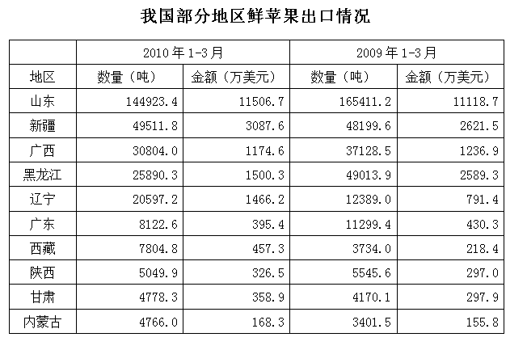

### 第 111 题

2009年1~3月我国鲜苹果出口平均单价约为每吨多少美元：

A. 520

B. 550

C. 580

D. 610

第 111 题 · 答案与解析

**参考答案（粉笔题库参考内容）**

C

**解析**

2009年1-3月我国鲜苹果出口平均单价约为，略大于万美元/吨，C项满足。

故正确答案为C。

**考点**：基期计算、综合资料

**来源**：2011年内蒙古自治区公务员录用考试《行测》题第111题

### 第 112 题

2010年1~3月，表中各省区鲜苹果出口量和出口金额与上年同期相比均下降的有几个：

A. 2

B. 3

C. 4

D. 5

第 112 题 · 答案与解析

**参考答案（粉笔题库参考内容）**

B

**解析**

观察表可知，鲜苹果出口量和出口额与上年同期相比均下降的有3个省区，分别为广西、黑龙江和广东。

故正确答案为B。

**考点**：直接找数、综合资料

**来源**：2011年内蒙古自治区公务员录用考试《行测》题第112题

### 第 113 题

2010年1~3月，我国出口欧盟的鲜苹果平均单价是出口俄罗斯的多少倍：

A. 1.5

B. 2

C. 2.5

D. 3

第 113 题 · 答案与解析

**参考答案（粉笔题库参考内容）**

A

**解析**

我国鲜苹果对俄罗斯的出口量为5.71万吨，出口额为3693万美元；对欧盟27国的出口量为3145吨，出口额为311万美元。故可得出口欧盟的鲜苹果平均单价是出口俄罗斯的倍，直除首位为1。

故正确答案为 A。

**考点**：现期倍数、综合资料

**来源**：2011年内蒙古自治区公务员录用考试《行测》题第113题

### 第 114 题

下列四个省区中，2010年1～3月鲜苹果出口平均单价低于上年同期的是：

A. 山东

B. 新疆

C. 陕西

D. 内蒙古

第 114 题 · 答案与解析

**参考答案（粉笔题库参考内容）**

D

**解析**

A选项错误，山东2010年鲜苹果出口单价为万美元/吨，2009年单价为，易知；

B选项错误，新疆2010年鲜苹果出口单价为万美元/吨，2009年单价为，两个分数量级相当，依次直除得首位6、5，故；

C选项错误，陕西2010年鲜苹果出口单价为万美元/吨，2009年单价为，易知；

D选项正确，内蒙古2010年鲜苹果出口单价为万美元/吨，2009年单价为两个分数量级相当，依次直除得首位3、4，故。

故正确答案为D。

**考点**：两期平均数比较、综合资料

**来源**：2011年内蒙古自治区公务员录用考试《行测》题第114题

### 第 115 题

关于2010年1~3月我国鲜苹果出口情况的表述，与资料相符合的是：

A. 山东鲜苹果的出口量和出口额均占全国一半以上

B. 广西鲜苹果的出口平均单价超过全国平均水平

C. 平均每个欧盟国家自中国进口的鲜苹果价值不超过10万美元

D. 西藏鲜苹果出口量的同比增量高于甘肃

第 115 题 · 答案与解析

**参考答案（粉笔题库参考内容）**

D

**解析**

A选项错误，山东鲜苹果出口量占全国的144923.4÷312000＜0.5，出口额占全国的11506.7÷21000＞0.5，山东鲜苹果的出口量未占到全国一半以上；

B选项错误，广西鲜苹果出口单价为11746000÷30804.0≈1180÷3≈393美元/吨，广西鲜苹果的出口平均单价小于全国平均水平679美元/吨；

C选项错误，平均每个欧盟国家自中国进口的鲜苹果价值311÷27＞10万美元；

D选项正确：西藏鲜苹果出口量的同比增量为：7804.8-3734.0=4070.8；甘肃鲜苹果出口量的同比增量为：4778.3-4170.1=608.2，显然4070.8＞608.2，西藏鲜苹果出口量的同比增量高于甘肃。

故正确答案为D。

**考点**：综合分析、综合资料

**来源**：2011年内蒙古自治区公务员录用考试《行测》题第115题

## 材料 3

三、根据以下资料，完成各题。

        2010年上半年，我国移动互联网市场用户数规模达2.14亿人，市场收入规模达237亿元，其中通道费（移动流量费）占整体市场的59.1%，达140亿元，其余为各项服务收入。

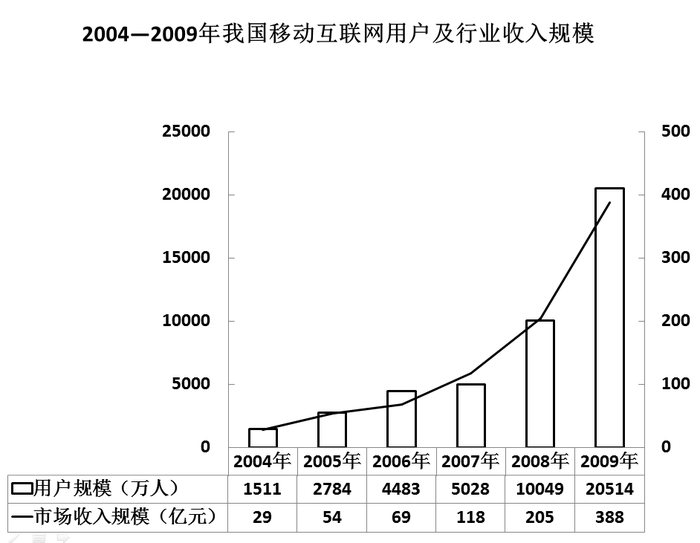

2010年上半年我国移动互联网市场服务收入构成

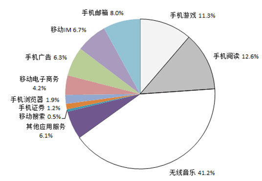

### 第 116 题

我国移动互联网市场收入同比增长率最低的年份是：

A. 2005年

B. 2006年

C. 2007年

D. 2008年

第 116 题 · 答案与解析

**参考答案（粉笔题库参考内容）**

B

**解析**

2004年至2008年的市场收入分别为：29、54、69、118、205亿元，分别增长：25、15、49、87亿元，可以看出05年、07年、08年分别增长近一倍，06年增长尚不足一半。所以可得出增长率最低的年份是2006年。

故正确答案为B。

**考点**：一般增长率、综合资料

**来源**：2011年内蒙古自治区公务员录用考试《行测》题第116题

### 第 117 题

2010年上半年我国移动互联网市场的各项服务收入中，最多的约为多少亿元：

A. 37

B. 40

C. 97

D. 140

第 117 题 · 答案与解析

**参考答案（粉笔题库参考内容）**

B

**解析**

2010年上半年除通道费外，其余各项服务收入之和为237－140＝97亿元，其中无线音乐份额最大，约为97×41%≈100×0.4＝40亿元。

故正确答案为B。

**考点**：现期比重、综合资料

**来源**：2011年内蒙古自治区公务员录用考试《行测》题第117题

### 第 118 题

2006-2009年间，哪一年平均每个移动互联网用户为市场带来的收入最高：

A. 2006年

B. 2007年

C. 2008年

D. 2009年

第 118 题 · 答案与解析

**参考答案（粉笔题库参考内容）**

B

**解析**

2006—2009年每个移动互联网用户为市场带来的收入依次为、、、亿元/万人。相当于比较

、、、的大小，显然的数值最大。因此2007年每个移动互联网用户为市场带来的收入最高。

故正确答案为B。

**考点**：现期平均数、综合资料

**来源**：2011年内蒙古自治区公务员录用考试《行测》题第118题

### 第 119 题

2005—2009年间，我国移动互联网市场用户规模实现同比翻一番的年份有几个：

A. 1

B. 2

C. 3

D. 4

第 119 题 · 答案与解析

**参考答案（粉笔题库参考内容）**

A

**解析**

观察资料可知，用户数翻番的年份只有2009年。

故正确答案为A。

**考点**：现期倍数、综合资料

**来源**：2011年内蒙古自治区公务员录用考试《行测》题第119题

### 第 120 题

下列说法与资料相符的是：

A. 2010年上半年我国移动互联网用户人均为市场带来的收入不足100元

B. 2005-2009年间，我国移动互联网市场收入同比增长率逐年上升

C. 2010年上半年的手机阅读市场收入超过手机浏览器市场收入的6倍

D. 各项移动互联网市场服务中，2010上半年收入相差最少的是手机广告和移动IM

第 120 题 · 答案与解析

**参考答案（粉笔题库参考内容）**

C

**解析**

A选项错误，移动互联网用户人均为市场带来的收入为元/人；

B选项错误，观察表格可知，2004年至2005年的增长率为，2005年至2006年的增长率为，故2006年的增长率同比下降，逐年上升不对；

C选项正确，手机阅读占移动互联网市场服务收入的12.6%，手机浏览器占1.9%，倍数为倍，所以手机阅读超过移动互联网收入的6倍；（注意：超过某某的n倍，就是大于n倍即可，不需要减1倍）

D选项错误，正确观察饼状图，手机广告占移动互联网市场收入的6.3%，移动IM占6.7%，其它应用服务占6.1%，所以差额最小的是手机广告和其他应用服务。

故正确答案为C。

**考点**：综合分析、综合资料

**来源**：2011年内蒙古自治区公务员录用考试《行测》题第120题

