# 2014年412联考《行测》题（内蒙古卷）

<!-- gwy:overview:start -->
> **内蒙古 · 2014 · 行测 · 统考** ｜ 120 题 · 图片 84 处 · 答案随题折叠

| 题型模块 | 题量 | 题号 |
| --- | ---: | ---: |
| 常识判断 | 20 | 1–20 |
| 言语理解与表达 | 26 | 21–46 |
| 数量关系 | 15 | 47–61 |
| 判断推理 | 44 | 62–105 |
| 资料分析 | 15 | 106–120 |
| **合计** | **120** | |

导航：[题型与作答说明](#题型与作答说明) · [题目](#题目) · [材料 1](#材料-1)
<!-- gwy:overview:end -->

> 候选采集稿。参考答案及解析来自粉笔页面，不代表官方答案或真实高分答卷；来源使用许可与原卷对应关系仍需人工核实。

## 题型与作答说明

常识判断

（20题）

根据题目要求，在四个选项中选出一个最恰当的答案。

言语理解与表达

（26题）

本部分包含表达与理解两方面的内容，请根据题目要求，在四个选项中选出一个最恰当的答案

数量关系

（15题）

在这部分试题中，每道题呈现一段表现数字关系的文字，要求你迅速、准确的计算出答案。

判断推理

（44题）

本部分包含图形推理、定义判断、类比推理和逻辑判断四个部分，根据要求选出符合要求的一项。

资料分析

（15题）

所给出的图、表、文字或综合资料均有若干个问题要你回答，请根据材料提供的信息进行分析、比较、计算和判断处理。

## 题目

### 第 1 题

下列关于铅的说法错误的是：

A. 铅笔芯的主要成分是铅

B. 香烟中是含铅的

C. 铅在人体内日积月累，不会分解

D. 汽油中添加铅元素可以起到防爆的作用

第 1 题 · 答案与解析

**参考答案（粉笔题库参考内容）**

A

**解析**

A项错误，铅笔的笔芯是用石墨和黏土按一定比例混合制成的，其主要成分是石墨；B项正确，烟草燃烧时释放的烟雾中含有数千种已知的化学物质，绝大多数对人体有害，其主要有：尼古丁、苯并芘强致癌物、放射性物质、刺激性化合物、有害金属，烟草中含砷、汞、镉、镍、铅等有害金属；C项正确，铅进入人体除部分通过粪便、汗液排泄外其余则溶入血液阻碍血液合成导致人体贫血出现头痛、眩晕、乏力、困倦、便秘和肢体酸痛等；D项正确，汽油分为含铅和不含铅汽油，其中含铅汽油含有四乙基铅添加剂，四乙基铅可以作为抗爆剂，消除汽油燃烧时产生的爆震。

本题为选非题，故正确答案为A。

**考点**：化学常识

**来源**：2014年河南省选调生选拔考试 《行政职业能力测验》试卷（精选）第81题

### 第 2 题

关于四大文明古国及其数学成就，下列对应错误的是：

A. 古埃及：“0”的发现

B. 古印度：阿拉伯数字

C. 古巴比伦：六十进位制

D. 古中国：勾股定理

第 2 题 · 答案与解析

**参考答案（粉笔题库参考内容）**

A

**解析**

A项错误，“0”的发现是古印度的成就。B项正确，阿拉伯数字，现今国际通用数字。最初由印度人发明，后由阿拉伯人传向欧洲，之后再经欧洲人将其现代化。C项正确，六十进制是以60为基数的进位制，源于巴比伦，流传至今仍用作记录时间、角度和地理坐标。D项正确，勾股定理是余弦定理的一个特例。这个定理在中国又称为“商高定理”，在外国称为“毕达哥拉斯定理”或者“百牛定理”。但他们发现勾股定理的时间都比中国晚，中国是最早发现这一几何宝藏的国家。

本题为选非题，故正确答案为A。

**考点**：文化常识

**来源**：2014年412联考《行测》题（宁夏卷）第44题

### 第 3 题

下列关于火山的表述错误的是：

A. 喷出的物质有气态、液态和固态三种

B. 页岩是最常见的岩浆岩

C. 五大连池的形成与火山喷发有关

D. 可分为死火山、活火山和休眠火山

第 3 题 · 答案与解析

**参考答案（粉笔题库参考内容）**

B

**解析**

A项正确，火山喷出物中，气体物质主要是水蒸气，还有氢气、二氧化碳等，液态物质主要是高温岩浆，固态物质主要是火山弹、火山砂和火山灰。

B项错误，页岩是一种沉积岩，成分复杂，但都具有薄页状或薄片层状的节理，主要是由黏土沉积经压力和温度形成的岩石，但其中混杂有石英、长石的碎屑以及其他化学物质。

C项正确，五大连池火山群位于黑龙江省北部五大连池市境内，属小兴安岭西侧中段余脉。五大连池火山群因1719—1721年（清康熙五十八年至六十年）火山爆发堵塞白河而形成5个相连的堰塞湖和周围14座火山锥，故称五大连池火山群。

D项正确，火山可分为死火山、活火山和休眠火山。

本题为选非题，故正确答案为B。

**考点**：自然地理

**来源**：2014年412联考《行测》题（宁夏卷）第57题

### 第 4 题

关于海水及其运动，下列说法错误的是：

A. 海水的冰点温度比淡水低

B. 北海道渔场位于寒流与暖流的交汇处

C. 波罗的海是世界上盐度最高的海域

D. 波浪、潮汐和洋流是海水运动的主要形式

第 4 题 · 答案与解析

**参考答案（粉笔题库参考内容）**

C

**解析**

A项正确，淡水0℃结冰叫作冰点，海水冰点变化与海水盐度和密度有密切关系，因海水含有大量盐，所以海水的冰点温度比淡水低；B项正确，北海道渔场地处亚洲东部的日本北海道，位于千岛寒流与日本暖流的交汇处海域，是世界第一大渔场；C项错误，红海是世界上盐度最高的海域，红海受副高和信风带控制，形成热带沙漠气候，蒸发量大，降水稀少，终年高温；D项正确，海水运动的形式主要有三种：波浪、潮汐、洋流。

本题为选非题，故正确答案为C。

**考点**：自然地理

**来源**：2014年河南省选调生选拔考试 《行政职业能力测验》试卷（精选）第85题

### 第 5 题

下列关于石灰的说法错误的是：

A. 生石灰通常可以作为食品干燥剂

B. 澄清石灰水放置在空气中易变浑浊

C. 汉白玉与石灰石的主要成分相同

D. “烈火焚烧若等闲”指熟石灰的高温煅烧

第 5 题 · 答案与解析

**参考答案（粉笔题库参考内容）**

D

**解析**

A项正确，食品干燥剂一般无毒、无味、无接触腐蚀性、无环境污染。食品干燥剂是为了降低食品袋中的湿度，防止食品变质腐败；食品中常用的干燥剂是氧化钙（俗称生石灰，化学式是CaO）和硅胶，蒙脱石干燥剂，氯化钙干燥剂，纤维干燥剂。B项正确，二氧化碳通入澄清石灰水中变浑浊，是因为二氧化碳和澄清石灰水反应生成碳酸钙沉淀，化学方程式为：CO_2+\=CaCO_3↓+H_2O。C项正确，汉白玉主要成分是碳酸钙，它是一种化合物，化学式是CaCO_3，基本不溶于水。石灰石主要成分是碳酸钙。石灰和石灰石大量用做建筑材料，也是许多工业的重要原料。D项错误，“烈火焚烧若等闲”指烧炼石灰石，石灰石的主要成分是碳酸钙CaCO_3，而熟石灰的主要成分是氢氧化钙，二者主要成分不同。

本题为选非题，故正确答案为D。

**考点**：化学常识

**来源**：2014年河南省选调生选拔考试 《行政职业能力测验》试卷（精选）第86题

### 第 6 题

关于中国地理，下列说法错误的是：

A. 九寨沟国家地质公园以雅丹地貌闻名

B. 藏羚羊主要生活在可可西里国家级自然保护区

C. 张家界国家森林公园处于武陵山脉的腹地

D. 三江并流风景名胜区已被列入《世界遗产名录》

第 6 题 · 答案与解析

**参考答案（粉笔题库参考内容）**

A

**解析**

A项错误，九寨沟景区属于喀斯特地貌（岩溶地貌）。喀斯特发育区地下水循环通畅，九寨沟以水景最为奇丽，素有“世界水景之王”的美誉，不仅河湖水清澈，而且景色宜人；B项正确，藏羚羊，学名藏羚，是偶蹄目、牛科、藏羚属动物。藏羚羊生活在中国青藏高原（西藏、青海和新疆），有少量分布在印度拉达克地区，被称为“可可西里的骄傲”；C项正确，1982年9月25日，经中华人民共和国国务院批准，将原来的张家界林场正式命名为“张家界国家森林公园”，是中国建立的第一个国家级的森林公园，澧水中上游，属武陵山脉腹地，为中国最重要的旅游资源；D项正确，2002年10月8日至10月20日，国际自然保护联盟的专家对云南“三江并流”地区进行了实地考察。2003年6月，该联盟向联合国世界遗产委员会推荐，建议将“三江并流”按满足世界自然遗产全部四条标准列入《世界遗产名录》。2003年7月，“三江并流”自然景观被列入《世界遗产名录》。

本题为选非题，故正确答案为A。

**考点**：中国地理

**来源**：2014年河南省选调生选拔考试 《行政职业能力测验》试卷（精选）第87题

### 第 7 题

下列哪组不属于夺命“急症”：

A. 肺栓塞、哮喘

B. 冠心病、毒品过量

C. 脑出血、急性坏死性胰腺炎

D. 阑尾炎、腹膜炎

第 7 题 · 答案与解析

**参考答案（粉笔题库参考内容）**

D

**解析**

心源性疾病，特别是冠心病、急性心肌梗死患者最为多见，容易猝死，常见的夺命“急病”有：肺栓塞、脑出血、急性坏死性胰腺炎、哮喘、过敏、猝死、暴发性紫癜、过量的毒品。A、B、C三项正确。D项错误，阑尾炎是指阑尾由于多种因素而形成的炎性改变，为外科常见病；腹膜炎是由细菌感染、化学刺激或损伤所引起的外科常见的一种严重疾病，如未能及时治疗，可死于中毒性休克。腹膜炎属于夺命急症而阑尾炎不是，故D项表述错误。

本题为选非题，故正确答案为D。

**考点**：生物常识

**来源**：2014年河南省选调生选拔考试 《行政职业能力测验》试卷（精选）第88题

### 第 8 题

下列哪组物品均属可燃固体？

A. 香蕉水、酒精

B. 面粉、油漆

C. 沥青、松香

D. 甲烷、乙炔

第 8 题 · 答案与解析

**参考答案（粉笔题库参考内容）**

C

**解析**

本题考查常识判断中化学常识，主要考查物体的性质等有关知识点，需要结合题干材料分析。

A项错误，香蕉水是由多种有机溶剂配制而成的无色透明易挥发的液体，微溶于水，能溶于各种有机溶剂，易燃，但不是固体；酒精又称乙醇，是一种有机物，是一种易燃、易挥发的无色透明液体，不是固体。

B项错误，面粉是一种易燃易爆的粉状物，当面粉颗粒在空气中达到一定浓度时，遇到明火会爆炸；油漆为粘稠油性颜料，未干情况下易燃，不溶于水，微溶于脂肪。

C项正确，沥青是一种有毒的易燃物，沥青有固体的，粘稠状的，还有液体状的，一般认作可融化固体；松香是易燃物，呈固体状，透明，颜色为淡黄色或棕色。二者均为可燃固体。

D项错误，甲烷是最简单的有机物，是天然气，沼气，坑气等的主要成分，俗称瓦斯，在标准状态下甲烷是一无色无味的易燃气体；乙炔在室温下是一种无色、极易燃的气体。

故正确答案为C。

**考点**：化学常识

**来源**：2015年深圳市公务员录用考试《行测》题第11题

### 第 9 题

下列哪项不在中国地形的第二级阶梯上？

A. 秦岭

B. 呼伦贝尔高原

C. 鄂尔多斯高原

D. 巴颜喀拉山

第 9 题 · 答案与解析

**参考答案（粉笔题库参考内容）**

D

**解析**

第一级阶梯：在我国西南部的青藏高原，平均海拔在4000米以上，主要有昆仑山、巴颜喀拉山、横断山脉；第二级阶梯：在青藏高原边缘以东和以北，是一系列宽广的高原和巨大的盆地，海拔下降到1000~2000米，主要有阿尔泰山、天山、鄂尔多斯高原、阴山、呼伦贝尔高原、秦岭山脉、大兴安岭、太行山、巫山、雪峰山；第三级阶梯：在我国东部主要有丘陵和平原分布区，大部分地区海拔在500米以下，主要有长白山、大别山、武夷山、南岭、台湾山脉。

本题为选非题，故正确答案为D。

**考点**：中国地理

**来源**：2014年河南省选调生选拔考试 《行政职业能力测验》试卷（精选）第89题

### 第 10 题

关于矿产资源及其主要分布国，下列对应错误的是：

A. 硝石：加拿大

B. 磷矿：摩洛哥

C. 铜矿：智利、秘鲁

D. 金矿：南非

第 10 题 · 答案与解析

**参考答案（粉笔题库参考内容）**

A

**解析**

A项错误，加拿大的矿产有60余种，主要有钾、铀、钨、镉、镍、铅等。原油储量仅次于委内瑞拉和沙特居世界第三，其中97%以油砂形式存在。智利是世界上唯一生产天然硝石的国家。

B项正确，美国佛罗里达磷矿和摩洛哥磷矿是世界著名的磷矿生产基地。

C项正确，智利、澳大利亚、秘鲁、俄罗斯、墨西哥和美国的铜矿储量合计占全球总储量的62%，属于全球铜储量的第一梯队；印尼、中国、哈萨克斯坦、刚果（金）和赞比亚属于铜储量的第二梯队，在全球总储量中的占比在2-4%之间。

D项正确，南非是世界五大矿产资源国之一。现已探明储量并开采的矿产有70余种。铂族金属、氟石、铬的储量居世界第一位，黄金、钒、锰、锆居第二位。

本题为选非题，故正确答案为A。

**考点**：世界地理

**来源**：2014年412联考《行测》题（贵州卷）第8题

### 第 11 题

关于农作物，下列说法正确的是：

A. 中国是最早栽培大豆的国家

B. 玉米是通过丝绸之路传入中国的

C. 花生是世界上最主要的油料作物

D. 泰国是世界上最大的稻米出口国

第 11 题 · 答案与解析

**参考答案（粉笔题库参考内容）**

A

**解析**

A项正确，大豆起源于中国，中国学者大多认为原产地是云贵高原一带。我国是最早种植大豆的国家，也是最早利用大豆制成豆腐制品的国家；B项错误，玉米是在1492年哥伦布发现美洲以后，才传到旧大陆各国的，不是通过丝绸之路传入中国的；C项错误，受人口的增长和市场对植物油需求量不断增加的影响，世界油料作物快速发展。目前大豆生产量占世界油料总生产量的一半以上，是最主要的油料作物；D项错误，虽然在过去两、三年时间里，泰国大米出口受到多重不利因素的影响，导致2012、2013年连续两年失去世界第一大米出口国的宝座，落在印度和越南之后，并造成泰国大米库存量居高不下。但表达过于绝对，属于半正确选项，而A项大豆是客观描述，正确。

故正确答案为A。

**考点**：生物常识

**来源**：2014年河南省选调生选拔考试 《行政职业能力测验》试卷（精选）第90题

### 第 12 题

关于下列各组人物说法错误的是：

A. 苏格拉底、柏拉图和亚里士多德被称为“古希腊三贤”

B. 颜回、曾子都属孔子七十二门徒

C. 荀子及其弟子韩非子是法家学派的代表人物

D. 康有为、梁启超都是“公车上书”的发起人

第 12 题 · 答案与解析

**参考答案（粉笔题库参考内容）**

C

**解析**

A项正确，“古希腊三贤”即苏格拉底、柏拉图、亚里士多德，苏格拉底是柏拉图的老师，柏拉图是亚里士多德的老师；B项正确，颜回、曾子都属孔子七十二门徒；C项错误，荀子是儒家的代表人物；D项正确，公车上书，是指清光绪二十一年（1895年），数千名举人联名上书光绪帝爱新觉罗·载湉，反对在甲午战争中败于日本的清政府签订丧权辱国的《马关条约》的事件。康有为、梁启超都是“公车上书”的发起人，“公车上书”被认为是维新派登上历史舞台的标志，也被认为是中国群众政治运动的开端。

本题为选非题，故正确答案为C。

**考点**：中国历史

**来源**：2014年河南省选调生选拔考试 《行政职业能力测验》试卷（精选）第91题

### 第 13 题

下列体育人物与其擅长领域对应错误的是：

A. 罗尼·奥沙利文：斯诺克台球

B. 拉菲尔·纳达尔：棒球

C. 罗杰·费德勒：网球

D. 泰格·伍兹：高尔夫

第 13 题 · 答案与解析

**参考答案（粉笔题库参考内容）**

B

**解析**

A项正确，罗尼·奥沙利文，世界著名斯诺克球手，以左右开弓和独特的杆法著称，绰号“The Rocket”（火箭）；B项错误，拉菲尔·纳达尔是西班牙职业网球运动员，是“金满贯”得主，并且是“体育界的奥斯卡”——劳伦斯奖最佳男运动员获得者；C项正确，罗杰·费德勒是瑞士男子职业网球运动员，多次获得大满贯男子单打冠军。2012年上海大师赛结束后，费德勒在ATP世界第一的总周数达到了300周，是公开赛时代以来第一位在世界第一总周数达到300周的男子单打球员；D项正确，艾德瑞克·泰格·伍兹是美国高尔夫球手，截至2009年世界排名首位，并被公认为是史上最成功的高尔夫球手之一。

本题为选非题，故正确答案为B。

**考点**：生活常识

**来源**：2014年河南省选调生选拔考试 《行政职业能力测验》试卷（精选）第92题

### 第 14 题

关于亚洲政坛女性首脑，下列说法错误的是：

A. 科拉松·阿基诺夫人是亚洲首位女总统

B. 阿罗约曾任菲律宾总统之职

C. 朴槿惠的父亲曾任韩国总统

D. 英拉·西那瓦是马来西亚总理

第 14 题 · 答案与解析

**参考答案（粉笔题库参考内容）**

D

**解析**

A项正确，科拉松·阿基诺（1933——2009）全名玛莉亚·科拉松·柯莉·柯峻科·阿基诺，菲律宾第11任总统，亦是菲律宾及亚洲首位女总统，于1986年至1992年在位。祖籍中国福建省漳州台商投资区角美镇鸿渐村。B项正确，格洛丽亚·马卡帕加尔·阿罗约1947年4月5日生于菲律宾班诗兰省，是菲律宾第14、15任总统，也是菲律宾第二位女总统。C项正确，朴槿惠的父亲朴正熙，号中树，韩国庆尚北道人，1917年11月生。他亦曾经用过“冈本实”和“高木正雄”这两个日本名。他是韩国第3任、第5至第9届总统。D项错误，英拉·西那瓦，泰国前总理，著名企业家，2011年8月5日，在第24届国会下议院第二次会议上当选为泰国第28位总理，成为泰国历史上首位女性政府首脑。

本题为选非题，故正确答案为D。

**来源**：2014年河南省选调生选拔考试 《行政职业能力测验》试卷（精选）第93题

### 第 15 题

关于我国公务员制度，下列叙述正确的是：

A. 正在接受纪律审查的公务员不得辞去公职

B. 我国公务员培训基地是党校

C. 公务员对降职不服，可以向人民法院提出申诉

D. 公务员考核的基本内容包括德、能、勤、绩、才

第 15 题 · 答案与解析

**参考答案（粉笔题库参考内容）**

A

**解析**

本题考查行政法。

A项正确，《公务员法》第八十六条规定：“公务员有下列情形之一的，不得辞去公职： （一）未满国家规定的最低服务年限的；（二）在涉及国家秘密等特殊职位任职或者离开上述职位不满国家规定的脱密期限的；（三）重要公务尚未处理完毕，且须由本人继续处理的； （四）正在接受审计、纪律审查、监察调查，或者涉嫌犯罪，司法程序尚未终结的：（五）法律、行政法规规定的其他不得辞去公职的情形。”

B项错误，党校是中国共产党对党员和党员干部进行培训、教育的学校，并不是公务员培训基地。

C项错误，《公务员法》第九十五条第一款规定：“公务员对涉及本人的下列人事处理不服的，可以自知道该人事处理之日起三十日内向原处理机关申请复核；对复核结果不服的，可以自接到复核决定之日起十五日内，按照规定向同级公务员主管部门或者作出该人事处理的机关的上一级机关提出申诉；也可以不经复核，自知道该人事处理之日起三十日内直接提出申诉： （一）处分； （二）辞退或者取消录用； （三）降职； （四）定期考核定为不称职； （五）免职； （六）申请辞职、提前退休未予批准； （七）不按照规定确定或者扣减工资、福利、保险待遇； （八）法律、法规规定可以申诉的其他情形。”

D项错误，《公务员法》第三十五条规定：“公务员的考核应当按照管理权限，全面考核公务员的德、能、勤、绩、廉，重点考核政治素质和工作实绩。考核指标根据不同职位类别、不同层级机关分别设置。 ”

故正确答案为A。

**来源**：2014年河南省选调生选拔考试 《行政职业能力测验》试卷（精选）第95题

### 第 16 题

下列思想流派与产生时代对应错误的是：

A. 心学——明代

B. 玄学——魏晋

C. 理学——宋代

D. 儒学——汉代

第 16 题 · 答案与解析

**参考答案（粉笔题库参考内容）**

D

**解析**

A项正确，“陆王心学”是由儒家学者陆九渊、王阳明发展出来的心学的简称，或直接称“心学”；或有专门称为某哲学家的心学，如王守仁的“阳明心学”。至明朝，由王守仁首度提出“心学”两字，并提出心学的宗旨在于“致良知”，至此心学开始有清晰而独立的学术脉络；B项正确，玄学又称新道家，是对《老子》《庄子》《周易》的研究和解说，产生于魏晋，是魏晋时期的主要哲学思潮，是道家和儒家融合而出现的一种哲学、文化思潮；C项正确，古代的理学是指宋朝以后的新儒学，又称道学；D项错误，儒家学说，亦称儒学，起源于春秋时期，和“道家”“墨家”“法家”“阴阳家”等组成诸子百家，汉武帝时期起，成为中国社会的正统思想，如果从孔子算起，绵延至今已有两千五百余年的历史了。

本题为选非题，故正确答案为D。

**考点**：文化常识

**来源**：2014年河南省选调生选拔考试 《行政职业能力测验》试卷（精选）第96题

### 第 17 题

关于政治思想，下列表述错误的是：

A. 孟德斯鸠提出三权分立学说

B. 伏尔泰最早提出社会契约论的思想

C. 柏拉图主张建立哲学王统治的国家

D. 让·布丹提出君主主权学说

第 17 题 · 答案与解析

**参考答案（粉笔题库参考内容）**

B

**解析**

A项正确，“三权分立”最早出自法国思想家孟德斯鸠所著的《论法的精神》，主张立法、行政和司法三种国家权力分别由不同机关掌握，各自独立行使、相互制约制衡；B项错误，启蒙运动早期英国政治家、哲学家霍布斯在《利维坦》（英国1651年出版）中最早提出社会契约论，书中他以“社会契约论”为根据，反君权神授，说明了国家的起源，即国家通过社会契约创造；C项正确，在西方，古希腊思想家柏拉图曾提出哲人治国论，主张建立哲学王统治，这也属于人治的一种政治思想；D项正确，让·布丹认为：主权是国家的主要标志，是对公民和臣民的不受法律限制的最高权力。主权是指对内具有至高无上的权力，对外具有独立平等的权力。君主制度最优越，是实现国家统一主权的最好组织形式。

本题为选非题，故正确答案为B。

**来源**：2014年河南省选调生选拔考试 《行政职业能力测验》试卷（精选）第97题

### 第 18 题

关于存款保险制度，下列说法错误的是：

A. 存款保险制度起始于20世纪30年代大萧条之后的美国

B. 存款保险制度有利于保护存款人的利益，提高公众对银行体系的信心

C. 存款保险由存款人向存款保险公司投保

D. 存款保险通常只赔偿存款人因银行倒闭而遭受的部分损失

第 18 题 · 答案与解析

**参考答案（粉笔题库参考内容）**

C

**解析**

A项正确，现代意义上的存款保险制度起始于1934年美国建立的联邦存款保险制度，经过近80年的发展，全球已有100多个国家和地区建立了这一制度。

B项正确，存款保险制度的实施并推广，有利于增强中小银行信用，有效提高公众信心，从而降低挤兑风险、维护金融稳定，也是国家金融安全网的基本组成要素。

C项错误，存款保险制度是一种金融保障制度，是指由符合条件的各类存款性金融机构集中起来建立一个保险机构，各存款机构作为投保人按一定存款比例向其缴纳保险费，建立存款保险准备金，当成员机构发生经营危机或面临破产倒闭时，存款保险机构向其提供财务救助或直接向存款人支付部分或全部存款，从而保护存款人利益，维护银行信用，稳定金融秩序的一种制度。

D项正确，如果建立了存款保险制度，当实行该制度的银行资金周转不灵或破产倒闭而不能支付存款人的存款时，按照保险合同条款，投保银行可从存款保险机构那里获取赔偿或取得资金援助，或被接收、兼并，存款保险通常只赔偿存款人因银行倒闭而遭受的部分损失。这样，存款人的存款损失就会降低到尽可能小的程度，有效保护了存款人的利益。

本题为选非题，故正确答案为C。

**考点**：市场经济

**来源**：2014年河南省选调生选拔考试 《行政职业能力测验》试卷（精选）第83题

### 第 19 题

关于我国的农民工现象，下列说法错误的是：

A. 农民工是我国特有的城乡二元体制的产物

B. 近年来跨省流动农民工所占比重继续下降

C. 从输出地看，中部地区输出农民工最多，西部次之，东部最少

D. “新生代农民工”主要指80后、90后，目前在农民工群体中占一半以上

第 19 题 · 答案与解析

**参考答案（粉笔题库参考内容）**

C

**解析**

A项正确，农民工，是指在本地乡镇企业或者进入城镇务工的农业户口人员，农民工是我国特有的城乡二元体制的产物，是我国在特殊的历史时期出现的一个特殊的社会群体。

B项正确，在外出农民工中，在省内流动的农民工8689万人，比上年增加299万人，增长3.6%，占外出农民工总量的53.2%；跨省流动的农民工7647万人，比上年增加174万人，增长2.3%，占外出农民工总量的46.8%，在省外务工的比重比上年下降0.3个百分点。

C项错误，根据国家统计局《2012年全国农民工监测调查报告》，从输出地看，东部地区农民工11191万人，比上年增加401万人，增长3.7%，东部地区农民工占农民工总量的42.6%；中部地区农民工8256万人，比上年增加314万人，增长4.0%，中部地区农民工占农民工总量的31.4%；西部地区农民工6814万人，比上年增加268万人，增长4.1%，西部地区农民工占农民工总量的26.0%。东部地区输出农民工最多，中部次之，西部最少。

D项正确，农民工内部出现了代际更替，1980年之后出生的外出农民工，通常被称为“新生代农民工”。为了全面和准确地掌握新生代农民工的状况，2010年国家统计局在10个省进行了新生代农民工专项调查，调查结果表明，新生代农民工总人数为8487万，占全部外出农民工总数的58.4%，已经成为外出农民工的主体。

本题为选非题，故正确答案为C。

**考点**：中国地理

**来源**：2014年河南省选调生选拔考试 《行政职业能力测验》试卷（精选）第98题

### 第 20 题

根据民事诉讼法的规定，下列说法错误的是：

A. 人民法院调解和好的离婚案件，可以不制作调解书

B. 民事诉讼法中规定了“公益诉讼”的内容

C. 人民法院可以根据实际情况，决定采取传真的方式送达判决书

D. 民事诉讼法规定，当事人所在社区可以推荐公民作为诉讼代理人

第 20 题 · 答案与解析

**参考答案（粉笔题库参考内容）**

C

**解析**

A项正确，我国《民事诉讼法》第九十八条规定：“下列案件调解达成协议，人民法院可以不制作调解书：（一）调解和好的离婚案件；（二）调解维持收养关系的案件；（三）能够即时履行的案件；（四）其他不需要制作调解书的案件。对不需要制作调解书的协议，应当记入笔录，由双方当事人、审判人员、书记员签名或者盖章后，即具有法律效力。”

B项正确，《民事诉讼法》第五十五条规定:“对污染环境、侵害众多消费者合法权益等损害社会公共利益的行为，法律规定的机关和有关组织可以向人民法院提起诉讼。人民检察院在履行职责中发现破坏生态环境和资源保护、食品药品安全领域侵害众多消费者合法权益等损害社会公共利益的行为，在没有前款规定的机关和组织或者前款规定的机关和组织不提起诉讼的情况下，可以向人民法院提起诉讼。前款规定的机关或者组织提起诉讼的，人民检察院可以支持起诉。”上述法条规定了公益诉讼的内容。

C项错误，电子送达经受送达人同意，法院可以采用传真、电子邮件等能够确认其收悉的方式送达诉讼文书，但是，判决书、裁定书、调解书除外。传真、电子邮件等到达受送达人特定系统日期为送达日期。

D项正确，《民事诉讼法》第五十八条规定：“当事人、法定代理人可以委托一至二人作为诉讼代理人。下列人员可以被委托为诉讼代理人：（一）律师、基层法律服务工作者；（二）当事人的近亲属或者工作人员；（三）当事人所在社区、单位以及有关社会团体推荐的公民。”

本题为选非题，故正确答案为C。

**考点**：诉讼法

**来源**：2014年河南省选调生选拔考试 《行政职业能力测验》试卷（精选）第99题

### 第 21 题

预循环是一种更环保的生活方式，指通过＿＿＿＿＿＿购入会产生垃圾的家庭或商业物品来减少垃圾数量的行为。可循环的垃圾经过处理后可以＿＿＿＿＿＿＿＿别的功效，可是处理这些可循环物质也是要消耗能源并产生垃圾的，所以更加环保的方式是尽量少用会产生垃圾的物品。

依次填入画横线部分最恰当的一项是：

A. 避免 发挥

B. 杜绝 具备

C. 放弃 衍生

D. 禁止 实现

第 21 题 · 答案与解析

**参考答案（粉笔题库参考内容）**

A

**解析**

第一空，根据“减少垃圾数量的行为”以及“尽量少用会产生垃圾的物品”可知，横线处需体现“减少”的语义。A项“避免”指设法不使某种情形发生，符合文意，保留。B项“杜绝”指彻底制止；C项“放弃”指丢掉（权利、主张、意见等）；D项“禁止”指不许可，文段强调预循环是通过某种方式“减少垃圾数量”，并非完全不让产生垃圾，B、C、D 三项均语义过重，排除。

第二空，代入验证。A项“发挥”和“功效”搭配恰当，当选。

故正确答案为A。

**考点**：实词填空、词的辨析-搭配对象、词的辨析-程度轻重

**来源**：2014年河南省选调生选拔考试 《行政职业能力测验》试卷（精选）第2题

### 第 22 题

在环境问题上，我们所面临的困境不是由于我们＿＿＿＿＿＿，而是我们尽力了，但却无法遏制环境恶化的势头，这是一个信号：把魔鬼从瓶子里放出来的人类，已经失去把魔鬼再装回去的能力。

填入画横线部分最恰当的一项是：

A. 无所顾忌

B. 无所不为

C. 无所事事

D. 无所作为

第 22 题 · 答案与解析

**参考答案（粉笔题库参考内容）**

D

**解析**

根据反义并列标志词“不是······而是······”可知，横线处所填词语与后文语意相反，后文提到“我们尽力了”，故横线处应表达“我们什么都没有做”的意思，D项“无所作为”指没有做出任何成绩，填入文段语意合适，当选。

A项“无所顾忌”指没有什么顾虑、畏惧，B项“无所不为”指没有什么事不做，即什么事都干得出来，C项“无所事事”是说没有什么事可做，指闲着什么事也不干，填入文段语意均不合适，排除。

故正确答案为D。

**考点**：关联关系-并列关系、成语填空

**来源**：2014年河南省选调生选拔考试 《行政职业能力测验》试卷（精选）第1题

### 第 23 题

在美国这样的商业社会里，无论他们抛出了多少关乎人文、情怀、精神的辞藻，几乎所有艺术与技术，＿＿＿＿＿＿＿都是一门生意，即便是教主乔布斯和他的苹果也不例外。但这本身无可指摘，也不＿＿＿＿＿＿ 这些公司和这些人缔造一个伟大的时代。

依次填入画横线部分最恰当的一项是：

A. 自始至终 影响

B. 归根结底 妨碍

C. 毋庸讳言 干扰

D. 理所当然 排斥

第 23 题 · 答案与解析

**参考答案（粉笔题库参考内容）**

B

**解析**

第一空，根据文段中的表述“无论他们抛出了多少关乎人文、情怀、精神的辞藻”中的“辞藻”一般是指非常华丽的、表面的东西，即“人文、情怀、精神”都是艺术与技术的表象，那么文段的意思即为“在本质”方面，艺术和技术是一门生意，与前一句话构成了相对的意思。B项，“归根结底”指归结到根本上。此项符合语境。

第二空做验证，“不妨碍这些公司……时代”，意思合理。

故正确答案为B。

【成语积累】

毋庸讳言：指没有什么不可以直说。

理所当然：指按道理应当这样。

自始至终：指从开始到末了，表示一贯到底。

**考点**：对应关系-前后呼应、混搭填空

**来源**：2014年412联考《行测》题（宁夏卷）第14题

### 第 24 题

从20世纪末开始的十几年间，中国大学招生数激增了五六倍，为制造业和高科技行业提供了\_\_\_\_\_的劳动力，但增长速度过快，远超过普通或无技能劳动力的增速，导致就业市场配置错位。

填入画横线部分最恰当的一项是：

A. 源源不断

B. 应有尽有

C. 形形色色

D. 数不胜数

第 24 题 · 答案与解析

**参考答案（粉笔题库参考内容）**

A

**解析**

搭配“劳动力”，且根据前文“激增了五六倍”可知，劳动力数量是很多的，A项“源源不断”形容接连不断，搭配恰当，且对应前文“十几年间”体现一个接连的过程，符合文意，当选。B项“应有尽有”指该有的全都有，形容很齐全；C项“形形色色”形容事物种类繁多，各式各样，文段仅针对“制造业和高科技行业”，并非所有行业，与文意不符，均排除；D项“数不胜数”形容数量极多，很难计算，程度过重，排除。

故正确答案为A。

**考点**：对应关系-前后呼应、成语填空

**来源**：2014年412联考《行测》题（宁夏卷）第15题

### 第 25 题

现在，很多保健品的广告做得很好，但消费者并不知道自己有没有必要买这些东西，其实很多保健品在研究时并未做过\_\_\_\_\_\_\_调查，并不知道哪些营养素是大家普遍缺乏的。服用未经这样的调查就开发出的保健品，对消费者来说完全是一种\_\_\_\_\_\_\_。

依次填入画横线部分最恰当的一项是：

A. 实地 伤害

B. 科学 浪费

C. 跟踪 欺骗

D. 严格 误导

第 25 题 · 答案与解析

**参考答案（粉笔题库参考内容）**

B

**解析**

第一空，文段的意思是说，在保健品“研发时”做的调查不够认真仔细，不知道哪种营养素大家缺乏，B项“科学”、D项“严格”均符合文意，保留。A项“实地”指在事情发生或出现的地方，文段并没有体现要在现场，排除；C项“跟踪”，“跟踪”调查一般指的是售后的调查，做反馈，而文段是研发的时候，不符合语境，排除。

第二空，根据文段最后一句话，“服用······”可知，横线处是形容消费者服用这些保健品的行为，且呼应前文提到的消费者不知道自己“有没有必要”买这些东西，“没必要”吃却吃了这些保健品，即“浪费”，B项符合文意，当选。D项“误导” 指错误引导，文段搭配的是消费者的自身行为，而非广告的作用，排除。

故正确答案为B。

**考点**：实词填空、对应关系-前后呼应、词的辨析-词义侧重

**来源**：2014年河南省选调生选拔考试 《行政职业能力测验》试卷（精选）第6题

### 第 26 题

2007年全球金融海啸肆虐。以家电为代表的消费性电子产品外销的需求急速衰退，家电企业可谓＿＿＿＿＿＿。为了扩大国内市场，也为了让国内家电企业走出低谷，家电下乡、以旧换新、节能补贴等政策陆续出台，这些扶持性政策＿＿＿＿＿＿，对家电业的发展产生了巨大推动作用。

依次填入画横线部分最恰当的一项是：

A. 如履薄冰 有的放矢

B. 今非昔比 有目共睹

C. 举步维艰 不负众望

D. 江河日下 任重道远

第 26 题 · 答案与解析

**参考答案（粉笔题库参考内容）**

C

**解析**

第一空，根据文意，金融海啸造成了家电产品外销衰退，且对应下文“为了让国内家电企业走出低谷”，故横线处所填成语需体现家电企业处于低谷、困境、处境艰难之意。C项“举步维艰”指迈步艰难，比喻办事情每向前进行一步都十分不容易，D项“江河日下”比喻情况一天天地坏下去，均可体现家电企业经营艰难的现状，符合文意，保留。A项“如履薄冰”比喻行事极为谨慎，存有戒心，与文段强调的家电企业经营困境无关，排除；B项“今非昔比”指现在不是过去能比得上的，多指形势、自然面貌等发生了巨大的变化，文段中并未进行现在与过去的比较，且不能表达家电企业现在处境困难之意，排除。

第二空，根据“对家电业的发展产生了巨大推动作用”可知，所填成语应该形容“扶持性政策”有作用。C项“不负众望”指不辜负大家的期望，符合文意，当选。D项“任重道远”比喻责任重大，要经历长期的奋斗，强调目标远未达成，与“产生了巨大推动作用”对应不当，排除。

故正确答案为C。

**考点**：对应关系-前后呼应、对应关系-解释说明、成语填空

**来源**：2014年河南省选调生选拔考试 《行政职业能力测验》试卷（精选）第7题

### 第 27 题

你肯定听过这种理论：左撇子的右脑运作比较活跃，因此更为感性，具有艺术天赋；右撇子则充分锻炼了左脑，因而擅长逻辑思维，性格更加理性。这个观念是如此深入人心，以至于有些父母或教育者煞费苦心地让孩子平衡左右手活动。

接下来作者最有可能谈论的是：

A. 左右脑为何存在分工

B. 左右脑如何协调工作

C. 左右脑分工不同的例子

D. 左右脑未必存在明确分工

第 27 题 · 答案与解析

**参考答案（粉笔题库参考内容）**

D

**解析**

根据提问方式可知，本题为接语选择题，应在通读全文的基础上，重点关注文段最后论述的核心话题。文段首先介绍了一种关于左撇子和右撇子因左右脑运作不同而具有不同优势的观点，随后指出很多人对该观点深信不疑，以至于有些父母或教育者煞费苦心地让孩子平衡左右手活动。由文段尾句中“如此的”“以至于”“煞费苦心”，可以看出作者对左右脑存在明确分工这一理论存在异议，故接下来应围绕“左右脑未必存在明确分工”展开论述，对应D项。

A项“左右脑为何存在分工”、B项“左右脑如何协调工作”、C项“左右脑分工不同的例子”均肯定了前文引用的理论所表达的意思，和作者的对于该理论的态度相反，排除。

故正确答案为D。

**考点**：接语选择题

**来源**：2014年河南省选调生选拔考试 《行政职业能力测验》试卷（精选）第34题

### 第 28 题

最新研究显示，所谓“好胆固醇”也许并非真的那么好。研究引用大量基因资料，发现俗称“好胆固醇”的高密度蛋白胆固醇（HDL）水平即使升高，对降低心脏病风险也不一定有帮助；与此同时，因遗传因素而有较高HDL水平的人士患心脏病的风险并不低于天生HDL水平较低的人士。如果HDL真的有助于降低心脏病风险，前者患心脏病的机会应该较低。没有参与研究的学者对相关结果感到不安。

下列哪项最适合做这段文字的标题？

A. 遗传因素与心脏病

B. 心脏病研究的新发现

C. “好胆固醇”或并不存在

D. 胆固醇对心脏病的影响

第 28 题 · 答案与解析

**参考答案（粉笔题库参考内容）**

C

**解析**

文段围绕“好胆固醇”展开，通过举例说明了所谓的“好胆固醇”对心脏病的效果几乎没有。也就是说，好胆固醇也许并不好，C项的描述最为贴切。A、B、D三项均未体现文段的重点概念“好胆固醇”，故排除。

故正确答案为C。

**考点**：标题填入题

**来源**：2014年412联考《行测》题（宁夏卷）第34题

### 第 29 题

“苍蝇妈妈”是对那些过分关注孩子的家长的称谓，这类家长试图时刻走在孩子前面，提前为他们扫清障碍。美国华盛顿大学的一项相关研究显示，过分关照孩子的父母会妨碍儿童个人能力和独立意识的发展；无微不至的照料会降低儿童的幸福感，并令他们长大后难以正确对待压力。受到父母过度照料的儿童，长大以后会经常意志消沉，对生活不满，精神焦虑。为了孩子的身心健康，“苍蝇妈妈”们\_\_\_\_\_\_\_\_\_\_\_。

填入横线部分最恰当的一项：

A. 请适当降低对孩子的期望值

B. 请移开你们挡在孩子面前的身体

C. 请先学会不被其他意见影响或左右

D. 请相信你们纠结的事情其实没那么重要

第 29 题 · 答案与解析

**参考答案（粉笔题库参考内容）**

B

**解析**

横线出现在文段结尾，且为尾句的分句，需结合横线前内容以及横线所在尾句内容进行分析。文段开篇先引出“苍蝇妈妈”的话题，并对其进行介绍，即“苍蝇妈妈”们试图走在孩子前面，为他们扫清障碍，接着通过相关研究具体指出过分关照孩子的父母不利于孩子的健康成长，故横线处应体现出为了孩子的身心健康，“苍蝇妈妈”们不要时刻走在孩子前面，提前为他们扫清障碍之意，对应B项。

A项，“期望值”文段并未提及，无法与前文衔接，排除；

C项，“不被其他意见影响或左右”是指不要被其他意见影响，即坚持自己的做法，文中表达的意思是这种做法是不对的，即不应该坚持，表述相悖，排除；

D项，“纠结的事情”文段并未提及，无法与前文衔接，排除。

故正确答案为B。

**考点**：横线在结尾

**来源**：2014年河南省选调生选拔考试 《行政职业能力测验》试卷（精选）第31题

### 第 30 题

①草原上的大量事例已经证明这些帝国都是昙花一现

②这些民族在历史上是一股巨大的力量

③这种压力不断地影响着这些地区历史的发展

④世界上的游牧民族大都生息在欧亚大草原上

⑤他们的历史重要性在于他们向东、向西流动时，对中国、波斯、印度和欧洲所产生的压力

⑥他们的历史重要性主要不在于他们所建立的帝国

A. ①④⑥⑤③②

B. ①⑥⑤③④②

C. ④②⑥①⑤③

D. ④①⑥⑤②③

第 30 题 · 答案与解析

**参考答案（粉笔题库参考内容）**

C

**解析**

由选项入手，①、④两句中，根据首尾句原则，①句中出现指代词“这些”，不适合作首句，由此确定首句为④句，排除A、B两项。根据内容一致原则，④句中的主语是游牧民族，②句中的主语是这些民族，两者衔接的更加自然。

故正确答案为C。

**考点**：确定捆绑、确定首句-非首句特征

**来源**：2014年412联考《行测》题（宁夏卷）第32题

### 第 31 题

几乎每个人的内心深处，都有着对乌托邦和理想社会的向往。反乌托邦主题则是将其逻辑进行推演，最终会发现理想（主要是对制度和技术的崇拜）往往会导致种种无法控制的弊端：极权统治、非人性社会、精神压抑等。与乌托邦批判“旧”或允诺“新”的热度相比，反乌托邦的语汇更加冷峻，也更尊重人性的真实。大多数反乌托邦作品都充满想象力和黑色幽默，其辛辣的讽刺让我们哭笑不得，然后冷汗涔涔。

对这段文字概括最准确的是：

A. 揭示乌托邦理想的弊端

B. 介绍反乌托邦作品的特点

C. 描述理想与现实之间的鸿沟

D. 指出乌托邦与反乌托邦作品的差异

第 31 题 · 答案与解析

**参考答案（粉笔题库参考内容）**

B

**解析**

文段开篇借助于乌托邦引出反乌托邦这一重点概念，后文详细地介绍了反乌托邦这一主题，并展开了详细的论述，故文段的主题词是“反乌托邦”。B项是对原文主旨的凝练概括，即“介绍反乌托邦作品的特点”，当选。

A、C两项的主题词不是反乌托邦，排除；D项，文段重点强调的是“反乌托邦”，“乌托邦”为非重点，其次“乌托邦与反乌托邦作品的差异”反推文段，应该是围绕“乌托邦”与“反乌托邦”的并列文段，但此题强调“反乌托邦”，排除。

故正确答案为B。

**考点**：主题词、关联词-转折

**来源**：2014年河南省选调生选拔考试 《行政职业能力测验》试卷（精选）第18题

### 第 32 题

英国有着高福利的传统，1601年英国引入世界首部《济贫法》，1948年依据《贝弗里奇计划》，宣布建成世界上第一个福利国家，承诺提供“从摇篮到坟墓”全天候福利保障制度服务。但随着经济不景气、尤其是老龄化的日趋严重，英国65岁以上老年人口目前已达16%，养老金严重入不敷出，目前养老金缺口已达GDP的26%。养老金改革合情合理，但这无疑触动了国民养老费用的奶酪，遭至强烈反抗也在情理之中。显然，福利制度的刚性特征使得由简入奢易，由奢入简难。

对这段文字概括最准确的是：

A. 描述英国养老金改革计划举步维艰的状况

B. 揭示人口老龄化对英国政府提出的新要求

C. 反思英国实行全天候福利保障制度的弊端

D. 分析英国高福利传统难以为继的客观原因

第 32 题 · 答案与解析

**参考答案（粉笔题库参考内容）**

A

**解析**

文段首句介绍了英国的高福利传统，接着通过转折词“但”指出当下英国的福利制度面临的诸多问题。随后提出对策“养老金改革”，并通过转折词“但”强调改革遇到了阻力。尾句通过“显然”总结前文得出结论，强调养老金改革困难。故文段重在强调英国养老金改革难，对应A项“描述英国养老金改革计划举步维艰的状况”，“举步维艰的状况”即是文中改革实施障碍重重的概括。

B项“揭示人口老龄化对英国政府提出的新要求”，“新要求”不明确，文段中“新要求”体现为养老金改革，排除；C项“反思英国实行全天候福利保障制度的弊端”、D项“分析英国高福利传统难以为继的客观原因”均对应结论之前的内容，非重点，排除。

故正确答案为A。

**考点**：关联词-因果

**来源**：2014年河南省选调生选拔考试 《行政职业能力测验》试卷（精选）第19题

### 第 33 题

在没有特别说明的情况下，通货膨胀一般是用消费者价格指数（CPI）衡量的物价涨幅，这主要因为CPI是根据一国消费者最终消费支出的商品种类和权重编制的价格指数。该指数直接影响居民收入的真实购买力。政府从维护居民福利的角度看，没有哪个价格指数比CPI更合适，更体贴民意了。而食品价格波动主导了中国的消费者价格指数，这不仅是因为食品价格在商品篮子中占到三成以上的比重，更重要的是食品价格本身的剧烈变动。故而关注食品价格波动成为研究中国通货膨胀的重中之重。

对这段文字概括最准确的是：

A. 说明在中国食品价格为何成为研究通胀问题的焦点

B. 分析控制食品价格波动对中国国计民生的重要意义

C. 解释食品价格波动如何对消费者价格指数产生影响

D. 强调提高居民的真实购买力应从控制食品价格入手

第 33 题 · 答案与解析

**参考答案（粉笔题库参考内容）**

A

**解析**

文段先介绍了通货膨胀、CPI的定义和作用，接着指出中国食品价格主导了中国的CPI，并且分析了原因，最后通过结论词“故而”总结前文，强调食品价格对于中国通货膨胀的重要性，对应A项。

B项：“国计民生”概念扩大，排除。

C项：对应总结词“故而”之前的内容，非重点，排除。

D项：“真实购买力”对应结论词“故而”之前的内容，非重点，排除。

故正确答案为A。

**考点**：关联词-因果

**来源**：2014年河南省选调生选拔考试 《行政职业能力测验》试卷（精选）第16题

### 第 34 题

传统理论认为，人类祖先由于气候变化、树木减少，被迫离开树栖环境，选择在地面上直立行走。一项最新研究则认为，早期人类直立行走源自现今非洲东部和南部崎岖山脉地区，该地形是上新世时期火山喷发和构造板块移动形成的。人类的祖先被岩石地形和峡谷所吸引，这里可提供很好的庇护栖息地，同时有机会诱捕猎物；这种环境要求早期人类具备直立行走和攀登的能力，因此人类祖先最终逐渐进化为两足直立行走。

下列哪项与最新研究的结论相符：

A. 气候变化致使早期人类选择直立行走

B. 人类祖先选择直立行走是为了更好地适应地形环境

C. 地质条件的变化改变了人类早期祖先的行走方式

D. 人类祖先由于食物匮乏被迫离开最初的生活环境

第 34 题 · 答案与解析

**参考答案（粉笔题库参考内容）**

B

**解析**

材料中通过“一项最新研究则认为······”引出重点，并通过“崎岖山脉、岩石地形、峡谷”等词以及最后一句“这种环境要求早期人类具备直立行走和攀登的能力”可知，人类直立行走与地形环境有关。结合选项，B项与文段中心意思符合，当选。

A项为传统理论的观点，排除；C项表述的概念“地质条件”意思不准确，文段中讲的是“地形环境”，排除；D项食物匮乏在文中没有表述，排除。

故正确答案为B。

**考点**：细节判断题

**来源**：2014年河南省选调生选拔考试 《行政职业能力测验》试卷（精选）第29题

### 第 35 题

默读电视新闻、广告和节目文稿的人，比观看电视节目本身的人能记住和回想起更多信息；你鄙视某杂志的价值原则，仍可以津津有味地读它，如果电视节目出现这种情况，你就看不下去，赶紧换台。在这种情况下，我们不愿意把时间花在不同意的观点上，就不太可能进行反思，实际上对一切东西的质疑都将更为稀少。把两个书面记录摆在一起看，很容易发现不一致处，甚至能很容易地辨别信息之间权威程度的差别；比较两个视频报道就比较麻烦了，在被要求从两个互相冲突的电视报道中加以选择时，观众要么依靠直觉，要么依靠他在观看之前相信的东西。

这段文字意在说明的是：

A. 阅读文本比看电视更有助于思考

B. 信息接受途径影响人的行为习惯

C. 电视有可能使人形成错误的价值观

D. 喜欢阅读的人比爱看电视的人更冷静

第 35 题 · 答案与解析

**参考答案（粉笔题库参考内容）**

A

**解析**

文段第一句通过对默读文稿和观看电视节目作对比，指出读比看能记住更多的信息。紧接着通过“在这种情况下”指代前文，作者提出观点，认为看电视的时候人们不太可能进行反思，对问题的质疑会变少，即思考较少。最后通过“书面记录”和“视频”作比较，来为前面的观点作解释说明。故作者主要想说的是：读文本比看电视更有利于思考，对应A项。

B项，“信息接受途径”概念范围扩大，文段仅强调读和看，排除；

C项，“形成错误价值观”文段中未提及，排除；

D项，“更冷静”为无中生有，排除。

故正确答案为A。

**考点**：分述句特征-多角度论述

**来源**：2014年河南省选调生选拔考试 《行政职业能力测验》试卷（精选）第23题

### 第 36 题

在漫长的进化过程中，食物匮乏一直是人类面临的首要威胁。由于食物供应的不确定性和食物不能长期保留，人类一直过着饱一顿、饿几顿的生活，能够最大限度有效利用食物的个体具有生存优势。在经历了反复的饥荒选择后，具有生存优势的个体和他们体内的基因，就会通过自然选择的方式被保留下来。这些基因能在饱餐一顿后刺激胰岛素大量分泌，从而最大限度地转化利用血液中的葡萄糖。虽然这样做的代价是可能导致肥胖，但它对肌体的危害所造成的生存威胁，却直到中年后才会表现出来，而在人类历史的绝大部分时间里，人的平均寿命不到30岁。

这段文字意在说明：

A. 古人的生存环境与现代人完全不同

B. 人类的生理结构是自然选择的结果

C. 食物匮乏是人类长期应对的首要问题

D. 肥胖与人类生存繁衍的优势基因相关

第 36 题 · 答案与解析

**参考答案（粉笔题库参考内容）**

D

**解析**

文段前四句阐述了人类优势基因通过自然选择被保留下来以及如何发挥作用，最后一句引出主旨，解释了前文所述的优势基因与肥胖之间的关系和没有被淘汰的原因。因此，结合选项应该选择D项。D项最为准确地复述了这一主旨。A、B两项属无中生有，均排除。C项根据文段首句可得出，但不是重点，故排除。

故正确答案为D。

**考点**：关联词-转折

**来源**：2014年河南省选调生选拔考试 《行政职业能力测验》试卷（精选）第24题

### 第 37 题

人类很早就知道城墙的防御效果，古往今来，不知上演过多少隔墙而战的攻防战役。蒙古人开始征战世界时，善于野战的游牧骑兵团对攻城束手无策。但蒙古人善于学习，很快就掌握了攻城的战术，并将各地的攻城武器集中起来综合使用，达到了很好的效果，许多固若金汤的城池都被摧毁了，欧洲当时那些较薄的城墙，根本不能抵御蒙古人的攻击，特别是蒙古人开始使用多种威力巨大的火器，更具破坏性。从此以后，由于火炮的火力改进，城墙的作用就逐渐从人类历史中消失了。

这段文字意在说明：

A. 蒙古兵团是怎样征服欧洲的

B. 城墙是如何退出历史舞台的

C. 火器是如何在攻城战中发挥作用的

D. 蒙古的游牧兵团是如何调整战术的

第 37 题 · 答案与解析

**参考答案（粉笔题库参考内容）**

B

**解析**

第一句引出城墙的防御功能。第二、三句描述蒙古人的攻城历史，通过运用攻城战术和火器摧毁了许多固若金汤的城池，从而使城墙的作用逐渐消失。第四句即为主旨句，由于火炮的火力改进，城墙的作用就逐渐从人类历史中消失了。因此，结合选项应该选择B项，第四句是一个因果关系的句子，表述的是文段的主要内容，即城墙是如何逐渐消失的。A项蒙古兵团征服欧洲并不是文段的重点，文段强调的是城墙作用的消失，所以城墙这个主体对象必须抓准，排除；同理可知，C项与D项亦非文段论述重点，排除。

故正确答案为B。

**考点**：主题词、关联词-因果

**来源**：2014年412联考《行测》题（宁夏卷）第22题

### 第 38 题

过去的20年间，金砖国家与欧美发达国家的相对位置不约而同地发生了迅速而巨大的变化。需要强调的不仅是“迅速”和“巨大”，还应该注意“不约而同”，因为金砖国家的崛起各自遵循了相去甚远的发展战略，增长模式各不相同。除了时间的同步性之外，金砖国家的经济奇迹并无多少共同之处。如果说“金砖”奇迹的确能说明什么，恐怕最准确的结论应该是，这几个国家以自己的成功检验了“条条大路通罗马”这样一个古已有之的道理，证明新兴经济体完全可以凭借自己的力量实现崛起，赶超西方世界。

这段文字意在说明：

A. 金砖国家之间应建立稳固的磋商机制

B. 每个国家都有权选择适合自己的发展道路

C. 新兴经济体显示出令世界刮目相看的实力

D. 金砖国家之间在发展模式上差异很大

第 38 题 · 答案与解析

**参考答案（粉笔题库参考内容）**

B

**解析**

文段首先指出金砖国家与欧美发达国家的相对位置不约而同地发生了迅速而巨大的变化，指出增长模式各不相同，并无多少共同之处，然后据此得出结论“条条大路通罗马”，证明新兴经济体完全可以凭借自己的力量实现崛起，赶超西方世界，故文段是通过金砖国家的兴起这一现象得出一个普适性的结论：新兴经济体可以凭借自己的力量崛起，对应B项。

A项“磋商机制”属于无中生有，排除；C项与文段重点“凭借自己力量崛起”不符，偏离文段中心，排除；D项并非文段强调重点，文段的重点在于最后得出的结论，而非金砖国家，金砖国家只是例子，非重点，排除。

故正确答案为B。

**考点**：关联词-因果

**来源**：2014年河南省选调生选拔考试 《行政职业能力测验》试卷（精选）第22题

### 第 39 题

亚洲国家躲过了近年来的全球大萧条，其中最主要的原因是它未被卷入2008年金融危机。然而近日一项调查显示，亚洲的债务水平正在以可怕的速度增长。从某些方面来说，这有部分合理理由，许多国家的超低息政策鼓励贷款，债务增长是财富增长的自然产物，但值得警惕的是，亚洲国家需要借助更大的债务规模来保持经济增长。这个信号表明，亚洲经济健康状况不像GDP增长速度反映的那样良好，亚洲目前的债务水平总体来说低于欧洲，还处在安全范围内，但债务的迅速增长会让经济体更容易遭受冲击。

这段文字意在表明：

A. 亚洲国家经济增长缺乏后劲

B. 盲目追求GDP增长速度后患无穷

C. 亚洲国家需警惕陷入债务危机

D. 要全面认识超低息贷款政策的利弊

第 39 题 · 答案与解析

**参考答案（粉笔题库参考内容）**

C

**解析**

文段开篇介绍背景，亚洲国家躲过了近年来的全球大萧条，随后指出当下亚洲的债务水平正在快速增长，并阐述债务水平增长的合理原因，接着通过转折关联词“但”以及“值得警惕的是”强调亚洲国家需借助更大的债务规模来保持经济增长，这会让经济体更易遭受冲击。故文段转折后重在强调亚洲国家目前债务情况不容乐观，应针对问题提出对策，对应C项。

A、B两项，均未涉及文段论述的核心话题“亚洲”“债务”，且均为问题表述，非重点，排除；

D项，“超低息贷款政策”对应转折前内容，且未涉及文段论述的核心话题“亚洲”“债务”，排除。

故正确答案为C。

**考点**：主题词

**来源**：2014年河南省选调生选拔考试 《行政职业能力测验》试卷（精选）第25题

### 第 40 题

商标作为一种大众传播的视觉符号，一定要具有特定含义，并且需要以简洁的形象，鲜明地传达出它所具有的特定信息。所以，只具有形象美而不具有丰富内涵的商标是不能称为“标志”的，充其量只是一种图案或图形。同时，我们也必须明白，每个企业都必然具有多方面的特性，试图用一种形象涵盖所有信息是不可能的，试图在一枚商标中容纳所有特征，也是不可取的。这就需要设计师通过分析和筛选，提炼出对象所具有的独特属性，使其与视觉形象完美融合，从而创造出全新的、具有鲜明指示性的符号标识。

这段文字意在说明：

A. 商标怎样才能呈现企业的独特属性

B. 商标的创造过程是对设计师的考验

C. 商标应该是形象与内涵的完美统一

D. 商标的内涵是对商标的最基本要求

第 40 题 · 答案与解析

**参考答案（粉笔题库参考内容）**

C

**解析**

文段开篇指出商标要有特定含义且以简洁形象传达特定信息。接着通过“所以”表明只具形象美无丰富内涵不能称“标志”，同时说明企业具有多方面的特性，用一种形象涵盖所有信息不可取，最后通过“需要”提出建议，指出设计师应通过提炼对象独特属性与视觉形象融合创造全新符号标识，故文段重点讨论商标应是形象与内涵的完美统一，对应C项。

A项“呈现企业独特属性”只是其中一方面，表述片面，排除；

B项“对设计师的考验”表述不够明确，未提及作者的建议，排除；

D项“内涵是最基本要求”表述片面，文段还强调视觉形象，排除。

故正确答案为C。

**考点**：关联词-对策

**来源**：2014年412联考《行测》题（贵州卷）第43题

### 第 41 题

在中国传统观念中，雕塑一直未被看作是与绘画同等的艺术形式；在中国传统学术中，也只有“画学”而没有“雕塑学”。历史上的这种不重视，造成19世纪末20世纪初，大量具有极高史料研究价值的石雕作品流失海外。而今天，新兴收藏家们的目光也只停留在艺术品的财富表象上，因此使得元、明、清三代的铜塑金佛像价格一路飞涨。而面对那些真正体现中国雕塑文化及历史风貌的高古石雕时，他们表现得却有些畏畏缩缩、举棋不定，这难免让人觉得遗憾。

这段文字主要谈论的是：

A. 观念上重视雕塑艺术的意义

B. 目前雕塑收藏家不成熟的心态

C. 高古石雕在中国不受重视的原因

D. 雕塑收藏品价格与价值背离的状况

第 41 题 · 答案与解析

**参考答案（粉笔题库参考内容）**

C

**解析**

文段开篇通过中国传统观念和中国传统学术中雕塑的地位，说明历史上对石雕作品的不重视。接下来分析今天的情况，新兴收藏家们只关注在艺术品的财富表象，关注铜塑金佛像，但真正可以体现中国雕塑文化及历史风貌的高古石雕却不受重视，故文段尾句利用程度词“真正”强调了由于种种原因，最终真正具有代表意义的高古石雕不受重视，对应C项。

A项未体现“重视雕塑艺术的意义”，为无中生有，排除；

B项未体现“雕塑收藏家不成熟”，为无中生有，排除；

D项“价格”可对应文段“元、明、清三代的铜塑金佛像价格”，但并非文段重点，排除。

故正确答案为C。

**考点**：主题词

**来源**：2014年河南省选调生选拔考试 《行政职业能力测验》试卷（精选）第17题

### 第 42 题

维生素E是一种溶解于油的维生素，它是一种抗氧化剂，能清除氧自由基，从而保护细胞膜上的脂质，而脂质的氧化与冠心病、癌症、衰老等密切相关。总之，维生素E是人体不可缺少的营养成分，但是“需要”并不意味着越多越好。维生素E缺乏在人群中很少发生，只有几种人可能存在问题：胆汁缺乏或脂肪代谢困难的人；罕见的基因异常导致缺乏维生素E转移蛋白的人；因早产而体重严重不足的婴儿。这些情况在人群中都不易出现。

这段文字所传达的观点是：

A. 正常人没必要补充维生素E

B. 应该正确认识维生素E的作用

C. 人们对维生素E的认识存在误区

D. 要特别注意可能缺乏维生素E的人

第 42 题 · 答案与解析

**参考答案（粉笔题库参考内容）**

A

**解析**

文段前两句介绍了维生素E的定义和作用，得出维生素对人体必不可少的结论。接下来，由转折词“但是”引出文段重点，即“并不意味着越多越好”。后半部分阐述了维生素E的需要量较少，而缺乏的情况在人群中不易出现，可知，大部分人是不缺乏维生素E的，也就没有补充的必要，对应A项。

B项，“应该正确认识······作用”表述错误，文段并未强调错误认识维生素E会带来什么后果，也就无从谈起“正确认识······的作用”，无中生有，排除；

C项，“误区”不明确，文段也没有提到人们有误区，属于无中生有，且文段重在阐述要不要补充维生素，而非强调人们对维生素的“认识”，排除；

D项，是解释说明的内容，非重点，排除。

故正确答案为A。

**考点**：关联词-转折

**来源**：2014年河南省选调生选拔考试 《行政职业能力测验》试卷（精选）第28题

### 第 43 题

据英国《每日邮报》报道，科学家和心理学家长期以来一直未解开一个谜团——为什么我们会忘记童年发生的事情？这是人生之中最无忧无虑、最快乐的时光。目前，两位科学家认为他们揭开了谜底。他们指出，生命初期大脑记忆中枢的细胞快速生长，这意味着早期存在的大脑记忆细胞之间的关键性连接将被更新替代，因此，人们童年时期的记忆就不太可能恢复。他们认为，这可以解释为什么人类很少有对幼年时期的回忆。实际上，无法回忆起童年生活的细节也具有一定的好处，它能使人们不会经常回忆起婴儿时期发生的一些不愉快事件。

根据这段文字，童年回忆缺失的主要原因是：

A. 大脑记忆细胞快速发育

B. 记忆随时间而模糊消退

C. 生命初期语言能力较低

D. 儿童具有自我保护机制

第 43 题 · 答案与解析

**参考答案（粉笔题库参考内容）**

A

**解析**

根据问题，查找文段，定位“因此”之前的内容：“生命初期大脑记忆中枢的细胞快速生长，这意味着早期存在的大脑记忆细胞之间的关键性连接将被更新替代”，对应A项。

B、C、D三项文段均没有提到，排除。

故正确答案为A。

**考点**：细节判断题

**来源**：2014年河南省选调生选拔考试 《行政职业能力测验》试卷（精选）第30题

### 第 44 题

全球变暖是老天爷对人类开出的罚单，便宜且容易利用的矿石燃料，是推动近现代经济增长的重要源泉之一，但科学证明这可能带来灾难性的气候变化。目前不得不面对的现实是，人类必须为自己的排放买单。如果世界上只有一个国家，此事就相对简单，不管成本多大，最终都由这个国家承担。但问题是，世界上有许多国家，国情历史大不相同，这张巨额罚单究竟在各国间如何分配，就成了关于全球变暖问题谈判最核心的问题。所有的国家，他们做出的所有的减排承诺，最后都会有一张价格标签，承诺越多，价码越高。

这段文字意在说明的是：

A. 减排成本份额应按各国的排放量合理分配

B. 沉重的减排成本有可能拖累全球经济增长

C. 遏制全球变暖需要支付巨额经济成本

D. 利益是应对全球变暖问题的最大症结

第 44 题 · 答案与解析

**参考答案（粉笔题库参考内容）**

D

**解析**

文段第一句话介绍了全球变暖的大背景，且指出其可能带来的严重后果，接着引出了为排放买单的话题。后文“但”表转折意，提出问题所在，即重点意思，将买单问题转变为分配问题，最后将各国对减排做出的承诺与价格标签挂钩，根据文意可知，关于减排谈判各国相持不下的原因就是价格问题，归根结底是利益问题。因此，结合选项应该选择D项。A项，文段中关于减排成本的分配问题并未得出结论，排除；B项是说减排对经济增长的作用，文段中并未提及，属于无中生有，排除；C项表述正确，但并非文段重点，排除。

故正确答案为D。

**考点**：关联词-转折、分述句特征-引入铺垫

**来源**：2014年河南省选调生选拔考试 《行政职业能力测验》试卷（精选）第21题

### 第 45 题

历史上，语言在世界上的分布反映了世界权力的分配，使用最广泛的语言，如英语、西班牙语、法语、阿拉伯语和俄语，都是或曾是帝国的语言，这些帝国曾积极促进其他民族使用它们的语言。权力分配的变化产生了语言使用的变化，英国和法国都曾坚持在其殖民地使用自己的语言，但大多数前殖民地独立后，都在不同程度上努力用本土语言代替帝国语言，并取得了不同程度的成功。

这段文字意在说明：

A. 本土语言是民族独立的重要标志

B. 语言使用是政治权力的某种表现

C. 利用权力推行语言是无法持续的

D. 殖民统治对语言分布有深刻影响

第 45 题 · 答案与解析

**参考答案（粉笔题库参考内容）**

B

**解析**

文段先指出语言的分布反映权力的分配，随后举出一些帝国促进其他民族使用它们语言的例子解释说明。紧接着又提出权力分配会产生语言使用的变化的观点，后文具体解释说明，前后两部分都在强调语言与权力之间的关系，故文段为并列结构，需全面概况、提取共性，对应B项。

A、D两项，表达的是本土、殖民统治，为后文的解释说明部分，非重点，均排除；

C项，文段指出语言在世界上的分布反映了世界权力的分配，且权力分配的变化产生了语言使用的变化，而并未论述利用权力推行语言是否可持续，该项无中生有，排除。

故正确答案为B。

**考点**：关联词-并列

**来源**：2014年河南省选调生选拔考试 《行政职业能力测验》试卷（精选）第20题

### 第 46 题

气象条件及其变化不仅影响人的生理健康，对心理情绪的影响也非常明显。有利的气象条件使人情绪高涨、心情舒畅；不利的气象条件使人情绪低落、懒惰无力，甚至导致心理及精神病态和行为异常。研究表明，高温、高湿、阴雨以及一些异常天气事件，都不利于人的心理健康。世卫组织的一份资料表明，20世纪的厄尔尼诺现象使全球约10万人患上抑郁症，精神病发病率上升8%。究其原因，是该现象引起全球范围的气候异常和天气灾难，超过部分人的心理承受能力，导致其出现坐卧不安、思维迟钝等精神异常状况。

这段文字意在说明：

A. 异常天气会对人的精神状况产生不利影响

B. 抑郁症与气候异常、天气灾难有一定关系

C. 有必要深入研究厄尔尼诺等异常气象条件

D. 古代“天人合一”的说法有一定的科学道理

第 46 题 · 答案与解析

**参考答案（粉笔题库参考内容）**

A

**解析**

文段首先提出气象条件变化对人的心理影响，接着具体说明不同气象条件产生的不同影响。第三句话更加具体化地说到一些异常的天气，不利于人的心理健康，接下来通过资料详细地解释和分析异常天气不利于人的心理健康的原因。故文段第三句话即重点，结合选项应该选择A项。B项对抑郁症的描述过于局限，属于具体解释说明部分的信息，排除；C项的厄尔尼诺也是具体解释说明部分的内容，且“有必要深入研究”无从得到，排除；D项为无中生有，排除。

故正确答案为A。

**考点**：分述句特征-举例子、分述句特征-其他

**来源**：2014年河南省选调生选拔考试 《行政职业能力测验》试卷（精选）第26题

### 第 47 题

某单位利用业余时间举行了3次义务劳动，总计有112人次参加。在参加义务劳动的人中，只参加1次、参加2次和3次全部参加的人数之比为5:4:1。问该单位共有多少人参加了义务劳动？

A. 70

B. 80

C. 85

D. 102

第 47 题 · 答案与解析

**参考答案（粉笔题库参考内容）**

A

**解析**

方法一：3次义务劳动共计112人次参加，其中只参加1次，参加2次和3次全部参加的人数之比为5:4:1。设只参加1次的人数为5x人，则参加2次的人数为4x人，参加3次的人数为x人。根据三集合容斥原理公式可列式为：，解得x=7，则参加一次的人数为35人，参加2次的人数为28人，参加3次的人数为7人，参加总人数=35+28+7=70人。

方法二：由于参加人数之比为5:4:1，则人次之比为5:8:3，总人次为112，所以参加1次的人次==35，则参加2次、3次的人次分别为56、21，对应人数分别为人、人、人，故总人数=35+28+7=70人。

故正确答案为A。

**考点**：三集合

**来源**：2014年河南省选调生选拔考试 《行政职业能力测验》试卷（精选）第36题

### 第 48 题

环形跑道长400米，老张、小王、小刘从同一地点同向出发，围绕跑道分别慢走、跑步和骑自行车。已知三人的速度分别是1米/秒、3米/秒和6米/秒，问小王第3次超越老张时，小刘已经超越了小王多少次？

A. 3

B. 4

C. 5

D. 6

第 48 题 · 答案与解析

**参考答案（粉笔题库参考内容）**

B

**解析**

根据题意可得小王每超越老张一次，小王比老张多跑一圈即400米，由路程差=速度差×时间，可得，解得t=600秒。经过600秒，小刘比小王多跑的路程=（6–3）×600=1800米，圈数，即小刘比小王多跑了4.5圈，故小刘超越了小王4次。

故正确答案为B。

**考点**：相遇追及

**来源**：2014年河南省选调生选拔考试 《行政职业能力测验》试卷（精选）第37题

### 第 49 题

箱子里有大小相同的3种颜色玻璃珠各若干颗，每次从中摸出3颗为一组，问至少要摸出多少组，才能保证至少有2组玻璃珠的颜色组合是一样的？

A. 11

B. 15

C. 18

D. 21

第 49 题 · 答案与解析

**参考答案（粉笔题库参考内容）**

A

**解析**

最不利构造，每次从箱子中摸出3颗玻璃珠，若摸出3个玻璃珠均为一种颜色，则共有3种情况；若摸出3个玻璃珠有两种颜色，即有两个球颜色一样，另一个球与之不同，则共有种情况；若摸出的3个玻璃珠三种颜色都有，则有1种情况。故从中摸出3个玻璃珠，颜色组合共计有3+6+1=10种情况。考虑最不利情况，在摸出的前10种情况中，摸出的颜色组合均不相同，则在第11次无论摸出哪种颜色组合均可满足2组玻璃珠的颜色组合相同，故至少需要10+1=11次。

故正确答案为A。

**考点**：基础排列组合、最不利构造

**来源**：2014年412联考《行测》题（宁夏卷）第63题

### 第 50 题

某市电价为一个自然月内用电量在100度以内的每度电0.5元，在101度到200度之间的每度电1元，在201度以上的每度电2元。张先生家第三季度缴纳电费370元，该季度用电最多的月份用电量不超过用电最少的月份的2倍，问他第三季度最少用了多少度电？

A. 300

B. 420

C. 480

D. 512

第 50 题 · 答案与解析

**参考答案（粉笔题库参考内容）**

C

**解析**

要使第三季度用电量最少，电费370元为定值，需要让平均用电价格尽量高，则应让一个月超过200度的电尽可能多，其他两个月用电量尽可能少，又已知用电最多的月份用电量不超过用电最少月份的2倍，极端考虑，可假设用电量少的其他两个月用电量相等，均为（100+x）度，电量多的月份用电量为（200+2x）度。则能够得出：

 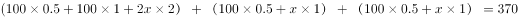元

解得x=20度，则总的用电度数=度。

故正确答案为C。

**考点**：分段计算问题、构造数列

**来源**：2014年河南省选调生选拔考试 《行政职业能力测验》试卷（精选）第38题

### 第 51 题

一菱形土地面积为√3平方公里，菱形的最小角为60°。如果将这一菱形土地向外扩张变为一正方形土地，问正方形土地边长最小为多少公里？

A. √2

B. √3

C. √6

D. 2√6

第 51 题 · 答案与解析

**参考答案（粉笔题库参考内容）**

B

**解析**

根据题意，菱形的面积为√3平方公里，由于菱形面积等于对角线乘积÷2，则如下图所示：，（因为ABD是等边三角形，所以高），则AB=，则对角线AC公里。为使正方形土地边长最小，则应使正方形面积最小，故应选择对角线AC为正方形对角线，才满足上述条件。由AC=√6公里，则所要构成的正方形对角线长度为√6公里，通过勾股定理可得，正方形边长公里。

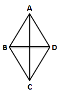

故正确答案为B。

**考点**：几何公式类-平面图形、几何结论类-三角形相关

**来源**：2014年河南省选调生选拔考试 《行政职业能力测验》试卷（精选）第39题

### 第 52 题

从A市到B市的航班每周一、二、三、五各发一班。某年2月最后一天是星期三。问当年从A市到B市的最后一次航班是星期几出发的？

A. 星期一

B. 星期二

C. 星期三

D. 星期五

第 52 题 · 答案与解析

**参考答案（粉笔题库参考内容）**

A

**解析**

根据题意可知，2月最后一天是星期三，则3月1日为星期四。从3月1日至12月31日共计天数还有365-31-28=306天(闰年为366-31-29)。

306÷7=43周······5天，可假设3月1日星期四为第一周的第一天，则第43周的最后一天为星期三，再经过5天则为星期一，即当年的最后一天12月31日为星期一，故当年最后一次航班是星期一出发的。

故正确答案为A。

**考点**：周期余数问题、星期日期问题

**来源**：2014年河南省选调生选拔考试 《行政职业能力测验》试卷（精选）第40题

### 第 53 题

甲乙两辆车从A地驶往90公里外的B地，两车的速度比为5:6，甲车于上午10点半出发，乙车于10点40分出发，最终乙车比甲车早2分钟到达B地。问两车的时速相差多少千米/小时？

A. 10

B. 12

C. 12.5

D. 15

第 53 题 · 答案与解析

**参考答案（粉笔题库参考内容）**

D

**解析**

据题意可知，由于两车的速度之比为5:6，所走的路程相同，速度与时间成反比，故两车所用时间之比为6:5。设甲用时为x，则乙用时为x-12。x：（x-12）=6:5，解得x=72分钟=1.2小时。所以甲、乙两车的速度分别为90/1.2=75千米/小时、90/1=90千米/小时。故两车的时速相差15千米/小时。

故正确答案为D。

**考点**：普通行程

**来源**：2014年412联考《行测》题（宁夏卷）第65题

### 第 54 题

某有色金属公司四种主要有色金属总产量的1/5为铝，1/3为铜，镍的产量是铜和铝产量之和的1/4，而铅的产量比铝多600吨。问该公司镍的产量为多少吨？

A. 600

B. 800

C. 1000

D. 1200

第 54 题 · 答案与解析

**参考答案（粉笔题库参考内容）**

A

**解析**

设总产量为15份，由题意，其中铝为3份，铜为5份，镍则为份，铅为15-3-5-2=5份，铅比铝多2份，2份代表600吨，所以镍的产量为600吨。

故正确答案为A。

**考点**：和差倍比问题

**来源**：2014年412联考《行测》题（宁夏卷）第66题

### 第 55 题

药厂使用电动研磨器将一批晒干的中药磨成药粉。厂长决定从上午10点开始，增加若干台手工研磨器进行辅助作业。他估算如果增加2台，可在晚上8点完成，如果增加8台，可在下午6点完成。问如果希望在下午3点完成，需要增加多少台手工研磨器？

A. 20

B. 24

C. 26

D. 32

第 55 题 · 答案与解析

**参考答案（粉笔题库参考内容）**

C

**解析**

题目中中药的总量不变，设原有的电动研磨器效率为x，每台手工研磨器效率为1，如果到晚上8点完成，即工作10小时，工作量为；到下午6点完成，即工作8小时，工作量为，因工作量一定，则有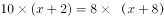，解得x=22，中药的总量=240。如果要下午3点完成，实际工作5小时，则有台。

故正确答案为C。

**考点**：给效率比例型

**来源**：2014年河南省选调生选拔考试 《行政职业能力测验》试卷（精选）第41题

### 第 56 题

某工厂有100名工人报名参加了4项专业技能课程中的一项或多项，已知A课程与B课程不能同时报名。如果按照报名参加的课程对工人进行分组，将报名参加的课程完全一样的工人分到同一组中，则人数最多的组最少有多少人？

A. 7

B. 8

C. 9

D. 10

第 56 题 · 答案与解析

**参考答案（粉笔题库参考内容）**

D

**解析**

根据题意，报名情况数共有：当只报名一种课程时，有C_4^1=4种；当报名两种课程时，有（“1”为同时报名A、B课程时的情况）；当报名三种课程时，共有ACD和BCD这2种情况；故共有4+5+2=11种情况数。为使人数最多的组人数最少，则应让其他十组人数尽可能多，设人数最多的组最少有x人，其余各组亦均为x人，11x＝100，x=100/11≈9.1，若x=9，此时总人数11x=99，剩下的1个人只能给人数最多的那个组，故人数最多的组人数最少为10人。（其中C、D为另外两项专技能课程）

故正确答案为D。

**考点**：基础排列组合、构造数列

**来源**：2014年河南省选调生选拔考试 《行政职业能力测验》试卷（精选）第42题

### 第 57 题

某单位组织参加理论学习的党员和入党积极分子进行分组讨论，如果每组分配7名党员和3名入党积极分子，则还剩下4名党员未安排；如果每组分配5名党员和2名入党积极分子，则还剩下2名党员未安排，问参加理论学习的党员比入党积极分子多多少人？

A. 16

B. 20

C. 24

D. 28

第 57 题 · 答案与解析

**参考答案（粉笔题库参考内容）**

B

**解析**

方法一：设第一次为x组，第二次为y组，则党员人数有7x＋4＝5y＋2，积极分子人数为3x＝2y，解方程得x＝4，y＝6，党员人数=7×4＋4＝32人，积极分子人数=3×4＝12人，党员比积极分子多32－12＝20人。

方法二：由题意，总人数除以10余数为4，则总人数减4后能被10整除，总人数除以7余数为2，则总人数减2后能被7整除，故满足要求的总人数最小为44人，代入第一次分组情况，可分为4个小组，党员人数人，则积极分子人数为12人，代入第二次分组验证，符合条件，故二者相差32-12=20人。

故正确答案为B。

**考点**：和差倍比问题

**来源**：2014年河南省选调生选拔考试 《行政职业能力测验》试卷（精选）第43题

### 第 58 题

一个圆形的草地中央有一个与之同心的圆形花坛，在花坛圆周和草地圆周上各有3个不同的点，安放了洒水的喷头。现用直管将这些喷头连上，要求任意两个喷头都能被一根水管连通，问最少需要几根水管(1根水管上可以连接多个喷头)：

A. 5

B. 8

C. 20

D. 30

第 58 题 · 答案与解析

**参考答案（粉笔题库参考内容）**

B

**解析**

为使水管数量尽可能少，则应让喷头尽可能多地排在一条直线上，最多有4个喷头可以排在一条直线上，另有2个与其中一个连在一条直线上，如下图所示。则最少需要8根水管才能使任意两个喷头被一根水管相连。

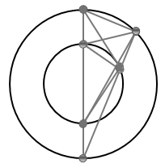

故正确答案为B。

说明：本题存在更小的答案如下图所示，该结果为7根水管。由于选项中并没有7这个答案，因此出题人也没考虑到这种结果。为了与真题保持统一，因此本题结果还是为8。学员们只需要了解本题的基本做法即可。

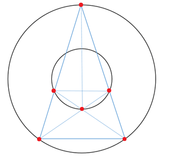

**考点**：几何其他题型、统筹规划问题

**来源**：2014年河南省选调生选拔考试 《行政职业能力测验》试卷（精选）第44题

### 第 59 题

工厂需要加工一批零件，甲单干工作需要96个小时完成，乙需要90个小时、丙需要80个小时。现在按照第一天甲乙合作，第二天甲丙合作，第三天乙丙合作的顺序轮班工作，每天工作8小时，当全部零件完成时，甲工作了多少小时：

A. 16

B. 24

C. 44

D. 32

第 59 题 · 答案与解析

**参考答案（粉笔题库参考内容）**

D

**解析**

由题意可得甲、乙、丙单独完成工作分别需要96个小时、90个小时、80个小时，可假设工程总量为三人所用时间的最小公倍数1440，则甲、乙、丙效率分别为：、、，设3天为一个周期，一个周期中共计完成工作量=，还剩下1440-784=656。第四天甲、乙合作共完成，第五天甲、丙合作共完成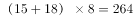，还剩下656-248-264=144，第六天由乙、丙完成。则甲共工作了4天，共计32小时。

故正确答案为D。

**考点**：周期余数问题、给完工时间型

**来源**：2014年412联考《行测》题（重庆卷）第47题

### 第 60 题

一家四口人的年龄和为149岁。其中外公年龄、母亲年龄以及两人的年龄之和都是平方数，而父亲7年前的年龄正好是孩子年龄的6倍。问外公年龄上一次是孩子年龄的整数倍是在几年前：

A. 2

B. 4

C. 6

D. 8

第 60 题 · 答案与解析

**参考答案（粉笔题库参考内容）**

D

**解析**

根据题意，外公、母亲及两人的年龄之和都为平方数，而在正常年龄段中外公64岁与母亲36岁符合要求。则父亲与孩子今年的年龄之和为149-64-36=49岁。父亲7年前的年龄刚好是孩子年龄的6倍，设7年前孩子x岁，则父亲为6x岁，x+7+6x+7=49，解得x=5岁，则孩子今年5+7=12岁，设外公年龄上一次是孩子年龄的整数倍是在n年前，欲使（64-n）÷（12-n）为整数，代入选项验证即可，只有D项，满足要求。

那么8年前外公年龄是孩子年龄的整数倍。

故正确答案为D。

**考点**：年龄问题

**来源**：2014年河南省选调生选拔考试 《行政职业能力测验》试卷（精选）第45题

### 第 61 题

一间房屋的长、宽、高分别是6米、4米和3米。施工队员在房屋内表面上画一条封闭的线，其所画的线正好在一个平面上且该平面正好将房屋的空间分割为两个形状大小完全相同的部分。问其所画的线可能的最长距离和最短距离之间的差是多少米？

A. 6

B. 6(√5−1)

C. 8

D. 4(√13 - 2)

第 61 题 · 答案与解析

**参考答案（粉笔题库参考内容）**

C

**解析**

如图所示：

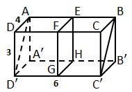

符合条件的施工员所画线的最长距离为矩形ABC'D'的周长，所画线的最短距离为矩形EFGH的周长。米，则矩形ABC'D'的周长米，矩形EFGH的米。则所画线可能的最长距离和最短距离之间的差为22-14=8米。

故正确答案为C。

**考点**：几何公式类-立体图形、几何结论类-三角形相关

**来源**：2014年412联考《行测》题（重庆卷）第49题

### 第 62 题

把下面的六个图形分成两类，使每一类图形都有各自的共同特征或规律，分类正确的一项是：

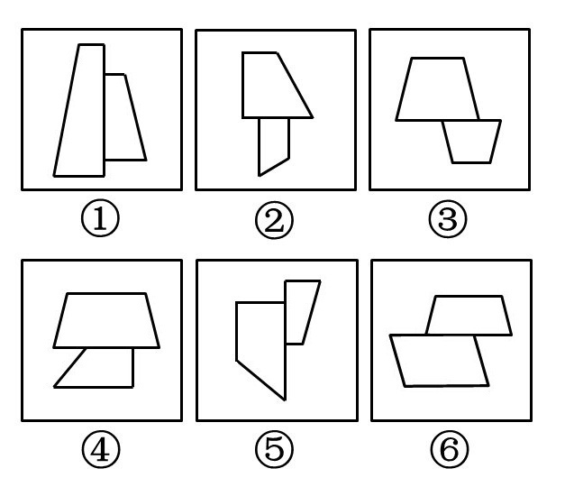

A. ①②③ ④⑤⑥

B. ①②④ ③⑤⑥

C. ①②⑤ ③④⑥

D. ①③④ ②⑤⑥

第 62 题 · 答案与解析

**参考答案（粉笔题库参考内容）**

B

**解析**

题干图形均有两个封闭区域相连接，考虑图形间关系，两封闭区域相交于线，①②④公共边中一个图形的边完全包含另一个；③⑤⑥的公共边则不完全包含。

故正确答案为B。

**考点**：特殊规律-图形间关系

**来源**：2014年河南省选调生选拔考试 《行政职业能力测验》试卷（精选）第46题

### 第 63 题

把下面的六个图形分成两类，使每一类图形都有各自的共同特征或规律，分类正确的一项是：

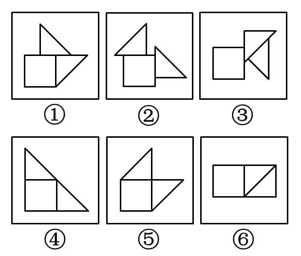

A. ①②③，④⑤⑥

B. ①③⑤，②④⑥

C. ①④⑥，②③⑤

D. ①⑤⑥，②③④

第 63 题 · 答案与解析

**参考答案（粉笔题库参考内容）**

A

**解析**

题干每幅图都由三个图形拼接而成，优先考虑图形间关系。图①②③中图形与图形的相交边均为图形边的一部分，图④⑤⑥中图形与图形的相交边均为图形的完整边。故图①②③为一组，图④⑤⑥为一组。

故正确答案为A。

**考点**：特殊规律-图形间关系

**来源**：2014年412联考《行测》题（内蒙古卷）第63题

### 第 64 题

如用白、灰、黑三种颜色的油漆为正方体盒子的6个面上色，且两个相对面上的颜色都一样，以下哪一个不可能是该盒子外表图的展开图：

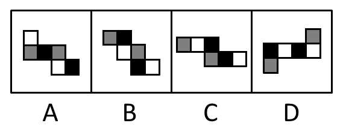

A. A

B. B

C. C

D. D

第 64 题 · 答案与解析

**参考答案（粉笔题库参考内容）**

C

**解析**

C项中黑面和黑面相交，不满足相对面上的颜色一样这一要求。

本题为选非题，故正确答案为C。

**考点**：空间类-空间重构-六面体

**来源**：2014年412联考《行测》题（宁夏卷）第72题

### 第 65 题

左边给定的是纸盒外表面的展开图，右边哪一项能由它折叠而成？请把它找出来：

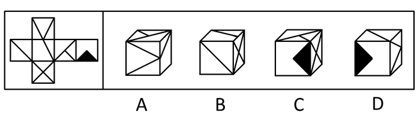

A. A

B. B

C. C

D. D

第 65 题 · 答案与解析

**参考答案（粉笔题库参考内容）**

A

**解析**

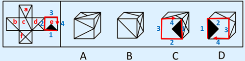

利用箭头法或者时针法及公共边上的细节可排除B、C、D三项。

B项：顶面的直线应与右侧面的对角线相连，错误，排除；

C项：选项中边4对应的是面d，而题干中边2对应面d，对应错误，排除；

D项：选项中边2对应的是面b，而题干中边2对应的是面d，对应错误，排除。

故正确答案为A。

**考点**：空间类-空间重构-六面体

**来源**：2014年河南省选调生选拔考试 《行政职业能力测验》试卷（精选）第47题

### 第 66 题

下列的立体图形是立方体中挖出一个圆锥台孔后形成的，如果从任一面剖开，以下哪一个不可能是该立体图形的截面：

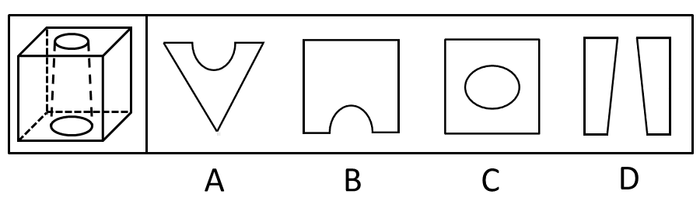

A. A

B. B

C. C

D. D

第 66 题 · 答案与解析

**参考答案（粉笔题库参考内容）**

C

**解析**

A项正确，沿着上表面的对角线斜向切割而成。

 

B项正确，如图所示，以中间圆形直径所在线向立方体的前面斜切即可。

C项错误，中间的图形应该是圆而不是椭圆。

D项正确，如图切割所得图形如下。

本题为选非题，故正确答案为C。

**考点**：空间类-截面图

**来源**：2014年河南省选调生选拔考试 《行政职业能力测验》试卷（精选）第48题

### 第 67 题

从所给的四个选项中，选择最合适的一个填入问号处，使之呈现一定的规律性：

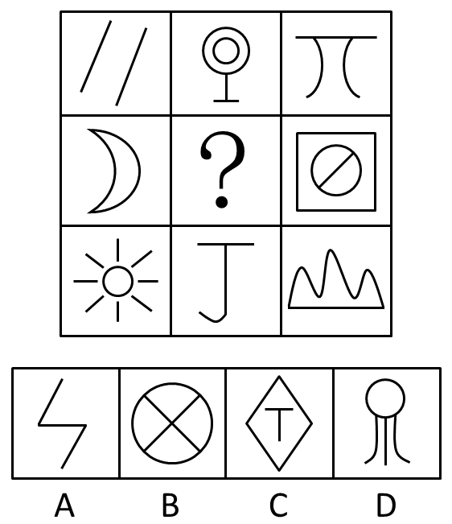

A. A

B. B

C. C

D. D

第 67 题 · 答案与解析

**参考答案（粉笔题库参考内容）**

D

**解析**

元素组成不同，且无明显属性规律，考虑数量规律。观察发现，题干图形出现明显的曲直线条相交，优先考虑数曲直交点。九宫格优先看横向，第一行图形曲直交点数依次为0，1，2；第三行图形曲直交点数依次为0，1，2；第二行第一幅和第三幅图形曲直交点数分别为0、2，故“？”处图形曲直交点数应该为1，只有D项符合。

故正确答案为D。

**考点**：数量规律-点

**来源**：2014年河南省选调生选拔考试 《行政职业能力测验》试卷（精选）第49题

### 第 68 题

从所给的四个选项中，选择最合适的一个填入问号处，使之呈现一定的规律性：

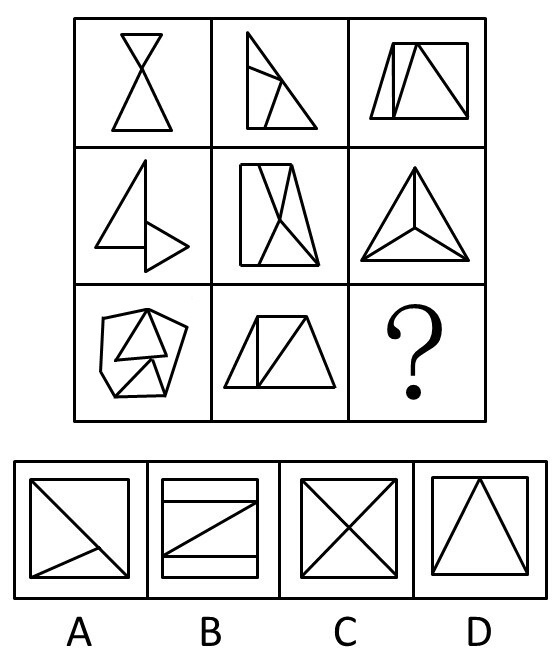

A. A

B. B

C. C

D. D

第 68 题 · 答案与解析

**参考答案（粉笔题库参考内容）**

A

**解析**

包含相同的元素：三角形，本题考点特殊，数三角形的个数，可重复数。第一行三角形的个数分别为2，3，4，第二行三角形的个数分别为2，3，4，因此？处三角形的个数为4，只有A项符合。

故正确答案为A。

**考点**：数量规律-素

**来源**：2014年河南省选调生选拔考试 《行政职业能力测验》试卷（精选）第50题

### 第 69 题

请从所给的四个选项中，选择最合适的一项填在问号处，使之呈现一定的规律性。

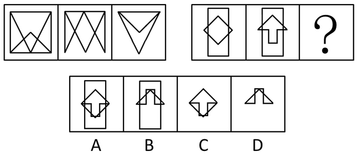

A. A

B. B

C. C

D. D

第 69 题 · 答案与解析

**参考答案（粉笔题库参考内容）**

D

**解析**

元素组成相似，相同线条重复出现，考虑加减同异。第一组图形都存在外框，从外框入手，前两幅图外框相同边去掉，不同边保留得到图3，规律为求异，但保留的横线由下变到上面，即发生上下翻转或旋转180°；所以规律为前两幅图去同存异后，再上下翻转得到第三幅图。第二组图应用此规律，求异后去掉矩形外框，排除AB两项，比较CD项，不同之处在于菱形外框，第二组图1是完整菱形，图2菱形有两条边，求异后只能留下两条边，上下翻转后得到答案为D项。

故正确答案为D。

**考点**：样式规律-加减同异

**来源**：2014年412联考《行测》题（宁夏卷）第75题

### 第 70 题

经营性资产是在生产和流通中能够为社会提供商品或劳务的资产。经营性资产的使用单位是具有法人地位的企业，其运营要以追求经济效益为原则。从会计角度看，主要指企业因盈利目的而持有，且实际也具有盈利能力的资产。

根据上述定义，下列不属于“经营性资产”的是：

A. 某电视机厂中积压的黑白电视机

B. 建设中尚未投入使用的水力发电站

C. 某外贸公司用于交纳税金的银行存款

D. 某重点中学新购入的实验室设备和器材

第 70 题 · 答案与解析

**参考答案（粉笔题库参考内容）**

D

**解析**

第一步：定位有效信息。

提问考查定义“经营性资产”，且要求选择“不属于”，即选择一个不符合定义的选项。题干中“经营性资产的使用单位是具有法人地位的企业”，即主体为“法人地位的企业”。

第二步：逐一分析选项。

A项主体“某电视机厂”、B项主体“水力发电站”、C项主体“某外贸公司”均属于“具有法人地位的企业”。D项主体“某重点中学”是事业单位，并不是“具有法人地位的企业”。

本题为选非题，故正确答案为D。

**考点**：主客体

**来源**：2014年河南省选调生选拔考试 《行政职业能力测验》试卷（精选）第51题

### 第 71 题

诱导运动是一种视错觉，即观察者知觉到某个物体在运动，而实际上该物体没有发生空间移动，只是由于其他物体的运动使得被观察物体看起来好像在运动。

根据上述定义，下列属于诱导运动的是：

A. 在没有月光的夜晚仰望天空，觉得星星好像在动

B. 电影院里播放的精彩电影

C. 月亮在云彩后面穿行

D. 注视飞速开过的火车之后，会觉得附近的树木向相反方向运动

第 71 题 · 答案与解析

**参考答案（粉笔题库参考内容）**

C

**解析**

第一步：找出定义关键词。

“视错觉”、“实际上物体未发生空间移动”、“由于其他物体使得被观察物体看起来好像在运动”。

第二步，逐一分析选项。

A项，只提及“星星”，没有提及其他物体，不符合“由于其他物体使得被观察物体看起来好像在运动”的情况，不符合定义，排除；

B项，电影里面的画面是动态的，本身发生了空间移动，不符合“实际上物体未发生空间移动”，不符合定义，排除；

C项，月亮未发生空间移动，由于云彩的运动使得月亮看起来好像在运动，符合“视错觉”、“实际上物体未发生空间移动”、“由于其他物体使得被观察物体看起来好像在运动”符合定义，当选；

D项，火车开过后，此时不存在正在移动的物体，只有树，移动物体与静止物体是先后出现，不符合“其由于其他物体使得被观察物体看起来好像在运动”，感觉树在动是运动后效，不是诱导运动，不符合定义，排除。

故正确答案为C。

**考点**：原因结果

**来源**：2014年河南省选调生选拔考试 《行政职业能力测验》试卷（精选）第60题

### 第 72 题

风险规避是指通过计划的变更来消除风险或风险发生的条件，保护目标免受风险的影响。风险规避并不意味着完全消除风险，而是规避风险可能造成的损失，一是要降低损失发生的几率，这主要是采取事先控制措施；二是要降低损失程度。这主要包括事先控制、事后补救两个方面。

根据上述定义，下列不属于“风险规避”的是：

A. 某外语培训机构近两年业务发展迅速，但缺乏配套的资金投入，因此该机构选择通过上市发行股票这一渠道来筹集资金

B. 某广告公司为减少员工流失，实行了许多激励机制，包括提供更多培训机会、加大奖金幅度、增加保险额度等措施

C. 小李业余时间喜欢理财，他在银行的理财产品涉及很多类型，有债券、基金，有短期也有长期的，他觉得这样理财更稳健

D. 某购物网站有专门的储物仓库，平时供货稳定，但过节期间常供不应求，为此公司制定了一系列方案来控制货物储备和物流管理

第 72 题 · 答案与解析

**参考答案（粉笔题库参考内容）**

A

**解析**

第一步：找出定义关键词。

“通过计划的变更来消除风险或风险发生的条件”、“保护目标免受风险的影响”、“降低损失发生的几率，采取事先控制措施”、“降低损失程度，包括事先控制、事后补救”。

第二步：逐一判断选项。

A项：通过上市发行股票这一渠道来筹集资金，目的是筹钱，并非为了规避风险，不符合“通过计划的变更来消除风险或风险发生的条件”，不符合定义，当选；

B项：为减少员工流失，实行了激励机制，说明是在已经发生员工流失的情况下做出的补救，符合“通过计划的变更来消除风险或风险发生的条件”、“保护目标免受风险的影响”、“降低损失发生的几率，采取事先控制措施”，符合定义，排除；

C项，小李的投资产品涉及不同类型以及不同周期，通过多样化的投资来分散和降低风险，符合“通过计划的变更来消除风险或风险发生的条件”、“保护目标免受风险的影响”、“降低损失程度，包括事先控制、事后补救”，符合定义，排除；

D项，过节期间常供不应求，为此公司制定方案来控制货物储备和物流管理，说明公司为应对风险发生提前做出准备，符合“通过计划的变更来消除风险或风险发生的条件”、“保护目标免受风险的影响”、“降低损失发生的几率，采取事先控制措施”，符合定义，排除。

本题为选非题，故正确答案为A。

**考点**：方式目的

**来源**：2014年河南省选调生选拔考试 《行政职业能力测验》试卷（精选）第52题

### 第 73 题

心理记账是人们在心理上对结果进行分类、编码、估价和预算的过程。消费者在决策时可能根据不同的任务进行相应的心理记账。

根据上述定义，下列不属于典型心理记账的是：

A. 损失10元钱给人心理带来的痛苦要比获得10元奖金带来的高兴更强烈

B. 王某出差常选星级酒店，因为它比旅馆更可能提供免费网络和自助早餐

C. 相比丢了10元钱的人，丢了电影票的人更不可能会掏钱买票去看电影

D. 工会发放福利时，不再发实物而改发购物卡以使职工有更多的自由选择

第 73 题 · 答案与解析

**参考答案（粉笔题库参考内容）**

D

**解析**

第一步：抓住定义中的关键词，心理记账的主体是人。

第二步：逐一判断选项。

A项，损失10元钱和获得10元奖金给人心理带来的感受是一种分类、估价的过程，符合定义，排除；

B项，王某作为“消费者”认为“星级酒店”相比较“旅馆”而言更可能提供免费网络和自助早餐，体现了人们在心理上对结果进行分类、估价和预算的过程，符合定义，排除；

C项，丢了10元钱还是丢了电影票，是消费者一种分类和估价的过程，符合定义，排除；

D项，主体是工会，工会不属于“人”而是指基于共同利益而自发组织的社会团体，不符合定义，当选。

本题为选非题，故正确答案为D。

**考点**：主客体

**来源**：2014年河南省选调生选拔考试 《行政职业能力测验》试卷（精选）第59题

### 第 74 题

潜伏需求是指相当一部分消费者对某种商品或服务有强烈的需求，而现有产品或服务又无法使之满足的一种需求状况。

根据上述定义，以下最能体现“潜伏需求”的是：

A. 某市所售楼盘多为三居室大户型，让想在这里安家的工薪阶层望而却步

B. 某药厂推出的中药降糖保健品在部分程度上可以取代药品，常供不应求

C. 目前市场上的防辐射孕妇装抵御电子产品辐射的有效率是多少尚不明确

D. 新型的电动游戏机带有护眼功能，想必可以说服一些学生家长前来购买

第 74 题 · 答案与解析

**参考答案（粉笔题库参考内容）**

A

**解析**

第一步：抓住定义中的关键词。

“现有产品或服务又无法使之满足的一种需求状况”。

第二步：逐一判断选项。

A项，工薪阶层想在某市安家，而所售楼盘多为三居室大户型使工薪阶层望而却步，体现了题干中的“现有产品或服务又无法使之满足的一种需求状况”，当选；

B项，从选项可知，中药降糖保健品只是市场上某些药品的取代品，即使供不应求也不符合题干中的“现有产品或服务又无法使之满足的一种需求状况”这一定义要求，排除；

C项，防辐射孕妇装有效率是多少尚不明确，不能体现需求状况，故此选项与题干无关，排除；

D项，新型的电动游戏机带有护眼功能，体现一种需求状况，但无法说明“现有产品或服务又无法使之满足的一种需求状况”，排除。

故正确答案为A。

**考点**：单定义-其他句式

**来源**：2014年河南省选调生选拔考试 《行政职业能力测验》试卷（精选）第54题

### 第 75 题

著作人身权，又称著作精神权，指著作权人对其作品所享有的各种与人身相联系或者密不可分而又无直接财产内容的权利，是作者通过创作表现个人风格的作品而依法享有获得名誉、声望和维护作品完整性的权利。著作财产权，又称著作经济权，是著作人身权的对称，是指著作权人自己使用或者授权他人以一定方式使用作品而获得物质利益的权利。

根据上述定义，下列说法中正确的是：

A. 某知名网络小说作家要求出版社使用其真实姓名出版其作品，则该作家行使的是著作人身权

B. 画家王某将自己的画作以高价卖给了姜某，则姜某获得了该画作的著作财产权

C. 某知名舞蹈家创作的舞蹈深受群众喜爱，不少人纷纷模仿并进行商业演出，该舞蹈家要求停止这一侵权行为，则她行使的是著作人身权

D. 某剧作家创作的电视剧因深受观众喜爱而被翻拍，该剧作家要求电视剧制作方不得修改故事的结局，则他行使的是著作财产权

第 75 题 · 答案与解析

**参考答案（粉笔题库参考内容）**

A

**解析**

第一步：找出定义关键词。

关键词为：（1）著作人身权：作者通过创作表现个人风格的作品而依法享有获得名誉、声望和维护作品完整性的权利；

（2）著作财产权：著作权人自己使用或者授权他人以一定方式使用作品而获得物质利益的权利。

第二步：逐一分析选项。

A项：某知名网络小说作家要求出版社使用其真实姓名是“作者通过创作表现个人风格的作品而依法享有获得名誉、声望和维护作品完整性的权利”，行使的是著作人身权，当选；

B项：考查著作财产权定义，著作财产权应该属于画家王某，排除；

C项：该舞蹈家要求停止模仿她的舞蹈进行商业演出获利，她行使的是著作财产权，排除；

D项：该剧作家要求电视剧制作方不得修改故事的结局是行使的著作人身权，排除。

故正确答案为A。

**考点**：特殊问法

**来源**：2014年河南省选调生选拔考试 《行政职业能力测验》试卷（精选）第56题

### 第 76 题

姑息治疗是指对那些治愈性治疗无望或不能接受治愈性治疗的病人采取完全的主动的医疗和护理，控制疼痛及有关症状，并对心理、社会和精神问题予以重视，其目的是为病人和家属赢得最好的生活质量。姑息治疗同样适用于早期肿瘤病人，将姑息治疗与抗肿瘤治疗相结合。

根据上述定义，下列不属于姑息治疗的是：

A. 某患者因病情恶化且年老体衰，无法翻身，身体生了褥疮，口腔也有霉菌感染，护士为其洗澡擦身，并做了口腔清洁

B. 某患者因为癌症晚期，且自身状况差无法进行抗癌治疗，医生认为患者已没有治疗价值，劝患者回家休养

C. 某年轻患者刚结婚便被诊断为乳腺癌，情绪非常激动，拒绝接受治疗，医生为其进行了心理辅导

D. 某患者手术后严重疼痛，无法入睡，医生给了他止疼药，并给予一定的镇静剂，让患者能好好休息

第 76 题 · 答案与解析

**参考答案（粉笔题库参考内容）**

B

**解析**

第一步：找出定义关键词。

“对那些治愈性治疗无望或不能接受治愈性治疗的病人采取完全的主动的医疗和护理”“控制疼痛及有关症状”“对心理、社会和精神问题予以重视”“为病人和家属赢得最好的生活质量”。

第二步：逐一分析选项。

A项：某患者因病情恶化且年老体衰，符合“那些治愈性治疗无望或不能接受治愈性治疗的病人”，护士为其洗澡擦身，并做了口腔清洁，符合“控制疼痛及有关症状”“为病人和家属赢得最好的生活质量”，符合定义，排除；

B项：某患者因为癌症晚期，且自身状况差无法进行抗癌治疗，符合“那些治愈性治疗无望或不能接受治愈性治疗的病人”，医生认为患者已没有治疗价值，劝患者回家休养说明医生已经放弃了对患者的治疗和护理，不符合对病人“采取完全的主动的医疗和护理”“控制疼痛及有关症状”“对心理、社会和精神问题予以重视”“为病人和家属赢得最好的生活质量”，不符合定义，当选；

C项：某患者患有乳腺癌，符合题干中“那些治愈性治疗无望或不能接受治愈性治疗的病人”，医生为其进行了心理辅导，符合“对心理、社会和精神问题予以重视”，符合定义，排除；

D项：某患者手术后严重疼痛，无法入睡，医生给了他止疼药，符合医生进行“完全的主动的医疗和护理 ”“控制疼痛及有关症状”，让患者能好好休息，符合“为病人和家属赢得最好的生活质量”，符合定义，排除。

本题为选非题，故正确答案为B。

注：本题易错项为D。理由是D项为术后患者，不符合“治愈性治疗无望或不能接受治愈性治疗的病人”。但文段最后说到“姑息治疗同样适用于早期肿瘤病人”也就意味在治疗前期也可能采用姑息治疗，根据定义看出姑息治疗强调的应该是主动的治疗，而B选项就是让你回家了，也就是不再管了，更不符合定义，而且根据相应的姑息治疗的案例，都强调的是全程护理不放弃，且患病初期、中期及晚期都可采取姑息治疗，因此本题经过粉笔教研，倾向于选B。

**考点**：方式目的

**来源**：2014年河南省选调生选拔考试 《行政职业能力测验》试卷（精选）第57题

### 第 77 题

知情同意原则是指临床医师在为病人作出诊断和治疗方案后，必须向病人提供包括诊断结论、治疗决策、病情预后及诊治费用等方面真实、充分的信息，尤其是诊疗方案的性质、作用、依据、损伤、风险、不可预测的意外及其他可供选择的诊疗方案及其利弊等信息，使病人或家属经深思熟虑自主作出选择，并以相应方式表达其接受或拒绝此种诊疗方案的意愿和承诺；在得到患方明确承诺后，才可最终确定和实施由其确认的诊治方案。

根据上述定义，下列违反了知情同意原则的是：

A. 医生向患者交代了目前患者可以选择的两种治疗方案，但患者和家属由于文化水平低，并未听懂，因此让医生替他们做决定

B. 医生向白血病患儿的家属交代了骨髓移植手术的作用、风险、预后及花费等情况，家属在讨论后，决定在手术同意书上签字

C. 某患者在进行检查前，医生将检查的用处以及可能存在的风险向患者告知，患者表示清楚，但非常关心检查的费用是否报销，在得知是自费检查时，拒绝了该项检查

D. 某患者在化疗前，医生提供了两种可供选择的方案，一种为效果较好但昂贵的进口药，一种是效果稍差但便宜的国产药，家属和患者的意见不一致，请医生帮他们拿主意，在医生的耐心解释下，患者与家属终于达成了共识

第 77 题 · 答案与解析

**参考答案（粉笔题库参考内容）**

A

**解析**

第一步：抓住定义中关键词。

“使病人或家属经深思熟虑自主作出选择”。

第二步：逐一判断选项。

A项：患者和家属因文化水平低未能听懂医生的交代而让医生替他们做决定，不符合题干“使病人或家属经深思熟虑自主作出选择”，不符合定义，当选；

B项：符合定义中家属了解详情后自主作出选择，排除；

C项：符合定义中病人了解详情后自主作出选择，排除；

D项：医生并没有帮患者拿主意，而是在医生的耐心解释下，患者与家属终于达成了共识，符合定义，排除。

本题为选非题，故正确答案为A。

**考点**：方式目的

**来源**：2014年河南省选调生选拔考试 《行政职业能力测验》试卷（精选）第58题

### 第 78 题

生产、销售有毒、有害食品罪是指在生产、销售的食品中掺入有毒、有害的非食品原料，或者销售明知掺有有毒、有害的非食品原料的食品的行为。

根据上述定义，下列构成生产、销售有毒、有害食品罪的是：

A. 某肉食品加工厂用病死猪肉作原料生产火腿，造成大批消费者食物中毒

B. 刘某在地下工厂用工业高纯度酒精加自来水制造大量假酒，并将其销售给商店，获得8万多元

C. 某饮料生产厂家在生产的可乐中添加了食品添加剂——咖啡因，但并未在包装上予以注明，使大量消费者饮用了含有咖啡因的可乐

D. 某食品厂在所生产的一批彩虹糖中添加食用色素超标，长期食用会给人体健康造成危害

第 78 题 · 答案与解析

**参考答案（粉笔题库参考内容）**

B

**解析**

第一步：抓住定义中的关键词。

本题只需抓住“有毒、有害的非食品原料”。

第二步：逐一判断选项。

A项：病死猪肉不符合“有毒、有害的非食品原料”这一定义关键词，排除；

B项：用工业高纯度酒精制造假酒，符合在生产中掺入“有毒、有害的非食品原料”，并销售给商店，符合销售明知掺有“有毒、有害的非食品原料”的食品的行为，当选；

C项：咖啡因是食品添加剂不属于“有毒、有害的非食品原料”，排除；

D项：食用色素添加超标，虽然长期食用会给人体健康造成危害，但也不符合在生产中掺入“有毒、有害的非食品原料”这一定义，排除。

故正确答案为B。

**考点**：单定义-其他句式

**来源**：2014年412联考《行测》题（宁夏卷）第93题

### 第 79 题

喻代是一种建立于比喻基础之上的以喻体代本体的一种修辞方式。即先比喻，后用喻体代本体。喻代是比喻后的名称代换，喻体作为别名而存在，其比喻的色彩、意味减弱，含蓄表达成为关键。

根据上述定义，下列各项中没有使用喻代这一修辞方式的是：

A. 我吃了一吓，却见一个五十岁上下的女人站在我的面前，两手搭在髀间，张着两脚，正像一个画图仪器里细脚伶仃的圆规……然而圆规很不平，显示鄙夷的神色。

B. 多么熟悉的声音，多么动人的曲子，去年春节文娱晚会上因这支歌而被同学们昵称为“李谷二”，她的声音，我一下子就能听出来。

C. 他走了，像只风筝，在山坡上摇啊摇，弯弯曲曲的白线越放越长，到底放到头了，那儿是山顶，是和天连着的地方，“风筝”停了，他知道这条白线还拴着一颗心呢。

D. 那外国人想雇我的驴去游山东，我要五块钱，他嫌贵。你嫌贵，我还嫌你胖呢。胖的像大白熊，别压坏了我的驴。讲来讲去，大白熊答应我的价钱，骑着驴去逛了半天。

第 79 题 · 答案与解析

**参考答案（粉笔题库参考内容）**

B

**解析**

第一步，抓住定义中的关键词。

①以喻体代本体，即先比喻，后用喻体代本体；②喻体作为别名而存在；③含蓄表达成为关键。

第二步，逐一判断选项。

A项，圆规比喻五十岁上下的女人，后用圆规代替女人，符合定义，排除；

B项，不存在比喻，没有喻体出现，与定义不符，当选；

C项，风筝喻他，后用风筝代替他，符合定义，排除；

D项，大白熊喻外国人，后用大白熊代替外国人，符合定义，排除。

本题为选非题，故正确答案为B。

**考点**：大前提

**来源**：2014年河南省选调生选拔考试 《行政职业能力测验》试卷（精选）第55题

### 第 80 题

选择性接触是指受众在接触大众传播活动之际，并不是不加区别地对待任何媒介和内容，而是更倾向于与自己的既有立场、观点、态度一致或接近的加以接触，或有意无意地回避与自己既有倾向相左的媒介或内容。

根据上述定义，下列属于“选择性接触”的是：

A. 旅行社推出的夕阳红系列游的团体活动受到很多退休老人的欢迎。

B. 减肥产品最畅销的人群是那些正在减肥的人，而不是那些打算减肥的人。

C. 初中政治老师王某每天回家的第一件事就是收看新闻联播。

D. 赵总监推崇人性化管理，经常参加人本主义取向的心理学培训课程。

第 80 题 · 答案与解析

**参考答案（粉笔题库参考内容）**

D

**解析**

第一步：抓住定义中的关键词。

①接触大众传播活动；②倾向于接触与自己既有立场、观点、态度一致或接近的；③回避与自己倾向相左的立场观点。

第二步：逐一判断选项。

A项中旅行社、B项中的减肥产品，不符合定义关键词“接触大众传播活动”，排除；

C项没有明确地表明政治老师的观点、立场、态度是什么，不符合定义，排除；

D项明确地说出既有观点是人性化管理，并且人本主义取向的心理学培训课程与赵总监的观点存在一致性，符合定义，当选。

故正确答案为D。

**考点**：大前提

**来源**：2014年河南省选调生选拔考试 《行政职业能力测验》试卷（精选）第53题

### 第 81 题

动作技能的形成通常是以原有的动作联系为基础，所谓动作技能转移，是指学习新动作过程中，过去掌握的与正在学习的技能之间的相互影响和作用。

根据上述定义，下列各项中不属于动作技能转移的是：

A. 体操运动员掌握了向左侧翻的动作，向右侧翻的动作更容易掌握

B. 外科医生老李常年使用手术刀，锻炼了手的灵活性，退休后学习书法时他发现他的手比别人更灵活，更易于练好书法

C. 对于熟练掌握了一门外语的人来说，学习第二外语时更容易掌握

D. 学习跳马屈体腾越时，先前掌握得比较熟练的屈腿腾越的技能，容易干扰屈体腾越技能的形成

第 81 题 · 答案与解析

**参考答案（粉笔题库参考内容）**

C

**解析**

第一步：找出定义关键词。

“学习新动作过程中”、“过去掌握的与正在学习的技能之间的相互影响和作用”。

第二步：逐一分析选项。

A项：体操运动员掌握了向左侧翻的动作，向右侧翻的动作更容易掌握，说明过去掌握的技能可以帮助新技能的学习，符合“学习新动作过程中”、“过去掌握的与正在学习的技能之间的相互影响和作用”，符合定义，排除；

B项：老李常年使用手术刀，锻炼了手的灵活性，退休后发现更容易学好书法，说明过去掌握的技能可以帮助新技能的学习，符合“学习新动作过程中”、“过去掌握的与正在学习的技能之间的相互影响和作用”，符合定义，排除；

C项：学习外语属于语言技能，并非动作技能，不符合“学习新动作过程中”，不符合定义，当选；

D项：先前掌握的屈腿腾越技能，容易干扰屈体腾越技能的形成，说明先前掌握的技能阻碍了新技能的学习，符合“学习新动作过程中”、“过去掌握的与正在学习的技能之间的相互影响和作用”，符合定义，排除。

本题为选非题，故正确答案为C。

**考点**：拆词

**来源**：2014年412联考《行测》题（内蒙古卷）第81题

### 第 82 题

分水岭 对于（    ） 相当于（    ）对于  水稻

A. 山岭：大米

B. 地质：节气

C. 界线：作物

D. 回归线：青稞

第 82 题 · 答案与解析

**参考答案（粉笔题库参考内容）**

D

**解析**

填空类代入验证。

A项：分水岭和山岭是交叉关系，大米是水稻加工的产物，前后逻辑关系不一致，排除；

B项：分水岭和地质无明显的关系，水稻和节气无明显的关系，前后逻辑关系不一致，排除；

C项：分水岭是一种界线，水稻是一种作物，但顺序反了，前后逻辑关系不一致，排除；

D项：分水岭和回归线都是分界线的一种，二者是并列关系，水稻和青稞都是农作物的一种，二者也是并列关系，前后逻辑关系一致，当选。

故正确答案为D。

**考点**：逻辑关系-并列关系

**来源**：2014年河南省选调生选拔考试 《行政职业能力测验》试卷（精选）第68题

### 第 83 题

银元：白银：货币

A. 竹筏：竹子：木舟

B. 瓦片：泥土：屋顶

C. 琵琶：木材：弦乐

D. 齿轮：金属：机械

第 83 题 · 答案与解析

**参考答案（粉笔题库参考内容）**

D

**解析**

第一步：分析题干词语间逻辑关系。

白银是银元的原材料，银元与货币之间是种属关系，银元是一种货币。

第二步：逐一分析选项的逻辑关系。

A项竹筏和木舟是并列关系，与题干逻辑关系不一致，排除；

B项瓦片是屋顶的组成部分，是组成关系，与题干逻辑关系不一致，排除；

C项琵琶不是弦乐的一种，应该是弦乐器的一种，与题干逻辑关系不一致，排除；

D项的金属是齿轮的原材料，齿轮是机械的一种，与题干逻辑关系一致，当选。

故正确答案为D。

**考点**：逻辑关系-包容关系、逻辑关系-对应关系

**来源**：2014年412联考《行测》题（宁夏卷）第83题

### 第 84 题

戒烟：疾病

A. 酒驾：事故

B. 核对：差错

C. 过失：反思

D. 斟酌：顾虑

第 84 题 · 答案与解析

**参考答案（粉笔题库参考内容）**

B

**解析**

第一步：判断题干词语间逻辑关系。

戒烟是为了预防疾病。

第二步：判断选项词语间的逻辑关系。

A项：酒驾可能发生事故，与题干逻辑关系不一致，排除；

B项：核对是为了避免差错，与题干逻辑关系一致，当选；

C项：过失可能引起反思，与题干逻辑关系不一致，排除；

D项：斟酌能够增加顾虑，与题干逻辑关系不一致，排除。

故正确答案为B。

**考点**：逻辑关系-对应关系

**来源**：2014年河南省选调生选拔考试 《行政职业能力测验》试卷（精选）第62题

### 第 85 题

照片：留念

A. 文件：机密

B. 古董：珍藏

C. 日记：记载

D. 书籍：查阅

第 85 题 · 答案与解析

**参考答案（粉笔题库参考内容）**

C

**解析**

第一步：判断题干词语间逻辑关系。照片是用来留念的，是对应关系，并且，照片留下的是拍照时候的影像。

第二步：逐一判断其他选项。A项机密是文件的一种属性，不符合条件，排除；B项古董是被珍藏的，是谓宾关系，排除；C项日记是用来记载的，是对应关系，并且日记记载的是记日记时候的心情，当选；D项书籍是用来被查阅的，是谓宾关系，排除。

故正确答案为C。

**考点**：逻辑关系-对应关系

**来源**：2014年河南省选调生选拔考试 《行政职业能力测验》试卷（精选）第63题

### 第 86 题

药物：胶囊

A. 桌椅：桌面

B. 电脑：屏幕

C. 书本：封面

D. 物品：木箱

第 86 题 · 答案与解析

**参考答案（粉笔题库参考内容）**

D

**解析**

第一步：判断题干词语间逻辑关系。胶囊用来盛放药物。

第二步：逐一判断其他选项。A项，桌面是桌椅的组成部分，排除；B项，屏幕是电脑的组成部分，排除；C项，封面也是书本的组成部分，排除；D项，木箱用来盛放物品，和题干逻辑关系一致，当选。

故正确答案为D。

**考点**：逻辑关系-对应关系

**来源**：2014年河南省选调生选拔考试 《行政职业能力测验》试卷（精选）第64题

### 第 87 题

计算之于（  ）相当于 实验之于（  ）

A. 推理：逻辑

B. 物理：天文

C. 数学：化学

D. 大脑：助手

第 87 题 · 答案与解析

**参考答案（粉笔题库参考内容）**

C

**解析**

逐一代入选项。

A项：计算和推理是两种不同的思维方式，二者为并列关系，实验需要遵循逻辑，二者为条件对应关系，前后逻辑关系不一致，排除；

B项：计算是物理学科的研究手段之一，二者为对应关系，但天文的核心研究手段是观测，而非实验，二者无明显逻辑关系，前后逻辑关系不一致，排除；

C项：计算和数学是学科和主要方法的对应关系，二者为对应关系，实验和化学是学科和主要方法的对应，二者为对应关系，前后逻辑关系一致，当选；

D项：大脑是进行计算的载体，二者为载体的对应关系，助手是协助完成实验的角色，二者为角色对应关系，前后逻辑关系不一致，排除。

故正确答案为C。

**考点**：逻辑关系-对应关系

**来源**：2014年河南省选调生选拔考试 《行政职业能力测验》试卷（精选）第69题

### 第 88 题

南征北战：东讨西伐

A. 万紫千红：姹紫嫣红

B. 古往今来：天南地北

C. 朝三暮四：喜新厌旧

D. 左顾右盼：东张西望

第 88 题 · 答案与解析

**参考答案（粉笔题库参考内容）**

D

**解析**

第一步：判断题干词语间逻辑关系。

“南征北战”与“东讨西伐”都是指到处打仗，二者是近义关系，且“南”和“北”、“东”和“西”是反义关系，“征”和“战”、“讨”和“伐”是近义关系。

第二步：判断选项词语间逻辑关系。

A项：“万紫千红”与“姹紫嫣红”都是指百花齐放，形容色彩斑斓，五颜六色，二者是近义关系，但“万”和“千”不是反义关系，与题干逻辑关系不一致，排除；

B项：“古往今来”指从古到今，属于时间维度，“天南地北”指从南到北，属于空间维度，二者不是近义关系，与题干逻辑关系不一致，排除；

C项：“朝三暮四”与“喜新厌旧”都是指不专一，二者是近义关系，但“三”和“四”不是近义关系，与题干逻辑关系不一致，排除；

D项：“左顾右盼”和“东张西望”都是指到处看，二者是近义关系，且“左”和“右”、“东”和“西”是反义关系，“顾”和“盼”、“张”和“望”是近义关系，与题干逻辑关系一致，当选。

故正确答案为D。

**考点**：拆分思维、语义关系-反义关系、语义关系-近义关系

**来源**：2014年河南省选调生选拔考试 《行政职业能力测验》试卷（精选）第65题

### 第 89 题

（   ）对于 汽车  相当于   开关 对于（    ）

A. 轮胎 电门

B. 汽油 电灯

C. 钥匙 电视

D. 飞机 电池

第 89 题 · 答案与解析

**参考答案（粉笔题库参考内容）**

C

**解析**

本题为填空型，代入选项验证。

A项：轮胎是汽车的组成部分，电门和开关是全同关系，前后逻辑不一致，排除；

B项：汽油是汽车的动力来源，而开关并不是电灯的动力来源，前后逻辑关系不一致，排除；

C项：钥匙可以启动汽车，开关可以启动电视，前后逻辑关系一致，当选；

D项：飞机和汽车是并列关系，开关和电池无明显的对应关系，前后逻辑关系不一致，排除。

故正确答案为C。

**考点**：逻辑关系-对应关系

**来源**：2014年河南省选调生选拔考试 《行政职业能力测验》试卷（精选）第70题

### 第 90 题

居住：居民

A. 继承：继承人

B. 吝啬：守财奴

C. 顺从：独裁者

D. 乞讨：流浪者

第 90 题 · 答案与解析

**参考答案（粉笔题库参考内容）**

A

**解析**

第一步：判断题干词语间逻辑关系。

造句为：居民居住，“居民”是名词，“居住”是动词，二者是主谓关系。

第二步：判断选项词语间逻辑关系。

A项：造句为：继承人继承，“继承人”是名词，“继承”是动词，二者是主谓关系，与题干逻辑关系一致，当选；

B项：造句为“守财奴吝啬”，但“吝啬”是形容词，与题干逻辑关系不一致，排除；

C项：造句为“独裁者顺从”，搭配不当，一般都是别人顺从独裁者，与题干逻辑关系不一致，排除；

D项：造句为“流浪者乞讨”，二者是主谓关系，但并不是所有的“流浪者”都“乞讨”，有些流浪者是街头艺人等，与题干逻辑关系不一致，排除。

故正确答案为A。

**考点**：语法关系

**来源**：2014年河南省选调生选拔考试 《行政职业能力测验》试卷（精选）第66题

### 第 91 题

荆棘：困难

A. 布衣：学生

B. 折柳：惜别

C. 心腹：信任

D. 桎梏：束缚

第 91 题 · 答案与解析

**参考答案（粉笔题库参考内容）**

D

**解析**

第一步：判断题干词语间逻辑关系。

荆棘象征困难，此处为比喻象征义，且荆棘是名词。

第二步：判断选项词语间逻辑关系。

A项：布衣象征平民，而非学生，与题干逻辑关系不一致，排除；

B项：折柳象征惜别，但折柳不是名词，与题干逻辑关系不一致，排除；

C项：心腹象征信任的人，而非信任，与题干逻辑关系不一致，排除；

D项：桎梏是中国古代的一种刑具，在手上戴的为梏，在脚上戴的为桎，可象征束缚，且桎梏是名词，与题干逻辑关系一致，当选。

故正确答案为D。

**考点**：语义-其他、语义关系-比喻象征义

**来源**：2014年河南省选调生选拔考试 《行政职业能力测验》试卷（精选）第61题

### 第 92 题

抑制：热情

A. 滋润：喉咙

B. 分散：注意

C. 消除：声音

D. 反转：方向

第 92 题 · 答案与解析

**参考答案（粉笔题库参考内容）**

B

**解析**

第一步：判断题干词语间逻辑关系。

抑制热情是动宾关系，抑制热情指把热情程度降低。

第二步：判断选项词语间逻辑关系。
A项：滋润喉咙是动宾搭配，但喉咙是具体名词，题干中的热情是抽象名词，不符合题干逻辑关系，排除；

B项：分散注意，是动宾关系，分散注意指把注意程度降低，与题干逻辑关系一致，当选；

C项：消除声音是动宾搭配，但是消除声音是指把声音彻底消灭，而不仅仅是程度降低，没有B项贴切，排除；

D项：反转方向并没有减弱的意思，而变成了相反，排除。

故正确答案为B。

**考点**：语法关系

**来源**：2014年河南省选调生选拔考试 《行政职业能力测验》试卷（精选）第67题

### 第 93 题

抵押 对于 （    ）， 相当于 （    ） 对于 处罚

A. 银行：监狱

B. 担保：罚款

C. 房屋：立法

D. 债务：刑罚

第 93 题 · 答案与解析

**参考答案（粉笔题库参考内容）**

B

**解析**

逐一代入选项。

A项，前半部分办理抵押要到银行，后半部分不能说处罚要到监狱，前后顺序也颠倒了，排除；

B项，前半部分抵押是一种担保，后半部分罚款是一种处罚，都是包容关系中的种属关系，当选；

C项，前半部分可以选择用房屋抵押，后半部分也可以用立法的方式处罚，但是顺序颠倒，排除；

D项，前半部分抵押和债务并无明显的对应关系，后半部分刑罚是处罚的一种，包容关系，排除。

故正确答案为B。

**考点**：逻辑关系-包容关系

**来源**：2014年412联考《行测》题（宁夏卷）第85题

### 第 94 题

噬菌体是一种病毒，它能够捕食细菌，目前随着医疗中植入技术的发展，越来越多的患者接受着诸如导尿管、心脏支架等医学植入装置，但随之也带来了细菌感染的风险，因此，一些研究人员认为如果噬菌体吸附在植入装置材料表面，再将其放入患者体内，就可以避免植入装置引发的感染。

以下哪项为真，最能削弱上述结论：

A. 对植入医学装置的患者，一般通过服用抗生素来防御细菌感染

B. 有细菌的场所就可能有相应噬菌体的存在，只是存在数量的差异

C. 噬菌体能够攻击致病细菌，但有时也“捕食”有益的细菌

D. 一些噬菌体进入机体后，无法适应体液环境，难以保持活性

第 94 题 · 答案与解析

**参考答案（粉笔题库参考内容）**

D

**解析**

第一步：分析题干，找到论点和论据。

论点：噬菌体吸附在植入装置材料表面，放入患者体内，可以避免植入装置引发的感染。

论据：噬菌体能“捕食”细菌。
第二步：逐一分析选项。

A、B两项：“服用抗生素”“噬菌体数量”均与论点无关，属于无关项，排除；

C项：认可噬菌体对致病细菌的攻击作用，虽然也会“捕食”有益细菌，但仍然加强了论点，排除；

D项：说明噬菌体无法在体内保持活性，所以其效力无法保证，削弱了论点，当选。

故正确答案为D。

**考点**：削弱论点

**来源**：2014年河南省选调生选拔考试 《行政职业能力测验》试卷（精选）第71题

### 第 95 题

随着手机和网络的普及，人们开始随时随地获取各种信息。但有研究认为，正是人们接触过多信息，导致想法增多。当过多想法无法实现时，人们会利用各种信息填充大脑，让无法实现的想法所带来的焦虑暂时不进入脑海。

根据以上描述可以推出：

A. 人们的想法增多导致人们随时随地获取信息

B. 人们的痛苦随着手机和网络越来越普及而增加了

C. 人们的大脑有办法避开痛苦的事情

D. 如果人们减少获取额外信息，就可以减少痛苦

第 95 题 · 答案与解析

**参考答案（粉笔题库参考内容）**

C

**解析**

第一步，抓住题干中的主要信息。

题干有三个信息，一是人们随时随地获取各种信息，人们接触过多信息，导致想法增多；二是想法多，就有无法实现的想法；三是人们会填充大脑，让无法实现的想法所带来的焦虑暂时不进入脑海。

第二步分析题干信息，并结合选项寻找答案。

A项，与题干因果倒置，是因为随时随地获取各种信息，才导致人们想法增多，排除；

B项，题干中并未体现痛苦增加，排除；

C项，能够从原文的最后一句话推知，当选；

D项，减少信息就能减少痛苦，题干未提及，为无关选项，排除。

故正确答案为C。

**考点**：日常结论

**来源**：2014年河南省选调生选拔考试 《行政职业能力测验》试卷（精选）第73题

### 第 96 题

以往的研究认为火山喷发会释放大量热量，引发全球变暖，但近日研究发现，火山喷发不仅不会引发全球温度上升，还可以削弱全球变暖的影响。

以下哪项为真，最能支持上述结论：

A. 研究表明，火山爆发时地下岩浆喷出地面，与空气接触，产生氧化反应，引起局部温度升高。

B. 火山爆发能够抑制某种分解有机物的细菌，其分解的有机物中含有甲烷，甲烷是一种可燃性气体，可产生热能。

C. 火山喷发后会带来大规模的酸雨，酸雨能在短期内降低火山区气温，但是也引发了农作物虫害。

D. 研究发现火山喷发物质——二氧化硫可与大气物质形成“水粒”并将阳光反射，减少对地面的热辐射，延缓全球变暖。

第 96 题 · 答案与解析

**参考答案（粉笔题库参考内容）**

D

**解析**

第一步：找到论点论据。

论点：火山喷发不仅不会引起全球温度上升，还可以削弱全球变暖的影响。

论据：无明显论据。

第二步：逐一分析选项。

A项：火山喷发会产生热能，引起温度升高，削弱了论点，排除；

B项：火山爆发抑制了能够分解出甲烷的细菌，那么甲烷就会减少，但是甲烷燃烧后才会产生热量，因此甲烷量的变化是否会引起相应热量的变化不明确，无法加强，排除；

C项：火山喷发后会带来大规模的酸雨，酸雨能在短期内降低火山区气温，可以加强，保留；

D项：火山喷发物可以延缓全球变暖，可以加强，保留；

比较C、D两项，均说明火山喷发会降温，但C项只是火山区短期降温，而D项是延缓全球变暖，所以D项加强力度更强，当选。

故正确答案为D。

**考点**：补充论据

**来源**：2014年412联考《行测》题（宁夏卷）第96题

### 第 97 题

软件用户的调查显示，通常一个软件会有1000个用户采用，如果一个软件每天被下载安装的次数达到55次，这个软件的流行度会急速上升，最多时有1200万个用户采用，大量用户几乎是完全根据其他用户的行为来选择安装这个软件，而很少关注其本身的内在特点。

根据以上描述可以推出：

A. 网站上最流行的软件未必是最实用的软件

B. 参考别人选择安装软件是不明智的

C. 网站上推出的软件未必都是有用的

D. 用户安装在电脑上的一些软件或许会被删除

第 97 题 · 答案与解析

**参考答案（粉笔题库参考内容）**

A

**解析**

日常结论题，根据题干信息逐一分析选项。

A项：大量用户安装软件仅仅是因为随大流，而不是因为软件本身。所以，流行的软件不一定本身优质，可以推出，当选；

B项：参考别人的就是不明智的，说得过于绝对，在原文中找不到依据，不能推出，排除；

C项：网站推出的软件未必是有用的，文章主要强调的是流行的软件而非网站推出的软件，偷换概念，不能推出，排除；

D项：用户安装的软件是否会被删除原文中没有提到过，属于无中生有，不能推出，排除。

故正确答案为A。

**考点**：日常结论

**来源**：2014年河南省选调生选拔考试 《行政职业能力测验》试卷（精选）第74题

### 第 98 题

R医院连续五年在C市举办的“我最满意的医院”调查中高居榜首，该医院负责人表示，这是由于该医院提供了比其他医院更加优质的导诊服务。以下哪项为真，最能支持该医院负责人的观点：

A. C市各大医院都在导诊服务中投入了大量精力，力图提高导诊服务质量

B. C市“我最满意的医院”调查已开展20年，高居榜首的均是公立医院

C. C市共有200多家医院，并非所有的医院都参与了此次调查

D. 与R医院医疗水平相当，但导诊服务不佳的医院排名均不如R医院

第 98 题 · 答案与解析

**参考答案（粉笔题库参考内容）**

D

**解析**

第一步：找到论点论据。

论点：R医院连续5年在“我最满意的医院”调查中高居榜首的原因是该医院提供了更加优质的导诊服务。

论据：无明显论据。

第二步：判断加强方式。

本题没有论据，故可以考虑补充新论据加强论点。

第三步：逐一判断选项。

A项说的是各大医院都投入精力，没说明结果如何，属于无关选项，排除；

B项涉及的是公立医院，与R医院之间关系未知，属于无关选项，排除；

C项说明了并非是所有医院都参加调查，所以，R医院的高居榜首不能代表所有医院，故削弱了论点，排除；

D项说明了医疗水平相当的排名不如R医院，所以，优质的导诊服务有可能是高居榜首的原因，加强了论点，当选。

故正确答案为D。

**考点**：加强-实验类、补充论据

**来源**：2014年河南省选调生选拔考试 《行政职业能力测验》试卷（精选）第76题

### 第 99 题

随着人们的生活和工作环境进入高楼大厦，人们接触日光的机会变少，研究发现，日光是合成维生素D的必要条件，而维生素D是促进钙吸收的关键因素。因此有人得出结论：现代人更容易患骨质疏松等因缺钙引起的疾病。

以下哪项为真，最能质疑上述结论：

A. 骨质疏松疾病患者多晒太阳就可以缓解或治愈

B. 现代人饮食结构中的含钙食品比以前丰富很多

C. 骨质疏松症患者接触日光的时长与其他人无异

D. 口服维生素D片是加了促吸收剂的合成配方

第 99 题 · 答案与解析

**参考答案（粉笔题库参考内容）**

C

**解析**

第一步：找到论点论据。论点：缺乏阳光导致现代人更容易患缺钙引起的骨质疏松症。论据：现代人接触日光的机会变少，日光是合成维生素D的必要条件，维生素D是促进钙吸收的关键因素。

第二步：判断削弱方式。论点强调的是骨质疏松等缺钙疾病，论据强调的是缺少日光、维生素D，两者对象不一致，可以考虑不搭桥削弱论证。第三步：逐一判断选项。A项说的是骨质疏松疾病的缓解和治愈措施，而论点说的是引起骨质疏松疾病的原因，二者话题不一致，无法削弱，排除；B项说的是人们饮食结构中的含钙食品多了，但是摄取的这些食物是否能被有效地吸收无法在选项中体现，无法证明人们是否会因缺钙而患骨质疏松，属于无关选项，排除；C项骨质疏松患者接触阳光时长与他人一样，意味着阳光和骨质疏松之间没有必然联系，削弱论证，当选；D项中的维生素D是否添加合成配方与题干讨论的话题不一致，属无关选项，无法削弱，排除。

故正确答案为C。

**考点**：拆桥

**来源**：2014年河南省选调生选拔考试 《行政职业能力测验》试卷（精选）第72题

### 第 100 题

在地球构造活动频繁的时期，环非洲、南美和欧洲的新海洋盆地开始扩展，产生了新的空间，大气中大量二氧化碳与光合作用的生物发生反应，死亡的生物随后被埋在海底沉积物中，形成了富含碳元素的页岩。大气中的碳被固定下来，使得大气中二氧化碳的水平下降，减小了温室效应并降低了全球温度，这对海洋生命来说是非常严重的后果。因此科学家认为，全球变冷或变暖后果同样严重。

下列哪项为真，最能支持科学家的论断：

A. 在全球变冷的200年后，由于频繁的火山爆发，使得固化在页岩中的碳以二氧化碳的形式重回到大气层，部分恢复了温室效应

B. 全球变暖会导致海洋生物生态危机，科学家发现在26万年前全球变冷的时期，海洋生物发生过类似的危机

C. 大规模且长期的自然变化，或由于人类活动而造成全球温室效应在短期内的巨大改变对整个系统来说都具有冲击作用

D. 科学家观察到气候变冷的发生超过几百万年，而不是几十年或几百年，这还很难和我们迅速变化的现代气候条件联系起来

第 100 题 · 答案与解析

**参考答案（粉笔题库参考内容）**

B

**解析**

第一步：找到论点论据。

论点：全球变冷或变暖后果同样严重。

论据：全球降温给海洋生物带来过非常严重的后果。

第二步：判断加强方式。本题论点需要多个论据证明，题干论据只涉及了变冷的情况，所以需要补充新论据加强论点。

第三步：逐一分析选项。

A项所说的全球变冷之后又部分恢复了温室效应并没有涉及变暖或变冷的后果，属无关选项，排除；

B项既说了变暖导致生态危机，也说了变冷也会发生类似危机，补充了新论据，说明变冷变暖的后果一样严重，加强了论点，为正确选项，当选；

C项所说的冲击作用未说明是否带来严重后果，也是属于无关选项，排除；

D项涉及到的时间长短问题，均与论题无关，也没有涉及变冷或变暖的后果，属无关选项，排除。

故正确答案为B。

**考点**：补充论据

**来源**：2014年河南省选调生选拔考试 《行政职业能力测验》试卷（精选）第77题

### 第 101 题

一项新的研究发现，短期摄入高脂食物有益心脏，研究人员在实验后期人工引发老鼠心脏缺血性伤害，类似人心脏病发作时的情况。他们发现，吃高脂食物24小时、1周和2周的老鼠心脏组织受损状况比吃6周高脂食物的老鼠和“吃素”的老鼠轻70%。研究人员认为这是由于短期摄入高脂食品可以使心脏肌肉获得更多能量，增强抵御伤害能力。他们认为，短期摄入高脂饮食或可保护心脏机能。

以下哪项为真，最能支持题干的结论：

A. 高脂食物中所含有的低密度脂蛋白胆固醇是人体所不可缺少的物质

B. 高脂食物可以使人体获得进行新陈代谢等活动所必需的物质和能量

C. 如果让老鼠“吃一天荤”后改“吃素”，它们心脏抵御伤害的能力比一开始就“吃素”的老鼠强

D. 要想降低患心脏病风险，应注意饮食平衡，适当摄入脂肪和胆固醇

第 101 题 · 答案与解析

**参考答案（粉笔题库参考内容）**

C

**解析**

第一步：找到论点论据。

论点：短期摄入高脂食品可以使心脏肌肉获得更多能量，增强抵御伤害能力，可保护心脏机能。

论据：吃高脂食物24小时、1周和2周的老鼠心脏组织受损状况比吃6周高脂食物的老鼠和“吃素”的老鼠轻70%。

第二步：判断加强方式。本题论点需要多个论据支持，题设论据只是其中一部分，故可以考虑补充新论据加强论点。

第三步：逐一判断选项。

A、B两项说明的都是高脂食物对人体有好处，无法具体得知对心脏机能是否有好处，属于无关选项，均排除；

C项将短期摄入高脂食物的老鼠和吃素的老鼠进行对照，举例子加强了论点，当选；

D项涉及的是降低心脏病风险，而且没有提及“短期摄入”，属于无关选项，排除。

故正确答案为C。

**考点**：补充论据

**来源**：2014年河南省选调生选拔考试 《行政职业能力测验》试卷（精选）第75题

### 第 102 题

新学期开始，研究生院发现有新生没有到教务处办理注册手续。

若该命题为真，则下列陈述不能确定真假的是：

Ⅰ所有新生都没有到教务处办理注册手续

Ⅱ所有新生都到教务处办理了注册手续

Ⅲ有的新生到教务处办理了注册手续

Ⅳ新生小明到教务处办理了注册手续

A. Ⅰ、Ⅱ、Ⅲ、Ⅳ

B. Ⅰ、Ⅲ、Ⅳ

C. Ⅰ、Ⅱ、Ⅲ

D. Ⅱ、Ⅲ、Ⅳ

第 102 题 · 答案与解析

**参考答案（粉笔题库参考内容）**

B

**解析**

翻译题干：研究生院至少有一人没有到教务处办理注册手续（即：包含全部人都没有注册）。

Ⅰ：所有新生都没有到教务处办理注册手续，无法推出，因此，真假不确定；

Ⅱ：所有新生都到教务处办理了注册手续，与题干矛盾，为假命题；

Ⅲ：有的新生到教务处办理了注册手续，无法推出，因此，真假不确定；

Ⅳ：新生小明到教务处办理了注册手续，无法推出，因此，真假不确定。

故正确答案为B。

**考点**：集合推理

**来源**：2014年河南省选调生选拔考试 《行政职业能力测验》试卷（精选）第78题

### 第 103 题

兄弟姐妹四人，甲、乙、丙、丁。甲说：丁是最小的妹妹。乙说：兄弟姐妹中只有哥哥一个男孩。丙说：我是甲的姐姐。

如果上述都为真。以下推断正确的是：

A. 丙排行第二，是女孩；丁排行最小，是女孩

B. 乙排行第二，是女孩：丙排行第一，是女孩

C. 甲排行第二，是男孩；乙排行第三，是女孩

D. 甲排行第二，是女孩；丙排行第一，是女孩

第 103 题 · 答案与解析

**参考答案（粉笔题库参考内容）**

C

**解析**

根据已知条件可得，只有一个男孩，他是乙的哥哥，又因为，丙和丁都是女的，所以甲是男的，甲是乙的哥哥，又有丙是甲的姐姐，丁是最小的妹妹，所以，可以推出年龄从大到小：丙（女）＞甲（男）＞乙（女）＞丁（女）。

故正确答案为C。

**考点**：从确定信息开始推

**来源**：2014年河南省选调生选拔考试 《行政职业能力测验》试卷（精选）第79题

### 第 104 题

研究人员认为肥胖症和人体内寄生某些能产生特定气体的微生物有关，这些微生物使他们呼出的气体味道更难闻。加州洛杉矶CS医学中心分析了792位体检者的呼吸，发现呼出甲烷和氢气量高的人的身高体重指数（BMI）比正常人要高2.4点，即属于肥胖人群。

根据以上描述不能推出：

A. 胖人体内可能寄生着某些产生特定气体的微生物

B. 可以通过气体是否难闻来判定呼气者是否是肥胖症患者

C. 呼出气体中甲烷和氢气含量高的人群比正常人群更胖

D. 甲烷和氢气的混合物味道较难闻

第 104 题 · 答案与解析

**参考答案（粉笔题库参考内容）**

B

**解析**

本题属于日常推理类题型。A、C两项可以推出，是原文的复述，可分别由第一句话和最后一句话直接得到，均排除；B项属于逻辑错误，根据原文可以得知，胖子呼出的甲烷和氢气味道难闻，但不能得出呼出气体难闻的都是胖子，当选；D项，原文说到胖子呼出的气体难闻，呼出甲烷和氢气含量高的人属于肥胖人群，因此，可以得到D项的结论，排除。

本题为选非题，故正确答案为B。

**考点**：日常结论

**来源**：2014年412联考《行测》题（宁夏卷）第101题

### 第 105 题

低热量食物是指含淀粉、糖类等碳水化合物类较少的食物。通过食用低热量食品，可以有效控制能量的摄入量，避免多余能量在体内以脂肪形式储存下来。如果体重已经较重的人改为食用低热量食品，则可在保持饱腹感的同时达到减肥效果。另外，有许多人认为，低热量食物对糖尿病患者也十分有益。

以下哪项为真，最能支持上述推论：

A. 改食用低热量食物需要逐步进行，否则会引起机体代谢紊乱

B. 研究表明低热量饮食可减少脂肪在胰脏中的沉积，恢复胰岛素的分泌

C. 低热量食品可适当增加进食量，满足饱腹感，享受吃饱的乐趣

D. 低热量食品可以降低超重或糖尿病患者的体重，但需要补充其他营养

第 105 题 · 答案与解析

**参考答案（粉笔题库参考内容）**

B

**解析**

第一步：找到论点论据。

论点：胖子改为食用低热量食品可在保持饱腹感的同时减肥，低热量食物对糖尿病患者有益。有许多人认为，低热量食物对糖尿病患者也十分有益。

论据：通过食用低热量食品，可以有效控制能量的摄入量，避免多余能量在体内以脂肪形式储存下来。

第二步：判断加强方式。本题论点需要多个论据证明，题设的论据只解释了胖子减肥的方面，可以考虑补充新论据加强论点。

第三步：逐一分析选项。

A项涉及的是低热量食物是否需要逐步进行，与论点无关，属于无关选项，排除；

B项补充新论据，恢复胰岛素，减少脂肪沉积，无论对于肥胖还是糖尿病患者，均非常重要，加强论点，当选；

C项涉及的饱腹感也只是论点中的一小部分，加强力度较弱，排除；

D项说明“低热量食物降低超重或糖尿病患者体重”，但是并不需要降低糖尿病患者的体重，对于糖尿病患者，更重要的是减少糖的吸收，所以属于无关选项，排除。

故正确答案为B。

**考点**：补充论据

**来源**：2014年河南省选调生选拔考试 《行政职业能力测验》试卷（精选）第80题

## 材料 1

图1 2008—2012年全国一次能源、石油生产量与消费量的情况

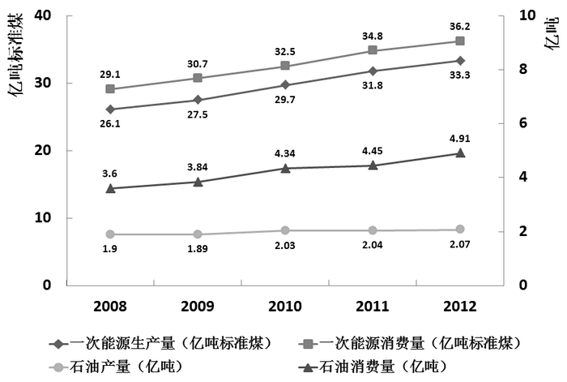

图2 2008—2012年全国矿产品进出口情况

### 第 106 题

2009—2012年间一次能源生产量增速最快的一年是：

A. 2009年

B. 2010年

C. 2011年

D. 2012年

第 106 题 · 答案与解析

**参考答案（粉笔题库参考内容）**

B

**解析**

题干要求2009—2012年间一次能源生产量增速最快的一年，故本题为一般增长率的比较问题。根据图1可找出各年份一次能源生产量的具体数值，结合增长率的一般计算公式：增长率=,故选项各年份的同比增长率分别为：A项：2009年=\=1.4/26.1；B项：2010年=\=2.2/27.5；C项：2011年=\=2.1/29.7；D

项: 2012年=\=1.5/31.8。与B项相比，C、D两项分子小，分母大，则分数小，可直接排除；对比A、B两项，比较分子、分母的变化速度，分子2.2接近1.4的两倍，但分母27.5与26.1变化很小，分子增长幅度较大则分数较大，故B项的增长率是最大的。

故正确答案为B。

**考点**：一般增长率、统计图

**来源**：2014年河南省选调生选拔考试 《行政职业能力测验》试卷（精选）第101题

### 第 107 题

图中一次能源消费量与生产量差值最大的一年，该差值为多少亿吨标准煤？

A. 2.9

B. 3.0

C. 3.1

D. 3.2

第 107 题 · 答案与解析

**参考答案（粉笔题库参考内容）**

D

**解析**

根据题干中“该差值为多少亿吨标准煤”可知此题为简单加减计算问题。根据图1，观察“一次能源消费量与生产量”的折线可知其差值最大的一年为2009年，具体差值=30.7–27.5=3.2。

故正确答案为D。

**考点**：简单加减计算、统计图

**来源**：2014年河南省选调生选拔考试 《行政职业能力测验》试卷（精选）第102题

### 第 108 题

2009—2012年间全国商品进出口总额最高年份，矿产品进出口总额比上年：

A. 上升了348亿美元

B. 下降了1601亿美元

C. 上升了2138亿美元

D. 上升了2446亿美元

第 108 题 · 答案与解析

**参考答案（粉笔题库参考内容）**

A

**解析**

根据题干中“矿产品进出口总额比上年”可知此题为增长相关的问题，选项均为具体值，故此题为增长量的计算问题。根据图2可知，2009—2012年间全国商品进出口总额分别为4987/22.6%、7125/24%、9571/26.3%、9919/25.7%，观察分母很接近，2012年的分子最大，故全国商品进出口总额最高的年份是2012年。2012年矿产品进出口总额的增长量=现期量-基期量=9919-9571=348亿美元。

故正确答案为A。

**考点**：增长量计算、统计图

**来源**：2014年河南省选调生选拔考试 《行政职业能力测验》试卷（精选）第103题

### 第 109 题

2008—2012年间，全国石油消费量超过全国石油产量2倍的年份有几个？

A. 2

B. 3

C. 4

D. 5

第 109 题 · 答案与解析

**参考答案（粉笔题库参考内容）**

C

**解析**

根据题干中“全国石油消费量超过全国石油产量2倍”可知此题为倍数的比较问题。根据图1可知2008-2012年全国石油的消费量与产量的2倍关系分别为：2008年：3.6＜1.9×2；2009年：3.84＞1.89×2；2010年：4.34＞2.03×2；2011年：4.45＞2.04×2；2012年：4.91＞2.07×2。观察可知大于2倍关系的年份一共有4个。

故正确答案为C。

**考点**：现期倍数、统计图

**来源**：2014年河南省选调生选拔考试 《行政职业能力测验》试卷（精选）第104题

### 第 110 题

关于2009—2012年全国矿产品贸易和能源生产、消费，能够从上述资料中推出的是：

A. 石油产量年均增速超过一次能源生产量

B. 矿产品进出口总额占全国商品进出口总额比重逐年递增

C. 矿产品进出口总额最低的年份，一次能源消费同比增量也最低

D. 平均每年一次能源生产量超过30亿吨标准煤

第 110 题 · 答案与解析

**参考答案（粉笔题库参考内容）**

D

**解析**

A项：由图1可知2009年—2012年石油产量的增长幅度明显小于一次能源产量；故其年平均增速也应小于一次能源生产量，无法推出；

B项：由图2可知矿产品进出口总额占全国商品进出口总额比重在2012年出现下降，并非逐年递增，无法推出；

C项：由图2中可知矿产品进出口总额最低的是2009年，但在图1中，2009年的一次能源消费同比增量并不是最低，无法推出；

D项：由图1可知2009-2012年一次能源生产总量=27.5+29.7+31.8+33.3。取参照值30计算，则原式=-2.5-0.3+1.8+3.3=2.3，为正值，则四年间平均一次能源生产量超过30亿吨标准煤，可以推出。

故正确答案为D。

**考点**：统计图、综合分析

**来源**：2014年河南省选调生选拔考试 《行政职业能力测验》试卷（精选）第105题

## 材料 2

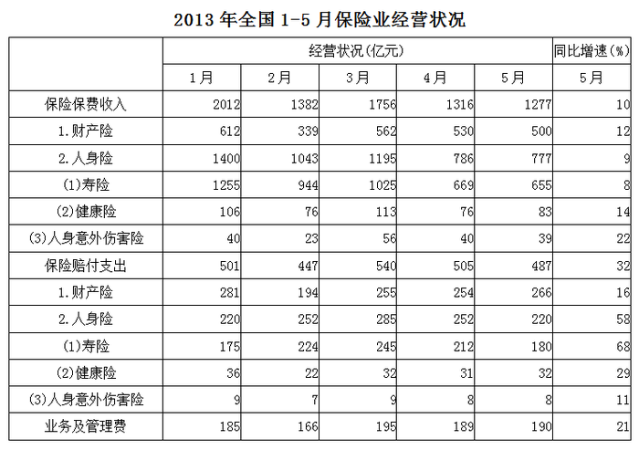

### 第 111 题

2013年1—5月，保险业平均每月业务及管理费用约为多少亿元？

A. 180

B. 185

C. 190

D. 195

第 111 题 · 答案与解析

**参考答案（粉笔题库参考内容）**

B

**解析**

方法一：由题干“平均每月业务及管理费用”可知本题为平均数计算问题。定位到表格最后一行可知2013年1-5月业务及管理费的具体数额，平均每月业务及管理费用=\=\=185亿元。

方法二：取参照值185计算，则原式=0-19+10+4+5=0，则平均每月业务及管理费用=185+0=185亿元。

故正确答案为B。

**考点**：现期平均数、统计表

**来源**：2014年河南省选调生选拔考试 《行政职业能力测验》试卷（精选）第111题

### 第 112 题

2013年3月，人身险的三个险种保费收入环比增速排序正确的是：

A. 人身意外伤害险＞寿险＞健康险

B. 人身意外伤害险＞健康险＞寿险

C. 健康险＞人身意外伤害险＞寿险

D. 健康险＞寿险＞人身意外伤害险

第 112 题 · 答案与解析

**参考答案（粉笔题库参考内容）**

B

**解析**

由题干“环比增速排序正确的是”可知本题为一般增长率的比较及排序类问题，可直接比较现期与基期的倍数关系来确定大小（增长率==现期/基期-1，比较大小中，-1部分可以忽略不计）。定位到表格中，人身意外伤害险收入两期比值=56/23≈2.4；健康险收入两期比值=113/76≈1.5；寿险收入两期比值=1025/944≈1.1。则三类保险收入中人身意外伤害险收入环比增速最高，健康险次之，寿险最低，满足要求的排序为B项。

故正确答案为B。

**考点**：一般增长率、统计表

**来源**：2014年河南省选调生选拔考试 《行政职业能力测验》试卷（精选）第112题

### 第 113 题

以下各月中，哪个月全行业保险赔付支出额与保险保费收入额比值最低？

A. 1月

B. 2月

C. 3月

D. 4月

第 113 题 · 答案与解析

**参考答案（粉笔题库参考内容）**

A

**解析**

由题干“哪个月······比值最低”可知本题为比值的比较问题。定位到表格中，4个月份全行业保险赔付支出额与保险保费收入额的比值分别为：

A项：1月；B项：2月；C项：3月；D项：4月。

比较得知，最低的为1月。

故正确答案为A。

**考点**：比值比较、统计表

**来源**：2014年河南省选调生选拔考试 《行政职业能力测验》试卷（精选）第113题

### 第 114 题

在寿险、健康险和人身意外伤害险中，有几类险种在2013年5月的保险赔付支出额占全行业保险赔付支出总额的比重高于上年同期水平？

A. 0

B. 1

C. 2

D. 3

第 114 题 · 答案与解析

**参考答案（粉笔题库参考内容）**

B

**解析**

由题干“比重高于上年同期水平”可知本题为两期比重比较问题。根据两期比重比较公式，比较两期比重大小，仅需比较a与b的大小关系，当a>b时比重上升，当a&lt;b时比重下降。定位图表可知，保险赔付支出总额同比增速b=32%，寿险赔付支出同比增速，健康险赔付支出增速，人身意外伤害险赔付支出同比增速。同比增速高于32%的，只有寿险一项满足。

故正确答案为B。

**考点**：两期比重、统计表

**来源**：2014年河南省选调生选拔考试 《行政职业能力测验》试卷（精选）第114题

### 第 115 题

关于2013年1—5月保险业经营状况，能够从上述资料中推出的是：

A. 5月各类险种保费收入均低于4月

B. 4月三个人身险种的收入均高于一季度平均水平

C. 1月人身意外伤害险收入在保费总收入中的占比不足2%

D. 2月各类险种保险赔付支出均低于1月

第 115 题 · 答案与解析

**参考答案（粉笔题库参考内容）**

C

**解析**

根据题干中“能够从上述资料中推出的是”可知此题为综合分析问题，可逐项分析选择出能够推出的一项。

A项：定位表格“保险保费收入”栏，5月份健康险的保费收入额高于4月份，无法推出；

B项：定位表格“保险保费收入”栏，首先观察人身险中的寿险，4月份收入为669亿元，而第一季度三个月中收入均超过669亿元，故4月份的寿险收入应小于一季度的平均值，无法推出；

C项：定位表格“保险保费收入”栏，1月份人身意外伤害险收入为40亿元，保费总收入为2012亿元，所占比重=40/2012，直除首位只能商1，占比不足2%，能够推出；

D项：定位表格“保险赔付支出”栏，2月份寿险赔付支出高于1月份，无法推出。

故正确答案为C。

**考点**：统计表、综合分析

**来源**：2014年河南省选调生选拔考试 《行政职业能力测验》试卷（精选）第115题

## 材料 3

2013年3月末，金融机构人民币各项贷款余额65.76万亿元，同比增长14.9%，增速比上年同期低0.8个百分点。

       2013年3月末，主要金融机构及小型农村金融机构，外资银行人民币小微企业贷款余额11.78万亿元，同比增长13.5%，比全部企业贷款余额增速高1.2个百分点。

       2013年3月末，主要金融机构本外币工业中长期贷款余额6.46万亿元，同比增长3.2%。其中，轻工业中长期贷款余额6824亿元，同比增长7.6%；重工业中长期贷款余额5.77万亿元，同比增长2.7%，服务业中长期贷款余额16.55万亿元，同比增长8.9%。

       2013年3月末，主要金融机构及小型农村金融机构、村镇银行、财务公司本外币农村贷款余额15.24万亿元，同比增长18.4%；农户贷款余额3.86万亿元，同比增长16.9%；农业贷款余额2.87万亿元，同比增长12.3%。

       2013年3月末，主要金融机构及小型农村金融机构、外资银行人民币房地产贷款余额12.98万亿元，同比增长16.4%。地产开发贷款余额1.04万亿元，同比增长21.4%。房产开发贷款余额3.2万亿元，同比增长12.3%。个人购房贷款余额8.57万亿元，同比增长17.4%。保障性住房开发贷款余额6140亿元，同比增长42.4%。

### 第 116 题

2013年3月末，金融机构人民币各项贷款余额约是2011年同期的多少倍？

A. 1.1

B. 1.2

C. 1.4

D. 1.3

第 116 题 · 答案与解析

**参考答案（粉笔题库参考内容）**

D

**解析**

由题干“2013年3月末是2011年同期的多少倍”可知本题为倍数的计算问题。定位文字材料第一段“2013年3月末，金融机构人民币各项贷款余额65.76万亿元，同比增长14.9%，增速比上年同期低0.8个百分点”可知2013年3月末同比增速，2012年的同期增速r_2=。

根据间隔增长率计算公式，2013年3月末相比2011年同期的增长率。则2013年比2011年多了0.33倍，2013年是2011年的1+0.33=1.33倍，与D项最接近。

故正确答案为D。

**考点**：文字资料、间隔增长率

**来源**：2014年河南省选调生选拔考试 《行政职业能力测验》试卷（精选）第116题

### 第 117 题

2013年3月末，轻工业中长期贷款余额占工业中长期贷款余额总体的比重与上年相比：

A. 约上升0.4个百分点

B. 约上升4个百分点

C. 约下降0.4个百分点

D. 约下降4个百分点

第 117 题 · 答案与解析

**参考答案（粉笔题库参考内容）**

A

**解析**

由题干“比重与上年相比”可知本题为两期比重的比较问题。定位文字材料第三段可知2013年3月末轻工业中长期贷款余额A=6824亿元，同比增速a=7.6%；工业中长期贷款余额B=6.46万亿元，同比增速b=3.2%。代入两期比重差公式：A/B×(a-b)/(1+a)=6824/64600，因a>b，所得值为正值，故比重上升，排除C、D两项；因选项差距较大可估算求解，原式≈1/10×4.4%/1.1=0.4%。

故正确答案为A。

**考点**：两期比重、文字资料

**来源**：2014年河南省选调生选拔考试 《行政职业能力测验》试卷（精选）第117题

### 第 118 题

2013年3月末，各项贷款余额从高到低排序正确的是：

A. 农户贷款余额、地产开发贷款余额、农业贷款余额

B. 房产开发贷款余额、地产开发贷款余额、轻工业中长期贷款余额

C. 服务业中长期贷款余额、农户贷款余额、重工业中长期贷款余额

D. 重工业中长期贷款余额、轻工业中长期贷款余额、房产开发贷款余额

第 118 题 · 答案与解析

**参考答案（粉笔题库参考内容）**

B

**解析**

由题干“从高到低排序正确的是”可知本题为排序类问题。结合文字材料第二、三、四、五段可直接查找出2013年3月末各项贷款余额的具体值。
A项：农户贷款余额为3.86万亿元、地产开发贷款余额为1.04万亿元、农业贷款余额额为2.87万亿元，顺序错误；
B项：房产开发贷款余额为3.2万亿元、地产开发贷款余额为1.04万亿元，轻工业中长期贷款余额为6824亿元≈0.68万亿元，顺序正确；
C项：服务业中长期贷款余额为16.55万亿元，农户贷款余额为3.86万亿元，重工业中长期贷款余额为5.77万亿元，顺序错误；
D项：重工业中长期贷款余额为5.77万亿元，轻工业中长期贷款余额为6824亿元≈0.68万亿元，房产开发贷款余额为3.2万亿元，顺序错误。

故正确答案为B。

**考点**：排序类、文字资料

**来源**：2014年河南省选调生选拔考试 《行政职业能力测验》试卷（精选）第118题

### 第 119 题

2013年3月末，房地产开发贷款余额同比增速为：

A. 14.4%

B. 12.3%

C. 19.3%

D. 21.4%

第 119 题 · 答案与解析

**参考答案（粉笔题库参考内容）**

A

**解析**

题干所求为2013年3月末房地产开发贷款余额同比增速，可知本题为一般增长率的计算问题。定位材料最后一段，地产开发贷款余额为1.04万亿元，同比增长21.4%。房产开发贷款余额为3.2万亿元，同比增长12.3%。房地产开发贷款余额=地产余额+房产余额，则房地产同比增速为地产与房产的混合增长率。根据混合增长率特点，所求混合增长率一定介于12.3%与21.4%之间，排除B、D两项。且更接近于基数较大的一项，估算可知，房产的基期值大于地产基期值，即更接近于12.3%，A项满足。

故正确答案为A。

**考点**：文字资料、混合增长率

**来源**：2014年河南省选调生选拔考试 《行政职业能力测验》试卷（精选）第119题

### 第 120 题

关于2013年3月末贷款余额的情况，能够从上述材料中推出的是：

A. 全部企业贷款余额同比增长了14.7%

B. 农村贷款余额比上年同期增长了3万多亿元

C. 个人购房贷款余额同比增速快于保障性住房开发贷款余额

D. 服务业中长期贷款余额同比增量超过工业中长期贷款余额的3倍

第 120 题 · 答案与解析

**参考答案（粉笔题库参考内容）**

D

**解析**

A项：定位文字材料第二段，外贸银行贷款余额同比增长13.5%，比全部企业贷款余额增速高1.2个百分点，则全部企业贷款余额增速=13.5%-1.2%=12.3%，无法推出，排除；

B项：定位文字材料第四段，农村贷款余额为15.24万亿元，同比增长18.4%。同比增量：现期×r/(1+r)≈2.3（），增长不到3万亿元，无法推出，排除；

C项：定位文字材料最后一段，个人购房贷款余额同比增长17.4%，保障性住房开发贷款余额同比增长42.4%。保障性住房开发贷款余额增速更快，无法推出，排除；

D项：定位文字材料第三段，服务业中长期贷款余额同比增量×8.9%≈16.55/(1+1/11)×1/11；工业中长期贷款余额同比增量=×3.2%≈6.46/(1+1/30)×1/30；前者是后者的倍，超过3倍，能够推出，当选。

故正确答案为D。

**考点**：文字资料、综合分析

**来源**：2014年河南省选调生选拔考试 《行政职业能力测验》试卷（精选）第120题

