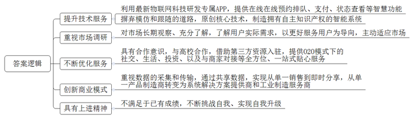
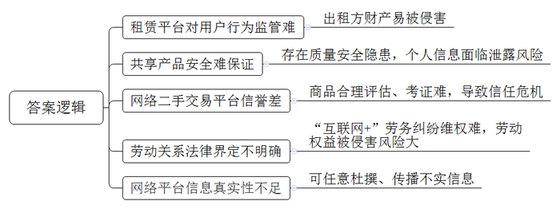
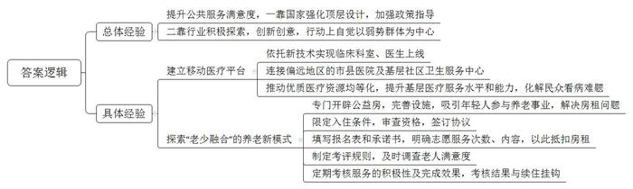
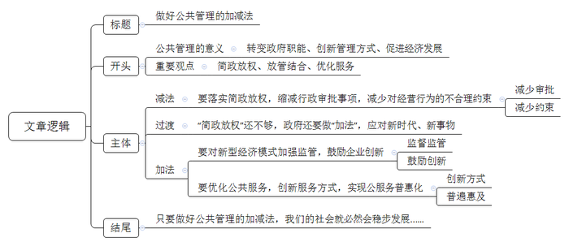

# 2018年公务员多省联考《申论》题（内蒙古卷）

> 候选采集稿。参考答案及解析来自粉笔页面，不代表官方答案或真实高分答卷；来源使用许可与原卷对应关系仍需人工核实。

## 给定材料

### 材料 material-1f74e69b8efc0749

近日，某个国产知名品牌校园洗衣房正式入驻R市大学城，18台物联网自助洗衣设备开始投入使用，为大学生提供自助洗衣服务。与过去的自助投币式洗衣机不同，大学生只要扫描下载该品牌洗衣APP，就可以随时随地实现在线预约排队、在线支付及在线状态查看等。

由于有着对中国当代大学生的长期观察和了解，该品牌依托物联网打造出这一创新模式。这种自助洗衣设备一入驻R市大学城，就受到了大学生们的喜爱。课间查看空余机位，一键下单、手机支付，逐渐成为大学生校园生活的一部分。“自从学校有了这种自助洗衣设备，之前排队洗衣的时间可以用在逛书店和学习上了。现在我们宿舍的六个室友，每人都装了洗衣APP，给我们带来了很多便利。”一名收到洗衣APP取衣提醒后前来取衣的学生告诉记者。

其实，这样的场景每天都在全国200多个城市600多所高校上演。有数据统计，该品牌洗衣APP注册用户数达541万，且日增7000余新用户。事实上，从上世纪90年代起，该品牌以更好服务用户为导向，主动适应市场，就在学校中设立投币式自助洗衣设备，让学校成为其洗衣服务的“重要阵地”。如今，在行业还停留在探索如何刷卡投币解决大学生洗衣排队难题时，该品牌又开始以物联网的理念运作自助洗衣。让在校学生足不出户便可享受到智能预约洗衣、手机下单、在线支付、完成提醒功能等一站式贴心服务，彻底解决了大学生的“洗衣难”问题。此外，通过与全国600多所高校合作，借助第三方资源入驻，该品牌还为大学生提供O2O模式下的校园社交、学生生活、投资机构和商家对接等全方位服务，在资源扩大的同时实现自我升级。

无独有偶，S机床厂通过创新商业模式，实现了在国内外机床行业市场规模整体萎靡之时的逆势上扬。“我本人在机床行业工作近30年，这些年，我冷静下来思考，总结了四句话：第一，我们的员工不满意。任何员工都希望工资越来越高，我们拿什么来给他们发工资？第二，我们的用户不满意。虽然设备都是进口的，但是一些顶尖的机床，国外根本就不卖给我们。第三，我们的领导不满意，说你们什么时候才能赶超日、美、德呢？第四，我自己也不满意。回顾过去，基本啥也没干。”该公司董事长不无幽默地说道。2007年，S机床厂彻底摒弃模仿和跟随的道路，公司科技部的一帮年轻人从源代码开始写起，用了6年时间，原创了多项数控核心技术，诞生了拥有自己知识产权的“智能5代系统”。该系统具有一个很重要的特性：在运行的过程中可以及时采集和传输数据。有了这些数据，客户在手机上就能通过S机床厂的大数据系统随时查看自己工厂的运转情况、机台的生产情况，从而替代了传统的管理。由于掌握了这些最真实的数据，S机床厂又能通过互联网，为客户在线提供技术解决方案，实现人才共享。数据的共享，还为S机床厂开启了一条与众不同的商业模式——不再是传统的机床买卖、加价销售、赚取利润，而是以“零首付”租赁给客户，按小时或者按加工量收费，结算的依据就是机床运转所传输回来的数据。通过赢取用户对企业和产品的信任，让机床的销售从单纯买卖，走向了即时分享，S机床厂已经从过去单纯的产品制造商，转身成为系统解决方案提供商和工业制造服务商。

### 材料 material-6e83d64a7ad63d0a

美国某房屋租赁公司曾发生一起事件。一名房东发现她的公寓被从该公司网站上招来的房客洗劫一空。她在给该公司的信上写道：“他们在我的柜子上凿了个洞，劫走了里面的护照、现金、信用卡和我奶奶的珠宝首饰。不仅如此，他们又搜走了我的照相机、老式电脑和装有我所有相片、日志等备份的外接硬盘。他们掠走了我的一切。”这大概是所有人对互联网时代协同消费经济模式的顾虑了。某调查公司针对美国用户对这一经济模式的调研数据显示，参与调查的人群中，57%的人表示，“对这种消费模式感兴趣，但是仍有顾虑”；而在熟悉这种经济模式的人群中，69%的人认为，“除非信任的人推荐，否则将不会相信”。

共享充电宝在成为许多市民生活“标配”的同时，也引发了不少争议。除了共享充电宝自身的质量安全外，使用者可能还会面临个人信息泄露的风险。曹先生是一位互联网公司的程序员，他说：“每次看到有人使用共享充电宝，我都为他们捏把汗。其实它本质上就是一台电脑，有电脑的地方就会有黑客。现在大数据、算法不断发展，数据公司和社交软件合作，无孔不入地对个人信息进行收集。如今，我们消费时常扫二维码，通过第三方支付对其进行授权，但是第三方支付其实都绑定了个人身份信息、银行卡信息，在扫码过程中，就存在信息泄露的可能。”本应更方便、更优惠的互联网协同消费经济，有时还会让人陷入更大的麻烦。随着家庭用品加速升级换代，如何让闲置物品流转起来，使旧物出售和消费变成“动动手指就能办成的事”，成为商家瞄准的一片蓝海。不过，由于买卖无需“打照面”、交钱与交货环节分离等原因，网络二手交易平台的信誉难以尽如人意，“省时省力不省心”，是不少人的共同印象。与一般商品不同，非标准化是二手商品的最大特点，其损耗程度、保养情况等很难得到最合理的评估、考证。如何让踏实放心取代买卖双方的彼此猜忌，除了考验平台的服务智慧、相关部门的治理决心，还有赖于社会征信体系的建立。

由于制度建设的相对滞后，经济活动过程中产生的纠纷，也让人颇费思量。租车、私厨、保洁……“互联网+”催生了很多以APP为平台的服务业务，通过APP和客户建立联系进行服务，是否就算是和APP的运营公司建立了劳动关系？邓先生、孙先生等7名厨师，通过某公司APP网约客户，成为上门掌勺的“私厨”。日前，他们起诉要求法院确认自己和该公司存在劳动关系，要求支付双倍工资、休息加班费等酬劳。该公司认为，根据双方签订的商务合作协议，孙先生等通过其旗下的APP平台，依照客户需求接单并提供服务，是否接单和工作时间孙先生等人均自行掌握，他们不接受公司管理，因此双方非劳动关系。有法律界人士认为，“互联网+”劳务是近年来兴起的劳务形式，网络服务平台运营方与加入平台的劳动者之间是否构成劳动关系是一个尚有争议的法律问题，这就造成劳动权益被侵害的风险加大。

某些网站只需付费即可杜撰发布不实词条，让人对这场新经济的盛宴又多添了几分忧虑。有网友打趣，互联网平台在实现“与世界分享你的知识、经验和见解”的同时，也在分享着以假乱真的故事。一方面，这一创新模式让人们醉心于知识的汪洋；另一方面，利益架构起来的知识岛屿往往会误导人们求知的航向。一位哲人曾说，一切背离了公正的知识都应叫做狡诈，而不应称为智慧。平台的开放性与真实性从来都不是背道而行，更不容许贪婪的欲望主导信息的传播。每个人不管是主动分享，还是被动接收，都应遵守规则、承担责任，用客观理性的观念培育知识的植株，做一名慧眼识珠的花匠、恪尽职守的护花使者，知识的花朵才会灿然盛开、传递芬芳。

### 材料 material-6944d5591aff069b

2016年开始，A省省立医院尝试建立了“移动医疗平台”，上线临床医技科室53个、医生500余名，连接西南多省的市县医院及基层社区卫生服务中心100余家。2016年底，位于西南边陲的瑶族自治县人民医院骨科的张医生遇到一疑难病例，通过A省省立医院建立的“移动医疗平台”，张医生与省立医院医生联动，很快拿出会诊结论，确定了下一步治疗方案。

“移动医疗平台”让基层医院分享到优质的医疗资源，让基层患者分享到高水平的诊疗医术。通过它，让优质医疗资源上下贯通，提升基层医疗服务能力，—定程度上化解了民众“看病难、看病贵”的难题，提高了公众对医疗卫生服务的满意度。

在新技术不断出现的今天，提升公众对公共服务的满意度，既需要国家拿出顶层设计，也需要各行各业多一些改革探索，多一些奇妙创意，多一些以弱势群体为中心的行动自觉。

日前，B市一家养老机构探索“老少融合”养老新模式，养老院里不光住老人，年轻人也能入住。不过，年轻人必须为老人提供多种形式的志愿服务，通过累积服务时间来兑换住宿权和抵扣房租。

这家养老机构坐落在一栋大楼里，一楼是医院，老人的居住区分布在高层的几个楼层，共有300个床位。而在老人的居室之间，第13层则是专门开辟出来供年轻人居住的公益房—“志愿者之家”。走进“志愿者之家”，首先看到的是公共活动区，区内干净整洁、设施齐全，配有桌球、跑步机、电视、沙发、冰箱等。该机构负责人表示，他们开设公益房的目的，就是为了吸引年轻人参与养老事业，增强敬老、爱老、助老之风，同时也为年轻人解决房租太贵的现实问题。年轻人怎样才能住进养老院的公益房呢？该负责人表示，首先要具备养老服务的热情，然后要通过院方考核，最终达成入住协议。获得入住“志愿者之家”资格的志愿者需要填写《志愿者报名表》《志愿者承诺书》，承诺每周参与志愿服务不低于一定次数。志愿者住进养老院的公益房，是不是就意味着可以免费入住，不用负担房租了呢？答案并非如此。年轻人要想抵扣房租，就要付出劳动。据介绍，目前租金抵扣的方式是：志愿者每周参与一定次数的服务活动且完成服务内容，即可获得具有租金抵扣资格的印花，凭印花抵扣房租，印花的多少决定抵扣房租的多少。

年轻人入住养老机构的模式，在业内也引发了热议。有业内人士指出，尽管此种模式在国外早有先例，但是在国内试水，要小心公益变味。对此，工作人员表示，此种模式目前在起步阶段，“志愿者之家”内部也提前制定了相应的考评规则，每次志愿服务后都会对老人进行满意度调查，目前并无强制规定能入住多久或者一定要服务到什么程度。不过，机构每半年进行一次志愿者服务考核，按照志愿者参与积极性及完成效果，决定其是否延续入住。

### 材料 material-fc5e2281d067ae6b

《一个学子对农村的调查纪实》是H大学新闻与传播学院大三学生小肖的新作。这是他利用三个寒暑假，深入黄土高原农村，穿沟壑、睡窑洞，完成的一部28万字的乡村调查纪实。三年来，小肖身上有两个身份，两个身份之间相距700公里。平时作为H大学新闻与传播学院的学生，节假日来到L县，他就成了黄土地上挥着长鞭驱赶羊群的“羊倌”。小肖和村民们一起劳作，下午三四点下地挖大葱，晚上捆扎，第二天早上6点起来装车，到了7点半准时在县城集市开卖。他说，坐着满载大葱的农用车翻山越岭到县城集市销售，知道山区人起早贪黑赚一两百块钱要付出多少艰辛；骑车跟随乡村教师翻越一道道梁峁，才知道农村教育要付出多大的成本。

置身此地，小肖关注着与都市的红男绿女毫不相关的另一重风景——水土严重流失的沟壑，渴盼脱贫致富的作坊主，困顿无望的留守儿童……他说：“尽管生存环境艰辛，黄土地上的人们从未丢弃坚强、执着、淳朴、宽厚和善良，这些品质都是极其可贵的。改变贫困地区面貌，我们需要多一份真情多一份责任与担当。”如今，小肖重新回归了自己的学生生活。他已经升入大四，开始为毕业论文和升学而忙碌。虽然就读于新闻专业，但小肖似乎已经找到未来的努力方向，他打算申请攻读研究生，研究方向就是“三农”问题。小肖说：“有的同学选择了转入商科、法律，他们有自己的志向，我想自己的志向就在这里了。”

与小肖有着相似理想的刘总，现为省工商联副主席，大学生创业协会会长。他的微信签名这样写道，“我有个梦想：带领一百户农民、一百个大学生真正走上致富的道路！”1998年，他考上了某大学工业电气自动化专业。大二时，他和同学一起创办了大学生创业超市，不仅为自己解决了学杂费问题，还为很多贫困大学生提供了勤工俭学的机会。毕业后，刘总向亲戚朋友筹借了5万余元，选择了自主创业。通过几年的努力，他淘到了人生中第一桶金。日子好了，但刘总还有块心病。看到家乡落后的面貌，他内心很有感触。他说：“带领父老乡亲们一起致富，是我一直以来的梦想。”他回到家乡，拿出资金，带动村民们种水田，并在水田里养殖稻田蟹。他承诺如果赚了大家分，如果赔了由自己个人承担。结果遇上发大水，稻田蟹几乎全部被冲跑。刘总如当初承诺的一样，自己承担了20万元的经济损失。在养殖稻田蟹失败之后，他并没有气馁，他制定了以发展有机农业为主，畜牧业为辅，第三产业为补充的创新经济发展模式。与此同时，刘总又带领村民成立了农牧林专业合作社，与省龙头企业签订了种植1000亩有机水稻的协议，形成了“公司+合作社+农户”的三位一体模式，既保证了土地的增产，也促进了农民的增收。如今，入社成员人均增收千余元。

村民们富了，但刘总并不满足，他又一次把目光聚焦在扶持大学生创业的问题上。2016年，该市成立了大学生创业协会，由他担任会长。协会自成立以来举办了“创业青年进名企”“全市首届大学生创业大赛”“企业名师带高徒”等系列活动。眼皮贴近地皮，才能看见草根。刘总讲出了自己朴实的愿望：希望自己的家乡民风依旧纯朴，希望乡亲们能够和谐相处共同富裕，希望能够助力更多的年轻人实现他们的创业梦想。

## 题目

### 第 1 题

**给定资料**5**描述了国有品牌在新环境下的发展形势，请总结其成功的经验。****（25分）**

关联材料：material-1f74e69b8efc0749

作答要求：

要求：全面，准确，简明，有条理。500字以内。

### 第 2 题

**根据“给定资料**4**”概括互联网协同消费经济存在哪些问题。（15分）**

关联材料：material-6e83d64a7ad63d0a

作答要求：

要求：全面、准确，有条理。不超过300字。

### 第 3 题

**根据给定资料**8**，简述资料中的做法在改善和提高公共服务方面有哪些可借鉴的经验。****（15分）**

关联材料：material-6944d5591aff069b

作答要求：

要求：紧扣材料内容具体，逻辑清晰，层次分明，300字以内。

### 第 4 题

**根据“给定资料**2**”中划线部分“何时做加法，何时做减法，是一门公共管理的艺术，需要智慧，需要眼光，需要技巧，更需要视野。加法和减法，不一样的切入角度，体现不一样的心态和思维逻辑，直接决定了最终的成败”的理解，自拟题目，写一篇文章。（45分）**

关联材料：material-fc5e2281d067ae6b

作答要求：

要求：自选角度，立意明确；联系实际，不拘泥于给定资料；思路清晰，语言流畅；总字数1000-1200字。

## 答案与解析

第 1 题

**参考答案（粉笔题库参考内容）**

1.提升技术服务。利用最新物联网科技研发专属APP，提供在线在线预约排队、支付、状态查看等智慧功能；摒弃模仿和跟随的道路，原创核心技术，制造拥有自主知识产权的智能系统。

2.重视市场调研。对市场长期观察、充分了解，了解用户实际需求，以更好服务用户为导向，主动适应市场。

3.不断优化服务。具有合作意识，与高校合作，借助第三方资源入驻，提供O2O模式下的社交、生活、投资、以及与商家对接等全方位、一站式贴心服务。

4.创新商业模式。重视数据的采集和传输，通过共享数据，实现从单一销售到即时分享，从单一产品制造商转变为系统解决方案提供商和工业制造服务商。

5.具有上进精神。不满足于已有成绩，不断挑战自我、实现自我升级。

**解析**

**参考答案说明**：本题分别从“提升技术服务”“重视市场调研”“不断优化服务”“创新商业模式”“具有上进精神”五个方面介绍经验做法，并且将总结词前置，分条罗列，每条要点间内容上无交叉。

**考点**：考点经验启示类

**来源**：来源2018年公务员多省联考《申论》题（内蒙古卷）

第 2 题

**参考答案（粉笔题库参考内容）**

1.租赁平台对用户行为监管难。出租方财产易被侵害。

2.共享产品安全难保证。存在质量安全隐患，个人信息面临泄露风险。

3.网络二手交易平台信誉差。商品合理评估、考证难，导致信任危机。

4.劳动关系法律界定不明确。“互联网+”劳务纠纷维权难，劳动权益被侵害风险大。

5.网络平台信息真实性不足。可任意杜撰、传播不实信息。

**解析**

**参考答案说明：**本参考答案从“租赁平台”“共享产品”“网络二手交易平台”“互联网劳务关系”“网络平台信息”这五个方面展开，各条答案要点之间在内容上相互并列，没有交叉。

**考点**：考点问题类

**来源**：来源2018年公务员多省联考《申论》题（内蒙古卷）

粉笔申论页面对本题只提供「解析视频」入口，该入口是会员推广位，页面无视频地址与文字解析。

第 3 题

**参考答案（粉笔题库参考内容）**

提升公共服务满意度，一靠国家强化顶层设计，加强政策指导；二靠行业积极探索，创新创意，行动上自觉以弱势群体为中心。

具体经验有：1.建立移动医疗平台。依托新技术实现临床科室、医生上线；连接偏远地区的市县医院及基层社区卫生服务中心；推动优质医疗资源均等化，提升基层医疗服务水平和能力，化解民众看病难题。

2.探索“老少融合”的养老新模式。专门开辟公益房，完善设施，吸引年轻人参与养老事业，解决房租问题；限定入住条件，审查资格，签订协议；填写报名表和承诺书，明确志愿服务次数、内容，以此抵扣房租。制定考评规则，及时调查老人满意度；定期考核服务的积极性及完成效果，考核结果与续住挂钩。

**解析**

**参考答案说明：**本参考答案形式上呈“总分”结构，先介绍了提升公共服务的总体经验；其次分别从“建立移动医疗平台”和“探索‘老少融合’的养老新模式”两个方面介绍了具体经验，各条要点在内容上相互并列，没有交叉。

**考点**：考点经验启示类

**来源**：来源2018年公务员多省联考《申论》题（内蒙古卷）

粉笔申论页面对本题只提供「解析视频」入口，该入口是会员推广位，页面无视频地址与文字解析。

第 4 题

**参考答案（粉笔题库参考内容）**

**做好公共管理加减法**

公共管理是一门艺术，体现行政部门的眼光与智慧，责任与担当。提升公共管理能力，对于转变政府职能、创新管理方式、促进经济发展等都意义重大。因此，党的十八大以来，面对复杂多变的社会事物，我国政府怀抱开放的心态和辩证的思维逻辑，致力于平衡公共管理中的“加法”与“减法”，全面推进“简政放权、放管结合、优化服务”改革，翻开了社会公共管理的新篇章。

**政府要做好公共管理的****“减法”，****就要落实简政放权****，缩减行政审批事项，****减少对****经营行为****的不合理约束****。**过去，政府审批事项过多，种种限制也多有不合理之处，影响了市场主体的积极性。比如农民销售自家的农产品，可能会因没有经营执照而被没收工具，甚至缴纳高额罚款。这就需要落实中央“简政放权”的方针，把政府不该管的事交给市场。但是，简政放权的目标还没有完全实现，今后还要继续推进“负面清单”的制定和公开工作，并将其写入法律制度，尤其要注意进一步减少对于微观事务的管理，从而减少对市场主体一些不必要、不合理的约束。这也是清权、减权的过程。清单越合理、越清晰，改革效果就越大。

当然，“简政放权”并不意味着政府责任的减少。政府还要做好公共管理的“加法”，应对新时代、新事物。

**政府要做好公共管理的****“加法”，****就要对新型经济模式****加强监管，鼓励企业创新。**当前，如互联网产业等新事物、新模式、新产业等层出不穷，它们不但是我国经济的希望所在，也为群众的生活带来了诸多便利。但这些新经济在发展模式、机制和特点等方面与传统经济有很大不同，政府过去的经验不一定能适用。套用老办法，可能将很多新事物扼杀，既制约创新活力，也对创新创业者不公平，甚至可能会引发新风险。所以，政府必须要通过审慎全面的监管，去芜存菁，推动新经济健康发展。同时，政府还应本着鼓励创新、包容审慎的原则，鼓励企业利用新技术、创造新模式。共享单车、共享汽车等企业，就正是在政府的监管和鼓励下一步一步发展壮大，有了今天的规模。

**政府要做好公共管理的****“加法”，还要优化公共服务，创新服务方式，实现公共服务普惠化。**无论是政府推动简政放权，还是完善监管体系，其最终的落脚点都是为了优化公共服务，最终实现服务群众。但随着社会发展，人民群众对公共服务也提出了更多样化、更高质量的要求，这就需要政府充分利用现代技术，让服务方式更加现代化、多元化。比如现在几乎所有社会企业，都开通了移动支付功能，便利消费者，但很多国营企业或景点仍未能开通，这就是政府应该努力的方向。另外，像文化、医疗、养老等公共服务，关系到千家万户，政府还应该进一步普及公共服务，让更多群众能享受到政府福利，提升生活幸福感。

在新时代，只要掌握好公共管理的艺术，做好公共管理的加减法，我们的社会就必然会在这种平衡中稳步发展，群众的生活质量也必然会节节攀升。

**解析**

**文章分析**

**做好公共管理加减法**

【**标题的优点：**首先，范文的标题“做好公共管理加减法”突出了“公共管理的加减法”这一主题。其次，形式上，文字简洁明快。】

（1）公共管理是一门艺术，体现行政部门的眼光与智慧，责任与担当。（2）提升公共管理能力，对于转变政府职能、创新管理方式、促进经济发展等都意义重大。因此，（3）党的十八大以来，面对复杂多变的社会事物，我国政府怀抱开放的心态和辩证的思维逻辑，致力于平衡公共管理中的“加法”与“减法”，全面推进“简政放权、放管结合、优化服务”改革，翻开了社会公共管理的新篇章。

【**开头的优点：**★内容方面。范文的开头是紧扣题目给定的“何时做加法，何时做减法，是一门公共管理的艺术，需要智慧，需要眼光，需要技巧，更需要视野……”这句话展开的。首先，开头点出主题，做到了主题明确。其次，对“公共管理的加减法”这一主题进行了分析阐述：（1）先指出了“公共管理”的含义。（2）接着指出了“提高公共管理能力”的意义。（3）最后指出了“做好公共管理加减法”的对策。★文字表达方面：使用了“因此”“从而”等关联词，使语言表达有逻辑性；长短句配合使用，使语言表达有节奏感。】

**政府要做好公共管理的****“减法”，****就要落实简政放权****，缩减行政审批事项，****减少对****经营行为****的不合理约束****。**（1）过去，政府审批事项过多，种种限制也多有不合理之处，影响了市场主体的积极性。比如农民销售自家的农产品，可能会因没有经营执照而被没收工具，甚至缴纳高额罚款。这就需要落实中央“简政放权”的方针，把政府不该管的事交给市场。但是，（2）简政放权的目标还没有完全实现，今后还要继续推进“负面清单”的制定和公开工作，并将其写入法律制度，尤其要注意进一步减少对于微观事务的管理，从而减少对市场主体一些不必要、不合理的约束。这也是清权、减权的过程。（3）清单越合理、越清晰，改革效果就越大。

【**论述段****1****的优点：**★观点句：范文的观点句是紧扣“公共管理的加减法”这一文章主题提出的。形式上，它在段首处直接写出，位置突出，容易发现。内容上，关键词突出，内容要点明确，可以明显看出它是从“简政放权”入手，指出了“政府公共管理中的‘减法’”。★论述内容：（1）先介绍了“过去政府行政管理存在的问题”；（2）接着介绍了“贯彻落实简政放权的具体措施”；（3）最后介绍了“简政放权的意义”。注意：以上三个方面的内容都是紧扣“政府要做好公共管理的‘减法’，就要落实简政放权，缩减行政审批事项，减少对经营行为的不合理约束”这个观点句进行分析论述的，论述的针对性强，内容层次丰富。在论述方法和论据的选取上做到了讲道理、举例子相结合，做到了丰富多样。】

当然，“简政放权”并不意味着政府责任的减少。政府还要做好公共管理的“加法”，应对新时代、新事物。

【**过渡段的优点：**范文过渡段分析了“公共管理的加减法”不仅要“减”，还要“加”。此外，还要注意过渡段末尾的“政府还要做好公共管理的‘加法’，应对新时代、新事物”是用来引起下文的过渡句。】

**政府要做好公共管理的****“加法”，****就要对新型经济模式****加强监管，鼓励企业创新。**（1）当前，如互联网产业等新事物、新模式、新产业等层出不穷，它们不但是我国经济的希望所在，也为群众的生活带来了诸多便利。（2）但这些新经济在发展模式、机制和特点等方面与传统经济有很大不同，政府过去的经验不一定能适用。套用老办法，可能将很多新事物扼杀，既制约创新活力，也对创新创业者不公平，甚至可能会引发新风险。所以，（3）政府必须要通过审慎全面的监管，去芜存菁，推动新经济健康发展。同时，政府还应本着鼓励创新、包容审慎的原则，鼓励企业利用新技术、创造新模式。共享单车、共享汽车等企业，就正是在政府的监管和鼓励下一步一步发展壮大，有了今天的规模。

【**论述段****2****的优点：**★观点句：范文的观点句是紧扣“公共管理的加减法”这一文章主题提出的。形式上，它在段首处直接写出，位置突出，容易发现。内容上，关键词突出，内容要点明确，可以明显看出它是从“政府加强监管，鼓励企业创新”入手，指出了“政府公共管理中的‘加法’”。★论述内容：（1）先介绍了“我国新经济取得的成绩”；（2）接着介绍了“老方法不适用于新经济”；（3）最后从“加强监管、鼓励创新”两个方面介绍了政府应采取的措施。注意：以上三个方面的内容都是紧扣“政府要做好公共管理的‘加法’，就要对新型经济模式加强监管，鼓励企业创新”这个观点句进行分析论述的，论述的针对性强，内容层次丰富。在论述方法和论据的选取上做到了讲道理、举例子相结合，做到了丰富多样。】

**政府要做好公共管理的****“加法”，还要优化公共服务，创新服务方式，实现公共服务普惠化。**（1）无论是政府推动简政放权，还是完善监管体系，其最终的落脚点都是为了优化公共服务，最终实现服务群众。（2）但随着社会发展，人民群众对公共服务也提出了更多样化、更高质量的要求，这就需要政府充分利用现代技术，让服务方式更加现代化、多元化。比如现在几乎所有社会企业，都开通了移动支付功能，便利消费者，但很多国营企业或景点仍未能开通，这就是政府应该努力的方向。另外，（3）像文化、医疗、养老等公共服务，关系到千家万户，政府还应该进一步普及公共服务，让更多群众能享受到政府福利，提升生活幸福感。

【**论述段****3****的优点：**★观点句：范文的观点句是紧扣“公共管理的加减法”这一文章主题提出的。形式上，它在段首处直接写出，位置突出，容易发现。内容上，关键词突出，内容要点明确，可以明显看出它是从“优化公共服务”入手，指出了“政府公共管理中的‘加法’”。★论述内容：（1）先介绍了“政府工作的落脚点是服务群众”；（2）接着介绍了“让公共服务现代化、多元化”；（3）最后介绍了“让公共服务普及化”。注意：以上三个方面的内容都是紧扣“政府要做好公共管理的‘加法’，还要优化公共服务，创新服务方式，实现公共服务普惠化”这个观点句进行分析论述的，论述的针对性强，内容层次丰富。在论述方法和论据的选取上做到了讲道理、举例子相结合，做到了丰富多样。】

【**论述段之间的关系**：★内容的内在逻辑：范文的论述段之间有两层逻辑。第一层，整体上是从“减法”到“加法”的逻辑展开的。第二层，其中观点2和观点3又是从“加法”出发，论述段2先写了“政府要做好加法，加强监管职能”，论述段3再写了“政府也应当做好服务的加法，让公共服务实现普惠化”。★段与段的外在衔接：论述段1、论述段2之间的过渡段“当然，‘简政放权’并不意味着政府责任的减少。政府还要做好公共管理的‘加法’，应对新时代、新事物”起到了承接论述段1、引出了论述段2、3的作用。】

在新时代，掌握好公共管理的艺术，（1）做好公共管理的加减法，我们的（2）社会必然会在这种平衡中稳步发展，群众的获得感、幸福感也必然会节节攀升。

【**结尾的优点**：范文的结尾回扣了“公共管理的加减法”这一主题。（1）再次提到了“公共管理的加减法”；（2）发出了展望，阐述了深远意义。】

  
  

**考点**：考点文章写作题

**来源**：来源2018年公务员多省联考《申论》题（内蒙古卷）

粉笔申论页面对本题只提供「解析视频」入口，该入口是会员推广位，页面无视频地址与文字解析。

