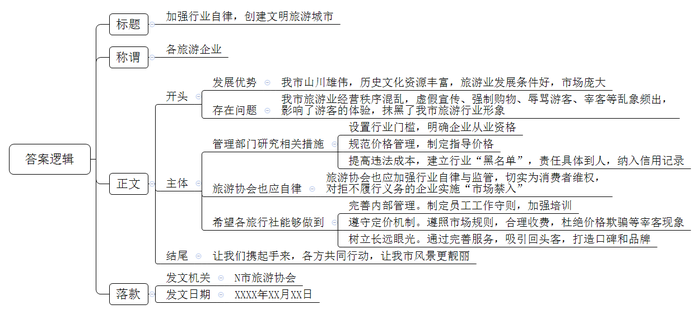
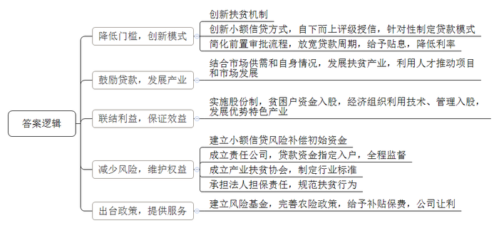
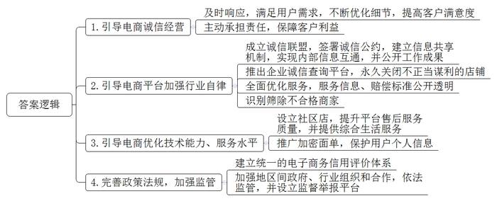

# 2019年公务员多省联考《申论》题（内蒙古卷）

> 候选采集稿。参考答案及解析来自粉笔页面，不代表官方答案或真实高分答卷；来源使用许可与原卷对应关系仍需人工核实。

## 给定材料

### 材料 material-efd2c53c01f4960b

随着社会的发展，旅游已成为一种对美好生活的要求，是老百姓生活中一道亮丽的风景线。N市山川雄伟，拥有丰富的历史文化资源，而且经济发展迅速，市民收入水平高，具有得天独厚发展旅游业的条件。该市旅游业正在飞速发展，相关企业、从业人员和游客数量众多，旅游市场庞大，但遗憾的是，该市旅游业一直比较混乱，经常受到诟病。

余先生近日报名参加了一家旅行社组织的环城周边三日游。“在一家景区就进了七八家购物店，导游一直向我们推荐玉石和银器。我们进店不买东西导游不肯带队离开，有一个购物店我们足足待够了2个小时，行程安排上的景点多数只停留一刻钟，拍拍照就草草结束了。标榜的豪华游最后变成了购物游。”余先生说，“有的团员没有购买任何东西，导游不仅不给好脸色还对游客言语攻击。”

李先生一家趁着小孩子放暑假的机会报名参加了某旅行社的亲子游。旅游即将结束时，导游向他们推荐不在旅游范围内的另一个风景点。在听了天花乱坠的“描述性推介”后，听说每个人只需要150元，李先生一家觉得价钱好像也不贵，而且时间也刚好来得及，就决定掏钱一游。回来后李先生在网上一查，原来到那个风景点去旅游最高也就90元，李先生连呼“上当”，旅游的好心情顿时化为乌有。

此类现象缘何屡禁不止？在N市经营旅行社的王经理认为：“某些旅行社管理混乱，不重视服务质量，一味以低价诱惑顾客，导致旅游行业很不规范。”随着旅游行业成为朝阳产业，旅行社犹如春笋般破土而出，近两年，N市大大小小旅行社达百余家，其中难免鱼龙混杂，泥沙俱下。在王经理看来，有些旅行社根本就是“不怕你不上当，就怕你不来。”报价低得出奇，不可能有利润，就是想引诱顾客，然后千方百计“宰客”。他们多做“一锤子买卖”，不指望什么“回头客”。旅行社经营秩序混乱的问题，已引起有关部门重视，旅游部门整顿过很多次。但是，这些旅行社往往抱着“逮着了就认罚，没逮着我狠”的态度，我行我素，大不了换身行头重新登场。“很重要的原因就是惩罚太轻，违法成本太低。”该市的旅游协会曾会长说，一些不合理低价旅游已经形成了灰色利益链条。受利益驱动，很多旅行社把“宝”全部押在游客身上，有的甚至将游客“转卖”给导游，收取人头费牟利，导游需要先期支付现款，一旦游客不买或者买得少，导游就难以获得回扣，这个团就难以获利，甚至有可能大面积亏损。导游为了赚回成本及利润，就不得不依靠回扣，设法让游客多购物。游客购物多，导游服务态度就好；购物少，导游便冷嘲热讽。

最近，N市提出打造文明旅游城市。但没有良好的旅游市场，文明旅游城市只能是空中楼阁。曾会长说，守住底线关键在于增加失信违法的成本。专家建议，将处罚责任具体到人，并通过全国联网的信用记录等方式，“让失信者寸步难行”。监管和维权体系要更广泛，不仅政府要发挥自身职能，还应包括行业组织。在欧洲一些国家，相关的行业组织以行业自律形式切实为消费者维权，拒不履行义务的企业有可能面临“市场禁入”的严惩。古诗有云“人面桃花相映红”。桃花再红，也需“人”来欣赏；人与风景同在，旅途才会更美。相信在各方的共同推动下，N市的风景会更靓丽。

### 材料 material-ee5373db88511f34

阳光正好，M县永兴村老谭到家门口的木耳地里转了一圈，看着一排排菌棒上厚实的黑木耳，他的心里美滋滋的。不到一年时间，4亩木耳，收入近14万元，从打零工的农民工变身为黑木耳种植大户，他感觉致富步伐越来越快了。

如今在M县，越来越多的贫困户凭信用贷款找到致富门路。这一切源于当地的金融扶贫机制创新。

老谭一家属于因学致贫。他两个儿子正读大学，一个月生活费和其他开销就要4000多元。过去，夫妇俩靠在建筑工地打工，生活捉襟见肘。“没钱不能干事，也不敢干事。”老谭实话实说，过去印象中，贷款只是一些老板的事。有一年，他想贷两万元做生意，银行工作人员解释了一堆贷款政策，老谭依然是一头雾水，只能悻悻作罢。变化说来就来。“去年初，村里传来消息，贫困户不用抵押也能贷款，还有公司来推广黑木耳种植技术，我就想着试一试。”老谭回忆说，没过几天，他就拿到了贷款，甩开膀子干了起来。

为了有效开展精准扶贫，M县探索创新扶贫小额信贷：贫困户经过评级授信，无需抵押和担保，即可从县农商银行拿到1万至5万元的贷款。“我们为贫困户‘量身定制’贷款。诚信评价、家庭劳动力和人均收入，作为评级授信的三项指标，分值分别是70分、20分、10分。”M县农商银行行长介绍，整个授信工作自下而上，主要由熟悉情况的村民代表等组成授信小组，采取投票的方式对贫困户进行量化计分、评级，信用级别越高，贷款额度越大。“贷款周期没有硬性限制，利率也降低了一半，而且根据银行的还息凭证，扶贫部门还给予3年全额贴息奖励。”这和过去形成鲜明的对照。以前贷款的前置审批程序中，光财政证明就有18项之多。另外贷款利息高，一年贷一万元，需要还1000多元利息，贫困户很难承受。

据统计，自推行扶贫小额信贷以来，该县已对2.43万户贫困户完成评级授信，有效授信率达92.35%，共发放小额信用贷款1.26亿元。

贷款的问题解决了，如何杜绝陷入“给一头羊，吃一头羊”的怪圈呢？M县扶贫部门调研发现，尽管政府提供了信用贷款，但有的贫困户还是不敢贷，担心钱打了水漂，还不了钱；另外，有人觉得拿到贷款之后，不知道干什么，所以宁愿不要。M县委书记说：“山里的百姓淳朴，如果不知道做什么可以挣钱，就是答应给他们贷款，他们心里也打鼓。因此，精准扶贫要‘扶上马再送一程’，在解决‘资金跟着穷人走’之后，根据市场供需与自身情况选择扶贫产业，以‘能人’带动大多数贫困户一起发展，‘能人’跟着项目走，项目跟着市场走。”

M县山岗村贫困村民小夏正在当地一家农业发展有限公司的蛋鸡基地紧张地忙碌，他既在基地打工，又是公司的股东。公司董事长介绍说，当地23户贫困户将小额信贷资金75万元委托给公司发展蛋鸡养殖产业，占65%的股份，公司负责蛋鸡产业的技术服务和经营管理，折合35%的股份。去年年底，23户农户实现分红14万元，户均增收6000元。小夏去年底拿到分红1800元，同时他和妻子、岳父三人打工，一年收入将近12万元，小夏笑着说，今年计划贷5万元入伙，“公司有技术、会管理、有市场，我们脱贫有底气。”近年来M县的家禽养殖、木耳种植等产业，催生了一批扶贫经济组织，在精准脱贫实践中成效显著。“立足优势特色产业，在贫困户和农业企业、家庭农场、合作社等扶贫经济组织之间建立紧密的利益联结机制，这样才能保证扶贫效益精准到户。”M县委书记介绍。

以前银行不愿意贷款给贫困户，主要是担心坏账的风险。M县农商银行行长反复说：“风险，还是风险！1.26个亿，没有抵押和担保，你说不担心是假的。”为化解金融部门的后顾之忧，M县专门建立了贫困农户小额信贷风险补偿初始资金，如今规模已达1000万元。“1000万，相对于1.26亿来说，比例很小，保证资金安全是不小的挑战。”为消除银行的担心，M县政府试图引进农业保险公司，交300万的保费，来保1个亿。结果没有一家保险公司接手，理由一致：农业扶贫项目大多不可预期，风险不可测算。去年M县遭遇了一场大洪水、两场冰雹灾害，不少种植户损失比较严重。M县委书记建议，国家进一步完善农险政策的顶层设计，完善“政府补贴一部分保费以扩大参保面、农户自担一部分风险以提高防灾积极性、保险公司让出一部分利润来确保微利可持续经营”的农业保险模式。

扶贫资金监管也是一个课题。怎样有效避免企业以扶贫的名义套取扶贫资金？贫困户的权利如何保障？M县已成立扶贫开发责任公司，贫困户贷款直接打到公司指定账户，企业入股资金也要打到该账户，然后才能施行招标。这样实现全程监管，确保扶贫资金安全。“成立产业扶贫协会，也是可以尝试的方式。”M县委书记说，通过协会制定产业扶贫的行业标准，可以规范扶贫行为，政府只需出台政策，做好相关服务，建立风险基金，行业协会则承担法人的责任担保。

### 材料 material-6915a052706f9ec7

“我做网店这么多年，深知经营者一旦失信，市场就会被扰乱，当你的客户不再相信你时，网店也到了尽头。所以我们必须诚信经营，这样市场才会越做越活，路子越走越远。”凭着多年的努力，为满足客户需求上下求索，诚信经营，40岁农民张某走出了自己的电商致富路。

张某夫妇2014年创办了网店，主要销售地区特色农产品。在张某的心中，做电商想要销路好，最关键的是“诚信”。对于客户提出的问题和要求，他做到有问必答；对于电商上做得不好的细节，他有错必改，直到客户满意。有一次，张某发送给广东的“菜煎饼”专用饼，客户在收到货后，发现饼已经变质。客户把这一问题反映过来后，张某立即查阅物流信息，发现货物在途中多耽误了两天。但是，不管责任在谁，绝不能让客户受到损失，张某毫不犹豫地给客户补发了货物。客户知道原因后要求和他共同承担责任，被他坚决拒绝了。从此，客户对他的产品更加青睐了。从一穷二白做起，凭着诚信经营，张某的网店经营范围逐步扩大，卖出的产品越来越多，收到的好评也越来越多，新客户、回头客络绎不绝。

近年来，随着大数据、云计算等互联网技术的大规模应用，电子商务迅猛发展，已成为我国国民经济的组成部分和重要增长点。对电子商务而言，诚信是其健康发展的重要基础，这已成为众多电商的行业共识。多家电商平台联合成立诚信联盟，签署《电子商务诚信公约》。该联盟旨在通过互联网手段促进行业自律。根据约定，联盟将建立信息共享机制，设立专属网站，实现联盟成员之间的信息互通，并向公众公开联盟工作成果。

多家电子商务平台也以各自的方式开展诚信建设活动。某平台推出企业诚信查询平台。用户登录后，只需在网站输入企业名称和法定代表人信息，就能查询其信用等级以及企业相关情况。该平台还发布处罚公告，宣布永久关闭平台上36家以不正当手段谋取利益的商家店铺。

为了使用户享有便捷、可信、有保障的二手车服务，某二手车平台推出三大透明计划：检测报告、委托/交易合同、服务内容收费标准100%全公开，并做出三大必赔保障承诺：车况不符、车价赚差价、服务费不实必赔。另外，平台会分别通过管理、技术、监管等多个角度对车商进行识别筛除，要求平台的加盟商家签署《诚信商家承诺书》。

“电商诚信问题有时候不是道德问题，而是技术能力和服务水平的问题。”一家电子商务平台的负责人说。电子商务让消费者头疼的一个问题就是售后服务跟不上。为此该平台专门设立只卖服务产品的社区店，围绕平台经营做好售后服务工作；同时，也为周边居民提供家装、维修和保洁等综合服务。在个人隐私保护方面，某快递公司也设计了加密运单，让个人信息不再随包裹“裸奔”。据介绍，作为加密运单的快件，在派件时只有当班次出仓快件的收派员，才能通过手持智能终端扫描看到收件人的电话信息；而在快件运输的环节中，没有人能看到隐藏的信息，这保证了收寄件人的信息安全。

为促进电商市场的健康发展，国家接连出台法规和政策，推动电子商务领域诚信体系建设。2017年1月，国家发改委等九部门发布《关于全面加强电子商务领域诚信建设的指导意见》。2018年7月，商务部印发《2018年商务信用建设工作要点》，部署了包括电子商务在内的四个重点领域的信用工作。2018年8月31日，十三届全国人大常委会第五次会议表决通过《电子商务法》，明确提出要“推进电子商务诚信体系建设”。

地方政府也在积极响应。2018年8月，Y市正式出台了《全面加强电子商务领域诚信建设的实施意见》，逐步建立统一的电子商务信用评价体系。该市的茶叶电商协会负责人说：“电商具有非常明显的跨地域性，不像传统线下商务那么直接、容易受到属地政府部门或者行业组织的监管。电商平台模式对平台方信用程度的要求更高，政府部门、行业组织或信用机构依法进行信用监管，是维护电子商务良好秩序的关键。”

### 材料 material-609e2cbd47b885b0

人无信不立，业无信不兴。诚信不仅是个人安身立命的根本，也是社会良序发展的基石。

党的十八大以来，党和国家高度重视诚信建设。习近平总书记在多个不同场合围绕诚信主题发表了一系列重要论述，从战略高度为新时代中国的诚信建设提供了基本遵循。他从历史维度、价值维度、实践维度对诚信问题进行了深刻阐述，进一步指出中华文化关于诚信的思想和理念，不论过去还是现在，都有其鲜明的民族特色，都有其永不褪色的时代价值。他强调，要运用法治手段解决道德领域突出问题。对突出的诚信缺失问题，既要抓紧建立覆盖全社会的征信系统，又要完善守法诚信褒奖机制和违法失信惩戒机制，使人不敢失信、不能失信。对见利忘义、制假售假的违法行为，要加大执法力度，让败德违法者受到惩治、付出代价。

为全面推进诚信建设，党和国家作出了一系列重要部署。中共中央办公厅印发的《关于培育和践行社会主义核心价值观的意见》强调：“以诚信建设为重点，加强社会公德、职业道德、家庭美德、个人品德教育，形成修身律己、崇德向善、礼让宽容的道德风尚。”中央文明委发布《关于推进诚信建设制度化的意见》，明确规定通过曝光失信当事人、限制严重失信者高消费行为等手段打击失信行为。这是我国第一份强调从制度层面推进国家诚信建设的中央文件。国务院先后发布《关于建设完善守信联合激励和失信联合惩戒制度加快推进社会诚信建设的指导意见》《关于加快推进失信被执行人信用监督、警示和惩戒机制建设的意见》，建立起社会诚信奖惩制度，并进一步完善了失信惩戒制度。诚信建设从注重教育走向教育与制度建设并重。

## 题目

### 第 1 题

**根据“给定资料**8**”，假定你是N市旅游协会的会长，请对全市旅游企业写一份“加强行业自律，为创建文明旅游城市出力”的倡议书。（25分）**

关联材料：material-efd2c53c01f4960b

作答要求：

要求：

（1）紧扣资料，内容具体；

（2）条理清晰，层次分明；

（3）不超过450字。

### 第 2 题

**根据“给定资料**3**”请谈谈M县采取了哪些有效措施推进金融扶贫。（15分）**

关联材料：material-ee5373db88511f34

作答要求：

要求：全面、准确、简明，有条理，不超过300字。

### 第 3 题

**根据“给定资料**6**”，假定你是某市市场监管管理局的工作人员，请就加强本市电商诚信体系建设提出政策建议。（15分）**

关联材料：material-6915a052706f9ec7

作答要求：

要求：

（1）紧扣资料，内容具体；

（2）层次分明，建议可行；

（3）不超过300字。

### 第 4 题

**“给定资料**2**”中提到，“信用既是一种道德品质，也是一种制度和规则。”请你根据对这句话的理解，自拟题目，写一篇文章。（45分）**

关联材料：material-609e2cbd47b885b0

作答要求：

要求：

（1）自选角度，立意明确；

（2）联系实际，不拘泥于“给定资料”；

（3）思路清晰，语言流畅；

（4）总字数1000—1200字。

## 答案与解析

第 1 题

**参考答案（粉笔题库参考内容）**

加强行业自律，创建文明旅游城市

各旅游企业：

我市山川雄伟，历史文化资源丰富，旅游业发展条件好，市场庞大。然而，我市旅游业经营秩序混乱，虚假宣传、强制购物、辱骂游客、宰客等乱象频出，影响了游客的体验，抹黑了我市旅游行业形象。

针对这些现象，管理部门研究相关措施：如设置行业门槛，明确企业从业资格；规范价格管理，制定指导价格；提高违法成本，建立行业“黑名单”，责任具体到人，纳入信用记录。同时，旅游协会也应加强行业自律与监管，切实为消费者维权，对拒不履行义务的企业实施“市场禁入”。

希望各旅行社能够做到：一、完善内部管理。制定员工工作守则，加强培训。二、遵守定价机制。遵照市场规则，合理收费，杜绝价格欺骗等宰客现象。三、树立长远眼光。通过完善服务，吸引回头客，打造口碑和品牌。

让我们携起手来，各方共同行动，让我市风景更靓丽！

N市旅游协会

XXXX年XX月XX日

**解析**

**参考答案说明：**（1）格式方面，本参考答案写到了“标题”“称谓”“正文”“落款”。（2）正文部分，一方面从内容来看，围绕着“加强行业自律，创建文明旅游城市”这一主题，本参考答案的开头先写到了N市创建文明旅游城市优势、问题；主体部分从“管理部门”“旅游协会”“旅行社”这三个主体出发给出了具体的建议；结尾进行总结、呼吁。另一方面，形式上，本参考答案做到了分段、分条撰写，整体上条理较为清晰。（3）本参考答案能够结合“倡议书”的特点，在语言表达上做到了有感染力、流畅。

**考点**：考点宣传类

**来源**：来源2019年公务员多省联考《申论》题（内蒙古卷）

粉笔申论页面对本题只提供「解析视频」入口，该入口是会员推广位，页面无视频地址与文字解析。

第 2 题

**参考答案（粉笔题库参考内容）**

一、降低门槛，创新模式。创新扶贫机制；创新小额信贷方式，自下而上评级授信，针对性制定贷款模式；简化前置审批流程，放宽贷款周期，给予贴息，降低利率。

二、鼓励贷款，发展产业。结合市场供需和自身情况，发展扶贫产业，利用人才推动项目和市场发展。

三、联结利益，保证效益。实施股份制，贫困户资金入股，经济组织利用技术、管理入股，发展优势特色产业。

四、减少风险，维护权益。建立小额信贷风险补偿初始资金；成立责任公司，贷款资金指定入户，全程监督；成立产业扶贫协会，制定行业标准；承担法人担保责任，规范扶贫行为。

五、出台政策，提供服务。建立风险基金，完善农险政策，给予补贴保费，公司让利。

**解析**

**参考答案说明：**答案从“降低门槛，创新模式”“鼓励贷款，发展产业”“联结利益，保证效益”“减少风险，维护权益”“出台政策，提供服务”等五个方面对措施进行了分条撰写。各条要点之间在内容上是并列关系，没有交叉。

**考点**：考点概括措施类

**来源**：来源2019年公务员多省联考《申论》题（内蒙古卷）

粉笔申论页面对本题只提供「解析视频」入口，该入口是会员推广位，页面无视频地址与文字解析。

第 3 题

**参考答案（粉笔题库参考内容）**

1.引导电商诚信经营。及时响应，满足用户需求，不断优化细节，提高客户满意度；主动承担责任，保障客户利益。

2.引导电商平台加强行业自律。成立诚信联盟，签署诚信公约，建立信息共享机制，实现内部信息互通，并公开工作成果；推出企业诚信查询平台，永久关闭不正当谋利的店铺；全面优化服务，服务信息、赔偿标准公开透明；识别筛除不合格商家。

3.引导电商优化技术能力、服务水平。设立社区店，提升平台售后服务质量，并提供综合生活服务；推广加密面单，保护用户个人信息。

4.完善政策法规，加强监管。建立统一的电子商务信用评价体系；加强地区间政府、行业组织的合作，依法监管，并设立监督举报平台。

**解析**

**参考答案说明**：本参考答案分别从“引导电商诚信经营”“引导电商平台加强行业自律”“引导电商优化技术能力、服务水平”“完善政策法规，加强监管”这四个方面展开，各条答案要点分条罗列，在内容上无交叉。

**考点**：考点提出对策类

**来源**：来源2019年公务员多省联考《申论》题（内蒙古卷）

粉笔申论页面对本题只提供「解析视频」入口，该入口是会员推广位，页面无视频地址与文字解析。

第 4 题

**参考答案（粉笔题库参考内容）**

**刚柔并济，共建诚信社会**

当人们在评价某个人很有信用时，往往会用诚信、诚实等形容品质的词汇，所以信用代表了道德品质，是对个人的人格勾勒，是一种柔性的力量。当然，一说到信用，人们也会用“遵守信用”来搭配，因此信用是对公民在公共事务中态度和做法的描述。遵守信用的背后，体现出一种社会契约，需要大家共同遵守，它也是一种制度和规则，是一种刚性的力量。

**建设诚信社会，需要“刚柔并济”，将道德和制度有机统一起来。**道德本身具备一定的强制性。通过个体良心的谴责，舆论的否定性评价等方式，道德可以规范社会行为。所以，构建诚信社会，需要道德的力量。但是，在快速发展、变迁的社会中，单纯依靠道德是不够的，还需要约束力更强的规则、法律、制度。通过国家强制力来规范各类经济社会活动，建设诚信社会。当然，所有的规章制度都是建立在一定的文化、社会风气基础上，制度建设的最理想状态就是变成社会行为、文化、风气的一部分。所以，构建诚信社会，一方面要通过教育、引导、宣传等手段发挥道德的柔性力量；另一方面也需要通过法律、社会征信系统、奖惩机制等手段加强道德的刚性约束。

**构建诚信社会，应通过教育、宣传、引导等手段，提升道德水平。**信用是一种道德品质，这种品质体现在方方面面。它既包含个人品德、家庭美德等个人私德；也囊括职业道德、社会美德等社会公德。而在当下，却出现个人学术造假，离婚率居高不下，收礼、拿红包现象频繁，各类诈骗案被持续曝光等现象，在这背后不难发现，小到个人层面，大到社会公德，都有诚信缺失的影子。毋庸赘言，提升全民的诚信水平已成为当务之急。构建诚信社会，需要发挥出道德的柔性力量，通过“三微一端”、课堂教育等手段加大宣传引导，也可以通过各类诚信人物的评选活动，来进行教化。

我国目前正处在社会转型阶段，由熟人社会向陌生人社会转变，利益主体多元，社会经济活动增多。**单纯依靠道德的约束是不够的，还必须利用法律手段，建立社会征信系统，完善奖惩机制。**

老话说：“业无信不兴”。企业和社会团体的失信往往会影响自身公信力，导致利益受损。但“店大欺客”现象也时有发生。从最近发生的“奔驰女车主维权”事件可以发现，若企业出现失信行为，单纯依靠教育、引导，呼吁其加强自省，效果往往不尽人意。因此，就需要“刚性”手段，利用法律手段，尤其是奖惩机制来规范社会行为。政府、银行、企业、社会团体，利用互联网、大数据，共同建立统一的征信体系。对守信方，提供政策、资金、公共服务等方面的便利，并向社会广泛宣传；对失信方，在医食住用行等方面进行限制，并依法向社会公示，起到震慑作用。

信用是我们的一种内在品德，也是外界对我们的一种要求、规范。建设诚信社会，既需要“柔性”的教育，也需要“刚性”的制度，只有“刚柔并济”，才能为“诚信”提供一片肥沃的“土壤”，让诚信成为国家治理体系建设的新支柱，成为治理能力现代化提升的新抓手。

**解析**

**文章分析**

**刚柔并济，共建诚信社会**

【**标题的优点：**首先，范文的标题“刚柔并济，共建诚信社会”突出了“信用既是一种道德品质，也是一种制度和规则”这一主题。其次，形式上，文字简洁明快。】

（1）当人们在评价某个人很有信用时，往往会用诚信、诚实等形容品质的词汇，所以信用代表了道德品质，是对个人的人格勾勒，是一种柔性的力量。当然，（2）一说到信用，人们也会用“遵守信用”来搭配，因此信用是对公民在公共事务中态度和做法的描述。遵守信用的背后，体现出一种社会契约，需要大家共同遵守，它也是一种制度和规则，是一种刚性的力量。

【**开头的优点：**★内容方面。范文的开头是紧扣“信用既是一种道德品质，也是一种制度和规则”这一主题展开的。首先，开头点出主题，做到了主题明确。其次，对“信用既是一种道德品质，也是一种制度和规则”这一主题进行了分析阐述：（1）先从道德层面对信用进行了阐述；（2）再从制度层面对信用进行了阐述。★文字表达方面：使用了“所以……”“也是……”等关联句式，使语言表达有逻辑性。】

**建设诚信社会，需要****“刚柔并济”，将道德和制度有机统一起来。**（1）道德本身具备一定的强制性。通过个体良心的谴责，舆论的否定性评价等方式，道德可以规范社会行为。所以，构建诚信社会，需要道德的力量。但是，（2）在快速发展、变迁的社会中，单纯依靠道德是不够的，还需要约束力更强的规则、法律、制度。通过国家强制力来规范各类经济社会活动，建设诚信社会。当然，所有的规章制度都是建立在一定的文化、社会风气基础上，制度建设的最理想状态就是变成社会行为、文化、风气的一部分。所以，构建诚信社会，一方面要通过教育、引导、宣传等手段发挥道德的柔性力量；另一方面也需要通过法律、社会征信系统、奖惩机制等手段加强道德的刚性约束。

【**观点****1段落的优点：**★观点句：范文的观点句是紧扣“信用既是一种道德品质，也是一种制度和规则”这一主题提出的。形式上，它在段首处直接写出，位置突出，容易发现。内容上，要点明确，可以明显看出它是从“道德与制度的关系”入手，指出了“信用建设需要兼顾道德与制度”。★论述内容：（1）先介绍了“为什么建设诚信社会需要道德约束”；（2）再介绍了“为什么建设诚信社会需要制度约束”。注意：以上两个方面的内容都是紧扣“建设诚信社会，需要‘刚柔并济’，将道德和制度有机统一起来”这个观点句进行分析论述的，论述的针对性强，内容层次丰富。最后，在论述方法和论据的选取上以讲道理为主，做到了分析透彻、层次清晰。】

**构建诚信社会，应通过教育、宣传、引导等手段，提升道德水平。**（1）信用是一种道德品质，这种品质体现在方方面面。它既包含个人品德、家庭美德等个人私德；也囊括职业道德、社会美德等社会公德。（2）而在当下，却出现个人学术造假，离婚率居高不下，收礼、拿红包现象频繁，各类诈骗案被持续曝光等现象，在这背后不难发现，小到个人层面，大到社会公德，都有诚信缺失的影子。毋庸赘言，提升全民的诚信水平已成为当务之急。（3）构建诚信社会，需要发挥出道德的柔性力量，通过“三微一端”、课堂教育等手段加大宣传引导，也可以通过各类诚信人物的评选活动，来进行教化。

【**观点****2段落的优点：**★观点句：范文的观点句是紧扣“信用既是一种道德品质，也是一种制度和规则”这一主题提出的。形式上，它在段首处直接写出，位置突出，容易发现。内容上，要点明确，可以明显看出它是从“道德约束”入手，指出了“如何建设诚信社会”。★论述内容：（1）先介绍了“信用在道德层面的表现”；（2）再介绍了“当前信用滑坡的现象”；（3）最后介绍了“如何借用道德力量建设诚信社会”。注意：以上三个方面的内容都是紧扣“构建诚信社会，应通过教育、宣传、引导等手段，提升道德水平”这个观点句进行分析论述的，论述的针对性强，内容层次丰富。最后，在论述方法和论据的选取上做到了讲道理、举例相结合，做到了丰富多样。】

我国目前正处在社会转型阶段，由熟人社会向陌生人社会转变，利益主体多元，社会经济活动增多。**单纯依靠道德的约束是不够的，还必须利用法律手段，建立社会征信系统，完善奖惩机制**。

老话说：“业无信不兴”。（1）企业和社会团体的失信往往会影响自身公信力，导致利益受损。但“店大欺客”现象也时有发生。从最近发生的“奔驰女车主维权”事件可以发现，若企业出现失信行为，单纯依靠教育、引导，呼吁其加强自省，效果往往不尽人意。因此，（2）就需要“刚性”手段，利用法律手段，尤其是奖惩机制来规范社会行为。政府、银行、企业、社会团体，利用互联网、大数据，共同建立统一的征信体系。对守信方，提供政策、资金、公共服务等方面的便利，并向社会广泛宣传；对失信方，在医食住用行等方面进行限制，并依法向社会公示，起到震慑作用。

【**观点****3段落的优点：**★观点句：范文的观点句是紧扣“信用既是一种道德品质，也是一种制度和规则”这一主题提出的。形式上，它在段首处直接写出，位置突出，容易发现。内容上，要点明确，可以明显看出它是从“制度约束”入手，指出了“如何建设诚信社会”。★论述内容：（1）先介绍了“之所以需要制度约束的原因”；（2）再介绍了“如何借用制度的力量建设诚信社会”。注意：以上两个方面的内容都是紧扣“必须利用法律手段，建立社会征信系统，完善奖惩机制”这个观点句进行分析论述的，论述的针对性强，内容层次丰富。最后，在论述方法和论据的选取上做到了讲道理、举例相结合，做到了丰富多样。】

【**论述段之间的关系：**★内容的内在逻辑：范文的论述段之间有两层逻辑。第一层，整体上是从“分析”到“对策”的逻辑展开的。第二层，其中观点2和观点3又是从“对策”出发，论述段2先写了“借助道德力量建设诚信社会”，论述段3再写了“借助法制力量建设诚信社会”。★段与段的外在衔接：论述段3的段首处的过渡句“我国目前正处在社会转型阶段，由熟人社会向陌生人社会转变，利益主体多元，社会经济活动增多。单纯依靠道德的约束是不够的”，起到了承接论述段2、引出了论述段3的作用。】

信用是我们的一种内在品德，也是外界对我们的一种要求、规范。（1）建设诚信社会，既需要“柔性”的教育，也需要“刚性”的制度，只有“刚柔并济”，才能为“诚信”提供一片肥沃的“土壤”，（2）让诚信成为国家治理体系建设的新支柱，成为治理能力现代化提升的新抓手。

【**结尾的优点**：范文的结尾回扣了“信用既是一种道德品质，也是一种制度和规则”这一主题。（1）再次提到了“信用既是一种道德品质，也是一种制度和规则”；（2）发出了号召希望。】

**考点**：考点文章写作题

**来源**：来源2019年公务员多省联考《申论》题（内蒙古卷）

粉笔申论页面对本题只提供「解析视频」入口，该入口是会员推广位，页面无视频地址与文字解析。

