# 2019年420联考《行测》题（内蒙古卷）（网友回忆版）

<!-- gwy:overview:start -->
> **内蒙古 · 2019 · 行测 · 统考** ｜ 120 题 · 图片 82 处 · 答案随题折叠

| 题型模块 | 题量 | 题号 |
| --- | ---: | ---: |
| 常识判断 | 25 | 1–25 |
| 言语理解与表达 | 35 | 26–60 |
| 数量关系 | 10 | 61–70 |
| 判断推理 | 35 | 71–105 |
| 资料分析 | 15 | 106–120 |
| **合计** | **120** | |

导航：[题型与作答说明](#题型与作答说明) · [题目](#题目) · [材料 1](#材料-1)
<!-- gwy:overview:end -->

> 候选采集稿。参考答案及解析来自粉笔页面，不代表官方答案或真实高分答卷；来源使用许可与原卷对应关系仍需人工核实。

## 题型与作答说明

常识判断

（25题）

根据题目要求，在四个选项中选出一个最恰当的答案。

言语理解与表达

（35题）

本部分包括表达与理解两方面的内容。请根据题目要求，在四个选项中选出一个最恰当的答案。

数量关系

（10题）

在这部分试题中，每道题呈现一段表述数字关系的文字，要求你迅速、准确地计算出答案。

判断推理

（35题）

本部分包括图形推理、定义判断、类比推理与逻辑判断四种类型的试题，在四个选项中选出一个最恰当的答案。

资料分析

（15题）

所给出的图、表、文字或综合性资料均有若干个问题要你回答。你应根据资料提供的信息进行分析、比较、计算和判断处理。

## 题目

### 第 1 题

习近平总书记在中央政治局第十三次集体学习时强调，要精准有效处置重点领域风险，深化金融改革开放，增强金融服务           能力，坚决打好防范化解包括金融风险在内的重大风险攻坚战，推动我国金融业健康发展。

A. 实体经济

B. 私营经济

C. 中小企业

D. 国有企业

第 1 题 · 答案与解析

**参考答案（粉笔题库参考内容）**

A

**解析**

本题考查政治常识。

2019年2月22日，中共中央政治局就完善金融服务、防范金融风险举行第十三次集体学习。习近平总书记在主持学习时强调：“要深化对国际国内金融形势的认识，正确把握金融本质，深化金融供给侧结构性改革，平衡好稳增长和防风险的关系，精准有效处置重点领域风险，深化金融改革开放，增强金融服务**实体经济**能力，坚决打好防范化解包括金融风险在内的重大风险攻坚战，推动我国金融业健康发展。”

故正确答案为A。

**考点**：经济建设、重要会议讲话

**来源**：2019年420联考《行测》题（黑龙江省直卷）（网友回忆版）第1题

### 第 2 题

下列属于改革开放40年来我国经济建设所取得伟大成就的是：

①建立了最完整的现代工业体系

②成为了世界商品消费第一大国

③主要农产品的产量跃居世界前列

④外汇储备连续多年位居世界第一

A. ①②④

B. ①③④

C. ②③④

D. ①②③④

第 2 题 · 答案与解析

**参考答案（粉笔题库参考内容）**

B

**解析**

本题考查政治常识。

2018年12月18日，习近平总书记在庆祝改革开放40周年大会上的讲话中指出：“我国主要农产品产量跃居世界前列，建立了全世界最完整的现代工业体系，科技创新和重大工程捷报频传。我国基础设施建设成就显著，信息畅通，公路成网，铁路密布，高坝矗立，西气东输，南水北调，高铁飞驰，巨轮远航，飞机翱翔，天堑变通途。现在，我国是世界第二大经济体、制造业第一大国、货物贸易第一大国、商品消费第二大国、外资流入第二大国（2020年我国成为外资流入第一大国），我国外汇储备连续多年位居世界第一，中国人民在富起来、强起来的征程上迈出了决定性的步伐！”所以，①③④表述正确，②错误。

故正确答案为B。

**考点**：重要会议讲话

**来源**：2019年420联考《行测》题（黑龙江省直卷）（网友回忆版）第2题

### 第 3 题

关于生态文明建设，下列说法正确的是:

A. 蓝天保卫战是全面建成小康社会的三大攻坚战之一

B. 加快构建生态文明体系是解决污染问题的根本之策

C. 生态环境安全是经济社会持续健康发展的重要保障

D. 地方政府主要领导是本行政区域生态环境保护第一责任人

第 3 题 · 答案与解析

**参考答案（粉笔题库参考内容）**

C

**解析**

本题考查政治常识。

A项错误，2017年10月18日，习近平总书记在十九大报告中指出：“要坚决打好**防范化解重大风险、精准脱贫、污染防治的攻坚战**，使全面建成小康社会得到人民认可、经得起历史检验。”蓝天保卫战并不是三大攻坚战之一。

B项错误，2018年5月18日至19日，习近平总书记在全国生态环境保护大会上强调：“要全面推动绿色发展**。绿色发展是构建高质量现代化经济体系的必然要求，是解决污染问题的根本之策。**”

C项正确，2018年5月18日至19日，习近平总书记在全国生态环境保护大会上强调：“要有效防范生态环境风险。**生态环境安全是国家安全的重要组成部分，是经济社会持续健康发展的重要保障。**”

D项错误，2018年5月18日至19日，习近平总书记在全国生态环境保护大会上强调：“各地区各部门要增强‘四个意识’，坚决维护党中央权威和集中统一领导，坚决担负起生态文明建设的政治责任。**地方各级党委和政府主要领导是本行政区域生态环境保护第一责任人，**各相关部门要履行好生态环境保护职责，使各部门守土有责、守土尽责，分工协作、共同发力。”

故正确答案为C。

**考点**：生态文明建设

**来源**：2019年420联考《行测》题（江西乡镇）（网友回忆版）第15题

### 第 4 题

关于全面依法治国，下列说法**不准确**的是：

A. 到本世纪中叶，基本建成法治国家、法治政府、法治社会

B. 全面依法治国在“四个全面”中具有基础性、保障性作用

C. 党的领导是社会主义法治最根本的保证

D. 中国特色社会主义法治体系是中国特色社会主义制度的法律表现形式

第 4 题 · 答案与解析

**参考答案（粉笔题库参考内容）**

A

**解析**

本题考查政治常识。

A项错误，党的十九大报告指出：“综合分析国际国内形势和我国发展条件，从2020年到本世纪中叶可以分两个阶段来安排。第一个阶段，**从2020年到2035年**，在全面建成小康社会的基础上，再奋斗十五年，基本实现社会主义现代化。到那时，我国经济实力、科技实力将大幅跃升，跻身创新型国家前列；**人民平等参与、平等发展权利得到充分保障，法治国家、法治政府、法治社会基本建成**，各方面制度更加完善，国家治理体系和治理能力现代化基本实现······”因此，到2035年，基本建成法治国家、法治政府、法治社会。

B项正确，2018年8月24日中央全面依法治国委员会第一次会议顺利召开，习近平总书记作出重要讲话。他强调：“**全面依法治国具有基础性、保障性作用**，在统筹推进伟大斗争、伟大工程、伟大事业、伟大梦想，全面建设社会主义现代化国家的新征程上，要加强党对全面依法治国的集中统一领导，坚持以全面依法治国新理念新思想新战略为指导，坚定不移走中国特色社会主义法治道路，更好发挥法治固根本、稳预期、利长远的保障作用。”

C项正确，党的十八届四中全会通过的《中共中央关于全面推进依法治国若干重大问题的决定》指出：“党的领导是中国特色社会主义最本质的特征，是社会主义法治最根本的保证。”

D项正确，建设中国特色社会主义法治体系、建设社会主义法治国家是坚持和发展中国特色社会主义的内在要求。习近平总书记强调：“我们要建设的中国特色社会主义法治体系，本质上是中国特色社会主义制度的法律表现形式”。

本题为选非题，故正确答案为A。

**考点**：其他建设

**来源**：2019年420联考《行测》题（黑龙江省直卷）（网友回忆版）第3题

### 第 5 题

下列关于改革开放历史地位的表述正确的是：

①是决定当代中国命运的关键一招

②是党和人民大踏步赶上时代的重要法宝

③是坚持和发展中国特色社会主义的必由之路

④是决定实现“两个一百年”奋斗目标、实现中华民族伟大复兴的关键一招

A. ①②③

B. ①③④

C. ②③④

D. ①②③④

第 5 题 · 答案与解析

**参考答案（粉笔题库参考内容）**

D

**解析**

本题考查政治常识。

习近平总书记在庆祝改革开放40周年大会上说：“ 40年的实践充分证明，改革开放是党和人民大踏步赶上时代的重要法宝，是坚持和发展中国特色社会主义的必由之路，是决定当代中国命运的关键一招，也是决定实现“两个一百年”奋斗目标、实现中华民族伟大复兴的关键一招。”

①②③④都正确。

故正确答案为D。

**考点**：经济建设、重要会议讲话

**来源**：2019年420联考《行测》题（海南卷精选）（网友回忆版）第17题

### 第 6 题

2018年我国科技界取得了一系列重大成果，这些成果中**不包括**：

A. 第二艘航母出海试航

B. 嫦娥四号探测器发射成功

C. 造岛神器“天鲲号”下水

D. 国产大型水陆两栖飞机水上首飞

第 6 题 · 答案与解析

**参考答案（粉笔题库参考内容）**

C

**解析**

本题考查政治常识。

A项正确，2018年5月13日，我国第二艘航母从大连造船厂码头启航，赴相关海域执行海上试验任务，主要检测验证动力系统等设备的可靠性和稳定性。

B项正确，2018年12月8日2时23分，我国在西昌卫星发射中心用长征三号乙运载火箭成功发射嫦娥四号探测器，开启了月球探测的新旅程。嫦娥四号探测器后续将经历地月转移、近月制动、环月飞行，最终实现人类首次月球背面软着陆，开展月球背面就位探测及巡视探测，并通过已在使命轨道运行的“鹊桥”中继星，实现月球背面与地球之间的中继通信。

C项错误，2017年11月3日，由我国自主设计研发的新一代国之重器——“天鲲号”自航绞吸挖泥船成功下水。从被称为“造岛神器”的“天鲸号”，到目前亚洲最大最先进的“天鲲号”，中国自航绞吸挖泥船的自主研制实力再一次让世人惊叹。

D项正确，2018年10月20日，中国自主研制的大型水陆两栖飞机——“鲲龙”AG600在湖北荆门漳河机场成功实现水上首飞。至此，中国大飞机终于迈出“上天入海”完整步伐，建设航空强国轮廓愈发明晰。

本题为选非题，故正确答案为C。

**考点**：科技理论与成就

**来源**：2019年420联考《行测》题（黑龙江省直卷）（网友回忆版）第4题

### 第 7 题

下列法律法规中，哪一项**不是**从2019年1月1日起施行？

A. 《中华人民共和国电子商务法》

B. 《中华人民共和国土壤污染防治法》

C. 新修订的《中华人民共和国公务员法》

D. 新修订的《中华人民共和国个人所得税法实施条例》

第 7 题 · 答案与解析

**参考答案（粉笔题库参考内容）**

C

**解析**

本题考查法律。

A项正确，《中华人民共和国电子商务法》是2018年8月31日第十三届全国人民代表大会常务委员会第五次会议通过，本法第八十九条规定：“本法自2019年1月1日起施行。”

B项正确，《土壤污染防治法》是2018年8月31日十三届全国人大常委会第五次会议全票通过，本法第九十九条规定：“本法自2019年1月1日起施行。”

C项错误，《中华人民共和国公务员法》已由中华人民共和国第十三届全国人民代表大会常务委员会第七次会议于2018年12月29日修订通过，自2019年6月1日起施行。

D项正确，《中华人民共和国个人所得税法实施条例》是国务院发布的法规，2018年12月18日中华人民共和国国务院令第707号第四次修订通过，第三十六条规定：“本条例自2019年1月1日起施行。”

本题为选非题，故正确答案为C。

**考点**：法理学

**来源**：2019年420联考《行测》题（江西乡镇）（网友回忆版）第18题

### 第 8 题

下列关于全国经济普查的说法**错误**的是：

A. 根据《全国经济普查条例》的规定，经济普查每5年进行一次

B. 目的是全面调查我国第一、第二、第三产业的发展规模、布局和效益

C. 普查取得的单位和个人资料，不作为对普查对象实施处罚的依据

D. 2019年1月1日，第四次全国经济普查现场登记工作正式启动

第 8 题 · 答案与解析

**参考答案（粉笔题库参考内容）**

B

**解析**

本题考查法律常识。

A项正确，《全国经济普查条例》第七条规定：“经济普查每5年进行一次，标准时点为普查年份的12月31日。”

B项错误，《全国经济普查条例》第二条规定：“经济普查的目的，是为了**全面掌握我国第二产业、第三产业的发展规模、结构和效益等情况**，建立健全基本单位名录库及其数据库系统，为研究制定国民经济和社会发展规划，提高决策和管理水平奠定基础。”

C项正确，《全国经济普查条例》第三十三条规定：“经济普查取得的单位和个人资料，严格限定用于经济普查的目的，不作为任何单位对经济普查对象实施处罚的依据。”

D项正确，2019年1月1日零时，第四次全国经济普查现场登记工作正式启动。按照部署，第四次全国经济普查标准时点为2018年12月31日，普查时期资料为2018年年度资料。

本题为选非题，故正确答案为B。

**考点**：其他法律法规

**来源**：2019年420联考《行测》题（江西乡镇）（网友回忆版）第4题

### 第 9 题

荷花虽生长于池塘的污泥中，但荷叶却出污泥而不染，其主要原因是：

A. 荷叶含有大量的叶绿素，能与太阳光发生光合作用，产生自清洁

B. 荷叶表面光滑，具有非常强的光洁度，污泥很难在它的表面吸附

C. 荷叶含有疏水的纳米级蜡质，雨露落在上面会形成水珠清洁叶面

D. 荷花枝干细长，水珠落在荷叶上，容易造成荷叶晃动，甩出污泥

第 9 题 · 答案与解析

**参考答案（粉笔题库参考内容）**

C

**解析**

本题考查科技常识。

荷叶之所以能出污泥而不染是由荷叶叶面上存在着复杂的多重纳米和微米级的超微结构决定的：在超高分辨率显微镜下可以清晰看到，荷叶表面上有许多微小的乳突，它上面长满茸毛，乳突间的凹陷部分充满空气，这样就在紧贴叶面处形成一层极薄的只有纳米量级厚的空气层。这使得在尺寸上远大于这种结构的灰尘、雨水等降落在叶面上后，隔着一层极薄的空气，从而雨水会自动聚集成球形水珠，而水珠的滚动会把落在叶面上的尘土污泥吸附掉滚出叶面，使叶面始终保持干净，这就是著名的“荷叶自洁效应”。

故正确答案为C。

**考点**：物理常识

**来源**：2019年420联考《行测》题（黑龙江省直卷）（网友回忆版）第6题

### 第 10 题

首次把《大学》《中庸》《论语》和《孟子》编在一起的学者是：

A. 朱熹

B. 程颐、程颢

C. 董仲舒

D. 颜之推

第 10 题 · 答案与解析

**参考答案（粉笔题库参考内容）**

A

**解析**

本题考查人文常识。

A项正确，南宋理学家朱熹首次将《大学》、《中庸》、《论语》、《孟子》汇集在一起，并为其作章句集注，成《四书章句集注》一书，对后世产生了深远的影响。

B项错误，程颢、程颐兄弟，河南洛阳人，北宋著名理学家、教育家，“洛学”代表人物，世称“二程”，其理学思想对后世影响深远，南宋理学“集大成者”朱熹正是继承和发展了他们的学说。“二程”的理学思想主要见于《遗书》《文集》和《经说》等，现均收入《二程集》。

C项错误，董仲舒，汉代思想家、哲学家、政治家、教育家。他在著名的《举贤良对策》中系统地提出了“天人感应”、“大一统”学说和“罢黜百家，表彰六经”的主张。董仲舒的儒家思想大大维护了汉武帝的集权统治，为当时社会政治和经济的稳定做出了贡献。

D项错误，颜之推，字介，汉族，琅琊临沂（今山东临沂）人。中国古代文学家、教育家，生活年代在南北朝至隋朝期间。颜之推著有《颜氏家训》，在家庭教育发展史上有重要的影响。

故正确答案为A。

**考点**：文学常识

**来源**：2019年420联考《行测》题（黑龙江省直卷）（网友回忆版）第7题

### 第 11 题

下列关于粉尘爆炸的说法**错误**的是：

A. 颗粒越小越易燃烧，爆炸也越剧烈

B. 越易氧化的物质，其粉尘越易爆炸

C. 越易带电的物质，其粉尘越易爆炸

D. 含卤素和钾、钠的粉尘，爆炸趋势增强

第 11 题 · 答案与解析

**参考答案（粉笔题库参考内容）**

D

**解析**

本题考查科技常识。

呈细粉状的固体物质被称为粉尘，能燃烧和爆炸的粉尘叫做可燃粉尘。工厂内一些金属粉尘，如镁粉、铝粉，生活中常见的淀粉、木粉等都是可燃粉尘。粉尘在爆炸极限范围内，遇到热源（明火或高温），火焰瞬间传播于整个混合粉尘空间，化学反应速度极快，同时释放大量的热，形成高温高压。由于这一过程中不断有升高的压力会产生冲击波，因此，爆炸会造成很大的破坏力。

A项正确，粉尘的表面能够吸附空气中的氧，颗粒越细小，粉尘总的表面积就越大，从而表面吸附的氧就越多，越容易发生爆炸。

B、C项正确，粉尘爆炸的难易程度与粉尘的物理化学性质和环境条件等有关。一般认为氧化速度快的物质容易爆炸，如镁粉、铝粉等。容易带电的粉尘也很容易引起爆炸，如合成树脂粉末、纤维类粉尘等。

D项错误，根据实践分析，一般含有卤素和钾、钠的粉尘，爆炸趋势减弱。

本题为选非题，故正确答案为D。

**考点**：化学常识

**来源**：2019年420联考《行测》题（黑龙江省直卷）（网友回忆版）第8题

### 第 12 题

下列哪一种现象的物理原理不同于其他三项：

A. 水中的手指变粗

B. 池水看起来比实际的浅

C. 只有瞄准鱼的下方才能叉到鱼

D. 小明在宁静的湖边看见“云在水中飘”

第 12 题 · 答案与解析

**参考答案（粉笔题库参考内容）**

D

**解析**

本题考查科技常识。

光从一种透明介质斜射入另一种透明介质时，传播方向一般会发生变化，这种现象叫光的折射。

A项正确，盛水的玻璃杯中间厚、边缘薄，就如同一个凸透镜（放大镜），对手指有放大作用，使得水中部分手指看上去变粗了。凸透镜利用的是光的折射原理。

B、C项正确，从池底或鱼身上（S点）反射的光线由水中进入空气时，在水面上发生了折射，由于水的折射率大于空气，使得折射角大于入射角，折射光线进入人眼，人眼会逆着折射光线的方向看去，就会觉得池底或鱼的位置偏高（如图S’点），看上去池子变浅了，叉鱼时也须瞄准鱼的下方才能叉到鱼。

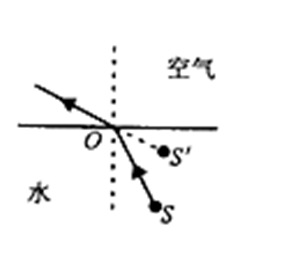

D项错误，宁静的湖水有平面镜的效果，能将天空中云朵反射进小明的眼中，体现的是光的反射原理。

本题为选非题，故正确答案为D。

**考点**：物理常识

**来源**：2019年420联考《行测》题（江西乡镇）（网友回忆版）第12题

### 第 13 题

下列关于仿生生物学的应用对应关系**不正确**的是：

A. 发光纤维——萤火虫

B. 子弹头列车——翠鸟

C. 维克罗尼龙搭扣——苍耳

D. 全天然空调系统建筑——非洲白蚁巢穴

第 13 题 · 答案与解析

**参考答案（粉笔题库参考内容）**

A

**解析**

本题考查科技常识。

A项错误，发光纤维是指受到光和放射线的照射时能发出可见光的纤维。常见的发光纤维如：以发光玻璃作芯材的纤维、以发光塑料作芯材的纤维。而萤火虫有专门的发光细胞，在发光细胞中有两类化学物质，一类被称作荧光素，另一类被称为荧光素酶。荧光素能在荧光素酶的催化下消耗ATP（腺苷三磷酸），并与氧气发生反应，反应中产生激发态的氧化荧光素，当氧化荧光素从激发态回到基态时释放出光子。反应中释放的能量几乎全部以光的形式释放，只有极少部分以热的形式释放，萤火虫是通过这样的作用来发光的。由此可见，发光纤维并不是在仿生萤火虫。

B项正确，翠鸟拥有长而平的喙，使其可以从空气迅速潜入水中，同时并不会产生过多的扰动。日本工程师中津英治仿照翠鸟喙设计出了新干线子弹头列车的车头，使其更长更平，降低了火车的噪音。

C项正确，苍耳是一种植物，它的总苞具有钩状的硬刺，可以贴附于动物的身体上。尼龙搭扣的设计正是从苍耳获得的灵感，尼龙搭扣的两边都是尼龙做的，一边是一排排的小勾，另一边是密密麻麻的小线圈，两边贴在一起的时候，小勾就勾住小线圈，使其能贴在一起。

D项正确，非洲白蚁会建造巨大的巢穴系统，他们经常开启和关闭自己塔楼巢穴中的气口，使得巢穴内外的空气得以对流——冷空气从底部的气口流入塔楼，与此同时热空气从顶部的烟囱流出。从而使得巢穴中始终维持一个恒定的温度。在设计津巴布韦首都哈拉雷的约堡东门购物中心和办公大楼时，建筑大师麦克·皮尔斯研究了非洲白蚁巢穴的结构，设计出了全天然空调系统，使得购物中心常年维持适宜的温度。

本题为选非题，故正确答案为A。

**考点**：生物常识

**来源**：2019年420联考《行测》题（黑龙江省直卷）（网友回忆版）第9题

### 第 14 题

下列成语和人物的对应关系**错误**的是：

A. 口蜜腹剑——李义府

B. 十面埋伏——项羽

C. 程门立雪——杨时

D. 东床快婿——王羲之

第 14 题 · 答案与解析

**参考答案（粉笔题库参考内容）**

A

**解析**

本题考查人文常识。

A项错误，“口蜜腹剑”出自《资治通鉴·唐记》“口有蜜，腹有剑”，这是文中对奸相李林甫的评语。李林甫为宰相后，对于朝中百官凡是才能和功业在自己之上而受到玄宗宠信或官位快要超过自己的人，一定要想方设法除去，尤其忌恨由文学才能而进官的士人。有时表面上装出友好的样子，说些动听的话，而暗中却阴谋陷害。所以世人都称李林甫“口有蜜，腹有剑”。笑里藏刀是指李义府。

B项正确，“十面埋伏”出自楚汉相争的垓下之战（今安徽省宿州市灵璧县东南）。楚汉相争时期，汉王刘邦重用淮阴人韩信，先后活捉魏王豹、赵王歇、燕王臧荼、齐王田广。他被刘邦封为齐王后率30万大军和彭越的军队会师，把项羽围困在垓下（今安徽省宿州市灵璧县东南），他采取十面埋伏的战术，逼使项羽在乌江自刎，取得决定性的胜利。

C项正确，宋代的杨时考到进士后不愿做官，专心研究学问。他起先在颍昌（地名）拜理学家程颢为师，学到了不少知识。程颢死后，四十多岁的杨时又和同学游酢一起到洛阳请教另一位有名的理学家程颐（程颢的弟弟）。他们到程颐家时，程颐正在打瞌睡。两人不敢惊动他，就侍立在门口。程颐醒来后发现门外的雪已下了一尺多深。程门立雪由此而来，比喻尊师重道。

D项正确，“东床快婿”出自刘义庆《世说新语笺疏雅量第六》“王氏谱曰：逸少，羲之小字。羲之妻，太傅郗鉴女，名璿，字子房。”指为人豁达，才能出众的女婿，是女婿的美称。“东床快婿”王羲之就是大名鼎鼎的书法家，被后人称之为“书圣”。

本题为选非题，故正确答案为A。

**考点**：文学常识

**来源**：2019年420联考《行测》题（黑龙江省直卷）（网友回忆版）第10题

### 第 15 题

下列表述正确的是：

A. 鄱阳湖栖息着世界上最大的白鹤群

B. 我国最早出现的种植业位于松花江流域

C. 被誉为“天上云霞,地下鲜花”的是四川蜀绣

D. 东北平原是中国第二大平原，也是中国重要的粮棉生产基地

第 15 题 · 答案与解析

**参考答案（粉笔题库参考内容）**

A

**解析**

本题考查地理国情。

A项正确，鄱阳湖是全世界最大的白鹤集中越冬地，白鹤的数量占全世界总数的95%以上，堪称鹤之天堂。鄱阳湖区发现白鹤的最早记录是1980年。1985年，时任国际鹤类基金会会长的乔治·阿基博带队来鄱阳湖考察，观测到白鹤1350只，其中幼鹤119只。他们认定那是当时世界上发现的最大野生白鹤群。

B项错误，我国最早出现的种植业应位于黄河、长江流域。黄河、长江是中国的母亲河，这两条河流的冲积平原地区是中华文明的发祥地且两个平原处在温带湿润、半湿润地区，气候温暖湿润，比较适宜人类居住，所以种植业发展最早。

C项错误，被誉为“天上云霞，地下鲜花”的是杭州的织锦。

D项错误，东北平原是中国最大的平原，是中国三大平原之一。位于中国东北部，南北长约1000千米，东西宽约400千米，面积达35万平方千米。同时东北平原土地肥沃，是全球仅有的三大黑土区域之一，是中国重要的粮食、大豆、畜牧业生产基地，也是中国重要的钢铁、机械、能源、化工基地。

故正确答案为A。

**考点**：中国地理

**来源**：2019年420联考《行测》题（黑龙江省直卷）（网友回忆版）第11题

### 第 16 题

下列说法**错误**的是：

A. 雷雨可使土壤的氮肥增加

B. 18K黄金制品的含金量为70%

C. 聚四氟乙烯可用于制作不粘锅的涂层

D. 在金属表面喷漆可以防止金属被氧化腐蚀

第 16 题 · 答案与解析

**参考答案（粉笔题库参考内容）**

B

**解析**

本题考查科技常识。

A项正确，雷雨天气过程中的闪电温度极高，一般在三万度以上，并造成高电压。在高温高电压条件下，空气分子会发生电离，等它们重新结合时，其中的氮和氧就会化合为亚硝酸盐和硝酸盐分子，并溶解在雨水中降落地面，成为天然氮肥。

B项错误，K金是指黄金和其它金属混合在一起的合金。根据在首饰中的黄金含量可分为不同的K金，其中24K是指纯金，18K黄金制品的含黄金量就是18/24=75%，因此选项中的70%表述错误。

C项正确，聚四氟乙烯俗称“塑料王”，是由四氟乙烯经聚合而成的高分子化合物，具有优良的化学稳定性、耐腐蚀性、密封性、高润滑不粘性，可用于制作不粘锅的涂层。

D项正确，金属被氧化腐蚀是指各类材料在环境作用下发生损坏、性能下降或状态的劣化。良好的喷漆涂装保护层能够成为抑制腐蚀介质侵入的屏障，使得金属保持连续完整，因此在金属表面喷漆是一种很重要的金属防腐蚀手段。

本题为选非题，故正确答案为B。

**考点**：化学常识

**来源**：2019年420联考《行测》题（江西乡镇）（网友回忆版）第16题

### 第 17 题

下列气体既会造成酸雨，又可用作防腐剂的是：

A. 二氧化碳

B. 二氧化氮

C. 二氧化硫

D. 氮气

第 17 题 · 答案与解析

**参考答案（粉笔题库参考内容）**

C

**解析**

本题考查科技常识。

酸雨通常指pH值小于5.6的酸性降水。酸雨中含有多种无机酸和有机酸，绝大部分是硫酸和硝酸，由人为排放的大气污染物二氧化硫和氮氧化物转化而成。

A项错误，二氧化碳溶于水后虽然会使雨水呈弱酸性，但不会导致酸雨。

B项错误，二氧化氮会与大气中水反应生成硝酸，形成硝酸型酸雨；二氧化氮有剧毒，不可以作防腐剂。

C项正确，二氧化硫与大气中的水反应生成亚硫酸，亚硫酸又与大气中的氧气反应，生成硫酸，形成硫酸型酸雨；二氧化硫有还原性，易被氧化，因此常用作葡萄酒的防腐剂。

D项错误，氮气化学性质不活泼，常温下很难跟其他物质发生反应，所以常被用作薯片等食品的防腐剂；氮气难溶于水，不会造成酸雨。

故正确答案为C。

**考点**：化学常识

**来源**：2019年420联考《行测》题（黑龙江省直卷）（网友回忆版）第16题

### 第 18 题

下列成语均与佛教有关的是：

A. 天花乱坠 心心相印

B. 黄粱一梦 味同嚼蜡

C. 一针见血 一丝不挂

D. 乐极生悲 大彻大悟

第 18 题 · 答案与解析

**参考答案（粉笔题库参考内容）**

A

**解析**

本题考查人文常识。

A项正确，“天花乱坠”出自《心地观经·序品》，形容人说话巧妙动听，但虚妄、空洞、不着边际。典故：传说梁武帝时云光法师讲佛经，感动了上天，天上的花纷纷降落下来。现在用来比喻说话有声有色，非常动听（多指夸大的或不切实际的），与佛教有关。“心心相印”是禅宗用语，心指佛心，印者印可，禅宗不依语言，以心印心，契合无间，故曰“心印”。《六祖大师法宝坛经》：“吾传佛心印，安敢违于佛经。”

B项错误，“黄粱一梦”比喻虚幻不能实现的梦想，出自《枕中记》，该成语与道教有关，与佛教无关。“味同嚼蜡”指味道如同嚼蜡一般，形容没有味道，多指说话或文章枯燥无味，出自《楞严经》卷八：“我无欲心，应汝行事，于横陈时，味同嚼蜡。”

C项错误，“一针见血”出自南朝时期范晔的《后汉书·郭玉传》，本义是一针刺下去就见到血，形容医生医术十分高明，现在多比喻说话直截了当，切中要害，与佛教无关。“一丝不挂”是佛教禅宗名词，用来比喻人内心没有一点烦恼，没有一点挂碍，超凡脱俗。

D项错误，“乐极生悲”指高兴到极点时，发生使人悲伤的事，出自《淮南子·道应训》，该成语与佛教无关。“大彻大悟”形容彻底醒悟，出自元代的郑德辉《立成汤伊尹耕萃》，该成语与佛教无关。

故正确答案为A。

**考点**：文化常识

**来源**：2019年420联考《行测》题（黑龙江省直卷）（网友回忆版）第20题

### 第 19 题

管理大师杰克·韦尔奇有句名言：管得少，就是管得好。他主要强调管理应该注重：

A. 沟通

B. 分权

C. 组织

D. 控制

第 19 题 · 答案与解析

**参考答案（粉笔题库参考内容）**

B

**解析**

本题考查管理学常识。

“管得少，就是管得好”强调的就是管理应该注重分权。管理的最终目标在于提高经营绩效，分权是管理学学者在近一百多年的企业管理研究与实践中，为提高效率而归纳出的一大规律性，管理学家认为企业在追求绩效时必须善于分权，担任一定管理职务的领导者在实际工作中为充分利用专门人才的知识和技能，应将部分解决问题和处理新增业务的权利委任给下属。据此可知，B项正确，ACD三项与题干无关。

故正确答案为B。

**来源**：2019年420联考《行测》题（江西乡镇）（网友回忆版）第19题

### 第 20 题

下列气体是人体能够产生的，能发挥抗炎、神经功能调节和血管松弛等作用，但若吸入过量会与血红素结合导致中毒的是：

A. 一氧化氮

B. 一氧化碳

C. 硫化氢

D. 氨气

第 20 题 · 答案与解析

**参考答案（粉笔题库参考内容）**

A

**解析**

A项正确，一氧化氮是一种人体可以自然产生的物质，其具有三大功能：①内皮舒张因子。作为内皮舒张因子，一氧化氮主要产生于内皮细胞，对预防和控制心脑血管疾病有着显著的效果。具体而言，一氧化氮是一种脂溶性气体，可以快速渗透出细胞膜向下扩散，进入并作用于血管周围平滑肌细胞，随着平滑肌的舒张，血管得以扩张（使血管松弛），最终导致血压的下降；②神经传导因子。作为神经传导因子，一氧化氮产生于外周神经和大脑中，作为肾上腺素和胆碱以外的神经递质，在血管、海绵体、胃肠道、泌尿道、气管肌、肛尾肌等外周输出神经抑制反应中起到非常重要的作用；③免疫调节因子。作为免疫调节因子，一氧化氮产生于免疫系统中，合成产生的一氧化氮，通过多条途径调节炎症，在调控免疫反应中起到重要作用。具体而言，一氧化氮可辅助白细胞杀死细菌、真菌、寄生虫、肿瘤细胞等。综上可知，一氧化氮在人体内发挥血管松弛、神经功能调节、抗菌消炎的作用。同时，一氧化氮与血红蛋白有很高的亲和力，如果吸入过量，一氧化氮会夺取氧气与血红蛋白结合的位置，造成人体因缺氧而中毒。

B项错误，身体组织受毒素、紫外线辐射、激素和药物等侵害时，体内会自然地产生少量一氧化碳。一氧化碳与血红蛋白具有很高的亲和力，吸入过量会造成人体因缺氧而中毒，但一氧化碳在体内不具有血管松弛、神经功能调节、抗菌消炎的作用。

C项、D项错误，具有刺激性气味的硫化氢和氨气是人体代谢产生的废气，二者均不与血红蛋白结合，且不具有血管松弛、神经功能调节、抗菌消炎的作用。

故正确答案为A。

**考点**：生物常识

**来源**：2019年420联考《行测》题（江西乡镇）（网友回忆版）第9题

### 第 21 题

佛朗西斯·克里克提出的中心法则指明了遗传信息的流向，在科学发展中得到不断补充完善。根据该法则，下列哪一种遗传信息传递流程**不可能**发生：

A. DNA通过转录把遗传信息传递给RNA

B. RNA通过翻译把遗传信息传递给蛋白质

C. RNA通过逆转录把遗传信息传递给DNA

D. 蛋白质通过逆翻译把遗传信息传递给RNA

第 21 题 · 答案与解析

**参考答案（粉笔题库参考内容）**

D

**解析**

本题考查科技常识。

A、B、C项正确，中心法则指出，遗传信息的转移可以分为两类：第一类，包括DNA的复制、RNA的转录和蛋白质的翻译，即①DNA→DNA(复制)；②DNA→RNA(转录)；③RNA→蛋白质(翻译)。这三种遗传信息的转移方向普遍地存在于所有生物细胞中。第二类，是特殊情况下的遗传信息转移，包括RNA的复制，RNA反向转录为DNA和从DNA直接翻译为蛋白质，即①RNA→RNA(复制)；②RNA→DNA(逆转录)；③DNA→蛋白质。RNA复制只在RNA病毒中存在。

D项错误，中心法则旨在详细说明连串信息的逐个传送，它指出遗传信息不能由蛋白质转移到蛋白质或核酸之中。

本题为选非题，故正确答案为D。

**考点**：生物常识

**来源**：2019年420联考《行测》题（黑龙江省直卷）（网友回忆版）第15题

### 第 22 题

下列关于血糖的说法**错误**的是：

A. 正常人进食后血糖浓度会升高

B. 正常人空腹超过12小时会引起低血糖

C. 南瓜能抑制葡萄糖吸收，具有降血糖作用

D. 胰岛素是人体产生的唯一能够降低血糖的激素

第 22 题 · 答案与解析

**参考答案（粉笔题库参考内容）**

C

**解析**

本题考查科技常识。

A项正确，食物中存在大量的淀粉等糖类。人在进食后，糖类被人体消化吸收，因此会使血糖含量升高。

B项正确，低血糖的常见原因包括进食过少、运动过度、药物使用不当、大量饮酒等。正常人空腹（禁食）时间过长，由于没有食入足够的糖，可能会引起低血糖。

C项错误，南瓜中含有丰富的营养物质，其中包含了蛋白质、多糖、果胶、纤维素、维生素以及微量元素等成分，在这些众多的营养物质中，蛋白质和多糖都可以提升自身免疫功能。部分多糖会被分解成单糖，可能导致人体血糖升高。

D项正确，胰岛素是体内唯一能够降低血糖浓度的激素，它不仅能够促使葡萄糖分解，还能抑制非糖物质转化为葡萄糖。

本题为选非题，故正确答案为C。

**考点**：生物常识

**来源**：2019年420联考《行测》题（黑龙江省直卷）（网友回忆版）第19题

### 第 23 题

下列选项对“夏满芒夏暑相连”中节气的表述**错误**的是：

A. “小满”表明了降水的时间和强度

B. “芒种”反映了自然物候现象或农事活动

C. “立夏”“夏至”体现了寒来暑往的季节变化

D. “小暑”“大暑”标明了一年之中最热的时段

第 23 题 · 答案与解析

**参考答案（粉笔题库参考内容）**

C

**解析**

本题考查人文常识。

A项正确，小满具有多重含义，从小满开始，大麦、冬小麦等夏收作物，已经结果、籽粒饱满，但尚未成熟，所以叫小满。小满反映作物的成熟、收成情况，也可以表现降水的时间和强度。

B项正确，芒种的“芒”字，是指麦类等有芒植物的收获，“种”指谷黍类作物播种的节令。对中国大部分地区来说，芒种一到，夏熟作物要收获，夏播秋收作物要下地。反映作物的收成、播种情况，即农事活动。

C项错误，立夏是夏季的开始，从此进入夏天，万物生长旺盛。夏至是北半球白昼最长、黑夜最短的一天，从这一天起，进入炎热季节，天地万物在此时生长最旺盛。夏至是从天文角度划分的，反映了太阳高度变化的转折点。立夏体现了季节的变化，夏至体现了太阳高度的转折。

D项正确，小暑是天气已经很热了，但还不到最热的时候。大暑是一年中最热的节气。

本题为选非题，故正确答案为C。

**考点**：文化常识

**来源**：2019年420联考《行测》题（黑龙江省直卷）（网友回忆版）第17题

### 第 24 题

下列我国空间站发展的重要标志性事件按完成步骤排列正确的是：

①“天宫二号”空间实验室成功发射

②“神舟十一号”成功发射，完成与“天宫二号”对接

③陆续发射科学实验舱和空间站核心舱，组建中国空间站

④“天舟一号”货运飞船成功发射，完成与“天宫二号”对接

A. ①②③④

B. ④①②③

C. ①③④②

D. ①②④③

第 24 题 · 答案与解析

**参考答案（粉笔题库参考内容）**

D

**解析**

本题考查科技常识。

①2016年9月15日22时04分，“天宫二号”空间实验室由长征二号FT2火箭发射升空。

②2016年10月19日3时31分，“神舟十一号”载人飞船与“天宫二号”空间实验室成功实现自动交会对接。

③建设具有国际先进水平的空间站，解决有较大规模的、长期有人照料的空间应用问题，是我国载人航天工程“三步走”发展战略中第三步的任务目标。按计划，空间站将于2022年前后建成，是我国长期在轨稳定运行的国家太空实验室，将全面提升我国载人航天综合应用效益水平。

④2017年4月20日19时11分，中国首架货运飞船——“天舟一号”成功发射升空，并在4月22日完成与“天宫二号”的首次对接。

由此可知，按照完成步骤的时间应该是①②④③。

故正确答案为D。

**考点**：科技理论与成就

**来源**：2019年420联考《行测》题（江西乡镇）（网友回忆版）第23题

### 第 25 题

俗话说“不要将你的鸡蛋全都放在一只篮子里”。下列选项与该俗语蕴含的道理相吻合的是：

A. 天有不测风云

B. 鱼与熊掌不可兼得

C. 不入虎穴，焉得虎子

D. 舍不得孩子，套不住狼

第 25 题 · 答案与解析

**参考答案（粉笔题库参考内容）**

A

**解析**

本题考查经济常识。

如果把所有鸡蛋都放在同一个篮子里，篮子翻了，所有的鸡蛋都会碎掉；如果不把所有的鸡蛋放在一个篮子里，篮子翻了，还会有其他鸡蛋剩下。即不要把所有的资本都投入到一件事情上，应该做多手准备，规避风险。

A项正确，天有不测风云比喻灾祸是无法预料的，即风险是随时存在的，我们应该懂得随时规避和防范风险。与题意相符合。

B项错误，鱼与熊掌不可兼得，意思是鱼和熊掌不能同时获得。强调的是我们在做选择的时候，应该如何取舍，在经济上对应的是机会成本。与风险无关。

C项错误，不入虎穴，焉得虎子比喻不经历艰险，就不能取得成功，也指需通过实践取得真知。与风险无关。

D项错误，舍不得孩子，套不住狼比喻要达到某一目的必须付出相应的代价。与风险无关。

故正确答案为A。

**考点**：宏观经济与调控政策

**来源**：2019年420联考《行测》题（江西乡镇）（网友回忆版）第25题

### 第 26 题

科学已经成为当下社会的主流命题，无论从事什么工作都无法忽视它、绕过它。因此从某种程度来说，科学与艺术，或者说理性与感性的边界正在        。艺术展上艺术家们摆弄起了宇宙爆炸、量子世界，而不少科学家也乐于把科学仪器下观察到的景象捕捉下来，展示到人们面前，其精美程度丝毫不亚于艺术家的加工描摹。

填入划横线部分最恰当的一项是：

A. 消遁

B. 消失

C. 消除

D. 消弭

第 26 题 · 答案与解析

**参考答案（粉笔题库参考内容）**

D

**解析**

本题可根据完整语句提示做题。

根据首句“科学已经成为当下社会的主流命题，无论从事什么工作都无法忽视它、绕过它”可知，所有工作（包括艺术）与科学之间是没有界限的，换言之，边界不应该存在。

又根据后文的“艺术展上艺术家们摆弄起了宇宙爆炸、量子世界，而不少科学家也乐于把科学仪器下观察到的景象捕捉下来，展示到人们面前，其精美程度丝毫不亚于艺术家的加工描摹。”可知，科学与艺术的边界正在慢慢模糊。

分析横线处可知，“理性”对应“科学”，“感性”对应“艺术”，“科学”与“艺术”间无界限，即“感性”与“理性”间不应有界限。故横线处应表达“理性与感性的边界”这一不应该存在的事物慢慢消失了。

D项“消弭”意为清除，多与风险、隐患等不好的事物搭配，而在本题中，作者认为，“边界”是不应该存在的事物，即不好的事物（提示：勿根据常识判断，结合上下文判断作者对“边界”的倾向），搭配得当，符合文意，当选。

A项“消遁”指消失逃跑，与文意不符，排除；

C项“消除”指使不存在，多与误会、疑虑等搭配，与“边界”搭配不当，排除；

B项“消失”置于文段虽然语义合适，但是相比之下，不能体现出“边界”的不应存在，感情倾向不如D项恰当。

故正确答案为D。

【文段出处】《“当李白遇见火星”会发生什么》

【原文摘录】欧阳自远认为，科学已经成为当下社会的主流命题，无论从事什么工作都无法忽视它、绕过它。因此从某种程度来说，科学与艺术，或者说理性与感性的边界正在消弭。君不见许多艺术展上，艺术家们摆弄起了宇宙爆炸、量子世界，而不少科学家也乐于把科学仪器下观察到的景象捕捉下来，展示到人们面前，其精美程度丝毫不亚于艺术家的加工描摹。

**考点**：词的辨析-搭配对象、实词填空

**来源**：2019年420联考《行测》题（黑龙江省直卷）（网友回忆版）第21题

### 第 27 题

某航天科工集团研制出的民航风切变预警系统，克服了预警难度大、精度低等现实问题，可以为飞机的起飞降落        提供风切变预警信息，还能够提供机场未来48小时的天气预报。

填入划横线部分最恰当的一项是：

A. 及时

B. 实时

C. 适时

D. 即时

第 27 题 · 答案与解析

**参考答案（粉笔题库参考内容）**

B

**解析**

根据“可以为飞机的起飞降落······，还能够提供机场未来48小时的天气预报”可知，横线处表达除了可以提供未来的信息，也可以为飞机的起飞降落这一时间段内一直监测风向，提供当时的预警信息。B项“实时”意为在某事发生、发展的过程中的同一时间，符合语境，当选。

A项“及时”意为立刻、马上、不拖延，C项“适时”意为适合时宜，均无法对应当下一段时间内同步进行监测，排除；D项“即时”意为当下、立刻，与B项“实时”相比，“实时”更加侧重一段时间内的情况，且“实时信息”也为常见搭配，因此D项不符，排除。

故正确答案为B。

【文段出处】《航天技术来到你身边》

**考点**：词的辨析-词义侧重、实词填空、对应关系-前后呼应

**来源**：2019年420联考《行测》题（黑龙江省直卷）（网友回忆版）第22题

### 第 28 题

云南在西、巴蜀在北，贵州有着说不尽的历史。这片西南中国的广袤土地，呈现了华夏山河的            、见证了中国革命的风云际会、记录了多民族文化的交流激荡。现在，贵州正在以绿色发展谋求生态红利，率先推进了中国生态文明建设的地方探索。

填入划横线部分最恰当的一项是：

A. 海晏河清

B. 渊渟岳峙

C. 钟灵毓秀

D. 瑕瑜互见

第 28 题 · 答案与解析

**参考答案（粉笔题库参考内容）**

C

**解析**

横线处所填的词语搭配对象为“华夏山河”，与后文两个并列结构共同说明在西南这片土地上有着说不尽的历史。C项“钟灵毓秀”指美好的山川孕育出优秀的人才，搭配“华夏山河”恰当，与文段语境相符，当选。

A项“海晏河清”比喻太平盛世、天下太平，与“华夏山河”搭配不当，与语境不符，排除；B项“渊渟岳峙”比喻人品德如渊水深沉，如高山耸立，不用于形容“华夏山河”，排除；D项 “瑕瑜互见”比喻优点、缺点都有，文段不强调“华夏山河”的缺点，与文意不符，排除。

故正确答案为C。

【文段出处】《让绿色成为发展的鲜明底色》

**考点**：词的辨析-搭配对象、成语填空

**来源**：2019年420联考《行测》题（黑龙江省直卷）（网友回忆版）第23题

### 第 29 题

关于科学革命的讨论        于十七世纪。不过，其时革命尚在            地展开，相关讨论的焦点集中在科学的本性，而未有所谓“科学革命史”的理解。到十九世纪，现代科学的基本模式逐渐定型，一些学者便回到现代科学的源头做起了编史和整理工作。

依次填入划横线部分最恰当的一项是：

A. 滥觞 如火如荼

B. 溯源 轰轰烈烈

C. 起源 风起云涌

D. 发端 方兴未艾

第 29 题 · 答案与解析

**参考答案（粉笔题库参考内容）**

A

**解析**

第一空，A项“滥觞”、C项“起源”、D项“发端”均有表达事物起源和开端的含义，均符合文意，保留；B项“溯源”后一般不加宾语，常表述为“对······进行溯源”，排除。

第二空，搭配“革命”，表达革命如何展开，A项“如火如荼”形容旺盛、热烈或激烈，可以体现革命开展很热烈，符合文意，当选；C项“风起云涌”形容事物迅速发展，声势浩大，可以说“改革风起云涌”，“风起云涌地展开”用法不当，排除；D项“方兴未艾”指事物正在兴起、发展，一时不会终止，若填入横线处，则与“展开”语义上重复，二者搭配不当，可表述为“科学革命方兴未艾”，排除。

故正确答案为A。

【文段出处】《科学史绝非科学的注脚：科学革命的人文理解》

**考点**：词的辨析-搭配对象、混搭填空

**来源**：2019年420联考《行测》题（黑龙江省直卷）（网友回忆版）第24题

### 第 30 题

有人曾        “人工智能是个筐，什么都能往里装”，虽然        ，但也说明了现状。通常，当解决问题需要推理、决策、理解、学习这类最基本的技能时，我们才认为它跟人工智能相关。常见的人工智能技术应用有指纹识别、人脸识别、机器翻译等。很多通过机械的计算和机械的记忆实现的东西，一般不把它看成人工智能的本质应用。

依次填入划横线部分最恰当的一项是：

A. 嘲笑 苛刻

B. 调侃 尖酸

C. 揶揄 刻薄

D. 嘲弄 刻毒

第 30 题 · 答案与解析

**参考答案（粉笔题库参考内容）**

C

**解析**

本题可从第二空入手，横线处形容“人工智能是个筐，什么都能往里装”这句话。B项“尖酸”指用刻薄的话讥刺人，C项“刻薄”指（待人、说话）冷酷无情；过分苛求，均可形容前文“人工智能是个筐，什么都能往里装”这句话，符合文意，保留。A项“苛刻”，一般是指要求苛刻，不是说这句话对人工智能要求挑剔苛刻，排除；D项“刻毒”，毒是恶毒的意思，程度太重，排除。

第一空，同样形容“人工智能是个筐，什么都能往里装”，两空感情色彩、程度要一致，C项“揶揄”“刻薄”符合要求，当选。B项“调侃”程度比“揶揄”轻，排除。

故正确答案为C。

【文段出处】《人工智能：边原创冲刺边伦理“刹车”》

**考点**：词的辨析-感情色彩、词的辨析-程度轻重、实词填空、对应关系-前后呼应、关联关系-转折关系

**来源**：2019年420联考《行测》题（黑龙江省直卷）（网友回忆版）第37题

### 第 31 题

为应对全球气候变暖，各国科学家都在开展地球科学研究。最近，有科学家在《科学》上发表论文提出缓解温室效应的两种方案。其中一种方案是在稍低于卷云自然形成的上层大气中加入微小的沙尘颗粒，以        卷云的形成。卷云不同于会反射阳光的白云，而更像覆盖在地球上的毯子，困住从地球向太空辐射的热量，地球也就越来越        。

依次填入划横线部分最恰当的一项是：

A. 减少 冷

B. 增加 冷

C. 减少 热

D. 增加 热

第 31 题 · 答案与解析

**参考答案（粉笔题库参考内容）**

C

**解析**

本题可从第二空入手，根据“卷云······像覆盖在地球上的毯子，困住从地球向太空辐射的热量”可知，地球无法向太空辐射热量，因此地球越来越热，排除AB两项。

根据后文可知，卷云会让地球变热，因此为应对全球气候变暖的一种方案应该是减少卷云的形成，排除D项。

故正确答案为C。

【文段出处】《中国拨款1448万设地球工程国家研究项目，旨在为地球降温》

**考点**：实词填空、对应关系-前后呼应

**来源**：2019年420联考《行测》题（江西乡镇）（网友回忆版）第34题

### 第 32 题

说梵高是一个“圣徒式的画家”并不为过，他通过绘画仰望、接近上帝。        ，即便是这样一个具有宗教情怀、追求超越性的梵高，也从未试图远离人群、拥抱绝对的孤独。        ，他总在渴望人与人之间的温暖与爱，而始终未能得到。他的绘画也好，文字也好，除去遗传的因素，很大程度上就是表达此种“寻求”与“寻求不得”之间的落差及随之而来的痛苦。

依次填入划横线部分最恰当的一项是：

A. 然而 因为

B. 首先 其次

C. 因为 于是

D. 但是 相反

第 32 题 · 答案与解析

**参考答案（粉笔题库参考内容）**

D

**解析**

第一空，由前文“他通过绘画仰望、接近上帝”以及后文“也从未试图远离人群、拥抱绝对的孤独”可知，横线前后语义相反，表达梵高接近上帝但也没有远离人群，故横线处应填入转折关系的引导词，A项“然而”、D项“但是”均可表示转折关系，保留；B项“首先”表示逻辑顺序，C项“因为”表示因果关系，均不符合文意，排除。

第二空，由前文“远离人群、拥抱绝对的孤独”以及后文“他总在渴望人与人之间的温暖与爱”可知，横线前后语义相反，表达梵高没有试图远离人群，相反他总是渴望人与人之间的温暖与爱，横线处要填入表达相反语义的词语，对应D项“相反”。A项“因为”表示因果关系，与文意不符，排除。

故正确答案为D。

【文段出处】《<梵高传>：艺术是“是其所信”》

**考点**：关联关系-转折关系

**来源**：2019年420联考《行测》题（黑龙江省直卷）（网友回忆版）第32题

### 第 33 题

形成有文化特色、有地域特色、可识别的小城镇发展模式，是一个长期的渐进过程。我们应尊重当地实际，            、远近结合、量力而行，不能盲目            。在模式选择上，可以借鉴国内外小城镇建设的经验，但更重要的是结合自身实际、体现自身特色。

依次填入划横线部分最恰当的一项是：

A. 循规蹈矩 分庭抗礼

B. 按部就班 投闲置散

C. 循序渐进 贪大求快

D. 按图索骥 急于求成

第 33 题 · 答案与解析

**参考答案（粉笔题库参考内容）**

C

**解析**

第一空，根据文段首句完整语句“是一个长期的渐进过程”的提示，可知接下来整个文段也应围绕“长期”“渐进”展开。B项“按部就班”指按照一定的顺序、步骤进行，C项“循序渐进”即按照一定顺序逐渐深入或提高，置于此处均符合文意，保留。A项“循规蹈矩”比喻按规矩行事，或拘泥保守，不敢变通，侧重遵守规矩不逾越，D项“按图索骥”比喻按照线索去寻找事物，侧重于拘泥成法办事，均无法与“长期”“渐进”对应，与文意不符，排除。

第二空，根据“不能盲目”可知，横线处要体现“短期”“快速”之意，C项“贪大求快”对应恰当，当选。B项“投闲置散”指担当不重要的工作或不担任工作，不予重用，与“短期”“快速”无关，排除。

故正确答案为C。

【文段出处】人民网《小城镇建设须注重文化要素》

**考点**：对应关系-前后呼应、成语填空

**来源**：2019年420联考《行测》题（江西乡镇）（网友回忆版）第43题

### 第 34 题

城市的文化形象是人们对一个城市的文化      的整体认知与印象，主要来源于城市的发展哲学、城市精神等构成的理念识别系统，城市各主体的行为方式所构成的行为识别系统以及公共文化空间、文化景观等构成的视觉识别系统。在新一轮的城市竞争中，城市的文化形象对城市的经济社会发展将起到      的作用。

依次填入划横线部分最恰当的一项是：

A. 观感 撼天震地

B. 气质 举足轻重

C. 禀赋 振聋发聩

D. 特征 醍醐灌顶

第 34 题 · 答案与解析

**参考答案（粉笔题库参考内容）**

B

**解析**

本题可从第二空入手，横线处要体现出的是城市的文化形象对城市经济社会发展的作用很重要，B项“举足轻重”比喻所处地位重要，一举一动都关系着全局，符合语境，保留；A项“撼天震地”意为连天地都摇动了，形容力量强，声势大，C项“振聋发聩”比喻用语言文字唤醒糊涂麻木的人，使他们清醒过来，D项“醍醐灌顶”比喻给人灌输智慧，使人得到启发或感悟，均无“作用重要”之意，不符合语境，排除。

第一空，代入验证，B项“气质”用于此处，运用拟人化手法与“城市的文化”搭配得当，意指城市的文化内涵精神等，当选。

故正确答案为B。

【文段出处】长江日报《以城市文化形象助力城市发展》

**考点**：词的辨析-搭配对象、对应关系-前后呼应、混搭填空

**来源**：2019年420联考《行测》题（黑龙江省直卷）（网友回忆版）第39题

### 第 35 题

纪录片《苏东坡》以苏东坡贬谪黄州四年的生活为横切面，        其一生的心路历程，从文学、艺术、美食、情感等维度进行透视，多角度地        其生命感悟、精神嬗变和艺术升华的过程，以及对中国传统文化产生的深远影响。同时，辅之以当今最新的研究成果，再现了一个最丰富、最接近本真的苏东坡形象。

依次填入划横线部分最恰当的一项是：

A. 关照 阐释

B. 记载 解说

C. 记录 阐述

D. 观照 解读

第 35 题 · 答案与解析

**参考答案（粉笔题库参考内容）**

D

**解析**

第一空，横线处所填词语用以修饰“纪录片”，强调其展现了苏东坡的心路历程，C项“记录”指把所见所闻通过一定的手段保留下来，D项“观照”指观察审视，均符合文意，保留；A项“关照”指关心照顾，与“纪录片”搭配不当，排除；B项“记载”多指用文字叙述，纪录片是影像、声音、文字的集合体，不是简单的文字描绘，排除。

第二空，由前文可知，强调纪录片从多个维度透视，对苏东坡的生命感悟进行多角度的分析，使我们更加深入地了解苏东坡，D项“解读”指分析研究，可以体现出纪录片的作用，符合文意，当选；C项“阐述”指述说、论述，通过前文可知，纪录片并非简单地述说苏东坡的生命感悟，而是对其进行多角度的分析，故不符合文意，排除。

故正确答案为D。

【文段出处】《大型人文历史纪录片<苏东坡>台前幕后的故事》

**考点**：词的辨析-搭配对象、实词填空、对应关系-前后呼应

**来源**：2019年420联考《行测》题（黑龙江省直卷）（网友回忆版）第31题

### 第 36 题

一个艺术家真正的贡献是艺术语言的创新，如果说审美理想的构建是绘画法度和秩序建立的基石，那么绘画秩序的建立则是绘画风格成熟的      。风格的形成在于画面所搭建的整体构成必须有      的秩序和法则。

依次填入划横线部分最恰当的一项是：

A. 途径 和谐

B. 标志 内在

C. 方向 全新

D. 目标 稳定

第 36 题 · 答案与解析

**参考答案（粉笔题库参考内容）**

B

**解析**

第一空，根据“如果说审美理想的构建是绘画秩序建立的基石”，说明审美理想对绘画法度和秩序的建立很重要，则根据“那么绘画秩序的建立则是绘画风格成熟的”，即绘画秩序的建立则是绘画风格成熟的重要体现、表现，故横线处要表达重要体现之意，B项“标志”，符合题意，保留。A项，“途径”，我们通常说做一件事情的具体解决办法，填入文段应表达为“建立绘画秩序则是绘画风格成熟的途径”，故用法不对，排除。C、D两项，文段强调“绘画风格成熟”是目标是追求的方向，而非“绘画秩序的建立”是目标是追求的方向，所以“方向”和“目标”填入文段则与文段意思相悖，排除C、D两项。

第二空，代入验证，B项，“必须有内在的秩序和法则”，搭配恰当，且“内在的秩序和法则”与前文“画面所搭建的整体构成”可以构成对应，当选。

故正确答案为B。

【文段出处】《寻求工笔新语境》

**考点**：实词填空、对应关系-前后呼应

**来源**：2019年420联考《行测》题（黑龙江省直卷）（网友回忆版）第40题

### 第 37 题

夏季天气炎热，人很容易犯困、无精打采，这时不妨吃几颗葡萄来帮你提神、消除疲乏之意。因为在葡萄中含有丰富的葡萄糖成分，且很容易被人体吸收利用，从而为大脑供给所需能量，快速恢复大脑活力。同时，葡萄中还含有较多的氨基酸，能对神经产生良好的 \_\_\_\_，帮助人体\_\_\_\_衰弱的神经，这也是提神醒脑的有效途径。

依次填入划横线部分最恰当的一项是：

A. 刺激 调理

B. 应激 调节

C. 激变 调整

D. 激发 调剂

第 37 题 · 答案与解析

**参考答案（粉笔题库参考内容）**

A

**解析**

第一空，横线处所填词语搭配“产生”，用来形容葡萄中的氨基酸给神经带来的积极作用，A项“刺激”指现实的物体和现象作用于感觉器官，可与产生搭配，置于此处符合文意，保留；D项“激发”为动词，指刺激使奋发，“产生”也为动词，置于此处用法不当，排除；B项“应激”指由外界情况变化所引起的一种情绪状态，常见搭配为产生应激反应，置于此处搭配不当，排除；C项“激变”强调变化突然且激烈，置于此处程度过重，与文意不符，排除。

第二空，代入验证，A项“调理”指管理，料理，可与文段中“衰弱的神经”进行搭配，形容葡萄中的氨基酸为人体带来的积极作用，符合文意，当选。

故正确答案为A。

【文段出处】人民网《夏天吃葡萄有什么好处?教你正确清洗葡萄的方法》

**考点**：词的辨析-词义侧重、词的辨析-搭配对象、实词填空

**来源**：2019年420联考《行测》题（江西乡镇）（网友回忆版）第32题

### 第 38 题

没有精神内核的娱乐，即便一时热闹，        流于空虚。网民需要文化产品、需要轻松娱乐，但不需要无下限、无道德的“秀”。应该肯定的是，依法净网，不只是约谈平台、关停账号，而是持续发力、        治理。

依次填入划横线部分最恰当的一项：

A. 最终 固定化

B. 难免 长效化

C. 终归 常态化

D. 终将 平常化

第 38 题 · 答案与解析

**参考答案（粉笔题库参考内容）**

C

**解析**

第一空，横线处所填词语与“即便”构成对应，表达在“一时热闹”之后产生的结果，A项“最终”、C项“终归”、D项“终将”都可以体现出一个结果，符合文意；B项“难免”重在强调“无法避免”，与文意无关，排除。

第二空，与前文“持续发力”构成近义并列，要体现出一直在做的状态，对应C项“常态化”；A项“固定化”、D项“平常化”均不能与“持续发力”构成近义并列，排除A、D两项。

故正确答案为C。

【文段出处】《关停炒作账号，让娱乐走正道》

**考点**：实词填空、对应关系-前后呼应、关联关系-并列关系

**来源**：2019年420联考《行测》题（内蒙古卷）（网友回忆版）第38题

### 第 39 题

儒学对生活的      ，体现在每一个细微的环节上，每个观念或者行为都可能有一些潜移默化的印记，有时候可能是比较清晰的一种灌输，有时候则是一种生活态度和行为细节上      的顺应。

依次填入划横线部分最恰当的一项是：

A. 滋养 不自觉

B. 影响 不期然

C. 浸润 不经意

D. 渗透 不留神

第 39 题 · 答案与解析

**参考答案（粉笔题库参考内容）**

C

**解析**

第一空，根据后文“有一些潜移默化的印记”可知，横线处所填词语体现的是儒家思想对生活的逐渐的感染和影响，B项“影响”指以间接或无形的方式来作用或改变，C项“浸润”指逐渐发生作用，D项“渗透”比喻某种事物或势力逐渐进入其他方面，置于此处均符合文意，保留；A项“滋养”指供给养分，补养，文段中并未体现“儒学为生活提供了养分”之意，不符合文意，排除。

第二空，根据文段“有时候可能是······，有时候则是······”可知，横线处所填词语应与“清晰”相反，C项“不经意”形容在没意识到、没察觉到的情况下所发生的事情，也就是比较模糊的事情，符合文意，当选；B项“不期然”常用于“非常不希望这样，但是竟然这样”的语境中；D项“不留神”常用于“一不小心，放松警惕”的语境，文中并无此意，均排除。

故正确答案为C。

【文段出处】《儒学转型与民间社会的新维度》

**考点**：实词填空、对应关系-前后呼应

**来源**：2019年420联考《行测》题（黑龙江省直卷）（网友回忆版）第30题

### 第 40 题

极光多姿多彩，变化万千，任何彩笔都很难绘出那在严寒的两极空气中嬉戏无常、变幻莫测的炫目之光。在自然界中还没有哪种现象能与之        。极光有时出现时间极短，犹如节日的焰火，在空中闪现一下就消失得无影无踪；有时却可以在苍穹之中        几个小时；有时像一条彩带，有时像一团火焰，有时像一张五光十色的巨大银幕，仿佛上映一场球幕电影，给人视觉上极美的享受。

依次填入划横线部分最恰当的一项是：

A. 匹敌 延宕

B. 相较 迤逦

C. 媲美 辉映

D. 抗衡 映照

第 40 题 · 答案与解析

**参考答案（粉笔题库参考内容）**

C

**解析**

第一空，表达没有哪种现象能比得上极光，A项“匹敌”，指双方地位平等、力量相当，B项“相较”指相比较，C项“媲美”美好的程度可以相比，类似比美之意，A、B、C三项均符合语境，保留；D项“抗衡”指彼此对抗，对立，与文意不符，排除。

第二空，文段搭配极光，C项“辉映”光辉映照、照耀，搭配恰当，当选；A项“延宕”指拖延，偏消极，与文段的感情色彩不符，排除；B项“迤逦”指曲折连绵，通常搭配为“山水迤逦”、“风景迤逦”，与“极光”搭配不当，排除。

故正确答案为C。

【文段出处】新华网《极光：最奇妙的天象之谜》

**考点**：词的辨析-搭配对象、实词填空、对应关系-前后呼应

**来源**：2019年420联考《行测》题（江西乡镇）（网友回忆版）第31题

### 第 41 题

除了口误，笔误同样泄露了潜意识的秘密。短信聊天说到我爸身体不舒服却不去医院检查这一事实时，我想说“我爸就是太固执了”，但我键入的文字竟是“我爸就是太过分了”。那一刻，我突然呆住了。一词之别，却暴露出我内心深处的真实情绪。“固执”只是一种较为客观的        ，而“过分”却是饱含着情绪的        。

依次填入画横线部分最恰当的一项是：

A. 判断 认识

B. 体现 流露

C. 显示 暗示

D. 描述 表达

第 41 题 · 答案与解析

**参考答案（粉笔题库参考内容）**

D

**解析**

本题可从第二空入手，根据文段信息“笔误同样泄露了潜意识的秘密”、“暴露出我内心深处的真实情绪”可知，“过分”应是内心深处对于父亲的一种情绪表达，B、D两项保留。A项“认识”指人的头脑对客观世界的反映，文段“过分”不是一种认识，而是情绪的表达，与文意不符，排除； C项“暗示”指用含蓄的言语或示意的举动使人领会，文段没有含蓄示意的意思，排除。

第一空，根据“我想说‘我爸就是太固执了’”可知，横线前的“固执”是作者对自己父亲的一种评价，D项“描述”指描写叙述，符合文意，当选。B项“体现”指某一事物具体地表现出的某种现象、性质或精神，是一种客观事实的表现，而文段是作者对父亲的评价，非事实的表现，排除。

故正确答案为D。

【文段出处】《潜意识如何泄露我们的秘密？》

**考点**：实词填空、对应关系-前后呼应

**来源**：2019年420联考《行测》题（黑龙江省直卷）（网友回忆版）第27题

### 第 42 题

美好的事物人人向往，若是缺少发现的眼睛，它也容易被      。某次儿童画展，一位小朋友的作品上有一个洞，评委们好奇地问，这是不是一幅破损的作品。小朋友说，这是进入世外桃源的入口。孩子的答案，耐人寻味。如何      发现美的眼睛，是一个需要全社会去回答的课题。

依次填入划横线部分最恰当的一项是：

A. 蒙蔽 擦拭

B. 遮蔽 擦亮

C. 掩饰 拂拭

D. 遮掩 烛照

第 42 题 · 答案与解析

**参考答案（粉笔题库参考内容）**

B

**解析**

第一空，根据“缺少发现的眼睛”可知，所填词语应体现出美好事物就难以被发现之意。B项“遮蔽”指遮挡，挡住使看不到， D项“遮掩”亦有遮挡之意，均可以体现出难以发现之意，保留；A项“蒙蔽”指隐瞒真相，使人上当，通常与人搭配使用，与“美好事物”搭配不当，排除；C项“掩饰”设法遮盖、掩盖(真实情况)，不想让他人发现，文段没有设法掩盖之意，与文段语境不符，排除。

第二空，搭配“眼睛”，B项“擦亮”与“眼睛”为常见搭配，当选；D项“烛照”指照耀，照亮，与“眼睛”搭配不当，排除。

故正确答案为B。

【文段出处】《美是有力量的 美育是一种刚需》

**考点**：词的辨析-搭配对象、实词填空、对应关系-前后呼应

**来源**：2019年420联考《行测》题（黑龙江省直卷）（网友回忆版）第33题

### 第 43 题

习近平主席在上海合作组织成员国元首理事会第十八次会议上的重要讲话，深刻分析了我们今天所共同面对的风险挑战：当今世界霸权主义和强权政治        存在；各种传统和非传统安全威胁不断        ；单边主义、贸易保护主义、逆全球化思潮不断有新的表现；文明冲突、文明优越等论调不时            。

依次填入划横线部分最恰当的一项是：

A. 依旧 显现 拨云见日

B. 仍然 出现 激浊扬清

C. 依然 涌现 沉渣泛起

D. 仍旧 浮现 振臂高呼

第 43 题 · 答案与解析

**参考答案（粉笔题库参考内容）**

C

**解析**

本题可从第三空入手，根据前文“深刻分析了我们今天所共同面对的风险挑战”可知，后文主要是针对“风险挑战”的论述。根据“文明冲突、文明优越等论调”可知，横线处表达不好的论调出现，需体现消极的语义。C项“沉渣泛起”比喻已经绝迹了的腐朽、陈旧事物又重新出现，符合文意，当选；A项“拨云见日”比喻冲破黑暗见到光明，也比喻疑团消除，心里顿时明白，与“论调”搭配不当，排除；B项“激浊扬清”比喻清除坏的，发扬好的；D项“振臂高呼”指举起手欢呼，形容非常高兴。B、D两项均体现积极的感情色彩，与文意不符，排除。

第一空，代入验证，横线处表达世界霸权主义和强权政治存在的情况持续不变，C项“依然”指照往常、依旧，符合文意。

第二空，代入验证，横线处体现传统和非传统安全威胁不断出现之意，C项“涌现”指在同一时期大量、突然地出现，符合文意。

故正确答案为C。

【文段出处】《为携手建设人类命运共同体作出更大贡献》

**考点**：词的辨析-感情色彩、混搭填空

**来源**：2019年420联考《行测》题（江西乡镇）（网友回忆版）第26题

### 第 44 题

从人口的空间布局看，城镇化是农村人口向城镇转移，是农民向市民的转变。农民向市民的转变过程，是人的素质的现代化过程。而人的素质的现代化离不开接受现代化的教育。人的教育的现代化是城镇化的基础和支撑。城镇化还意味着人们的就业和生产从农业领域向工业和服务业的转移。人的生产方式的现代化，是城镇化的本质特征，更是人的现代化的本质体现。而支撑人的生产方式现代化的基础则是现代职业教育的普及。

这段文字意在强调：

A. 城镇化是人的生产方式的现代化

B. 城镇化是人的素质教育的现代化

C. 城镇化时代的农民需要职业教育

D. 城镇化是进城农民身份的市民化

第 44 题 · 答案与解析

**参考答案（粉笔题库参考内容）**

B

**解析**

文段开篇从人口空间布局的角度解释了城镇化，即农民向市民的转变，接着指出这一转变是人的素质的现代化过程，而素质现代化离不开接受现代化的教育，故文段前半部分强调人的教育的现代化对城镇化很重要。后文指出城镇化还意味着生产方式的现代化，生产方式现代化的基础是现代职业教育的普及，故文段后半部分依然在强调现代教育对于城镇化很重要。故文段重在强调现代化的教育对于城镇化很重要，对应B项。

A项“生产方式”，D项“进城农民身份的市民化”偏离文段核心话题，文段重在强调“现代教育”，排除A、D两项；C项“农民”概念缩小，文段强调“人”，且“职业教育”并非文段重点，文段强调“现代教育”，排除。

故正确答案为B。

【文段出处】《光明日报：建立城镇义务教育资源配置长效机制》

**考点**：主题词

**来源**：2019年420联考《行测》题（黑龙江省直卷）（网友回忆版）第41题

### 第 45 题

随着装备信息化程度的提升，有别于当初的盲目技术堆砌，目前为航母加装相控阵雷达似乎已成为一种必要的“复古之风”。但与英俄将相控阵雷达部署在舰桥之上不同，无论是美国最初的“企业”号还是最新的“福特”级航母，他们都将相控阵雷达布置在了舰桥之下，从而保证了舰桥具有足够高度。尽管美国航母舰桥的这种布局会限制相控阵雷达的探测范围，但作为世界航母首强的美国很清楚，相控阵雷达与舰桥哪个更重要。

根据这段文字，下列说法**不正确**的是：

A. 在舰桥高度上，英俄美三国之间有一定差距

B. 英俄美三国都重视在航母上部署相控阵雷达

C. 美国海军对航母的实际作战效能不是很重视

D. 相控阵雷达部署在舰桥下面比在上面更合理

第 45 题 · 答案与解析

**参考答案（粉笔题库参考内容）**

C

**解析**

C项，“美国海军对航母实际作战效能不是很重视”文段并未提及，无中生有，当选；

A项，根据“与英俄将相控雷阵雷达部署在舰桥之上不同，无论是美国······，从而保证了舰桥具有足够高度。”可知，表述与文意相符，排除；

B项，根据“目前为航母加装相控阵雷达······，与英俄······不同······”可知，表述与文意相符，排除；

D项，根据“他们都将相空阵雷达布置在舰桥之下”、“作为世界航母首强的美国很清楚，相控阵雷达与舰桥哪个更重要”可知，表述与文意相符，排除。

本题为选非题，故正确答案为C。

【文段出处】《001A甲板仅差滑跃，舰岛舰桥关乎战力高下》

**考点**：细节判断题

**来源**：2019年420联考《行测》题（江西乡镇）（网友回忆版）第52题

### 第 46 题

大数据是科学决策的重要工具，是高精度对未来进行预测的手段。数据是记录人类行为的工具。靠大数据技术对未来做一个预测和参考是人类发展的成果。但是，人际的沟通和交流不该因为大数据技术而遭弃，而过于依赖大数据的预测和推理，放弃人际沟通过程，必然产生人际沟通的弱化，进而影响到人的自由意志。

这段文字旨在强调：

A. 大数据是科学决策的重要工具

B. 大数据将发挥越来越重要的作用

C. 大数据不应弱化人际沟通

D. 大数据影响人的自由意志

第 46 题 · 答案与解析

**参考答案（粉笔题库参考内容）**

C

**解析**

文段开篇先引出了大数据的概念，并指出大数据带来了好处，后文通过转折关联词“但是”重点强调“人际的沟通和交流不该因为大数据技术而遭弃”，并通过“产生人际沟通的弱化”，“影响到人的自由意志”论证大数据弱化人际沟通后带来的危害，故文段主旨是在强调大数据不应该弱化人际沟通，对应C项。

A项，“大数据是科学决策的重要工具”为转折之前的内容，非重点，排除；

B项，“发挥越来越重要的作用”无中生有，且文段转折后强调的是大数据的危害，感情色彩相悖，排除；

D项，“大数据影响人的自由意志”仅对应尾句中大数据弱化人际沟通的危害的其中一个方面，且文段重在强调大数据不应该弱化人际沟通，非重点，排除。

故正确答案为C。

【文段出处】《大数据带来的是天堂还是地狱》

**考点**：关联词-转折

**来源**：2019年420联考《行测》题（江西乡镇）（网友回忆版）第49题

### 第 47 题

一部人类史，就是人与自然、科学与社会的互动史。在漫长的文明进程中，科学曾仅仅是“闲人”的志趣，科学普及无从谈起，人们在“非科学”的禁锢中艰难摸索。随着近现代科学兴起，人类对自然认识不断加深，科学与社会联系日趋紧密，科学普及在人与自然、科学与社会的结合点上顽强生长，科学在人类现代化道路上散发出璀璨的光芒。

上述文字主要阐述了：

A. 人与自然、科学与社会的互动极大促进了科学普及

B. 在人类文明进程中，科学普及前进的道路异常艰辛

C. 科学普及应紧密联系社会并且找准结合点和切入点

D. 随着近现代科学兴起，科学普及前景更加灿烂辉煌

第 47 题 · 答案与解析

**参考答案（粉笔题库参考内容）**

A

**解析**

文段首句通过下定义引出“人与自然、科学与社会的互动”的话题，接下来阐述过去“科学普及”所面临的问题，即很少有人谈论。尾句指出在近代科学兴起的背景下，人与自然、科学与社会的联系更紧密，互动更强，根据“科学普及在人与自然、科学与社会的结合点上顽强生长”“散发出璀璨的光芒”可知，文段旨在强调“人与自然、科学与社会的互动”推动了“科学普及”的发展，对应A项。

B项，“道路艰辛”对应文段前文“科学普及无从谈起”，是在介绍以前的情况，非重点，排除；

C项，仅仅提到“联系社会”表述片面，文段中是“人与自然、科学与社会的互动”，并且“切入点”无中生有，文段未提及，排除；

D项，“随着近代科学兴起”为背景的内容，非重点，排除。

故正确答案为A。

【文段出处】《让科普这只“翅膀”硬起来——一论加强科学普及》

**考点**：分述句特征-引入铺垫

**来源**：2019年420联考《行测》题（黑龙江省直卷）（网友回忆版）第42题

### 第 48 题

20世纪以来，人类对弦的认识，发生了质的变革。弦就是振动，振动就会产生波，说明波构成了丰富多彩的大千世界，这为重新认识“美”提供了思想基础和技术方法。研究表明，自然美与物质的波长（或者频率）存在着深刻的内在联系，物体固有的频率与人自身的频率存在耦合关系，“美”是由不同类型波谱的频率与人的相互作用而产生的。

根据这段文字，下列说法**不正确**的是：

A. 对同一个人的美丑认识不同，因审美主体的频率不同所致

B. 阳光、鲜花一定时间内大致不变，因为振动频率没有变化

C. 距离产生美，是因为审美主客体在一定频率范围内共振

D. 见义勇为行为得到社会认可，因为审美主体振动频率一致

第 48 题 · 答案与解析

**参考答案（粉笔题库参考内容）**

D

**解析**

文段开篇介绍了认识美的思想和方法，即通过物体的振动波，接着论述了审美中，物质自身的振动和人自身的频率之间存在相互作用的关系，即当审美客体与审美主体之间耦合的频率相同时，就会产生共振，进而使人觉得“美”。

A项，根据“‘美’是由不同类型波谱的频率与人的相互作用而产生的”可知，对同样一个审美客体，每个审美主体的美感不同，有的说漂亮，有的说丑，这是由于审美主体的频率不同所致，该项表述正确，排除；

B项，根据“弦就是振动，振动就会产生波，说明波构成了丰富多彩的大千世界”可知，大千世界是由波构成的，即波构成了万物，万物的变化也就意味着波的变化，波的变化也就意味着振动频率的变化，故万物一定时间内不变就是因为其振动频率没有变化，该项表述正确，排除；

C项，根据“物体固有的频率与人自身的频率存在耦合关系”可知，物体在一定的频率范围内，能够和人自身的频率产生共振，产生美感，“距离产生美”就是这个道理。该项表述正确，排除；

D项，文段论述的是审美与主客体之间的振动频率有关，即审美主体与审美客体耦合频率一致，该项中，“见义勇为”得到社会认可，是由于审美主体（不同的人们）的振动频率一致，且审美主体（不同的人们）与审美客体（见义勇为的行为）频率一致，而D项仅仅论述了原因中的主体间振动频率一致，故表述错误，当选。

本题为选非题，故正确答案为D。

【文段出处】《自然美的波谱学原理》

**考点**：细节判断题

**来源**：2019年420联考《行测》题（黑龙江省直卷）（网友回忆版）第44题

### 第 49 题

在智能化无人超市，客人从进门到出门，一举一动都会被数字化，并且被捕捉记录。这些信息回流到云端后，通过算法模型，可以得到许多非常有价值的信息：比如男性顾客和女性顾客各自进店最集中的时间段是什么，哪些商品被拿起又放回去的频次最高等。甚至还能做出预测，比如，传感器感应到进店的女客人很多是穿高跟鞋的，敏锐的老板便会在女鞋区多放些半跟鞋垫和脚踝磨损修复霜。可见，数字化最终目的是实现商品供应链的优化以及店内货架与商品摆放的人性化。

这段文字主要介绍：

A. 智能无人零售让超市变得更加聪明、更加善解人意

B. 智能无人零售给线下实体商店的发展前景增添亮色

C. 智能无人零售能够对用户购买行为进行记录与描画

D. 智能无人零售给消费者所带来的更良好的购物体验

第 49 题 · 答案与解析

**参考答案（粉笔题库参考内容）**

C

**解析**

本段语料介绍了智能化无人超市对客人的大数据统计，可以据此收集到很多有价值的信息，对用户的购买行为进行记录与描画，因此C选项正确。

A、B、D选项都是由C选项推测、演绎出的，而非这段文字主要介绍的内容，所以排除。

故正确答案为C。

【文段出处】《智能零售来了 消费体验变了》

**考点**：分述句特征-举例子

**来源**：2019年420联考《行测》题（黑龙江省直卷）（网友回忆版）第45题

### 第 50 题

完美主义者习惯于把各项标准都定得过高而不切实际，受到挫折打击后，变得逃避、拖延、自责而失去行动力。完美主义不仅拖后腿，还可能带来许多心理疾病。由于缺乏一种深刻且始终如一的自尊来源，接受失败的打击对于完美主义者来说尤其困难，而且可能导致一部分人长期抑郁和退缩。完美主义也与社交焦虑和社交恐怖显著相关，因为他们很担心自己是否能给别人留下好印象，容易出现羞怯、自卑、回避行为。完美主义也容易导致强迫症，因为完美主义者对每件事都要求完美无瑕。减少“全或无”的心理倾向，内心会更自在、从容，也更利于进步。

这段文字意在说明：

A. 标准过高而且不切实际会损害自尊

B. 羞怯自卑容易使人长期抑郁和退缩

C. 社交焦虑和社交恐怖会导致强迫症

D. 为了心理健康应避免完美主义倾向

第 50 题 · 答案与解析

**参考答案（粉笔题库参考内容）**

D

**解析**

文段首先指出完美主义者在受到挫折打击后，变得逃避、拖延、自责而失去行动力，接着指出完美主义者不仅会拖后腿，还会带来很多心理疾病，后文通过“抑郁”、“社交焦虑”、“社交恐怖”、“强迫症”进行举例说明，尾句给出对策，即减少“全或无”这种完美主义的心理倾向会使人的内心更健康，故文段重在强调应避免完美主义倾向，对应D项。

A项“会损害自尊”，B项“使人长期抑郁和退缩”，C项“会导致强迫症”均为问题的表述，而文段重在强调解决问题的对策，故排除A、B、C三项。

故正确答案为D。

【文段出处】《完美主义拖后腿》

**考点**：关联词-对策

**来源**：2019年420联考《行测》题（黑龙江省直卷）（网友回忆版）第47题

### 第 51 题

科学家在100亿光年外的星系里发现一颗超亮超新星，其爆发于宇宙大爆炸后约35亿年，正值天文学家所称的“宇宙正午”时期。普通超新星是大质量恒星死亡时发生剧烈爆炸产生的。超亮超新星的亮度比普通超新星高10到100倍，目前还不太清楚其形成机制。以往发现的超亮超新星所在星系质量都较小，使科学家认为小星系缺乏重元素的环境有利于产生超亮超新星。此次发现的超亮超新星所在星系是普通的大质量星系，使人重新思考超亮超新星的形成问题。这意味着银河系也可能曾拥有产生超亮超新星的条件。

下列说法与原文相符的是：

A. 超亮超新星产生于恒星形成最剧烈的“宇宙正午”时期

B. 小星系缺乏重元素的环境事实上不利于产生超亮超新星

C. 普通的大质量星系可能曾经拥有产生超亮超新星的条件

D. 大质量恒星死亡时发生剧烈爆炸并不能产生超亮超新星

第 51 题 · 答案与解析

**参考答案（粉笔题库参考内容）**

C

**解析**

C项，根据“此次发现的超亮超新星所在星系是普通的大质量星系，使人重新思考超亮超新星的形成问题”可知，普通大质量星系可能可以产生超亮超新星，符合文意，当选。

A项，“恒星形成最剧烈”文段没有提及，且文段只是说一颗超亮超新星爆发于“宇宙正午时期”，选项表述无中生有，排除；

B项，根据“小星系缺乏重元素的环境有利于产生超亮超新星”，选项说“不利于”，与文意相悖，排除；

D项，根据“普通超新星是大质量恒星死亡时发生剧烈爆炸产生的”可知，文段没有说过“大质量恒星死亡时发生剧烈爆炸”和“超亮超新星”的关系，无中生有，排除。

故正确答案为C。

【文段出处】《科学家解析“宇宙正午”的超亮超新星》

**考点**：细节判断题

**来源**：2019年420联考《行测》题（黑龙江省直卷）（网友回忆版）第48题

### 第 52 题

近年来，保健品市场兴起了一场“鱼油热”。鱼油即不饱和脂肪酸，适当地食用不饱和脂肪酸可以预防动脉硬化的发生，减轻动脉硬化的症状。一方面，鱼油可以调节血脂，能降低总胆固醇及“坏胆固醇”——低密度脂蛋白胆固醇。另一方面，鱼油可以改善记忆、保护视网膜。有说法称大剂量摄入鱼油能够帮助高血压患者有效降低血压，但有研究者总结31项国外研究发现，每天摄入大剂量鱼油虽能轻度降低血压，但如果剂量过大，则会刺激人体的胃肠道。此外，鱼油摄入量超标，还会转化为人体的脂肪储存，使人发胖，从而对身体产生负面影响。

从这段文字可以推出：

A. 每天大量摄入鱼油不能降低血压

B. 充足食用鱼油可以治疗动脉硬化

C. 摄入鱼油适当才有助于身体健康

D. 摄入不饱和脂肪酸不会使人发胖

第 52 题 · 答案与解析

**参考答案（粉笔题库参考内容）**

C

**解析**

A项，根据“有说法称大剂量摄入鱼油能够帮助高血压患者有效降低血压，但有研究者总结31项国外研究发现，每天摄入大剂量鱼油虽能轻度降低血压，但如果剂量过大，则会刺激人体的胃肠道”可知，每天大量摄入鱼油可以降低血压，选项表述错误，排除；

B项，根据“适当地食用不饱和脂肪酸可以预防动脉硬化的发生，减轻动脉硬化的症状”可知，“充足食用鱼油可以治疗动脉硬化”偷换概念，将“适当”偷换为“充足”，排除；

C项，根据“鱼油即不饱和脂肪酸，适当地食用不饱和脂肪酸可以预防动脉硬化的发生，减轻动脉硬化的症状”及“但如果剂量过大，则会刺激人体的胃肠道。此外，鱼油摄入量超标，还会转化为人体的脂肪储存，使人发胖，从而对身体产生负面影响”可知，选项表述正确，当选；

D项，根据“此外，鱼油摄入量超标，还会转化为人体的脂肪储存，使人发胖，从而对身体产生负面影响”可知，摄入量超标时会使人发胖，选项偷换概念，排除。

故正确答案为C。

【文段出处】《国内外保健品市场兴起“鱼油热” 它真的如此神奇吗？》

**考点**：细节判断题

**来源**：2019年420联考《行测》题（黑龙江省直卷）（网友回忆版）第49题

### 第 53 题

互联网深切地变革了媒体的内容生产方式，媒体环境呈现“移动化、社交化、视觉化”三大趋势，在这些趋势影响下所诞生的网络媒体是粉丝经济的基础。传播媒介更为迅速便捷，与粉丝的心理距离更为接近，粉丝的组织化程度大幅提高，这些都使得粉丝能更为顺利地介入偶像生活，甚至可以改变偶像的生活状态和演艺生涯。在电视剧等文化行业中，粉丝流量经济已是行业主推力：大剧单集售价从240-500万涨至400-1000万，增长的部分由粉丝来买单，艺人片酬和著作版权费从而暴涨。

这段文字意在说明：

A. 粉丝经济基于网络媒体而诞生

B. 传播媒介便捷促进粉丝组织化

C. 偶像的演艺生涯深受粉丝影响

D. 粉丝经济推动文化产业的发展

第 53 题 · 答案与解析

**参考答案（粉笔题库参考内容）**

D

**解析**

开篇介绍互联网变革了媒体的内容生产方式，并指出网络媒体是粉丝经济的基础，即开篇引出粉丝经济的话题，然后通过“媒介更为便捷”“粉丝组织化程度提高”等来介绍粉丝经济的具体表现，最后指出粉丝经济是文化产业的主推力，并通过一系列数据来解释说明，故文段是分总结构，先引出粉丝经济的话题，并介绍粉丝经济的体现，最后重在强调粉丝经济对文化产业的推动作用，应选D项。A项“粉丝经济基于网络媒体而诞生”是背景介绍的内容，非重点，文段重在强调粉丝经济对于文化产业的作用，排除; B项“传播媒介、粉丝组织化”属于粉丝经济的表现，非重点，且“促进”无中生有，排除; C项“偶像的演艺生涯”属于解释说明的内容，非重点，排除。

故正确答案为D。

【文段出处】《价值观与亚文化：当我们讨论青年时我们在讨论什么？》

**考点**：分述句特征-引入铺垫

**来源**：2019年420联考《行测》题（江西乡镇）（网友回忆版）第48题

### 第 54 题

科学家认为，未来的仿生机器人并非是要完全模仿人类的所有功能，而是模仿某项功能。这些智能机器人有望成为“超人”，有的具有超强的记忆力，有的具有超强的学习能力，有的听觉功能特强，有的嗅觉功能特强······                    。

填入划横线部分最恰当的一项是：

A. 智能机器将超越人类

B. 不同功能的智能机器人可以用于不同的领域

C. 但它并不具备人类的情感，也不具备人脑的灵活性

D. 人类受限于缓慢的生物学进化速度，无法与之竞争和对抗

第 54 题 · 答案与解析

**参考答案（粉笔题库参考内容）**

B

**解析**

横线在结尾，可知需基于前文得出结论。分析前文，文段开篇提出 “未来的仿生机器人并非···，而是模仿某项功能”，然后通过“这些”总结上文给出观点“智能机器人有望成为‘超人’”，即智能机器人应用于各个领域，后文“有的···有的···”举例子具体说明这些智能机器人分别具有哪些方面的功能，故基于文段，重点说明不同的机器人可以应用在不同的方面，对应B项。

A项，文段核心词为“智能机器人”而非“智能机器”，另外“超越人类”无中生有，排除；

C项，文段未提及机器人“情感”和“灵活性”，无中生有，故不能总结上文，排除；

D项，文段未提及“受限于生物学进化速度”和“人类无法与机器人竞争和对抗”，无中生有，排除。

故正确答案为B。

【文段出处】《智能机器会超越人类吗》

**考点**：横线在结尾

**来源**：2019年420联考《行测》题（黑龙江省直卷）（网友回忆版）第56题

### 第 55 题

敦煌研究院将与外部机构进一步合作，开展敦煌壁画的保护和修复，为这个文化宝藏的永续保存探讨更多可能性。保护和修复也为了更好地传播，依托数字化，“数字敦煌”资源库在2016年上线。资源库第一期的30个经典石窟，跨越北魏、西魏、北周、隋、唐等多个时期，其中绝大多数石窟都是未对游客开放的，全球网友只需轻点鼠标，就可以免费360度漫游洞窟，足不出户便能近距离感受千年的文化。千年敦煌石窟，正借助科技的手段，                    ，焕发出新的生命与活力。

填入划横线部分最恰当的一项是：

A. 力求重建用户沉浸式体验

B. 以虚拟世界代替现实场景

C. 突破时间、空间上的限制

D. 促进与传统文化深度融合

第 55 题 · 答案与解析

**参考答案（粉笔题库参考内容）**

C

**解析**

横线在文段末尾，起总结概括的作用。横线所在句子意在表明敦煌石窟正在借助科技的手段解决某些问题，使石窟重新焕发活力。文段开篇介绍敦煌研究院与外部机构合作探讨敦煌文化的永续保存，接着介绍依托数字化，全球网友只需轻点鼠标便可以漫游石窟文化，无需远行便可感受千年前的文化。由此可知，科技手段解决的是时间和空间上的限制，对应C项。

A项“重建用户沉浸式体验”、B项“虚拟世界代替现实场景”、D项“与传统文化深度融合”均无中生有，排除。

故正确答案为C。

【文段出处】光明网《不再高冷：科技让博物馆有张现代的脸》

**考点**：横线在结尾

**来源**：2019年420联考《行测》题（江西乡镇）（网友回忆版）第56题

### 第 56 题

在今天的社会文化实践中，我们更要关注当下的传统文化热是否真正触及了传统文化的人文精神实质，是否真正提升了人们的精神境界。一般而言，文化的形式要自觉为文化的内容服务，如果忽略了文化的内容，尤其是忽略了对贯穿其中的人文精神的追求，就必然会走入歧途，背离我们弘扬传统文化的初衷。文化是活的，不能做简单的固化处理，更不能只注重形式而忽略对其内涵的传承。鉴于此，我们必须                    。

填入划横线部分最恰当的一项是：

A. 改变过于强调传统文化的符号性的做法

B. 注意纠正传统文化弘扬中的形式化倾向

C. 以实用心态凸显传统文化的工具性价值

D. 借助现代电子技术手段来弘扬传统文化

第 56 题 · 答案与解析

**参考答案（粉笔题库参考内容）**

B

**解析**

横线出现在文段结尾，又根据“鉴于此，我们必须······”说明横线处需要根据上文给对策。分析上文，文段开篇提出问题，即“在今天的社会文化实践中······是否真正提升了人们的精神境界”，后文指出“如果忽略了文化的内容，就会走入歧途，背离初衷”，说明不能只重视形式，一定要重视文化的内容，结尾又通过“文化是活的，更不能只注重形式而忽略对其内涵的传承”再次强调传统文化不能只注重形式而忽略内容。所以，基于上文的对策应该是传统文化弘扬不能只重视形式而忽略内容，对应B项。

A项，“符号性”文段没有提到，无中生有，排除；

C项，文段没有提到“实用心态”，也没有提到“传统文化工具性”，无中生有，排除；

D项，文段中没有提到“电子技术手段”，属于无中生有，排除。

故正确答案为B。

【文段出处】《弘扬传统文化应注重人文精神的承传》

**考点**：横线在结尾

**来源**：2019年420联考《行测》题（黑龙江省直卷）（网友回忆版）第60题

### 第 57 题

①但实际调查的匮乏，并不足以令那些笃定“甜食可以治愈”的人们完全信服

②“吃甜食会让人心情变好”似乎是人们口耳相传的一条“真理”

③但迄今还没有任何证据支持容易受抑郁症影响的人倾向于增加糖分摄入量的假设

④即高糖分的饮食全部或部分源于人们原本就糟糕的心理状态

⑤而换个角度说，心理疾病是否也可能导致人们摄入更多的糖分

⑥然而已经有多项研究表明，糖分摄入水平越高，抑郁症患病可能性越大

将以上6个句子重新排列，语序正确的是：

A. ③④⑥⑤①②

B. ③⑥④⑤①②

C. ②⑥①③④⑤

D. ②⑥①⑤④③

第 57 题 · 答案与解析

**参考答案（粉笔题库参考内容）**

D

**解析**

对比选项，判断首句，②指出人们相信“吃甜食会让人心情变好”，③出现转折词“但”不适合做首句，排除A、B两项。

对比C、D两项，继续观察文段，寻找线索。③中出现“但”转折关联词，根据关联词捆绑，对比③前接①还是④，③“没有任何证据支持······”即没有证据说明抑郁症和糖分之间的关系，①“不足以······令人信服”是不认同甜食与抑郁症的关系，故①③观点一致，构不成转折关系，排除C项，验证D项，④“高糖分饮食源于糟糕的心理状态”认同抑郁症和糖分之间的关系，④③构成转折关系，故对应D项。

故正确答案为D。

【文段出处】《“吃甜食心情好”或有另说》

**考点**：确定首句-非首句特征、确定捆绑

**来源**：2019年420联考《行测》题（黑龙江省直卷）（网友回忆版）第57题

### 第 58 题

手机可能使一个孩子深陷其中不能自拔。近日，看到一个“标题党”：                    ，表达了人们的深深忧虑。因此，中小学都将大力治理学生手机问题纳入重难点，很多学校校规中明确规定禁止学生带手机进校园上课堂，违者将受重罚。即便如此，学生携带手机的现象还是依然呈现蔓延之势，拥有手机的学生越来越低龄化。

填入划横线部分最恰当的一项是：

A. 未来让手机给毁了

B. 别让手机危害孩子

C. 恐怖的手机危害

D. 手机，身边的炸弹

第 58 题 · 答案与解析

**参考答案（粉笔题库参考内容）**

A

**解析**

横线出现在文段中间，需要结合前后文，且横线处前提到“标题党”，说明所填内容符合“标题党”特征，有夸大的成分且能够吸引大家眼球，以及通过连接的句子能够表达“人们的深深忧虑”。文段开篇的论述强调手机对孩子有危害，后文通过“因此”做总结，指出学校治理学生携带手机进入学校，但是仍然不能杜绝此类现象，且趋势还在继续蔓延。概括前后文语义即“手机对孩子有危害，学生携带手机问题呈蔓延趋势，令人担忧”，对应A项，且A项表述属于“标题党”的特征。

B项，是对问题的直接陈述，不能体现“标题党”的特征，排除；

C、D两项，仅指出手机危害，但未体现对孩子所造成的影响，均与文意不符，排除。

故正确答案为A。

【文段出处】《孩子上网尤其需要家庭启蒙教育》

**考点**：横线在中间

**来源**：2019年420联考《行测》题（江西乡镇）（网友回忆版）第50题

### 第 59 题

当前，我国科技事业实现了历史性、整体性、格局性重大变化，重大创新成果竞相涌现，一些前沿方向开始进入并行、领跑阶段。但也应看到，我国科技领域仍然存在一些亟待解决的问题，关键核心技术受制于人的局面没有得到根本性改变。现在，我们迎来了世界新一轮科技革命和产业变革同我国转变发展方式的历史性交汇期，科技创新角逐空前激烈，只有努力实现关键核心技术自主可控，才能抓住千载难逢的历史机遇，有力支撑世界科技强国建设，真正发挥创新引领发展的第一动力作用。

最适合做这段文字标题的是：

A. 努力拼搏，获取关键核心技术

B. 把关键核心技术掌握在自己手中

C. 重视激励原始创新和核心技术研发

D. 发挥创新引领作用，掌握关键核心技术

第 59 题 · 答案与解析

**参考答案（粉笔题库参考内容）**

B

**解析**

文段首句为背景引入，介绍了我国科技事业的发展状况。接下来通过转折词“但”引出了科技领域存在的问题。尾句通过必要条件“只有······才”给出对策，意在强调“努力实现关键核心技术自主可控”的重要性。本题为对策类文段，故解决问题的对策是重点，对应B项。

A项，“获取”表述片面，文段强调的不仅是“取得”，更重要的是要做到“自主可控”，排除；

C项，“激励原始创新”无中生有，排除；

D项，文段只强调需要“实现关键技术自主可控”，“创新引领作用”属于对策带来的作用或有利影响，而非对策本身，非重点，排除。

故正确答案为B。

【文段出处】《把关键核心技术掌握在自己手中》

**考点**：标题填入题

**来源**：2019年420联考《行测》题（黑龙江省直卷）（网友回忆版）第55题

### 第 60 题

为了帮助贫困地区脱贫，长期以来，社会各界以多种形式开展帮扶，扶贫思路更加清晰，扶贫手段更加多样，文化扶贫、旅游扶贫、电商扶贫等新方式效果显著，脱贫攻坚实现换挡提速。但一些尚未脱贫的地区，因为自然条件恶劣，发展脱贫产业难度较大。要啃下扶贫的“硬骨头”，还需打好科技牌。

最适合做这段文字标题的是：

A. 打好脱贫攻坚科技牌

B. 啃下扶贫的“硬骨头”

C. 选好脱贫攻坚新方式

D. 脱贫攻坚实现换挡提速

第 60 题 · 答案与解析

**参考答案（粉笔题库参考内容）**

A

**解析**

文段开篇指出“社会各界以多种形式开展帮扶，脱贫效果显著，脱贫攻坚实现换挡提速”，即脱贫攻坚取得成效，然后文段通过转折词“但”强调在一些尚未脱贫的地区，难度较大，即存在问题，随后出现了对策标志词“要”，引出对策。故整个文段重点是对策，强调扶贫要通过科技牌，对应A项。

B项，没有提及文段重点强调的“科技”这样一种扶贫的对策，偏离文段重点，排除；

C项，“新方式”表述不明确，排除；

D项，“脱贫攻坚实现换挡提速”是转折之前的内容，转折之前内容非重点，排除。

故正确答案为A。

【文段出处】《人民日报纵横：打好脱贫攻坚科技牌》

**考点**：标题填入题

**来源**：2019年420联考《行测》题（黑龙江省直卷）（网友回忆版）第54题

### 第 61 题

林先生要将从故乡带回的一包泥土分成小包装送给占其朋友总数30%的老年朋友。在分包过程中发现，如果每包200克，则少500克；如果每包150克，则多250克。那么，林先生的朋友共有多少人?

A. 15

B. 30

C. 50

D. 100

第 61 题 · 答案与解析

**参考答案（粉笔题库参考内容）**

C

**解析**

设林先生的老年朋友为x人，根据分包过程可得：200x-500=150x+250，解得x=15人。因老年朋友占朋友总数的30%，则林先生的朋友总共有：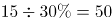人。

故正确答案为C。

注：本题并未说明每人分1包，不够严谨；但是不按每人1包则有无数种可能，无法求解。

**考点**：和差倍比问题

**来源**：2019年420联考《行测》题（重庆卷）（网友回忆版）第61题

### 第 62 题

太阳高度角是太阳光的入射方向和地平面之间的夹角。在正午时，太阳高度角为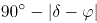，为纬度，δ为太阳赤纬。已知小陈的身高为180厘米，他所在地的纬度为43°，当日太阳赤纬为13°。那么，在正午时他的影子长度约为：

A. 60厘米

B. 90厘米

C. 104厘米

D. 208厘米

第 62 题 · 答案与解析

**参考答案（粉笔题库参考内容）**

C

**解析**

根据题干，正午时太阳高度角为。如下图所示，在△ABC中，AC代表小陈的身高，故为180厘米。AB代表太阳光，由于正午太阳高度角为60°，故∠B为60°。∠C为90°，BC即为影子的长度。根据30°直角三角形三边关系可知，，因此，则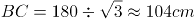。

故正确答案为C。

**考点**：几何结论类-三角形相关、几何公式类-平面图形

**来源**：2019年420联考《行测》题（黑龙江省直卷）（网友回忆版）第74题

### 第 63 题

一工厂生产的某规格齿轮的齿数是一个三位数的质数（除了1和它本身之外，不能被其他整数整除的正整数），其个、十、百位数字各不相同且均为质数。若将该齿数的百位数字与个位数字对调，所得新的三位数比该齿数大495，则该齿数的十位数字为：

A. 7

B. 5

C. 3

D. 2

第 63 题 · 答案与解析

**参考答案（粉笔题库参考内容）**

B

**解析**

三位数数字各不相同且均为质数，可知三位数字应在2、3、5、7中选择。调换位置后所得新数字比原数字大495，根据尾数判断则原数字的个位（调换后的百位）应为7，原数字的百位（调换后的个位）应为2，则十位数字只能是3或5。如果是3，则原数字为237=3×79，不是质数，不符合题意，因此原十位数字只能为5。

故正确答案为B。

**来源**：2019年420联考《行测》题（黑龙江省直卷）（网友回忆版）第71题

### 第 64 题

幼儿园老师设计了一个摸彩球游戏，在一个不透明的盒子里混放着红、黄两种颜色的小球，它们除了颜色不同，形状、大小均一致。已知随机摸取一个小球，摸到红球的概率为三分之一。如果从中先取出3红7黄共10个小球，再随机摸取一个小球，此时摸到红球的概率变为五分之二，那么原来盒中共有红球多少个？

A. 5

B. 10

C. 15

D. 20

第 64 题 · 答案与解析

**参考答案（粉笔题库参考内容）**

A

**解析**

假设原来盒子中共有x个红球，因随机摸取一个小球，摸到红球的概率为1/3，则原来盒子中共有3x个小球。取出3红7黄共10个小球后，红球剩下(x-3)个，小球总个数为(3x-10)，此时随机摸取一个小球，摸到红球的概率为2/5，则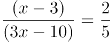，解得x=5。

故正确答案为A。

**考点**：概率问题-其他

**来源**：2019年420联考《行测》题（黑龙江省直卷）（网友回忆版）第72题

### 第 65 题

甲、乙两个工程队共同参与一项建设工程。原计划由甲队单独施工30天完成该项工程三分之一后，乙队加入，两队同时再施工15天完成该项工程。由于甲队临时有别的业务，其参加施工的时间不能超过36天，那么为全部完成该项工程，乙队至少要施工多少天？

A. 18

B. 20

C. 24

D. 30

第 65 题 · 答案与解析

**参考答案（粉笔题库参考内容）**

A

**解析**

根据题意可得，甲队单独完成这项工程需要天，则90甲=30甲+15×(甲+乙)，得3甲=乙，则甲、乙效率之比为1:3，赋值甲的效率为1，乙的效率为3，工程总量为90×1=90。根据问题，乙队施工天数尽可能少，则甲队施工天数应尽可能多，其最多可为36天，则乙队施工天数至少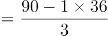=18天。

故正确答案为A。

**考点**：给效率比例型

**来源**：2019年420联考《行测》题（黑龙江省直卷）（网友回忆版）第61题

### 第 66 题

小王在商店消费了90元，口袋里只有1张50元、4张20元、8张10元的钞票，他共有几种付款方式，可以使店家不用找零钱?

A. 5

B. 6

C. 7

D. 8

第 66 题 · 答案与解析

**参考答案（粉笔题库参考内容）**

C

**解析**

根据题干条件分析，付款方式可包含使用50元与不使用50元两种情况。对情况进行枚举可得：

可得共有7种付款方式，可以使店家不用找零钱。

故正确答案为C。

**考点**：基础排列组合

**来源**：2019年420联考《行测》题（黑龙江省直卷）（网友回忆版）第64题

### 第 67 题

甲乙两人相约骑共享单车运动健身。停车点现有9辆单车，分属3个品牌，各有2、3、4辆。假如两人选择每一辆单车的概率相同，两人选到同一品牌单车的概率约为：

A. 1/6

B. 2/9

C. 5/18

D. 1/3

第 67 题 · 答案与解析

**参考答案（粉笔题库参考内容）**

C

**解析**

假设三个品牌分别为A、B、C，两人各选一辆单车的情况数共有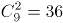种。两人选到同一品牌的单车，包含三种情况：

（1）两人同时选到A品牌，情况数为C_2^2=1；

（2）两人同时选到B品牌，情况数为C_3^2=3；

（3）两人同时选到C品牌，情况数为C_4^2=6；

则两人选到同一品牌单车的概率。

故正确答案为C。

**考点**：给情况求概率

**来源**：2019年420联考《行测》题（黑龙江省直卷）（网友回忆版）第66题

### 第 68 题

某次田径运动会中，选手参加各单项比赛计入所在团体总分的规则为：一等奖得9分，二等奖得5分，三等奖得2分。甲队共有10位选手参赛，均获奖。现知甲队最后总分为61分，问该队最多有几位选手获得一等奖？

A. 3

B. 4

C. 5

D. 6

第 68 题 · 答案与解析

**参考答案（粉笔题库参考内容）**

C

**解析**

设获得一等奖、二等奖、三等奖的人数分别为x、y、z，根据题意得：x+y+z=10，9x+5y+2z=61，整理两式，消去z得：7x+3y=41。

问获得一等奖人数最多，考虑从大到小代入：

代入D项，若x=6，代入7x+3y=41，y为负且不是整数，排除；

代入C项，若x=5，代入7x+3y=41，解得y=2，z=3，符合题意。

故正确答案为C。

**考点**：不定方程组

**来源**：2019年420联考《行测》题（黑龙江省直卷）（网友回忆版）第68题

### 第 69 题

小林在距家1.5公里的工厂上班。一天，小林出发10分钟后，父亲老林发现小林的手机没带，立即追出去，并在距离工厂500米的地方追上了他。如果老林追赶的速度比小林快6公里/小时，那么，下列关于小林速度x，求值所列方程正确的是：

A. 

B. 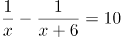

C. 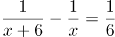

D. 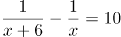

第 69 题 · 答案与解析

**参考答案（粉笔题库参考内容）**

A

**解析**

根据题意，老林从家到追上小林，老林和小林行驶的路程均为1.5-0.5=1 公里，老林比小林少用10 分钟，即1/6 小时。小林速度为x，老林速度为x+6，则。

故正确答案为A。

**考点**：相遇追及

**来源**：2019年420联考《行测》题（江西乡镇）（网友回忆版）第64题

### 第 70 题

一位学生在距离热气球100米处观看它起飞。在热气球起飞后，学生注意到热气球顶部从他的仰角30°上升到45°，再从45°上升到60°的位置分别用了11秒和17秒。则前后两段时间热气球平均上升速度的比值约为：

A. 0.89

B. 0.91

C. 1.12

D. 1.10

第 70 题 · 答案与解析

**参考答案（粉笔题库参考内容）**

A

**解析**

如图所示：当仰角为30°时，在直角三角形OAB中，

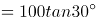米；当仰角为45°时，在直角三角形OAC中， 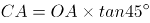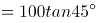=100米；当仰角为60°时，在直角三角形OAD中，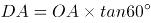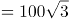米。两段时间上升的距离分别为米，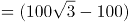米，则两段时间平均上升速度比为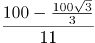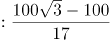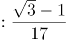≈0.89。

故正确答案为A。

**考点**：几何结论类-三角形相关、几何公式类-平面图形、普通行程

**来源**：2019年420联考《行测》题（黑龙江省直卷）（网友回忆版）第70题

### 第 71 题

把下面的图形分为两类，使每一类图形都有各自的共同特征或规律，分类正确的一项是：

A. ①③⑤，②④⑥

B. ①④⑥，②③⑤

C. ①④⑤，②③⑥

D. ①②⑥，③④⑤

第 71 题 · 答案与解析

**参考答案（粉笔题库参考内容）**

B

**解析**

解析一：

本题为分组分类题目。题干均是里面有两条直线的立体图形，可以考虑两条直线之间的关系。观察发现，图①④⑥中两条直线不相交，图②③⑤中两条直线相交，故①④⑥一组，②③⑤一组，只有B项符合。

故正确答案为B。

解析二：

本题为分组分类题目。题干均是里面有两条直线的立体图形，可以考虑两条直线之间的关系。观察发现，图①③⑤中两条直线不垂直，图②④⑥中两条直线垂直，故①③⑤一组，②④⑥一组，只有A项符合。

故正确答案为A。

粉笔说明：方法一的分类更直观，而方法二的知识点在以前有所考查，故本题属于命题不严谨。

**考点**：数量规律-线

**来源**：2019年420联考《行测》题（黑龙江省直卷）（网友回忆版）第78题

### 第 72 题

把下面的图形分为两类，使每一类图形都有各自的共同特征或规律，分类正确的一项是：

A. ①④⑥，②③⑤

B. ①②③，④⑤⑥

C. ①③⑥，②④⑤

D. ①③④，②⑤⑥

第 72 题 · 答案与解析

**参考答案（粉笔题库参考内容）**

A

**解析**

本题为分组分类题目，图形均为明显两个图形相交，考虑图形间关系。观察发现，图①④⑥的公共边为短边，图②③⑤的公共边为长边，故①④⑥一组，②③⑤一组。

故正确答案为A。

**考点**：特殊规律-图形间关系

**来源**：2019年420联考《行测》题（黑龙江省直卷）（网友回忆版）第76题

### 第 73 题

把下面的图形分为两类，使每一类图形都有各自的共同特征或规律，分类正确的一项是：

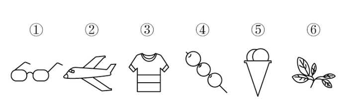

A. ①③⑥，②④⑤

B. ①③⑤，②④⑥

C. ①④⑥，②③⑤

D. ①②④，③⑤⑥

第 73 题 · 答案与解析

**参考答案（粉笔题库参考内容）**

C

**解析**

元素组成不同，优先考虑属性规律。对称、曲直均无明显规律，考虑开闭性。图①④⑥均为半开半封闭图形；图②③⑤均为全封闭图形。因此①④⑥一组，②③⑤一组。

故正确答案为C。

**考点**：属性规律-开闭性

**来源**：2019年420联考《行测》题（黑龙江省直卷）（网友回忆版）第77题

### 第 74 题

从所给四个选项中，选择最合适的一个填入问号处，使之呈现一定的规律性：

A. A

B. B

C. C

D. D

第 74 题 · 答案与解析

**参考答案（粉笔题库参考内容）**

C

**解析**

元素组成相同，优先考虑位置规律。整体观察发现，小三角、小圆圈均在移动，可以分开看，先看小三角，小三角的移动规律为每次顺时针平移两格，只有C项符合要求。再通过小圆圈位置验证，小圆圈的移动规律为每次逆时针平移三格， C项当选。

故正确答案为C。

**考点**：位置规律-平移

**来源**：2019年420联考《行测》题（内蒙古卷）（网友回忆版）第74题

### 第 75 题

从所给四个选项中，选择最合适的一个填入问号处，使之呈现一定的规律性：

A. A

B. B

C. C

D. D

第 75 题 · 答案与解析

**参考答案（粉笔题库参考内容）**

C

**解析**

元素组成不同，且无明显属性规律，考虑数量规律。图四、图五封闭面明显，考虑面数量。面数量依次为2、3、4、5、6，则问号处图形面数量为7，只有C符合要求。

故正确答案为C。

**考点**：数量规律-面

**来源**：2019年420联考《行测》题（重庆卷）（网友回忆版）第73题

### 第 76 题

从所给的四个选项中，选择最合适的一个填入问号处，使之呈现一定的规律性：

A. A

B. B

C. C

D. D

第 76 题 · 答案与解析

**参考答案（粉笔题库参考内容）**

B

**解析**

解析1：元素组成不相同，不相似，优先考虑属性规律。题干均为轴对称图形，且对称轴数量均为3条。A项1条；B项3条；C项2条；D项2条。

故正确答案为B。

注：如上图所示，A项中蓝点处于圆与三角形的切点处，而红点并非处于圆与三角形的切点处，故此图只有1条对称轴，而不是3条。

解析2：元素组成不相同，不相似，优先考虑属性规律。题干有曲线有直线，考虑曲直性，图一为有曲有直图形，图二为全直线图形，图三为有曲有直图形，图四为全直线图形，因此“？”处选择一个有曲有直图形。A项有曲有直，B、C、D三项均为纯直线图形。

故正确答案为A。

解析3：元素组成不相同，不相似，考虑属性和数量规律。题干出现切圆，考虑笔画数，题干图形笔画数依次为2121？，故？处应为2笔画图形，只有D项为2笔画。

故正确答案为D。

本题有多种规律，但从图形特征和命题思路分析，考虑到题干几个图均是等边三角形的变形图，而等边三角形以及其变形图在近几年的考试中多用于考查对称性，故粉笔倾向对称性这一考点。

故正确答案为B。

**考点**：属性规律-对称性

**来源**：2019年420联考《行测》题（黑龙江省直卷）（网友回忆版）第79题

### 第 77 题

从所给的四个选项中，选择最合适的一个填入问号处，使之呈现一定的规律性：

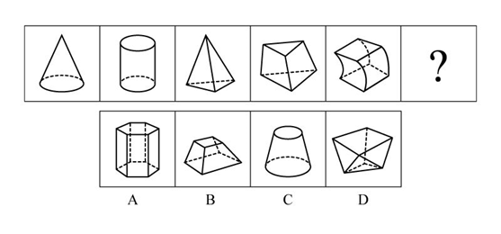

A. A

B. B

C. C

D. D

第 77 题 · 答案与解析

**参考答案（粉笔题库参考内容）**

D

**解析**

解析一：元素组成不同，属性无明显规律，考虑数量规律。题干均为立体图形，且封闭区域较多，可数立体图形的外表面的面数量，即立体图形的外表面是由几个面构成的，观察发现分别由2、3、4、5、6个面构成，因此“？”处应该选择一个外表面为7的立体图形。A选项8个面，B选项6个面，C选项3个面，D选项7个面。D项当选。

故正确答案为D。

解析二：元素组成不同，属性无明显规律，考虑数量规律。观察发现题干立体图形均有下底面，图一和图二下底面形状相同，图三和图四下底面形状相同，因此“？”处应该选择一个与图五下底面形状相同的图形。B项当选。

故正确答案为B。

因为解析一中数立体图形的外表面的面数量呈现严谨的等差规律，故粉笔对于此题更倾向根据外表面的面数量，选择 D项。

**考点**：数量规律-面

**来源**：2019年420联考《行测》题（江西乡镇）（网友回忆版）第78题

### 第 78 题

正方体切掉一块后剩余部分如下图左侧所示，右侧哪一项是其切去部分的形状？

A. A

B. B

C. C

D. D

第 78 题 · 答案与解析

**参考答案（粉笔题库参考内容）**

B

**解析**

此题为立体图形拼合问题，解题原则为凹凸一致。根据题目要求，可知正确选项和左侧图形拼合后应为正方体。观察题干左侧图形，发现外侧斜坡和其内侧上方凸出的小矩形在同一侧，而A、C两项外侧斜坡和凹进去的小矩形不在同一侧，排除；比较B、D两项，仅在中间位置不同，题干左侧图形中间位置存在斜坡，根据凹凸一致的原则，选项也应存在斜坡，只有B项符合。

故正确答案为B。

**考点**：空间类-立体拼合

**来源**：2019年420联考《行测》题（黑龙江省直卷）（网友回忆版）第80题

### 第 79 题

从所给四个选项中，选择最合适的一个填入问号处，使之呈现一定的规律性：

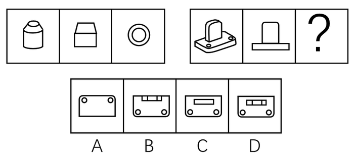

A. A

B. B

C. C

D. D

第 79 题 · 答案与解析

**参考答案（粉笔题库参考内容）**

C

**解析**

本题考查三视图，第一组图形中第二个图形和第三个图形分别是第一个立体图形的主视图和俯视图。第二组应用规律，问号处所填图形应为第一个立体图形的俯视图。俯视图从上往下看，可以看到外框是一个类似矩形的轮廓，里面两个小圆圈加上一个小矩形，只有C项符合。

故正确答案为C。

**考点**：空间类-三视图

**来源**：2019年420联考《行测》题（内蒙古卷）（网友回忆版）第79题

### 第 80 题

组织认同是指组织成员在行为或观念等诸方面与其所加入的组织具有一致性，觉得自己在组织中既有理性的契约和责任感，也有非理性的归属和依赖感，以及在这种心理基础上表现出的对组织活动尽心尽力的行为结果。

根据上述定义，下列选项**不属于**组织认同的是：

A. “我们要以共产党员的标准严格要求自己”

B. “公司面临困难的时候，我们要不离不弃”

C. “我要每时每刻自觉维护公司的良好形象”

D. “今日我以母校为傲，明日母校以我为荣”

第 80 题 · 答案与解析

**参考答案（粉笔题库参考内容）**

D

**解析**

第一步：找出定义关键词。

“组织成员与其所加入的组织具有一致性”、“既有理性的契约和责任感”、“也有非理性的归属和依赖感”、“对组织活动尽心尽力”。

第二步：逐一分析选项。

A项：用共产党员的标准要求自己，体现了党员的行为和观念与党组织的一致性，但说出此话的主体不一定是党员，非党员也可以表达这样的决心，该项主体不明确，可能符合“组织成员与其所加入的组织具有一致性”，保留；

B项：对公司不离不弃，体现了员工对公司的责任感和归属感，符合“既有理性的契约和责任感”、“也有非理性的归属和依赖感”，且面对困难也一直坚守，符合“对组织活动尽心尽力”，符合定义，排除；

C项：自觉维护公司的良好形象，符合“既有理性的契约和责任感”、“也有非理性的归属和依赖感”，符合定义，排除；

D项：学生和母校互相为各自取得的成绩骄傲，母校的定义是曾经在那里毕业或学习过的学校，即此刻已经不是该校的学生了，我们才会称之为“母校”，不符合“组织成员与其所加入的组织具有一致性”；另外学校和学生是教书育人的关系，一般也不会说二者有契约关系，不符合“既有理性的契约和责任感”，跟A项相比，A项可能符合，D项是更不符合的，当选。

本题为选非题，故正确答案为D。

**考点**：单定义-其他句式

**来源**：2019年420联考《行测》题（江西乡镇）（网友回忆版）第87题

### 第 81 题

投射性认同指一个人诱导他人以一种限定的方式来作出反应的行为模式。体现在人际关系中，往往是甲方把内心中“好”或“坏”的客体投射到乙方身上，认为乙方“好”或“坏”，而乙方又接受了这一投射幻想，于是就以甲方所设想的方式来对待甲方。然后甲方又进一步验证了自己的假设，认为乙方就是他所认为的那样的人。

根据上述定义，下列选项属于投射性认同的是：

A. 寒门亦可出贵子

B. 严师方能出高徒

C. 虎父果然无犬子

D. 慈母自古多败儿

第 81 题 · 答案与解析

**参考答案（粉笔题库参考内容）**

C

**解析**

第一步：找出定义关键词。

“甲方把内心中‘好’或‘坏’的客体投射到乙方身上”、“乙方接受这一幻想”、“甲方验证了假设”。

第二步：逐一分析选项。

A项：寒门也可以出贵子，是指出生微贱的年轻人在自身努力和外界条件支持下也可以获得成就，认为寒门可以出贵子，符合“甲方把内心中‘好’或‘坏’的客体投射到乙方身上”，但最终出身寒门的年轻人是否成为了贵子并没有得到验证，不符合“乙方接受这一幻想”、“甲方验证了假设”，不符合定义，排除；

B项：严师方能出高徒，是指严格的师傅或老师能教出本领高超的好徒弟或好学生，认为严师才能出高徒，符合“甲方把内心中‘好’或‘坏’的客体投射到乙方身上”，但该项没有涉及严师的徒弟最后到底是否成为了高徒的验证，不符合“乙方接受这一幻想”、“甲方验证了假设”，不符合定义，排除；

C项：虎父果然无犬子，是指出色的父亲果然不会生出一般的孩子，认为虎父无犬子，符合“甲方把内心中‘好’或‘坏’的客体投射到乙方身上”，且该项中的“果然”体现了虎父的孩子确实不是犬子，体现了进一步验证了自己的假设，符合“乙方接受这一幻想”、“甲方验证了假设”，符合定义，当选；

D项：慈母自古多败儿，是指宠溺孩子的母亲，教出的孩子多是很自私很任性，认为慈母多败儿，符合“甲方把内心中‘好’或‘坏’的客体投射到乙方身上”，但该项没有涉及慈母的儿子最后到底是否是自私任性的人的验证，不符合“乙方接受这一幻想”、“甲方验证了假设”，不符合定义，排除。

故正确答案为C。

**考点**：单定义-其他句式

**来源**：2019年420联考《行测》题（黑龙江省直卷）（网友回忆版）第82题

### 第 82 题

关怀强迫症即一个人特别需要别人依赖自己，总是爱向别人提供别人不需要的关怀。并且，这种人还强迫别人接受自己的关怀，从而使别人不能独立。当别人依赖自己的时候，他就会感到满足，感到自己有价值。这种症状会压抑人的神经，并同时给身边的亲朋好友甚至一般的同事带来诸多不便。

根据上述定义，下列属于关怀强迫症的是：

A. 张某说：“我一天没见到儿子就会发疯”

B. 李某连哄带骗让感冒的女儿吃下感冒药

C. 刘某从小学到大学期间都住自己家里

D. 王某在女儿就读的大学附近租房陪读

第 82 题 · 答案与解析

**参考答案（粉笔题库参考内容）**

D

**解析**

第一步：找出定义关键词。

“需要别人依赖自己”、“提供别人不需要的关怀”、“强迫别人接受”、“使别人不能独立”。

第二步：逐一分析选项。

A项：张某一天没见到儿子就会发疯，说明是张某依赖儿子，而并非是儿子依赖自己，不符合“需要别人依赖自己”，不符合定义，排除；

B项：李某连哄带骗让感冒的女儿吃下感冒药，没有体现“需要别人依赖自己”，且感冒的女儿需要被人关怀照顾，不符合“提供别人不需要的关怀”，不符合定义，排除；

C项：刘某上学期间住在家里，没有体现到强迫别人，不符合“强迫别人接受”，不符合定义，排除；

D项：王某在女儿就读的大学附近租房陪读，女儿已经读大学了，说明她已经能够独立地生活和学习，符合 “提供别人不需要的关怀”、“强迫别人接受”、“使别人不能独立”，符合定义，当选。

故正确答案为D。

**考点**：单定义-其他句式

**来源**：2019年420联考《行测》题（黑龙江省直卷）（网友回忆版）第83题

### 第 83 题

虚拟现实技术是指一种可以创建和体验虚拟世界的仿真系统，它利用计算机生成可交互的三维环境，向使用者提供视觉、听觉、触觉等感官的模拟，从而让人有身临其境之感，这是一种360度视角的沉浸式体验。

根据上述定义，下列选项属于虚拟现实技术运用的是：

A. 张三通过电脑与远在巴黎的父亲视频聊天，亲眼见到了埃菲尔铁塔

B. 李四用手机微信与妻子视频聊天，亲耳听到了儿子背诵古诗的声音

C. 刘五戴上特制头盔网购书桌，能够全方位地体验书桌摆进书房的效果

D. 王二用平板电脑看同学在西藏旅游的视频，感觉自己也到了布达拉宫

第 83 题 · 答案与解析

**参考答案（粉笔题库参考内容）**

C

**解析**

第一步：找出定义关键词。

“指一种可以创建和体验虚拟世界的仿真系统”、“它利用计算机生成可交互的三维环境，向使用者提供视觉、听觉、触觉等感官的模拟”、“从而让人有身临其境之感，是一种360度视角的沉浸式体验。”

第二步：逐一分析选项。

A项：张三通过电脑与远在巴黎的父亲视频聊天，亲眼见到了埃菲尔铁塔，看到的埃菲尔铁塔是现实世界的景物，并不是虚拟的，不符合“是一种可以创建和体验虚拟世界的仿真系统”，也不符合“向使用者提供视觉、听觉、触觉等感官的模拟”，不符合定义，排除；

B项：李四用微信与妻子视频聊天，亲耳听到了儿子背诵古诗的是声音，儿子背诵古诗的声音也是现实世界的声音，并不是虚拟的，不符合“是一种可以创建和体验虚拟世界的仿真系统”，也不符合“向使用者提供视觉、听觉、触觉等感官的模拟”，不符合定义，排除；

C项：刘五戴上特制头盔，能够全方位地体验书桌摆进书房的效果，符合“向使用者提供视觉、听觉、触觉等感官的模拟”、“是一种360度视角的沉浸式体验”，符合定义，当选；

D项：王二用平板电脑看同学在西藏旅游的视频，感觉自己也到了布达拉宫，王二观看视频的过程，不符合“创建和体验虚拟世界的仿真系统”，不符合定义，排除。

故正确答案为C。

**考点**：方式目的

**来源**：2019年420联考《行测》题（黑龙江省直卷）（网友回忆版）第84题

### 第 84 题

投资市场相反理论是指投资市场本身并不创造新的价值，没有增值，甚至可以说是减值。如果一个投资者在投资行动时同多数投资者相同，那么他一定不是获利最大的，因为不可能多数人获利；要获得最大的利益，一定要同多数人的行动不一致。

根据上述定义，下列选项**不符合**投资市场相反理论的是：

A. “已经跌这么多了，该到底了”

B. “在市场投资者爆满的时候，我们再离场”

C. “只要你和多数投资者的意见相左，致富机会永远存在”

D. “人弃我取，别人恐惧我贪婪”

第 84 题 · 答案与解析

**参考答案（粉笔题库参考内容）**

A

**解析**

第一步：找出定义关键词。

“投资市场本身并不创造新的价值，没有增值，甚至可以说是减值”、“要获得最大的利益，一定要同多数人的行动不一致”。

第二步：逐一分析选项。

A项：该项只说了投资产品价值的变化，并没有提及投资者人数是多还是少，以及投资者的策略是否相同，不符合定义，选非题，当选；

B项：该项提到在投资者非常多的时候我们再离场，表明我们与大多数投资者的策略是不相同的，符合 “要获得最大的利益，一定要同多数人的行动不一致”，符合定义，选非题，排除；

C项：该项说明投资者在投资时，选择和多数投资者不同的意见就可以成功，这符合“要获得最大的利益，一定要同多数人的行动不一致”，符合定义，选非题，排除；

D项：该项表明“我”和大多数投资者的投资策略是不同的，大家害怕投资失败选择放弃的时候，而“我”为了追求利润会选择购买，符合“要获得最大的利益，一定要同多数人的行动不一致”，符合定义，选非题，排除。

本题为选非题，故正确答案为A。

**考点**：单定义-其他句式

**来源**：2019年420联考《行测》题（江西乡镇）（网友回忆版）第85题

### 第 85 题

意志的活动过程会体现以下两大定律。其中，意志强度边际效应定律是指意志的强度随着自身行为的活动规模的增长而下降；意志强度时间衰减定律是指意志的强度随着自身行为的持续时间的增长而呈现负指数下降。

根据上述定义，下列选项最能体现意志强度时间衰减定律的是：

A. 锲而舍之，朽木不折

B. 为山九仞，功亏一篑

C. 穷且益坚，不坠青云之志

D. 一鼓作气，再而衰，三而竭

第 85 题 · 答案与解析

**参考答案（粉笔题库参考内容）**

D

**解析**

第一步：找出定义关键词。

意志强度边际效应定律：“意志强度”、“随自身行为的活动规模增长而下降”；

意志强度时间衰减定律：“意志强度”、“随自身行为的持续时间增长而呈现负指数下降”。

第二步：逐一分析选项。

A项：“锲而舍之，朽木不折”意思是说如果不坚持做一件事，就算是腐朽的木头也无法折断，说明人们不坚持做一件事的后果，不符合“随自身行为的持续时间增长”，不符合定义，排除；

B项：“为山九仞，功亏一篑”意思是说堆九仞高的山，只缺一筐土导致不能完成，是用来比喻做事情只差最后一点没能完成，说明没有一直坚持下去，不符合“随自身行为的持续时间增长”，不符合定义，排除；

C项：“穷且益坚，不坠青云之志”意思是说一个人处境越是艰难，就越是坚忍不拔，越是不丢失高远之志，没有体现与时间增长的关系，不符合“随着自身行为的持续时间的增长而呈现负指数下降”，不符合定义，排除；

D项：“一鼓作气，再而衰，三而竭”意思是说，第一次击鼓士气会大大的增加，第二次击鼓士气就会减弱了，第三次击鼓就没有士气了，说明士气随着时间的增加而减弱，符合“随时间增长而呈现负指数下降”，符合定义，当选。

故正确答案为D。

**考点**：常规问法

**来源**：2019年420联考《行测》题（黑龙江省直卷）（网友回忆版）第85题

### 第 86 题

元素指自然界中一百多种基本的金属和非金属物质，它们由一种原子组成，其原子中的每一个核子具有同样数量的质子，用一般的化学方法不能使之分解，并且能构成一切物质。原子是化学反应不可再分的基本微粒，原子在化学反应中不可分割，但在物理状态中可以分割，由原子核和绕核运动的电子组成。分子由原子构成，是构成物质的一种基本粒子的名称，是单独存在、保持化学性质最小的粒子。

根据上述定义，下列选项正确的是：

A. 原子是构成物质的最小粒子

B. 空气由各种细小的原子构成

C. 具有不同数量质子的原子不是同一类元素

D. 一氧化碳分子（CO）由一个氧元素和一个碳元素构成

第 86 题 · 答案与解析

**参考答案（粉笔题库参考内容）**

C

**解析**

第一步：找出定义关键词。

“元素是指自然界中一百多种基本的金属和非金属物质”、“元素由一种原子组成，其原子中的每一个核子具有相同数量的质子”、“原子用一般的化学方法不能使之分解，并且能构成一切物质”、“原子是化学反应不可再分的基本微粒，原子在化学反应中不可分割，但在物理状态中可以分割，由原子核和绕核运动的电子组成”、“分子由原子构成，是构成物质的一种基本粒子的名称，是单独存在、保持化学性质最小的粒子”。

第二步：逐一分析选项。

A项：原子是构成物质的最小粒子，不符合“在物理状态中可以分割”，不符合定义，排除；

B项：空气是一种混合物，不可能是由细小的原子构成，不符合定义，排除；

C项：具有不同数量质子的原子不是同一类元素，符合“元素由一种原子组成，其原子中的每一个核子具有相同数量的质子”，符合定义，当选；

D项：选项不符合“分子由原子构成，是构成物质的一种基本粒子的名称，是单独存在、保持化学性质最小的粒子”，一氧化碳分子（CO）应该是由一个氧原子和一个碳原子构成，不符合定义，排除。

故正确答案为C。

**考点**：特殊问法

**来源**：2019年420联考《行测》题（黑龙江省直卷）（网友回忆版）第86题

### 第 87 题

消费滞后是指个人消费滞后于国家经济发展和个人家庭收入所应达到的平均消费水平。消费超前是指当下的收入水平不足以购买现在所需的产品或服务，以贷款、分期付款、预支等形式进行消费。

根据上述定义，下列属于消费超前的是：

A. 职员小王以信用卡支付的形式在网上订购了火车票

B. 大学生小李通过某借贷平台购买了某知名品牌电脑

C. 退休工人老张名下有商品房和汽车，但坚持只用老式的直板手机

D. 青年教师小刘有十万元定期存款未到期，向同事借了八万元买车

第 87 题 · 答案与解析

**参考答案（粉笔题库参考内容）**

B

**解析**

第一步：找出定义关键词。

消费滞后：“指个人消费滞后于国家经济发展和个人家庭收入所应达到的平均消费水平”；

消费超前：“指当下的收入水平不足以购买现在所需的产品或服务”、“以贷款、分期付款、预支等形式进行消费”。

第二步：逐一分析选项。

A项：小王为职员说明小王已经工作，购买火车票应该是消费水平范围内，不符合“当下的收入水平不足以购买现在所需的产品或服务”，不符合定义，排除；

B项：小李是一名大学生，尚未参加工作，购买电脑符合“当下的收入水平不足以购买现在所需的产品或服务”，且通过“某借贷平台购买”属于“贷款”的支付方式，符合定义，当选；

C项：老张有房有车，却使用老式的直板手机，符合“个人消费滞后于国家经济发展和个人家庭收入所应达到的平均消费水平”，属于消费滞后，不属于消费超前，不符合定义，排除；

D项：小刘有十万元的存款，而车只有八万元，也就是当下的收入足以购买现在所需的产品，不符合“当下的收入水平不足以购买现在所需的产品或服务”，且向同事借钱不符合“以贷款、分期付款、预支等形式进行消费”，不符合定义，排除。

故正确答案为B。

**考点**：常规问法

**来源**：2019年420联考《行测》题（黑龙江省直卷）（网友回忆版）第88题

### 第 88 题

水文节律指湖泊水情周期性、有节律的变化。广义水文节律包括昼夜、月运、季节和年际节律。正常情况下，由于流域气候和下垫面等因素较稳定，湖泊多年平均水位趋于稳定数值即湖泊正常年平均水位。所以湖泊年际节律以干扰因素驱动的突变性和适应干扰后的阶段稳定性为特点，无渐变趋向；而昼夜节律对生态系统影响微弱。因此，狭义水文节律特指月运节律与季节节律。

根据上述定义，下列涉及狭义水文节律的是：

A. 鄱阳湖受降雨持续减少和来水减少双重影响，水面面积持续萎缩

B. 洪泽湖历史年均水温16.3℃，最高水温在9月，最低水温在1月

C. 洞庭湖去年年降水量1560毫米，其中4~6月降水约占全年一半

D. 巢湖流域年平均气温稳定在之间，有200天以上无霜期

第 88 题 · 答案与解析

**参考答案（粉笔题库参考内容）**

B

**解析**

第一步：找出定义关键词。

水文节律：“湖泊水情周期性、有节律的变化”；

广义水文节律：“昼夜、月运、季节和年际节律”；

狭义水文节律：“月运节律和季节节律”。

（注：水情是指江河湖泊的状况、特征及地理意义，如流量、水位、流速、水温与冰情等）

本题要选的是符合狭义水文节律的选项。

第二步：逐一分析选项。

A项：鄱阳湖水面面积持续萎缩，说明是一直在减小，不存在周期性的变化，不符合定义，排除；

B项：洪泽湖历史年均最高水温在9月，最低水温在1月，月份和季节不同水温也不同，而且是统计了历史上多年的水温，符合“湖泊水情周期性、有节律的变化”，符合“季节节律”，符合狭义水文节律，符合定义，当选（水情指江河湖泊的状况、特征及地理意义，如流量、水位、流速、水温与冰情等，水温是水文测验的基本项目之一）；

C项：只是给出洞庭湖去年一年的降水量，没有体现“周期性、有节律的变化”，不符合定义，排除；

D项：巢湖流域平均气温在15-16摄氏度之间，有200天以上无霜期，是湖泊流经区域的气温变化，而不是湖泊水情的变化，不符合定义，排除。

故正确答案为B。

**考点**：常规问法

**来源**：2019年420联考《行测》题（黑龙江省直卷）（网友回忆版）第89题

### 第 89 题

孤本：书籍

A. 正方形：长方形

B. 蔬菜：土地

C. 显微镜：实验室

D. 礼物：商品

第 89 题 · 答案与解析

**参考答案（粉笔题库参考内容）**

A

**解析**

第一步：判断题干词语间逻辑关系。

孤本，指某书刊仅有一份在世间流传的版本，亦指仅存的一份未刊手稿或原物已亡佚，仅存的一份拓本。孤本是特殊的书籍。

第二步：判断选项词语间逻辑关系。

A项：正方形是特殊的长方形，与题干逻辑关系一致，当选；

B项：蔬菜和土地，土地是蔬菜生长的场所，与题干逻辑关系不一致，排除；

C项：显微镜和实验室，显微镜是实验室需要用到的工具，与题干逻辑关系不一致，排除；

D项：有的礼物是商品，有的礼物不是商品，有的商品是礼物，有的商品不是礼物，二者为交叉关系，与题干逻辑关系不一致，排除。

故正确答案为A。

**考点**：逻辑关系-包容关系

**来源**：2019年420联考《行测》题（黑龙江省直卷）（网友回忆版）第92题

### 第 90 题

玻璃幕墙：光污染

A. 汽车尾气：酸雨

B. 海上风暴：海啸

C. 火山喷发：地震

D. 空气消毒：臭氧

第 90 题 · 答案与解析

**参考答案（粉笔题库参考内容）**

A

**解析**

第一步：判断题干词语间逻辑关系。

玻璃幕墙可以导致光污染，二者是因果关系，并且玻璃幕墙是人为产物。

第二步：判断选项词语间逻辑关系。

A项：汽车尾气可以导致酸雨，二者为因果关系，并且汽车尾气是人为产物，与题干逻辑关系一致，当选；

B项：海上风暴可以导致海啸，二者为因果关系，但海上风暴为天然现象，与题干逻辑关系不一致，排除；

C项：火山喷发可以导致地震，二者为因果关系，但火山喷发为天然现象，与题干逻辑关系不一致，排除；

D项：空气消毒不会导致臭氧，二者不是因果关系，与题干逻辑关系不一致，排除。

故正确答案为A。

**考点**：逻辑关系-对应关系

**来源**：2019年420联考《行测》题（黑龙江省直卷）（网友回忆版）第91题

### 第 91 题

拥挤：水泄不通

A. 清晰：洞见肺腑

B. 严重：触目惊心

C. 费力：举重若轻

D. 伤心：肝肠寸断

第 91 题 · 答案与解析

**参考答案（粉笔题库参考内容）**

D

**解析**

第一步：判断题干词语间逻辑关系。

水泄不通形容拥挤或包围的非常严密，与拥挤是近义关系。

第二步：判断选项词语间逻辑关系。

A项：洞见肺腑是指很清楚地看见人的内心，形容襟怀坦白，待人诚恳。与清晰不是近义关系，与题干逻辑关系不一致，排除；

B项：触目惊心是指看见某种严重情况而内心震惊，形容事态严重，引起轰动，该词强调的是震惊，与严重不是近义关系，与题干逻辑关系不一致，排除；

C项：举重若轻是比喻能力强，能够轻松地胜任繁重的工作或处理困难的问题。与费力不是近义关系，与题干逻辑关系不一致，排除；

D项：肝肠寸断是比喻伤心到极点，与伤心是近义关系，与题干逻辑关系一致，当选。

故正确答案为D。

**考点**：语义关系-近义关系

**来源**：2019年420联考《行测》题（黑龙江省直卷）（网友回忆版）第98题

### 第 92 题

成长：衰亡

A. 坚定：彷徨

B. 美好：苦难

C. 深刻：纯真

D. 复杂：单纯

第 92 题 · 答案与解析

**参考答案（粉笔题库参考内容）**

A

**解析**

第一步：判断题干词语间逻辑关系。

成长和衰亡是反义关系，并且成长是积极的，衰亡是消极的。

第二步：判断选项词语间逻辑关系。

A项：坚定和彷徨是反义关系，并且坚定是积极的，彷徨是消极的，与题干逻辑关系一致，当选；

B项：美好的反义词应该是丑陋，而苦难不一定是丑陋的，很多磨难是对人的一种历练，是对人生有益的，因此美好和苦难不是反义关系，与题干逻辑关系不一致，排除；

C项：深刻和纯真不是反义关系，与题干逻辑关系不一致，排除；

D项：复杂和单纯是反义关系，但是复杂和单纯没有积极和消极之分，与题干逻辑关系不一致，排除。

故正确答案为A。

**考点**：语义-其他

**来源**：2019年420联考《行测》题（黑龙江省直卷）（网友回忆版）第97题

### 第 93 题

老字号：新品牌：传承

A. 老传统：新花样：质疑

B. 老配方：新工艺：创新

C. 老问题：新思考：评价

D. 老物件：新东西：区分

第 93 题 · 答案与解析

**参考答案（粉笔题库参考内容）**

B

**解析**

第一步：判断题干词语间逻辑关系。

老字号经过传承可以变为新品牌。

第二步：判断选项词语间逻辑关系。

A项：老传统被质疑不能变为新花样，与题干逻辑关系不一致，排除；

B项：老配方经过创新可以变为新工艺，与题干逻辑关系一致，当选；

C项：老问题被评价不能变为新思考，与题干逻辑关系不一致，排除；

D项：老物件被区分不能变为新东西，与题干逻辑关系不一致，排除。

注：此题有同学可能会纠结D项，认为老字号与新品牌都是品牌，老物件与新东西都是物品。但D项前两个词与区分无关。从题干三个词的关系看体现了新老物体之间的变化，而B项也是体现了新老事物之间的变化，因此粉笔更倾向于B项。

故正确答案为B。

**考点**：逻辑关系-对应关系

**来源**：2019年420联考《行测》题（黑龙江省直卷）（网友回忆版）第93题

### 第 94 题

效率：公平：市场经济

A. 科学：理性：政治哲学

B. 革命：改良：社会制度

C. 民主：集中：组织原则

D. 美丑：善恶：审美范畴

第 94 题 · 答案与解析

**参考答案（粉笔题库参考内容）**

C

**解析**

第一步：判断题干词语间逻辑关系。

市场经济需要兼顾效率与公平。

第二步：判断选项词语间逻辑关系。

A项：政治哲学不需要兼顾科学与理性，且科学是理性的，与题干逻辑关系不一致，排除；

B项：社会制度不需要兼顾革命与改良，与题干逻辑关系不一致，排除；

C项：组织原则需要兼顾民主与集中，与题干逻辑关系一致，当选；

D项：审美范畴不需要兼顾美丑与善恶，且善恶不属于审美的范畴，与题干逻辑关系不一致，排除。

故正确答案为C。

**考点**：逻辑关系-对应关系

**来源**：2019年420联考《行测》题（黑龙江省直卷）（网友回忆版）第94题

### 第 95 题

鞋匠：缝纫机：大头皮鞋

A. 厨师：炒菜锅：青椒炒肉

B. 矿工：十字镐：钙铁榴石

C. 记者：录音笔：高端访谈

D. 园丁：洒水壶：鹿角海棠

第 95 题 · 答案与解析

**参考答案（粉笔题库参考内容）**

A

**解析**

第一步：判断题干词语间逻辑关系。

鞋匠用缝纫机制作大头皮鞋，鞋匠是职业，缝纫机是使用的工具，大头皮鞋是鞋匠制作的成品。

第二步：判断选项词语间逻辑关系。

A项：厨师用炒菜锅制作青椒炒肉，厨师是职业，炒菜锅是使用的工具，青椒炒肉是厨师制作的成品，与题干逻辑关系一致，当选；

B项：矿工用十字镐挖掘钙铁榴石（含钛、铬的石榴石都属于钙铁榴石），矿工是职业，十字镐是使用的工具，钙铁榴石可以是十字镐作用的对象，与题干逻辑关系不一致，排除；

C项：记者用录音笔记录高端访谈，记者是职业，录音笔是使用的工具，“高端访谈”是“记者”参与的活动，与题干逻辑关系不一致，排除；

D项：园丁用洒水壶浇灌鹿角海棠（属多年生肉质灌木），园丁是职业，洒水壶是使用的工具，鹿角海棠是洒水壶作用的对象，与题干逻辑关系不一致，排除。

故正确答案为A。

**考点**：逻辑关系-对应关系

**来源**：2019年420联考《行测》题（黑龙江省直卷）（网友回忆版）第99题

### 第 96 题

（ ） 对于 聚集之处 相当于 捷径 对于 （ ）

A. 荟萃；取巧之思

B. 渊薮；速成之法

C. 辐辏；入门之路

D. 囹圄；提升之梯

第 96 题 · 答案与解析

**参考答案（粉笔题库参考内容）**

B

**解析**

逐一代入选项。

A项：荟萃比喻优秀的人物或精美的东西会集、聚集，可以形容聚集之处，捷径比喻能较快地达到目的的巧妙手段或办法，与取巧之思无关，前后逻辑关系不一致，排除；

B项：渊薮比喻某种人或事、物聚集的地方，可以比喻聚集之处；捷径指近便的小路，形容便捷的方法，可以比喻速成之法，前后逻辑关系一致，当选；

C项：辐辏形容人或物聚集像车辐集中于车毂一样，可以形容聚集之处，入门之路与捷径无关，前后逻辑关系不一致，排除；

D项：囹圄原指监牢，后引申为束缚、困难，与聚集之处无关，捷径与提升之梯无关，前后逻辑关系不一致，排除。

故正确答案为B。

**考点**：语义关系-近义关系

**来源**：2019年420联考《行测》题（黑龙江省直卷）（网友回忆版）第100题

### 第 97 题

（ ） 对于 风险 相当于 精兵简政 对于 （ ）

A. 亡羊补牢：效率

B. 枕戈待旦：业绩

C. 克己奉公：资源

D. 曲突徙薪：成本

第 97 题 · 答案与解析

**参考答案（粉笔题库参考内容）**

D

**解析**

逐一代入选项。

A项：亡羊补牢比喻出了问题以后想办法补救，可以防止继续受损失，能够减少风险，精兵简政比喻精简不必要的东西，可以提高效率，一个体现减少，一个体现增加，前后逻辑关系不一致，排除；

B项：枕戈待旦指时刻警惕，准备作战，连睡觉时也不放松戒备，与风险无关，精兵简政与业绩无关，前后逻辑关系不一致，排除；

C项：克己奉公比喻一个人对自己要求严格，一心为公，与风险无关，精兵简政，其实就是节约资源，前后逻辑关系不一致，排除；

D项：曲突徙薪比喻消除可能导致事故的因素，防患于未然，曲突徙薪的目的是减少风险，精兵简政的目的是减少成本，前后逻辑关系一致，当选。

故正确答案为D。

**考点**：逻辑关系-对应关系

**来源**：2019年420联考《行测》题（黑龙江省直卷）（网友回忆版）第96题

### 第 98 题

（ ） 对于 幸灾乐祸 相当于 怨天尤人 对于 （ ）

A. 得意忘形；呼天号地

B. 乐极生悲；饮恨吞声

C. 兔死狐悲；乐天知命

D. 睚眦必报；破涕为笑

第 98 题 · 答案与解析

**参考答案（粉笔题库参考内容）**

C

**解析**

逐一代入选项。

A项：得意忘形指因心意得到满足而高兴得失去常态，幸灾乐祸指人缺乏善意，在别人遇到灾祸时感到高兴，二者无关；怨天尤人指遇到挫折或出了问题，一味抱怨天责怪别人，呼天号地形容极为冤屈、怨恨或痛苦，二者无关，前后逻辑关系不一致，排除；

B项：乐极生悲指高兴到极点时，发生使人悲伤的事，与幸灾乐祸无关；饮恨吞声形容忍恨含悲，不敢表露，与怨天尤人无关，前后逻辑关系不一致，排除；

C项：兔死狐悲指对同盟的死亡或不幸而伤心，与幸灾乐祸构成反义关系；乐天知命指认为自己的一切都由命运支配，安于现状，与怨天尤人构成反义关系，前后逻辑关系一致，当选；

D项：睚眦必报指像瞪一下眼睛那样极小的怨仇也要报复，比喻心胸极其狭窄，与幸灾乐祸无关；破涕为笑形容转悲为喜，一下子从哭变为了笑，与怨天尤人无关，前后逻辑关系不一致，排除。

故正确答案为C。

**考点**：语义关系-反义关系

**来源**：2019年420联考《行测》题（内蒙古卷）（网友回忆版）第98题

### 第 99 题

快速、持续、无法预测的竞争环境要求企业规模小，结构简化，同时要有足够的技术储备和抵抗资金风险的能力。目前解决这一矛盾的途径通常是建立全球范围内的“基于双赢原则”的虚拟企业。虚拟企业是企业间的一种动态联盟，参加虚拟企业的各成员企业有一定的自主权。当出现了市场机会，各加盟企业就组织在一起，共同开发并生产销售新产品，一旦发现该产品无利可图，便自动解散。因此，虚拟企业被认为是21世纪最有竞争力的企业运行模式。

以下哪项如果为真，最能支持上述观点？

A. 当今社会发达的现代信息技术和通讯手段为各企业间的沟通提供了便利

B. 企业想在当前的竞争环境中生存发展扩大优势，需要一种新的运行模式

C. 虚拟企业中的任一加盟企业生产上出现问题都会中断整个生产链的运行

D. 虚拟企业可迅速集中最强设计加工与销售力量，实现对市场的快速反应

第 99 题 · 答案与解析

**参考答案（粉笔题库参考内容）**

D

**解析**

第一步：找出论点和论据。

论点：虚拟企业被认为是21世纪最有竞争力的企业运行模式。

论据：当出现了市场机会，各加盟企业就组织在一起，共同开发并生产销售新产品，一旦发现该产品无利可图，便自动解散。

论点论据都在说虚拟企业的优势，话题一致，优先考虑补充论据，补充能够证明虚拟企业是最有竞争力的企业运营模式的理由进行加强。

第二步：逐一分析选项。

A项：现代发达的信息技术为各企业之间的沟通提供便利，但是提供便利不代表就有竞争力，话题不一致，无法加强，排除；

B项：企业想在竞争环境中生存发展扩大优势，需要新的运行模式，但新的运行模式是否指的是虚拟企业不清楚，无法加强，排除；

C项：虚拟企业中的任一加盟企业生产出现问题都会中断整个生产链的运行，说的是虚拟企业的缺点，但有缺点不代表没有竞争力，虚拟企业是否是最有竞争力的企业运行模式未知，话题不一致，无法加强，排除；

D项：虚拟企业能够快速集中最强的力量做出最快的反应，说明虚拟企业的优势，并且力量最强，速度最快，也可说明虚拟企业是最有竞争力的运营模式，补充论据，可以加强，当选。

故正确答案为D。

**考点**：补充论据

**来源**：2019年420联考《行测》题（黑龙江省直卷）（网友回忆版）第102题

### 第 100 题

研究发现，20到39岁的群体更热衷于使用智能手机中的运动类应用。最主要的原因在于该群体大部分都已经参加工作，且亚健康在该群体中较普遍，所以越来越多的白领和年轻人更注重身体健康；同时，年轻人肥胖率占比较高，而年轻人对美的追求远远超过中老年人，所以他们更在乎运动；此外，该年龄段的用户群体也更熟悉智能手机的操作。

以下哪项如果为真，最能**削弱**上述调研发现？

A. 许多年轻人沉迷于智能手机中的游戏

B. 许多年轻人长期加班，睡眠远远不足

C. 年轻人不坚持运动易引发亚健康问题

D. 当代年轻人营养过于丰富，体型偏胖

第 100 题 · 答案与解析

**参考答案（粉笔题库参考内容）**

A

**解析**

第一步：找出论点和论据。

论点：20到39岁的群体更热衷于使用智能手机中的运动类应用。

论据：最主要的原因在于该群体大部分都已经参加工作，且亚健康在该群体中较普遍，所以越来越多的白领和年轻人更注重身体健康；同时，年轻人肥胖率占比较高。而年轻人对美的追求远远超过老年人，所以他们更在乎运动；此外，该年龄段的用户群体也更熟悉智能手机的操作。

本题的论点是20到39岁的群体更喜欢用智能手机中的运动类应用，其中的“更”表明了比较关系，因此削弱论点时要么削弱论点中的中心话题（年轻人不喜欢用手机中的运动类应用），要么直接削弱论点中比较关系（年轻人更喜欢用的不是智能手机中的运动类应用）。

第二步：逐一分析选项。

A项：论点说的是年轻人更喜欢用智能手机运动类应用，而该项说的是有很多年轻人沉迷的是智能手机中的游戏，削弱了论点中所说的运动类应用更受欢迎，削弱论点，当选；

B项：论点讨论的是年轻人更喜欢用智能手机的运动类应用，论据中第二句说的是年轻人大部分因工作处于亚健康状态，因此注重身体健康，本项说的是年轻人因经常加班而睡眠不足，因此本项支持了该论据，无法削弱，排除；

C项：本项说的是不坚持运动易导致亚健康，论据中第二句说的是年轻人大部分因工作处于亚健康状态，因此本项支持了该论据，无法削弱，排除；

D项：论据第二句是通过说明年轻人肥胖率占比高，年轻人更追求美来解释论点原因，本项说现在年轻人确实体型肥胖，加强了该论据，无法削弱，排除。

故正确答案为A。

**考点**：削弱论点

**来源**：2019年420联考《行测》题（黑龙江省直卷）（网友回忆版）第101题

### 第 101 题

多数家长的投入对子女学业投入具有显著的正向预测作用，家长投入程度随子女学段升高而降低，同时多数家长更注重在家辅导的投入，对子女参与社区及学校活动的投入较欠缺。而家长自主支持或控制的教养风格在家长投入与子女学业投入的关系中起调节作用，且部分通过子女学业心理需要的满足这一中介变量产生作用。

由此可以推出：

A. 多数家长对子女教育投入的减少，意味着子女学段的升高

B. 家长的投入、教养风格必然会对子女的学业投入产生影响

C. 家中学习环境的创设、形成和学校、社区间的联系呈反比关系

D. 子女学业心理需要的满足是影响其学业投入的内驱和首要因素

第 101 题 · 答案与解析

**参考答案（粉笔题库参考内容）**

B

**解析**

日常结论题，根据题干信息逐一分析选项。

A项：题干指出“家长投入程度随子女学段升高而降低”，先有子女学段升高，后有投入降低，而选项说的是家长对教育投入减少，意味着子女学段的升高，存在逻辑顺序错误，不能推出，排除；

B项：题干指出“多数家长的投入对子女学业投入具有显著的正向预测作用”和 “家长自主支持或控制的教养风格在家长投入与子女学业投入的关系中起调节作用”，说明家长的投入、教养风格均会对子女学业的投入产生影响，虽然“必然”这一表述过于绝对，但产生的影响可大可小，哪怕是微乎其微的影响，也可以说“必然有影响”，因此该选项是可以推出的，当选；

C项：题干指出“多数家长更注重在家辅导的投入，对子女参与社区及学校活动的投入较欠缺”，这是单纯对两种投入的多少情况进行描述，并未体现两种投入之间存在反比关系，过度脑补，无法推出，排除；

D项：题干只是说 “子女学业心理需要的满足是中介变量”，无法推出其是内驱和首要因素，无中生有，排除。

故正确答案为B。

注：本题确实非常有争议，大部分同学在A项和B项中纠结，A项的顺序反了，B项说得太绝对，都有不能接受的问题，所以我们通过查询原文和多次教研发现，B项就是整篇论文想重点讨论的核心内容，从以往经验来看，如果出题人在出题时题干大量参考了某篇文章，一般选项就不会违背该论文的主旨来出题，故小粉笔择优把答案给到B项。争议题各说各有理，备考时间有限，该题可不作为备考重点题目。

原文网址：https://www.sohu.com/a/311522939\_186472?sec=wd

**考点**：日常结论

**来源**：2019年420联考《行测》题（黑龙江省直卷）（网友回忆版）第103题

### 第 102 题

如今，基于互联网的新型科普方式层出不穷。浅阅读、视频直播以及游戏互动等方式，使得如今获取科学知识的渠道越来越多、门槛也越来越低。研究者认为，尽管“互联网+科普”令科学知识的获取和传播方式发生了很大变化，但这不是对科普传播的一种颠覆，而是显示了公民科学素养的提升。

以下哪项如果为真，最能**质疑**研究者的观点？

A. 新闻应用、微博等资讯类媒体是用户了解科学热点事件的最主要渠道

B. 在许多科学热点事件的传播过程中，公众很难见到权威科学家的身影

C. 数据表明，用户普遍乐于通过图文资讯这样轻松愉悦的形式获取知识

D. 比起明星八卦，在社交媒体转发科普内容更能为转发者本人形象加分

第 102 题 · 答案与解析

**参考答案（粉笔题库参考内容）**

B

**解析**

第一步：找出论点和论据。

论点：“互联网+科普”不是对科普传播的一种颠覆，而是显示了公民科学素养的提升。

论据：无。

本题无论据，只能通过直接否论点进行削弱。可以说 “互联网+科普”是对科普传播的一种颠覆，并没有显示出公民科学素养的提升。

第二步：逐一分析选项。

A项：该项说的是用户获取知识的最主要渠道是哪些，而论点说的是互联网传播科学知识是否会让公民科学素养的提升，与论点话题不一致，无法削弱，排除；

B项：该项说很难见到权威科学家的身影，说明公众接触到的科学知识是并不权威的，即科学素养没有提升，直接否定题干论点，当选；

C项：该项说的是用户喜欢用图文资讯的方式获取知识，而论点说的是互联网传播知识是否会让公民科学素养提升，话题不一致，无法削弱，排除；

D项：该项说的是转发科普内容会使转发者形象加分，说明比起转发明星八卦，公众对于转发科普内容的人评价更高，显示出公众更重视科学，即显示了公众科学素养的提升，属于加强，不能削弱，排除。

故正确答案为B。

注：本题通过查询原文，如下图所示，张谦女士提出了观点“互联网+科普”不是对科普传播的一种颠覆，而是有利于公民科学素养的提升。后面的便开始分析提出这个观点的原因，所以在此题中D项是加强项，而非削弱项。

**考点**：削弱论点

**来源**：2019年420联考《行测》题（黑龙江省直卷）（网友回忆版）第107题

### 第 103 题

自制力不仅关乎自我控制，还包括排除不相关刺激的干扰和坚持完成相关任务（即使是自己不喜欢的任务）的能力。自制力是稳定不变的，还是会被消耗的，学界各派的看法不一。心理学家把实验对象分为两组，让他们同场解决难题。一组解题时只能吃萝卜，另一组还可以吃饼干。结果只吃萝卜的这组坚持时间更短，因为他们在抵制饼干的诱惑的同时，消耗了自制力。他们由此得出结论：人们的自制力是有限的，过度使用会导致自制力下降。

上述结论的成立需要补充以下哪项作为前提？

A. 实验对象对解决难题的兴趣不完全相同

B. 饼干和萝卜对实验对象的诱惑力不相同

C. 饼干和萝卜补充人体能量的效果不相同

D. 两组实验对象抗干扰的能力不完全相同

第 103 题 · 答案与解析

**参考答案（粉笔题库参考内容）**

B

**解析**

第一步：找出论点和论据。

论点：人们的自制力是有限的，过度使用会导致自制力下降。

论据：心理学家把实验对象分为两组，让他们同场解决难题。一组解题时只能吃萝卜，另一组还可以吃饼干。结果只吃萝卜的这组坚持时间更短，因为他们在抵制饼干诱惑的同时，消耗了自制力。

论据和论点话题一致，且问题为“前提”，优先考虑必要条件。

第二步：逐一分析选项。

A项：实验对象对于解决问题的兴趣不同，说明实验起点不一致，并不知道过度使用自制力是否会消耗自制力，无法加强，排除；

B项：饼干和萝卜对人们的诱惑力不同，如果相同的话，那么就无法通过对比饼干和萝卜得到抵制饼干的诱惑会消耗自制力，是论证成立的前提，当选；

C项：饼干和萝卜对人体的能量补充的效果，与题干论点无关，为无关选项，无法加强，排除；

D项：实验对象抗干扰能力不同，说明实验起点不一致，并不知道过度使用自制力是否会消耗自制力，无法加强，排除。

故正确答案为B。

**考点**：必要条件

**来源**：2019年420联考《行测》题（重庆卷）（网友回忆版）第98题

### 第 104 题

有研究声称：癌细胞怕热，高体温可以抗癌。人体最容易罹癌的器官包括肺、胃、大肠、乳腺等都是体温较低的部位，心脏之类的“高温器官”不容易得癌症。因此，可以用运动、喝热水、泡澡等方法提高体温来抗癌。

以下哪项如果为真，最能**反驳**上述论断？

A. 受呼吸、饮食等影响，人的口腔温度一般比直肠温度低，而世界范围内直肠癌的发生率要高于口腔癌

B. 人的体温存在精准的调控机制，基本保持平稳状态，体内各个脏器之间并没有什么明显的温度差异

C. 热疗或许可以帮助放疗或一些化疗发挥更好的作用，但证明其可靠性的研究数据依然不足

D. 心脏很少发生恶性肿瘤，是因为这里的心肌细胞不再进行分裂增殖，而与温度高低无关

第 104 题 · 答案与解析

**参考答案（粉笔题库参考内容）**

A

**解析**

第一步：找出论点和论据。

论点：可以用运动、喝热水、泡澡等方法提高体温来抗癌。

论据：人体最容易罹癌的器官包括肺、胃、大肠、乳腺等都是体温较低的部位，心脏之类的“高温器官”不容易得癌症。

本题的论点指出提高体温抗癌的方法，论据中也是在说“高温器官”不容易得癌症，所以论点、论据讨论话题一致，要想削弱优先考虑否定论点。

第二步：逐一分析选项。

A项：人的口腔温度一般比直肠温度低，而世界范围内直肠癌的发生率要高于口腔癌，说明直肠温度高，直肠癌发生率高，提高体温并不能抗癌，举反例削弱题干论点，保留；

B项：选项指出体内各个脏器之间并没有明显温度差异，那么肺、胃、大肠、乳腺等就不是体温“较低”的部位，也就没有“高温器官”之说，可以削弱题干论据，保留；

C项：热疗或许可以发挥更好的作用，但证明其可靠性的研究数据依然不足，因此不确定提高体温是否真的有利于抗癌，属于不明确选项，排除；

D项：指出心脏很少发生恶性肿瘤，是因为心肌细胞不再分裂增殖，而与温度高低无关，可以削弱题干论据，保留。

对比ABD三项，A项削弱论点的力度强于B项和D项的削弱论据。

故正确答案为A。

**考点**：削弱论点

**来源**：2019年420联考《行测》题（黑龙江省直卷）（网友回忆版）第110题

### 第 105 题

某国际古生物学研究团队最新报告称，在2.8亿年前生活在南非的正南龟是现代乌龟的祖先，它们是在二叠纪至三叠纪大规模物种灭绝事件中幸存下来的。当时，为了躲避严酷的自然环境，它们努力向地下挖洞，同时为保证前肢的挖掘动作足够有力，身体需要一个稳定的支撑，从而导致了肋骨不断加宽。由此可知，乌龟有壳是适应环境的表现，只不过不是为了保护，而是为了向地下挖洞。

上述结论的成立需要补充以下哪项作为前提？

A. 只有挖洞才能从大规模物种灭绝事件中幸存

B. 现代乌龟继承了正南龟善于挖洞的某些习性

C. 正南龟前肢足够有力因而并不需要龟壳保护

D. 龟壳是由乌龟的肋骨逐渐加宽后进化而来的

第 105 题 · 答案与解析

**参考答案（粉笔题库参考内容）**

D

**解析**

第一步：找出论点和论据。

论点：乌龟有壳是适应环境的表现，只不过不是为了保护，而是为了向地下挖洞。

论据：为了躲避严酷的自然环境，它们努力向地下挖洞，同时为保证前肢的挖掘动作足够有力，身体需要一个稳定的支撑，从而导致了肋骨不断加宽。

问前提，优先考虑搭桥。论点讨论的是乌龟有壳是为了向地下挖洞，论据讨论的是为了适应环境，导致了乌龟的肋骨不断加宽，论点论据讨论的不是一回事，在论点论据之间进行搭桥，可以说明肋骨加宽和有壳之间的关系。

第二步：逐一分析选项。

A项：讨论的是如何在大规模物种灭绝事件中幸存，没有说明龟壳与肋骨加宽之间的关系，无法加强，排除；

B项：讨论的是现代乌龟所继承的习性，没有说明龟壳与肋骨加宽之间的关系，无法加强，排除；

C项：只解释了正南龟的龟壳不是起到保护的作用，但没有说明龟壳与肋骨加宽之间的关系，没有搭桥，排除；

D项：说明龟壳是由肋骨加宽后进化而来的，在论点论据之间搭桥，当选。

故正确答案为D。

**考点**：搭桥

**来源**：2019年420联考《行测》题（江西乡镇）（网友回忆版）第99题

## 材料 1

根据以下资料，回答下列问题。

2014年我国实施“单独两孩”生育政策，出生人口1687万人，比上年增加47万人。2016 年实施“全面两孩”生育政策，出生人口1786万人，比上年增加131万人；出生率与“十二五”时期年平均出生率相比，提高了0.84个千分点。2017 年我国出生人口1723万人，虽然比上年减少63万人，但比“十二五”时期年平均出生人口多出79万人；出生率为12.43‰，比上一年降低0.52个千分点。2017年二孩数量进一步上升至883万人，二孩占全部出生人口的比重达到51.2%，比2016年的占比提高了11个百分点。

2017年出生人口最多的省份是山东，出生人口174.98万人，但是比2016年减少2.08万人。广东和河南出生人口也超过百万，其中广东出生人口151.63万人，同比增加22.18万人；河南出生人口140.13 万人，较上年减少2.48万人。此外，出生人口排名前十的省份依次还有河北、四川、湖南、安徽、广西、江苏、湖北。其中，河北、四川、湖南出生人口超90万人，湖北最少，为74.26万人。

从人口增量来看，2017年广东出生人口增量最大，出生人口较2016年增加22.18万人。安徽、四川、河北出生人口增量超过5万，此外，江苏、湖南、山东、河南出生人口较2016年有所减少。其中，河南减少最多，出生人口减少2.48万人。

### 第 106 题

2016年我国二孩出生人口约为：

A. 883万人

B. 742万人

C. 718万人

D. 693万人

第 106 题 · 答案与解析

**参考答案（粉笔题库参考内容）**

C

**解析**

根据题干“2016年我国二孩出生人口约为”，结合材料时间为2017年，且已知二孩出生人口占全部出生人口的比重，可判定题为基期比重问题。定位文字材料第一段“2016年实施‘全面两孩’生育政策，出生人口1786万人······2017年······二孩占全部出生人口的比重达到51.2%，比2016年的占比提高了11个百分点”，故2016年二孩占全部出生人口的比重为51.2%-11%=40.2%，则2016年我国二孩出生人口为1786×40.2%≈1800×0.4=720万人，C项最接近。

故正确答案为C。

**考点**：文字资料、基期比重

**来源**：2019年420联考《行测》题（黑龙江省直卷）（网友回忆版）第113题

### 第 107 题

“十二五”时期我国年平均出生率为：

A. 11.59‰

B. 12.11‰

C. 12.43‰

D. 12.95‰

第 107 题 · 答案与解析

**参考答案（粉笔题库参考内容）**

B

**解析**

定位文字资料第一段“2016年······出生率与‘十二五’时期年平均出生率相比，提高了0.84个千分点；2017年······出生率为12.43‰，比上一年降低0.52个千分点”，可知“十二五”期间年平均出生率为12.43‰+0.52‰-0.84‰=12.11‰。

故正确答案为B。

**考点**：文字资料、简单加减计算

**来源**：2019年420联考《行测》题（黑龙江省直卷）（网友回忆版）第112题

### 第 108 题

2015年我国出生人口同比：

A. 增长3.2%

B. 降低3.2%

C. 增长1.9%

D. 降低1.9%

第 108 题 · 答案与解析

**参考答案（粉笔题库参考内容）**

D

**解析**

根据题干“2015年……同比”，结合选项为增长/降低+%，可判定本题为一般增长率问题。定位文字资料第一段“2014年……我国出生人口1687万人，2016年……我国出生人口1786万人，比上年增加131万人”，可知2015年我国人口为1786-131=1655万人。代入公式：，即2015年我国出生人口同比降低1.9%。

故正确答案为D。

**考点**：文字资料、一般增长率

**来源**：2019年420联考《行测》题（黑龙江省直卷）（网友回忆版）第111题

### 第 109 题

2016年山东、广东和河南三省出生人口之和占当年全国出生人口的比重约为：

A. 21%

B. 25%

C. 28%

D. 31%

第 109 题 · 答案与解析

**参考答案（粉笔题库参考内容）**

B

**解析**

根据问题“2016年······占······的比重约为······”，且材料时间为2017年，可判定此题为基期比重问题。定位文字材料第一段可得“2016年······出生人口1786万人”；定位第二段可得“2017年出生人口最多的省份是山东，出生人口174.98万人，但是比2016年减少2.08万人······广东出生人口151.63万人，同比增加22.18万人；河南出生人口140.13万人，较上年减少2.48万人”则2016年山东省出生人口为174.98+2.08=177.06万人，广东省出生人口为151.63-22.18=129.45万人，河南省出生人口为140.13+2.48=142.61万人。则2016年，三省出生人口之和占当年全国出生人口的比重为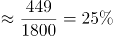。

故正确答案为B。

**考点**：文字资料、基期比重

**来源**：2019年420联考《行测》题（黑龙江省直卷）（网友回忆版）第114题

### 第 110 题

能够从上述资料中推出的是：

A. 2016、2017两年山东出生人口数量均超过当年全国出生人口数量的10%

B. 2016年广东出生人口数量超过2017年湖北出生人口数量的2倍

C. 2017年出生人口增量超过5万的省份只有3个

D. 2017年出生人口比2013年增长超过5%

第 110 题 · 答案与解析

**参考答案（粉笔题库参考内容）**

D

**解析**

A项：定位文字材料第一段“2016年实施‘全面两孩’生育政策，出生人口1786万人······2017年我国出生人口1723万人”，定位文字材料第二段“2017年出生人口最多的省份是山东，出生人口174.98万人，但是比2016年减少2.08万人”。 2017年：174.98万人>1723×10%；2016年：174.98+2.08＜1786×10%，则2016年山东出生人口数量没有超过当年全国出生人口数量的10%，错误；

B项：定位文字材料第二段“2017年出生人口······其中广东出生人口151.63万人，同比增加22.18万人······湖北最少，为74.26万人”，151.63-22.18＜74.26×2，错误；

C项：定位文字材料第三段“2017年广东出生人口增量最大，出生人口较2016年增加22.18万人。安徽、四川、河北出生人口增量超过5万”，可得2017年出生人口增量超过5万的省份至少有4个，错误；

D项：定位文字材料第一段可知：2014年出生人口1687万人，比上年增加47万人。2017年出生人口1723万人。可得2013年出生人口为1687-47=1640万人，代入增长率公式：，故2017年出生人口比2013年增长了，正确。

故正确答案为D。

**考点**：文字资料、综合分析

**来源**：2019年420联考《行测》题（黑龙江省直卷）（网友回忆版）第115题

## 材料 2

根据以下资料，回答下列问题。

2017年全国举办马拉松赛事达1102场，其中，中国田径协会举办的A类赛事223场，B类赛事33场。2017年马拉松赛事的参与人次达到了498万人次，2016年、2015年马拉松赛事的参与人次分别为280万人次、150万人次。

2017年全年马拉松直接从业人口数72万，间接从业人口数200万。年度产业总规模达700亿元，比去年同期增长约20%，中国田径协会设置的发展目标是到2020年，全国马拉松规模赛事超过1900场，其中中国田径协会认证赛事达到350场，各类赛事参赛人数超过1000万人次，马拉松运动产业规模达到1200亿元。

规模赛事数量方面，2017年排名前三的省份为浙江省、江苏省和广东省，分别为152场、149场和103场，而2016年的前三名分别为江苏省37场，北京市33场，广东省25场。

从2017年全年赛事的覆盖区域来看，马拉松赛事地域分布更为广泛，中国境内马拉松及相关赛事已经涵盖了含西藏在内的全国31个省、区、市的234个城市，较上年增加了101个城市。

在赛事类型方面，2017年1102场规模赛事中，全程马拉松参赛人次最高，突破了235万人次，其次为半程马拉松赛事，参赛人次超过134万人次。在中国田径协会认证的A类、B类赛事中，2017年全程马拉松项目完赛26.89万人次，同比增长10.61%；半程马拉松项目完赛45.29万人次，同比减少了0.03万人次。

按照跑者户籍所在地统计，2017年参加中国田径协会认证赛事的跑者中，来自江苏的数量最多，共有76469人参赛，在全国占比10.10%。湖北、广东、山东、福建、浙江等省紧随其后。而在全部参赛选手中，共有3663人次的男选手在全程项目中跑进3小时，772人次女选手跑进3小时20分。

### 第 111 题

2017年我国马拉松赛事场次比2011年增加了：

A. 约47倍

B. 约49倍

C. 约51倍

D. 约53倍

第 111 题 · 答案与解析

**参考答案（粉笔题库参考内容）**

B

**解析**

根据题干“2017年···比2011年增加了”，结合选项，可判定本题为一般增长率问题。定位图1可得：2017年、2011年我国马拉松赛场次分别为1102场、22场。根据增长率，可得2017年的增长率为倍。

故正确答案为B。

**考点**：一般增长率、综合资料

**来源**：2019年420联考《行测》题（黑龙江省直卷）（网友回忆版）第117题

### 第 112 题

在中国田径协会认证的A类、B类赛事中，2016年全程马拉松项目完赛人次比同期半程马拉松项目完赛人次：

A. 多23万

B. 少23万

C. 多21万

D. 少21万

第 112 题 · 答案与解析

**参考答案（粉笔题库参考内容）**

D

**解析**

根据题干“······2016年全程马拉松项目完赛人次比同期半程马拉松项目完赛人次”，并结合选项为“多/少+具体单位”，且材料数据为2017年，可判定本题为基期和差问题。定位文字材料第五段可得：“在中国田径协会认证的A类、B类赛事中，2017年全程马拉松项目完赛26.89万人次，同比增长10.61%；半程马拉松项目完赛人次45.29万人次，同比减少了0.03万人次”，代入基期量公式：现期量/(1+r)，则2016年全程马拉松项目完赛人次为：万人次，2016年半程马拉松项目完赛人次为：45.29+0.03=45.32万人次，故2016年全程马拉松项目完赛人次与同期半程马拉松项目完赛人次差为：24-45.32≈-21，即少21万人次。

故正确答案为D。

**考点**：基期和差、综合资料

**来源**：2019年420联考《行测》题（黑龙江省直卷）（网友回忆版）第119题

### 第 113 题

2017年中国田径协会举办的A类与B类赛事占全国马拉松赛事的比例约为：

A. 20%

B. 23%

C. 25%

D. 28%

第 113 题 · 答案与解析

**参考答案（粉笔题库参考内容）**

B

**解析**

根据题干“2017年，···占···的比例约为”，结合材料中给了2017年的数据，可判定本题为现期比重问题。定位文字材料第一段可得：2017年全国举办马拉松赛事达1102场，其中，中国田径协会举办的A类赛事223场，B类赛事33场。根据比重=部分/总体，可得2017年的比重为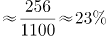。与B项最接近。

故正确答案为B。

**考点**：现期比重、综合资料

**来源**：2019年420联考《行测》题（黑龙江省直卷）（网友回忆版）第116题

### 第 114 题

2017年马拉松赛事参与人次的同比增速比2016年：

A. 快约9个百分点

B. 慢约9个百分点

C. 快约7个百分点

D. 慢约7个百分点

第 114 题 · 答案与解析

**参考答案（粉笔题库参考内容）**

B

**解析**

根据题干“2017年···的同比增速比2016年”，可判定本题为一般增长率问题。定位文字材料第一段可得：2017年、2016年、2015年马拉松赛事的参与人次分别为498万人次、280万人次、150万人次。根据增长率，可得2017年的增长率为，2016年的增长率为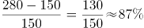，则78%-87%=-9%，即2017年同比增速比2016年慢约9个百分点。

故正确答案为B。

**考点**：一般增长率、综合资料

**来源**：2019年420联考《行测》题（重庆卷）（网友回忆版）第107题

### 第 115 题

能够从上述资料中推出的是：

A. 2017年马拉松运动年度产业规模比2016年多200亿元

B. 2017年参加中国田径协会认证赛事的全国跑者数量少于75万人

C. 2011年至2016年我国马拉松赛事场次之和超过2017年赛事场次的50%

D. 在2016年与2017年马拉松规模赛事数量上，江苏省、北京市都有进入前三名

第 115 题 · 答案与解析

**参考答案（粉笔题库参考内容）**

C

**解析**

A项：定位文字材料第二段可得：“2017年全年马拉松······年度产业总规模达700亿元，比去年同期增长约20%。” 故2017年马拉松运动年度产业规模比2016年多：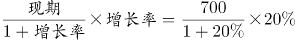亿元，错误；

B项：定位文字材料第六段可得：“2017年参加中国田径协会认证赛事的跑者中，来自江苏的数量最多，共有76469人，在全国占比10.10%”，故2017年参加中国田径协会认证赛事的全国跑者数量为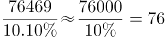万，错误；

C项：定位图形材料可得：“2011年至2017年我国马拉松赛事场次分别为22、33、39、51、134、328、1102”，故2011年至2016年我国马拉松赛事场次之和：22+33+39+51+134+328=607，2017年赛事场次的50%为1102×50%=551，前者大于后者，正确；

D项：定位文字材料第三段可得：“规模赛事数量方面，2017年排名前三的省份为浙江省、江苏省和广东省······而2016年的前三名分别为江苏省、北京市、广东省”，故在2016年和2017年马拉松规模赛事数量上，北京市没有都进入前三名，错误。

故正确答案为C。

**考点**：综合分析、综合资料

**来源**：2019年420联考《行测》题（黑龙江省直卷）（网友回忆版）第120题

## 材料 3

根据以下资料，回答下列问题。

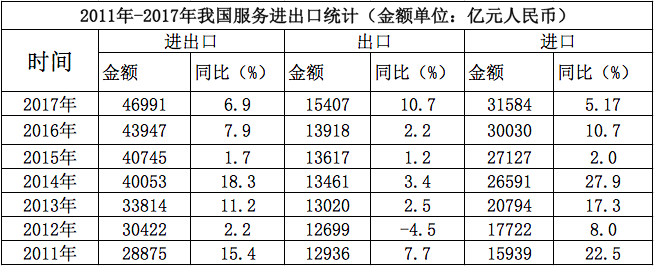

（注：顺差是指在国际收支上，一定时期内收入大于支出的差额；逆差指的是在国际收支上，一定时期内支出大于收入的差额；表中同比数据为正的代表同比增长，同比数据为负的代表同比下降）

### 第 116 题

2011年至2017年，我国服务进出口逆差最大的年份是：

A. 2017年

B. 2016年

C. 2015年

D. 2014年

第 116 题 · 答案与解析

**参考答案（粉笔题库参考内容）**

A

**解析**

定位表格材料1，根据“逆差=进口-出口”可知，A项：2017年逆差=31584-15407=16177，B项：2016年逆差=30030-13918=16112，C项：2015年逆差=27127-13617=13510，D项：2014年逆差=26591-13461=13130，因此逆差最大年份为2017年。

故正确答案为A。

**考点**：统计表、简单加减计算

**来源**：2019年420联考《行测》题（黑龙江省直卷）（网友回忆版）第121题

### 第 117 题

2016年我国保险和养老金服务进出口额约为：

A. 857亿元人民币

B. 1112亿元人民币

C. 1134亿元人民币

D. 1158亿元人民币

第 117 题 · 答案与解析

**参考答案（粉笔题库参考内容）**

C

**解析**

根据题干“2016年······进出口额”，材料给的是2017年的数据，可以判定本题为基期计算问题。定位表格材料2：2017年保险和养老金服务进出口额976.0亿元，同比增长率为-13.9%，根据，可得2016年保险和养老金服务进出口额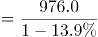≈1134亿元。

故正确答案为C。

**考点**：统计表、基期计算

**来源**：2019年420联考《行测》题（黑龙江省直卷）（网友回忆版）第122题

### 第 118 题

按照2017年的同比增速，2018年知识产权使用费出口额约为：

A. 992亿元人民币

B. 1014亿元人民币

C. 1336亿元人民币

D. 1588亿元人民币

第 118 题 · 答案与解析

**参考答案（粉笔题库参考内容）**

C

**解析**

根据题干“按照2017年的同比增速，2018年······出口额”材料给的是2017年的数据，可以判定本题为现期计算问题。定位表格材料2：2017年知识产权使用费出口额322.0亿元，同比增长率315.0%，根据现期=基期×（1+r），可得2018年知识产权使用费出口额=322×（1+315%）≈320×4.2≈1344亿元，与C选项最接近。

故正确答案为C。

**考点**：现期计算、统计表

**来源**：2019年420联考《行测》题（黑龙江省直卷）（网友回忆版）第123题

### 第 119 题

2016年个人、文化和娱乐服务进口额占同期服务进口总额的比重约为：

A. 0.1个百分点

B. 0.3个百分点

C. 0.5个百分点

D. 0.7个百分点

第 119 题 · 答案与解析

**参考答案（粉笔题库参考内容）**

C

**解析**

根据题干“2016年……占……比重为”，定位表格材料2的数据时间为2017年，可判定本题为基期比重问题。定位表格材料1可得2016年我国服务进口总额为30030亿元，定位表格材料2可得2017年个人文化娱乐进口额为186亿元，同比增长30.8%，根据，2016年个人文化娱乐进口额为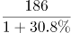，则2016年个人文化娱乐进口额占同期服务进口总额比重为：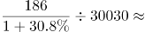。

故正确答案为C。

**考点**：基期比重、统计表

**来源**：2019年420联考《行测》题（黑龙江省直卷）（网友回忆版）第124题

### 第 120 题

能够从上述资料中推出的是：

A. 2011年至2017年，我国进出口总是出现逆差

B. 2016年我国建筑服务进出口实现顺差1039亿元人民币

C. 2017年我国服务进出口中，其他商业服务进出口实现的顺差最多

D. 2017年我国服务进出口中，别处未提及的政府服务进出口额占比最小

第 120 题 · 答案与解析

**参考答案（粉笔题库参考内容）**

C

**解析**

A项：定位表格材料一，材料中只给出了2011年至2017年我国服务进出口额，而非我国进出口额，故无法推出，错误；

B项：定位表格材料二，2017年我国建筑服务出口1618.0亿元，同比增长92%；进口579.0亿元，同比增长5.4%。则2016年我国建筑服务出口额=亿元，进口额=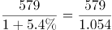≈549.3亿元，故2016年我国建筑服务进出口实现顺差约293.4亿元，错误；

C项：定位表格材料二，2017年我国服务进出口中，实现顺差的有：加工服务：1223.0-12.0=1211亿元；维护和维修服务：401.0-153.0＜1211亿元；建筑：1618.0-579.0＜1211亿元；金融服务：250.0-109.0＜1211亿元；电信、计算机和信息服务：1876.0-1295.0＜1211亿元；其他商业服务：4157.0-2895.0=1262亿元＞1211亿元。故2017年我国服务进出口中，实现顺差最多的为其他商业服务，正确。

D项：定位表格材料一，2017年我国服务进出口额46991亿元；定位表格材料二，2017年别处未提及的政府服务进出口额348亿元。根据公式：比重=部分量/总体量，别处未提及的政府服务进出口占比=348/46991，而个人、文化和娱乐服务进出口占比=，故别处未提及的政府服务进出口占比并非最小，错误。

故正确答案为C。

**考点**：综合分析、统计表

**来源**：2019年420联考《行测》题（黑龙江省直卷）（网友回忆版）第125题

