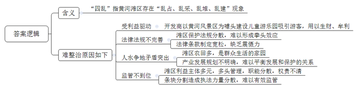
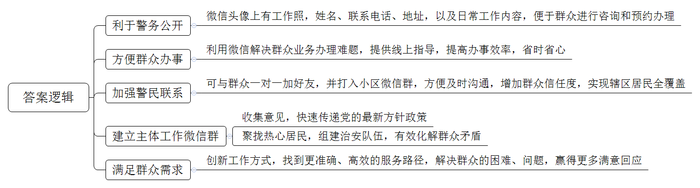
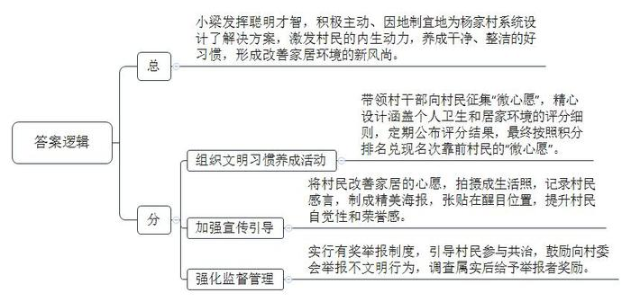
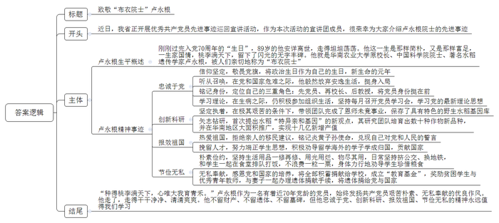

# 2020年0822公务员多省联考《申论》题（内蒙古乡镇卷）

> 候选采集稿。参考答案及解析来自粉笔页面，不代表官方答案或真实高分答卷；来源使用许可与原卷对应关系仍需人工核实。

## 给定材料

### 材料 material-bc71a1e13a3ce09e

曾经，黄河大堤向内500多米处，占地370多亩的儿童游乐园一片喧闹景象，蘑菇城堡、魔法屋五光十色，园里游客熙熙攘攘，停车场内停满密密麻麻的私家车。这幅景象，与黄河风光实在格格不入。

“开发商相中的就是黄河。”Z市水利局河长制办公室岳主任介绍，“黄河风景区风光优美，‘玩在黄河边’成为吸引游客的噱头。就这样，本应是防洪要地、生态重地的滩区，因为利益驱动，却成了用来‘生金’的工具。”

“除了儿童游乐园，其他在黄河滩区‘乱占、乱采、乱堆、乱建’的现象，危害也十分严重。”岳主任说。滩区其实是黄河河道的组成部分，黄河进入下游后，河流流速放缓，裹挟泥沙大量沉积，河床抬升，河流向低洼处摆动，来回往复。为了给河流摆动预留足够空间，宽河固堤成为主要措施。面积广阔的滩区在行洪、蓄洪和沉沙等方面发挥重要作用。此外，滩区是动物栖息、植物生长的家园。滩区四乱现象，不仅影响了黄河自然景观，更破坏了脆弱的生态系统。

“黄河滩区既是重要的生态保护区，又是百万群众生活的家园，L省黄河滩区宽5-20公里，涉及120多万人，滩区既有农田又有湿地保护区，人水争地矛盾突出。同时，有关滩区保护的法律法规比较分散，难以形成拳头效应。加之有些法规条款制定比较宽松，缺乏震慑力。”岳主任说，“有条件的地区应有序引导滩区居民退出，不仅能缓解黄河防洪压力，还能还地于河。”他建议，列出黄河管理范围内产业发展负面清单，根据黄河生态保护要求，坚持绿色发展方向，明晰黄河滩地产业发展路子。河湖监管的背后，还有一道民生考题：位于滩区的村子有1000多个，如何平衡好发展和保护的关系？

“L省黄河滩区存在不少占地面积广、体量规模大、存留时间久的‘四乱’问题，利益主体多元，多头管理，职能分散，这是河湖乱象问题产生的原因之一。”L省检察院罗处长分析，多个部门都有黄河监管职能——黄河水利委员会的监督管理职能在堤坝以内，地方政府管理范围内又涉及多个部门，自然资源部门负责土地使用、河务部门负责河道行洪安全、生态环境部门负责环境保护、农业部门负责农用地保护……“条块分割造成执法力量分散，难以有效监管。”罗处长说。

2018年12月，一场清理黄河滩区“四乱”的战役在L省打响。河长制办公室把各种线索移交省检察院，由省检察院指定检察分院组织实地勘查，调取证据，询问证人……检察分院的王副检察长说：“我们随后向有关部门下达了检察建议书，要求全面履责，采取补救措施，拆除违建，有效恢复受损土地。”各地各部门依法全面履行职责，强化工作协调配合。检察院、河长办、黄河河务局及沿河各级政府联手，排查问题，拟定整治清单，建立“河湖长+检察长”机制，加强水行政执法及刑事司法衔接，通过立案调查、公益诉讼等方式，督促整改重点问题。

2019年3月，随着机械臂挥动，“四乱”典型的儿童游乐园轰然倒地；到6月底，滩区硬化地面全部拆除，此后，曾被乱建的滩区草木新发，滩区生态基本恢复。在清乱的同时，鼓励滩区村庄发展紫花苜蓿等饲草产业，目前优质牧草种植基地初具规模，预计到2025年可达100万亩。站在大堤上远眺，滩区草木葱葱，黄河掩映其间，静静流淌而过。

### 材料 material-15f23dc0281c22f5

民警小童的微信头像，很是特别，除了一张工作照，还有姓名、联系电话、地址，以及以下文字：“如果你需要办理户口、居住证，或调解家庭、邻里纠纷，请添加此微信号进行咨询和预约办理。”

小童是云沟派出所的一名社区民警，他的日常工作内容都浓缩到这张小小的头像里了。“再以传统的思维方式工作，可就跟不上时代啦。现在大人小孩都会玩微信，辖区里越来越多的大爷大妈玩得比我还好！我的工作方式和方法必须有所改变。”小童手机里存着近5千个居民的手机号码，微信好友中有近3千名居民，几乎覆盖了整个辖区。

前不久，一位已经办理过居住证的居民，在微信上紧急呼叫小童。原来，他去车管所办理轿车年审业务，但由于忘了居住证年审而无法正常完成业务办理，按照过去的做法，要来回奔波50多公里。小童让他立即将居住证的正面通过微信拍照传回处理，只花了一分钟就解决了问题。还有一次，一位现住外地的本社区居民，需要开具无违法犯罪记录证明，但是不知具体该怎么办，最终，在小童的微信指点下，这位居民顺利办理了事项。

社区工作面广，事杂。一方面，群众临时有事或者出门在外，往往不知道如何联系上民警；另一方面，由于流动性大，民警在进行人口、房屋、场所、行业等信息登记时，也常联系不到人。怎样才能加强和居民的联系呢？“与群众一对一联系是最好的，虽然花的时间多，但是更到位。”小童利用上门签订治安管理责任书的机会，与居民见面时互加微信、留手机号，又“打入”小区所有微信群，凭借特点突出、颇具诚意的微信头像，一个个加好友。慢慢地，群众有事就直接通过微信联系他，小小的微信头像也成了一张为群众信任的名片。

通过微信，小童还建立了一些跟主体工作有关的微信群，翻开他的微信群，有社区治安群，社区意见箱群，还有“党声群”。小童说：“在‘党声群’中，我还可以将最新的党的方针政策，以最快的方式传给社区群众。”小童还聚拢了治安群内的热心居民，组建起“红袖标”队伍，现在这支队伍已经从最初的46人发展到了270人。当谈到花费大量的时间看微信群，会不会增加工作量时，他认为，“从表面上看花费时间是多了，实际上工作起来反而更加快捷。”他反问道：“有些问题，是发生了再去处理，还是将问题直接杜绝在萌芽状态？”

“创新，为了更贴心；贴心，才能够创新。”说到自己的工作秘笈，小童笑言都在微信头像里。基层警务人少事多，只有不断创新工作方式才能更好地为群众服务，而创新的动力恰恰来自于解决群众生活中痛点、堵点的责任感。将满足群众需求作为群众服务的落脚点，才能不断推陈出新，找到更准确、高效的服务路径，也才能赢得群众更多的满意回应。“我们都是小童的粉丝，社区好了大家都好！”居民张大姐说。

### 材料 material-ddedd4742b33f6c8

杨家村是深度贫困村，经过几年的努力，村里绝大多数贫困户已经圆了脱贫梦。为了稳定增收，杨家村决心借助山清水秀的景致发展乡村旅游。2019年年初，在政府和帮扶单位专项资金支持下，杨家村的美丽乡村项目顺利开工。水泥道路通村入户，古建民居修葺一新，竹木栅栏、青石台阶、小桥流水的景观设计，让这个昔日的深度贫困村华丽转身，好似世外桃源。

村里漂亮了，可是人居环境却是个“老大难”。远远望去村容村貌焕然一新，可是走进老百姓家里一看，庭院乱堆放、杂物遍地是。以前村干部也多次上门做工作，但是群众认为这是自家的事，村干部管不着。关键时刻，省建筑工程集团公司的驻村第一书记小梁发挥聪明才智，为村里“量身设计”了一套解决方案。

8月的一天，一场“积分兑换心愿，勤劳改变习惯”的文明习惯养成活动在杨家村拉开帷幕。小梁和村干部一起向村民征集有关家居环境改善的“微心愿”，并精心设计了十项涵盖个人卫生和居家环境的评分细则，每周公布评分结果，最终按照积分排名兑现前20名的“微心愿”。“我们想通过‘微心愿’来激发村民的内生动力，帮助大家养成好习惯，形成新风尚。”小梁说。

村民们纷纷讲出了自己改善家居的愿望。“要是有台大彩电，忙完一天的农活，就可以陪孙子看动画片了！”村民张大娘说。“要是有台大冰箱，我家就能天天吃到新鲜饭菜了！”村民张伯伯说。他们的这些心愿，配上摄影师为他们拍摄的生活照，被制成精美的海报，张贴在村里醒目的位置。其中一张海报是65岁的唐大妈笑呵呵地在做针线活。“在整洁、干净的屋里做针线活儿，我心里那叫一个美啊！”海报上印着两行大字，这是唐大妈的感言。看着邻里乡亲竟然也能像明星一样登上如此精美的海报，村民们的荣誉感更强烈了。为了督促村民改变卫生习惯，实行有奖举报制度，发现谁家乱倒垃圾可以向村委会举报，调查属实的给举报者奖励一袋面粉。在大家共同努力下，改善家居环境一时间蔚然成风。小梁说，几个月来，从锅碗瓢盆、个人起居，到房前屋后、禽畜养殖，杨家村变化很大。

村民夏姐的丈夫常年在外打工，她自己留在村里种地看孩子。一个人忙里忙外，难免顾不上收拾屋子。“自从参加活动以来，养成了好习惯，房前屋后都干净了，自己住着也舒服。”她说。

从爱美之心人皆有之，到护美之行人人为之，杨家村这个新建成的美丽乡村，处处透着美的气息。小梁也如约为表现优异的家庭兑现了“微心愿”，夏姐领到了心仪的热水器，脸上露出了开心的笑容。

### 材料 material-2ede2e3893383566

刚刚过完入党70周年的“生日”，89岁的他安详离世，走得坦坦荡荡。积蓄，全都捐了；最后一笔党费，老伴代交了，有1万元之多……这一生，他是那样简朴，又是那样富足，一生家国情，桃李满天下，留下了闪光的无字丰碑。他曾说，生活过得好，不是追求舒服，而是“无愧我心”。他，就是华南农业大学原校长、中国科学院院士、著名水稻遗传学家卢永根，人们亲切地称他为“布衣院士”。

生命最后的时光，卢永根躺在病床上，有些疲倦。可一说起当年入党时的情形，他眼中立刻发出明亮的光。“一个很小的房子，墙上挂着党旗。”老人的声音有些颤抖，“举右手，面向北方，延安就在北方，延安就是我们心中的太阳。”1930年，卢永根出生于香港的一个中产家庭，家里有电话、出门有汽车。11岁那年，日寇占领了香港，他被父亲送回广东老家避难，谁料想，这里也被铁蹄践踏。亲历了国土的沦丧，目睹了国民党政府的腐败，他苦苦寻求着希望和方向。1949年8月9日，卢永根加入了中国共产党。老伴说，“他把入党那一天看成生日，新生命的开始。所以，每年这一天，我都为他过生日。”

新中国成立前夕，卢永根受党组织派遣，离开香港到广州领导地下学联，迎接广州解放。“我为什么要抛弃安逸的生活回内地呢？是中国共产党指给我有意义的人生之路，只有社会主义祖国才是我安身立命的地方。”卢永根说。作为华南农业大学的校长，卢永根这样定位自己的三重角色：先党员，再校长，后教授。“虽然我现在疾病缠身，无法行走，但是，我的意识是清醒的，我的牵挂是不变的，我的信仰是坚定的！”岁月时光无法磨灭卢永根的初心。住院不久，卢永根和老伴向党组织郑重申请：“我俩大半辈子都没有离开过党。这个时候，也不能没有组织生活。”对此，校党委决定，由农学院党委书记等几名党员参加，每月在病房开一次党员学习会。“我全程收看了党的十九大开幕直播，听完总书记的报告，热血沸腾，备受鼓舞。”

卢永根大学毕业后留校任教，成为“中国稻作科学之父”丁颖教授的助手。“抗战时，丁老师带着水稻种、番薯种，一直逃难到云南，把种质资源保护下来。”卢永根十分敬佩。丁教授去世后，卢永根在极其艰苦的条件下，带领团队完成了恩师未竟的事业，保存了具有特色的野生水稻基因库，首次提出水稻“特异亲和基因”的新观点。近些年，卢永根研究团队共选育出作物新品种33个，在华南地区累计推广面积1000多万亩，新增产值15亿多元。

曾几何时，在美国的姐姐苦劝卢永根一家移民，可怎么也说不动他。卢永根说：“我是炎黄子孙，要为自己的祖国效力。”他在给留学生的信中写道：“外国的实验室再先进，也不过是替人家干活。”在他的劝导下，多名学生学成归国。“生命诚可贵，爱情价更高；若为祖国故，两者皆可抛！”在一次对学生的演讲中，卢永根化用著名诗句深情表白。晚年，又有人问他为什么非要留在国内，他说：“你向党、向人民作过许诺和宣誓，那自己要遵守了！”

走进老人的家，仿佛回到上世纪中叶。铁架子床锈迹斑斑，挂蚊帐用的是竹竿，一头绑着绳子，一头用钉子固定在墙上；台灯是几十年前的款式，收音机坏了一修再修……“这些东西没有用光用烂，还能用，物还没有尽其用。”卢永根说，“床已经很好了，我们刚结婚时，4个条凳架上板子，就是床。”出门，80多岁的老两口背着双肩包、头戴遮阳帽，挤公交、换地铁；吃饭，叮叮当当拎着饭盒，和学生一起在食堂排队打饭，吃得一粒米都不剩。看到有学生剩饭，卢永根总忍不住提醒：“多少株水稻才能出一碗米饭？”

880多万元储蓄，老两口没有留给唯一的女儿，一分不剩，全部捐给华南农业大学成立“卢永根教育基金”。这些壮举，卢永根说是“还”：“党培养了我，这是做最后的贡献。”老伴也说：“国家给了我们许多，我们用不完了，当然还回去。”不仅“还”钱，他们觉得连生命都是党和国家的，也要“还”回去，双双办理了遗体捐献手续。

“布衣院士”卢永根走了，走得干干净净、清清爽爽。他不留财产、不留遗体、不留墓碑，但是，他却留下了很多很多……

## 题目

### 第 1 题

**根据给定资料**1**，分析黄河滩区****“****四乱****”****现象难整治的原因。（****25分）**

关联材料：material-bc71a1e13a3ce09e、material-15f23dc0281c22f5、material-ddedd4742b33f6c8、material-2ede2e3893383566

作答要求：

要求：紧扣材料，条理清晰，不超过400字。

### 第 2 题

**根据给定资料**2**，分析民警小童为何采用这样的微信头像。（15分）**

关联材料：material-bc71a1e13a3ce09e、material-15f23dc0281c22f5、material-ddedd4742b33f6c8、material-2ede2e3893383566

作答要求：

要求：紧扣资料，全面准确；分析透彻，条理清晰；不超过300字。

### 第 3 题

**根据给定资料**3**，谈谈小梁如何解决杨家村人居环境这个****“****老大难****”****问题。（****15分）**

关联材料：material-bc71a1e13a3ce09e、material-15f23dc0281c22f5、material-ddedd4742b33f6c8、material-2ede2e3893383566

作答要求：

要求：准确、全面、有条理，不超过300字。

### 第 4 题

**根据给定资料**4**，作为宣讲团的一员，拟写一份****“****布衣院士****”****卢永根先进事迹的宣讲稿。（****45分）**

关联材料：material-bc71a1e13a3ce09e、material-15f23dc0281c22f5、material-ddedd4742b33f6c8、material-2ede2e3893383566

作答要求：

要求：内容具体，有逻辑性，800-1000字。

## 答案与解析

第 1 题

**参考答案（粉笔题库参考内容）**

“四乱”指黄河滩区存在“乱占、乱采、乱堆、乱建”现象。

难整治原因如下：1.受利益驱动。开发商以黄河风景区为噱头建设儿童游乐园吸引游客，用以生财、牟利。2.法律法规不完善。滩区保护法规分散，难以形成拳头效应；法律条款制定宽松，缺乏震慑力。3.人水争地矛盾突出。滩区农田多，是群众生活的家园；产业发展规划不明确，难以平衡发展和保护的关系。4.监管不到位。滩区利益主体多元，多头管理，职能分散，权责不清；条块分割造成执法力量分散，难以有效监管。

**解析**

**参考答案说明：**本参考答案先解释了“四乱”的含义；后从“受利益驱动”“法律法规不完善”“人水争地矛盾突出”“监管不到位”四个方面分析“‘四乱’难整治”的原因，并进行了分条撰写。各条原因要点之间在内容上相互并列，没有交叉。并且撰写每条原因要点时，都提炼出了概括性强的总括词并前置，让答案更清晰、准确。

**考点**：考点原因类

**来源**：来源2020年0822公务员多省联考《申论》题（内蒙古乡镇卷）

粉笔申论页面对本题只提供「解析视频」入口，该入口是会员推广位，页面无视频地址与文字解析。

第 2 题

**参考答案（粉笔题库参考内容）**

1.利于警务公开。微信头像上有工作照，姓名、联系电话、地址，以及日常工作内容，便于群众进行咨询和预约办理。

2.方便群众办事。利用微信解决群众业务办理难题，提供线上指导，提高办事效率，省时省心。

3.加强警民联系。可与群众一对一加好友，并打入小区微信群，方便及时沟通，增加群众信任度，实现辖区居民全覆盖。

4.建立主体工作微信群。收集意见，快速传递党的最新方针政策；聚拢热心居民，组建治安队伍，有效化解群众矛盾。

5.满足群众需求。创新工作方式，找到更准确、高效的服务路径，解决群众的困难、问题，赢得更多满意回应。

**解析**

**参考答案说明：**本参考答案从“利于警务公开”“方便群众办事”“加强警民联系”“建立主体工作微信群”“满足群众需求”这五个方面进行了分条撰写。各条要点之间在内容上相互并列，没有交叉。

**考点**：考点原因类

**来源**：来源2020年0822公务员多省联考《申论》题（内蒙古乡镇卷）

粉笔申论页面对本题只提供「解析视频」入口，该入口是会员推广位，页面无视频地址与文字解析。

第 3 题

**参考答案（粉笔题库参考内容）**

小梁发挥聪明才智，积极主动、因地制宜地为杨家村系统设计了解决方案，激发村民的内生动力，养成干净、整洁的好习惯，形成改善家居环境的新风尚。

一、组织文明习惯养成活动。带领村干部向村民征集“微心愿”，精心设计涵盖个人卫生和居家环境的评分细则，定期公布评分结果，最终按照积分排名兑现名次靠前村民的“微心愿”。

二、加强宣传引导。将村民改善家居的心愿，拍摄成生活照，记录村民感言，制成精美海报，张贴在醒目位置，提升村民自觉性和荣誉感。

三、强化监督管理。实行有奖举报制度，引导村民参与共治，鼓励向村委会举报不文明行为，调查属实后给予举报者奖励。

**解析**

**参考答案说明：**本参考答案采用“总-分”的逻辑结构。先总说了小梁改善杨家村人居环境的主要做法，然后再分别从“组织文明习惯养成活动”“加强宣传引导”“强化监督管理”三个方面进行了分条撰写。各条要点之间在内容上是并列关系，没有交叉。并且撰写每条要点时，都提炼出了概括性强的总结词并前置，符合题目中“有条理”这一要求。

**考点**：考点概括措施类

**来源**：来源2020年0822公务员多省联考《申论》题（内蒙古乡镇卷）

粉笔申论页面对本题只提供「解析视频」入口，该入口是会员推广位，页面无视频地址与文字解析。

第 4 题

**参考答案（粉笔题库参考内容）**

致敬“布衣院士”卢永根

近日，我省正开展优秀共产党员先进事迹巡回宣讲活动，作为本次活动的宣讲团成员，很荣幸为大家介绍卢永根院士的先进事迹。

刚刚过完入党70周年的“生日”，89岁的他安详离世，走得坦坦荡荡。他这一生是那样简朴，又是那样富足，一生家国情，桃李满天下，留下了闪光的无字丰碑。他就是华南农业大学原校长、中国科学院院士、著名水稻遗传学家卢永根，被人们亲切地称为“布衣院士”。

一、忠诚于党。他信仰坚定，敬畏党旗，将政治生日作为自己的生日，新生命的元年；听从召唤，在党和国家危难之际，他毅然放弃安逸生活，挺身入局；铭记身份，定位自己的三重角色：先党员、再校长、后教授，将党员身份挺在前；学习理论，在生病之际，仍积极参加组织生活，坚持每月召开党员学习会，学习党的最新理论思想。

二、创新科研。他坚定执着，在极其艰苦的条件下，带领团队完成了恩师未竟事业，保存了具有特色的野生水稻基因库；矢志钻研，首次提出水稻“特异亲和基因”的新观点，其研究团队培育出数十种作物新品种，并在华南地区大面积推广，实现十几亿新增产值。

三、报效祖国。他热爱祖国，拒绝亲人的移民建议，铭记炎黄子孙使命，兑现自己对党和人民的誓言；挽留人才，努力端正学生思想，积极劝导留学海外的学子学成归国，贡献国家。

四、节俭无私。他朴素俭约，坚持生活用品一修再修、用光用烂、物尽其用，日常坚持挤公交、换地铁，和学生一起在食堂排队打饭，不浪费一粒一粟，身体力行地劝导学生珍惜粮食；无私奉献，感恩党和国家的培养，将全部积蓄捐献给学校，成立“教育基金”，奖励贫困学生与优秀青年教师，与妻子一起办理遗体捐献手续，将遗体捐给党与国家。

“种得桃李满天下，心唯大我育青禾。”卢永根作为一名有着近70年党龄的党员，始终发扬共产党员艰苦朴素、无私奉献的优良作风。他走了，走得干干净净、清清爽爽。他不留财产、不留遗体、不留墓碑，但他忠诚于党、创新科研、报效祖国、节俭无私的精神永远值得我们学习！

**解析**

**参考答案说明：**（1）本题格式为：标题+正文。（2）正文部分，一方面从内容来看，本参考答案的开头先写到了“宣讲人身份”；围绕着“卢永根先进事迹”这一主题，主体分别从“卢永根生平概述”“卢永根具体事迹”两个方面进行展开，其中，“卢永根具体事迹”从“忠诚于党”“创新科研”“报效祖国”“节俭无私”这四个层次进行展开；最后，围绕“宣讲目的”，结尾进行了呼吁号召。另一方面，形式上，本参考答案做到了条理清晰、思路明确。

**考点**：考点宣传类

**来源**：来源2020年0822公务员多省联考《申论》题（内蒙古乡镇卷）

粉笔申论页面对本题只提供「解析视频」入口，该入口是会员推广位，页面无视频地址与文字解析。

