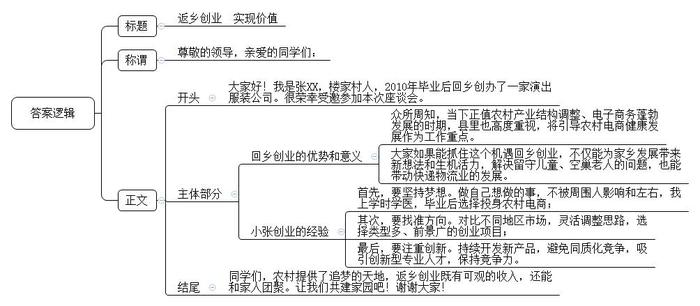
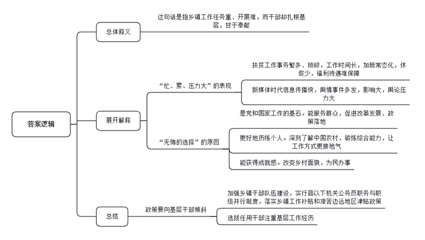

# 2020年0822公务员多省联考《申论》题（内蒙古县级卷）

<!-- gwy:overview:start -->
> **内蒙古 · 2020 · 申论 · 县级卷** ｜ 4 题 · 图片 4 处 · 答案随题折叠

导航：[题目](#题目) · [材料 1](#材料-1)
<!-- gwy:overview:end -->

> 候选采集稿。参考答案及解析来自粉笔页面，不代表官方答案或真实高分答卷；来源使用许可与原卷对应关系仍需人工核实。

## 给定材料

### 材料 1

“我们都在努力奔跑，我们都是追梦人。”是的，我们都是追梦人。追梦，我们收获满满；追梦，我们希望满满。

正如习近平总书记所说，中国人民具有伟大梦想精神。改革开放40多年的征程，就是一个追梦之旅。改革开放之初，我们党以非凡的胆略、坚定的自信设计了用70多年、分三步走，基本实现社会主义现代化的宏伟蓝图。改革开放40多年的追梦路上，我们咬定青山不放松，风雨无阻朝着这个伟大目标前进。

从站起来、富起来到强起来，这是奋斗的力量，也是梦想的力量。

党的十九大对我国发展提出了更高的奋斗目标，形成了从全面建成小康社会到基本实现现代化、再到全面建成社会主义现代化强国的战略安排，发出了实现中华民族伟大复兴中国梦的最强音。

但是，船到中流浪更急，人到半山路更陡，并且“愈进愈难、愈进愈险而又不进则退、非进不可”。在这样的关键时刻，我们要心怀梦想、奋勇拼搏，一步一个脚印，一棒接着一棒，在新时代创造中华民族新的更大奇迹！

梦想是拼出来的，奇迹是干出来的。改革开放的辉煌成就背后，是40多年的不懈努力。未来中国梦的实现，同样需要汗水的浇灌。没有人能随随便便成功。改革开放40多年的历程告诉我们：伟大事业都始于梦想，基于创新，成于实干。梦想是激发活力的源泉，只要有梦想，就会有力量。只要有梦想，则时光不弃，未来可期。

### 材料 2

因为早就敏锐地发现了农村创业的机遇，2010年小张在大学一毕业就果断选择了返乡创业，投身农村电商业务。如今小张已成为村里的“创业榜样”，家里的奖状堆满了一箱。小张的父亲做了30多年的乡村医生，希望他能接班，所以把他送进了一所医学院。但对自己的未来，小张有不一样的梦想，他觉得自己不适合做医生，应该做点和父亲不一样的事情，才能更好地实现自己的价值。他就想学电子商务专业，但被父亲阻止了。毕业后，没人能再反对他干自己想干的事儿，他决定开网店。

当时电子商务还没有那么火。小张的家乡是N县的楼家村，这是个传统意义上的农业村。当时整个村子接入宽带的都没有几户人家，也没有工业基础。90年代后期，村子里有人开始做起影楼服饰的生意，以家庭作坊居多，并未规模化。销售方式也都是在村里做好后，送到城里去卖，这种上门推销的手工作坊模式发展非常缓慢。

村子里有传统，小张最初想把这种影楼服饰搬到网上去卖。于是，他购买了几台缝纫机和一台电脑，租赁了门面进行服装加工，并在电商平台上注册了网店。刚开始，由于缺乏经验，生意并没有做起来。“我原来是学医的，专业离这个比较远。而且在学校也没学过如何创业，我对此非常陌生，完全是凭着一股热情闯进来的。”小张说，自己一开始并没有对影楼服饰的市场进行过调查，后来才发现影楼服饰市场很小，3个月下来，小张并没有赚到钱，还一度到了交不起房租的窘境。

不过，这个年轻人不服输，他决定去南方看看，了解不同地区的服装制造市场。经过考察，他发现相比于原先狭窄的影楼服饰市场，演出服装要好做得多，类型比较多样，市场能拓展开。就这样，小张调整思路，铆着一股劲，开始转做演出服装的生意。4年过去了，小张成立了自己的公司，建起了2000余平方米的车间，光各类服装设备就有106台。

小张带起的星星之火逐渐发展成了燎原之势。眼看着小张生意越做越好，同村的很多年轻人也陆续仿照着开起了网店。目前，全村300户家庭全都开有网店，年销售收入100万元的服饰加工户30多家，青年回乡创业，除了带来新想法，还有年轻人的生机和活力，留守儿童，空巢老人的问题不复存在。与电子商务相关的周边产业，配套设施也被带动起来，最大的改变是快递物流的出现。一家大型物流公司在村里设点，每天定时收发快件。这也给村里人生活带来了极大的便利。回首过去，小张觉得当初返乡创业是一个非常恰当的选择，顺应了农村产业结构调整和电子商务蓬勃发展的时代潮流。他认为农村为大学生提供了追逐梦想的广阔天地，大学生返乡创业不仅经济收入可观，还能和家人团聚，同时也为农村带来了活力和人才。

不过，返乡创业的大学生们享受着家乡电子商务“野蛮发展”带来的红利时，也有了新的烦恼。小张明显感觉生意没以前好做了。“前两年一件演出服装能赚20至30块钱，现在10块钱吧。”与其他村依山靠山卖土特产不同，楼家村的演出服装似乎没有那么接地气，而开服装网店成本低，一台电脑，再找到一家可靠的代加工厂商就可以“创业”了，很容易造成同质化竞争。小张认为目前保持竞争力的唯一方法就是不停地开发新品，让别人赶不上。“演出服装想创新难，你得自己设计、打板，抄袭成本却很低。”凑巧的是，小张的妻子是服装学院毕业的，妻子便成为家里创新的主力，但小张说：“这显然是不够的，我现在迫切需要专业的设计师过来帮助做创新。”

N县也在类似楼家村这样的村子带动下，发展出了很多“网店村”。这种飞快的发展速度也引起了县委县政府的关注，县委县政府明确提出把引导“网店村”健康发展作为政府服务增效的重要工作内容。“我们正在联系一家大型电商平台，争取双方在跨境电子商务、人才培训、云计算和大数据应用等方面早日开展深入合作。”县委负责人说。

### 材料 3

“真希望自己是‘三头六臂’就好了！”M乡王乡长快人快语。王乡长正在负责完善贫困户档案，要了解家庭人员构成、住房改造前后照片对比、种植养殖种类及数量、扶持项目公示、会议记录、入户追访、满意度调查等内容。一方面，因为建档的需要，要填写大量的表格等资料。另一方面，“表格的内容很细致，不到贫困户家中实地调查那是不行的。看似简单的事情其实很繁琐，有时候要来回跑很多趟。”

基层工作千头万绪，事务繁多，而且某件事成为舆情热点，不仅会极大增加基层工作量，而且让基层干部倍感压力。经历过几次舆情热点事件，M乡宣传干事小陈已经略有心得：尽快披露事实，优先回应网友质疑......然而，小陈却坦言工作不易：“国家强调依法治国，事情处理起来都有程序，需要时间。但新媒体时代信息传播越来越快，造成舆论影响迅速放大。”一次该地出现旅游纠纷，消息在网上飞快传开，网友一边倒地批评景区，可是通过调查却发现，其实是游客挑衅。“虽然最后真相大白，可还是给我们造成了很大的压力。”小陈说。

基层，是整个社会的“地基”，这个“地基”是社会的主体，也是时代的主流。基层干部，是党和国家工作的“基石”，他们奋战在改革发展的主战场、服务群众的最前沿。目前绝大多数政策落地都在县乡，从脱贫攻坚到民生保障，再到招商引资、产业发展、入户做群众工作，都离不开基层干部。基层干部忙得脚打后脑勺，加班是常态，但干部们几乎都没有加班费。有关科研机构的调查显示，乡镇干部平均每天工作10到11个小时，不少乡镇干部五六年没休过假。

王乡长说：“<u>乡镇工作虽然忙、累、压力大，但也是我们无悔的选择</u>。”

C乡党委李书记至今已在5个乡镇工作过，乡镇的每个岗位几乎都干过。“乡镇是最基层的行政机构，但麻雀虽小，五脏俱全。产业发展、土地问题、安全生产……能最深刻地了解中国农村，最全面地锻炼干部能力。”李书记说。基层工作经历让乡镇干部的综合能力得到迅速提升，工作方式也更接地气，他们也很感谢这样的历练。

2017年，中共中央办公厅发文，强调要加强乡镇干部队伍建设，实行县以下机关公务员职务与职级并行制度，落实乡镇工作补贴和艰苦边远地区津贴政策。“而且现在干部的选拔任用更加注重基层工作经历，相关政策也更多向基层干部倾斜。干部想更长远发展，基层工作其实也是一个重要的经历。”李书记说。

不过，在李书记看来，最重要的还是乡镇工作独特的成就感。“我们很多人都是农村出身，很多亲戚朋友都在农村。改变家乡面貌，帮助农民做点事，这是我们肩负的使命。”C乡地处贫困地区，李书记带领群众克服海拔高、交通条件差、缺工人缺材料等困难，在三个月内改造了71栋房子，“看着很多贫困户欢欢喜喜搬进新房，我忍不住流下眼泪。想到靠自己的努力能够改造一方水土，有一种梦想正在一点点地实现的感觉，那个时候，你就会觉得所有的付出都值得。”

### 材料 4

出于各种考虑，在省城工作的赵先生今年春节没回农村老家过年，但为了看望家中父母，他特意在春节前回去了一趟。“回去一趟，几千块钱就没了。”赵先生说，“有两个晚辈赶在春节前结婚，每人随了2000元。”

20世纪80年代，农村碰到重要的红白喜事，一般都是送点日常用品或者鸡蛋、罐头等，邻里一起出出力帮帮忙，那时候很少有人随钱，而且随多随少也没有固定标准。但如今，农村人情交往中赠送礼物的现象几乎消失了，结婚的、生孩子的、盖新房子的、升学的、给老人祝寿的，都要办酒席，而且都要随礼，礼金标准也在不断攀升。

随着农村产业结构的调整和生产方式的转变，农民的人际关系和交往范围逐渐扩大，随礼的范围也在不断扩大。赵先生回忆说，“小时候，家里的人情往来一般在亲属、邻居和朋友之间，后来逐渐增加了工友、同事、合作伙伴等，农村人情消费支出大幅增加。”

五花八门的酒席、巧立名目的宴请、节节攀升的礼金……近年来，部分农村地区出现了这种不好的风气。热衷“穷讲究”，最终“讲究穷”，甚至出现了随礼致贫的现象。相关调查显示，当下部分地区农民消费的第一支出为食品，第二支出就是人情礼金，甚至超过了医疗支出。随着礼金范畴的泛化，人情礼金已经不再有人情味，反而变成了人情债，农村邻里关系也因此变了味。邻里和谐，才会实现老乡们的幸福梦，但人情异变却成了农民实现小康梦路上的绊脚石。

不少农民对这些问题反映强烈，但碍于面子，不愿意从自己开始改变现状。赵先生曾要求父亲，有些宴请可以选择不参加，但父亲认为“不去不行”，因为“随礼是祖祖辈辈传下来的规矩，别人都随，咱家不随，人家一定会怪罪咱们。乡里乡亲的，低头不见抬头见，实在抹不开面子。”

对此，赵先生也有自己的思考。中国农村虽然在现代化进程中取得了很大的进步，但主要还是一个熟人社会。在农村熟人社会，人情礼金这样约定俗成的交往准则其实更像是一把双刃剑。

### 材料 5

BD药业是一家在全球肿瘤药物领域拥有多项核心自主知识产权的高科技公司。说起BD药业的故事和梦想，公司董事长兼首席执行官丁先生有很多的感慨。

2002年，借着国家鼓励留学生回国创新创业的东风，留洋十年的丁先生怀着“做创新药”的梦想，背起行囊，与几位合伙人一道回国创业。就在第二年，BD药业成立。有人说，丁先生的这个抉择很有勇气。回国之前丁先生已是国外著名大学的医学博士和执业医师，回国创业就意味着放弃了优渥的生活条件、高额的薪水，还要白手起家。然而在丁先生看来，这个选择顺理成章。“像我们这些知识分子，大多数还是有故土情结的，梦想着做出一份自己的事业，也希望用自己的知识为国家医药事业发展出份力。”除了游子的思乡情结，还有一点对丁先生来说非常重要——“国家鼓励海归创新创业，在国内可以做到在国外做不到的事”。他说，在国外，科学家只能做药物研发的其中某一段的研发，很少有几个科学家合作完成一个新药所有的研究，并将其产业化，只有在中国有这种机会。

与很多企业选择做仿制药不同，BD药业一开始就立志做新药，要在全球药业竞争中拥有完全知识产权。尽管BD药业现在已成为一家在全球肿瘤药物领域拥有多项核心自主知识产权的高科技公司，但回想企业初创时，丁先生有很多感慨，当时面临各种技术难题、无休止试药及资金链断裂等“生死劫”，但有志者事竟成，BD药业克服了重重困难，最终成功了。他们研制的抗癌药获得国家颁发的新药证书，成为我国首个具有完全自主知识产权的同类抗癌新药。该药还被列入国际权威机构发布的新药研发年度报告，成为第一个获得国际机构认可的中国创制新药。

2016年1月8日对于丁先生来说很特别，也很难忘。这一天他作为BD药业相关项目的第一完成人，在2015年度国家科学技术奖励大会上捧起了光荣的奖杯。“这个奖杯是对奋斗者坚持梦想的最好褒奖，这个奖杯上不仅有我的名字，还有我们团队的名字，其实还应该有国家的名字。”在北京深冬的暖阳中，丁先生郑重地一手拿着大红证书，一手举起奖杯，站在人民大会堂前拍了一张照片。这是国家对BD药业创新能力的巨大肯定。

“拥有自主创新，才能拥有话语权”，丁先生常说，“要真正把中国的医药产业发展起来，得把中国用药的话语权掌握在自己手里。”

近年来，BD药业跑得飞快，源源不绝的动力就来自“创新”二字。自主研发是BD药业的看家本领。丁先生表示，今年，截至目前创新研发投入已经超过10亿元。“我们正不断加强自主研发这一块，有自主研发做保证，我们就有底气开拓市场和开展合作。”BD药业把眼光投向全球，通过与国际知名医药企业合作，及时掌握国际市场信息，在全球的抗肿瘤药物市场中奋勇开拓。

如今，BD药业又种下了一颗新的梦想种子——以自家企业为基础，打造一座“医药梦工场”，搭建更大的创新平台，为全国医药产业的快速发展打造新引擎。丁先生说，这是一个为科学家、创业者造梦圆梦的项目，目标是打造一个具有国际先进水准的生物医药专业众创空间。未来，这里也将集聚一批医药领域的创业者。

研制新药去拯救病患，搭建创新平台去服务全行业。丁先生说这些都是出自一个企业家的担当。作为过来人，丁先生还想告诉创业者的是，企业家要有企业家的担当，企业家既要有仰望星空的格局与胸襟，也要有坐住板凳的定力和意志。“就拿我们医药行业来说，与一般的制造业不同的是，医药行业一方面与老百姓的身体健康密切相关，另一方面新产品的研发时间长、投入大、失败的风险高，要成功很难。”经历了风风雨雨，丁先生一直坚持“做老百姓吃得起的好药”，还对符合相关条件的患者进行免费赠药，赠药数量甚至超过了销售数量，这就是一位企业家的社会责任心。胸怀远方，迎接岁月的磨砺，才有了如今的BD药业。

## 题目

### 第 1 题

**根据给定资料**2**，假如小张的母校拟举办一场大学生返乡创业座谈会，邀请小张出席，请你为小张写一篇发言提纲。（25分）**

关联材料：材料 2

作答要求：

要求：紧扣材料，内容具体；语言准确，有逻辑性，不超过450字。

第 1 题 · 答案与解析

**参考答案（粉笔题库参考内容）**

返乡创业 实现价值

尊敬的领导，亲爱的同学们：

大家好！我是张XX，楼家村人，2010年毕业后回乡创办了一家演出服装公司。很荣幸受邀参加本次座谈会。

众所周知，当下正值农村产业结构调整、电子商务蓬勃发展的时期，县里也高度重视，将引导农村电商健康发展作为工作重点。大家如果能抓住这个机遇回乡创业，不仅能为家乡发展带来新想法和生机活力，解决留守儿童、空巢老人的问题，也能带动快递物流业的发展。

创业需借“东风”，更需要个人的努力。接下来，我结合自身经历，跟大家分享一些创业经验和体会。首先，要坚持梦想。做自己想做的事，不被周围人影响和左右，我上学时学医，毕业后选择投身农村电商；其次，要找准方向。对比不同地区市场，灵活调整思路，选择类型多、前景广的创业项目；最后，要注重创新。持续开发新产品，避免同质化竞争，吸引创新型专业人才，保持竞争力。

同学们，农村提供了追梦的天地，返乡创业既有可观的收入，还能和家人团聚。让我们共建家园吧！谢谢大家！

**解析**

**参考答案说明：**本参考答案形式上，包括标题、称谓、正文。内容上，从“小张的基本情况”“回乡创业的优势以及意义”“小张创业的经验”三个方面展开。其中“小张创业的经验”又从“坚持梦想”“找准方向”“注重创新”三个层面进行说明，各条答案要点之间在内容上相互并列，没有交叉。

### 第 2 题

**请根据给定资料**3**，谈谈你对划线句子“乡镇工作虽然忙、累、压力大，但也是我们无悔的选择”的理解。（15分）**

关联材料：材料 3

作答要求：

要求：全面准确，条理清晰，分析透彻，不超过350字。

第 2 题 · 答案与解析

**参考答案（粉笔题库参考内容）**

这句话是指乡镇工作任务重、开展难，而干部却扎根基层，甘于奉献。

“忙、累、压力大”表现在：1.扶贫工作事务繁多、琐碎，工作时间长，加班常态化，休假少，福利待遇难保障；2.新媒体时代信息传播快，舆情事件多发，影响大，舆论压力大。

“无悔的选择”指基层工作意义重大：1.是党和国家工作的基石。能服务群众，促进改革发展、政策落地；2.更好地历练个人。深刻了解中国农村，锻炼综合能力，让工作方式更接地气；3.能获得成就感。改变乡村面貌，为民办事。

因此，政策要向基层干部倾斜，加强乡镇干部队伍建设，实行县以下机关公务员职务与职级并行制度，落实乡镇工作补贴和艰苦边远地区津贴政策；选拔任用干部注重基层工作经历。

**解析**

**参考答案说明：**思路方面，本参考答案按照词句解释题“总体释义+展开解释+总结”的一般答题思路展开。内容方面，本参考答案首先解释了“乡镇工作虽然忙、累、压力大，但也是我们无悔的选择”的含义；接着分别给出了“忙、累、压力大”的具体表现和“无悔的选择”体现的重大意义；最后给出了对策作为总结。词句表达方面，本参考答案加上了“因此”等连接词来承接上下文。

### 第 3 题

**针对给定资料**4**中赵先生感受到的农村人情异变这一现象，谈谈你的认识。（****15分****）**

关联材料：材料 4

作答要求：

要求：观点明确，分析透彻，条理清晰，不超过300字。

第 3 题 · 答案与解析

**参考答案（粉笔题库参考内容）**

人情异变指的是人情交往由赠送礼物、出力帮忙转变为随礼金，且名目增加，礼金标准不断攀升，随礼范畴泛化。该现象是负面的、消极的，其成因复杂，需要理性思考。

1.其负面影响表现在：①加剧人情消费支出，出现随礼致穷现象，阻碍农村小康梦实现。②破坏邻里关系，增加人情债，降低幸福感。

2.其原因是：①农村产业结构调整和生产方式转变，农村人际关系和交往范围扩大。②村民碍于情面，存在攀比心理，怕得罪人，不愿改变。③农村仍处于熟人社会，存在人情礼金的约定俗成的交往准则。

因此，要加大宣传教育力度，树立正确人情随礼观念，引导农村民众转变思想，积极践行。

**解析**

**参考答案说明：**思路方面，本参考答案按照观点现象分析题“解释抽象的观点、现象+表态+分析论证+总结”的一般答题思路展开。内容方面，本参考答案先对“农村人情消费异变”的含义进行了解释并表态；“分析论证”部分先分析了“影响”，接着分析了“原因”；最后“总结”部分提出了简单对策。词句表达方面，本答案加上了“因此”等连接词来承接上下文。

### 第 4 题

**给定资料**5**中提到，“这个奖杯是对奋斗者坚持梦想的最好褒奖，这个奖杯上不仅有我的名字，有我们团队的名字，其实还应该有国家的名字。”根据你对这****句****话****的理解，结合给定资料，联系实际，以****“人生的奖杯”为话题，自拟题目，写一篇议论文。（45分）**

关联材料：材料 1、材料 2、材料 3、材料 4、材料 5

作答要求：

要求：

（1）观点明确，内容充实，论证合理，结构清晰，语言流畅；

（2）结合给定资料，但不拘泥于给定资料；

（3）字数1200-1400字。

第 4 题 · 答案与解析

**参考答案（粉笔题库参考内容）**

**勇敢追逐梦想，托起人生奖杯**

**这是一个追梦的时代，我们都是追梦人**。梦想，是我们人生起航的方向，是追梦路上星星点点的希望，亦是华夏儿女不懈奋斗的最终目标。正如习总书记所说，中国人民具有伟大梦想精神。只要有梦想，就会有改革的活力；只要有梦想，就会有发展的动力；只要有梦想，则时光不弃，未来可期。**在追梦的路上，个人、企业、国家都需要积极作为，勇敢前行，共同托起人生的奖杯。**

**为梦想不懈奋斗者，向来都不乏从头开始的勇气，****他们充满家国情怀，敢于担当，无私又无畏，用厚重的社会责任心托起沉甸甸的人生奖杯。**王安石为梦想变法革新，不畏权贵；玄奘为梦想万里跋涉，西天取经；王淦昌为梦想隐姓埋名，以身许国；丁先生为梦想放弃高薪，毅然回国……凡此种种，都在告诉我们，追梦途中要有奉献一切的担当与勇气，要敢于担当，积极作为，无愧于社会；要有勇气直面矛盾，善于解决问题。放眼当下，正因为胸怀天下，心系百姓，才会有“甘于寂寞勇创新”的科研工作者，才会有“黄沙百战穿金甲”的最美逆行者，才会有“不胜疫情终不还”的医务工作者；正因为无愧于时代与人民，才会有“用脚步丈量民情”的基层干部，才会有“醉卧沙场君莫笑，古来征战几人回”的边疆战士。

**为梦想奋斗不止于个人的无私无畏，****企业也****要****奋勇开拓，埋头实干，以创新为抓手，坚持自主研发，百折不挠，加强合作，凝****聚****力量，不断提升市场竞争力。**奋勇开拓不是单打独斗的蛮干，也不是追随大流的盲从，而是要跟随时代前行的脚步，学会合作，善于创新。面对美国的多次打压，华为之所以能够顶住压力，绝地求生，正是在于其团结一心，持续创新。然而，当下很多企业只愿做跟随者，而不愿做开拓者，长此以往必将无法适应竞争激烈的外部环境，更不利于创新氛围的形成。面向未来，企业应该凝聚力量，加强自主研发，积极寻求合作，实干苦干，以超凡的格局迎接风险和挑战。

“人民有梦想，国家有力量。”中华民族生生不息，恰在于人们追梦的脚步从未停滞。新时代的我们，要继续锲而不舍的抓好社会主义精神文明建设，在追梦的路上，政府更要积极作为，为个人和企业的发展护航。

**除了****提供政策扶持****外，政府还要营造良好环境，激励大众创新创业，****为奋斗者保驾护航**。当前社会环境复杂，如果干事创业只凭一腔热血，缺少规划和引导，很可能会滑入失败的深渊。为此，国家应承担起责任和使命，从实际出发，因地制宜，加大扶持力度，出台减税降费、证照合一等政策，营造公平的竞争环境，打造良好的科研环境，以创业园区、创业孵化器等为创业者提供发展空间，以创业培训、创业贷款等缓解他们资金上的燃眉之急。良好的政策环境不仅可以提升效率，促进创新成果的转化，还可以使创业创新者保持定力，增强信心，让创新源泉充分涌流，不断为国家高质量发展提供动力；也能维护公共利益，使公民的生活更加美好，成为群众期盼的“甘霖”，成为社会发展的“助推器”。

作为新时代的追梦人，我们要不忘初心和使命，勇敢前行，奋勇开拓，携手唱响“我辈岂是蓬蒿人”的时代颂歌。

**文章分析**

**勇敢追逐梦想，托起人生奖杯**

【**标题的优点：**标题中含有“梦想”“人生奖杯”等主题词，使文章主题更突出、清晰。】

**这是一个追梦的时代，我们都是追梦人**。（1）<u>梦想</u>，<u>是我们人生起航的方向</u>，<u>是追梦路上星星点点的希望</u>，<u>亦是华夏儿女不懈奋斗的最终目标</u>。正如习总书记所说，<u>中国人民具有伟大梦想精神</u>。<u>只要有梦想</u>，<u>就会有改革的活力</u>；<u>只要有梦想</u>，<u>就会有发展的动力</u>；<u>只要有梦想</u>，<u>则时光不弃</u>，<u>未来可期</u>。（2）<u>在追梦的路上</u>，<u>个人</u>、<u>企业</u>、<u>国家都需要积极作为</u>，<u>勇敢前行</u>，<u>共同托起人生的奖杯</u>。

【**开头的优点：**★内容方面。范文的开头是紧扣“人生的奖杯（梦想）”这一主题展开的。首先，开篇点出主题，做到了主题明确。其次，对“人生的奖杯（梦想）”这一主题进行了分析阐述：（1）指出梦想的重要性和意义；（2）指出追梦路上需要个人、企业和政府的积极作为。★文字表达方面：使用了“……是……亦是……”“只要……就会……”等句式，使语言表达有逻辑性。】

**为梦想不懈奋斗者，向来都不乏从头开始的勇气，****他们充满家国情怀，敢于担当，无私又无畏，用厚重的社会责任心托起沉甸甸的人生奖杯。**王安石为梦想变法革新，不畏权贵；玄奘为梦想万里跋涉，西天取经；王淦昌为梦想隐姓埋名，以身许国；丁先生为梦想放弃高薪，毅然回国……凡此种种，都在告诉我们，（1）<u>追梦</u><u>途中</u><u>要有奉献一切的</u><u>担当</u><u>与勇气</u>，要敢于担当，积极作为，无愧于社会；要有勇气直面矛盾，善于解决问题。（2）<u>放眼当下</u>，<u>正因为</u><u>胸怀天下</u>，<u>心系百姓</u>，<u>才会有</u>“<u>甘于寂寞勇创新</u>”<u>的科研工作者</u>，<u>才会有</u>“<u>黄沙百战穿金甲</u>”<u>的最美逆行者</u>，<u>才会有</u>“<u>不胜疫情终不还</u>”<u>的医务工作者</u>；正因为无愧于时代与人民，才会有“用脚步丈量民情”的基层干部，才会有“醉卧沙场君莫笑，古来征战几人回”的边疆战士。

【**论述段****1****的优点**：★观点句：范文的观点句是紧扣“人生的奖杯（梦想）”这一文章主题提出的。形式上，它在段首处直接写出，位置突出，容易发现；内容上，关键词突出，内容要点明确，可以明显看出它是从“勇气”“家国情怀”“担当”“无私无畏”“社会责任心”等角度入手，指出追梦路上个人应如何作为。★论述内容：（1）追梦要有奉献一切的担当与勇气；（2）当下涌现出大量为梦想奋斗的先进典型。注意：以上两个方面的内容都是紧扣观点句“为梦想不懈奋斗者，向来都不乏从头开始的勇气，他们充满家国情怀，敢于担当，无私又无畏，用厚重的社会责任心托起沉甸甸的人生奖杯”进行分析论述的，针对性强、内容层次丰富。】

**为梦想奋斗不止于个人的无私无畏，****企业也****要****奋勇开拓，埋头实干，以创新为抓手，坚持自主研发，百折不挠，加强合作，凝****聚****力量，不断提升市场竞争力。**（1）<u>奋勇开拓</u><u>不是</u><u>单打独斗的蛮干</u>，<u>也</u><u>不</u><u>是追随大流的盲从</u>，<u>而是要跟随时代前行的脚步</u>，<u>学会合作</u>，<u>善于创新</u>。面对美国的多次打压，华为之所以能够顶住压力，绝地求生，正是在于其团结一心，持续创新。然而，（2）<u>当下很多企业只愿做跟随者</u>，<u>而不愿做开拓者</u>，<u>长此以往必将无法适应竞争激烈的外部环境</u>，<u>更不利于创新氛围的形成</u>。面向未来，（3）<u>企业应该凝</u><u><b>聚</b></u><u>力量</u>，<u>加强自主研发</u>，<u>积极寻求合作</u>，<u>实干苦干</u>，<u>以超凡的格局迎接风险和挑战</u>。

【**论述段****2的优点**：★观点句：范文的观点句是紧扣“人生的奖杯（梦想）”这一文章主题提出的。形式上，它在段首处直接写出，位置突出，容易发现；内容上，关键词突出，内容要点明确，可以明显看出它是从“奋勇开拓”“实干”“创新”“百折不挠”“合作”等角度入手，指出追梦路上企业应如何作为。★论述内容：（1）奋勇开拓的含义；（2）当下企业存在的问题及其危害；（3）企业应采取的措施。注意：以上三个方面的内容都是紧扣观点句“为梦想奋斗不止于个人的无私无畏，企业也要奋勇开拓，埋头实干，以创新为抓手，坚持自主研发，百折不挠，加强合作，凝聚力量，不断提升市场竞争力”进行分析论述的，针对性强、内容层次丰富。】

“人民有梦想，国家有力量。”中华民族生生不息，恰在于人们追梦的脚步从未停滞。新时代的我们，要继续锲而不舍的抓好社会主义精神文明建设，在追梦的路上，政府更要积极作为，为个人和企业的发展护航。

【**过渡段的优点**：过渡段承上启下，先指出了人们追梦的脚步从未停止，然后用“在追梦的路上，政府更要积极作为，为个人和企业的发展护航”引出下文政府方面的对策。】

**除了****提供政策扶持****外，政府还要营造良好环境，激励大众创新创业，****为奋斗者保驾护航。**（1）<u>当前社会环境复杂</u>，<u>如果干事创业只凭一腔热血</u>，<u>缺少规划和</u><u>引导</u>，<u>很可能会</u><u>滑入失败的深渊</u>。为此，（2）<u>国家</u><u>应承担起责任和使命</u>，<u>从实际出发</u>，<u>因地制宜</u>，<u>加大扶持力度</u>，<u>出台减税降费</u>、<u>证照合一等政策</u>，<u>营造公平</u><u>的</u><u>竞争环境</u>，<u>打造良好的科研环境</u>，<u>以</u><u>创业园区</u>、<u>创业孵化器</u><u>等为创业者提供发展空间</u>，<u>以</u><u>创业培训</u>、<u>创业贷款</u><u>等缓解他们资金上的燃眉之急</u>。（3）<u>良好的政策环境不仅可以提升效率</u>，<u>促进创新成果的转化</u>，<u>还</u><u>可以使创业</u><u>创新</u><u>者保持定力</u>，<u>增强信心</u>，<u>让创新源泉充分涌流</u>，<u>不断为国家高质量发展提供动力</u>；<u>也能维护公共利益</u>，<u>使公民的生活更加美好</u>，成为群众期盼的“甘霖”，<u>成为社会发展的</u><u>“助推器”</u>。

【**论述段****3的优点**：★观点句：范文的观点句是紧扣“人生的奖杯（梦想）”这一文章主题提出的。形式上，它在段首处直接写出，位置突出，容易发现；内容上，关键词突出，内容要点明确，可以明显看出它是从“政策扶持”“营造良好环境”“激励大众创新创业”等角度入手，指出追梦路上政府要为奋斗者保驾护航。★论述内容：（1）政府为奋斗者保驾护航的必要性；（2）政府应如何积极作为；（3）政府积极作为的意义。注意：以上三个方面的内容都是紧扣观点句“除了提供政策扶持外，政府还要营造良好环境，激励大众创新创业，为奋斗者保驾护航”进行分析论述的，针对性强、内容层次丰富。】

【**论述段之间的关系**：★内在逻辑上：范文的论述段之间呈现递进关系，按照“先说个人，再说企业，最后说国家”的逻辑展开的。★外在衔接上：论述段2开头处的“为梦想奋斗不止于个人的无私无畏，企业也要……”，起到了承接论述段1，引出论述段2的作用；论述段2之后的过渡段“‘人民有梦想，国家有力量。’中华民族生生不息，恰在于人们追梦的脚步从未停滞。在追梦的路上，政府更要积极作为，为个人和企业的发展护航”，起到了承接论述段1、2，引出论述段3的作用。】

作为新时代的追梦人，我们要不忘初心和使命，勇敢前行，奋勇开拓，携手唱响“我辈岂是蓬蒿人”的时代颂歌。

【**结尾的优点**：范文的结尾回扣了“人生的奖杯（追梦）”这一主题词，语言精悍，不拖沓。】

**解析状态：unknown（来源未提供）**

