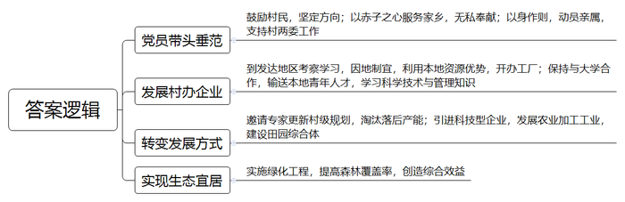
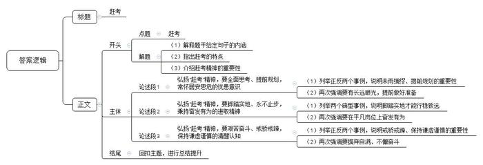

# 2021年公务员多省联考《申论》题（内蒙古县级卷）

<!-- gwy:overview:start -->
> **内蒙古 · 2021 · 申论 · 县级卷** ｜ 4 题 · 图片 4 处 · 答案随题折叠

导航：[题目](#题目) · [材料 1](#材料-1)
<!-- gwy:overview:end -->

> 候选采集稿。参考答案及解析来自粉笔页面，不代表官方答案或真实高分答卷；来源使用许可与原卷对应关系仍需人工核实。

## 给定材料

### 材料 1

“每天不是在开会，就是在开会的路上。”频繁又非必要的会议，让C市柳云村党支部书记老文很是头疼。老文工作的村子地处沿海，夏秋之际，台风频繁。“大家白天入户排查情况、宣传防台政策，还得抽时间应付各种会议。”老文告诉记者，“有的会议只是花几分钟传达一下文件精神，其实用电话或者材料就能通知到位。”

“刚刚签订战略合作协议，实质项目还没落地，就要准备一堆汇报材料。”C市大华街道干部小李对报送“材料”的苦恼，也引起了扶贫干部小吴的共鸣。小吴2018年起驻村负责57户建档立卡贫困户的工作。回想近两年的工作，小吴说，驻村扶贫工作不易，但最让人头疼的，却是应付各项检查以及反复整理、填写、修改各种资料和表格。“最多的时候，我手里同时有20多个表格要填。有一个表，因为不同要求反复修改，弄了大半年。”如果遇到过于重视迎检资料的领导，可能出现以资料多寡、“痕迹”是否明显来定绩效的情况，基层干部就不得不加班加点找资料，熬更守夜补台账。

2020年，C市纪检监察机关紧扣“四风”问题，设立了转变作风“曝光台”。采取有奖举报、外聘专家、记者采访等形式，对工作不实、作风漂浮的给予定期曝光。被曝光的单位或个人，市纪委监委将回访跟踪、督促整改。市新区小学师生则是这一举措的直接受益者。该小学位于上塘路交叉口，2018年新建了一座高架桥，由于未设置隔音屏，800多名师生不得不在滚滚车流带来的噪音中上课。工程完成伊始，学校和学生家长就多次反映问题，希望加装隔音屏。该街道住建科负责人表示，隔音屏属于高架桥附属工程，高架桥是谁建的，隔音屏就该谁来建。而建设主体市建委则表示，该段高架已移交市城管委养护，应由该委负责加装隔音屏。市城管委称，隔音屏在工程建设过程中，是由原建设单位负责实施的，需要增补应由属地政府负责落实。这次一上“曝光台”，市建委马上邀请市信访、城管、环保等部门和街道进行协调。一个多月后，长达近两年的问题得以解决。

市纪委张副书记说，在作风建设方面，今年C市一举推出了“六项机制”，重点整饬“闭门施策”“推诿扯皮”“政令空转”“留痕管理”“督考过多”“文山会海”等六大顽疾。“我对这样的措施表示肯定。”C市党校刘教授说，不少面向群众的基层政府人员，依然存在不作为、慢作为等现象，而这绝不是小事，甚至会在一定程度上影响政府威信，甚至丧失民心，动摇执政基础。在刘教授看来，“形式主义的根本在官僚主义，整治形式主义也必须从整治官僚主义做起。要树立正确的政绩观，克服功利主义，科学设定、实施绩效评估指标，把听取群众意见作为重要参考，注重考核结果的准确性和导向性，真正为敢于担当者、勇于实干者撑腰。”

### 材料 2

进工厂曾是一代人的梦想。时移世易，在23岁的小王看来，工厂工人和外卖员的工作体验是完全不一样的，他曾在一个工厂做过装卸工。“每天都待在厂子里，搬东西很累，还被呼来喝去。”小王坦言，“我们这个年纪的，谁会喜欢这样的工作呢？”数据显示，2018年，外卖骑手平均月薪为7750元左右，制造业员工平均月薪6000元左右。

今年33岁的小孙从事外卖工作近两年，他曾是家乡县城一家汽车工厂的喷漆工人。小孙不是科班出身，最早由师傅带入行，工作四年，月工资从3500元涨到了5000元左右。2018年7月，小孙到省城当外卖员，每月到手收入一度维持在8000元到10000元之间，他很满意，“这相当于我们当地一家4S店高级汽修技师的收入了。”当高级汽修技师曾是小孙的梦想，但由于理论知识、技能证书等门槛，初中文化的小孙并未选择这条路。不过，今年以来，小孙送外卖的收入再没有回到从前的高峰期。

转行两个月，作为外卖新手的小王并没有拿到传说中“月入过万”的收入。几乎无门槛的外卖行业正成为吸纳就业的重要蓄水池。小王很无奈，“5月份订单量刚涨起来，又新来了很多兼职外卖员。”数据显示，外卖骑手中56%的骑手有第二职业。“我们没有基本的社会保障，只能多赚点算点，为以后早做打算。”在他看来，返乡是最后一条路，但也是最现实的一条路。“像我这样只有高中文化的人，在互联网时代很难在大城市找到满意的工作了。”言语间，小王的无奈与心酸尽显。

不过，时至今日，机器虽然已经替代了工厂流水线上的基础岗位，但并未能完全替代快递外卖配送线上的基础岗位。在配送线上的“最后一公里”，在面对面的服务环节，依然需要人工。S大学林教授认为，未来中国服务业的增加值比重和就业份额将继续稳步提升。但一个残酷的现实是，“服务业中的高端知识型岗位和低端劳动密集型岗位之间的收入差距将会进一步扩大。”谈及未来，小孙说：“先干着，攒点钱，以后看能不能返乡开个汽车美容店。”

相比小王和小孙，小李正为自己的决定感到庆幸。小李是一所知名大学财经专业的毕业生。两年前，他从一家生产自动取款机的公司离职，回到家乡创业。“行业已经要变天了，我必须早做打算。公司当时营业收入、利润增长还不错，但我心里没有底。移动支付发展太快了！”小李如此解释自己两年前的担忧。

现金时代，一台台自动取款机就是其生产厂商的“印钞机”。上世纪90年代，存取款都只能在固定的储蓄所；2005年前后，自动取款机开始遍布街头巷尾；2015年，中国成为全球最大的自动取款机销售市场。当年年末，全球自动取款机行业协会会长充满激情地说，盛宴即将开始。但事后回看，这已是盛宴的尾声。

就在2015年，银行纷纷推出互联网金融战略，并开始减少自助银行、自动取款机，用户使用自动取款机的频次也大幅下滑。与此同时，各个银行的网络金融业务占比大幅提升。根据上市公司的财报显示，2018年多家自动取款机厂商从净利润下滑开始转向大幅度亏损，2019年亏损进一步加剧。小李感叹：“时代在抛弃你时，连一声招呼都不会打。”

### 材料 3

永济村在解放前是“光山秃岭乱石沟，十人见了十人愁；旱涝风雹年年有，庄稼十年九不收。”全村有大大小小239条干涸贫瘠的沟壑，332座光秃秃的山头，森林覆盖率不到2%。50年代初，22岁的张一雁成为了永济村的党支部书记。为了改变生存环境，张一雁带着村民上山种树，由于经验不足，树的成活率极低，村民们泄了气。张一雁鼓励大家说：“我们改不了天，但我们可以换地！不管前方的路有多苦多难，只要方向正确，我们的日子一定会一天比一天红火。”

时光荏苒，转眼就到了2015年。这一年，从省里某部门退休的副厅级干部阎永强经过村干部换届选举成为了永济村新一任村支书。阎永强带回来的不仅是身份，还有服务家乡的赤子之心。他把自己的户口、党组织关系全部转回村里，“又成了一个真正的永济人。”“为了村里的发展，我不会领取任何报酬工资，只希望能像老书记一样，让家乡百姓的日子一天比一天好。”

阎永强向记者介绍起了永济村的致富史。1980年冬，张一雁率几名村干部到南方考察。所到之处，乡镇企业给农民带来的巨大变化令张一雁一行眼热心跳。经过慎重考虑，村委决定利用本地丰富的铁矿资源建一座钢铁厂，这也是省里当年的第一家村办企业。剪彩那天，当第一炉火红的铁水滚滚流出的时候，许多党员激动得哭了。后来，永济村又先后创办了铝合金厂、石料厂等企业。张一雁说：“办企业不同于当年我们上山栽树，不是光有憨劲儿就行。企业需要的是懂技术、会管理的人才。”这以后，永济村与许多大学联系，送青年农民到那里学企业管理、财务、农作物栽培等科学技术。

阎永强说，老书记最爱说的一句话是：“有了好头头，群众不发愁。”这好头头就是党支部，就是共产党员的先锋带头作用。在村办企业多年发展的背后，高耗能重污染的弊端日渐显现。2015年，村两委邀请了省农业大学农村发展研究所的专家，完成了新的村级规划。根据新规划，要淘汰一批落后产能，当时许多村民都担心“下岗”，不太情愿。全体党员以身作则，并动员家属、亲戚支持村两委的决定。2016年，村两委引来了展望农业科技有限公司，在铝合金厂的旧址上，建起一条年产500吨食用保健油的冷榨加工生产线，同时建立了一个集餐饮、住宿、观光于一体的田园综合体。广大村民不仅实现了“再就业”，收入还比过去翻了一番。

“小时候村周围到处是荒山秃岭，现在满眼都是郁郁葱葱。”2020年春，在永济村不远处的一座山坡上，阎永强正带队搞绿化工程。“50年前为吃饱饭我跟着父亲拿着镰刀、背着松籽在永济的大山上种树，如今的永济村森林覆盖率超过87%，曾经的一座座荒山变成了一条条‘绿龙’，成了村民的‘绿色银行’。”阎永强说，“看到村里环境一天天变美，老百姓日子一天天富裕，我耳边常常回想起老书记那句话：‘只要方向正确，我们的日子一定会一天比一天红火’。”

## 题目

### 第 1 题

**资料**1**反映了****C****市个别部门、单位在工作中存在的形式主义现象，请梳理这些问题，并提出相应的解决办法。（25分）**

关联材料：材料 1

作答要求：

要求：紧扣资料，条理清晰，不超过300字。

第 1 题 · 答案与解析

**参考答案（粉笔题库参考内容）**

问题：1.非必要会议频繁。2.报送材料繁杂，要求多变，反复修改、整理，过度“留痕管理”。3.工作不实、作风漂浮，推诿责任。4.部分人员不作为、慢作为，存在官僚主义。

建议：1.精简会议安排。严控会议总量与频率，对用电话或材料能够通知到位的事项，采用非会议形式通知。2.优化材料报送。项目管理事前报批事后汇报；梳理整合各类表格，统一格式要求，形成在线文档，数据共享；科学评定，不以资料多寡、痕迹定绩效。3.强化监督整改。通过“曝光台”，加强对作风问题的监督；纪委部门进行回访跟踪、督促整改。4.加强人员管理。科学设定、实施绩效评估指标，将听取群众意见作为重要参考；定期开展作风建设学习，树立正确的政绩观。

**解析**

**参考答案说明：**本参考答案按照“问题”和“建议”两方面进行了分类、分条撰写。先从“会议频繁”“材料繁杂”“工作不实”“人员管理”四个方面对问题进行了展开，又从“精简会议安排”“优化材料报送”“强化监督整改”“加强人员管理”四个方面阐明了对策建议。各条要点之间在内容上相互并列，没有交叉。

**考点**：考点提出对策类

**来源**：来源2021年公务员多省联考《申论》题（内蒙古县级卷）

粉笔申论页面对本题只提供「解析视频」入口，该入口是会员推广位，页面无视频地址与文字解析。

### 第 2 题

**根据资料**2**请概括小王、小孙、小李三人各自的返乡打算有何不同，并分析其原因。****（****25分）**

关联材料：材料 2

作答要求：

要求：紧扣资料，条理清晰，不超过300字。

第 2 题 · 答案与解析

**参考答案（粉笔题库参考内容）**

返乡打算不同：小王将返乡视为最后出路，对返乡后的工作没有想法；小孙初步打算先积攒资金，再返乡选择熟悉的行业创业；小李职业规划明确，主动返乡换行创业。

原因：1.行业前景层面。小王与小孙从事低端劳动密集型岗位，就业门槛低，竞争压力大，没有社保，收入不理想，不被重视，使小王与小孙无奈选择返乡；小李危机意识强，在公司经营良好情况下，预见行业衰败，决定返乡。2.文化水平层面。小王与小孙低学历，视野窄，可选的职业有限；小李学历高，见识广，适应能力强，可选的职业较多。3.工作经验层面。小王较年轻，社会经验不足，对返乡后的发展不明确；小孙有一定职业技能，选择熟悉领域创业；小李认清原有行业兴衰，及时跳出原行业。

**解析**

**参考答案说明：**本参考答案先分析了小王、小孙、小李三人不同的“返乡打算”，然后分析了三人有不同打算的“原因”。其中“原因”部分分别从“行业前景”“文化水平”“工作经验”这三个层面进行分析，并进行了分条撰写，条理比较清晰。

**考点**：考点多要素组合类

**来源**：来源2021年公务员多省联考《申论》题（内蒙古县级卷）

粉笔申论页面对本题只提供「解析视频」入口，该入口是会员推广位，页面无视频地址与文字解析。

### 第 3 题

**资料**4**介绍了永济村的致富史。请归纳其经验做法。****（****10****分）**

关联材料：材料 3

作答要求：

要求：全面准确，不超过200字。

第 3 题 · 答案与解析

**参考答案（粉笔题库参考内容）**

1.党员带头垂范。鼓励村民，坚定方向；以赤子之心服务家乡，无私奉献；以身作则，动员亲属，支持村两委工作。

2.发展村办企业。到发达地区考察学习，因地制宜，利用本地资源优势，开办工厂；保持与大学合作，输送本地青年人才，学习科学技术与管理知识。

3.转变发展方式。邀请专家更新村级规划，淘汰落后产能；引进科技型企业，发展农业加工工业，建设田园综合体。

4.实现生态宜居。实施绿化工程，提高森林覆盖率，创造综合效益。

**解析**

**参考答案说明：**本参考答案从“党员带头垂范”“发展村办企业”“转变发展方式”“实现生态宜居”等四个方面进行了分条撰写。各条要点之间在内容上相互并列，没有交叉。

**考点**：考点经验启示类

**来源**：来源2021年公务员多省联考《申论》题（内蒙古县级卷）

粉笔申论页面对本题只提供「解析视频」入口，该入口是会员推广位，页面无视频地址与文字解析。

### 第 4 题

**请深****入理解资料**5**中划线句子“风后面是风****，****天空****上面****是天空，道路的前面****还****是道路。****”****联系实际，自拟题目写文章。****（****40****分）**

关联材料：材料 1

作答要求：

要求：观点明确，见解深刻，参考给定资料但不拘泥于给定资料。字数1000-1200字。

第 4 题 · 答案与解析

**参考答案（粉笔题库参考内容）**

**赶考**

“风后面是风，天空上面是天空，道路的前面还是道路”，这句诗以充满哲思的笔触揭示了事物发展永无止境的客观规律。时代浪潮奔腾不息，正如1949年毛泽东同志提出“进京赶考”时所预见的那样，赶考之路从无终点。从党和国家的发展征程，到企业的兴衰沉浮，再到个体的人生选择，赶考精神始终是穿越迷雾、行稳致远的核心密码。

**弘扬****“赶考”精神，要全面思考、提前规划，常怀居安思危的忧患意识。**《管子・乘马》有云：“事者生于虑”，唯有未雨绸缪，方能在变局中把握主动。华为在5G领域的深耕便是典范，当多数企业沉迷于4G时代的市场红利时，华为提前布局5G技术研发，累计投入超千亿元，即便面临外部技术封锁，仍能凭借自主创新的芯片与通信技术占据行业高地。反观曾经风靡一时的自动取款机行业，在移动支付浪潮来临前未能预判趋势，最终从“印钞机”沦为亏损重灾区。这启示我们，无论是企业经营还是个人发展，都需跳出眼前的舒适区，以长远眼光审视行业变革，在机遇来临前做好准备。

**弘扬****“赶考”精神，要脚踏实地、永不止步，秉持奋发有为的进取精神。**赶考之路容不得半点虚功，唯有脚踏实地才能行稳致远。“敦煌女儿”樊锦诗将一生奉献给莫高窟保护事业，面对文物保护的时代难题，她率先提出数字化保护构想，带领团队耗时数十年建立莫高窟数字档案，让千年壁画在数字世界永久留存；张桂梅校长扎根滇西北山区，拖着病体创办全国第一所免费女子高中，十余年间走遍山区村寨，帮助两千多名女孩走出大山。她们以“不务则不成”的信念，在平凡岗位上创造了不凡业绩，诠释了赶考精神中脚踏实地的真谛。

**弘扬****“赶考”精神，要艰苦奋斗、戒骄戒躁，保持谦虚谨慎的清醒认知。**历史反复证明，骄傲自满是赶考路上的最大障碍。比亚迪在新能源汽车领域的崛起，离不开始终如一的谦逊与拼搏。在燃油车市场占据优势时，比亚迪没有固步自封，而是正视技术短板，投入巨资研发电池与电控系统，历经无数次试验失败，终于在新能源领域实现弯道超车。反观部分曾领跑市场的企业，因固守过往成就、轻视技术革新，在产业变革浪潮中逐渐丧失竞争力，最终被时代淘汰。这警示我们，无论个人还是企业，唯有摒弃自满、保持奋斗姿态，方能在新“赶考”路上行稳致远。

“雄关漫道真如铁，而今迈步从头越。”在时代的“赶考”路上，我们每个人都是答卷人。让我们以全面思考、提前规划的智慧，脚踏实地、永不止步的决心，艰苦奋斗、戒骄戒躁的态度，书写属于我们这一代人的精彩答卷，向着更加美好的未来奋勇前行。

**解析**

**文章分析**

**赶考**

【**标题的优点**：严格按照题目的要求，以“赶考”为标题。】

（1）“风后面是风，天空上面是天空，道路的前面还是道路”，这句诗以充满哲思的笔触揭示了事物发展永无止境的客观规律。（2）时代浪潮奔腾不息，正如1949年毛泽东同志提出“进京赶考”时所预见的那样，赶考之路从无终点。（3）从党和国家的发展征程，到企业的兴衰沉浮，再到个体的人生选择，赶考精神始终是穿越迷雾、行稳致远的核心密码。

【**开头的优点：**★内容方面：范文的开头是紧扣“赶考”这一主题展开的。首先，开头点出主题，做到了主题明确。其次，对“赶考”这一主题进行了分析阐述：（1）先解释了题干给定句子的内涵；（2）再指出了赶考的特点；（3）最后介绍了赶考精神的重要性。★文字表达方面：使用了“从……到……再到……”等关联词，使语言表达有逻辑性。】

**弘扬****“赶考”精神，要全面思考、提前规划，常怀居安思危的忧患意识。**（1）《管子・乘马》有云：“事者生于虑”，唯有未雨绸缪，方能在变局中把握主动。华为在5G领域的深耕便是典范，当多数企业沉迷于4G时代的市场红利时，华为提前布局5G技术研发，累计投入超千亿元，即便面临外部技术封锁，仍能凭借自主创新的芯片与通信技术占据行业高地。反观曾经风靡一时的自动取款机行业，在移动支付浪潮来临前未能预判趋势，最终从“印钞机”沦为亏损重灾区。（2）这启示我们，无论是企业经营还是个人发展，都需跳出眼前的舒适区，以长远眼光审视行业变革，在机遇来临前做好准备。

【**论述段****1的优点：**★观点句：范文的观点句是紧扣“赶考”这一文章主题提出的。形式上，它在段首处直接写出，位置突出，容易发现。内容上，关键词突出，内容要点明确，可以明显看出主要从“未雨绸缪，提前规划”这个角度展开论述。★论述内容：（1）列举正反两个事例，说明未雨绸缪、提前规划的重要性；（2）再次强调要有长远眼光，提前做好准备。注意：以上两个方面的内容都是紧扣“弘扬‘赶考’精神，要全面思考、提前规划，常怀居安思危的忧患意识”这个观点句进行分析论述的，论述的针对性强，内容层次丰富。在论述方法上采用了讲道理与举例子相结合的方式，论述充实深刻。】

**弘扬****“赶考”精神，要脚踏实地、永不止步，秉持奋发有为的进取精神。**（1）赶考之路容不得半点虚功，唯有脚踏实地才能行稳致远。“敦煌女儿”樊锦诗将一生奉献给莫高窟保护事业，面对文物保护的时代难题，她率先提出数字化保护构想，带领团队耗时数十年建立莫高窟数字档案，让千年壁画在数字世界永久留存；张桂梅校长扎根滇西北山区，拖着病体创办全国第一所免费女子高中，十余年间走遍山区村寨，帮助两千多名女孩走出大山。（2）她们以“不务则不成”的信念，在平凡岗位上创造了不凡业绩，诠释了赶考精神中脚踏实地的真谛。

【**论述段****2****的优点：**★观点句：范文的观点句是紧扣“赶考”这一文章主题提出的。形式上，它在段首处直接写出，位置突出，容易发现。内容上，关键词突出，内容要点明确，可以明显看出主要从“脚踏实地，奋发有为”这个角度展开论述。★论述内容：（1）列举两个典型事例，说明脚踏实地才能行稳致远；（2）再次强调要在平凡岗位上奋发有为。注意：以上两个方面的内容都是紧扣“弘扬‘赶考’精神，要脚踏实地、永不止步，秉持奋发有为的进取精神”这个观点句进行分析论述的，论述的针对性强，内容层次丰富。在论述方法上采用了讲道理与举例子相结合的方式，论述充实透彻。】

**弘扬****“赶考”精神，要艰苦奋斗、戒骄戒躁，保持谦虚谨慎的清醒认知。**（1）历史反复证明，骄傲自满是赶考路上的最大障碍。比亚迪在新能源汽车领域的崛起，离不开始终如一的谦逊与拼搏。在燃油车市场占据优势时，比亚迪没有固步自封，而是正视技术短板，投入巨资研发电池与电控系统，历经无数次试验失败，终于在新能源领域实现弯道超车。反观部分曾领跑市场的企业，因固守过往成就、轻视技术革新，在产业变革浪潮中逐渐丧失竞争力，最终被时代淘汰。（2）这警示我们，无论个人还是企业，唯有摒弃自满、保持奋斗姿态，方能在新“赶考”路上行稳致远。

【**论述段****3****的优点：**★观点句：范文的观点句是紧扣“赶考”这一文章主题提出的。形式上，它在段首处直接写出，位置突出，容易发现。内容上，关键词突出，内容要点明确，可以明显看出主要从“戒骄戒躁，谦虚谨慎”这个角度展开论述。★论述内容：（1）列举正反两个事例，说明戒骄戒躁、保持谦虚谨慎的重要性；（2）再次强调要摒弃自满、不懈奋斗。注意：以上两个方面的内容都是紧扣“弘扬‘赶考’精神，要艰苦奋斗、戒骄戒躁，保持谦虚谨慎的清醒认知”这个观点句进行分析论述的，论述的针对性强，内容层次丰富。在论述方法上采用了讲道理与举例子相结合的方式，论述充实到位。】

【**论述段之间的关系：**★内容的内在逻辑：范文的论述段之间是依照“并列”的逻辑展开的。论述段1先写了“弘扬‘赶考’精神，要全面思考、提前规划，常怀居安思危的忧患意识”，论述段2再写了“弘扬‘赶考’精神，要脚踏实地、永不止步，秉持奋发有为的进取精神”，论述段3接着写了“弘扬‘赶考’精神，要艰苦奋斗、戒骄戒躁，保持谦虚谨慎的清醒认知”。文章整体论述思路清晰。】

“雄关漫道真如铁，而今迈步从头越。”在时代的“赶考”路上，我们每个人都是答卷人。让我们以全面思考、提前规划的智慧，脚踏实地、永不止步的决心，艰苦奋斗、戒骄戒躁的态度，书写属于我们这一代人的精彩答卷，向着更加美好的未来奋勇前行。

【**结尾的优点：**范文的结尾回扣了“赶考”这个主题，并且进行了总结提升。】

**考点**：考点文章写作题

**来源**：来源2021年公务员多省联考《申论》题（内蒙古县级卷）

粉笔申论页面对本题只提供「解析视频」入口，该入口是会员推广位，页面无视频地址与文字解析。

