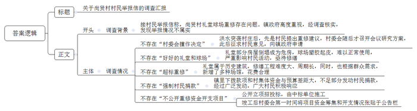
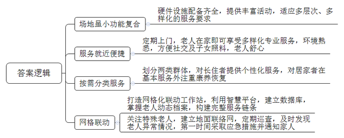
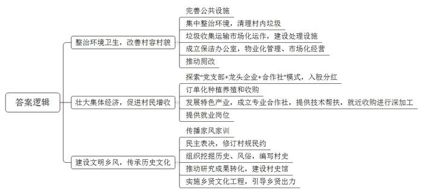
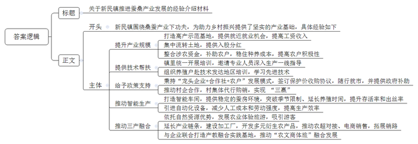

# 2022年公务员多省联考《申论》题（内蒙古旗县卷）

> 候选采集稿。参考答案及解析来自粉笔页面，不代表官方答案或真实高分答卷；来源使用许可与原卷对应关系仍需人工核实。

## 给定材料

### 材料 material-18f03b6b12c304a9

F县九和镇尚贤村村口礼堂，是全村最大的一座建筑，远近闻名。它的前身是始建于清朝末年的祠堂，迄今已有100多年历史。礼堂坐北朝南，广三路、深三进，占地面积1300多平米。内部设有活动室、会议室、阅览室、健身房、棋牌室等。礼堂集会议、教育、健身等功能于一体，村里的重大活动、红白喜事、村民集会等都在这里举行。礼堂堂前后来又建了一个灯光球场，每当夜幕降临，都会有村民在这里打球、跳舞。村里还经常在这里举办篮球赛、广场舞比赛、文化展览等文体活动。礼堂及堂前球场已成为全村人气最旺的地方。

然而，2020年8月，一场百年不遇的洪水突然袭击了尚贤村。礼堂因长时间浸泡，部分房屋倒塌，成为危房，球场也因塑胶起皮，变得坑坑洼洼，难以正常使用，村民活动受到了严重影响。为此，村民们纷纷向村委会提出重修礼堂和球场的建议，并表示愿意出资。11月，村委会召开会议研究决定由三方筹资重修礼堂及球场，村集体出资10万元，向上级申请拨款筹集一部分资金，不足部分通过发动村民捐款的方式募集。于是，村委会通过征求村民意见，拟定项目重修施工方案，向镇政府申请拨款。

2021年3月，镇政府派人到尚贤村进行实地调研后，考虑到礼堂是一座具有江南风格的历史建筑，结合村里上报的重修方案，下拨了20万元用于礼堂和球场重修项目。可是，镇里下拨的款项加上村集体所出的资金与重修预算还有较大差距。于是，一场捐款活动就在村里展开了。经过广泛发动，活动得到了广大村民的积极响应，共募集资金57.4万元。捐款活动结束后，村委会立即将大家的捐款情况公布了出去。经过立项招投标、中标单位施工，前后历时5个多月、耗资82万元的礼堂及球场重修工程竣工，村委会也第一时间将重修项目的资金筹集和开支情况张贴在村口的公告栏。

这座修旧如旧的礼堂新增了村史馆、道德讲堂、书法绘画室、乒乓球室等场馆，球场也焕然一新，新礼堂和球场将传承传统文化、展示村庄形象、丰富文体活动等功能有机结合在了一起。2021年10月10日，新礼堂张灯结彩、锣鼓喧天、鞭炮齐鸣，尚贤村新礼堂竣工暨建村65周年庆典仪式在这里隆重举行。周边村落的村民也纷纷赶来参加庆典，对新礼堂赞不绝口，现场热闹非凡。

然而，不久后，F县纪委收到了尚贤村村民反映情况的举报信，信中写道：尚贤村村委会擅作决定，对好好的礼堂和球场大搞超标重修耗资巨大，并强制村民捐款，且不公开重修资金开支项目，希望严肃查处这种损害群众利益的行为。

### 材料 material-527ed308447ae131

这天，在桐城街道驿道社区，30多名老人在社工的带领下，围在一起放风筝，76岁的赵大爷正专心致志地给风筝涂上自己喜欢的颜色。赵大爷说：“我们不出社区，就能与老伙伴摆摆龙门阵、唱唱歌、跳跳舞，感觉日子过得很充实，越活越精神，越活越高兴。”

“螺蛳壳里做道场”。驿道社区嵌入式养老服务中心场地虽小但功能复合，配套了无障碍通道、理疗间、多功能室、助餐室、护理室等，满足了养老服务多层次、多样化的需求。“我们积极开设老年课堂，每个星期都会提前把每一堂课的时间和内容以课程表的方式排好，轮流开展。我们的活动有趣味运动会、画画、舞蹈比赛等。同时，联系社会上的志愿者或社区医院，嵌入整个活动流程，不断丰富老年人生活，让老人老有所养、老有所乐。”中心社工部赖主任说。

在这个中心，社工团队还会定期上门为老人开展义剪、足浴和健康检查等嵌入式服务，为辖区老人提供更多便利。“早上八点半跳舞，然后搞活动，还给我们检查眼睛和血压，我很高兴。”社区居民熊大姐说。“20多年前我老伴儿去世，两个女儿嫁得比较远，长年不在身边，我在家很孤单。”80岁的曹奶奶说，“现在，我们在家附近就能享受到服务，他们的照顾很专业，还能与街坊邻居拉家常，这样的养老方式让我觉得很舒心。”谈起入住中心以来的生活曹奶奶乐得合不拢嘴。

端午节这天，社区居民张叔在家煲好鸽子汤，送到中心给中风卧床多年的老母亲尝尝鲜，不烫不凉，正好入口。他说：“我们双职工家庭无法长期留人在家看护老母亲，幸好中心就在家边上，下班后过来探视，送点吃的喝的都挺方便。”

不仅如此，中心将所服务的老人分为了两个群体，一个是住在里面的，一个是需要上门服务的。对于住在里面的，中心对每一位老人都有一套个性化服务方案。针对晚上睡眠不好的老人，会安排工作人员通过睡觉前按摩等方式帮助老人放松心情，更好入睡；针对一些情绪经常波动的老人，会安排工作人员陪老人聊天谈心，帮助他们找出原因，平复情绪。“大家对中心评价都非常高。我们每月只交不多的钱，就可以享受用餐、定期体检、心理咨询等一系列服务。现在生活规律、开心，感谢党的好政策。”91岁的刘奶奶高兴地说。

而对于需要上门服务的，除了基本服务外，考虑到这一部分人大都是失能失智人员，中心则主要在康养恢复上下功夫。“我老伴儿已经卧床多年，许多功能逐渐退化，中心工作人员不仅没嫌弃，还专门为她订做了一套理疗方案，包括定时派人来针灸、按摩等。”居民老倪说。

除此之外，中心还积极打造网格化联动工作站，运用智慧网格化管理平台，建立人脸3D信息库，通过信息系统掌握社区老人的动态档案，包括基本情况、服务动态等，构建起完整的服务链条。75岁的陈大妈患有阿尔兹海默症，子女因工作原因不在身边，老人常常一出门就找不到回家的路，中心工作人员对她给予特别关注，并与亲属、保安、警察、热心居民等形成联络网，以便发生走失意外时及时处理。

“我们现在所在的是中控室，相当于我们的大脑，电脑大屏上是我们掌握的老人数据库，能够体现社区所有老人的基本信息、定制需求和服务情况等，当然我们也为这些信息都做好了保密工作。同时，这些数据我们做到了每天及时更新。”驿道社区党总支秦书记介绍说。

中心在系统的帮助下，会定期对社区老人进行巡查。去年7月，中心工作人员巡查时，发现有位独居老人躺在床上，呼其不应，身体僵硬且无法动弹。工作人员立即拨打应急救援电话，并第一时间通知其在外地的子女，由于现场应急处理措施得当，老人家得到了及时救治，转危为安。

秦书记说：“今后我们将进一步探索这种‘自家的养老院’嵌入式养老模式，将老人们的个体行动无缝嵌入整个服务网络，让他们在情感上更容易接受，为他们提供更完善的养老服务。”

### 材料 material-549eff9c061a9574

对于家乡的旧貌，土生土长的洋下镇梨洋村村民老钟仍记忆犹新，“我们村虽然有得天独厚的优美山水，但过去，村里污水横流、垃圾满地，‘室内现代化、室外脏乱差’说的就是我们这里，经常被隔壁村的人看不起。”时隔两年，再次走进梨洋村，村里荒废的角落建起了休闲广场，健身器材、文化走廊、公共洗手间样样俱全，泥泞的乡间小路变成了宽阔的水泥路，农户房前院里，整齐地种着各种蔬菜和绿植，村容村貌焕然一新。“我们村开展环境卫生整治后，村庄道路宽了，出行更方便了，我家房前屋后也变得越来越整洁。乡亲们吃完饭，就在休闲广场上散步聊天，生活质量比以前提高了不少，‘腰杆’都挺直了。”村民老吴自豪地说。

2021年以来，梨洋村已经开展了10余次集中环境整治，组织党员干部、村民、返乡大学生对村里的垃圾、牛羊粪、废弃建筑材料等进行了全面清扫。村委会胡主任介绍：“我们还通过招标方式实现生活垃圾收集运输市场化运作，建立了小型微动力污水处理系统，生活垃圾处理站的两台焚烧炉每天能‘吃掉’6吨生活垃圾，有效解决了大家的生活垃圾和污水处理难题。”

村里还成立了保洁办公室，将人居环境整治转向物业化管理、市场化经营。在保洁办公室的推动下，村里陆续对村民家里的旱厕进行了水冲厕所改造。村民老张家的卫生间已经改造完成，新安装的马桶上贴着一张用户联系卡，上面标有维修、监督和村级联系人的电话。

为壮大村集体经济，村里积极探索“党支部+龙头企业+合作社”的模式，以入股的方式增加村集体收入，带动村民增收。胡主任介绍道，梨洋村在镇里的农产品开发公司投入股金80万元，村集体经济收入按占股比例分红，每年保底收益为5万元。同时，公司还通过订单种植养殖、订单收购，带动240户农户增收致富。今年，村里将发展以肉鸭养殖为主的项目，推动村民收入水平再上新台阶。

今年开春以来，村民老吕忙得不亦乐乎，每天不仅要饲养好自己养的5000多只鸭子，还要忙着收捡鸭蛋，然后送到附近的合作社加工。而就在几年前，他还只是一个养鸭规模不大的农户。“过去养殖规模很小，现在一年收入有10万元左右，这得益于产业发展的带动。”老吕高兴地说。为了更好地带动群众增收，村里还引导村民成立了专业的养殖合作社，不仅免费为像老吕这样的养殖户提供更多的养殖技术，还就近收购他们的产品进行深加工。在壮大集体经济的同时，也为村民提供了更多的就业岗位。

“村子近年来变化很大，房子漂亮，住着舒服，每天都有专门的人打扫卫生，村容村貌改进非常明显，更重要的是邻里关系和睦，家家户户门口都挂有家风家训。”村民老王说，村里建设的“家风家训一条街”对教育后代帮助很大，村里的孩子现在都能把家风家训背出来了。

今年年初，在村委会的指导下，梨洋村召开了村民代表大会，大家一致举手通过了新修订的村规民约。此外，村里还组织大学生返乡开展社会实践，通过实地走访老前辈，查阅文史资料，挖掘梨洋村的历史文化，探究过去的风俗习惯，编写了一本图文并茂的《梨洋村史》。下一步，村里还要推进村史研究成果转化，建设村史馆，并进一步实施乡贤文化工程，引导乡贤为本村的发展建言献策、出资助力。这些举措得到了镇政府的肯定，多次组织镇村干部前来“取经”。胡主任高兴地跟大家说道：“村里的发展，既要摘掉‘穷帽子’，又要改变‘老样子’，还要留住‘好根子’。”

### 材料 material-cfaf9f9a6e575dd4

采摘，装篓、运送……新民镇年过六旬的老杨干起活儿来认真且麻利，丝毫不比年轻人逊色。“每天工作7、8个小时，大概能采到500多斤桑叶，按照每斤3毛钱计算，收入一百多块不成问题。”老杨高兴地说道，“累吗？当然累，但想着干一天就有一百多块的收入，累也高兴。”对于一辈子没离开过土地的老人而言，能在家门口就获得赚钱的机会，着实是一件令人高兴的事。靠着勤劳，老杨夫妇每年在蚕桑基地务工两个月，收入可达万余元。除此之外，老杨还将家里的6亩地入股当地龙头企业，每年可实现分红约4000元。

截至目前，通过旧产区“改造”、现产区“挖潜”、潜产区“扩容”等方式，新民镇蚕桑种植面积已达8800亩，每年养蚕1.1万张，产鲜茧56万斤。“其实，刚开始，我们推广种植、养殖也不顺利，村民们认为种桑养蚕就是图个乐呵，靠这个怎么能增收。后来，我们在几个村创建了桑蚕高产示范基地，带领农户们增收致富，并出台政策，整合各类涉农资金，对种植户、养殖户进行补助，稳住种养成本，大家看到这个真有钱赚，才慢慢铺开，达到现有的规模。”新民镇吕镇长说。

“你不要以为这只是简单种树，桑树种植也是需要技术的，如果镇里没有开展培训、邀请专家和技术人员到田间地头来指导我们，这片桑树林早就不行了。”老杨告诉我们，为了促进桑蚕共育养殖，新民镇还组织小蚕共育户、养殖大户到蚕桑产业技术发达的地区进行培训，学习先进技术。同时，加大政策支持力度，秉持“龙头企业+合作社+农户”发展模式，引导龙头企业与政府签订保护价收购协议，在保护价协议基础上随行就市，并实行政府补助的政策机制，提高农户养殖积极性；扶持推动村集体与龙头企业结成合作伙伴，由村集体代行购销行为，实现企业、村集体、养殖户“三赢”。

2019年，新民镇引进了智能养蚕生产线，建成智能养蚕车间，成为传统蚕桑产业“破茧成蝶”的关键节点。“智能养蚕生产线仅需单人操作，较传统养蚕效率提高30倍。”提起智能养蚕车间，新民镇上岭村60多岁的智能蚕房负责人老田很是自豪。据了解，智能养蚕车间能够恒温恒湿控制蚕房环境，不仅突破了传统养蚕季节限制、最大程度延长了养蚕时间，同时也提高了蚕宝宝的存活率和出丝率。另一方面，机械化设备能够实现自动添桑、除沙、消毒、上簇、采茧等功能，极大减少了人工成本，减轻了劳动强度。

“周末专程带小孩来体验桑葚采摘的乐趣，同时也亲近亲近大自然！”每年5月份，随着桑葚成熟，众多游客纷至沓来，上岭村蚕桑基地也迎来了最热闹的日子。“基地果桑品种丰富，含无籽大十、大白珍珠、红果2号等30多个种类，口感独特、营养丰富。”老田介绍说。

依托优越的自然资源，上岭村种植果桑150亩，吸引了大批游客前来采摘、游玩。自2017年以来，村里已成功举办5届桑葚采摘节，累计接待游客8万多人次，实现旅游增收260余万元。在上岭村党群服务中心，慕名而来的游客采摘完桑葚，正在选购村里开发出来的桑叶面产品。除了桑叶面，新近开发的桑葚酒、桑葚膏、桑叶茶、蚕丝被等产品琳琅满目，让人眼花缭乱。上岭村党支部李书记介绍道：“我们的产品很多，质量也好，很受欢迎，客商经常会上门来买，镇里也帮我们与商超对接直销，还引入电商帮助营销、拓展销路，产业链条比较完善。”

“农旅融合的基础上，我们还致力于延伸打造蚕桑全产业发展链条，统筹谋划桑葚酒厂、蚕桑烘焙站、桑菌厂、桑葚加工厂和蚕纱综合加工厂建设，打造‘线上有丝路、线下有销路’的产业体系。目前，我们已经与省里的企业签订了协议，将打造产教融合蚕桑特色实践基地，推动蚕桑产业与劳动教育、研学实践与乡村旅游融合，提高农产品附加值，促进乡村全面振兴。”镇长补充说，该项目将围绕“学、讲、看、做”开设劳动大课堂，开展采摘、养蚕、参观蚕丝被和桑葚酒制作工艺、品尝桑蚕宴等活动，推动“农文商体旅”融合发展，实现农业“接二连三”（注：这里的“二”“三”分别指第二、第三产业）。

## 题目

### 第 1 题

**F县纪委收到举报信，组织调查组到九和镇调查了解情况，假设你是九和镇政府工作人员，请根据“给定****资料**1**”，起草一份给调查组的汇报提纲。（28分）**

关联材料：材料 material-18f03b6b12c304a9、材料 material-527ed308447ae131、材料 material-549eff9c061a9574、材料 material-cfaf9f9a6e575dd4

作答要求：

要求：

（1）紧扣材料，内容全面；

（2）条理清晰，语言流畅；

（3）不超过400字。

### 第 2 题

**根据****“给定资料**2**”，请谈谈桐城街道驿道社区嵌入式养老服务模式的特点。（22分）**

关联材料：材料 material-18f03b6b12c304a9、材料 material-527ed308447ae131、材料 material-549eff9c061a9574、材料 material-cfaf9f9a6e575dd4

作答要求：

要求：全面、准确、有条理，不超过300字。

### 第 3 题

**根据****“给定资料**3**”，请谈谈梨洋村是如何让村民挺****直****“腰杆子”的。（18分）**

关联材料：材料 material-18f03b6b12c304a9、材料 material-527ed308447ae131、材料 material-549eff9c061a9574、材料 material-cfaf9f9a6e575dd4

作答要求：

要求：全面、准确、有条理，不超过250字。

### 第 4 题

**新民镇推动蚕桑产业发展工作****入****选省乡村振兴局拟印发的乡村振兴典型案例汇编。请根据****“给定资料**4**”，为新民镇撰写一份案例介绍材料。（32分）**

关联材料：材料 material-18f03b6b12c304a9、材料 material-527ed308447ae131、材料 material-549eff9c061a9574、材料 material-cfaf9f9a6e575dd4

作答要求：

要求：

（1）紧扣材料，内容全面；

（2）条理清晰，语言流畅；

（3）不超过500字。

## 答案与解析

第 1 题

**参考答案（粉笔题库参考内容）**

关于尚贤村村民举报信的调查汇报

背景：接村民举报信称，尚贤村礼堂球场重修存在问题。镇政府高度重视，经调查核实，发现举报情况不属实。

调查情况：一、不存在“村委会擅作决定”。洪水突袭村庄后，先是村民提出重修建议，村委会随后才召开会议研究方案，此后征求村民意见，向镇政府申请。二、不存在“好好的礼堂和球场”。礼堂部分房屋倒塌成为危房，球场塑胶起皮，难以正常使用，严重影响村民活动，亟待修缮。三、不存在“超标重修”。礼堂属于历史建筑，修缮工程难度大、周期长，同时，也根据群众需求，新增了多种场馆，花费合理。四、不存在“强制村民捐款”。镇里下拨款项和村集体资金与预算差距大，不足部分发动村民捐款，经过广泛发动，广大村民积极响应。五、不存在“不公开重修资金开支项目”。公开立项招投标，由中标单位施工；竣工后村委会第一时间将项目资金筹集和开支情况张贴于公告栏。

**解析**

**参考答案说明：**（1）一方面从内容上来看，正文部分开头写到了九和镇调查礼堂球场重修情况的背景并表明调查结果；主体部分从不存在“村委会擅作决定”“好好的礼堂和球场”“超标重修”“强制村民捐款”“不公开重修资金开支项目”这五个方面展开介绍了重修礼堂球场的具体情况。（2）另一方面从形式上来看，本参考答案做到了分段、分条撰写，整体上条理较为清晰。

**考点**：考点总结类

**来源**：来源2022年公务员多省联考《申论》题（内蒙古旗县卷）

粉笔申论页面对本题只提供「解析视频」入口，该入口是会员推广位，页面无视频地址与文字解析。

第 2 题

**参考答案（粉笔题库参考内容）**

1.场地虽小功能复合。硬件设施配备齐全，提供丰富活动，适应多层次、多样化的服务要求。

2.服务就近便捷。定期上门，老人在家即可享受多样化专业服务，环境熟悉，方便社交及子女照料，老人舒心。

3.按需分类服务。划分两类群体，对长住者提供个性化服务，对居家者在基本服务外注重康养恢复。

4.网格联动。打造网格化联动工作站，利用智慧平台，建立数据库，掌握老人动态档案，构建完整服务链条；关注特殊老人，建立地面联络网，定期巡查，及时发现老人异常情况，第一时间采取应急措施并通知家人。

**解析**

**参考答案说明：**本参考答案从“场地虽小功能复合”“服务就近便捷”“按需分类服务”“网格联动”这四个方面进行了分条撰写。各条答案要点之间在内容上相互并列，没有交叉。

**考点**：考点特点类

**来源**：来源2022年公务员多省联考《申论》题（内蒙古旗县卷）

粉笔申论页面对本题只提供「解析视频」入口，该入口是会员推广位，页面无视频地址与文字解析。

第 3 题

**参考答案（粉笔题库参考内容）**

1.整治环境卫生，改善村容村貌。完善公共设施；集中整治环境，清理村内垃圾；垃圾收集运输市场化运作，建设处理设施；成立保洁办公室，物业化管理、市场化经营；推动厕改。

2.壮大集体经济，促进村民增收。探索“党支部+龙头企业+合作社”模式，入股分红；订单化种植养殖和收购；发展特色产业，成立专业合作社，提供技术帮扶，就近收购进行深加工；提供就业岗位。

3.建设文明乡风，传承历史文化。传播家风家训；民主表决，修订村规民约；组织挖掘历史、风俗，编写村史；推动研究成果转化，建设村史馆；实施乡贤文化工程，引导乡贤出力。

**解析**

**参考答案说明**：本参考答案从“整治环境卫生，改善村容村貌”“壮大集体经济，促进村民增收”和“建设文明乡风，传承历史文化”这三个方面展开。各条答案要点在内容上相互并列，没有交叉。

**考点**：考点概括措施类

**来源**：来源2022年公务员多省联考《申论》题（内蒙古旗县卷）

粉笔申论页面对本题只提供「解析视频」入口，该入口是会员推广位，页面无视频地址与文字解析。

第 4 题

**参考答案（粉笔题库参考内容）**

关于新民镇推进蚕桑产业发展的经验介绍材料

新民镇围绕桑蚕产业下功夫，为助力乡村振兴提供了坚实的产业基础，具体经验如下：

一、提升产业规模。打造高产示范基地，提供就近就业机会，提高工资收入；集中流转土地，提供入股分红；整合涉农资金，补助农户，稳住种养成本，提高农户积极性。二、提供技术帮扶。镇里统一开展培训，邀请专业人员深入生产一线指导；组织养殖户赴技术发达地区培训，学习先进技术。三、给予政策支持。秉持“龙头企业+合作社+农户”发展模式，签订保护价收购协议，随行就市，并提供政府补助；推动村企合作，村集体代行购销，实现“三赢”。四、推动智能生产。打造智能车间，提供稳定的蚕房环境，突破季节限制、延长养殖时间，提升存活率和出丝率；引进自动化设备，减少人工成本和劳动强度，提高生产效率。五、推动三产融合。依托自然资源优势，发展农业体验旅游，吸引游客；延长产业链条，建设加工厂，开发多元衍生农产品，推动农超对接、电商销售，拓展销路；与企业联合打造产教融合实践基地，推动“农文商体旅”融合发展。

**解析**

**参考答案说明：**（1）格式方面，本参考答案写到了“标题”和“正文”两个部分。（2）正文部分，一方面从内容上来看，围绕着“新民镇推动蚕桑产业发展工作”这一主题，本参考答案的开头先写到了“新民镇发展蚕桑产业的整体性概括及意义”；主体部分从“提升产业规模”“提供技术帮扶”“给予政策支持”“推动智能生产”和“推动三产融合”这五个方面介绍了具体经验。另一方面，形式上，本参考答案做到了分段、分条撰写，整体上条理较为清晰。

**考点**：考点总结类

**来源**：来源2022年公务员多省联考《申论》题（内蒙古旗县卷）

粉笔申论页面对本题只提供「解析视频」入口，该入口是会员推广位，页面无视频地址与文字解析。

