# 2022年内蒙古公务员录用考试《行测》题（网友回忆版）

<!-- gwy:overview:start -->
> **内蒙古 · 2022 · 行测 · 统考** ｜ 120 题 · 图片 148 处 · 答案随题折叠

| 题型模块 | 题量 | 题号 |
| --- | ---: | ---: |
| 常识判断 | 20 | 1–20 |
| 言语理解与表达 | 40 | 21–60 |
| 数量关系 | 10 | 61–70 |
| 判断推理 | 35 | 71–105 |
| 资料分析 | 15 | 106–120 |
| **合计** | **120** | |

导航：[题型与作答说明](#题型与作答说明) · [题目](#题目) · [材料 1](#材料-1)
<!-- gwy:overview:end -->

> 候选采集稿。参考答案及解析来自粉笔页面，不代表官方答案或真实高分答卷；来源使用许可与原卷对应关系仍需人工核实。

## 题型与作答说明

常识判断

（20题）

根据题目要求，在四个选项中选出一个最恰当的答案。

言语理解与表达

（40题）

本部分包括表达与理解两方面的内容。请根据题目要求，在四个选项中选出一个最恰当的答案。

数量关系

（10题）

在这部分试题中，每道题呈现一段表述数字关系的文字，要求你迅速、准确地计算出答案。

判断推理

（35题）

本部分包括图形推理、定义判断、类比推理与逻辑判断四种类型的试题，在四个选项中选出一个最恰当的答案。

资料分析

（15题）

所给出的图、表、文字或综合性资料均有若干个问题要你回答。你应根据资料提供的信息进行分析、比较、计算和判断处理。

## 题目

### 第 1 题

中国共产党十九届六中全会决定，党的二十大将于2022年下半年在北京召开。下列有关党的二十大的说法正确的有几项：

①党的二十大，是我们党进入全面建设社会主义现代化国家、向第二个百年奋斗目标进军新征程的重要时刻召开的一次十分重要的代表大会

②代表产生程序的5个主要环节是：推荐提名、组织考察、确定代表候选人初步人选、确定代表候选人预备人选、会议选举

③党的二十大代表的选举要严格资格条件，坚持把政治标准放在首位

④党的二十大代表名额共2300名，与十九大时相同

A. 1项

B. 2项

C. 3项

D. 4项

第 1 题 · 答案与解析

**参考答案（粉笔题库参考内容）**

D

**解析**

本题考查政治常识。

①正确，中国共产党第十九届中央委员会第六次全体会议公报指出：“全会决定，中国共产党第二十次全国代表大会于2022年下半年在北京召开。全会认为，党的二十大是我们党进入全面建设社会主义现代化国家、向第二个百年奋斗目标进军新征程的重要时刻召开的一次十分重要的代表大会，是党和国家政治生活中的一件大事。”

②正确，二十大代表的产生，要坚持和加强党的全面领导，充分发扬党内民主，采取自下而上、上下结合、反复酝酿、逐级遴选的办法进行。代表产生程序有5个主要环节，即推荐提名、组织考察、确定代表候选人初步人选、确定代表候选人预备人选、会议选举。

③正确，党中央提出，二十大代表应是共产党员中的优秀分子。要严把人选政治关，坚持把政治标准放在首位，突出考察人选的理想信念、政治品格和道德修养，着重了解人选政治判断力、政治领悟力、政治执行力，增强“四个意识”、坚定“四个自信”、做到“两个维护”等方面的表现情况，对政治上不合格的一票否决。

④正确，中央组织部负责人就做好二十大代表选举工作接受采访时表示，党中央明确，二十大代表名额共2300名，与十九大时相同。二十大代表名额的分配，主要根据党组织数量和党员人数确定，同时考虑前几次党的全国代表大会代表名额等因素。按照这一分配办法，各选举单位的代表名额，与十九大时基本相同。

故①②③④说法正确。

故正确答案为D。

**考点**：重要会议讲话、其他建设

**来源**：2022年浙江省公务员录用考试《行测》题（C类）（网友回忆版）第21题

### 第 2 题

2022年，中央一号文件《中共中央 国务院关于做好2022年全面推进乡村振兴重点工作的意见》明确提出“三农”工作的首要任务是“全力抓好粮食生产和重要农产品供给”。下列选项错误的是：

A. 大力推进北方设施蔬菜、北菜南运基地建设，提高蔬菜应急保供能力

B. 坚持中国人的饭碗任何时候都要牢牢端在自己手中，饭碗主要装中国粮

C. 全面落实粮食安全党政同责，严格粮食安全责任制考核，确保粮食播种面积稳定

D. 坚持和加强党对“三农”工作的全面领导，牢牢守住保障国家粮食安全和不发生规模性返贫两条底线

第 2 题 · 答案与解析

**参考答案（粉笔题库参考内容）**

A

**解析**

本题考查政治常识。

A项错误，《中共中央 国务院关于做好2022年全面推进乡村振兴重点工作的意见》在“一、全力抓好粮食生产和重要农产品供给”部分指出：“（三）保障‘菜篮子’产品供给。加大力度落实‘菜篮子’市长负责制。稳定生猪生产长效性支持政策，稳定基础产能，防止生产大起大落。加快扩大牛羊肉和奶业生产，推进草原畜牧业转型升级试点示范。稳定水产养殖面积，提升渔业发展质量。稳定大中城市常年菜地保有量，大力推进北方设施蔬菜、南菜北运基地建设，提高蔬菜应急保供能力。”由此可知，应是“南菜北运基地建设”，而非“北菜南运基地建设”。

B、C两项正确，《中共中央 国务院关于做好2022年全面推进乡村振兴重点工作的意见》在”一、全力抓好粮食生产和重要农产品供给”部分指出：“（一）稳定全年粮食播种面积和产量。坚持中国人的饭碗任何时候都要牢牢端在自己手中，饭碗主要装中国粮，全面落实粮食安全党政同责，严格粮食安全责任制考核，确保粮食播种面积稳定、产量保持在1.3万亿斤以上。”

D项正确，《中共中央 国务院关于做好2022年全面推进乡村振兴重点工作的意见》在开头第二段指出：“做好2022年‘三农’工作，要以习近平新时代中国特色社会主义思想为指导，全面贯彻党的十九大和十九届历次全会精神······坚持和加强党对‘三农’工作的全面领导，牢牢守住保障国家粮食安全和不发生规模性返贫两条底线，突出年度性任务、针对性举措、实效性导向，充分发挥农村基层党组织领导作用，扎实有序做好乡村发展、乡村建设、乡村治理重点工作，推动乡村振兴取得新进展、农业农村现代化迈出新步伐。”

本题为选非题，故正确答案为A。

**考点**：重要文件、社会建设

**来源**：2022年浙江省公务员录用考试《行测》题（C类）（网友回忆版）第26题

### 第 3 题

习近平总书记以统揽全局的战略思维和宽广的世界眼光深刻把握国家安全问题，提出了总体国家安全观。下列相关表述正确的有几项：

①总体国家安全观是我党历史上第一个被确立为国家安全工作指导思想的重大战略思想

②《中华人民共和国国家安全法》规定，每年5月15日为全民国家安全教育日

③总体国家安全观主要聚焦于如何解决好大国发展进程中面临的共性安全问题

④国家安全机关举报受理电话为12339

A. 1项

B. 2项

C. 3项

D. 4项

第 3 题 · 答案与解析

**参考答案（粉笔题库参考内容）**

B

**解析**

本题考查政治常识。

①正确，《总体国家安全观学习纲要》中明确提出：“总体国家安全观是我们党历史上第一个被确立为国家安全工作指导思想的重大战略思想，是中国共产党和中国人民捍卫国家主权、安全、发展利益百年奋斗实践经验和集体智慧的结晶，是马克思主义国家安全理论中国化的最新成果，是习近平新时代中国特色社会主义思想的重要组成部分，是新时代国家安全工作的根本遵循和行动指南。”

②错误，《中华人民共和国国家安全法》第一章“总则”第十四条规定：“每年4月15日为全民国家安全教育日。”

③错误，总体国家安全观从坚持和发展中国特色社会主义的战略高度，系统回答了中国特色社会主义进入新时代，如何既解决好大国发展进程中面临的共性安全问题，同时又处理好中华民族伟大复兴关键阶段面临的特殊安全问题这个重大时代课题，是一个系统完整的科学理论体系，内涵丰富、博大精深，涉及治党治国治军等各个方面，标志着我们党对国家安全基本规律的认识达到了新高度。故不仅是关注“大国发展进程中面临的共性安全问题”，同时也要关注“中华民族伟大复兴关键阶段面临的特殊安全问题”。

④正确，12339是国家安全机关受理公民和组织举报电话，这条热线是由国家安全部设立的，为了方便公民和组织向国家安全机关举报间谍行为或线索。

综上，①④正确，②③错误。

故正确答案为B。

**考点**：其他建设

**来源**：2022年浙江省公务员录用考试《行测》题（C类）（网友回忆版）第22题

### 第 4 题

习近平总书记强调，必须深化对新的时代条件下我国各类资本及其作用的认识，规范和引导资本健康发展，发挥其作为重要生产要素的积极作用。下列对资本的认识不准确的是（ ）。

A. 在社会主义市场经济体制下，资本是带动各类生产要素集聚配置的重要纽带

B. 资本具有逐利本性，如不加以规范和约束，就会给经济社会发展带来不可估量的危害

C. 要加强资本领域反腐败，保持反腐败高压态势，坚决打击以权力为依托的资本逐利行为

D. 要正确处理资本和利益分配问题，既注重维护按劳分配的主体地位，更注重保障资本参与社会分配获得增殖和发展

第 4 题 · 答案与解析

**参考答案（粉笔题库参考内容）**

D

**解析**

本题考查政治常识。

2022年4月29日，中共中央总书记习近平就依法规范和引导我国资本健康发展进行第三十八次集体学习时发表重要讲话。

A、B两项正确，习近平总书记在讲话中指出：“要历史地、发展地、辩证地认识和把握我国社会存在的各类资本及其作用。在社会主义市场经济体制下，资本是带动各类生产要素集聚配置的重要纽带，是促进社会生产力发展的重要力量，要发挥资本促进社会生产力发展的积极作用。同时，必须认识到，资本具有逐利本性，如不加以规范和约束，就会给经济社会发展带来不可估量的危害。”

C项正确，习近平总书记在讲话中指出：“要加强资本领域反腐败，保持反腐败高压态势，坚决打击以权力为依托的资本逐利行为，着力查处资本无序扩张、平台垄断等背后的腐败行为。”

D项错误，习近平总书记在讲话中指出：“要正确处理资本和利益分配问题。我国社会主义的国家性质决定了我们必须坚持按劳分配为主体、多种分配方式并存，在社会分配中体现人民至上。要注重经济发展的普惠性和初次分配的公平性，既注重保障资本参与社会分配获得增殖和发展，更注重维护按劳分配的主体地位，坚持发展为了人民、发展依靠人民、发展成果由人民共享，坚定不移走全体人民共同富裕的道路。”

本题为选非题，故正确答案为D。

**考点**：经济建设、重要会议讲话

**来源**：2022年浙江省公务员录用考试《行测》题（A类）（网友回忆版）第8题

### 第 5 题

2022年5月10日，习近平总书记在庆祝中国共产主义青年团成立100周年大会上发表重要讲话，激励广大青年团员在实现中华民族伟大复兴中国梦的新征程上奋勇前进。下列有关中国共产主义青年团表述不正确的是：

A. 团的地方组织和基层组织同时受同级党委和团的上级组织领导

B. 中国共产主义青年团受中国共产党的委托领导中国少年先锋队的工作

C. 团旗上环绕黄色五角星周围的黄色圆圈，象征中国青年一代紧密团结在中国共产党周围

D. 团员在加入共产党后或年满二十八周岁、没有在团内担任职务的情况下，不再保留团籍

第 5 题 · 答案与解析

**参考答案（粉笔题库参考内容）**

D

**解析**

本题考查政治常识。

A项正确，《中国共产主义青年团章程》总则规定：“中国共产主义青年团中央委员会受中国共产党中央委员会领导，团的地方组织和基层组织受同级党的委员会领导，同时受团的上级组织领导。”

B项正确，《中国共产主义青年团章程》总则规定：“中国共产主义青年团受中国共产党的委托领导中国少年先锋队的工作。中国共产主义青年团是中华全国青年联合会的核心团体会员，发挥主导作用。中国共产主义青年团在中国共产党的领导下，指导中华全国学生联合会开展工作。”

C项正确，《中国共产主义青年团章程》第八章“团旗、团徽、团歌”中的第三十七条规定：“中国共产主义青年团团旗旗面为红色，象征革命胜利；左上角缀黄色五角星，周围环绕黄色圆圈，象征中国青年一代紧密团结在中国共产党周围。”

D项错误，《中国共产主义青年团章程》第一章“团员”中的第一条第三款规定：“团员加入共产党以后仍保留团籍，年满二十八周岁，没有在团内担任职务，不再保留团籍。”

本题为选非题，故正确答案为D。

**考点**：重要事件、其他建设

**来源**：2022年浙江省公务员录用考试《行测》题（A类）（网友回忆版）第4题

### 第 6 题

《中共中央 国务院关于加快建设全国统一大市场的意见》于2022年4月发布，提出从全局和战略高度加快建设全国统一大市场。下列做法符合建设全国统一大市场要求的是：

A. 统一产权交易信息发布机制，实现全国产权交易市场联通

B. 以集中管理代替市场机制，统一市场价格、商品供给和配给渠道

C. 严格落实“负面清单准入”管理模式，要求各地主管部门根据实际情况及时发布具有市场准入性质的负面清单

D. 指导各地区综合比较优势、资源环境承载能力、产业基础、防灾避险能力等因素，搞好“小而全”的自我小循环

第 6 题 · 答案与解析

**参考答案（粉笔题库参考内容）**

A

**解析**

本题考查政治常识。

A项正确，《中共中央 国务院关于加快建设全国统一大市场的意见》在“（九）完善市场信息交互渠道”部分指出：“统一产权交易信息发布机制，实现全国产权交易市场联通。优化行业公告公示等重要信息发布渠道，推动各领域市场公共信息互通共享。优化市场主体信息公示，便利市场主体信息互联互通。推进同类型及同目的信息认证平台统一接口建设，完善接口标准，促进市场信息流动和高效使用。依法公开市场主体、投资项目、产量、产能等信息，引导供需动态平衡。”

B项错误，《中共中央 国务院关于加快建设全国统一大市场的意见》在“（二）工作原则”部分指出：“有效市场，有为政府。坚持市场化、法治化原则，充分发挥市场在资源配置中的决定性作用，更好发挥政府作用，强化竞争政策基础地位，加快转变政府职能，用足用好超大规模市场优势，让需求更好地引领优化供给，让供给更好地服务扩大需求，以统一大市场集聚资源、推动增长、激励创新、优化分工、促进竞争。”故不能用集中管理代替市场机制。

C项错误，《中共中央 国务院关于加快建设全国统一大市场的意见》在“（五）实行统一的市场准入制度”部分指出：“严格落实‘全国一张清单’管理模式，严禁各地区各部门自行发布具有市场准入性质的负面清单，维护市场准入负面清单制度的统一性、严肃性、权威性。”

D项错误，《中共中央 国务院关于加快建设全国统一大市场的意见》在“（二十四）破除地方保护和区域壁垒”部分指出：“指导各地区综合比较优势、资源环境承载能力、产业基础、防灾避险能力等因素，找准自身功能定位，力戒贪大求洋、低层次重复建设和过度同质竞争，不搞‘小而全’的自我小循环，更不能以‘内循环’的名义搞地区封锁。”

故正确答案为A。

**考点**：经济建设、重要文件

**来源**：2022年浙江省公务员录用考试《行测》题（A类）（网友回忆版）第5题

### 第 7 题

2022年3月，习近平总书记在看望参加政协会议的社会福利和社会保障界委员时强调，要在推动社会保障事业高质量发展上持续用力，织密社会保障安全网，为人民生活安康托底。下列做法有助于推动社会保障事业高质量发展的有几项：

①加大对因疫因灾遇困群众的临时救助力度

②保障流浪乞讨人员人身安全和基本生活，关心关爱精神障碍人员

③健全灵活就业人员社保制度，扩大失业、工伤、生育保险的覆盖面

④健全社会保障基金监管体系，严厉打击欺诈骗保、套保和挪用贪占各类社会保障资金的违法行为

A. 1项

B. 2项

C. 3项

D. 4项

第 7 题 · 答案与解析

**参考答案（粉笔题库参考内容）**

D

**解析**

本题考查政治常识。

①②正确，习近平总书记强调：“要加大对因疫因灾遇困群众的临时救助力度，做好残疾人康复、教育、就业等工作，保障流浪乞讨人员人身安全和基本生活，关心关爱精神障碍人员，坚决杜绝欺凌虐待妇女儿童、老年人、残疾人等违法行为。”

③④正确，习近平总书记强调：“我国已建成世界上规模最大的社会保障体系。要健全灵活就业人员社保制度，扩大失业、工伤、生育保险的覆盖面，实现制度安排更加公平，覆盖范围更加广泛，为人民生活安康托底。要健全社会保障基金监管体系，严厉打击欺诈骗保、套保和挪用贪占各类社会保障资金的违法行为，守护好人民群众的每一分‘养老钱’、‘保命钱’。”

综上所述，有助于推动社会保障事业高质量发展的有①②③④，有4项。

故正确答案为D。

**考点**：重要会议讲话、社会建设

**来源**：2022年浙江省公务员录用考试《行测》题（C类）（网友回忆版）第23题

### 第 8 题

根据十三届全国人大五次会议审议通过的《政府工作报告》，下列属于2022年我国经济发展主要预期目标的是：

①居民消费价格涨幅3%左右

②实现高水平科技自立自强

③国内生产总值增长6.5%左右

④粮食产量保持在1.3万亿斤以上

⑤坚持政府过紧日子，更好节用裕民

⑥居民收入增长与经济增长基本同步

A. ①③④

B. ①④⑥

C. ②③④

D. ②⑤⑥

第 8 题 · 答案与解析

**参考答案（粉笔题库参考内容）**

B

**解析**

本题考查政治常识。

①④⑥正确，③错误，2022年《政府工作报告》中“二、2022年经济社会发展总体要求和政策取向”指出：“今年发展主要预期目标是：国内生产总值增长5.5%左右；城镇新增就业1100万人以上，城镇调查失业率全年控制在5.5%以内；居民消费价格涨幅3%左右；居民收入增长与经济增长基本同步；进出口保稳提质，国际收支基本平衡；粮食产量保持在1.3万亿斤以上；生态环境质量持续改善，主要污染物排放量继续下降；能耗强度目标在‘十四五’规划期内统筹考核，并留有适当弹性，新增可再生能源和原料用能不纳入能源消费总量控制。”

②错误，2021年习近平在中国科学院第二十次院士大会、中国工程院第十五次院士大会和中国科学技术协会第十次全国代表大会上指出：“实践证明，我国自主创新事业是大有可为的！我国广大科技工作者是大有作为的！我国广大科技工作者要以与时俱进的精神、革故鼎新的勇气、坚忍不拔的定力，面向世界科技前沿、面向经济主战场、面向国家重大需求、面向人民生命健康，把握大势、抢占先机，直面问题、迎难而上，肩负起时代赋予的重任，努力实现高水平科技自立自强！”

⑤错误，2022年《政府工作报告》中“三、2022年政府工作任务”部分的“（一）着力稳定宏观经济大盘，保持经济运行在合理区间”指出：“要坚持政府过紧日子，更好节用裕民。大力优化支出结构，保障重点支出，严控一般性支出。盘活财政存量资金和闲置资产。”

综上所述，属于2022年我国经济发展主要预期目标的是①④⑥。

故正确答案为B。

**考点**：经济建设、重要文件

**来源**：2022年浙江省公务员录用考试《行测》题（C类）（网友回忆版）第25题

### 第 9 题

下列关于伟大科学工程的说法，正确的是：

A. 阿波罗计划：1961年在美国启动，尤里·加加林乘坐阿波罗1号宇宙飞船第一个登上月球表面

B. 中国863计划：1986年在中国启动，深海载人潜水器被列为该计划的研究专项之一

C. 人类基因组计划：1990年在法国启动，聚焦测定人染色体DNA序列，以破译遗传信息为目的

D. 人类脑计划：1997年在英国启动，以心理科学和信息科学研究为核心

第 9 题 · 答案与解析

**参考答案（粉笔题库参考内容）**

B

**解析**

本题考查科技常识。

A项错误，阿波罗计划为20世纪60-70年代美国实施的载人登月工程，“阿波罗”登月飞行从1961年启动。1969年7月16-24日，阿姆斯特朗作为“阿波罗”11号飞船指令长，完成人类首次登月飞行。

B项正确，中国863计划是中国发展高技术及其产业的计划，全称国家高技术研究发展计划。因1986年3月王大珩、王淦昌、杨嘉墀、陈芳允四位科学家提出这个建议而得名，于1986年启动实施。2002年中国科技部将深海载人潜水器研制列为国家高技术研究发展计划（863计划）重大专项，启动“蛟龙号”载人深潜器的自行设计、自主集成研制工作。

C项错误，人类基因组计划由美国科学家于1985年率先提出，1990年正式启动，于2000年完成了人类基因组“工作框架图”。其核心任务是要绘制出人类基因组的遗传图谱、物理图谱、转录图谱和序列图谱，最终测定出人类基因组DNA的全部核苷酸序列。

D项错误，人类脑计划包括神经科学和信息科学这当今自然科学两大热点的相互结合研究，其核心内容是神经信息学。1997年人类脑计划在美国正式启动，美国20多家著名的大学和研究所参加了这个研究计划。

故正确答案为B。

**考点**：科技理论与成就

**来源**：2022年浙江省公务员录用考试《行测》题（C类）（网友回忆版）第35题

### 第 10 题

新时代需要继承发扬以国家民族命运为己任的爱国主义精神，更需要继承发扬以爱国主义为底色的科学家精神。在中华民族伟大复兴的征程上，一代又一代的科学家不畏艰难，勇攀高峰，无私奉献，为国家和人民做出了彪炳史册的重大贡献。下列科学家与其成就对应关系正确的是：

①“两弹一星”元勋——于敏

②北斗三号卫星首席总设计师——谢军

③中国核潜艇第一任总设计师——赵忠尧

④新中国飞机空气动力设计奠基人——顾诵芬

⑤中国脊髓灰质炎疫苗研发生产拓荒者——汤飞凡

A. ①③④

B. ②③⑤

C. ①②④

D. ②④⑤

第 10 题 · 答案与解析

**参考答案（粉笔题库参考内容）**

C

**解析**

本题考查政治常识。

①项正确，于敏，核物理学家，中国“氢弹之父”，生于河北省宁河县（今天津市宁河区）。他在我国氢弹原理突破中解决了一系列基础问题，提出了从原理到构形基本完整的设想，起了关键作用。此后长期领导核武器理论研究、设计，解决了大量理论问题。对我国核武器进一步发展到国际先进水平做出了重要贡献。1982年于敏获国家自然科学奖一等奖。1985年、1987年和1989年三次获国家科技进步奖特等奖。1994年获求是基金杰出科学家奖。1999年被国家授予“两弹一星”功勋奖章。2019年9月17日，国家主席习近平签署主席令，授予于敏“共和国勋章”。

②项正确，谢军，山西临汾人，中共党员，研究员，历任航天科技集团五院504所副所长、所长，北斗二号导航卫星总设计师。现任北斗三号工程副总设计师、北斗三号导航卫星首席总设计师，北斗卫星导航系统工程副总设计师。2020年12月，被国资委党委授予第五届“央企楷模”称号。2021年2月17日，谢军被评为“感动中国2020年度人物”。

③项错误，彭士禄是中国核潜艇第一任总设计师，中国工程院首批及资深院士，被誉为“中国核潜艇之父”。赵忠尧，主要从事核物理研究，特别是硬g射线与物质相互作用等方面的研究，主持建成中国第一、二台质子静电加速器，为在国内建立核物理实验基地做出了重要贡献。

④项正确，顾诵芬，江苏苏州人，飞机设计专家，中国自行设计、制造的高空高速歼击机的主要技术负责人之一，是新中国飞机空气动力设计奠基人。2021年11月3日上午，2020年度国家科学技术奖励大会在北京人民大会堂隆重召开。中国航空工业集团有限公司顾诵芬院士获国家最高科学技术奖。

⑤项错误，顾方舟，我国著名病毒学家、脊髓灰质炎疫苗研发生产拓荒者，被称为“中国脊髓灰质炎疫苗之父”。汤飞凡，著名微生物学家、病毒学家，沙眼衣原体的发现人之一，长期从事微生物学、病毒学和免疫学的研究。

综上所述，科学家与其成就对应关系正确的是①②④。

故正确答案为C。

**考点**：重要事件、其他建设

**来源**：2022年浙江省公务员录用考试《行测》题（C类）（网友回忆版）第27题

### 第 11 题

中国共产党的入党誓词，镌刻着我党百年来的初心与使命，下列说法正确的是（ ）。

A. 党的十二大通过了新的《中国共产党章程》，将入党誓词明确写入党章

B. 中国共产党一大第二次会议认真讨论了入党誓词的内容

C. 中国共产党入党誓词内容从未发生过变化

D. 预备党员应在转正时进行入党宣誓仪式

第 11 题 · 答案与解析

**参考答案（粉笔题库参考内容）**

A

**解析**

本题考查政治常识。

A项正确，1982年9月6日，党的十二大通过了新的《中国共产党章程》，该党章中正式载入入党誓词。这是中国共产党历史上第一次把入党誓词写进党章。其中明确规定：“预备党员必须面向党旗进行入党宣誓。誓词如下：我志愿加入中国共产党，拥护党的纲领，遵守党的章程，履行党员义务，执行党的决定，严守党的纪律，保守党的秘密，对党忠诚，积极工作，为共产主义奋斗终身，随时准备为党和人民牺牲一切，永不叛党。”

B项错误，1921年7月24日，中共一大举行了第二次会议，李达代表上海发起组报告了自成立以来所进行的工作，各地代表报告本地区党团组织的状况和工作进程，并交流了经验体会，其中有相当篇幅的内容涉及新闻宣传。没有涉及讨论入党誓词的内容。

C项错误，在中国共产党百年奋斗历程中，入党誓词几经变迁，存在过多种版本，现在使用的为1982年的版本。该版本入党誓词精炼概括，总共12句80字的入党誓词一直沿用至今。

D项错误，入党宣誓仪式一般由基层党委或党支部（党总支）组织，应在上级党组织批准接收预备党员后及时举行，不能拖，更不能等到预备党员转正时才举行。

故正确答案为A。

**考点**：党章党纪

**来源**：2022年内蒙古公务员录用考试《行测》题（网友回忆版）第11题

### 第 12 题

下列关于金融产品的说法正确的是：

A. 金融产品价格波动属于信用风险

B. 在开放基金中风险最低的是混合型基金

C. 存款保险制度的保障范围不包括银行自营的理财产品

D. 金融产品的风险由大到小排序：金融债券＞股票＞储蓄产品

第 12 题 · 答案与解析

**参考答案（粉笔题库参考内容）**

C

**解析**

本题考查经济常识。

A项错误，信用风险又称违约风险，是指借款人、证券发行人或交易对方因种种原因，不愿或无力履行合同条件而构成违约，致使银行、投资者或交易对方遭受损失的可能性。因此，金融产品价格波动不属于信用风险。

B项错误，人们将开放式基金分为四种基本类型：股票型基金、混合型基金、债券型基金、货币型基金。混合型基金指同时投资于股票、债券和货币市场等工具，没有明确投资方向的基金。而货币型基金主要投资于货币市场的基金，相对来说，它的风险是最低的。

C项正确，存款保险主要保障的是储蓄存款，如果存款保险成员机构发生经营危机，或者面临破产倒闭，那么存款保险就可以为该成员机构提供财务方面的救助，或者直接向存款人支付部分或全部的存款，从而保障存款人的相关权益。但是银行自营的理财产品并不属于储蓄存款，因此是不属于存款保险制度的保障范围之内的。

D项错误，金融债券是由银行和非银行金融机构发行的债券。从收益方面看，债券在购买之前，利率已定，到期就可以获得固定利息，而不用管发行债券的公司经营获利与否；股票一般在购买之前不定股息率，股息收入随股份公司的盈利情况变动而变动，盈利多就多得，盈利少就少得，无盈利不得。从本金方面看，债券到期可回收本金，也就是说连本带利都能得到，如同放债一样；股票则无到期之说。股票本金一旦交给公司，就不能再收回，只要公司存在，就永远归公司支配。公司一旦破产，还要看公司剩余资产清盘状况，那时甚至连本金都会蚀尽，所以债券的风险性小于股票。储蓄产品是指银行推出的存钱产品，风险是最低的。因此，风险由大到小排序：股票＞金融债券＞储蓄产品。

故正确答案为C。

**考点**：市场经济

**来源**：2022年浙江省公务员录用考试《行测》题（C类）（网友回忆版）第32题

### 第 13 题

陈某在某商业银行网点购买了一份10年期的分红型保险。下列做法不符合规定的是（ ）。

A. 陈某所购买的保险犹豫期为15天

B. 该银行销售保险产品的服务属于银行代理保险业务

C. 在该银行网点销售保险给陈某的人是保险公司派驻的

D. 分红型保险是一款非预定收益型投资保险产品，红利分配是不确定的

第 13 题 · 答案与解析

**参考答案（粉笔题库参考内容）**

C

**解析**

本题考查经济常识。

A项正确，“犹豫期”是指投保人在收到保险合同后10天（银行保险渠道为15天）内，如不同意保险合同内容，可将合同退还保险人并申请撤销。在此期间，保险人同意投保人的申请，撤销合同并退还已收全部保费。陈某是在商业银行购买的保险，故犹豫期为15天。

B项正确，商业银行代理保险业务是指商业银行接受保险公司委托，在保险公司授权的范围内，代理保险公司销售保险产品及提供相关服务，并依法向保险公司收取佣金的经营活动。商业银行网点销售分红型保险产品的服务属于银行代理保险业务。

C项错误，《中国银监会关于进一步加强商业银行代理保险业务合规销售与风险管理的通知》第十二条明确规定：商业银行不得允许保险公司人员派驻银行网点。

D项正确，分红保险指在获得人寿保险的同时，保险公司将实际经营生产的盈余，按一定比例向保险单持有人进行红利分配的人寿保险品种。分红保险分的是该类分红保险当年的可分配盈余。由于保险公司的经营状况的不同，每年的可分配盈余也会有所不同。

本题为选非题，故正确答案为C。

**考点**：宏观经济与调控政策

**来源**：2022年内蒙古公务员录用考试《行测》题（网友回忆版）第13题

### 第 14 题

中华优秀传统文化中的许多经典名句言简意赅，蕴含着丰富哲理，彰显了中华民族的文化精神。习近平总书记多次在讲话中引用经典名句，下列引用名句与讲话主题对应错误的是：

A. 从善如登，从恶如崩——在同各界优秀青年代表座谈时的讲话

B. 不矜细行，终累大德——在纪念辛亥革命110周年大会上的讲话

C. 行之力则知愈进，知之深则行愈达——在庆祝改革开放40周年大会上的讲话

D. 为有牺牲多壮志，敢教日月换新天——在庆祝中国共产党成立100周年大会上的讲话

第 14 题 · 答案与解析

**参考答案（粉笔题库参考内容）**

B

**解析**

本题考查政治常识。

A项正确，2013年5月4日，习近平总书记在同各界优秀青年代表座谈时的讲话上指出：“要牢记‘从善如登，从恶如崩’的道理，始终保持积极的人生态度、良好的道德品质、健康的生活情趣。”

B项错误，2014年10月8日，习近平总书记在党的群众路线教育实践活动总结大会上的讲话指出：“‘不矜细行，终累大德。’各级干部要从我做起、从小事做起，带头坚守正道、弘扬正气，努力营造良好从政环境。”

C项正确，2018年12月18日，习近平总书记在庆祝改革开放40周年大会上的讲话上指出：“只有顺应历史潮流，积极应变，主动求变，才能与时代同行。‘行之力则知愈进，知之深则行愈达。’改革开放40年积累的宝贵经验是党和人民弥足珍贵的精神财富，对新时代坚持和发展中国特色社会主义有着极为重要的指导意义，必须倍加珍惜、长期坚持，在实践中不断丰富和发展。”

D项正确，2021年7月1日，习近平总书记在庆祝中国共产党成立100周年大会上的讲话上指出：“一百年来，中国共产党团结带领中国人民，以‘为有牺牲多壮志，敢教日月换新天’的大无畏气概，书写了中华民族几千年历史上最恢宏的史诗。”

本题为选非题，故正确答案为B。

**考点**：文化建设

**来源**：2022年云南公务员录用考试《行测》题（网友回忆版）第4题

### 第 15 题

根据《中华人民共和国监察官法》，下列关于监察官回避制度的说法错误的是：

A. 张某担任某设区的市监察委员会副主任，应当实行地域回避

B. 王某和李某都是监察官，二人系夫妻关系，不能被派驻到同一高校

C. 赵某一和赵某二系亲兄弟，可以同时担任某县监察委员会不同部门的监察官

D. 黄某担任某设区的市监察委员会副主任，其子不得担任该市下辖的县监察委员会委员

第 15 题 · 答案与解析

**参考答案（粉笔题库参考内容）**

A

**解析**

本题考查法律常识。

A项错误，根据《中华人民共和国监察官法》第二十三条规定：“监察官担任县级、设区的市级监察委员会主任的，应当按照有关规定实行地域回避。”故副主任无需实行地域回避。

B、C、D三项正确，根据《中华人民共和国监察官法》第二十四条规定：“监察官之间有夫妻关系、直系血亲关系、三代以内旁系血亲以及近姻亲关系的，不得同时担任下列职务：（一）同一监察委员会的主任、副主任、委员，上述人员和其他监察官；（二）监察委员会机关同一部门的监察官；（三）同一派驻机构、派出机构或者其他监察机构的监察官；（四）上下相邻两级监察委员会的主任、副主任、委员。”B项中，王某和李某系夫妻关系，根据上述第（三）项规定不得派驻到同一高校，说法正确。C项中，赵某一和赵某二系亲兄弟，根据上述第（二）项规定，不得担任同一部门的监察官，但可以担任不同部门的监察官，说法正确。D项中，根据上述第（四）项规定，黄某之子不得担任其任职的监察委员会的下一级监察委员会的委员，说法正确。

本题为选非题，故正确答案为A。

**考点**：其他法律法规

**来源**：2022年内蒙古公务员录用考试《行测》题（网友回忆版）第15题

### 第 16 题

2022年，按照以习近平同志为核心的党中央的部署要求，为稳定宏观经济大盘，稳定上亿市场主体，各部门多措并举优化和落实助企纾困政策，为经济平稳运行提供有力支撑。下列属于“稳主体”对策的是：

①实施大规模留抵退税政策

②对特困行业实行阶段性缓缴养老保险费

③中国人民银行宣布下调金融机构存款准备金率

④设立3岁以下婴幼儿照护个人所得税专项附加扣除

⑤央行、银保监会发布个人首套房商贷利率下限调整

A. 2项

B. 3项

C. 4项

D. 5项

第 16 题 · 答案与解析

**参考答案（粉笔题库参考内容）**

C

**解析**

本题考查经济常识。

市场主体是经济的力量载体，保市场主体就是保社会生产力。

①正确，2022年3月21日，国务院总理李克强主持召开国务院常务会议，确定实施大规模增值税留抵退税的政策安排，为稳定宏观经济大盘提供强力支撑。

②正确，2022年4月6日，国务院总理李克强主持召开国务院常务会议，决定对特困行业实行阶段性缓缴养老保险费政策，加大失业保险支持稳岗和培训力度；部署适时运用货币政策工具，更加有效支持实体经济发展。

③正确，为支持实体经济发展，促进综合融资成本稳中有降，中国人民银行决定于2022年4月25日下调金融机构存款准备金率0.25个百分点（不含已执行5%存款准备金率的金融机构），为加大对小微企业和“三农”的支持力度，对没有跨省经营的城商行和存款准备金率高于5%的农商行，在下调存款准备金率0.25个百分点的基础上，再额外多降0.25个百分点。

④错误，为贯彻落实《中共中央 国务院关于优化生育政策促进人口长期均衡发展的决定》，依据《中华人民共和国个人所得税法》有关规定，国务院决定，设立3岁以下婴幼儿照护个人所得税专项附加扣除。自2022年1月1日起，纳税人照护3岁以下婴幼儿子女的相关支出，在计算缴纳个人所得税前，按照每个婴幼儿每月1000元的标准定额扣除。该项扣除政策有利于减轻人民群众抚养子女负担，体现了国家对人民群众生育养育的鼓励和照顾。属于“保民生”的措施。

⑤正确，2022年5月15日，央行、银保监会联合发布《关于调整差别化住房信贷政策有关问题的通知》，对于贷款购买普通自住房的居民家庭，首套住房商业性个人住房贷款利率下限调整为不低于相应期限贷款市场报价利率（LPR）减20个基点，二套住房商业性个人住房贷款利率政策下限按现行规定执行。此举对稳定市场预期将起到积极作用，有利于进一步满足刚性和改善性住房需求，促进房地产市场平稳健康发展。

综上所述，属于“稳主体”对策的是①②③⑤，共4项。

故正确答案为C。

**考点**：市场经济

**来源**：2022年浙江省公务员录用考试《行测》题（C类）（网友回忆版）第24题

### 第 17 题

在日常生活中，长期来看下列杯子的使用方法对人体最没有危害的是：

A. 用玻璃杯喝冰橙汁

B. 用不锈钢杯喝碳酸饮料

C. 用塑料杯盛放刚烧开的水

D. 用内壁涂有彩釉的陶瓷杯喝热姜汁

第 17 题 · 答案与解析

**参考答案（粉笔题库参考内容）**

A

**解析**

本题考查科技常识。

A项正确，玻璃杯是指玻璃制成的杯子，通常由原材料高硼硅玻璃，经过600多度的高温烧制而成，其物理强度高，与普遍玻璃相比，无毒副作用，其机械性能，热稳定性能，抗水、抗碱、抗酸等性能大大提高。用玻璃杯喝冰橙汁对身体基本不会产生危害。

B项错误，不锈钢材质对于酸性饮料不具有防腐蚀特性，碳酸饮料属于酸性物质，长时间使用不锈钢杯装碳酸饮料不仅会破坏腐蚀水杯内壁，更会对人体造成伤害，因此不宜用不锈钢杯喝碳酸饮料。

C项错误，塑料杯通常由聚苯乙烯（PS）制作而成，用其装酸（如柳橙汁）、碱性物质后，会分解出致癌物质，不耐高温；其温度达到六十几度的时候会变形，产生对人体有害的物质，因此不宜能用塑料杯盛放刚烧开的水。

D项错误，彩釉陶瓷杯上的图案是用颜料涂画而来，内壁涂有彩釉，当装入开水、酸性、碱性饮料时，铅等有害重金属元素会溶解在饮料中，对健康不利。因此不宜用内壁涂有彩釉的陶瓷杯喝热姜汁。

故正确答案为A。

**考点**：生活常识

**来源**：2022年浙江省公务员录用考试《行测》题（A类）（网友回忆版）第19题

### 第 18 题

乒乓球运动员在比赛中运用上旋打法进攻，在击球的过程中通过带有向上提拉的动作，打出上旋球，下列关于上旋球说法错误的是：

A. 球体上表面相对空气的旋转速度大，下表面相对空气的旋转速度小

B. 球体上方气体压强比球体下方大，上旋球下坠速度比正常快

C. 乒乓球转速越大，上下表面压强差就越大，下坠得就越快

D. 球体旋转向前飞行，上表面向前转动，下表面向后转动

第 18 题 · 答案与解析

**参考答案（粉笔题库参考内容）**

A

**解析**

本题考查科技常识。

A项错误，上旋球的运动方向和自转方向一样，球向前运动，由于空气具有一定的粘滞性，当乒乓球向前转动时，空气就与球的上表面产生摩擦，就会导致球体上表面相对空气的旋转速度小，下表面相对空气的旋转速度大。

B项正确，由于球体的上表面相对空气的旋转速度小，下表面相对空气的旋转速度大，根据伯努利原理，流速大的地方压强小，所以下表面受的气体压强小，故上旋球下坠速度比正常快。

C项正确，当乒乓球转速越大，上表面的空气流动速度和下表面的空气流动速度差就越大，上下表面压强差就越大，所以下坠得就越快。

D项正确，上旋球的运动方向和自转方向一样，球向前运动，上表面是向前转动，下表面是向后转动。

本题为选非题，故正确答案为A。

**考点**：物理常识

**来源**：2022年浙江省公务员录用考试《行测》题（C类）（网友回忆版）第33题

### 第 19 题

关于安全生产管理工作，下列说法正确的是：

A. 机关、团体、企业、事业等单位应当对建筑消防设施每季度至少进行一次全面检测

B. 未造成人员伤亡的一般事故，县级人民政府可以委托事故发生单位组织事故调查组进行调查

C. 交通运输主管部门负责危险化学品的公共安全管理，核发剧毒化学品购买许可证、剧毒化学品道路运输通行证

D. 安全生产监督管理部门和负有安全生产监督管理职责的有关部门逐级上报事故情况，每级上报的时间不得超过1小时

第 19 题 · 答案与解析

**参考答案（粉笔题库参考内容）**

B

**解析**

本题考查法律常识。

A项错误，根据《中华人民共和国消防法》第十六条第一款第三项规定：“机关、团体、企业、事业等单位应当履行下列消防安全职责：（三）对建筑消防设施每年至少进行一次全面检测，确保完好有效，检测记录应当完整准确，存档备查。”题中，每季度至少进行一次全面检测说法错误。

B项正确，根据《生产安全事故报告和调查处理条例》第十九条规定：“特别重大事故由国务院或者国务院授权有关部门组织事故调查组进行调查。重大事故、较大事故、一般事故分别由事故发生地省级人民政府、设区的市级人民政府、县级人民政府负责调查。省级人民政府、设区的市级人民政府、县级人民政府可以直接组织事故调查组进行调查，也可以授权或者委托有关部门组织事故调查组进行调查。未造成人员伤亡的一般事故，县级人民政府也可以委托事故发生单位组织事故调查组进行调查。”

C项错误，根据《危险化学品安全管理条例》第六条第二项规定：“对危险化学品的生产、储存、使用、经营、运输实施安全监督管理的有关部门（以下统称负有危险化学品安全监督管理职责的部门），依照下列规定履行职责：（二）公安机关负责危险化学品的公共安全管理，核发剧毒化学品购买许可证、剧毒化学品道路运输通行证，并负责危险化学品运输车辆的道路交通安全管理。”

D项错误，根据《生产安全事故报告和调查处理条例》第十一条规定：“安全生产监督管理部门和负有安全生产监督管理职责的有关部门逐级上报事故情况，每级上报的时间不得超过2小时。”

故正确答案为B。

**考点**：其他法律法规

**来源**：2022年浙江省公务员录用考试《行测》题（A类）（网友回忆版）第17题

### 第 20 题

丙烯酰胺被世界卫生组织列为2A级致癌物，即可疑致癌物。食品中的丙烯酰胺并不是人为添加到食物中，而是在烘焙或烹饪过程中产生的，下列烹饪手法中生成丙烯酰胺最少的是：

A. 干煸四季豆

B. 炸油条

C. 白灼虾

D. 炝炒白菜

第 20 题 · 答案与解析

**参考答案（粉笔题库参考内容）**

C

**解析**

本题考查科技常识。

丙烯酰胺的形成与食物加工烹调方式、温度、时间、水分等有关。丙烯酰胺主要在高碳水化合物、低蛋白质的植物性食物烹调过程中被加热到120以上时生成，140-180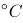为生成的最佳温度；在加工温度较低，如用水煮时，丙烯酰胺的形成水平相当低。食物的水含量也是影响丙烯酰胺形成的重要因素，特别是烘烤、油炸食品最后阶段水分减少、表面温度升高后，其丙烯酰胺形成量更高。白灼虾是用水煮的方式烹调，与干煸四季豆、炸油条、炝炒白菜相比，丙烯酰胺的生成量最少。

故正确答案为C。

**考点**：生活常识

**来源**：2022年湖北省公务员录用考试《行测》题（网友回忆版）第20题

### 第 21 题

越来越多的美食纪录片或是以昂贵的摄影设备、高水准的镜头语言造就美食奇观，或是用            的体量形式、草根气息的真实味道成为下饭陪伴，又或以富含哲理的文案、食物背后的故事触发观众共情。

填入划横线部分最恰当的一项是：

A. 长篇大论

B. 长篇累牍

C. 片言只语

D. 短小精悍

第 21 题 · 答案与解析

**参考答案（粉笔题库参考内容）**

D

**解析**

搭配“体量形式”，且根据“成为下饭陪伴”可知，横线处应体现出美食纪录片的体量较小，形式较简单，能够陪伴一顿饭的时间就好。D项“短小精悍”形容人身躯短小，精明强悍，也形容文章或发言简短而有力，符合文意，当选。

A项“长篇大论”指滔滔不绝的发言或篇幅冗长的文章，B项“长篇累牍”指篇幅很长，内容很多，均与文意相悖，排除；C项“片言只语”指零零碎碎的话语，侧重强调语言文字少，无法与“体量形式”搭配，且与“纪录片”对应不当，排除。

故正确答案为D。

【文段出处】北京青年报《<亚洲食谈>：八个国家的“饮食男女”》

**考点**：词的辨析-搭配对象、对应关系-前后呼应、成语填空

**来源**：2022年内蒙古公务员录用考试《行测》题（网友回忆版）第21题

### 第 22 题

修炼挨批评这项基本功，要有虚心接受的气度。接受批评，就要拿出虚心以待、胸怀若谷的姿态，砥砺            、从善如流的自觉。

填入划横线部分最恰当的一项是：

A. 见贤思齐

B. 洗心革面

C. 兼听则明

D. 闻过则喜

第 22 题 · 答案与解析

**参考答案（粉笔题库参考内容）**

D

**解析**

根据顿号可知，横线处所填成语与“从善如流”构成并列关系，表示听取正确的意见、接受善意的规劝之意，D项“闻过则喜”意为听到批评意见就喜悦，比喻乐于接受他人规劝，符合文意，当选。

A项“见贤思齐”意思是见到德才兼备的人就要向他（她）看齐，文段没有体现出要向德才兼备的人看齐之意，排除；B项“洗心革面”意为除去邪思杂念，改变旧日面目，比喻彻底悔悟，改过自新，文段并无改过自新之意，排除；C项“兼听则明”指多方听取意见才能辨明是非得失，侧重意见，文段强调批评，与文意不符，排除。

故正确答案为D。

【文段出处】人民日报《人民日报:每一位同志都要修炼好挨批评的基本功》

**考点**：成语填空、关联关系-并列关系

**来源**：2022年浙江省公务员录用考试《行测》题（C类）（网友回忆版）第36题

### 第 23 题

中华传统节日的文化内涵蕴藏在人与自然、人与他人、人与自身的相处之道中，体现了中华民族的核心价值观念，而        其中的则是对“和”的追求。

填入划横线部分最恰当的一项是：

A. 分列

B. 统贯

C. 包含

D. 纵横

第 23 题 · 答案与解析

**参考答案（粉笔题库参考内容）**

B

**解析**

根据“中华传统节日的文化内涵蕴藏在人与自然、人与他人、人与自身的相处之道中”可知，横线处应体现出对“和”的追求贯穿始终之意，B项“统贯”指系统、条贯，可以体现“贯穿始终”之意，当选。

A项“分列”指按照一项准则分级或分类，与文意无关，排除；

C项“包含”指里边含有，无法体现“贯穿始终”之意，排除；

D项“纵横”指竖横交错或奔驰无阻，文段未体现“交错”之意，排除。

故正确答案为B。

【文段出处】书籍《中国文艺评论》2021年第5期——《中华传统节日的文化内涵：基于人与自然、他者和自身关系视角的考察》

**考点**：实词填空、对应关系-前后呼应

**来源**：2022年浙江省公务员录用考试《行测》题（C类）（网友回忆版）第45题

### 第 24 题

无畏艰险、迎难而上，百折不挠、坚持到底，是中华民族生生不息、发展        的基因密码。陆军部队高度重视战斗精神        ，通过大项任务磨砺、军事斗争淬炼、日常作风培塑，锤炼“一不怕苦、二不怕死”的血性胆气，激励引导官兵敢于克服任何困难，勇于战胜一切敌人。

依次填入划横线部分最恰当的一项是：

A. 强大 教育

B. 宏大 教导

C. 伟大 培育

D. 壮大 培育

第 24 题 · 答案与解析

**参考答案（粉笔题库参考内容）**

D

**解析**

第一空，搭配“发展”，D项“壮大”指的是变得更加强大，“发展壮大”为惯用搭配，保留。A项“强大”指的是力量雄厚，常见搭配为“强大力量、强大动力”等，B项“宏大”指的是气势宏伟、巨大，常见搭配为“宏大场面、宏大目标”等，C项“伟大”指的是十分崇高卓越，常见搭配为“伟大精神、伟大梦想”等，均与“发展”搭配不当，排除。

第二空，代入验证，根据后文“通过大项任务磨砺、军事斗争淬炼、日常作风培塑······”可知，陆军部队正是通过这一系列举措在培养部队的战斗精神，D项“培育”指的是培养使其发育成长，符合文意，当选。

故正确答案为D。

【文段出处】求是网《【求是之声】传承发扬“硬骨头精神”的英雄连队》

**考点**：词的辨析-搭配对象、实词填空

**来源**：2022年内蒙古公务员录用考试《行测》题（网友回忆版）第24题

### 第 25 题

由我国自营勘探开发的首个1500米超深水大气田“深海一号”在海南岛东南陵水海域正式投产，标志着中国海洋石油勘探开发能力全面进入“超深水时代”，对保障国家能源安全、        能源结构转型升级和提升我国深海资源开发能力具有重要意义，建设海洋强国迈出了        的一步。

依次填入划横线部分最恰当的一项是：

A. 促使 坚决

B. 推动 坚实

C. 鼓动 坚定

D. 提高 坚韧

第 25 题 · 答案与解析

**参考答案（粉笔题库参考内容）**

B

**解析**

第一空，搭配“能源结构转型升级”，A项“促使”指推动某物或某事使达到一定目的，B项“推动”指使事物前进或发展，均与“能源结构转型升级”搭配恰当，保留。C项“鼓动”指以言语或行为使他人有所行动，多用于贬义语境，与文段感情色彩不符，排除；D项“提高”指使位置、程度、水平等方面比原来高，与“能源结构转型升级”搭配不当，排除。

第二空，搭配“一步”，B项“坚实”指牢固结实，符合文意，且与“一步”搭配恰当，当选。A项“坚决”指意志坚定，毫不犹豫，多形容态度、主张等，与“一步”搭配不当，排除。

故正确答案为B。

【文段出处】光明网《“深海一号”，探寻超深海能源宝藏》

**考点**：词的辨析-搭配对象、实词填空

**来源**：2022年浙江省公务员录用考试《行测》题（C类）（网友回忆版）第44题

### 第 26 题

这款奥运比赛服，将国旗色与故宫传统色相结合，在色彩的渐变中，“飞龙”腾空而起，        在祥云瑞气之中，        吉祥如意的祝福与祈愿。

依次填入划横线部分最恰当的一项是：

A. 掩护 包涵

B. 掩映 饱含

C. 掩藏 包容

D. 掩盖 包含

第 26 题 · 答案与解析

**参考答案（粉笔题库参考内容）**

B

**解析**

第一空，横线处所填词语用以形容“飞龙”腾空而起，穿行于祥云瑞气之中的场景，B项“掩映”指彼此遮掩而互相衬托，时隐时现，符合文意，保留；A项“掩护”指用人体或其他掩护体挡住，C项“掩藏”指隐藏、藏匿，D项“掩盖”指隐藏，隐瞒，均与文意无关，排除。

第二空，代入验证，横线处词语与“祝福与祈愿”搭配，B项“饱含”指满含，充满，置于此处搭配得当，符合文意，当选。

故正确答案为B。

【文段出处】人民资讯《比音勒芬携五星战袍Ⅱ 助力奥运健将在国际舞台上展现中国自信！》

**考点**：词的辨析-搭配对象、实词填空

**来源**：2022年湖北省公务员录用考试《行测》题（网友回忆版）第25题

### 第 27 题

大力弘扬北京冬奥精神，要胸怀大局，牢记“国之大者”，勇于承担使命责任；要自信开放，增强做中国人的志气、骨气和底气，热情        世界；要迎难而上，保持知重负重、直面挑战的昂扬斗志，坚韧不拔，百折不挠；要追求卓越，执着专注、一丝不苟，在自我突破和奋斗中创造精彩人生；要共创未来，        世界大势，顺应时代潮流，在推动文明交流互鉴、构建人类命运共同体中积极贡献力量。

依次填入划横线部分最恰当的一项是：

A. 展望 迎合

B. 融入 紧跟

C. 拥抱 把握

D. 面向 预测

第 27 题 · 答案与解析

**参考答案（粉笔题库参考内容）**

C

**解析**

第一空，根据“要胸怀大局”“要自信开放”可知，横线处需体现要积极加入世界，B项“融入”指混入，C项“拥抱”指搂抱，均符合文意，保留。A项“展望”指向远处看，D项“面向”指面对，均只能表达“看向”世界，与文意不符，排除。

第二空，搭配“世界大势”，即世界的发展趋势，且根据“要共创未来”“在推动文明交流互鉴、构建人类命运共同体中积极贡献力量”可知，横线处应表达“世界大势”需要我们参与其中，积极行动。C项“把握”指抓住，与“世界大势”搭配恰当，且能体现“积极参与”之意，当选。B项“紧跟”指跟从、跟在后边，与文意不符，排除。

故正确答案为C。

【文段出处】光明日报《发扬光大北京冬奥精神》

**考点**：词的辨析-搭配对象、实词填空、对应关系-前后呼应

**来源**：2022年内蒙古公务员录用考试《行测》题（网友回忆版）第27题

### 第 28 题

文化自信是更基础、更广泛、更深厚的自信，是一个国家、一个民族发展中最基本、最深沉、最持久的力量。人类社会与文明的每一次        ，无不伴随着文化的历史性进步。纵览历史长河，无论是传统还是现代社会治理结构和治理体系中，文化发展无不         、推动着社会的发展和完善。

依次填入划横线部分最恰当的一项是：

A. 跨越 滋补

B. 跃进 滋养

C. 变迁 滋润

D. 突破 滋生

第 28 题 · 答案与解析

**参考答案（粉笔题库参考内容）**

B

**解析**

第一空，横线处搭配“人类社会与文明”，根据“无不伴随着文化的历史性进步”可知，横线处要体现人类社会与文明的进步之意。A项“跨越”指超过时期或地区之间的界限，B项“跃进”指跳着向前进，比喻极快地前进，D项“突破”指冲破或超过某个界限，均可体现出进步之意，符合文意，保留。C项“变迁”指事物缓慢逐渐变化转移，侧重强调变化而并不一定就是进步，与文意不符，排除。

第二空，根据横线后顿号可知，横线处与“推动”构成近义并列，共同体现出“文化发展”对“社会的发展和完善”发挥的积极作用。B项“滋养”指供给养分，置于此处表示文化为社会的发展和完善提供养分，符合文意，当选。A项“滋补”指供给身体需要的养分，补养，常与“身体”搭配，与后文“社会的发展和完善”搭配不当，排除；D项“滋生”指繁殖，引起，产生，多用于消极语境，如滋生细菌、滋生腐败等，文段并非消极语境，排除。

故正确答案为B。

【文段出处】中国教育报《涵育向上而行的文化》

**考点**：词的辨析-搭配对象、词的辨析-感情色彩、实词填空、对应关系-前后呼应

**来源**：2022年湖北省公务员录用考试《行测》题（网友回忆版）第24题

### 第 29 题

脱贫攻坚精神是不断创造伟大奇迹的有力武器。贫穷是人类文明社会的顽疾，但贫穷不是不可改变的        ；贫穷不是社会主义，社会主义必须努力摆脱贫穷。脱贫攻坚伟大胜利成果来之不易，在脱贫攻坚这场与贫穷作斗争的硬仗中，党带领广大人民群众逢山开路、遇水搭桥、开拓创新，使贫困群众的生活状况、精神风貌发生了历史性变化，这场规模浩大的伟大斗争实现了            、载入史册的胜利。

依次填入划横线部分最恰当的一项是：

A. 命运 叹为观止

B. 归宿 登峰造极

C. 使命 绝无仅有

D. 宿命 史无前例

第 29 题 · 答案与解析

**参考答案（粉笔题库参考内容）**

D

**解析**

第一空，搭配“不可改变”，且形容“贫穷”，根据“贫穷是人类文明社会的顽疾”“贫穷不是社会主义，社会主义必须努力摆脱贫穷”可知，横线处要表达出贫穷是可以摆脱的事情，A项“命运”比喻事物发展变化的趋向及结局，D项“宿命”指生来注定的命运，均与“不可改变”搭配恰当，且符合文意，保留。B项“归宿”指人或事物最终的着落，文段中的贫穷属于目前存在的事情，与文意不符，排除；C项“使命”指派人办事的命令，多比喻重大的责任，贫穷并非是命令或责任，与文意不符，且“使命”多用于偏积极的语境，而“贫穷”偏消极，排除。

第二空，根据“使贫困群众的生活状况、精神风貌发生了历史性变化”“载入史册的胜利”可知，横线处要体现出这场斗争的宏大和前所未有，D项“史无前例”指历史上从来没有过的事例，符合文意，当选。A项“叹为观止”指赞美所见的事情好到了极点，常见用法为“令人叹为观止”“让人叹为观止”，置于此处用法错误，排除。

故正确答案为D。

【文段出处】光明日报《赓续伟大的脱贫攻坚精神》

**考点**：词的辨析-搭配对象、对应关系-前后呼应、混搭填空

**来源**：2022年湖北省公务员录用考试《行测》题（网友回忆版）第28题

### 第 30 题

中国的全面小康，犹如一幅前后相续的长卷，有            的创业征程，有气壮山河的建设浪潮，有波澜壮阔的改革探索，也有拥抱世界的        襟怀。在这条路上，我们用几十年时间，走完了发达国家几百年走过的发展历程；我们用一百年的奋斗，实现了中华民族伟大复兴中国梦的关键一步。

依次填入划横线部分最恰当的一项是：

A. 餐风宿露 开明

B. 筚路蓝缕 开放

C. 栉风沐雨 开朗

D. 艰苦卓绝 开拓

第 30 题 · 答案与解析

**参考答案（粉笔题库参考内容）**

B

**解析**

第一空，搭配“创业征程”，且根据文意可知，横线处形容创业的艰难。B项“筚路蓝缕”形容创业的艰辛，C项“栉风沐雨”形容不避风雨，奔波劳碌，D项“艰苦卓绝”形容十分艰苦，极不平凡，均与“创业征程”搭配恰当，且均可体现创业的艰难，符合文意，保留。A项“餐风宿露”形容旅途劳累或野外生活艰苦，与“创业征程”搭配不当，排除。

第二空，搭配“襟怀”，且根据“拥抱世界”可知，横线处应体现“对外发展”之意。B项“开放”指解除封锁、禁令、限制等，允许进入或利用，与“襟怀”搭配恰当，且符合文意，当选。C项“开朗”指开阔明朗或人性格豁达，乐观，D项“开拓”指开发、拓展，均与“襟怀”搭配不当，排除。

故正确答案为B。

【文段出处】人民日报《继往开来的世纪伟业——写在全面建成小康社会的历史时刻》

**考点**：词的辨析-搭配对象、对应关系-前后呼应、混搭填空

**来源**：2022年湖北省公务员录用考试《行测》题（网友回忆版）第27题

### 第 31 题

党的十八大以来，习近平总书记始终            、以上率下，带头严格执行中央八项规定，以行动作无声的号令、以身教作执行的榜样，为全党改进作风提供了强大动力。从八项规定到八项规定实施细则，研究同样的内容并进一步深化细化，释放出            将作风建设进行到底的鲜明信号。

依次填入划横线部分最恰当的一项是：

A. 高瞻远瞩 一如既往

B. 以身作则 一以贯之

C. 克己奉公 久久为功

D. 身先士卒 驰而不息

第 31 题 · 答案与解析

**参考答案（粉笔题库参考内容）**

B

**解析**

第一空，根据顿号可知，横线处与“以上率下”构成同义并列，语义相近，“以上率下”意为以自己为表率，作榜样给下属看。B项“以身作则”意为用自己的行动做出榜样，D项“身先士卒”指领导带头，走在群众前面，置于此处均可体现以自己为表率之意，保留。A项“高瞻远瞩”比喻目光远大，C项“克己奉公”意为克制自己的私心，一心为公，均与文意不符，排除。

第二空，根据横线前“从八项规定到八项规定实施细则，研究同样的内容······”可知，横线处应体现出以同样的事物贯穿始终之意，B项“一以贯之”意为用一种思想或理论贯穿于各类事物之中，置于此处可体现出将作风建设贯穿始终之意，符合文意，当选。D项“驰而不息”意为奔驰向前不停息，与文意不符，排除。

故正确答案为B。

【文段出处】《为了海晏河清、朗朗乾坤》

**考点**：对应关系-前后呼应、成语填空、关联关系-并列关系

**来源**：2022年湖北省公务员录用考试《行测》题（网友回忆版）第32题

### 第 32 题

奋斗者永远是年轻的。青春与否，无关乎年龄，而在于心境。用奋斗        时代，用拼搏定义未来，这不仅是年轻人该有的追求，更是每个与时代同行者应有的姿态。奋斗不息，青春不朽。让我们以梦为马，不负韶华，在奋勇搏击中放飞青春梦想，在            中激扬青春力量。

依次填入划横线部分最恰当的一项是：

A. 礼赞 砥砺前行

B. 拥抱 继往开来

C. 顺应 一往无前

D. 讴歌 风雨兼程

第 32 题 · 答案与解析

**参考答案（粉笔题库参考内容）**

A

**解析**

第一空，搭配“奋斗”“时代”，且文段感情色彩偏积极。A项“礼赞”指怀着敬意地赞扬，B项“拥抱”指为表示亲近和爱意而互相搂抱，均搭配恰当且符合文段感情色彩，保留。C项“顺应”指顺从，适应，为中性词，与文段感情色彩不符，排除；D项“讴歌”指用歌唱、言辞等赞美，与“奋斗”搭配不当，排除。

第二空，横线处成语与“奋勇搏击”构成并列，强调面对困难努力拼搏，勇敢向前。A项“砥砺前行”指经历磨炼，克服困难，往前进步，符合文意，当选。B项“继往开来”指继承前人的事业，开辟未来的道路，文段并未提及继承前人的事业，与文意不符，排除。

故正确答案为A。

【文段出处】人民网《在奋勇搏击中放飞青春梦想》

**考点**：词的辨析-搭配对象、词的辨析-感情色彩、混搭填空、关联关系-并列关系

**来源**：2022年湖北省公务员录用考试《行测》题（网友回忆版）第31题

### 第 33 题

在斗争中诞生、在斗争中发展、在斗争中壮大，一百年来，不怕牺牲、英勇斗争的伟大精神贯穿于革命、建设、改革各个时期，        成我们党历经百年风雨而风华正茂、饱经磨难而            的精神基因。

依次填入划横线部分最恰当的一项是：

A. 锤炼 永不言败

B. 锻造 百折不挠

C. 磨炼 九死不悔

D. 熔铸 生生不息

第 33 题 · 答案与解析

**参考答案（粉笔题库参考内容）**

D

**解析**

第一空，搭配“精神基因”，且根据文意可知，横线处表达伟大精神要转变成内在的精神基因之意，B项“锻造”指一种金属加工方法，含有打造之意，D项“熔铸”指熔化并铸造，均符合文意，且与“精神基因”搭配恰当，保留。A项“锤炼”指锻炼，磨炼，常搭配“意志”“语言”等，C项“磨炼”指在艰难困苦的环境中锻炼，常搭配“本领”“才干”等，均与“精神基因”搭配不当，排除。

第二空，搭配“精神基因”，根据文意可知，横线处表达历经磨难而精神基因一直存在之意，D项“生生不息”指事物不断地产生、发展，符合文意，当选。B项“百折不挠”指无论受多少挫折都不退缩，形容意志坚强，与文意无关，排除。

故正确答案为D。

【文段出处】南方日报《不怕牺牲 英勇斗争——三论伟大建党精神》

**考点**：词的辨析-词义侧重、词的辨析-搭配对象、混搭填空、关联关系-并列关系

**来源**：2022年湖北省公务员录用考试《行测》题（网友回忆版）第30题

### 第 34 题

低碳转型是牵涉供应端和消费端全链条的        工程，不仅需要各行各业攻坚克难的决心，也需要我们每个人            的行动。夏天把空调温度调高一些，尽量购买节能型用品，积极参与义务植树活动，每个人都为地球的“凉热”出一份力。只有让低碳成为新风尚、新潮流，才能与技术革新形成合力。

依次填入划横线部分最恰当的一项是：

A. 核心 事必躬亲

B. 系统 脚踏实地

C. 特殊 持之以恒

D. 浩大 厚积薄发

第 34 题 · 答案与解析

**参考答案（粉笔题库参考内容）**

B

**解析**

第一空，根据“牵涉供应端和消费端全链条”以及“不仅需要······也需要······”可知，低碳转型是一个涉及方方面面的工程，故横线处应体现涉及范围广的含义，B项“系统”指有条理的、成体系的，D项“浩大”指规模巨大，均符合文意，保留。A项“核心”指中心，主要部分，C项“特殊”指与别的事物不同，文段强调的是涉及范围广，均与文意不符，排除。

第二空，根据“夏天把空调温度调高一些，尽量购买节能型用品，积极参与义务植树活动，每个人都为地球的‘凉热’出一份力”可知，低碳行动需要我们每个人都付出切实的行动，B项“脚踏实地”比喻做事踏实认真，符合文意，当选。D项“厚积薄发”形容只有准备充分才能办好事情，文段强调每个人切实去做而非事先准备，与文意不符，排除。

故正确答案为B。

【文段出处】光明网《科技创新助力碳中和》

**考点**：对应关系-前后呼应、混搭填空

**来源**：2022年浙江省公务员录用考试《行测》题（C类）（网友回忆版）第46题

### 第 35 题

老字号，既是一种特色商贸品牌，也是民族传统文化的瑰宝。近年来，许多老字号通过        创新，积极扩大品牌影响力，不少“网红”老字号还“翻红”海外市场，收获了一批“海粉”。但老字号产品拓展海外市场之路并非            ，针对企业遇到的市场问题，政府部门应积极为企业纾困解难，助力老字号走出国门。

依次填入划横线部分最恰当的一项是：

A. 持续 一帆风顺

B. 巧妙 无往不利

C. 推进 天从人愿

D. 全力 左右逢源

第 35 题 · 答案与解析

**参考答案（粉笔题库参考内容）**

A

**解析**

本题可从第二空入手。“但”表转折，根据“积极扩大品牌影响力，不少‘网红’老字号还‘翻红’海外市场，收获了一批‘海粉’”和“针对企业遇到的市场问题，政府部门应积极为企业纾困解难，助力老字号走出国门”可知，横线所在句子表达老字号产品拓展海外市场之路遇到困难、发展不顺利的含义。A项“一帆风顺”比喻非常顺利，没有任何阻碍，B项“无往不利”指所到之处，没有不顺利的，与“并非”连用，均符合文意，保留。C项“天从人愿”指上天顺从人的意愿，事物的发展正合自己的心愿，文段重点强调老字号产品拓展海外市场的过程并不顺利，而非是否顺从个人的意愿，与文意不符，排除；D项“左右逢源”指做事得心应手，怎样进行都很顺利，也形容办事圆滑，置于此处与“老字号产品”搭配不当，排除。

第一空，根据“积极扩大品牌影响力，不少‘网红’老字号还‘翻红’海外市场，收获了一批‘海粉’”可知，老字号通过不断创新的方式扩大影响力，开拓海外市场。A项“持续”指延续、继续、连续不断，符合文意，当选。B项“巧妙”指灵巧高明，超出一般（多指方法或技术），文段重点强调老字号不断创新，并未体现出老字号在创新过程中运用了灵巧高明的方法，与文意不符，排除。

故正确答案为A。

【文段出处】经济日报《让更多“老字号”驻足海外市场》

**考点**：词的辨析-搭配对象、对应关系-前后呼应、混搭填空、关联关系-转折关系

**来源**：2022年浙江省公务员录用考试《行测》题（C类）（网友回忆版）第39题

### 第 36 题

站在新的历史起点上，展望建设现代化国际瓷都的未来，拥有2000年冶陶史、1000年官窑史、600年御窑史及新中国成立以来70年陶瓷生产史的景德镇，必将继续传承陶瓷文化，深度挖掘千年瓷都人文        ，创新陶瓷产业，构建新时代陶瓷产品和话语体系，扩大陶瓷贸易和文化交流，更好满足世界对中国陶瓷的新需要和对中华人文理想的新期待，进一步展示中华古老陶瓷文化魅力，        当代中国人文城市的创新发展。

依次填入划横线部分最恰当的一项是：

A. 潜力 促进

B. 底蕴 阐释

C. 资源 刺激

D. 涵养 解读

第 36 题 · 答案与解析

**参考答案（粉笔题库参考内容）**

B

**解析**

第一空，搭配“深度挖掘”，且根据“拥有2000年冶陶史、1000年官窑史、600年御窑史及新中国成立以来70年陶瓷生产史的景德镇”可知，景德镇拥有悠久的历史，丰厚的人文资源，A项“潜力”指潜在的尚未发挥出来的力量，B项“底蕴”指内涵，内在的储备，C项“资源”指物质资料等的来源，均符合文意，保留。D项“涵养”意为修养，通常表达为“具有······涵养”等，与“深度挖掘”搭配不当，排除。

第二空，根据“站在新的历史起点上，展望建设现代化国际瓷都的未来”以及“扩大陶瓷贸易和文化交流，更好满足世界对中国陶瓷的新需要和对中华人文理想的新期待，进一步展示中华古老陶瓷文化魅力”可知，整个文段重在论述，景德镇作为千年瓷都，在新的历史阶段，应更多向国际社会展示陶瓷文化的魅力，横线处所填词语与前文的“展示”构成对应，表达景德镇通过创新陶瓷产业，向世界展示中国人文城市的创新发展之意，B项“阐释”意为阐述并解释，符合文意，当选。A项“促进”指推动发展和进步，C项“刺激”指作用于事物使之产生反应，均与文意不符，排除。

故正确答案为B。

【文段出处】《千年瓷话：景德镇的历史变迁》

**考点**：实词填空、对应关系-前后呼应

**来源**：2022年浙江省公务员录用考试《行测》题（C类）（网友回忆版）第38题

### 第 37 题

在这片土地上，红色文化        而博大，除了红色史迹，这里还诞生了许多红色文化名人，陈独秀、陈延年、陈乔年父子，“两弹元勋”邓稼先等，他们的革命、奋斗、拼搏精神不仅推动着时代        ，也深深地影响着这片土地上的人们。也正因此，这片土地上才会产出敢于“大包干”的小岗村人、孕育出“舍小家、为大家”的王家坝精神。这些共同        成红色文化的精髓，成为不断奋进的精神动力。

依次填入划横线部分最恰当的一项是：

A. 沉重 行程 凝集

B. 厚重 进程 凝结

C. 稳重 过程 凝聚

D. 庄重 历程 凝固

第 37 题 · 答案与解析

**参考答案（粉笔题库参考内容）**

B

**解析**

第一空，搭配“红色文化”，且根据“除了红色史迹，这里还诞生了许多红色文化名人”可知，这片土地上的红色文化资源是十分丰富的，横线处所填词语应体现丰富之意。B项“厚重”指丰富，有分量，搭配得当，且符合文意，保留。A项“沉重”指沉静庄重或心思重重的，心情极度忧虑、不安或责任大，多搭配“心思、责任、性情”等，与“红色文化”搭配不当，且感情色彩偏消极，与文段感情色彩不一致，排除；C项“稳重”指安稳沉着，多用以形容人的性格、行事风格等，与“红色文化”搭配不当，排除；D项“庄重”指风度、仪表、举止或谈吐不随便，沉着稳重，未能体现丰富之意，且与“红色文化”搭配不当，排除。

第二空，代入验证，B项“进程”指事物发展变化或进行的过程，能体现革命、奋斗、拼搏精神推动时代前进之意，且与“推动”“时代”均搭配恰当，保留。

第三空，代入验证，B项“凝结”指凝聚、集结，与“精髓”搭配恰当，当选。

故正确答案为B。

【文段出处】人民网《安徽：奋进在红色热土上（红色地标巡礼·安徽篇）》

**考点**：词的辨析-搭配对象、实词填空、对应关系-前后呼应

**来源**：2022年浙江省公务员录用考试《行测》题（C类）（网友回忆版）第40题

### 第 38 题

古今会通亦应伴以中西互镜，构建有中国特色        全球价值的知识体系，强调自明、自觉、自信，以现实问题为会通处。从自我审视看，互镜        着养成基于自明的文化自觉和自信。文化自觉并非        、狂妄的自尊，首先要通过对话、互通获得自知之明。

依次填入划横线部分最恰当的一项是：

A. 兼备 意味 武断

B. 兼容 包含 臆断

C. 兼有 象征 专横

D. 兼顾 表达 决断

第 38 题 · 答案与解析

**参考答案（粉笔题库参考内容）**

A

**解析**

第一空，横线处所填词语搭配“全球价值”，且综合文意及选项分析可知，构建的知识体系同时具有中国特色和全球价值，A项“兼备”指同时具备， B项“兼容”指同时容纳几个方面，C项“兼有”指同时具有，D项“兼顾”指几个方面同时照顾到，均符合文意，且搭配得当，保留。

第二空，根据“古今会通亦应伴以中西互镜······强调自明、自觉、自信”可知，通过互镜可以反映出文化自觉和自信，A项“意味”指含有某种意义，B项“包含”指里边含有， D项“表达”指表示（思想、感情），均符合文意，保留。C项“象征”指用具体事物表现某些抽象意义，根据文意可知，“互镜”并非是具体事物，排除。

第三空，横线处通过顿号与“狂妄”构成近义并列， “狂妄”指极端的自高自大，故横线处也应体现自我、自大之意，且感情色彩消极，A项“武断”含有妄以权势裁断曲直之意，感情色彩偏消极，与“狂妄”构成近义并列对应，符合文意，当选。B项“臆断”指凭臆测来断定，无法构成近义并列，与文意不符，排除；D项“决断”指拿主意，做决定，为中性词，感情色彩不符，排除。

故正确答案为A。

【文段出处】胡百精《重返基源问题：中国传播思想史的知识建构》

**考点**：词的辨析-搭配对象、词的辨析-感情色彩、实词填空、关联关系-并列关系

**来源**：2022年浙江省公务员录用考试《行测》题（C类）（网友回忆版）第42题

### 第 39 题

有统计表明，由听力障碍者组成的家庭中，约90%育有听力正常子女。他们因出生于听障家庭，常常处在听障、健听两个世界的边缘地带。他们可能既无法真正        听障者世界，也不被听人世界完全        。他们面临普通人无法想象的挫折和压力，比如语言        迟缓、人际沟通障碍等，社会应给予他们更多的关注。

依次填入划横线部分最恰当的一项是：

A. 融入 接纳 习得

B. 汇入 接受 发展

C. 进入 纳入 获取

D. 深入 接收 运用

第 39 题 · 答案与解析

**参考答案（粉笔题库参考内容）**

A

**解析**

第一空，搭配“听障者世界”，横线前“他们”指代听力障碍者家庭中的听力正常子女，根据前文“常常处在听障、健听两个世界的边缘地带”可知，他们对于这两个世界都无法融合进来，A项“融入”、C项“进入”、D项“深入”均搭配恰当且符合文意，保留。B项“汇入”侧重空间上的汇合进入，与“听障者世界”搭配不当，排除。

第二空，搭配“听人世界”，且根据前后的并列关系可知，此处表示不被听人世界所接受，A项“接纳”、C项“纳入”均搭配恰当且符合文意，保留。D项“接收”指收受，文段强调的是接受的态度而非接收的具体行为，与文意不符，排除。

第三空，搭配“语言”，A项“习得”指学习得到，置于此处搭配恰当且符合文意，当选。C项“获取”表示获得、取得，一般不与“语言”搭配，排除。

故正确答案为A。

【文段出处】光明日报《倪兰：听障家庭中的健听子女》

**考点**：词的辨析-搭配对象、实词填空、对应关系-前后呼应

**来源**：2022年湖北省公务员录用考试《行测》题（网友回忆版）第35题

### 第 40 题

衡量民众对美好生活需要的满足状况，获得感无疑是一个重要的社会心态        。而获得感的        ，需要个体的持续努力，也需要政府和社会的赋能。共同富裕、教育减负、生育友好等国家战略和政策，都是有效的赋能方式，既可以直接        社会成员的负担，也有助于培养更加朝气蓬勃的社会生态，进而从体制机制上保障获得感的可持续性。

依次填入划横线部分最恰当的一项是：

A. 标志 获取 减少

B. 标准 增强 释放

C. 指标 提升 减轻

D. 准绳 巩固 降低

第 40 题 · 答案与解析

**参考答案（粉笔题库参考内容）**

C

**解析**

第一空，根据文意可知，横线处所填词语可以起到“衡量民众对美好生活需要的满足状况”的作用，B项“标准”指衡量事物的准则，C项“指标”指衡量目标的参数或预期中打算达到的指数、规格、标准，D项“准绳”比喻言论、行动等依据的原则和标准，三者均符合文意，保留。A项“标志”指表明特征的记号或事物，无法起到衡量的作用，排除。

第二空，搭配“获得感”，根据“个体的持续努力”“保障获得感的可持续性”可知，横线处所填词语应体现获得感越来越多之意。B项“增强”指在原有的基础上更进一步，C项“提升”指提高，二者均符合文意且搭配恰当，保留。D项“巩固”指使牢固，强调原有基础的保持，不能体现变多之意，排除。

第三空，搭配“负担”，C项“减轻”指减少重量或程度，与“负担”搭配恰当，当选。B项“释放”指把所含的能量或物质放出来，常搭配“能量”“压力”“潜能”等，与“负担”搭配不当，排除。

故正确答案为C。

【文段出处】光明网《以青春之奋斗创造青年之获得》

**考点**：词的辨析-搭配对象、实词填空、对应关系-前后呼应

**来源**：2022年浙江省公务员录用考试《行测》题（C类）（网友回忆版）第47题

### 第 41 题

作为深受各年龄层喜爱的一种智力游戏，数独在全世界范围内拥有众多爱好者。它根据规则在空格里填满数字，一般不需要太多的数学知识，只需要在9×9的81个格子中，每个格子里填入1～9数字中的一个即可。此时，必须使得每一个横行、纵列以及被区分好的3×3大小的“宫”里，都完整包含有1～9这9个数字，且每个数字仅能出现一次。在81个格子里，会预先填上大约20～30个数字（初始数字），以这些数字为线索，遵循上面的规则，用数字把空格全部填满即可。数独问题有且仅有一种答案。

这段文字主要介绍的是：

A. 数独的填数乐趣

B. 数独的九宫方阵

C. 数独的基本规则

D. 数独的解题思路

第 41 题 · 答案与解析

**参考答案（粉笔题库参考内容）**

C

**解析**

文段开篇引出数独的话题，强调其比较受欢迎，后文通过介绍格子数量和横行纵列填法，对于数独的填写方法和规则做出具体说明，尾句通过“仅有一种答案”，再次强调了数独的规则特点，故文段整体都在围绕数独填写的基本方法和要求展开说明，对应C项。

A项，“填数乐趣”文段中并未提及，无中生有，排除；

B项，“九宫方阵”仅对应文段“此时”之后的内容，表述片面，排除；

D项，“解题思路”即为解开数独的方法，文段并没有提到解开数独的具体方法步骤，无中生有，排除。

故正确答案为C。

【文段出处】科学世界《数独背后的数学魅力》

**考点**：关联词-并列

**来源**：2022年浙江省公务员录用考试《行测》题（C类）（网友回忆版）第65题

### 第 42 题

南极动物的食物链极有特色，有人这样形容：在南极生活的动物从食物链上划分只有三个可能：它是磷虾，它吃磷虾或它捕食吃磷虾的动物。这个说法简单清晰地揭示了南极磷虾在南极生物圈承担的关键角色——这里几乎所有的动物都直接或间接地依赖磷虾生存。有些动物的食谱只有磷虾，没有其他替代品，而且它们生长繁殖、捕猎与迁移的时间和地点均与磷虾的生长状态相耦合。

由上述材料无法推出：

A. 南极磷虾是南极生物链中至关重要的一个环节

B. 大多南极动物进化出以磷虾为中心的生存方式

C. 部分南极动物的繁殖期与磷虾的丰产期相一致

D. 企鹅数量的下降主要由于磷虾数量的减少所致

第 42 题 · 答案与解析

**参考答案（粉笔题库参考内容）**

D

**解析**

A项，根据“这个说法简单清晰地揭示了南极磷虾在南极生物圈承担的关键角色——这里几乎所有的动物都直接或间接地依赖磷虾生存”可以推出，南极磷虾在南极生物圈发挥关键作用，表述正确，排除；

B项，根据“在南极生活的动物从食物链上划分只有三个可能：它是磷虾，它吃磷虾或它捕食吃磷虾的动物”“这里几乎所有的动物都直接或间接地依赖磷虾生存”可以推出，大多南极动物进化出以磷虾为中心的生存方式，表述正确，排除；

C项，根据“而且它们生长繁殖、捕猎与迁移的时间和地点均与磷虾的生长状态相耦合”可以推出，部分南极动物的繁殖期与磷虾的丰产期相一致，表述正确，排除；

D项，文段未提及“企鹅数量下降”的原因，也未涉及“磷虾数量的减少”，故属于无中生有，当选。

本题为选非题，故正确答案为D。

【文段出处】《从南极磷虾看生命的意义》

**考点**：细节判断题

**来源**：2022年浙江省公务员录用考试《行测》题（C类）（网友回忆版）第54题

### 第 43 题

进入数字经济时代，数据成为一种重要生产要素，是国家核心战略资源和社会重要财富。2021年世界互联网大会乌镇峰会发布的《中国互联网发展报告2021》显示，2020年中国数字经济规模达到39.2万亿元，占GDP比重达38.6%，保持9.7%的高位增长速度，成为稳定经济增长的关键动力。在数字经济时代，安全是前提，更是基座。确保数据安全成为进一步激发数字经济活力、保障数字经济健康发展的基础手段。

接下来最不可能讲的是：

A. 保障数据安全的重要性

B. 多措并举保障数据安全

C. 通过立法保障数据安全

D. 全链条、全生命周期、全场景保护数据安全

第 43 题 · 答案与解析

**参考答案（粉笔题库参考内容）**

A

**解析**

文段开篇指出在数字经济时代数据的重要性，接下来列举相关数据加以论证，紧接着指出在数字经济时代安全很重要，最后尾句强调确保数据安全的重要性，故接下来应该围绕文段最后论述的核心话题“确保数据安全”展开论述，即具体如何确保数据安全。A项“重要性”在文段尾句已经提到，接下来不会重复讲述，当选。

B项“多措并举”、C项“立法”、D项“全链条、全生命周期、全场景保护”均是对策表述，接下来有可能讲述，排除。

本题为选非题，故正确答案为A。

【文段出处】《数据安全怎么保障》

**考点**：接语选择题

**来源**：2022年湖北省公务员录用考试《行测》题（网友回忆版）第39题

### 第 44 题

在人口老龄化趋势加快和经济社会快速转型的背景下，社会适老化改造已经到了刻不容缓的地步。根据第七次全国人口普查数据，我国60岁及以上老年人口达2.6亿，占全国总人口的18.7%，且老年人口规模还在持续快速增长。但我国城乡住宅普遍存在“不适老”的问题，大部分老旧小区未安装电梯和设置无障碍坡道。此外，大多数老年人因为不会使用智能手机，在出行、就医、消费等方面遭遇了许多不便。老年人口的基本生活需要与社会“不适老”之间的矛盾已经十分突出。

在此段之前最可能讲的是：

A. 推进社会适老化改造是解决老年人生活不便的当务之急，也是社会文明进步的重要标志

B. 养老问题已成为社会关注的焦点，适老化成为当下的社会热词

C. 要转变认知观念，提升全社会的适老化意识

D. 全社会应共同努力，加大适老化改造的力度

第 44 题 · 答案与解析

**参考答案（粉笔题库参考内容）**

B

**解析**

本题为接语选择题的变形，此段之前论述的内容应与文段话题一致，逻辑衔接恰当。文段开篇指出在当前的背景下，社会适老化改造刻不容缓，接着通过具体数据指出我国老年人口数量多、占比大且持续快速增长，后文在转折后通过“此外”引导的并列结构，从“住宅”和“智能手机”两个方面阐述了我国社会“不适老”的表现，指出老年人口的基本生活需要与社会“不适老”之间的矛盾已经十分突出。整个文段先强调“社会适老化改造”已刻不容缓，后分析“社会适老化改造”的原因，即当前社会存在“不适老”的情况，故前文应提出“社会适老化”的话题，对应B项。

A项，提到推进社会适老化改造可以解决老年人生活不便的问题，文段在最后提及老年人生活不便的情况，故A项与文段末尾话题的衔接更恰当，更适合放在文段之后论述，排除；

C、D两项，均为“社会适老化改造”的具体对策，应放在文段之后论述，排除。

故正确答案为B。

【文段出处】光明日报《构建老年友好型社会须推进适老化改造》

**考点**：接语选择题

**来源**：2022年湖北省公务员录用考试《行测》题（网友回忆版）第42题

### 第 45 题

实现技术要素高效配置是高标准市场体系建设的战略使命。技术要素市场化改革为建设高标准市场体系带来内生动力。发展完善技术要素市场，对现有市场体系提出了更高要求，例如需要更加健全的产权保护制度，更加公平的市场竞争环境，更为成熟的劳动力、资本要素市场以及更加包容的市场监管。此外，由于市场管理与创新管理的部门分割，技术要素市场化改革必然要求高标准市场体系建设要着力解决深层次的体制机制障碍、更加有效地统筹市场体系与创新体系的关系、协调科技与经济社会发展的关系。

这段文字的中心观点在于说明：

A. 科技与经济社会发展的关系

B. 技术要素与高标准市场体系的关系

C. 高标准市场体系与创新体系的关系

D. 技术要素对市场体系提出了更高要求

第 45 题 · 答案与解析

**参考答案（粉笔题库参考内容）**

B

**解析**

文段首先指出实现技术要素是高标准市场体系建设的战略使命，接着介绍技术要素市场化对高标准市场体系的作用及要求，并举例说明，然后通过“此外”引导并列，指出技术要素市场化改革对高标准市场体系的要求，故文段的主题词是“技术要素”与“高标准市场体系”，强调的重点是技术要素与高标准市场体系的关系，对应B项。

A项，“科技与经济社会发展的关系”对应尾句的一部分，表述片面，且无主题词“技术要素”与“高标准市场体系”，排除；

C项，文段并未提及“高标准市场体系与创新体系的关系”，无中生有，且无主题词“技术要素”，排除；

D项，对应“此外”前的内容，表述片面，且文段主题词是“高标准市场体系”而非“市场体系”，主题词范围扩大，排除。

故正确答案为B。

【文段出处】《技术要素市场如何培育》

**考点**：主题词

**来源**：2022年浙江省公务员录用考试《行测》题（C类）（网友回忆版）第50题

### 第 46 题

铝是一种很容易发生化学反应的物质，即使只放置在空气中，也会与氧发生反应，在表面形成氧化铝层。这种与氧发生反应、被其他物质夺走电子的化学反应称为“氧化”；与此相反，从其他物质夺取电子的化学反应则称为“还原”。普通金属与氧发生反应后会生锈（氧化物等的化合物）而被腐蚀，但是，如果像铝那样整个表面很快就覆盖上一层膜的话，膜下面的铝就不能再与氧发生反应。也就是说，多亏了铝具有容易发生化学反应（易氧化）这一性质，所以才能防止下层的铝继续氧化（生锈）。

从这段文字可以推出：

A. 铝容易氧化，但膜不容易生锈

B. 铝虽容易氧化，但也容易还原

C. 铝既容易生锈，也不容易生锈

D. 铝不仅容易氧化，还容易生锈

第 46 题 · 答案与解析

**参考答案（粉笔题库参考内容）**

C

**解析**

A项，根据“如果像铝那样整个表面很快就覆盖上一层膜的话，膜下面的铝就不能再与氧发生反应”可知，是“膜下面的铝”不容易生锈，而不是“膜”不容易生锈，偷换概念，排除；

B项，根据“从其他物质夺取电子的化学反应则称为‘还原’”可知，文段仅提及还原反应，但是并未提及铝的还原，无中生有，排除；

C项，根据“铝是一种很容易发生化学反应的物质······”“如果像铝那样整个表面很快就覆盖上一层膜的话，膜下面的铝就不能再与氧发生反应”以及文意可知，铝容易发生氧化反应，即“生锈”，但又因为铝氧化后表面覆盖一层膜，使得膜下的铝不容易生锈，因此“铝既容易生锈，也不容易生锈”，表述正确，当选；

D项，根据“如果像铝那样整个表面很快就覆盖上一层膜的话，膜下面的铝就不能再与氧发生反应······所以才能防止下层的铝继续氧化（生锈）”可知，膜下面的铝具有不易生锈的特点，表述错误，排除。

故正确答案为C。

**考点**：细节判断题

**来源**：2022年湖北省公务员录用考试《行测》题（网友回忆版）第37题

### 第 47 题

叙事医学是一种具有叙事能力的医学实践，而叙事能力是指能够吸收、解释并被疾病的故事所感动的能力。这种能力有助于临床医生在医疗活动中提升对患者的共情能力、职业精神、亲和力和自我行为的反思。叙事医学要求医生在临床决策过程中倾听病人的叙事，关注家属等社会关系人的叙事。这样，医生才可以获取更多有助于临床决策的信息，才能作出正确的疾病诊断，提出最适合病人的决策建议，最后和患方共同作出首先保障病人利益，又能平衡各方权益的诊疗选择。

这段文字意在说明：

A. 叙事医学有助于医患共同决策

B. 叙事医学可化解当下医疗分歧

C. 叙事医学可避免技术至上误区

D. 叙事医学有利于当前医学实践

第 47 题 · 答案与解析

**参考答案（粉笔题库参考内容）**

A

**解析**

文段开篇阐释“叙事医学”的定义，紧接着说明其对于临床医生在医疗活动中有诸多提升，接下来介绍“叙事医学”对医生在临床决策过程中的相关要求，最后通过“这样”总结前文，进一步指出“叙事医学”在诊疗过程中的积极意义。文段尾句点明主旨，强调“叙事医学”有助于医生和患方共同作出诊疗选择，对应A项。

B项“医疗分歧”、C项“技术至上”文段并未提及，无中生有，均排除；

D项，“医学实践”对应首句话题引入部分，非重点，且“有利于当前医学实践”表述不明确，排除。

故正确答案为A。

【文段出处】期刊《叙事医学助力医患共同决策》

**考点**：关联词-因果

**来源**：2022年湖北省公务员录用考试《行测》题（网友回忆版）第36题

### 第 48 题

我国全年降水量、河川径流量60％～80％集中在汛期；同时，降水和径流的年际变化显著，最大和最小年降水量南方地区相差2～4倍，北方地区相差3～6倍，径流量最大和最小年份相差10～15倍。天然来水过程与需水过程不匹配，很多地区出现旱涝急转，水资源开发利用难度加大。随着城镇化水平不断提升，人口和经济要素进一步向城市集聚。20世纪80年代初，全国人口城镇化率仅30%，2020年已达63.8%。城市群尤其中心城市水资源保障问题将日益突出。

这段文字意在说明：

A. 我国降水和河川径流年际变化较大

B. 我国大部分地区水资源年内分配不均

C. 我国北方地区水资源衰减态势可能会进一步持续

D. 我国水资源分布失衡、供需矛盾突出，与自然和人为因素有关

第 48 题 · 答案与解析

**参考答案（粉笔题库参考内容）**

D

**解析**

文段开篇指出我国全年降水量和河川径流量大部分集中在汛期，且不同年份的变化显著，天然来水过程与需水过程不匹配，接着又指出，随着城镇化水平不断提升，人口和经济要素向城市集聚，这种人为的因素也导致了水资源保障问题日益突出。因此，文段为没有标志的并列结构，前半部分指出水资源供需矛盾的自然因素，后半部分指出人为因素，对应D项。

A、B两项，均对应文段关于“水资源供需矛盾的自然因素”，表述片面，排除；

C项，“北方地区水资源衰减态势”文段未提及，无中生有，排除。

故正确答案为D。

【文段出处】光明日报《院士专家把脉我国水资源“家底”——水，如何平衡发展之重》

**考点**：关联词-并列

**来源**：2022年浙江省公务员录用考试《行测》题（C类）（网友回忆版）第53题

### 第 49 题

人脸识别的相关应用需要公民肖像做支撑，因此，肖像权是人脸识别过程中最有可能受到侵害的权利。在人们看来，人脸识别当然是识别人脸。但实际上，人脸识别图像上显示的是人脸，不过后台能够看见的画面已不局限在人脸范围，这样的人脸识别采集图像，的确有“说话不算数”之嫌。进一步说来，如此人脸识别的App在法律上也涉嫌越权或者侵权。人脸识别只能采集公民主动提供人脸的图像信息，一旦采集范围扩大，将人脸周围的图像、公民所处的环境、正在从事的行为等信息进行采集，将侵犯公民不愿暴露的隐私。

下列选项与文段意思不符的是：

A. 扩大人脸识别采集范围有可能侵害公民隐私权

B. 摄像头采集人脸周围的图像扩大了采集的范围

C. 公民应主动提供人脸的图像信息并享有知情权

D. 公民肖像权在人脸识别过程中最有可能受侵害

第 49 题 · 答案与解析

**参考答案（粉笔题库参考内容）**

C

**解析**

A项，根据文段“一旦采集范围扩大，将人脸周围的图像、公民所处的环境、正在从事的行为等信息进行采集，将侵犯公民不愿暴露的隐私”可知，说法正确，排除；

B项，根据文段“不过后台能够看见的画面已不局限在人脸范围”“一旦采集范围扩大，将人脸周围的图像······将侵犯公民不愿暴露的隐私”可知，采集人脸周围的图像属于扩大采集范围，说法正确，排除；

C项，根据文段“人脸识别只能采集公民主动提供人脸的图像信息”可知，人脸识别的信息获取来源由公民主动提供，文段并未要求公民主动提供，偷换概念，当选；

D项，根据文段“因此，肖像权是人脸识别过程中最有可能受到侵害的权利”可知，说法正确，排除。

本题为选非题，故正确答案为C。

【文段出处】光明网《人脸识别只能识别人脸》

**考点**：细节判断题

**来源**：2022年浙江省公务员录用考试《行测》题（C类）（网友回忆版）第55题

### 第 50 题

目前，牙科医生治疗受损牙齿使用的修复物由人造材料制成，而固定修复物所用的商业用胶，在性能和化学组成方面与天然牙组织——牙质有很大不同。因此，修复物与真牙结合得不太好，有时甚至会脱落。天然羟基磷灰石存在于牙齿、蛋壳等组织中，在其基础上制作的新黏合剂可模拟牙质的特性和结构。为检验新黏合剂的效果，科研人员将修复物放在真牙上，部分修复物用新黏合剂固定，另一部分以商业牙科用胶固定。结果显示，新型黏合剂由于与天然牙组织高度相似，可以更牢固地黏合人造修复材料。

下列说法与上述语段意思不符的是：

A. 类似牙齿的天然材料可治疗牙齿受损部分

B. 蛋壳中提取的羟基磷灰石可制成牙科黏合剂

C. 新型黏合剂与天然牙组织的特性和结构相似

D. 商业牙科用胶在固定牙科修复物时的黏性比不上新型黏合剂

第 50 题 · 答案与解析

**参考答案（粉笔题库参考内容）**

A

**解析**

A项，根据文段首句“牙科医生治疗受损牙齿使用的修复物由人造材料制成，而固定修复物所用的商业用胶······”以及“天然羟基磷灰石存在于牙齿、蛋壳等组织中，在其基础上制作的新黏合剂可模拟牙质的特性和结构”可知，用来治疗牙齿受损的是修复物，为人造材料制成，只有固定修复物的胶可以是天然物质合成，因此“类似牙齿的天然材料”应指的是起到黏合、固定作用的新黏合剂，并不能起到“治疗”作用，偷换概念，当选；

B项，根据文段中“天然羟基磷灰石存在于牙齿、蛋壳等组织······模拟牙质的特性和结构”可知，表述正确，排除；

C项，根据文段中“天然羟基磷灰石······制作的新黏合剂可模拟牙质的特性和结构”可知，新型黏合剂与天然牙组织有类似的特性和结构，表述正确，排除；

D项，根据文段中“为检验新黏合剂的效果······结果显示，新型黏合剂由于与天然牙组织高度相似，可以更牢固地黏合人造修复材料”可知，新型黏合剂的黏合效果更好，表述正确，排除。

本题为选非题，故正确答案为A。

【文段出处】光明网《蛋壳提取物 可制备牙科黏合剂》

**考点**：细节判断题

**来源**：2022年浙江省公务员录用考试《行测》题（C类）（网友回忆版）第57题

### 第 51 题

长棘海星，这种像仙人球一般长满尖刺的生物，是珊瑚礁生态系统的主要捕食者。成年长棘海星的身体直径可以达到35厘米，有记录的最大个体甚至能超过75厘米。长棘海星以各类珊瑚，尤其是造礁珊瑚为食，被啃食的珊瑚只会留下白森森的外骨骼。如同肆虐于草原和农田的蝗灾一样，在全球范围内长棘海星会出现不规律的种群暴发，对珊瑚礁生态系统造成严重影响。

这段文字没有提及长棘海星的：

A. 外形特征

B. 捕食对象

C. 种群密度

D. 破坏作用

第 51 题 · 答案与解析

**参考答案（粉笔题库参考内容）**

C

**解析**

A项，根据“长棘海星，这种像仙人球一般长满尖刺的生物”“成年长棘海星的身体直径可以达到35厘米，有记录的最大个体甚至能超过75厘米”可知，“外形特征”文段有提及，排除；

B项，根据“长棘海星以各类珊瑚，尤其是造礁珊瑚为食”可知，其“捕食对象”即为珊瑚，文段有提及，排除；

C项，“种群密度”文段并未提及，无中生有，当选；

D项，根据“如同肆虐于草原和农田的蝗灾一样，在全球范围内长棘海星会出现不规律的种群暴发，对珊瑚礁生态系统造成严重影响”可知，文段有提及“破坏作用”，排除。

本题为选非题，故正确答案为C。

【文段出处】中国国家地理杂志《长棘海星暴发 充满谜团的自然现象》

**考点**：细节判断题

**来源**：2022年浙江省公务员录用考试《行测》题（C类）（网友回忆版）第56题

### 第 52 题

①我国现存辽塔约有90座，其中辽宁省内就有约40座

②辽宁辽塔的“辽”字，既有空间上的地理分布，又有时间上的历史积淀

③辽代古塔简称辽塔，其以独特的风格造型和精美的建造艺术在中华古塔中独树一帜

④一座座矗立在辽宁省内的辽塔，历经千年，记录着佛教在东北地区的传播流变，也成为我们窥探大辽王朝兴衰的一扇窗

⑤契丹民族兴起于辽河河畔，辽宁省名源于辽河

将以上5个句子重新排列，语序正确的是：

A. ③①⑤②④

B. ③⑤①②④

C. ②③①④⑤

D. ①③②⑤④

第 52 题 · 答案与解析

**参考答案（粉笔题库参考内容）**

A

**解析**

对比选项，判断首句，①句指出我国现存辽塔的数量，②句指出辽塔中“辽”的内涵，③句引出辽塔这一话题。应先引出话题，再围绕其展开论述。故③句更适合作为首句，排除C、D两项。

继续对比选项，寻找线索。A、B两项的区别在于③句之后接①句还是⑤句，①句围绕辽塔话题，指出现存数量，与③句话题一致，而⑤句强调辽宁省的名字来源，与③句话题不一致，故确定③①两句捆绑，锁定A项。

故正确答案为A。

【文段出处】《辽宁辽塔 占据全国辽塔半壁江山的古塔群》

**考点**：确定首句-首句特征、确定捆绑

**来源**：2022年湖北省公务员录用考试《行测》题（网友回忆版）第55题

### 第 53 题

①因火焰的热量而变成气体

②因此，烛芯就显得尤为重要

③变成气体的蜡则可以在火焰中燃烧

④液体的蜡会堆积在里面，并在烛芯中向上移动

⑤点燃烛芯后，蜡烛的上部会因受热而熔化成碗状

⑥蜡烛一般是由石蜡制成，但直接用火很难点燃固体蜡

将以上6个句子重新排列，语序正确的是：

A. ⑥⑤②④①③

B. ⑥⑤④①③②

C. ⑥②⑤④①③

D. ⑥②⑤①③④

第 53 题 · 答案与解析

**参考答案（粉笔题库参考内容）**

C

**解析**

对比选项，首句均为⑥句。

进一步观察选项发现，应对比⑥句后面接②句还是⑤句，⑥句指出直接用火很难点燃固体蜡，②句通过“因此”得出结论，介绍烛芯的重要性，故⑥②两句可形成因果关系，构成捆绑，保留C、D两项。⑤句介绍点燃烛芯后蜡烛的变化，根据逻辑顺序，应先引入“烛芯”这一话题，再具体解释“点燃烛芯后的蜡烛变化”，故②句应在⑤句之前，排除A、B两项。

对比C、D两项，开头均为⑥②⑤三句，区别在于④句和①③两句的先后顺序，①句指出因火焰的热量而变成气体，③句指出变成气体的蜡可以燃烧，④句介绍液体蜡的情况，根据蜡烛燃烧时“固体-液体-气体”的变化规律可知，④句应在①③两句之前，排除D项，对应C项。

故正确答案为C。

**考点**：确定顺序

**来源**：2022年浙江省公务员录用考试《行测》题（C类）（网友回忆版）第64题

### 第 54 题

一国文明通常要通过典籍、实物和活态三条渠道完成传承。在传统社会中学者关注最多的是前二者，而很少会注意到活态传承。事实上，当一个国家最重要的文明——非物质文化遗产，因其内容、形式、工艺过于复杂，                    。传承人也凭借着他们的“活态传承”，为中华文明的延续作出了属于自己的贡献。

填入划横线部分最恰当的句子是：

A. 要想通过典籍将非物质文化遗产代代传承，几乎是不可能的

B. 通过古人的器物、遗址，同样能认识祖先创造的辉煌的人类文明

C. 用典籍与实物无法传承时，民间常用口耳相传等方式进行“活态传承”

D. 典籍传承有明显短板，中国典籍大多记载官方历史或文人创作，民间文化鲜有提及

第 54 题 · 答案与解析

**参考答案（粉笔题库参考内容）**

C

**解析**

横线在文段中间，需考虑与前后文的衔接。横线前介绍国家文明的传承需要通过典籍、实物和活态三条渠道，而活态传承相较前两种更缺少学者关注，接着通过转折词“事实上”指出非物质文化遗产的内容、形式、工艺很复杂。横线后通过“也”指出传承人通过“活态传承”为中华文明的延续作出贡献。横线前后均围绕“活态传承”展开论述，因此横线处应体现“活态传承”这一核心话题，对应C项。

A、B、D三项均偏离文段核心话题“活态传承”，排除。

故正确答案为C。

【文段出处】《非遗传承人：中华文明的另类传承者》

**考点**：横线在中间

**来源**：2022年浙江省公务员录用考试《行测》题（C类）（网友回忆版）第61题

### 第 55 题

目前，水和肥料都没有在农业中得到最佳使用，传统的植物栽培方法，使大部分水和化学物质，穿过土壤“溜过”根部，与地下水混合。为此，全球农业科技工作者都在寻找可以解决问题的新材料。某大学科研人员开发出一种聚合物水凝胶，该凝胶可作为土壤的“智能”添加剂，有助于避免土壤污染，显著减少用水量并改善植物对肥料的吸收。该研究员说，新研发的水凝胶能够在下雨或灌溉时储存大量水分，然后随着土壤变干缓慢释放。同时，这种水凝胶完全可以生物降解，也就是说，经过一段时间后，它们会“溶解”在土壤中，毫无踪迹。

这段文字意在说明：

A. 根部肥料往往远离根部未发挥其肥料作用

B. 聚合物水凝胶可减少土地用水并避免污染

C. 大量使用化学肥料使土壤状况被破坏

D. 新研发的水凝胶在土壤中可完全降解

第 55 题 · 答案与解析

**参考答案（粉笔题库参考内容）**

B

**解析**

文段开篇介绍传统的植物栽培方法存在不足，水和肥料都没有得到最佳使用，接着通过“为此”指代前文进行总结，指出某大学科研人员开发出一种聚合物水凝胶，并指出该凝胶既有助于避免土壤污染，又能减少用水量及改善植物对肥料的吸收。后文围绕聚合物水凝胶的作用进行具体解释说明。故文段重在强调聚合物水凝胶具有避免土壤污染和减少用水量的作用，对应B项。

A项，“根部肥料往往远离根部”对应前文传统的栽培方法的部分内容，文段重点强调新材料聚合物水凝胶，排除；

C项，文段并未论述“大量使用化学肥料”对于“土壤状况”的危害，无中生有，排除；

D项，“土壤中可完全降解”对应“同时”之后解释说明的内容，非重点且表述片面，排除。

故正确答案为B。

【文段出处】《新凝胶可减少土地用水并避免污染》

**考点**：分述句特征-多角度论述、关联词-对策、分述句特征-引入铺垫

**来源**：2022年浙江省公务员录用考试《行测》题（C类）（网友回忆版）第52题

### 第 56 题

热水和冷水混在一起会变成温水。但是，温水不会自发分成热水和冷水。热量只能从热的物体向冷的物体单向传递，这一原理称为“热力学第二定律”。如果用分子这一微观视角看这一定律，物质的温度取决于其中沿着随机方向运动的分子的速度。分子运动速度快就会变热，速度慢就会变冷。但是数量庞大的分子运动时，各个分子的运动速度不是固定的。说到底，温度只不过是以不同速度运动的分子的平均速度罢了。因此，如果能够从以各种速度运动的分子中，只筛选出运动速度快的分子，从理论上说，就应该能                    。

填入划横线处最恰当的句子是：

A. 从温水中单独提取出热水

B. 从温水中自发分出冷热水

C. 不使用能量就把冷水烧开

D. 不通过传递就把热水变温

第 56 题 · 答案与解析

**参考答案（粉笔题库参考内容）**

A

**解析**

横线出现在结尾，且为尾句的分句，故需依据横线前内容以及横线所在尾句内容进行分析。文段开篇指出，温水不会自发分成热水和冷水，并解释原因。随后指出物质的温度取决于分子的速度，分子速度快就会变热，速度慢就会变冷，并以“说到底”进行总结，指出温度是分子的平均速度。“因此”基于前文得出结论，指出若能筛选出运动速度快的分子，就可以达到某种目的。结合前文可知，运动速度快意味着温度高，“筛选出运动速度快的分子”意味着提取出了温度高的部分，A项“提取出热水”符合文意，且呼应首句提出的问题，当选。

B项，“筛选出运动速度快的分子”意味着提取出温度高的部分，而非“分出冷热水”，排除；

C项，文段没有体现出“不使用能量”，排除；

D项，“筛选出运动速度快的分子”意味着提取出温度高的部分，而非将热水变温，排除。

故正确答案为A。

**考点**：横线在结尾

**来源**：2022年湖北省公务员录用考试《行测》题（网友回忆版）第44题

### 第 57 题

关于“天鹅都是白色的”这一假说，通常我们应该一只一只地调查天鹅的颜色。这种通过积累个别观察来验证假说或推导出定律的方法称为“归纳法”。但基于归纳法的推论不能带来可靠的正确性，哲学家波普提出了不依赖于归纳法的科学方法。他认为，试图证明假说是错误的才是科学的研究。例如，即使只找到了一只黑天鹅，也能证明“天鹅都是白色的”这一假说是错误的。虽然基于归纳法的验证通常是不可靠的，但如果证伪的话，则是可靠的。通过反复“设定一个用来解决问题的假说，寻找其反例来证伪假说，再设立新的假说······”，就可以进行科学的研究。

哲学家波普意在说明：

A. “可靠性”才是科学的定义

B. “可证伪”才是科学的定义

C. “不可证伪”才是科学的定义

D. “不可归纳”才是科学的定义

第 57 题 · 答案与解析

**参考答案（粉笔题库参考内容）**

B

**解析**

文段首句通过“天鹅都是白色的”假说引出“归纳法”的话题，然后通过转折词“但”强调归纳法不能带来可靠的正确性，随后说明哲学家波普提出了新的科学方法，即“试图证明假说是错误的才是科学的研究”，后文通过黑天鹅进行举例论证前文观点，尾句进一步论述通过证伪可以进行科学的研究，故文段重点强调的是证明假说是错误的才是对于科学的定义，对应B项。

A、D两项，偏离文段核心话题，文段重点强调证明假说是错误的才是对于科学的定义，排除；

C项，“不可证伪”与文意相悖，排除。

故正确答案为B。

【文段出处】百度文库《所有的白天鹅都是白的——归纳谬误》

**考点**：分述句特征-举例子、分述句特征-引入铺垫、关联词-转折

**来源**：2022年内蒙古公务员录用考试《行测》题（网友回忆版）第57题

### 第 58 题

我国宏观调控体系伴随社会主义市场经济体制改革的全面深化不断创新、完善。随着大数据、云计算、人工智能、区块链等加速创新，数字技术日益融入经济社会发展各领域全过程。数字技术不仅是数字经济发展的支撑，而且是辅助经济治理的基础。宏观经济是一个不可中断的连续进程，作为关键生产要素的数据也是动态的、系统化的，以不间断的“流”的形式存在。发挥数字技术在宏观经济治理中的作用，是创新和完善调控的重要任务，是提高调控前瞻性、针对性、有效性的重要条件。

这段文字是一篇文章的引言，接下去作者最可能讲述的是：

A. 如何运用数字技术创新完善宏观调控

B. 如何完善宏观经济治理推动社会发展

C. 如何深度挖掘宏观经济数据资源

D. 如何让数字文明助力新发展格局

第 58 题 · 答案与解析

**参考答案（粉笔题库参考内容）**

A

**解析**

本题为接语选择题，需通读全文，重点关注文段最后讨论的核心话题。文段开篇引出话题，即宏观调控体系在不断创新、完善。随后提出数字技术对于经济治理的重要作用，并提出宏观经济与数据均是动态的形式存在。尾句提出数字技术对于宏观调控的重要作用。根据话题一致原则，文段接下来最可能围绕“数字技术”和“宏观调控”展开论述，介绍如何通过数字技术创新和完善宏观调控，对应A项。

B、C、D三项，均未提及文段核心话题“数字技术”，与前文无法衔接，排除。

故正确答案为A。

【文段出处】《善用数字技术创新宏观调控》

**考点**：接语选择题

**来源**：2022年浙江省公务员录用考试《行测》题（C类）（网友回忆版）第58题

### 第 59 题

制造与服务融合是智能制造的重要内容之一，服务要素渗透到制造各个环节中形成了生产性服务与制造服务化。本文从工业互联网的商业视角、使用视角、功能视角、实现视角建立了制造与服务融合中虚拟逻辑与实体活动交互的技术体系，有针对性地提出了生态位驱动、供应链驱动、大数据驱动、物联网驱动的制造与服务融合方法。本文构建的制造与服务融合技术体系，深化了工业互联网在制造业与服务业中的应用，为数字经济中制造服务产业的技术创新奠定了基础。

如果这是一篇论文的摘要，那么这篇论文的标题最有可能是：

A. 数字经济中制造与服务融合的协同机制

B. 四轮驱动下的制造与服务融合技术体系

C. 工业互联网在智能制造中的体系化应用

D. 基于工业互联网的制造与服务融合技术

第 59 题 · 答案与解析

**参考答案（粉笔题库参考内容）**

D

**解析**

文段开篇指出制造与服务融合是智能制造的重要内容之一，并由此形成了生产性服务与制造服务化。随后指出本文从工业互联网的多重视角，建立了制造与服务融合中虚拟逻辑与实体活动交互的技术体系，提出了多要素驱动的制造与服务融合方法，尾句作进一步阐释，指出基于工业互联网的制造与服务融合技术体系带来了诸多利好。故文段主要讨论的话题为“工业互联网”与“制造与服务融合技术”，对应D项。

A、B两项，均缺少文段核心话题“工业互联网”，排除；

C项，强调“工业互联网”在智能制造中的应用，缺少文段另一核心话题“制造与服务融合技术”，排除。

故正确答案为D。

【文段出处】万方智搜《基于工业互联网的制造与服务融合技术》

**考点**：标题填入题

**来源**：2022年浙江省公务员录用考试《行测》题（C类）（网友回忆版）第59题

### 第 60 题

在高空气球技术取得进展的同时，航空和航天技术也迎来了飞速发展时期。在大气层内，飞机是更便捷的飞行工具，而对于那些需要在大气层之上进行的科学研究，卫星提供了更加理想的环境。然而，高空气球这种历久弥新的工具却没有走出人们的视野，目前仍然是重要的科学研究工具。

这段文字的核心观点是：

A. 高空气球在科学研究中有独特优势

B. 高空气球比飞机和卫星更重要

C. 古老的高空气球仍在不断发展

D. 高空气球可用作科学观测平台

第 60 题 · 答案与解析

**参考答案（粉笔题库参考内容）**

A

**解析**

文段开篇指出在高空气球技术发展的同时，航空和航天技术也在发展，随后通过“飞机”和“卫星”具体介绍了航空航天技术的发展应用，尾句“然而”引导转折，强调高空气球依然是重要的科学研究工具，对应A项。

B项，“比飞机和卫星更重要”文段并未提及，无关对比，排除；

C项，“高空气球仍在不断发展”对应文段首句，为话题引入部分的内容，非重点，排除；

D项，“科学观测平台”文段并未提及，无中生有，排除。

故正确答案为A。

【文段出处】北晚在线《高空气球打造新型天文望远镜，只花千分之一的钱，做和哈勃望远镜同样的事》

**考点**：关联词-转折

**来源**：2022年湖北省公务员录用考试《行测》题（网友回忆版）第46题

### 第 61 题

某单位四个党史宣讲小组各有若干组员，现增加2人并重新分配，使得四个小组人数相等。此时与原先相比，第一小组人数增加10人，第二小组人数减少1人，第三小组人数增加一倍，第四小组人数减半。则原先人数最多的小组与人数最少的小组之间相差：

A. 15人

B. 21人

C. 24人

D. 32人

第 61 题 · 答案与解析

**参考答案（粉笔题库参考内容）**

C

**解析**

设重新分配后平均每组x人，则根据题意可知：

由上表可得，原先四个小组总人数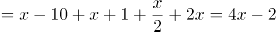 ，解得x=14。可得原先四个小组人数分别为：第一小组=x-10=4人，第二小组=x+1=15人，第三小组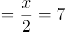人，第四小组=2x=28人。则原先人数最多的小组与人数最少的小组之间相差28-4=24人。

故正确答案为C。

**考点**：和差倍比问题

**来源**：2022年浙江省公务员录用考试《行测》题（C类）（网友回忆版）第17题

### 第 62 题

为了加强环境治理和生态修复，某市派出4位专家（甲、乙、丙、丁）前往某山区3个勘探点进行环境检测，要求每个勘探点至少安排一名专家。那么甲、乙两名专家去了不同勘探点的概率是：

A. 

B. 

C. 

D. 

第 62 题 · 答案与解析

**参考答案（粉笔题库参考内容）**

C

**解析**

4位专家分配到3个勘探点，要求每个勘探点至少安排一名专家，则有一个勘探点需要分配2位专家。从4位专家中选择两位，有种情况，将选择的两位专家当作一个整体，与另外两位专家分别分配到3个勘探点，共有种情况，则总情况数有6×6=36种。

甲、乙两名专家去了不同勘探点，从正向分析情况数较多，考虑反向计算，即甲、乙两名专家去了同一勘探点。将甲、乙两名专家当作一个整体，与另外两位专家分别分配到3个勘探点，共有种情况。即甲、乙两名专家去了同一勘探点共有6种情况。

则所求概率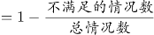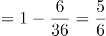。

故正确答案为C。

**考点**：给情况求概率

**来源**：2022年浙江省公务员录用考试《行测》题（C类）（网友回忆版）第10题

### 第 63 题

用一个长为20厘米、宽为2厘米、高为1.5厘米的长方体木料，制作一串半径最大的木珠子，不考虑制作过程中的损耗，则这串珠子的数量最多为：

A. 10个

B. 13个

C. 14个

D. 20个

第 63 题 · 答案与解析

**参考答案（粉笔题库参考内容）**

C

**解析**

木珠子是球形的，需要从长方体木料的内部进行切割，由于长方体的高为1.5厘米，则木珠子的最大直径为长方体的高1.5厘米，即半径最大。长方体的宽为2厘米，木珠子的直径为1.5厘米，制作过程中，要令数量最多，木珠子错落摆放即满足要求。摆放过程注意不要超出长方体木料的长度，用前两个珠子的摆放作为演示：

AC是两个木珠子球心的连线，长度即为木珠子的直径1.5厘米，AC为斜边做直角三角形ABC，AC即两个球心间的最短距离。BC的长度为长方体的宽-木珠子的半径-B点距长方体左边的边长，且AB垂直BC，可得出B点距长方体左边的边长即A点距长方体边长的距离0.75厘米，可求BC长=2-0.75-0.75=0.5厘米，在直角三角形ABC中，利用勾股定理可以求出AB长为厘米，即在AB所在直线上，相邻两个珠子间距（把珠子看成点）为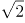厘米，且第一个和最后一个珠子的球心距长方体木料两端至少为0.75厘米。则制作的珠子数量=段数+1，段数，即分为13段，那么珠子数量最多=13+1=14个。

故正确答案为C。

**考点**：几何结论类-三角形相关、非典型最值问题、几何公式类-立体图形

**来源**：2022年浙江省公务员录用考试《行测》题（C类）（网友回忆版）第19题

### 第 64 题

某助农志愿小分队采摘到甲、乙、丙三筐枸杞共144斤。第一次从甲筐中取出与乙筐一样重的枸杞放入乙筐，第二次再从现有乙筐中取出与丙筐一样重的枸杞放入丙筐，第三次从现有丙筐中取出与现有甲筐一样重的枸杞放入甲筐，此时三筐枸杞一样重。那么原来甲筐中有枸杞：

A. 36斤

B. 48斤

C. 56斤

D. 66斤

第 64 题 · 答案与解析

**参考答案（粉笔题库参考内容）**

D

**解析**

方法一：甲、乙、丙三筐共144斤，最终三筐枸杞一样重，每筐144÷3=48斤，根据题意反推如下表：

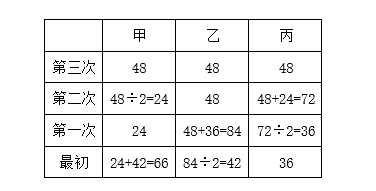

方法二：设最初甲、乙、丙分别有x斤、y斤、z斤枸杞，变化如下表：

可列方程组：，解得。

故正确答案为D。

**考点**：和差倍比问题

**来源**：2022年内蒙古公务员录用考试《行测》题（网友回忆版）第64题

### 第 65 题

为了支持乡村教育，某市派出6名优秀教师前往该市农村的三所学校支教，一所1名，一所2名，一所3名，不同的选派方法共有：

A. 60种

B. 120种

C. 360种

D. 720种

第 65 题 · 答案与解析

**参考答案（粉笔题库参考内容）**

A

**解析**

第一所学校需1名教师，选择情况数为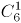种；第二所学校需2名教师，选择情况数为种，此时剩余三名教师自动去往第三所学校，故总情况数为种。

故正确答案为A。

备注：本题存在歧义，题干未明确指出三所学校所需教师名额是否固定。若名额不固定，另一种解法为：先选出一所学校，派出1名教师，情况数为种；再选出一所学校，派出2名教师，情况数为种，此时剩余三名教师自动去往最后一所学校，故总情况数为种，对应C项。但现实生活中，支教名额应该是根据学校需求定好的，所以粉笔更倾向A项为正确答案。

**考点**：基础排列组合

**来源**：2022年湖北省公务员录用考试《行测》题（网友回忆版）第57题

### 第 66 题

北京冬奥会期间，冬奥会吉祥物“冰墩墩”纪念品十分畅销。销售期间某商家发现，进价为每个40元的“冰墩墩”，当售价定为44元时，每天可售出300个，售价每上涨1元，每天销量减少10个。现商家决定提价销售，若要使销售利润达到最大，则售价应为：

A. 51元

B. 52元

C. 54元

D. 57元

第 66 题 · 答案与解析

**参考答案（粉笔题库参考内容）**

D

**解析**

设“冰墩墩”纪念品售价共上涨x元，销售利润为y元。根据题意，可列方程：y=(44-40+x)×(300-10x)，即y=(4+x)×(300-10x)，令y=0，解得，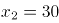，当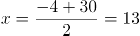时，总利润最大，此时售价为44+13=57元。

故正确答案为D。

**考点**：函数最值问题

**来源**：2022年浙江省公务员录用考试《行测》题（C类）（网友回忆版）第9题

### 第 67 题

某地采用传统销售模式，销售一批鸡蛋需要20天，销售一批桃子需要25天。为推动销售，当地开启县领导直播带货模式，直播带货期间，鸡蛋的销售效率提高为原来的2倍，桃子销售效率为原来的3倍；其余销售时间依然按照传统模式进行，结果两种产品同时销售完成。那么销售期间直播带货的天数为：

A. 3

B. 5

C. 8

D. 10

第 67 题 · 答案与解析

**参考答案（粉笔题库参考内容）**

B

**解析**

除了销售时间相同，销售鸡蛋和销售桃子没有其它关系，所以二者是相互独立的，因此可赋值传统销售模式下的鸡蛋和桃子的销售效率均为1，则直播带货期间，鸡蛋销售效率为2，桃子销售效率为3。根据题意可得，该批鸡蛋总量为20×1=20，该批桃子总量为25×1=25。设销售期间直播带货的天数为x，则非直播带货的鸡蛋销售时间为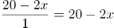，非直播带货的桃子销售时间为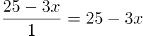。因为两种产品同时销售完成，其中的直播带货时间相同，那么非直播带货的时间也相同，即20-2x=25-3x，解得x=5，因此销售期间直播带货的天数为5。

故正确答案为B。

**考点**：给效率比例型

**来源**：2022年浙江省公务员录用考试《行测》题（C类）（网友回忆版）第8题

### 第 68 题

某城市规划馆有一个边长为40米的正三角形数字展厅，展厅中布置有5台投影设备，用于展示城市的过去、现在以及畅想城市的未来。每台投影设备的尺寸忽略不计，则任意两台设备之间的最小距离：

A. 小于10米

B. 不超过16米

C. 不超过20米

D. 在23～28米之间

第 68 题 · 答案与解析

**参考答案（粉笔题库参考内容）**

C

**解析**

根据题意“在正三角形数字展厅内部布置5台投影设备”，假设其中3台投影设备放在正三角形数字展厅的三个顶点，即蓝色圆点处，如下图所示。此时若想使剩余2台设备的距离尽量大，连接正三角形各边上的中点，可得到小正三角形，从红色圆点处任选2个放置剩余2台投影设备即可得到最大间距，则任意两台设备之间的最小距离不超过米。

故正确答案为C。

**考点**：几何结论类-几何小题型、非典型最值问题

**来源**：2022年内蒙古公务员录用考试《行测》题（网友回忆版）第68题

### 第 69 题

某商场为庆祝开业三周年，制作了一个长方形大蛋糕，并切成四块，如图所示。假设这个蛋糕可供350人享用，左下角那块蛋糕平均可供50人享用，右上角那块蛋糕平均可供70人，则中间最大块蛋糕平均可供多少人享用？

A. 150

B. 155

C. 175

D. 180

第 69 题 · 答案与解析

**参考答案（粉笔题库参考内容）**

B

**解析**

假设平均每人享用蛋糕，则蛋糕面积为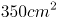，赋值蛋糕的长为35cm，宽为10cm。如下图所示：

根据“左下角那块蛋糕平均可供50人享用，右上角那块蛋糕平均可供70人”可知，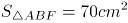，根据三角形面积公式：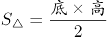，可得：CE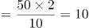cm，BF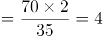cm，则ED=35-10=25cm，DF=10-4=6cm，则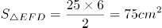，故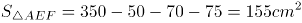，平均可供155人享用，即中间最大块蛋糕平均可供155人享用。

故正确答案为B。

**考点**：几何结论类-三角形相关、几何公式类-平面图形

**来源**：2022年浙江省公务员录用考试《行测》题（C类）（网友回忆版）第6题

### 第 70 题

商家门口摆放了一把正四棱锥形（底面为正方形，侧面为四个全等的等腰三角形）的遮阳伞，第一次伞撑开到图1所示的位置，伞柄与伞骨成角为，继续撑开到如图2所示的位置，伞柄与伞骨成角变为，那么第二次伞撑开后形成的正方形A'B'C'D'是第一次撑开后正方形ABCD面积的：

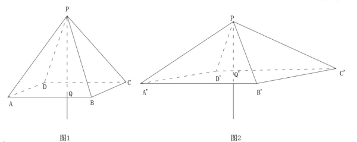

A. 倍

B. 倍

C. 2倍

D. 3倍

第 70 题 · 答案与解析

**参考答案（粉笔题库参考内容）**

D

**解析**

连接CQ，如图1所示，因PQ与正四棱锥的底面垂直，故三角形CPQ为直角三角形，在直角三角形CPQ中，，故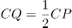。同理，连接C'Q'，如图2，在直角三角形C'PQ'中，，故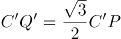，根据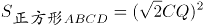 ，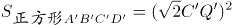，且CP= C'P，可得 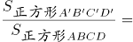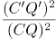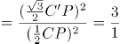，故第二次伞撑开后形成的正方形A'B'C'D'是第一次撑开后正方形ABCD面积的3倍。

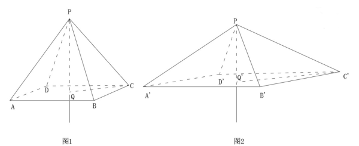

故正确答案为D。

**考点**：几何结论类-三角形相关、几何公式类-平面图形

**来源**：2022年浙江省公务员录用考试《行测》题（C类）（网友回忆版）第11题

### 第 71 题

所给的四个选项中，哪一项填入问号处，不能使之呈现一定的规律性：

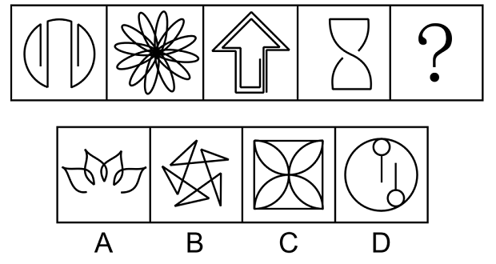

A. A

B. B

C. C

D. D

第 71 题 · 答案与解析

**参考答案（粉笔题库参考内容）**

D

**解析**

元素组成不同，且无明显属性规律，考虑数量规律。观察发现，图一、图三和图四均为多端点图形，图二为多圆相交图形，可以考虑笔画数。题干图形均为一笔画，而本题为选非题，故？处应选择不是一笔画的图形。A、B、C三项均为一笔画图形，D项为两笔画图形。只有D项不符合规律。

本题为选非题，故正确答案为D。

**考点**：数量规律-线

**来源**：2022年浙江省公务员录用考试《行测》题（A类）（网友回忆版）第77题

### 第 72 题

从所给的四个选项中，选择最合适的一个填入问号处，使之呈现一定的规律性：

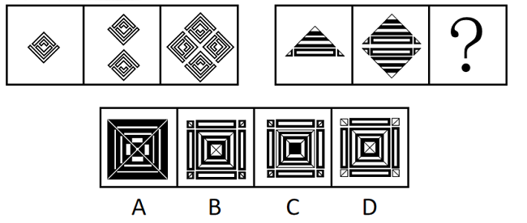

A. A

B. B

C. C

D. D

第 72 题 · 答案与解析

**参考答案（粉笔题库参考内容）**

B

**解析**

元素组成相同，优先考虑位置规律。观察发现，第一组图形中，第一个图形上下翻转并保留原图形后得到第二个图形，第一个图形保持不变放置在下方，然后对第一个图形分别进行上下翻转后放置在上方、顺时针旋转后放置在左侧、逆时针旋转后放置在右侧得到第三个图形。第二组图形应用此规律，对应B项。

故正确答案为B。

**考点**：位置规律-综合

**来源**：2022年浙江省公务员录用考试《行测》题（C类）（网友回忆版）第87题

### 第 73 题

从所给的四个选项中，选择最合适的一个填入问号处，使之呈现一定的规律性：

A. A

B. B

C. C

D. D

第 73 题 · 答案与解析

**参考答案（粉笔题库参考内容）**

A

**解析**

元素组成相同，优先考虑位置规律。观察发现，若将每列的元素分别标号后，如上图所示，每列的元素整体依次向右平移2列，且向右平移后又整体依次向下平移1格，只有A项符合此规律。

故正确答案为A。

**考点**：位置规律-平移

**来源**：2022年浙江省公务员录用考试《行测》题（C类）（网友回忆版）第88题

### 第 74 题

把下面的六个图形分为两类，使每一类图形都有各自的共同特征或规律，分类正确的一项是：

A. ①②③，④⑤⑥

B. ①③⑤，②④⑥

C. ①④⑤，②③⑥

D. ①⑤⑥，②③④

第 74 题 · 答案与解析

**参考答案（粉笔题库参考内容）**

C

**解析**

本题为分组分类题目。元素组成不同，且属性规律无法分为两组，考虑数量规律。题干每幅图形均为25宫格内出现的一个由黑粗线条构成的多边形封闭区域。观察发现，图①④⑤中多边形的面积相同，均占7.5个格子，图②③⑥中多边形的面积相同，均占10.5个格子。即图①④⑤为一组，图②③⑥为一组。

故正确答案为C。

**考点**：黑白块类、数量规律-面

**来源**：2022年浙江省公务员录用考试《行测》题（C类）（网友回忆版）第82题

### 第 75 题

把下面的六个图形分为两类，使每一类图形都有各自的共同特征或规律，分类正确的一项是：

A. ①②③，④⑤⑥

B. ①③⑤，②④⑥

C. ①④⑤，②③⑥

D. ①⑤⑥，②③④

第 75 题 · 答案与解析

**参考答案（粉笔题库参考内容）**

D

**解析**

元素组成不同，且无明显属性规律，考虑数量规律。观察发现，题干图形分割明显，考虑面数量。图①⑤⑥均有6个面，图②③④均有9个面，即图①⑤⑥一组，图②③④一组。

故正确答案为D。

**考点**：数量规律-面

**来源**：2022年浙江省公务员录用考试《行测》题（C类）（网友回忆版）第83题

### 第 76 题

把下面的六个图形分为两类，使每一类图形都有各自的共同特征或规律，分类正确的一项是：

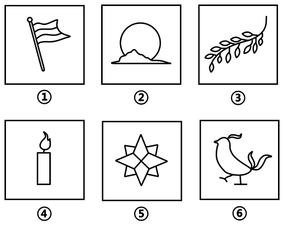

A. ①②③，④⑤⑥

B. ①③⑤，②④⑥

C. ①②⑤，③④⑥

D. ①④⑤，②③⑥

第 76 题 · 答案与解析

**参考答案（粉笔题库参考内容）**

C

**解析**

本题为分组分类题目。元素组成不同，且题干图形出现多个封闭面连在一起，考虑图形间关系。观察发现，图①②⑤的图形间关系为相交于线，图③④⑥的图形间关系为相交于点。即图①②⑤一组，图③④⑥一组。

故正确答案为C。

**考点**：特殊规律-图形间关系

**来源**：2022年浙江省公务员录用考试《行测》题（C类）（网友回忆版）第84题

### 第 77 题

下图右框内纸盒的外表面中，不能折叠成左框内所示的纸盒的是：

A. A

B. B

C. C

D. D

第 77 题 · 答案与解析

**参考答案（粉笔题库参考内容）**

B

**解析**

本题考查六面体的空间重构。将题干立体图中的面依次标注为面a、面b、面c，如下图所示。

A项：选项与题干立体图一致，排除；

B项：题干立体图中面a与面b的公共边靠近面a中云朵的底部，而选项中面a与面b的公共边靠近面a中云朵的顶部，选项与题干立体图不一致，当选；

C项：选项与题干立体图一致，排除；

D项：选项与题干立体图一致，排除。

本题为选非题，故正确答案为B。

备注：本题作图不严谨，C项中面b与面a的公共边所对应的图形与题干立体图有差别，云朵的细节与立体图形不同，但对比B、C两项，B项错误更加明显，因此小粉笔建议选择B项。

**考点**：空间类-空间重构-六面体

**来源**：2022年浙江省公务员录用考试《行测》题（C类）（网友回忆版）第90题

### 第 78 题

深度学习是指在模仿人脑机制的神经网络中，对人工神经元的层进行了“多层处理”。深度学习不仅可以让AI（人工智能）读取大量图片，还可以让AI自主提取图片特征。得益于深度学习技术的面世，只要有大量数据，AI就能以极高的准确率进行学习，从而大幅度拓展了AI的应用范围。

根据上述定义，下列属于深度学习的是：

A. 人工智能图片教学走进课堂让学生体验深度学习

B. 问诊机器人可以迅速获取病患B超报告的风险信息

C. 某设区市在数字峰会期间提供无人驾驶汽车试乘服务

D. 安防巡检机器人通过图像识别技术判定工人是否佩戴安全帽

第 78 题 · 答案与解析

**参考答案（粉笔题库参考内容）**

D

**解析**

第一步：找出定义关键词。

“AI（人工智能）读取大量图片”、“自主提取图片特征”。

第二步：逐一分析选项。

A项：让学生观看人工智能的图片来体验深度学习，是让学生观看图片，不是让AI读取图片，不符合“AI（人工智能）读取大量图片”，不符合定义，排除；

B项：问诊机器人可以识别B超报告，但报告中不只含有图片，还含有文字性诊断结果可以直接告知病患风险信息，而不需要AI提取，不符合“AI（人工智能）读取大量图片”、“自主提取图片特征”，不符合定义，排除；

C项：提供无人驾驶汽车试乘服务，不是让AI读取图片，不符合“AI（人工智能）读取大量图片”、“自主提取图片特征”，不符合定义，排除；

D项：安防巡检机器人通过识别工人的图像来判定工人是否佩戴安全帽，符合“AI（人工智能）读取大量图片”、“自主提取图片特征”，符合定义，当选。

故正确答案为D。

**考点**：单定义-其他句式

**来源**：2022年浙江省公务员录用考试《行测》题（C类）（网友回忆版）第91题

### 第 79 题

回应性监管是指政府通过制度设计，采用多样化的监管手段和策略对市场主体和社会组织进行动态化、智能化、差别化的监管。回应性监管强调监管主体的多元化，除政府以外，企业、社会组织，乃至被监管对象都是监管主体；在监管策略上，采取差异化、阶梯化的监管方式，即政府首先鼓励自我监管，难以奏效时才采取更为严厉的强化型自我监管直至命令控制型监管。

根据上述定义，下列选项没有体现回应性监管的是：

A. 某地主管部门因食品安全问题突击整顿涉事企业

B. 瑞典立法要求工作场所必须建立安全环保的内控体系

C. 英国成立企业、工会代表组成的大健康监管委员会

D. 聘请专业的第三方机构对企业安全生产状况进行评估

第 79 题 · 答案与解析

**参考答案（粉笔题库参考内容）**

A

**解析**

第一步：找出定义关键词。

“采用多样化的监管手段和策略”、“监管主体的多元化”。

第二步：逐一分析选项。

A项：某地主管部门直接对涉事企业进行了整顿，监管只有某地主管部门一个，没有体现出监管手段的多样化，不符合“采用多样化的监管手段和策略”，不符合定义，当选；

B项：瑞典立法要求建立内控体系，说明除政府外还有其他监管手段和策略，内控体系也体现了“差别化的监管”，符合“采用多样化的监管手段和策略”，符合定义，排除；

C项：英国成立企业、工会代表组成的大健康监管委员会，说明监管由不同主体共同完成，体现了多样化的监管手段和策略，符合“采用多样化的监管手段和策略”，符合定义，排除；

D项：聘请专业的第三方机构，说明除第三方机构外可能还有其他的监管主体，可能符合 “监管主体的多元化”，比A更好，符合定义，排除。

本题为选非题，故正确答案为A。

**考点**：方式目的

**来源**：2022年浙江省公务员录用考试《行测》题（C类）（网友回忆版）第92题

### 第 80 题

乡情治理是指乡情作用于基层社会治理主体和治理体系，在基层社会的意见整合、利益协调、矛盾化解、服务供给等治理过程中发挥重要作用的一种治理形态。“乡情”是一种基于地域以及附着在经济、社会、文化纽带上的特殊情感，体现为认同感、归属感、荣誉感及在此基础上的回馈意愿和公共精神。乡情治理的核心是存在一个由情感和认同构筑的场域，这个场域通过一些微观机制影响个体动机和群体行为，从而影响社会治理体系和过程。

根据上述定义，下列属于乡情治理的是：

A. 顺德人都以顺德是“世界美食之都”而自豪

B. 敢拼会赢的精神一直激励着闽南人勇闯南洋

C. 海外华侨华人一直有着爱国爱乡的光荣传统

D. 北岸乡贤成立妈祖慈善基金会服务当地桑梓

第 80 题 · 答案与解析

**参考答案（粉笔题库参考内容）**

D

**解析**

第一步：找出定义关键词。

“乡情作用于基层社会治理主体和治理体系”、“在基层社会的治理过程中发挥重要作用”、“由情感和认同构筑的场域”、“影响社会治理体系和过程”。

第二步：逐一分析选项。

A项：“以顺德是‘世界美食之都’而自豪”只表明顺德人对当地的情感和认同，但是没有体现出对基层社会的治理，不符合“乡情作用于基层社会治理主体和治理体系”、“在基层社会的治理过程中发挥作用”，不符合定义，排除；

B项：“敢拼会赢的精神”只表明这是闽南人的一种精神，并不是对于某地域的乡情，所以不存在由情感和认同构筑的场域，不符合“由情感和认同构筑的场域”，同时并没有体现出治理，不符合“乡情作用于基层社会治理主体和治理体系”，不符合定义，排除；

C项：“爱国爱乡的光荣传统”只是海外华侨华人的品格，并不是对于某地域的乡情，所以不存在由情感和认同构筑的场域，不符合“由情感和认同构筑的场域”，同时并没有体现出治理，不符合“乡情作用于基层社会治理主体和治理体系”，不符合定义，排除；

D项：“乡贤成立妈祖慈善基金会”说明当地人认同本地区的文化，存在由情感和认同构筑的场域，符合“由情感和认同构筑的场域”，而且“服务当地桑梓”是一种基层社会治理，符合“乡情作用于基层社会治理主体和治理体系”、“影响社会治理体系和过程”，符合定义，当选。

故正确答案为D。

**考点**：拆词

**来源**：2022年浙江省公务员录用考试《行测》题（C类）（网友回忆版）第93题

### 第 81 题

薄膜干涉，指的是不同颜色的光波有不同的波长，当一束光波照射于薄膜，由于折射率不同，光波会被薄膜的上界面与下界面分别反射后再相遇，发生相互干涉而形成新的光波。对这一现象的研究可以用于计算薄膜的厚度、折射率等。

根据上述定义，下列不属于薄膜干涉的是：

A. 一片普通薄玻璃镶嵌在窗框里，屋外灿烂的阳光穿透玻璃，照在屋内镜子上也能产生强烈反光

B. 汽车玻璃上的贴膜会改变折射光线和反射光线的能量分配比例，增加对某一光波的反射光强度

C. 汽车在有积水的柏油路上驶过时，积水面会形成一层油膜，这层油膜在阳光下呈现出美丽的色彩

D. 自然环境中，两块干净平整的玻璃片紧紧压叠形成极薄空间，出现一些平行条纹，手指用力压紧玻璃时，条纹随之发生改变

第 81 题 · 答案与解析

**参考答案（粉笔题库参考内容）**

A

**解析**

第一步：找出定义关键词。

“一束光波照射于薄膜”、“薄膜使其形成新的光波”。

第二步：逐一分析选项。

A项：阳光穿透玻璃，照在屋内镜子上产生强烈反光，说明镜子对光进行了反射，但镜子上是否有薄膜并不清楚，不符合“一束光波照射于薄膜”，不符合定义，当选；

B项：光线照射在汽车玻璃上的贴膜上，符合“一束光波照射于薄膜”，改变折射光线和反射光线的能量分配比例，增加对某一光波的反射光强度，说明光波经过贴膜后形成了新的光波，符合“薄膜使其形成新的光波”，符合定义，排除；

C项：积水面形成的油膜在阳光下呈现出美丽的色彩，符合“一束光波照射于薄膜”，“美丽的色彩”说明肉眼看不到颜色的阳光经过油膜后形成了新的光波，符合“薄膜使其形成新的光波”，符合定义，排除；

D项：两块干净平整的玻璃片紧紧压叠形成极薄空间时，出现平行条纹，说明周围环境有光，符合“一束光波照射于薄膜”，手指用力压紧玻璃时，条纹随之发生改变，说明出现了新的光波，符合“薄膜使其形成新的光波”，符合定义，排除。

本题为选非题，故正确答案为A。

**考点**：大前提

**来源**：2022年湖北省公务员录用考试《行测》题（网友回忆版）第78题

### 第 82 题

参照群体理论是关于人的社会心理态度和行为怎样受其从属的或追求的群体参照力所影响的社会心理学理论。参照群体是指个体从心理上把自己列入、与之对照，并在评价、态度、行为上和在规范与价值观形成上接受其影响的群体。

根据上述定义，下列选项不能用参照群体理论解释的是：

A. 小王平时喜欢便装，但是参加面试时他决定穿着西装

B. 夏秋之际，妈妈怕孩子受凉，很注意给孩子增减衣物

C. 小刘看其他影迷都购买了偶像同款商品，自己也去买

D. 小张父母都是医生，她比常人更在意身边的卫生状况

第 82 题 · 答案与解析

**参考答案（粉笔题库参考内容）**

B

**解析**

第一步：找出定义关键词。

“受其从属的或追求的群体参照力所影响”。

第二步：逐一分析选项。

A项：小王平时喜欢便装，但参加面试时穿了西装，是因为面试时大多数人都选择正式的西装，小王也受其影响，因而在面试时做出同样的选择，符合“受其从属的或追求的群体参照力所影响”，符合定义，排除；

B项：妈妈给孩子增减衣物是因为天气转凉，妈妈行为的变化是受天气变化的影响而不是群体的影响，不符合“受其从属的或追求的群体参照力所影响”，不符合定义，当选；

C项：小刘购买偶像同款商品是因为其他影迷都购买了，小刘的行为受影迷群体的影响，符合“受其从属的或追求的群体参照力所影响”，符合定义，排除；

D项：小张在意卫生状况是因为小张的父母都是医生，小张的行为受其父母的影响，符合“受其从属的或追求的群体参照力所影响”，符合定义，排除。

本题为选非题，故正确答案为B。

**考点**：单定义-其他句式

**来源**：2022年浙江省公务员录用考试《行测》题（C类）（网友回忆版）第94题

### 第 83 题

替代性满足指当欲望能量在最初对象上遇到阻碍时，就会向其他对象转移；如果再次遇阻，就再次转移，直到寻找到一个替代对象以消除紧张、满足欲望为止。

根据上述定义，下列选项不属于替代性满足的是：

A. 小李很喜欢旅游，因此经常利用自己的假期到全国各地旅游

B. 小王将自己不愉快的生活经历倾注于笔下，完成了一些作品

C. 小刘的小超市经营状况不佳，所以他一直有着天降横财的幻想

D. 小林梦想成为一个叱咤风云的英雄，他特别喜欢上网打战争游戏

第 83 题 · 答案与解析

**参考答案（粉笔题库参考内容）**

A

**解析**

第一步：找出定义关键词。

“欲望能量在最初对象上遇到阻碍”、“不断转移直到寻找到替代对象”。

第二步：逐一分析选项。

A项：小李喜欢旅游，这是他的“欲望能量”，他经常利用假期旅游，说明小李的“欲望能量”得到了满足，不符合“欲望能量在最初对象上遇到阻碍”，不符合定义，当选；

B项：愉快的生活是小王的“欲望能量”，小王有不愉快的生活经历，说明其“欲望能量”没有得到满足，符合“欲望能量在最初对象上遇到阻碍”；他利用不愉快的生活经历完成了一些作品，说明小王将写作作为最初欲望的替代，符合“不断转移直到寻找到替代对象”，符合定义，排除；

C项：经营好小超市是小刘的“欲望能量”，小刘的小超市经营状况不佳，说明其“欲望能量”没有得到满足，符合“欲望能量在最初对象上遇到阻碍”；他一直有天降横财的幻想，说明小刘将幻想作为最初欲望的替代，符合“不断转移直到寻找到替代对象”，符合定义，排除；

D项：做一个叱咤风云的英雄是小林的“欲望能量”，因此他特别喜欢上网打战争游戏，说明其“欲望能量”在现实中没有得到满足，符合“欲望能量在最初对象上遇到阻碍”；同时将网络游戏作为最初欲望的替代，符合“不断转移直到寻找到替代对象”，符合定义，排除。

本题为选非题，故正确答案为A。

**考点**：拆词

**来源**：2022年浙江省公务员录用考试《行测》题（C类）（网友回忆版）第95题

### 第 84 题

最小干预原则是指在保证文物安全的基本前提下，通过最小程度的介入来最大限度地维系文物的原本面貌，保留文物的历史、文化价值，以实现延续现状、降低保护性破坏的目标。

根据上述定义，下列选项不属于最小干预原则的是：

A. 某博物馆在修复古籍时不拆开原线绳，只修补蛀洞严重的书页，而不修补强度未受蛀洞影响的书页

B. 某博物馆的一幅雕塑作品中的人物手臂缺失，专家们查阅了原始资料，根据资料将其复原如初

C. 某古城墙修缮时，保留其残损的现状，在靠近边墙的一侧恢复了很窄的台阶供游人安全通过

D. 某古塔倾斜，专家们在研究后最终决定只纠偏一度，它看上去依旧是倾斜的状态

第 84 题 · 答案与解析

**参考答案（粉笔题库参考内容）**

B

**解析**

第一步：找出定义关键词。

“保证文物安全”、“最小程度的介入”、“最大限度地维系文物的原本面貌”、“延续现状、降低保护性破坏”。

第二步：逐一分析选项。

A项：某博物馆在修复古籍时不拆开原线绳，只修补蛀洞严重的书页，符合“最小程度的介入”，不修补强度未受蛀洞影响的书页，符合“最大限度地维系文物的原本面貌”，符合定义，排除；

B项：雕塑作品中的人物手臂缺失，根据资料将其复原如初，并没有保留现状，也没有体现是不是最小程度的改变，不符合“最小程度的介入”、“最大限度地维系文物的原本面貌”，不符合定义，当选；

C项：某古城墙修缮时，保留其残损的现状，符合“最大限度地维系文物的原本面貌”，在靠近边墙的一侧恢复了很窄的台阶，说明修复的地方很少，符合“最小程度的介入”，符合定义，排除；

D项：某古塔倾斜，专家们只纠偏一度，说明修复的很少，符合“最小程度的介入”，依旧保留倾斜的状态，符合“最大限度地维系文物的原本面貌”，符合定义，排除。

本题为选非题，故正确答案为B。

**考点**：方式目的

**来源**：2022年浙江省公务员录用考试《行测》题（C类）（网友回忆版）第96题

### 第 85 题

过滤气泡是指以大数据与算法推荐为底层架构，根据用户的使用时间、地区以及浏览习惯生成用户画像，并通过算法技术为其呈现独一无二的界面体验。网络上这种针对个人化搜索而提供筛选后结果的推荐算法，被称为过滤气泡。

根据上述定义，下列不属于过滤气泡的是：

A. 赵先生准备买车，上网看了很多汽车测评类的文章，买完车之后，浏览器上的内容几乎全是汽车类的资讯

B. 李先生经常网购图书，平台特意为他推送购书清单，打造个性化书店，让他在第一时间能得到新书的信息

C. 刘先生经常去某网络贴吧发帖，得到了很多人的关注，一些与他有相同爱好的人还建立了一个微信群进行交流

D. 王先生和张先生分别在各自手机上搜索某公司，王先生的搜索结果多为该公司的招聘信息，张先生的却多为该公司的投资信息

第 85 题 · 答案与解析

**参考答案（粉笔题库参考内容）**

C

**解析**

第一步：找出定义关键词。

“针对个人化搜索，提供筛选后结果”。

第二步：逐一分析选项。

A项：赵先生上网看测评类的文章后，浏览器为其推送相关内容，符合“针对个人化搜索，提供筛选后结果”，符合定义，排除；

B项：李先生经常网购图书，平台针对性推送购书清单，符合“针对个人化搜索，提供筛选后结果”，符合定义，排除；

C项：刘先生经常去某网络贴吧发帖，建立微信群的过程，没有体现出“针对个人化搜索，提供筛选后结果”，不符合定义，当选；

D项：两位先生分别在各自手机上搜索某公司后，搜索结果的不同，符合“针对个人化搜索，提供筛选后结果”，符合定义，排除。

本题为选非题，故正确答案为C。

**考点**：方式目的

**来源**：2022年浙江省公务员录用考试《行测》题（C类）（网友回忆版）第98题

### 第 86 题

欺诈行为是指经营者采用虚构假象、隐瞒真相、心理引导等方式，使消费者对客观事实产生错误认识，并因此作出购买决定。评价行为则是一种主观的价值判断，会随着评价主体的不同而发生变化，这属于正常的商业宣传。

根据上述定义，下列属于欺诈行为的是：

A. 李某卖的鲤鱼都是饲养的，却告诉张某说是野生的，张某并不在意鲤鱼是否野生，但念及李某谋生不易，心中不忍便买了一条

B. 王某看到一幅字帖落款为“启功”，指着这两个字问“真迹否？”店家笑而不语，王某遂以为真，以低价买得，欢喜回家

C. 服装店老板极尽推销之能事，说某件外套能够衬托赵某的身材气质，赵某购买后感觉并不好看，认为自己被骗了

D. 店家拿出一瓶贴牌假酒当真酒卖，黄某认出这是假酒，但心想可以据此索赔，就买回去了

第 86 题 · 答案与解析

**参考答案（粉笔题库参考内容）**

B

**解析**

第一步：找出定义关键词。

欺诈行为：“采用虚构假象、隐瞒真相、心理引导等方式”、“对客观事实产生错误认识而作出购买决定”；

评价行为：“主观的价值判断”、“随着评价主体的不同而发生变化”。

第二步：逐一分析选项。

A项：张某购买鲤鱼的理由是念及李某谋生不易，且并不在意鲤鱼是否野生，不符合“对客观事实产生错误认识而作出购买决定”，不符合“欺诈行为”的定义，排除；

B项：对于王某的疑问，店家笑而不语，符合“采用虚构假象、隐瞒真相、心理引导等方式”，王某遂以为真，以低价买得字帖，“遂以为真”说明字帖很大程度上是假的，符合“对客观事实产生错误认识而作出购买决定”，符合“欺诈行为”的定义，当选；

C项：服装店老板认为外套可以衬托赵某的身材气质，这只是推销过程中的主观认知，不符合“采用虚构假象、隐瞒真相、心理引导等方式”，不符合“欺诈行为”的定义，排除；

D项：黄某认出假酒，仍选择购买，说明没有对此酒产生错误认识，不符合“对客观事实产生错误认识而作出购买决定”，不符合“欺诈行为”的定义，排除。

故正确答案为B。

**考点**：常规问法

**来源**：2022年浙江省公务员录用考试《行测》题（C类）（网友回忆版）第99题

### 第 87 题

考拉：树袋熊

A. 墨鱼：乌贼

B. 蜜蜂：黄蜂

C. 蚱蜢：蝗虫

D. 金龟子：天牛

第 87 题 · 答案与解析

**参考答案（粉笔题库参考内容）**

A

**解析**

第一步：判断题干词语间逻辑关系。

考拉和树袋熊是同一种动物，二者为全同关系。

第二步：判断选项词语间逻辑关系。

A项：墨鱼和乌贼是同一种动物，二者为全同关系，与题干逻辑关系一致，保留；

B项：黄蜂属于胡蜂科，蜜蜂属于蜜蜂科，二者为并列关系，与题干逻辑关系不一致，排除；

C项：蚱蜢和蝗虫的关系较有争议，部分资料显示二者为全同关系，与题干逻辑关系一致，保留；

D项：金龟子是鞘翅目金龟总科的通称，天牛是多食亚目天牛科昆虫的总称，二者为并列关系，与题干逻辑关系不一致，排除。

对比A、C两项，C项中蚱蜢和蝗虫的关系较有争议，如下图所示，维基百科和百度百科都表明二者是全同关系，但现代汉语词典表明二者并不是同一种动物，目前无法确定出题人对二者的关系是如何判定的，相对来说，A项中的墨鱼和乌贼是没有争议的全同关系，因此，小粉笔更倾向于将正确答案给到A项。

故正确答案为A。

**考点**：逻辑关系-全同关系

**来源**：2022年浙江省公务员录用考试《行测》题（C类）（网友回忆版）第101题

### 第 88 题

岳父：泰山

A. 少女：娥眉

B. 儿子：孙子

C. 女婿：东床

D. 兄弟：伯仲

第 88 题 · 答案与解析

**参考答案（粉笔题库参考内容）**

C

**解析**

第一步：判断题干词语间逻辑关系。

“岳父”的别称叫“泰山”，二者为全同关系。

第二步：判断选项词语间逻辑关系。

A项：“少女”指未成年女孩，“娥眉”泛指貌美的女子，二者为交叉关系，与题干逻辑关系不一致，排除；

B项：“儿子”与“孙子”不是全同关系，与题干逻辑关系不一致，排除；

C项：“女婿”的别称叫“东床”，二者为全同关系，与题干逻辑关系一致，当选；

D项：“伯仲”指弟兄排行的次序，与“兄弟”不是全同关系，与题干逻辑关系不一致，排除。

故正确答案为C。

**考点**：逻辑关系-全同关系

**来源**：2022年浙江省公务员录用考试《行测》题（C类）（网友回忆版）第102题

### 第 89 题

帛书：简牍

A. 日晷：秒表

B. 熊猫：银杏

C. 青铜：礼器

D. 牛车：轿子

第 89 题 · 答案与解析

**参考答案（粉笔题库参考内容）**

D

**解析**

第一步：判断题干词语间逻辑关系。

帛书是指中国古代写在绢帛上的文书；简牍是指中国古代书写在竹简或木片上的文书，二者是两种不同的书，为并列关系。

第二步：判断选项词语间逻辑关系。

A项：日晷和秒表是两种不同的计时器，二者为并列关系，与题干逻辑关系一致，保留；

B项：熊猫是动物，银杏是植物，二者不是并列关系，与题干逻辑关系不一致，排除；

C项：青铜是制作礼器的原材料之一，二者为原材料与成品的对应关系，与题干逻辑关系不一致，排除；

D项：牛车和轿子是两种不同的交通工具，二者为并列关系，与题干逻辑关系一致，保留。

对比A、D两项，题干中的帛书和简牍都是古代出现的事物，A项中的日晷是古代出现的事物，但秒表是现代出现的事物，D项中的牛车起源于商代，牛车和轿子都是古代出现的事物，故D项与题干的关系更近。

故正确答案为D。

**考点**：逻辑关系-并列关系

**来源**：2022年浙江省公务员录用考试《行测》题（C类）（网友回忆版）第104题

### 第 90 题

电脑：设备

A. 广播：传媒

B. 颜料：绘画

C. 文言：白话

D. 能源：煤炭

第 90 题 · 答案与解析

**参考答案（粉笔题库参考内容）**

A

**解析**

第一步：判断题干词语间逻辑关系。

电脑是一种设备，二者是种属关系。

第二步：判断选项词语间逻辑关系。

A项：传媒指传播媒介，特指报纸、广播、电视、网络等各种新闻工具，广播是一种传媒，二者是种属关系，与题干逻辑关系一致，当选；

B项：颜料是绘画所用的材料，二者不是种属关系，与题干逻辑关系不一致，排除；

C项：文言和白话为汉语书面语的两种形式，二者是并列关系而非种属关系，与题干逻辑关系不一致，排除；

D项：煤炭是一种能源，二者是种属关系，但两词顺序与题干相反，与题干逻辑关系不一致，排除。

故正确答案为A。

**考点**：逻辑关系-包容关系

**来源**：2022年浙江省公务员录用考试《行测》题（C类）（网友回忆版）第105题

### 第 91 题

马匹：船只：车辆

A. 银两：金钱：银币

B. 纸张：试卷：画册

C. 水杯：油瓶：饭碗

D. 官员：武将：首领

第 91 题 · 答案与解析

**参考答案（粉笔题库参考内容）**

C

**解析**

第一步：判断题干词语间逻辑关系。

马匹、船只和车辆都有运输的功能，三者在功能上是并列关系。

第二步：判断选项词语间逻辑关系。

A项：银两是以银锭为主要形式的一种秤量货币单位，金钱多指用金属铸成的钱，后泛指货币财富，银两是金钱，二者是种属关系，与题干逻辑关系不一致，排除；

B项：纸张是制作试卷的原材料，二者是原材料与成品的对应关系，与题干逻辑关系不一致，排除；

C项：水杯、油瓶和饭碗都有盛装物品的功能，三者在功能上是并列关系，与题干逻辑关系一致，当选；

D项：武将是古代的军事将领或部队军官，武将是官员，二者是种属关系，与题干逻辑关系不一致，排除。

故正确答案为C。

**考点**：逻辑关系-并列关系

**来源**：2022年浙江省公务员录用考试《行测》题（C类）（网友回忆版）第106题

### 第 92 题

针线：布料：服饰

A. 剪刀：彩纸：窗花

B. 刻刀：玺印：玉石

C. 玻璃：窗户：窗框

D. 鸡精：乌鸡：鸡汤

第 92 题 · 答案与解析

**参考答案（粉笔题库参考内容）**

A

**解析**

第一步：判断题干词语间逻辑关系。

针线是制作服饰的工具，布料是制作服饰的原材料，三者为工具、原材料、成品的对应关系。

第二步：判断选项词语间逻辑关系。

A项：剪刀是制作窗花的工具，彩纸是制作窗花的原材料，三者为工具、原材料、成品的对应关系，与题干逻辑关系一致，当选；

B项：刻刀是制作玺印的工具，玉石是制作玺印的原材料，三者为工具、成品、原材料的对应关系，但三词顺序与题干不同，与题干逻辑关系不一致，排除；

C项：玻璃和窗框是窗户的组成部分，与题干逻辑关系不一致，排除；

D项：鸡精是一种调味品，不是制作鸡汤的工具，与题干逻辑关系不一致，排除。

故正确答案为A。

**考点**：逻辑关系-对应关系

**来源**：2022年浙江省公务员录用考试《行测》题（C类）（网友回忆版）第107题

### 第 93 题

电影院：影片：放映

A. 图书馆：资料：查阅

B. 下水道：地漏：排水

C. 传染病：疫苗：防疫

D. 朋友圈：微信：聊天

第 93 题 · 答案与解析

**参考答案（粉笔题库参考内容）**

A

**解析**

第一步：判断题干词语间逻辑关系。

在电影院放映影片，放映影片是动宾关系，电影院是放映影片的地点。

第二步：判断选项词语间逻辑关系。

A项：在图书馆查阅资料，查阅资料是动宾关系，图书馆是查阅资料的地点，与题干逻辑关系一致，当选；

B项：地漏具有排水的功能，二者是功能对应关系，与题干逻辑关系不一致，排除；

C项：不能说在传染病防疫疫苗，且传染病不是一个地点，与题干逻辑关系不一致，排除；

D项：不能说在朋友圈聊天微信，且朋友圈不是一个地点，微信具有聊天的功能，二者是功能对应关系，与题干逻辑关系不一致，排除。

故正确答案为A。

**考点**：逻辑关系-对应关系、语法关系

**来源**：2022年浙江省公务员录用考试《行测》题（C类）（网友回忆版）第108题

### 第 94 题

肥：瘦：挑肥拣瘦

A. 上：下：欺上瞒下

B. 来：去：翻来覆去

C. 黑：白：黑白分明

D. 是：非：口是心非

第 94 题 · 答案与解析

**参考答案（粉笔题库参考内容）**

A

**解析**

第一步：判断题干词语间逻辑关系。

肥与瘦为反义词，且肥在第三个词语中的2号位，瘦在第三个词语中的4号位，第三个词语拆分之后，挑肥与拣瘦均为动宾结构。

第二步：判断选项词语间逻辑关系。

A项：上与下为反义词，上在第三个词语中的2号位，下在第三个词语中的4号位，第三个词语拆分之后，欺上与瞒下均为动宾结构，与题干逻辑关系一致，当选；

B项：来与去为反义词，来在第三个词语中的2号位，去在第三个词语中的4号位，第三个词语拆分之后，翻来与覆去不是动宾结构，与题干逻辑关系不一致，排除；

C项：黑与白为反义词，黑在第三个词语中的1号位，白在第三个词语中的2号位，与题干逻辑关系不一致，排除；

D项：是与非为反义词，是在第三个词语中的2号位，非在第三个词语中的4号位，第三个词语拆分之后，口是与心非不是动宾结构，与题干逻辑关系不一致，排除。

故正确答案为A。

**考点**：语义关系-反义关系、拆分思维、语法关系

**来源**：2022年内蒙古公务员录用考试《行测》题（网友回忆版）第94题

### 第 95 题

征稿：评选：颁奖

A. 运动：热身：放松

B. 节能：减排：环保

C. 设计：施工：监理

D. 麻醉：切开：缝合

第 95 题 · 答案与解析

**参考答案（粉笔题库参考内容）**

D

**解析**

第一步：判断题干词语间逻辑关系。

先征稿，再评选，最后颁奖，三者为动作上的先后顺序的对应关系。

第二步：判断选项词语间逻辑关系。

A项：先热身，再运动，两词顺序与题干相反，与题干逻辑关系不一致，排除；

B项：节能和减排是并列关系，不分先后，且节能和减排都属于环保措施，与题干逻辑关系不一致，排除；

C项：先设计，再施工，监理是指对工程项目等进行监督管理，监理的主要内容是熟悉所监理项目的合同条款、规范、设计图纸，有效开展现场监理工作，及时报告施工过程中出现的问题等，所以施工和监理可以同时发生，没有一定的先后顺序，与题干逻辑关系不一致，排除；

D项：先麻醉，再切开，最后缝合，三者为动作上的先后顺序的对应关系，与题干逻辑关系一致，当选。

故正确答案为D。

**考点**：逻辑关系-对应关系

**来源**：2022年浙江省公务员录用考试《行测》题（C类）（网友回忆版）第109题

### 第 96 题

入木三分 对于 （ ） 相当于 （ ） 对于 音乐

A. 绘画；珠圆玉润

B. 雕刻；黄钟大吕

C. 建筑；高山流水

D. 书法；余音绕梁

第 96 题 · 答案与解析

**参考答案（粉笔题库参考内容）**

D

**解析**

逐一代入选项。

A项：入木三分形容书法刚劲有力，也用来形容议论、见解深刻，与绘画无明显逻辑关系；珠圆玉润形容歌声婉转优美或文字流畅明快，用来形容音乐，二者为对应关系。前后逻辑关系不一致，排除；

B项：入木三分形容书法刚劲有力，也用来形容议论、见解深刻，与雕刻无明显逻辑关系；黄钟大吕形容正大、庄严、高妙的音乐或文辞，用来形容音乐，二者为对应关系。前后逻辑关系不一致，排除；

C项：入木三分形容书法刚劲有力，也用来形容议论、见解深刻，与建筑无明显逻辑关系；高山流水指知音难觅或乐曲高妙，用来形容音乐，二者为对应关系。前后逻辑关系不一致，排除；

D项：入木三分形容书法刚劲有力，也用来形容议论、见解深刻，用来形容书法，二者构成对应关系；余音绕梁形容歌声或音乐优美，耐人回味，用来形容音乐，二者构成对应关系。前后逻辑关系一致，当选。

故正确答案为D。

**考点**：逻辑关系-对应关系

**来源**：2022年湖北省公务员录用考试《行测》题（网友回忆版）第95题

### 第 97 题

研究发现，对居住地附近有至少30%的土地是公园和绿地的成年人而言，他们感到孤独的几率比居住地附近绿地面积不足10%的成年人要低26%。对于独居者而言，关联性甚至更大——在绿地面积达到或超过30%的地区，他们感到孤独的可能性降低了一半。

以下哪项如果为真，最能支持上述观点?

A. 越来越多的证据表明，孤独感与罹患抑郁症的风险增加有关

B. 城市重新造林可能有助于降低主观记忆减退甚至患阿尔茨海默症的风险

C. 以前没有定期接触自然的人以安全、积极和可持续的方式定期与自然接触，就有希望缓解孤独感

D. 绿地面积大小与社交互动频率正相关，经常与他人在绿地环境中交流有助于改善情绪和消除孤独感

第 97 题 · 答案与解析

**参考答案（粉笔题库参考内容）**

D

**解析**

第一步：找出论点和论据。

论点：对于独居者而言，关联性甚至更大——在绿地面积达到或超过30%的地区，他们感到孤独的可能性降低了一半。

论据：对居住地附近有至少30%的土地是公园和绿地的成年人而言，他们感到孤独的几率比居住地附近绿地面积不足10%的成年人要低26%。

论据给出一组“居住地附近绿地面积”与“孤独感”关系的数据，论点说的是“居住地附近绿地面积”与“独居者孤独感”的关系，论据和论点的话题一致，加强优先考虑补充论据，即解释原因或举例子。

第二步：逐一分析选项。

A项：该项说的是孤独感与罹患抑郁症风险的关系，而论点说的是居住地附近绿地面积与孤独感的关系，话题不一致，无法加强，排除；

B项：该项说的是城市造林对主观记忆减退及患阿尔茨海默症风险的影响，而论点说的是居住地附近绿地面积与孤独感的关系，话题不一致，无法加强，排除；

C项：该项说的是定期接触自然有望缓解孤独感，但并不明确“接触自然”与“居住地附近绿地面积”的关系，为不明确项，无法加强，排除；

D项：该项说的是绿地面积大小影响社交互动频率，且经常与他人在绿地环境中交流有助于改善情绪和消除孤独感，解释了为什么在绿地面积达到或超过30%的地区，独居者感到孤独的可能性会降低，补充论据，可以加强，当选。

故正确答案为D。

**考点**：补充论据

**来源**：2022年浙江省公务员录用考试《行测》题（C类）（网友回忆版）第115题

### 第 98 题

有些人的心情比较容易受到外界影响，比如飞行员担心遇到雷暴，虽然没有什么奇招，但有些食物的确能让大脑更好地运作，可可就是其中之一。这是因为可可含有大量的茶碱和咖啡因，它们可以有效的减轻压力和缓解疼痛。

以下哪项如果为真，最能支持上述观点？

A. 虽然可可富含咖啡因，但咖啡因只有在特定条件下才能发挥其减压作用

B. 据研究显示，可可中含有的茶碱和咖啡因可以刺激大脑分泌内啡肽，而内啡肽对减轻压力和缓解疼痛非常有效

C. 每天摄入主要原料为可可的黑巧克力对情绪会有一定影响

D. 每天至少30分钟的运动，有助于大脑产生缓解压力和焦虑所需的激素

第 98 题 · 答案与解析

**参考答案（粉笔题库参考内容）**

B

**解析**

第一步：找出论点和论据。

论点：有些食物的确能让大脑更好地运作，可可就是其中之一。

论据：可可含有大量的茶碱和咖啡因，它们可以有效的减轻压力和缓解疼痛。

本题论点说的是“可可”让“大脑更好地运作”，论据说的是“可可”中的“茶碱和咖啡因”可以“减轻压力和缓解疼痛”，“减轻压力和缓解疼痛”有助于“大脑更好地运作”，二者关系紧密，可以认为话题一致，加强可以考虑补充论据，即解释原因或举例。

第二步：逐一分析选项。

A项：指出可可中的咖啡因需要在“特定条件”下才能发挥减压作用，但无法确定食用可可时是否满足特定条件，也就无法判断减压作用是否能实现，属于不明确项，无法加强，排除；

B项：指出可可中含有的茶碱和咖啡因是通过刺激大脑分泌内啡肽来起到减轻压力和缓解疼痛作用的，进而能让大脑更好地运作，解释原因，补充论据，当选；

C项：指出用可可制作的黑巧克力对情绪有影响，但无法判断是好影响还是坏影响，能否让大脑更好的运作，属于不明确项，无法加强，排除；

D项：指出“运动”对于大脑的作用，而论点说的是“可可”对于大脑的作用，话题不一致，属于无关项，无法加强，排除。

故正确答案为B。

**考点**：补充论据

**来源**：2022年浙江省公务员录用考试《行测》题（C类）（网友回忆版）第118题

### 第 99 题

研究人员对人的“头骨突起”进行了一项研究。在这项研究中，调查对象包括1200名年龄在18岁至86岁的普通人群，研究发现，颅骨底部出现骨质突起的情况在年轻人中比在老年人中更为普遍，尤其是在18岁至30岁年龄组的男性当中，研究者认为，一些人颅骨底部出现的奇怪的“头骨突起”与他们长时间弯下脖子看智能手机时的奇怪角度有关。

以下各项如果为真，最能质疑上述结论的是：

A. 网上销售的塑形枕头深受“头骨突起”的年轻消费者欢迎

B. 该研究样本人群是随机抽取，它的结论适用于普通人群

C. 研究人员对年轻人更容易出现头骨突起的分析过程存在瑕疵

D. 研究者并未对调查对象每日弯下脖子看智能手机的时间进行记录

第 99 题 · 答案与解析

**参考答案（粉笔题库参考内容）**

D

**解析**

第一步：找出论点和论据。

论点：一些人颅骨底部出现的奇怪的“头骨突起”与他们长时间弯下脖子看智能手机时的奇怪角度有关。

论据：研究发现颅骨底部出现骨质突起的情况在年轻人中比在老年人中更为普遍，尤其是在18岁至30岁年龄组的男性当中。

本题论据在分析“年龄”与“头骨突起”的关系，论点在分析“长时间弯下脖子看智能手机时的奇怪角度”和“头骨突起”的关系，论据和论点话题不一致，优先考虑拆桥，即不能通过“年龄”推出“不良姿势看手机的时长”。

第二步：逐一分析选项。

A项：指出塑形枕头受到“头骨突起”的年轻消费者欢迎，是在强调部分头骨突起人群的购物偏好，但论点是在分析“头骨突起”产生的具体原因，话题不一致，无法削弱，排除；

B项：指出研究样本选取很科学，结论具有普适性，进一步说明了结论成立的科学性，为加强项，无法削弱，排除；

C项：指出研究中对年轻人更容易出现头骨突起的分析过程存在瑕疵，即论据中的研究过程是存在瑕疵的，可以削弱，保留；

D项：指出该研究未统计过不同年龄段的受访者用不良姿势看智能手机的时长，那就不能通过“年龄”推出“不良姿势看手机的时长”，可以削弱，保留；

比较C、D两项，C项只说分析过程存在瑕疵，但具体是什么瑕疵，是否会影响实验结论，表述并不明确，故D项更为明确。

故正确答案为D。

**考点**：削弱-实验类、拆桥

**来源**：2022年浙江省公务员录用考试《行测》题（C类）（网友回忆版）第114题

### 第 100 题

近日，有科学家撰文指出，即使保持现有的城市和农田面积，地球上至少还有种植1万亿棵或1.5万亿棵树的空间，面积可达900万平方公里，大致相当于美国的国土面积。而这些新树未来几十年里可以从大气中吸收近7500亿吨导致温室效应的二氧化碳，这几乎等同于人类在过去25年排放的碳污染的总和。因此，该科学家认为，对抗全球变暖最根本的方法是，种植1万亿棵或1.5万亿棵树。

以下各项如果为真，最能质疑这位科学家观点的是：

A. 还有其他可行方法可以应对气候变化，例如让人们从吃肉转向吃素

B. 对燃烧石油、煤炭和天然气的依赖，才是导致全球变暖的根本原因

C. 随着全球变暖尤其是热带地区变干燥，当前树木植被已在大片消失

D. 只有年轻的树木才能从空气中清除更多碳污染，热带地区最具潜力

第 100 题 · 答案与解析

**参考答案（粉笔题库参考内容）**

B

**解析**

第一步：找出论点和论据。

论点：对抗全球变暖最根本的方法是，种植1万亿棵或1.5万亿棵树。

论据：1万亿棵或1.5万亿棵新树未来几十年里可以从大气中吸收近7500亿吨导致温室效应的二氧化碳，这几乎等同于人类在过去25年排放的碳污染的总和。

论点讨论的是“对抗全球变暖最根本的方法是种1万亿棵或1.5万亿棵树”，论据讨论的是“通过种1万亿棵或1.5万亿棵树吸收导致温室效应的二氧化碳”，论点论据都在讨论种树可以对抗全球变暖，论点论据话题一致，削弱优先考虑削弱论点。

第二步：逐一分析选项。

A项：该项说的是还有其他可行方法可以应对气候变化，题干论点讨论的是应对全球变暖最根本的方法是种树，话题不一致，无法削弱，排除;

B项：该项说的是导致全球变暖的根本原因是对燃烧石油、煤炭和天然气的依赖，说明要想对抗全球变暖根本方法应该是减少对燃烧石油、煤炭和天然气的依赖，可以说明种树不能从根本上解决全球变暖，削弱论点，当选；

C项：该项说的是全球变暖尤其是热带地区变干燥导致当前树木植被已在大片消失，题干论点讨论的是应对全球变暖最根本的方法是种树，话题不一致，无法削弱，排除；

D项：该项说的是什么样的树木才能从空气中清除更多碳污染，题干论点讨论的是应对全球变暖最根本的方法是种树，无法削弱，排除。

故正确答案为B。

**考点**：削弱论点

**来源**：2022年浙江省公务员录用考试《行测》题（C类）（网友回忆版）第116题

### 第 101 题

有观点认为，体质的酸化是百病之源。无论是癌症，还是常见的高血压、糖尿病、痛风等，都是由于“酸性食物”吃多了导致体质酸化引起的。而鱼、肉、米饭、酒等人类的主副食品都是酸性的，尤其是我们的主食米饭，更被渲染成“酸性食物”的典型代表。

以下各项如果为真，最能反驳上述观点的是：

A. 人体的皮肤处于弱酸性状态时，比较不容易滋生细菌

B. 人体的酸碱度以7.4为佳，即身体偏碱性就是健康的

C. 人体有三个调节系统平衡酸碱，人的体质不会是酸性

D. 健康人的尿液是呈酸性的，人体本身就存在酸性物质

第 101 题 · 答案与解析

**参考答案（粉笔题库参考内容）**

C

**解析**

第一步：找出论点和论据。

论点：体质的酸化是百病之源。

论据：无论是癌症，还是常见的高血压、糖尿病、痛风等，都是由于“酸性食物”吃多了导致体质酸化引起的。

本题的论点和论据均在讨论“体质酸化”与“疾病”之间的关系，话题一致，削弱优先考虑削弱论点，即体质的酸化不是百病之源。

第二步：逐一分析选项。

A项：该项讨论的是“人体皮肤处于弱酸性状态”与“不容易滋生细菌”的关系，“人体皮肤处于弱酸性状态”不能代表论点中“体质的酸化”，且“不容易滋生细菌”不代表不容易生病，话题不一致，无法削弱，排除；

B项：该项指出身体偏碱性就是健康的，未明确说明酸性体质是否健康，不明确项，排除；

C项：该项指出人的体质不会是酸性的，说明酸性体质不存在，则酸性体质也不可能是百病之源，削弱论点，当选；

D项：该项指出健康人体存在酸性物质，但是存在酸性物质不代表健康人是“酸性体质”，话题不一致，无法削弱，排除。

故正确答案为C。

**考点**：削弱论点

**来源**：2022年浙江省公务员录用考试《行测》题（C类）（网友回忆版）第112题

### 第 102 题

传统理论认为恐龙的灭绝是小行星撞击地球导致的，科学家表示，恐龙的多样性是从7600万年前开始下降。研究人员研究了六大恐龙群体的进化趋势，发现在6600万年白垩纪末期物种大灭绝之前的大约1000万年里，食草恐龙和食肉恐龙都在衰落。

由此可以推出：

A. 在小行星撞击地球并最终使恐龙灭绝之前恐龙就已经处境不佳

B. 在恐龙时代的最后1000万年里，六大恐龙的新物种形成速度下降，灭绝速度急剧上升

C. 在恐龙时代最后4000万年中的不同时期，六大恐龙的多样性都出现了下降，尽管降幅不一

D. 恐龙在小行星撞地球之前就面临危机，由于它们的灭绝速度超过新物种的速度，因此“尤其容易灭绝”

第 102 题 · 答案与解析

**参考答案（粉笔题库参考内容）**

A

**解析**

日常结论题，根据题干信息逐一分析选项。

A项：根据题干可知，恐龙的多样性从7600万年前就开始下降，食草恐龙和食肉恐龙都在衰落，这些发生在6600万年白垩纪末期物种大灭绝（小行星撞击地球的时间）之前的大约1000万年里，可以推出在小行星撞击地球并最终使恐龙灭绝之前恐龙就已经处境不佳，当选；

B项：题干只是指出在恐龙时代的最后1000万年里，食草恐龙和食肉恐龙都在衰落，并没有提及新物种形成速度和灭绝速度的情况，无中生有，无法推出，排除；

C项：题干中没有提及在恐龙时代“最后4000万年中的不同时期”，六大恐龙多样性的降幅问题，无中生有，无法推出，排除；

D项：题干中没有提及恐龙和新物种灭绝速度的比较，无中生有，无法推出，排除。

故正确答案为A。

**考点**：日常结论

**来源**：2022年湖北省公务员录用考试《行测》题（网友回忆版）第100题

### 第 103 题

科学家在金星大气层中探测到了磷化氢的踪迹，浓度极高，是地球大气层中磷化氢浓度的1000倍至100万倍。在地球上，磷化氢仅见于工业生产领域或由厌氧微生物所产生。对于金星上磷化氢的来源，研究团队进行了大量分析，推断是否来自光照、闪电、火山或者从金星表面向上吹至大气层中的矿物质等，但根据已有知识的计算结果均不支持这些来源。研究人员因此表示有磷化氢意味着没有充足的氧气存在，但有可能证明是存在厌氧生物的，故而金星大气层中的磷化氢有可能是某种生物留下的印记。

以下哪项如果为真，最能削弱上述研究人员的观点？

A. 金星大气中含有大量二氧化碳以及浓硫酸云层，温室效应非常严重

B. 科学家们发现了“不需要呼吸”的动物，比较符合金星的大气条件

C. 金星上存在某些未知的光化学过程，这些光化学过程能够释放大量的磷化氢

D. 磷化氢需要很多能量来制作，且任何行星上都不太可能存在太多磷，因此一颗行星产生大量磷化氢的可能性很低

第 103 题 · 答案与解析

**参考答案（粉笔题库参考内容）**

C

**解析**

第一步：找出论点和论据。

论点：金星大气层中的磷化氢有可能是某种生物留下的印记。

论据：有磷化氢意味着没有充足的氧气存在，但有可能证明是存在厌氧生物的。

本题论点说的是“金星大气层中的磷化氢”与“某种生物”之间的关系，论据说的是“磷化氢”与可能存在“厌氧生物”之间的关系，论点论据话题一致，削弱优先考虑削弱论点。

第二步：逐一分析选项。

A项：该项说金星大气中含有大量二氧化碳以及浓硫酸云层，温室效应非常严重，而论点讨论的是金星大气层中的磷化氢是否来自于某种生物，话题不一致，无法削弱，排除；

B项：该项说的是存在比较符合金星上大气条件的“不需要呼吸”的动物，说明在金星上可能在没有充足氧气的情况下存在生物，即厌氧生物，补充论据说明这些生物可能是磷化氢的来源，为加强项，无法削弱，排除；

C项：该项说的是金星上存在某些未知的光化学过程，这些光化学过程能够释放大量的磷化氢，说明金星大气层中的磷化氢是来自于光化学过程，而不是来自于厌氧生物，削弱论点，可以削弱，当选；

D项：该项说的是任何行星上都不太可能存在太多磷，因此一颗行星产生大量磷化氢的可能性很低，而题干论点讨论的是金星大气层中的磷化氢的来源问题，话题不一致，无法削弱，排除。

故正确答案为C。

**考点**：削弱论点

**来源**：2022年浙江省公务员录用考试《行测》题（C类）（网友回忆版）第117题

### 第 104 题

要控制冰川的退缩，一劳永逸的方法只有节能减排、减少温室气体排放、遏制地球气温升高。只有这样，冰川的加速退缩才能从根本上得到控制。如果不减少温室气体的排放，欧洲阿尔卑斯山将有94％的冰川会在100年内消失掉，也许人们只能在冷库中看到一点剩余的冰川冰。

由此可以推出：

A. 如果节能减排、减少温室气体排放、遏制地球气温升高，就能够控制冰川的退缩

B. 如果欧洲阿尔卑斯山有94％的冰川在100年内消失掉，那就说明温室气体排放没有减少

C. 除非减少温室气体排放，否则欧洲阿尔卑斯山将有94％的冰川在100年内消失掉

D. 只要节能减排、减少温室气体排放、遏制地球气温升高，就能控制冰川退缩

第 104 题 · 答案与解析

**参考答案（粉笔题库参考内容）**

C

**解析**

第一步：翻译题干。

①冰川的退缩得到控制节能减排、减少温室气体排放、遏制地球气温升高

②-减少温室气体排放欧洲阿尔卑斯山将有94％的冰川会在100年内消失掉

第二步：逐一分析选项。

A项：翻译为“节能减排、减少温室气体排放、遏制地球气温升高冰川的退缩得到控制”，是对①的肯后，但肯后得不到确定性的结论，无法推出，排除；

B项：翻译为“欧洲阿尔卑斯山将有94％的冰川在100年内消失掉减少温室气体排放”，是对②的肯后，但肯后得不到确定性的结论，无法推出，排除；

C项：翻译为“-欧洲阿尔卑斯山将有94％的冰川在100年内消失掉减少温室气体排放”，是对②的否后，否后必否前，可以推出，当选；

D项：翻译为“节能减排、减少温室气体排放、遏制地球气温升高冰川的退缩得到控制”，是对①的肯后，但肯后得不到确定性的结论，无法推出，排除。

故正确答案为C。

**考点**：常规翻译

**来源**：2022年内蒙古公务员录用考试《行测》题（网友回忆版）第104题

### 第 105 题

欧洲杯比赛期间，小赵、小钱、小孙、小李预测甲、乙两支队伍能否进入决赛。他们的对话如下：

小赵：如果甲进入决赛，则乙也能进入决赛。

小钱：我看甲进入决赛没有问题。

小孙：在我看来，甲能够进入决赛，但乙进不了。

小李：我的看法是，如果甲不能进入决赛，则乙进决赛。

结果出来后，他们四人的预测有两个真、两个假，关于甲和乙是否进入决赛，以下推论正确的是：

A. 甲和乙都进入决赛

B. 甲和乙都没有进入决赛

C. 甲进入决赛，乙没有进入决赛

D. 甲没有进入决赛，乙进入决赛

第 105 题 · 答案与解析

**参考答案（粉笔题库参考内容）**

D

**解析**

第一步：分析题干找关系。

①小赵：甲乙；

②小钱：甲；

③小孙：甲 且 -乙；

④小李：-甲乙。

分析题干条件，①、③为矛盾关系，必有一真一假。

第二步：看其余。

根据题干推理可知，四人预测为两真两假，故②、④也必有一真一假。由“AB”=“-A 或 B”可知，④“-甲乙”=“甲 或 乙”，此时，若②“甲”为真，则④“甲 或 乙”为真，与②、④必有一真一假矛盾，故②“甲”为假，即甲没有进入决赛，此时④“甲 或 乙”为真，根据或关系的否一推一，可知乙进入决赛。

故正确答案为D。

**考点**：两真两假

**来源**：2022年浙江省公务员录用考试《行测》题（C类）（网友回忆版）第120题

## 材料 1

2020年，由软件产品、信息技术服务、信息安全产品和服务、嵌入式系统软件四大业务形态构成的我国软件和信息技术服务业持续恢复，收入保持较快增长，信息技术服务加快云化发展，软件应用服务化、平台化趋势明显。

2020年，软件产品实现收入22758亿元，同比增长10.1%，占全行业比重为27.9%。其中，工业软件产品实现收入1974亿元，增长11.2%，为支撑工业领域的自主可控发展发挥重要作用。

2020年，信息技术服务实现收入49868亿元，同比增长15.2%，增速高出全行业平均水平1.9个百分点，占全行业收入比重为61.1%。其中，电子商务平台技术服务收入9095亿元，同比增长10.5%；云服务、大数据服务共实现收入4116亿元，同比增长11.1%。

2020年，信息安全产品和服务实现收入1498亿元，同比增长10.0%，增速较上年回落2.4个百分点。

2020年嵌入式系统软件实现收入7492亿元，同比增长12.0%，增速较上年提高4.2个百分点，占全行业收入比重为9.2%。嵌入式系统软件已成为产品和装备数字化改造、各领域智能化增值的关键性带动技术。

### 第 106 题

2020年电子商务平台技术服务收入占全行业收入的比重约为：

A. 7.6%

B. 11.1%

C. 15.3%

D. 18.2%

第 106 题 · 答案与解析

**参考答案（粉笔题库参考内容）**

B

**解析**

根据题干“2020年······占······的比重约为”，结合材料时间是2020年，可判定本题为现期比重问题。定位文字材料第二段、第三段可知：2020年，软件产品实现收入22758亿元，同比增长10.1%，占全行业比重为27.9%；电子商务平台技术服务收入9095亿元。根据公式：比重，则2020年全行业收入亿元，故题干所求，与B项最接近。

故正确答案为B。

**考点**：文字资料、现期比重

**来源**：2022年浙江省公务员录用考试《行测》题（C类）（网友回忆版）第76题

### 第 107 题

2020年四大业务形态收入同比增速高于全行业平均水平的有：

A. 1个

B. 2个

C. 3个

D. 4个

第 107 题 · 答案与解析

**参考答案（粉笔题库参考内容）**

A

**解析**

定位文字材料第二段可知：2020年软件产品收入同比增长10.1%；定位文字材料第三段可知：2020年信息技术服务收入同比增长15.2%，增速高出全行业平均水平1.9个百分点，可得2020年全行业平均水平同比增速为15.2%-1.9%=13.3%；定位文字材料第四段可知：2020年信息安全产品和服务收入同比增长10.0%；定位文字材料第五段可知：2020年嵌入式系统软件收入7492亿元，同比增长12.0%。四大业务形态收入同比增速高于全行业平均水平的为信息技术服务(15.2%)，有1个。

故正确答案为A。

**考点**：文字资料、直接找数

**来源**：2022年湖北省公务员录用考试《行测》题（网友回忆版）第107题

### 第 108 题

2019年全行业实现收入约为：

A. 7.2万亿元

B. 7.4万亿元

C. 8.2万亿元

D. 8.4万亿元

第 108 题 · 答案与解析

**参考答案（粉笔题库参考内容）**

A

**解析**

根据题干“2019年······约为”，结合材料时间为2020年，可判定本题为基期计算问题。定位文字材料第三段可得：2020年，信息技术服务实现收入49868亿元，同比增长15.2%，增速高出全行业平均水平1.9个百分点，占全行业收入比重为61.1%。根据公式：整体量，则2020年全行业实现收入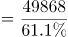亿元，同比增速=15.2%-1.9%=13.3%。根据公式：基期量，则2019年全行业实现收入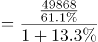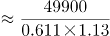亿元=7.2万亿元。

故正确答案为A。

**考点**：文字资料、基期计算

**来源**：2022年浙江省公务员录用考试《行测》题（C类）（网友回忆版）第77题

### 第 109 题

与2019年相比，2020年占全行业收入比重上升的是：

A. 软件产品

B. 信息技术服务

C. 信息安全产品和服务

D. 嵌入式系统软件

第 109 题 · 答案与解析

**参考答案（粉笔题库参考内容）**

B

**解析**

根据题干“与2019年相比，2020年占全行业收入比重上升的是”，可判定本题为两期比重问题。定位材料第二段至第五段可得：2020年，软件产品、信息技术服务、信息安全产品和服务、嵌入式系统软件实现收入分别同比增长10.1%、15.2%、10.0%、12.0%。定位材料第三段“2020年，信息技术服务实现收入49868亿元，同比增长15.2%，增速高出全行业平均水平1.9个百分点，”则2020年全行业收入同比增速=15.2%-1.9%=13.3%。根据两期比重比较结论：部分增长率＞整体增长率，比重上升。观察可知，只有信息技术服务收入同比增速（15.2%）＞全行业收入同比增速（13.3%），即与2019年相比，2020年占全行业收入比重上升的是信息技术服务。

故正确答案为B。

备注：由于题目为单选题，在考场上可直接根据第三段中“2020年，信息技术服务实现收入······增速高出全行业平均水平······”，秒选B项。

**考点**：文字资料、两期比重

**来源**：2022年浙江省公务员录用考试《行测》题（C类）（网友回忆版）第78题

### 第 110 题

下列选项不能从上述资料推出的是：

A. 2019年信息安全产品和服务实现收入约为1361.8亿元

B. 2019年信息安全产品和服务占全行业收入比重最低

C. 2020年信息安全产品和服务占全行业收入比重为2.8%

D. 2019年信息技术服务收入占全行业收入比重低于61.1%

第 110 题 · 答案与解析

**参考答案（粉笔题库参考内容）**

C

**解析**

A项：定位文字材料第四段可得：2020年，信息安全产品和服务实现收入1498亿元，同比增长10.0%。根据公式：基期量，则2019年信息安全产品和服务实现收入为亿元，正确；

B项：定位文字材料可知2020年软件产品、信息技术服务、信息安全产品和服务、嵌入式系统软件的实现收入及同比增长率。根据公式：比重，整体量一致，比较比重的大小，只需比较部分量的大小即可。根据公式：基期量，则2019年软件产品、信息技术服务、信息安全产品和服务、嵌入式系统软件的实现收入分别为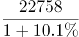亿元、亿元、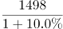亿元、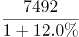亿元。分母（1+增长率）相差不大，现期量最小的是信息安全产品和服务，则其基期量最小，占全行业收入比重最低，正确；

C项：定位文字材料第一段可知：软件产品、信息技术服务、信息安全产品和服务、嵌入式系统软件四大业务形态构成我国软件和信息技术服务业。定位文字材料第二、三、五段可知2020年软件产品、信息技术服务、嵌入式系统软件实现收入占全行业收入的比重分别是27.9%、61.1%、9.2%。因此，2020年信息安全产品和服务占全行业收入比重为1-27.9%-61.1%-9.2%=1.8%，错误；

D项：定位文字材料第三段可得：2020年，信息技术服务实现收入同比增长15.2%，增速高出全行业平均水平1.9个百分点，占全行业收入比重为61.1%。根据两期比重比较口诀“部分增长率大于整体增长率，则比重上升”。部分增长率（15.2%）大于整体增长率（15.2%-1.9%），比重上升，即2019年信息技术服务收入占全行业收入比重低于61.1%，正确。

本题为选非题，故正确答案为C。

**考点**：文字资料、综合分析

**来源**：2022年浙江省公务员录用考试《行测》题（C类）（网友回忆版）第80题

## 材料 2

2020年末，全国共有艺术表演团体17581个，从业人员43.69万人，其中各级文化和旅游部门所属艺术表演团体2060个，从业人员10.75万人。2020年，全国文化和旅游部门所属艺术表演团体共组织政府采购公益演出13.38万场，比上年下降14.9%；观众0.86亿人次，下降27.9%。

### 第 111 题

2011~2020年中，全国艺术团体数同比增量超过2000个的年份有：

A. 1个

B. 2个

C. 3个

D. 4个

第 111 题 · 答案与解析

**参考答案（粉笔题库参考内容）**

B

**解析**

根据题干“2011~2020年中······同比增量超过2000个······”，可判定本题为增长量计算问题。定位表格材料可得：2011~2020年各年的全国艺术团体数依次为：7055个、7321个、8180个、8769个、10787个、12301个、15742个、17123个、17795个和17581个。根据公式：增长量=现期量-基期量，可得2012~2020年各年全国艺术团体数的同比增量，情况如下：

2012年的同比增量=7321-7055=266个<2000个；

2013年的同比增量=8180-7321=859个<2000个；

2014年的同比增量=8769-8180=589个<2000个；

2015年的同比增量=10787-8769=2018个>2000个；

2016年的同比增量=12301-10787=1514个<2000个；

2017年的同比增量=15742-12301=3441个>2000个；

2018年的同比增量=17123-15742=1381个<2000个；

2019年的同比增量=17795-17123=672个<2000个；

2020年的同比增量=17581-17795=-214个<2000个。

则2011~2020年中，全国艺术团体数同比增量超过2000个的年份有2015年和2017年，共2个。

故正确答案为B。

【备注】根据历年真题教研，本题问法也应计算2011年的增量。但由于题目数据不支持推出2011年增量，本题从2012年增量开始分析。

**考点**：增长量计算、综合资料

**来源**：2022年浙江省公务员录用考试《行测》题（C类）（网友回忆版）第66题

### 第 112 题

2020年，在全国艺术表演团体中，各级文化和旅游部门所属艺术表演团体从业人员占比约为：

A. 11.7%

B. 24.6%

C. 27.4%

D. 31.7%

第 112 题 · 答案与解析

**参考答案（粉笔题库参考内容）**

B

**解析**

根据题干“2020年，······占比约为”，可判定本题为现期比重问题。定位文字材料可得：2020年末，全国共有艺术表演团体从业人员43.69万人，其中各级文化和旅游部门所属艺术表演团体从业人员10.75万人。则2020年，在全国艺术表演团体中，各级文化和旅游部门所属艺术表演团体从业人员占比。

故正确答案为B。

**考点**：现期比重、综合资料

**来源**：2022年浙江省公务员录用考试《行测》题（C类）（网友回忆版）第67题

### 第 113 题

2019年全国艺术表演团体演出场次比2012年增长了：

A. 约80%

B. 约100%

C. 约120%

D. 约140%

第 113 题 · 答案与解析

**参考答案（粉笔题库参考内容）**

C

**解析**

根据题干“2019年······比2012年增长了”，结合选项为百分数，可判定本题为一般增长率问题。定位统计表可得：2012年、2019年全国艺术表演团体演出场次分别为135.02万场、296.80万场。根据公式：增长率，可得2019年全国艺术表演团体演出场次比2012年增长了，与C项最接近。

故正确答案为C。

**考点**：一般增长率、综合资料

**来源**：2022年浙江省公务员录用考试《行测》题（C类）（网友回忆版）第68题

### 第 114 题

以下折线图中，能准确反映2011~2020年国内演出观众人次变化的是：

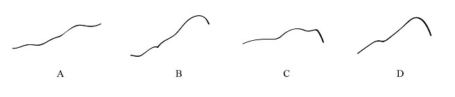

A. A

B. B

C. C

D. D

第 114 题 · 答案与解析

**参考答案（粉笔题库参考内容）**

C

**解析**

定位表格材料可得：2011年、2012年、2013年、2014年、2015年、2016年、2017年、2018年、2019年、2020年国内演出观众人次分别为：7.46亿人次、8.28亿人次、9.01亿人次、9.10亿人次、9.58亿人次、11.81亿人次、12.47亿人次、11.76亿人次、12.30亿人次、8.93亿人次，人次变化趋势为开始缓慢升高，排除B、D两项；最后下降，排除A项。

故正确答案为C。

**考点**：直接找数、综合资料

**来源**：2022年浙江省公务员录用考试《行测》题（C类）（网友回忆版）第69题

### 第 115 题

2011~2020年期间，全国艺术表演团体演出收入的年平均值：

A. 大于100亿元

B. 等于100亿元

C. 小于100亿元

D. 无法算出

第 115 题 · 答案与解析

**参考答案（粉笔题库参考内容）**

A

**解析**

根据题干“2011~2020年······的年平均值”，可判定本题为现期平均数问题。定位表格材料可得：2011~2020年全国艺术表演团体演出收入分别为52.67亿元、64.15亿元、82.07亿元、75.70亿元、93.93亿元、120.86亿元、147.68亿元、152.27亿元、126.78亿元、86.63亿元。根据选项的范围设置，利用“削峰填谷”，以100为基准，分别作差为：-47.33、-35.85、-17.93、-24.3、-6.07、20.86、47.68、52.27、26.78、-13.37，，即所求年平均值大于100亿元。

故正确答案为A。

**考点**：现期平均数、综合资料

**来源**：2022年内蒙古公务员录用考试《行测》题（网友回忆版）第115题

## 材料 3

### 第 116 题

假设2021年居民医保基金收入同比增速与2020年相同，那么，2021年居民医保基金收入约为：

A. 9598亿元

B. 9689亿元

C. 9727亿元

D. 9873亿元

第 116 题 · 答案与解析

**参考答案（粉笔题库参考内容）**

B

**解析**

根据题干“假设2021年······同比增速与2020年相同······2021年······约为”，结合材料时间为2012-2020年，可判定本题为现期计算问题。定位统计表可得：2019年居民医保基金支出和结余率分别为8191亿元和4.5%，2020年基金收入为9115亿元。根据结余率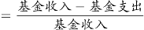，则有，解得2019年居民医保基金收入亿元（也可结合本篇材料第3题得出此数据）。根据公式：增长率、现期量=基期量×（1+增长率）。则2021年居民医保基金收入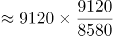亿元，与B项最接近。

故正确答案为B。

**考点**：现期计算、综合资料

**来源**：2022年浙江省公务员录用考试《行测》题（C类）（网友回忆版）第74题

### 第 117 题

2019年，职工医保参保人数共：

A. 30322万人

B. 31681万人

C. 32924万人

D. 34455万人

第 117 题 · 答案与解析

**参考答案（粉笔题库参考内容）**

C

**解析**

定位统计图可知，2019年在职职工医保参保人数为24224万人，退休职工医保参保人数为8700万人，则2019年职工医保参保人数为在职职工医保参保人数与退休职工医保参保人数之和：24224+8700=32924万人。

故正确答案为C。

**考点**：综合资料、简单加减计算

**来源**：2022年湖北省公务员录用考试《行测》题（网友回忆版）第117题

### 第 118 题

下列年份中，在职职工参保人数同比增速大小排序错误的是：

A. 2017年＞2016年

B. 2018年＞2017年

C. 2019年＞2018年

D. 2020年＞2019年

第 118 题 · 答案与解析

**参考答案（粉笔题库参考内容）**

C

**解析**

根据题干“······同比增速大小排序”，可判定本题为一般增长率问题。定位统计图可得2016-2020年在职职工参保人数，根据公式，增长率，代入公式可得2016-2020年在职职工参保人数同比增速分别为：，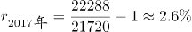，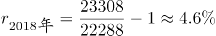，，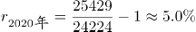。因此，2019年同比增速小于2018年同比增速，C项排序错误。

本题为选非题，故正确答案为C。

**考点**：一般增长率、综合资料

**来源**：2022年浙江省公务员录用考试《行测》题（C类）（网友回忆版）第72题

### 第 119 题

表中（？）处应填入的数字是：

A. 7822

B. 8559

C. 8577

D. 8898

第 119 题 · 答案与解析

**参考答案（粉笔题库参考内容）**

C

**解析**

表中“？”为2019年基金收入，结合材料给出2019年基金支出以及结余率，可判定本题为现期比重问题。定位统计表，2019年基金支出为8191亿元，结余率为4.5%。根据公式结余率，将数据代入公式可得，则基金收入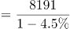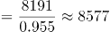，与C项最接近。

故正确答案为C。

**考点**：现期比重、综合资料

**来源**：2022年浙江省公务员录用考试《行测》题（C类）（网友回忆版）第73题

### 第 120 题

能够从上述资料中推出的有：

①2017年职工医保在职退休比高于2016年

②2020年居民医保参保人数比上年略有增加

③2012—2020年间，职工医保参保人数持续增加

④2012—2020年间，居民医保基金支出增长金额最快的是2017年

A. 1

B. 2

C. 3

D. 4

第 120 题 · 答案与解析

**参考答案（粉笔题库参考内容）**

B

**解析**

①：定位统计图可得：2017年职工医保在职退休比相较于2016年有所下降，故2017年退休比＜2016年退休比，错误；

②：材料所给数据均为职工医保参保人数，未出现居民医保参保人数相关数据，故无法推出，错误；

③：定位统计图可得：在职职工参保人数和退休职工参保人数2012年-2020年每年均在增加，故职工医保参保总人数也持续增加，正确；

④：定位统计表可得2012-2020年的数据，根据公式：增长率，

2013年，；

2014年，；

2015年，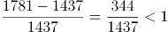；

2016年，；

2017年，；

2018年，；

2019年，；

2020年，基金支出较上年下降，增长率<0。故2017年增速最快，正确；

综上所述，只有③④正确，共2项。

故正确答案为B。

【备注】根据历年真题教研，对于④的问法，如果材料有2011年数据，需要计算2012年的增速，但如果材料没有2011年的数据，则不用计算。因此判定④正确。

**考点**：综合分析、综合资料

**来源**：2022年浙江省公务员录用考试《行测》题（C类）（网友回忆版）第75题

