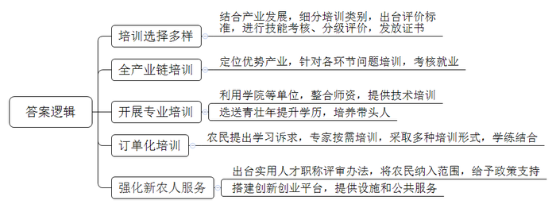
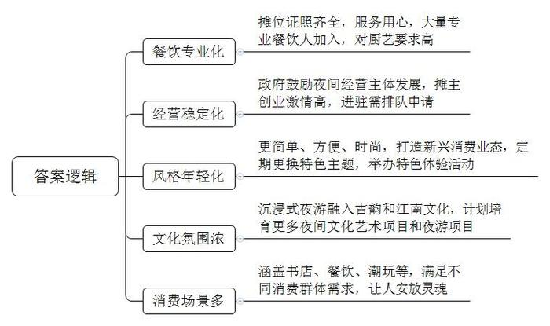
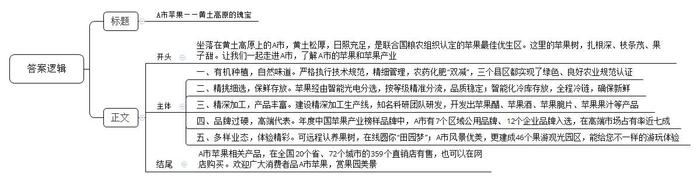
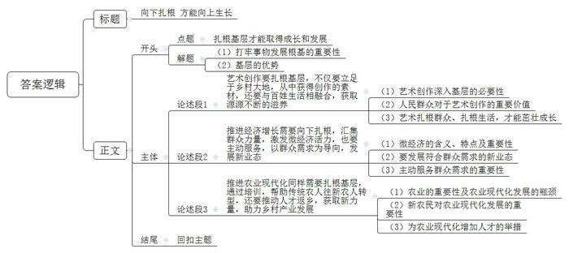

# 2023年公务员多省联考《申论》题（内蒙古旗县卷）

<!-- gwy:overview:start -->
> **内蒙古 · 2023 · 申论 · 县级卷** ｜ 4 题 · 图片 4 处 · 答案随题折叠

导航：[题目](#题目)
<!-- gwy:overview:end -->

> 候选采集稿。参考答案及解析来自粉笔页面，不代表官方答案或真实高分答卷；来源使用许可与原卷对应关系仍需人工核实。

## 给定材料

### 材料 material-027588c4a27318a5

在S省数字农业人才培训基地直播间里，61岁的老农民“八哥”操着乡音，对着手机屏幕介绍着当地的黄花。“八哥”在现实生活中被唤作“老陈”，是古家庄乡的农民，因对短视频直播有兴趣，就报名参加了当地的数字新农人直播培训班。拿到技能证书的“八哥”和老伴一起直播分享农家生活，销售小米、黄花等土特产，一年能挣十五六万元。

近年来，S省实施“人人持证、技能社会”工程，大量传统农人通过培训、考核，掌握了一技之长，成为“新农人”。D市结合当地产业发展、考虑农民兴趣诉求、调研市场情况，把培养目标分为农业经理人、返乡下乡创新创业者、新型农业经营与服务主体、种养加技术能手等类别。还先后出台20多个技能评价的地方标准，对参训农民进行技能考核与分级评价。不同的培训项目，不同的课程内容和培训时长，高、中、初三个等级的证书，为广大农民提供了多元选择。

S省农业发展的一个突破口在“特”与“优”，不同地方根据地域特色，逐步形成优势产业，比如Z市聚焦小杂粮、菌类种植，C市重点发展药茶、红枣产业等。老陈所在的D市高素质农民培训学院就依托园区企业，针对黄花种植、采摘、加工、物流等全产业链问题展开培训，农民考核通过后可直接进入相关企业工作。

X市的郝大姐曾是贫困户，在参加培训班后，学会了木耳吊袋种植方式。如今，她办起了合作社，年收入过百万，带动几十户村民就业。她说：“没有政策的支持和老师们的帮助，我走不到今天。”X市利用专门学院、县乡级合作社等单位，整合农科院所学者、农业部门农技专家等师资，对农民进行培训，还选送一批农村青壮年到涉农大中专院校参加大中专学历教育。青年农民创业者卫东在取得技能证书后，经常回培训班交流经验，还积极尝试学到的新种植方法，带动了不少人增收致富。

“我们坚持‘缺失补什么’，采取‘订单式’‘菜单式’模式，实现‘农民下单、专家配菜'，通过课堂教学、实习实践、线上培训、跟踪辅导等形式，让农民在学中干、在干中学。”S省农业农村厅科教处许处长说，“无论是专业教师还是身边榜样，都是培养高素质农民的‘好老师’，都是可以动员起来的力量。”

S省出台了农村实用人才职称评审办法，将农民作为一项职业纳入职称评定范围，并在项目扶持、资金贷款、培训、招聘等方面享受倾斜支持。“农民可以评职称，我们感觉特自豪，干劲儿更足了。”刚获得中级职称的水稻种植大户老田说起这个还很兴奋。

5年前，T市龙湖镇的方明从IT行业转战农村。多年的农业创业经历，让他感受到了新农人的不易。“做农业，投入大，回本慢，招人用工遇到困难，更是家常便饭。”T市的“星创天地”应运而生，这个半公益性质的农业孵化器，通过资源整合，面向入驻新农人，提供现代农机作业、技能培训、用工推荐、商业资源对接等服务，几年时间见证了不少项目从雏形成长为营业额超千万元的“潜力股”。

“我们以培育省级农村创新创业园区和孵化实训基地为抓手，搭建返乡下乡在乡人员创新创业平台，为新农人创新创业提供完备的基础设施和更高效交易便捷的公共服务。”省农业农村厅詹处长说，截至2022年，全省已培育省级以上农村创新创业园区（基地）184个。

### 材料 material-deded49ac6ea80f6

2019年，国务院办公厅印发的《关于加快发展流通促进商业消费的意见》明确提出，要活跃夜间商业和市场。过去几年间，夜间经济正在成为各地深挖消费潜力的重要战场之一。

夜幕降临的M市春和夜市热气腾腾，熙熙攘攘。“香脆鲜美，别处没有，欢迎品尝！”张文彬一边忙碌一边吆喝。一车两人，卫生许可证、健康证、营业执照一应俱全。去年，张文彬瞄准“车尾箱经济”崛起时机，从养殖场进货，做起了炸蚂蚱、炸金蝉子生意。“服务嘴的时候，要用心，含糊不得。夜市虽然是地摊生意，但现在有很多专业做餐饮的人进来了，你看那边，大饭店的大厨都到夜市做锅包肉和拔丝地瓜了，这就对厨艺有了更高要求，不是任何人都能随便干的。”张文彬认为，这对夜市的发展是好事，可以打造更专业的夜市餐饮。

往前走几步，是一家榴莲摊。摊主是一家三口，女主人小廖之前一直做社区团购，主要做线上。“市里鼓励夜间经营主体发展，点燃了大家的创业激情，现在外面还有很多摊主在排队申请进驻夜市，基本每天都有人来打听。”小廖说，夜市让她找到了“栖息地”。对于为什么选择全职摆地摊？小廖表示：“我就是想把榴莲做好，前期找货源、做推广、攒客户，将来开一家属于自己的店。地摊不是苟且，是对生活的不妥协。摆地摊也是一种生活态度，我享受这个过程。”

“白天上班比较累，下班后就想到风景好的夜市逛一逛，唱唱歌，放松一下。”31岁的音乐教培老师小余在夜市认识了不少有趣的朋友，他们经常在一起排练、聊天、运动。

“车尾箱市集”负责人王斐说：“车尾箱市集改变了以往脚踩三轮车摆摊的传统做法，以简单、方便、时尚的特点，迎合当下年轻人的审美，他们觉得这样子很酷。”

九坊是M市近年来着力打造的“不夜经济区”。时尚、潮流、炫酷的餐饮、主题酒吧、文化娱乐等新兴消费业态招来了大批的年轻人。“为了吸引年轻人，每次均以潮流夜市为风向标，按照特定主题举办，刺激周边夜经济发展。”中心广场发展有限公司招商运营部负责人曹梦说，“接下来，这里还将举办夜间露营等特色体验活动，我们要把这里建成夜间消费的地标。以前基础设施老化、业态布局单一，来的基本都是本地市民，改造之后，凭借独特风格和爆棚人气成了外地游客必打卡景点。”

2022年8月，M市“奇妙夜·寻梦游”沉浸式夜游开放首日，千余游客入园游览，在移步换景中感受古韵的盛世繁华。伴以夜间演艺活动，抚琴、唱曲、品茶、游船，让“宾客”真实感受江南文化。M市还将引进培育沉浸式话剧、音乐剧、歌舞剧等夜间文化艺术项目，积极开发西江夜游、博物馆夜游等多元化都市夜游项目。

走进书店，行走在书架间，能听到轻缓的脚步声和沙沙的翻书声。阅读区座无虚席，儿童区不时传来轻轻的孩童笑声。特色餐饮区汇聚了天南地北的名菜，空中花园则是推杯换盏的好去处。伴随流淌的音乐，喝上几杯甘醇的啤酒，夏日暑气瞬间消失不见。潮玩俱乐部、健身馆、茶馆、售卖“阅读时间”的夜间图书馆……多元夜间消费场景自如切换，烟火生香，人来人往。“现在的夜市更像是工作了一天，可以褪去一身倦怠的安乐窝，城市中的灵魂安放处。”正和朋友一起逛街的小唐说。

### 材料 material-4efc40ff68a29069

又是一年丰收季，又见苹果压枝低。坐落在黄土高原上的A市南洞沟村大青山山顶的标准化果园像一个集市，前来采摘苹果的游客、拉运苹果的快递车辆往来不断。果园的主人老马热情地招呼着客人：“随便吃，满意了再买。咱这儿黄土松厚，日头照得久，树苗扎得深，枝条开得茂，果子结得甜，是联合国粮农组织认定的苹果最佳优生区之一，最适合种苹果。”

作为一名有着丰富经验的果农，老马始终坚信“一分钱一分货”。五年前他流转了村集体72亩平整的山地，建起高标准苹果示范园。“在市、区果业部门技术员的指导下，我家的新果园完全按照黄土高原无支架密植高效栽培模式精细化管理，全部使用有机肥。尽管成本大，但效益更高。过去苹果论堆卖，现在按个卖，每个苹果价格在10元以上，最高卖到15元。”

A市果业中心陆主任介绍，苹果是A市广大农民增收致富的主导产业。经过不断探索实践，A市制定了《苹果标准综合体》等33个技术规范，大力推广无支架密植高效栽培为主要模式的18项主推技术，全面实施农药化肥“双减”行动，全市建成绿色、有机、良好农业等苹果种植基地192.5万亩，打造高质高效果园65个。三个县区实现了整县区绿色、良好农业规范认证。

顶茂果业科技有限公司生产线上，智能光电分选机里，闪光灯闪烁，一个果子留下数十张“X光片”。外观、果型、色泽、糖酸比……数据实时分析，苹果按等级精准分流到16条通道。“过去拿圈套、靠眼看，如今大数据自动识别，每小时能分拣4吨果，卖到了全国380多座城市。”公司销售主管赵锋笑呵呵地说。在公司的冷链冷藏基地，赵主管介绍：“果子过去储地窖，现在住进智能化冷库，全程冷链以保证苹果的新鲜度。还可以错峰销售，能比一般行情价高出1块多，一亩相当于多种半亩树。”

长期以来苹果采摘后，分选、储藏、运输、销售等方面都是粗放式经营。2017年，A市创新提出全面推进“苹果产业后整理”战略的重大举措。“全市把建设智能选果线和冷气库作为推进苹果产业后整理的重要抓手，加大政策资金支持力度，加快推进产业转型升级。”陆主任说，“截至目前，全市90家龙头企业装备智能选果线105条，占全省的61.8%，小时选果能力355吨以上；3000吨以上冷气库企业54家，带动全市冷气库贮能从2016年的80.1万吨增加到158.8万吨，增长98.3%。A市苹果采后装备水平全省第一、全国领先。”

“清洗、削皮、高温烘焙，普通果变脆片，身价能涨近10倍。精深加工生产线上，苹果化身为苹果醋、苹果酒、苹果脆片等产品。”某农产品有限责任公司李总经理说。作为“市级农业产业化龙头企业”，公司以“高起点、高标准、严要求”定位，建成3000亩有机苹果种植基地。为了延长产业链，进一步提高苹果附加值，2018年，公司委托知名科研团队，研发出“果红”果汁饮料，年可消耗非商品苹果2000多吨，生产饮料500余吨，销售收入1200余万元。

“苹果世家”出身的赵勇，大学毕业后决定子承父业。2019年，他经过多方考察，立足家乡苹果优势区域，注册成立了赵掌柜农业发展有限公司，全面开展苹果收购、冷藏仓储、预选分级、加工包装、外贸出口、市场批发、电商平台等全产业链业务。赵勇说，公司严格保持“赵掌柜”苹果的个性化特色，即生产管理标准化、采前检测无残化、现代仓储智能化、冷链运输全程化、对标销售精准化、售后保证追溯化，力争每一个苹果都使消费者满意。坚持“诚信为本、品质为上”的发展理念，“赵掌柜”的品牌影响力与日俱增，获得“2021年度中国十大苹果品牌”等多个荣誉称号，入选中国苹果产业榜样企业品牌。

在推进苹果产业高质量发展进程中，A市加快构建“区域品牌+企业品牌”体系，2021年，7个苹果区域公用品牌、12个企业品牌入选年度中国苹果产业榜样品牌。建立线上线下融合发展的营销格局，在全国20个省、72个城市建设直销店359个。通过“南果北上、北果南下”产销对接活动，2021年，A市苹果在高端市场占有率达68%。

从当厨师到拍视频，高阳村村民方永亮返乡创业，举起手机拍视频。苹果搭上了互联网，一年能销售几十万斤。电商、生态农业、休闲农业……苹果园长出新业态。认养果树，定期直播，成了农家新潮。“我们村不仅卖果子，还卖风景、卖体验，乡村振兴的产业链越拉越长。”高阳村驻村干部张光良说。目前A市有电商企业549家，各类网店、微店2.25万个，开展果树认养26.97万株，建成果游观光园区46个，年吸引游客170万人次。

## 题目

### 第 1 题

**请根据****“给定资料**1**”，概括S省在帮扶“新农人”工作中的主要做法。（20分）**

关联材料：材料 material-027588c4a27318a5

作答要求：

要求：全面、准确、有条理，不超过250字。

第 1 题 · 答案与解析

**参考答案（粉笔题库参考内容）**

1.培训选择多样。结合产业发展，细分培训类别，出台评价标准，进行技能考核、分级评价，发放证书。

2.全产业链培训。定位优势产业，针对各环节问题培训，考核就业。

3.开展专业培训。利用学院等单位，整合师资，提供技术培训；选送青壮年提升学历，培养带头人。

4.订单化培训。农民提出学习诉求，专家按需培训，采取多种培训形式，学练结合。

5.强化新农人服务。出台实用人才职称评审办法，将农民纳入范围，给予政策支持；搭建创新创业平台，提供设施和公共服务。

**解析**

**参考答案说明**：本参考答案从“培训选择多样”“全产业链培训”“开展专业培训”“订单化培训”“强化新农人服务”五个方面展开，各条答案要点之间在内容上相互并列，没有交叉。

**考点**：考点概括措施类

**来源**：来源2023年公务员多省联考《申论》题（内蒙古旗县卷）

粉笔申论页面对本题只提供「解析视频」入口，该入口是会员推广位，页面无视频地址与文字解析。

### 第 2 题

**请根据****“给定资料**2**”，谈谈M市夜市有哪些特点。（15分）**

关联材料：材料 material-deded49ac6ea80f6

作答要求：

要求：全面、准确、有条理，不超过200字。

第 2 题 · 答案与解析

**参考答案（粉笔题库参考内容）**

1.餐饮专业化。摊位证照齐全，服务用心，大量专业餐饮人加入，对厨艺要求高。

2.经营稳定化。政府鼓励夜间经营主体发展，摊主创业激情高，进驻需排队申请。

3.风格年轻化。更简单、方便、时尚，打造新兴消费业态，定期更换特色主题，举办特色体验活动。

4.文化氛围浓。沉浸式夜游融入古韵和江南文化，计划培育更多夜间文化艺术项目和夜游项目。

5.消费场景多。涵盖书店、餐饮、潮玩等，满足不同消费群体需求，让人安放灵魂。

**解析**

**参考答案说明：**本答案分别从“餐饮专业化”“经营稳定化”“风格年轻化”“文化氛围浓”“消费场景多”这五个方面的特点展开，各条答案要点之间在内容上相互并列，没有交叉。

**考点**：考点特点类

**来源**：来源2023年公务员多省联考《申论》题（内蒙古旗县卷）

粉笔申论页面对本题只提供「解析视频」入口，该入口是会员推广位，页面无视频地址与文字解析。

### 第 3 题

**假设****A市要在国家级媒体上发布一则三分钟的视频，推介该市的苹果以及相关产品，请根据“给定资料**3**”，为该视频撰写一则推介稿。（25分）**

关联材料：材料 material-4efc40ff68a29069

作答要求：

要求：联系资料，内容全面，条理清晰，语言生动；不超过500字。

第 3 题 · 答案与解析

**参考答案（粉笔题库参考内容）**

A市苹果——黄土高原的瑰宝

坐落在黄土高原上的A市，黄土松厚，日照充足，是联合国粮农组织认定的苹果最佳优生区。这里的苹果树，扎根深、枝条茂、果子甜。让我们一起走进A市，了解A市的苹果和苹果产业。

一、有机种植，自然味道。严格执行技术规范，精细管理，农药化肥“双减”，三个县区都实现了绿色、良好农业规范认证。二、精挑细选，保鲜存放。苹果经由智能光电分选，按等级精准分流，品质稳定；智能化冷库存放，全程冷链，确保新鲜。三、精深加工，产品丰富。建设精深加工生产线，知名科研团队研发，开发出苹果醋、苹果酒、苹果脆片、苹果果汁等产品。四、品牌过硬，高端代表。年度中国苹果产业榜样品牌中，A市有7个区域公用品牌、12个企业品牌入选，在高端市场占有率近七成。五、多样业态，体验精彩。可远程认养果树，在线圆你“田园梦”；A市风景优美，更建成46个果游观光园区，能给您不一样的游玩体验。

A市苹果相关产品，在全国20个省、72个城市的359个直销店有售，也可以在网店购买。欢迎广大消费者品A市苹果，赏果园美景。

**解析**

**参考答案说明：**（1）格式方面，本参考答案写到了“标题”“正文”这两个部分。（2）正文部分，一方面从内容上来看，答案的开头先写到了苹果的生长环境以及A市苹果的特点；主体从“有机种植，自然味道”“精挑细选，保鲜存放”“精深加工，产品丰富”“品牌过硬，高端代表”“多样业态，体验精彩”五个方面具体介绍了本市苹果产业的优势；结尾发出邀请。另一方面，形式上，本参考答案做到了分段、分层撰写，整体上条理较为清晰。

**考点**：考点宣传类

**来源**：来源2023年公务员多省联考《申论》题（内蒙古旗县卷）

粉笔申论页面对本题只提供「解析视频」入口，该入口是会员推广位，页面无视频地址与文字解析。

### 第 4 题

**请深入思考****“给定资料**4**”中肖教授说的一段话，结合你对这段话的理解，联系实际，自拟题目，自选角度，写一篇文章。（40分）**

关联材料：材料 material-027588c4a27318a5

作答要求：

要求：

（1）观点明确，见解深刻；

（2）根据给定资料，但不拘泥于给定资料；

（3）思路清晰，语言流畅；

（4）字数1000-1200字。

第 4 题 · 答案与解析

**参考答案（粉笔题库参考内容）**

**向下扎根 方能向上生长**

根深才能叶茂，本固方可枝荣。事物的发展需打牢根基，才能持续向上生长，无论是艺术创作，还是经济发展，亦或是农业发展，各项事业都是如此。最丰富的养分，最肥沃的厚土，依然在广大基层地区，在广大的人民群众中。

**艺术创作要扎根基层，不仅要立足于乡村大地，从中获得创作的素材，还要与百姓生活相融合，获取源源不断的滋养。**习总书记在文艺工作座谈会上强调：“文艺是时代前进的号角，最能代表一个时代的风貌。”而要想创作出无愧于时代的艺术作品，就必须深入基层，在广袤的乡村大地上，从丰富而鲜活的乡土文化中，汲取灵感、寻找素材。同时，人民群众是艺术创作的源头活水，只有从百姓的伟大实践和丰富多彩的生活中汲取营养，才能让艺术创作百花竞放，繁荣发展。正如总书记所说，艺术可以放飞想象的翅膀，但一定要脚踩坚实的大地。只有扎根群众、扎根生活，艺术才能打牢根基，茁壮成长。

艺术创作的不竭动力来自群众，来自基层，而这种力量也是推动经济发展的灯塔，更是推进农业现代化的引擎。

**推进****经济增长****需要向下扎根，汇集群众****力量，激发****微****经济活力****，也要主动服务，以群众****需求****为导向，****发展新业态****。**与传统大企业相比，微经济是指小规模企业和个体户的经济活动。微经济以其灵活性、创新性和高效性而闻名。正如老子所言：“合抱之木，生于毫末。”只有充分发挥和运用微经济的力量，才能为经济增长注入新的活力。与此同时，在推进经济增长的过程中，我们不能仅仅依赖传统的产业和经济模式，应积极发展符合群众需求和市场潜力的新兴产业和业态。只有主动服务群众的需求，才能真正提高人民的生活水平和生活质量，实现经济的可持续发展。

**推进农业现代化同样需要扎根基层，通过培训，帮助传统农人往新农人转型，还要推动人才返乡，获取新力量，助力乡村产业发展。**农业是国民经济的基础，但随着工业化、城镇化快速而深入地推进，农村人力资源向非农产业和城市大量转移，成为农业现代化发展的最大瓶颈。如果没有专业化的新农民，农业现代化便是无源之水、无本之木。必须要把人力资本开发放在首要位置。一方面要实施新型职业农民培育工程，就地培育一批具有专业技能的“土专家”“田秀才”；另一方面，筑巢引凤，从政策上对农村优秀人才回引提供支持和引领，为人才培育成长的“沃土”，给现代农业注入新鲜血液。

江河万里有源，树高千尺有根，无论时事如何变迁，只要我们与群众紧密相连，我们的各项事业就能扎牢根基，获取源源不断的向上力量，迎来满目繁华！

**解析**

**文章分析**

**向下扎根** **方能向上生长**

【**标题的优点：**标题中含有主题词，使文章主题更突出、清晰。】

（1）根深才能叶茂，本固方可枝荣。事物的发展需打牢根基，才能持续向上生长，无论是艺术创作，还是经济发展，亦或是农业发展，各项事业都是如此。（2）最丰富的养分，最肥沃的厚土，依然在广大基层地区，在广大的人民群众中。

【**开头的优点：**★内容方面。范文的开头是紧扣“扎根基层才能取得成长和发展”这一主题展开的。首先，开头点出主题，做到了主题明确。其次，对“扎根基层才能取得成长和发展”这一主题进行了分析阐述，指出了（1）打牢事物发展根基的重要性。（2）基层的优势。★文字表达方面。使用了“是……还是……亦或是……”等关联词，使语言表达有逻辑性。】

**艺术创作要扎根基层，不仅要立足于乡村大地，从中获得创作的素材，还要与百姓生活相融合，获取源源不断的滋养**。（1）习总书记在文艺工作座谈会上强调：“文艺是时代前进的号角，最能代表一个时代的风貌。”而要想创作出无愧于时代的艺术作品，就必须深入基层，在广袤的乡村大地上，从丰富而鲜活的乡土文化中，汲取灵感，寻找素材。（2）同时，人民群众是艺术创作的源头活水，只有从百姓的伟大实践和丰富多彩的生活中汲取营养，才能让艺术创作百花竞放，繁荣发展。（3）正如总书记所说，艺术可以放飞想象的翅膀，但一定要脚踩坚实的大地。只有扎根群众、扎根生活，艺术才能打牢根基，茁壮成长。

【**论述段****1的优点：**★观点句：范文的观点句是紧扣“扎根基层才能取得成长和发展”这一文章主题提出的。形式上，它在段首处直接写出，位置突出，容易发现。内容上，关键词突出，内容要点明确，可以明显看出是从“艺术创作”的角度展开论述。★论述内容：（1）先介绍了艺术创作深入基层的必要性；（2）接着介绍了人民群众对于艺术创作的重要价值；（3）最后强调艺术扎根群众、扎根生活，才能茁壮成长。注意：以上三个方面的内容都是紧扣“艺术创作要扎根基层，不仅要立足于乡村大地，从中获得创作的素材，还要与百姓生活相融合，获取源源不断的滋养”这个观点句进行分析论述的，论述的针对性强，内容层次丰富。在论述方法上主要采用了讲道理的方式，论述清晰透彻。】

艺术创作的不竭动力来自群众，来自基层，而这种力量也是推动经济发展的灯塔，更是推进农业现代化的引擎。

【**过渡段的优点**：范文的过渡段分析了扎根群众、扎根基层对于艺术创作的重要性，同时指出扎根群众、扎根基层对于社会治理以及推进农业现代化也同样重要，起到承上启下的作用。】

**推进经济增长需要向下扎根，汇集群众力量，激发微经济活力，也要主动服务，以群众需求为导向，发展新业态**。（1）与传统大企业相比，微经济是指小规模企业和个体户的经济活动。微经济以其灵活性、创新性和高效性而闻名。正如老子所言：“合抱之木，生于毫末。”只有充分发挥和运用微经济的力量，才能为经济增长注入新的活力。（2）与此同时，在推进经济增长的过程中，我们不能仅仅依赖传统的产业和经济模式，应积极发展符合群众需求和市场潜力的新兴产业和业态。（3）只有主动服务群众的需求，才能真正提高人民的生活水平和生活质量，实现经济的可持续发展。

【**论述段****2的优点：**★观点句：范文的观点句是紧扣“扎根基层才能取得成长和发展”这一文章主题提出的。形式上，它在段首处直接写出，位置突出，容易发现。内容上，关键词突出，内容要点明确，可以明显看出是从“经济增长”的角度展开论述。★论述内容：（1）先介绍了微经济的含义、特点及重要性；（2）接着指出了要发展符合群众需求的新业态；（3）最后介绍了主动服务群众需求的重要性。注意：以上三个方面的内容都是紧扣“推进经济增长需要向下扎根，汇集群众力量，激发微经济活力，也要主动服务，以群众需求为导向，发展新业态”这个观点句进行分析论述的，论述的针对性强，内容层次丰富。在论述方法上主要采用了讲道理的方式，论述清晰透彻。】

**推进农业现代化同样需要扎根基层，通过培训，帮助传统农人往新农人转型，还要推动人才返乡，获取新力量，助力乡村产业发展**。（1）农业是国民经济的基础，但随着工业化、城镇化快速而深入地推进，农村人力资源向非农产业和城市大量转移，成为农业现代化发展的最大瓶颈。（2）如果没有专业化的新农民，农业现代化便是无源之水，无本之木。（3）必须要把人力资本开发放在首要位置。一方面要实施新型职业农民培育工程，就地培育一批具有专业技能的“土专家”“田秀才”；另一方面，筑巢引凤，从政策上对农村优秀人才回引提供支持和引领，为人才培育成长的“沃土”，给现代农业注入新鲜血液。

【**论述段****3的优点：**★观点句：范文的观点句是紧扣“扎根基层才能取得成长和发展”这一文章主题提出的。形式上，它在段首处直接写出，位置突出，容易发现。内容上，关键词突出，内容要点明确，可以明显看出是从“农业现代化”的角度展开论述。★论述内容：（1）先介绍了农业的重要性及农业现代化发展的瓶颈；（2）接着介绍了新农民对农业现代化发展的重要性；（3）最后介绍了为农业现代化增加人才的举措。注意：以上三个方面的内容都是紧扣“推进农业现代化同样需要扎根基层，通过培训，帮助传统农人往新农人转型，还要推动人才返乡，获取新力量，助力乡村产业发展”这个观点句进行分析论述的，论述的针对性强，内容层次丰富。在论述方法上主要采用了讲道理的方式，论述清晰透彻。】

【**论述段之间的关系：**三个论述段分别从“艺术创作”“社会治理”“农业现代化”的角度，对文章主题“扎根基层才能取得成长和发展”展开了论述，彼此之间呈现出并列的逻辑。】

江河万里有源，树高千尺有根，无论时事如何变迁，只要我们与群众紧密相连，我们的各项事业就能扎牢根基，获取源源不断的向上力量，迎来满目繁华！

【**结尾的优点：**范文的结尾回扣了“扎根基层才能取得成长和发展”这个主题，并且进行了总结升华。】

**考点**：考点文章写作题

**来源**：来源2023年公务员多省联考《申论》题（内蒙古旗县卷）

粉笔申论页面对本题只提供「解析视频」入口，该入口是会员推广位，页面无视频地址与文字解析。

